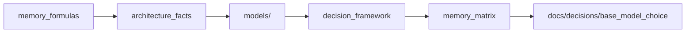

# **Stage 01: Base-Model Selection**

*Date: 28 Nov 2026. Nothing is trained here. The only output is a decision record that picks one base model and defends it on capability, license, memory footprint and tooling support.*

## **1. The Rule**

Pick one tier A model for fast loops and one tier B model as the real target.

| tier | memory | platform GPU |
|---|---|---|
| A | 8 to 12 GB | 16 GB T4 |
| B | 22 to 24 GB | 24 GB L4, 22.49 GiB usable |
| C | 40 to 80 GB | L40S, A100, H100 |
| D | rack | serve only |

## **2. Reading Order**

## **3. Folder Map**

| path | what it holds | state |
|---|---|---|
| `models/` | one note per family and `serve_only.md` | done |
| `vram_planning/` | `memory_formulas.md`, `memory_matrix.md`, `estimate_vram.py` | done |
| `architecture_facts.md`, `labs/architecture_facts.py` | architecture facts and script | done |
| `decision_framework.md` | gates, spare memory, capability noise | done |
| `configs/candidates.yaml` | candidate list with status | done |
| `results/` | `claims_log.md`, `leaderboard_snapshots.md` | leaderboard cells empty |
| `../docs/` | `model_matrix.md`, `licenses.md`, `decisions/base_model_choice.md` | decision is provisional |

## **4. Status**

The decision record is provisional. Close open items O1 to O7 in `results/claims_log.md`, then mark it final.