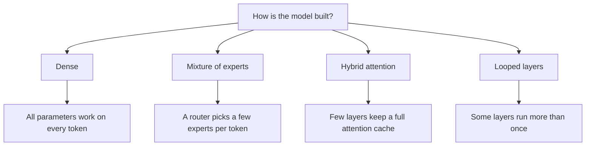
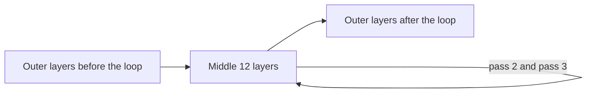

# **Architecture Facts**

**Date checked:** 28 Nov 2026

Four design choices change how much memory a model needs and how fast it runs: dense or mixture of experts, full or hybrid attention, and whether layers repeat. This note explains each one with a number you can check, so the model notes later in this stage can say what they mean in plain terms.

## **1. Dense Models**

A dense model uses every parameter for every token. Memory and compute both follow the same number, so the planning is simple.

| Model | Type | Parameters |
|---|---|---|
| Muse Glimmer | Dense | about 29.6B |

For a dense model, active parameters equal total parameters.

## **2. Mixture of Experts**

### **2.1 How it works**

Each layer holds many small expert blocks. A router picks a few of them for each token and the rest stay idle for that token.

| Fact for Inkling 2 Mini | Value |
|---|---|
| Experts per layer | 128 |
| Experts picked per token | 8 |
| Total parameters | 26.4B |
| Active parameters | about 3.4B |

### **2.2 Worked example: how much works per token**

| Step | Calculation | Result |
|---|---|---|
| 1. Share of experts picked | 8 / 128 | 6.25% |
| 2. Share of all parameters active | 3.4 / 26.4 | 12.9% |

$$
\boxed{\text{About 13\% of the stored parameters work on each token}}
$$

The second share is higher than the first because attention layers and other shared parts run for every token. Only the experts are picked.

### **2.3 What it means for memory and speed**

$$
\text{memory} \propto N_{\text{total}} \qquad \text{compute per token} \approx 2 \times N_{\text{active}}
$$

You pay for the whole model in memory but only for the active part in compute. Generation is fast for the size, and the memory bill is still the full 26.4B.

### **2.4 Fine tuning trap**

Experts are stored as 3D tensors. Stock transformers with bitsandbytes cannot train experts in 4 bit for that reason. Unsloth works around it for Inkling 2 Mini. This was not checked for Gemma 4 26B-A4B or the Qwen3.5 MoE models, so mark them as not checked until you test.

## **3. Looped Models**

### **3.1 How it works**

A looped model stores a block of layers once and runs it several times in a row. The stored weights stay small and the model still gets depth.

Inkling 2 Mini has 24 stored layers and the middle 12 run three times.

### **3.2 Worked example: layer passes**

| Step | Calculation | Result |
|---|---|---|
| 1. Layers run once | 24 − 12 | 12 passes |
| 2. Looped layers | 12 × 3 | 36 passes |
| 3. Total passes | 12 + 36 | 48 passes |

$$
\boxed{48\text{ layer passes from 24 stored layers}}
$$

### **3.3 Active parameters with loops**

Counting the loop passes, Inkling 2 Mini has about 5.4B active parameters instead of 3.4B. The model card says each extra pass adds about 1.0B, so 3.4B plus 2 times 1.0B gives 5.4B. The rest of the model runs once.

| Model | Active B | GFLOPs per token (2 × active) |
|---|---|---|
| Inkling 2 Mini, loops counted | 5.4 | 10.8 |
| Muse Glimmer, dense | 29.6 | 59.2 |

$$
\boxed{\text{Glimmer does about 5.5 times more work per token than Inkling 2 Mini}}
$$

### **3.4 Memory with loops**

Weights follow the stored layers, so the 26.4B weight formula from the memory formulas note still holds. During training the model keeps results from every pass for the backward step, so activation memory likely grows with the number of passes. Keep batch size 1 on tight cards.

## **4. Hybrid Attention**

### **4.1 The attention cache**

While generating, a model stores a key and a value for every token in every full attention layer. This cache grows with context length, and for long context it can matter as much as the weights.

$$
\text{cache (GB)} = \frac{2 \times L \times H_{kv} \times d \times T \times b}{10^9}
$$

L is layers with full attention, H_kv is key value heads, d is head size, T is tokens and b is bytes per value.

### **4.2 Worked example with generic numbers**

These numbers are made up for learning and do not describe a real model.

| Step | Calculation | Result |
|---|---|---|
| 1. Values per token | 2 × 32 × 8 × 128 | 65,536 |
| 2. Values for 32,768 tokens | 65,536 × 32,768 | 2.147 billion |
| 3. Bytes at bf16 | 2.147 billion × 2 | 4.29 GB |
| 4. Hybrid, 1 in 4 layers full | 4.29 × 0.25 | 1.07 GB |

$$
\boxed{4.29\text{ GB with full attention, 1.07 GB when only 1 in 4 layers keeps a full cache}}
$$

Hybrid models swap most full attention layers for cheaper ones. That is why they can offer long context. Two real layer mixes from this stage:

| Model | Layer mix | Full cache layers |
|---|---|---|
| Muse Glimmer | 52 layers, 3 sliding window layers then 1 global layer, 2 key value heads | 13 of 52 |
| Qwen3.8-27B | 64 layers, 3 gated DeltaNet layers then 1 gated attention layer | 16 of 64 |

Check each model card for its real layer mix before you plan memory.

## **5. Traps**

| Trap | What to do |
|---|---|
| Reading active parameters as memory | Use total parameters for memory |
| Reading 3.4B and 5.4B as a conflict | 3.4B is without loops, 5.4B counts loop passes |
| Assuming 4 bit expert training works everywhere | Test each MoE model, only Inkling is confirmed |
| Planning long context from weights alone | Add the attention cache |
| Forgetting loops raise training activations | Keep batch size 1 and watch peak memory |

## **6. Pre-flight Answers**

| Question | Answer |
|---|---|
| What sets memory for a MoE model? | Total parameters |
| What sets speed for a MoE model? | Active parameters |
| Do loops add weights? | No, they add compute and training activations |
| What does hybrid attention save? | Attention cache memory at long context |

