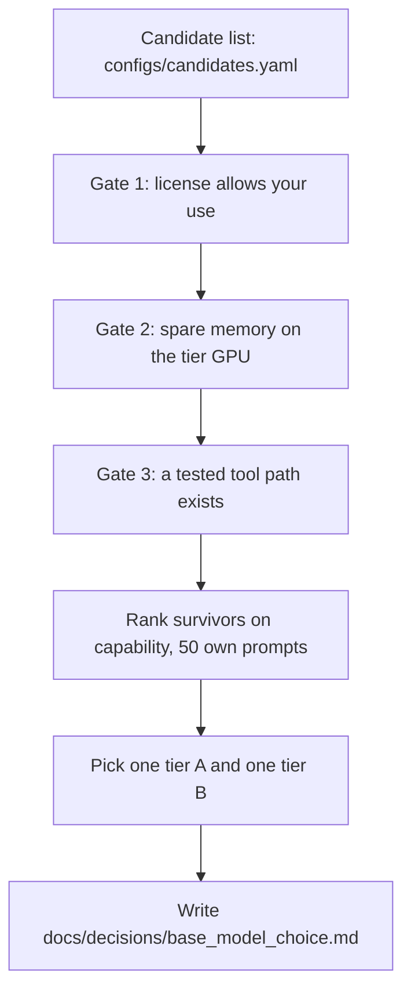

# **Decision Framework**

*Stage 01 Base-Model Selection. Date checked: 28 Nov 2026. Nothing is trained in this stage.*

## **1. What This Note Decides**

The rule from the roadmap is one tier A model for fast loops and one tier B model as the real target. This note gives the steps that turn the model notes into those two picks, so the decision record can defend them on four axes: capability, license, memory footprint and tooling support.

| **What you will learn** |
|---|
| How gates remove models before you compare them. |
| How to turn a vendor memory figure into spare room on your GPU, with a worked example. |
| How to tell a real capability gap from noise on a small test. |

## **2. The Steps**

| gate | pass rule | evidence | source of the rule |
|---|---|---|---|
| 1 License | Apache 2.0 or similar, and any extra policy read | model note, License section | your roadmap |
| 2 Memory | spare memory of at least 1.0 GiB at 1,024 tokens | model note, memory table | the 1.0 GiB margin is my illustrative choice |
| 3 Tooling | one documented path for QLoRA or LoRA | model note, fine tune path | your roadmap |

## **3. Spare Memory, Step by Step**

**Symbols.**

| symbol | read aloud | meaning |
|---|---|---|
| $P_{\text{GB}}$ | P in GB | memory figure quoted by a vendor, in decimal GB |
| $P$ | P | the same figure in GiB |
| $U$ | U | usable memory the GPU reports, in GiB |
| $S$ | S | spare memory, in GiB |

$$P = P_{\text{GB}} \times \frac{10^{9}}{2^{30}} = 0.9313 \, P_{\text{GB}} \qquad S = U - P$$

**What it says.** A GB is smaller than a GiB, and a GPU never gives you its full label size. Convert first, then subtract.

**Usable memory of the 24 GB tier.** The L4 reports 23,034 MiB in `nvidia-smi` (Docker docs and several lab guides), so:

$$U = \frac{23034}{1024} = \boxed{22.49 \text{ GiB}}$$

Consumer 24 GB cards report about 23.65 GiB in PyTorch errors (RTX 4090 and A5000 reports), so a benchmark taken on one of them leaves about 1.2 GiB more room than an L4 does.

**Worked example, reading A: the vendor figure is decimal GB.**

| step | Gemma 4 31B QLoRA | Qwen3.8 27B QLoRA |
|---|---|---|
| quoted need $P_{\text{GB}}$ | 22 | 24 |
| times 0.9313 gives $P$ | 20.49 | 22.35 |
| usable $U$ on L4 | 22.49 | 22.49 |
| spare $S = U - P$ | $\boxed{2.00}$ | $\boxed{0.14}$ |

**Reading B: the vendor figure is already GiB.**

| step | Gemma 4 31B | Qwen3.8 27B |
|---|---|---|
| $P$ | 22 | 24 |
| spare $S = 22.49 - P$ | $\boxed{0.49}$ | $\boxed{-1.51}$ |

The unit of the quoted figures is not recorded in the model notes, so both readings stay open. Measured peaks are in GiB and need no conversion:

| model | measured peak (GiB) | spare on L4 |
|---|---|---|
| Muse Glimmer 30B | 22.57 | $22.49 - 22.57 = \boxed{-0.08}$ |
| Inkling 2 Mini | 25.7 | $22.49 - 25.7 = \boxed{-3.21}$ |
| Gemma 4 12B (about 17, unit not recorded) | 17 | $\boxed{5.49}$ if GiB, $\boxed{6.66}$ if GB |

**Beginner trap.** Reading "fits 24 GB" as "fits the 24 GB tier". The tier GPU has 22.49 GiB.

## **4. Capability Without Noise**

You cannot afford a full benchmark run in this stage, so use 50 prompts from your own task and score each answer pass or fail. With pass rate $p$ and $n$ prompts, the standard error of one rate and of the gap between two models is:

$$\text{SE} = \sqrt{\frac{p(1-p)}{n}} \qquad \text{SE}_{\text{gap}} = \sqrt{2}\,\text{SE}$$

| step | value |
|---|---|
| $p$ | 0.60 |
| $n$ | 50 |
| $p(1-p)/n = 0.24/50$ | 0.0048 |
| SE | $\boxed{0.069}$ |
| SE of the gap | $\boxed{0.098}$ |

A gap under about two times 0.098, so 0.20, is noise. If two models land within 0.20 of each other, decide on memory and tooling. The 0.20 rule treats the two runs as independent, which is cautious, since both models see the same prompts.

## **5. Applying It to the Candidates**

| model | role | license gate | memory gate on the tier GPU | tool path | capability |
|---|---|---|---|---|---|
| Gemma 4 E4B | tier A | pass, Apache 2.0 | about 10 GB need, T4 usable memory not checked | Unsloth, documented | not checked |
| Gemma 4 31B | tier B lead | pass, Apache 2.0 | spare 2.00 or 0.49 on L4, measured peak missing | Unsloth, documented | not checked |
| Qwen3.8 27B | tier B runner up | pass, Apache 2.0 | spare 0.14 or does not fit on L4 | Unsloth, documented | not checked |
| Muse Glimmer 30B | 48 GB tier | pass, plus a usage policy to read | fails on L4 by 0.08 GiB | Unsloth, documented | not checked |
| Inkling 2 Mini | 48 GB tier | pass, plus an acceptable use policy | fails on L4 by 3.21 GiB | Unsloth, documented | not checked |

**Why the same family helps.** E4B and 31B share one chat template and one tool path, so a config that works in the fast loop moves to the real target with few changes. This is a tooling argument, not a capability one.

## **6. Traps**

1. Comparing a vendor "need" with a measured "peak" as if they were the same kind of number.
2. Using a benchmark from a consumer card to plan an L4 run.
3. Choosing on a capability gap smaller than the noise in section 4.
4. Counting active parameters as memory. Active parameters lower compute, not memory.

## **7. Pre Flight Answers**

| question | answer |
|---|---|
| Which GPU tiers does the platform offer? | 16, 24, 48, 80, 141, 180 and 288 GB (Stage 03 note 02) |
| Is any pick final? | No. Capability is not checked and no peak is measured on an L4 |
| What is the first action? | Run the peak memory cell on an L4 for Gemma 4 31B and Qwen3.8 27B |

## **8. Sources**

- L4 usable memory: Docker GPU docs, https://docs.docker.com/engine/containers/gpu.md, and the AAU GPU guide, https://hpc.aau.dk/ai-cloud/additional-guides/checking-gpu-usage (status: verified, 28 Nov 2026)
- 24 GB consumer card capacity: https://discuss.pytorch.org/t/torch-outofmemoryerror-cuda-out-of-memory/217669 and https://forums.developer.nvidia.com/t/outofmemoryerror/285909 (status: verified)
- Model memory figures: the model notes in `models/` (status: as marked there)