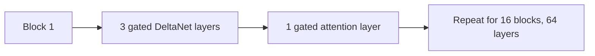

# **Qwen**

**Date checked:** 28 Nov 2026

Qwen3.8-27B is the dense model in Alibaba's current open line, released on 14 Aug 2026, and it is the one Qwen model that fits a tier B card for training. Bigger Qwen3.8 models are serve only, and Qwen4 open weights are promised but not released.

## **1. Spec Table**

| Item | Qwen3.8-27B | Status |
|---|---|---|
| Model id | Qwen/Qwen3.8-27B | verified |
| Released | 14 Aug 2026 | verified |
| Type | Dense, about 27B | verified |
| Layers | 64, as 16 blocks of 3 gated DeltaNet layers and 1 gated attention layer | one community card, check the base card |
| Context | 262,144 native | verified |
| Input | text, image, video | verified |
| Modes | Hybrid thinking, with a reasoning effort setting | verified |
| Official files | BF16 55.6 GB, FP8 30.9 GB | verified |

Only 16 of the 64 layers keep a full attention cache. That is the hybrid attention saving from architecture_facts.md.

## **2. License**

**Apache 2.0** for Qwen3.8-27B. Card: https://huggingface.co/Qwen/Qwen3.8-27B

Other Qwen3.8 models use other licenses, listed in section 6.

## **3. Memory and Fine Tune Path**

| Item | Value | Source | Date | Status |
|---|---|---|---|---|
| QLoRA | 24 GB | Unsloth Qwen3.8 guide | 28 Nov 2026 | verified |
| LoRA | above 36 GB | Unsloth Qwen3.8 guide | 28 Nov 2026 | verified, see trap 1 |
| Full fine tune | about 4 times the VRAM | Unsloth Qwen3.8 guide | 28 Nov 2026 | verified |
| Free GPUs | Kaggle 2 × T4 notebooks | Unsloth Qwen3.8 guide | 28 Nov 2026 | verified |
| Qwen3.5 27B, for comparison | bf16 LoRA 56 GB, QLoRA 28 GB | Unsloth Qwen3.5 guide | 28 Nov 2026 | verified |
| Qwen3.5 small sizes, bf16 LoRA | 0.8B 3 GB, 2B 5 GB, 4B 10 GB, 9B 22 GB | Unsloth Qwen3.5 guide | 28 Nov 2026 | verified |

### **3.1 Worked example: QLoRA on Qwen3.8-27B**

| Step | Calculation | Result |
|---|---|---|
| 1. Weights at 4 bit | 27 × 0.5 | 13.5 GB |
| 2. Adapters | 200 × 16 / 1000 | 3.2 GB |
| 3. Activations and buffers | starting guess | 4.0 GB |
| 4. Total guess | 13.5 + 3.2 + 4.0 | 20.7 GB |
| 5. Unsloth figure | published | 24 GB |

$$
\boxed{\text{Guess 20.7 GB, published 24 GB, so plan with 24 GB}}
$$

## **4. Traps**

| Trap | What to do |
|---|---|
| LoRA above 36 GB looks low for a 55.6 GB model | The 27B bf16 LoRA figure was 56 GB for Qwen3.5, so plan for 56 GB at bf16 |
| Old draft said Qwen3.5 has no 4 bit path | Wrong for the dense 27B, QLoRA works at 28 GB. Only the MoE sizes are not recommended in 4 bit |
| Qwen3.8 uses the qwen3_5 architecture | Use the Qwen3.5 path in Unsloth and turn off fast vLLM inference for RL |
| Flash Linear Attention kernels | Unsloth uses them, install the full Unsloth stack |
| Qwen4 | Qwen4-Max is API only, smaller open Qwen4 models have no date |

## **5. Pre-flight Answers**

| Question | Answer |
|---|---|
| Tier for Qwen3.8-27B | Tier B, 24 GB with QLoRA |
| Is there a tier A Qwen | Qwen3.5 4B at 10 GB or 2B at 5 GB for bf16 LoRA, license not rechecked |
| Commercial use | Apache 2.0 for the 27B |
| Should I wait for Qwen4 | Revisit when Alibaba names the open Qwen4 sizes |

## **6. Other Qwen Models**

| Model | Size | License | Notes | Status |
|---|---|---|---|---|
| Qwen3.8-2.4T-A95B | 2.4T total, 95B active | qwen3.8-max license | Released 12 Aug 2026, serve only | verified |
| Qwen3.8-Flash-Next | 125B total, 6B active | Qwen Community License 1.0, not Apache | Released 26 Aug 2026, 1M context, GDN plus QSA hybrid, about 74 GiB resident at 4 bit in one runtime, no training guide found, one source lists 180B in metadata | verified, size conflict |
| Qwen4-Max | 2.4T total, 71B active | API only | Announced 16 Nov 2026, open smaller models promised | verified |

This closes the earlier open item: Qwen Flash Next is not Apache 2.0.

## **7. Sources**

| Source | Used for | Date |
|---|---|---|
| https://unsloth.ai/docs/models/qwen3.8/train | QLoRA 24 GB, LoRA above 36 GB | read 28 Nov 2026 |
| https://unsloth.ai/docs/models/qwen3.5/fine-tune | Qwen3.5 memory, MoE advice | read 28 Nov 2026 |
| https://github.com/QwenLM/Qwen3.8 | Release dates | read 28 Nov 2026 |
| https://docs.tokios.com/models/qwen3.8 | File sizes, Apache 2.0 | read 28 Nov 2026 |
| https://huggingface.co/trailio/QwenSec-38 | Layer pattern, context | read 28 Nov 2026 |
| https://cellcog.ai/blog/qwen3-8-flash-next/ | Flash Next license | read 28 Nov 2026 |
| https://nhimg.org/qwen3-8-model-profile | Family licenses and sizes | read 28 Nov 2026 |
| https://alibabacloud.com/en/press-room/alibaba-unveils-qwen4-max | Qwen4-Max, 71B active | read 28 Nov 2026 |