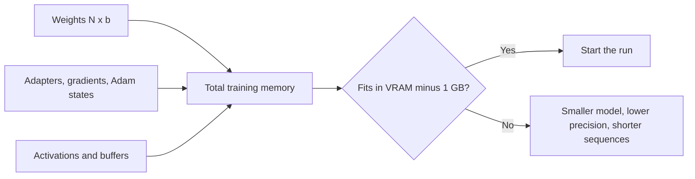

# **Memory Formulas**

**Date checked:** 28 Nov 2026

A model needs memory for its weights first, and the weights follow one simple formula: how many parameters it has times how many bytes each parameter takes. This note shows that formula, how to adjust it for 4 bit, how to add training memory on top, and how to check the result against numbers published by model makers.

## **1. Weights Memory**

### **1.1 The formula**

$$
\text{weights (GB)} = N \times b
$$

**N** is the total parameters in billions, counting every expert in a mixture of experts model. **b** is the bytes per parameter. With N in billions, the answer comes out in GB directly. Here 1 GB means 1 billion bytes.

| Precision | Bytes per parameter (b) |
|---|---|
| bf16 | 2.0 |
| int8 | 1.0 |
| 4 bit | 0.5 |

### **1.2 Active parameters do not change memory**

A mixture of experts model picks a few experts for each token, so only some parameters do work. That lowers compute, not memory, because every expert must still sit in memory ready to be picked.

| Model | Total (N) | Active per token | Memory follows |
|---|---|---|---|
| Inkling 2 Mini | 26.4B | about 3.4B (5.4B counting loop passes) | 26.4B |
| Muse Glimmer | about 29.6B, dense | about 29.6B | 29.6B |

### **1.3 Worked example: Inkling 2 Mini**

| Step | Calculation | Result |
|---|---|---|
| 1. Take total parameters | N = 26.4 | 26.4B |
| 2. bf16 weights | 26.4 × 2.0 | 52.8 GB |
| 3. 4 bit weights | 26.4 × 0.5 | 13.2 GB |
| 4. Published sizes | Unsloth merged 16 bit file, official NVFP4 checkpoint | about 53 GB and about 20 GB |

$$
\boxed{52.8\text{ GB at bf16 and }13.2\text{ GB at 4 bit}}
$$

The bf16 number matches the published one. The 4 bit number is a little low, and the next section explains why.

## **2. Why 4 Bit Is Not Exactly 0.5 Bytes**

Some parts stay in 16 bit, such as embeddings and the small gate layers that choose experts. The quantizer also stores scale values next to each block of weights. Both add a little, so the real bytes per parameter is above 0.5.

$$
b_{\text{real}} = \frac{\text{published size (GB)}}{N}
$$

| Model | Published 4 bit | N | Real b |
|---|---|---|---|
| Inkling 2 Mini, official NVFP4 and MXFP8 checkpoint | about 20 GB | 26.4B | 0.76 |
| Muse Glimmer, Unsloth dynamic 4 bit | 21 GB | 29.6B | 0.71 |
| Gemma 4 31B, Google Q4_0 | 17.5 GB | 30.7B | 0.57 |

$$
\boxed{\text{Use 0.55 to 0.75 bytes per parameter for 4 bit, and read the real file size}}
$$

The 29.6B Glimmer count is on its model card and includes a 1.8B vision encoder. Real bf16 files are also not exactly N times 2: Glimmer ships as about 56 GB and Gemma 4 31B is listed at 69.9 GB.

## **3. Training Memory**

Training needs more than the weights. A LoRA run keeps the base weights frozen and trains small adapters, so the extra memory comes from three places.

### **3.1 Adapter memory**

Each trainable parameter needs 4 bytes for the weight, 4 for the gradient and 8 for the two Adam states, which is 16 bytes.

$$
\text{adapters (GB)} = \frac{M \times 16}{1000}
$$

M is the number of adapter parameters in millions. With 200M adapter parameters this gives 3.2 GB.

### **3.2 Activations and buffers**

This part grows with batch size and sequence length. It is the hardest piece to predict, so use about 4 GB as a starting guess and keep batch size 1 on tight cards.

### **3.3 Worked example: QLoRA on Inkling 2 Mini**

| Step | Calculation | Result |
|---|---|---|
| 1. Weights at 4 bit | 26.4 × 0.5 | 13.2 GB |
| 2. Adapters | 200 × 16 / 1000 | 3.2 GB |
| 3. Activations and buffers | starting guess | 4.0 GB |
| 4. Total | 13.2 + 3.2 + 4.0 | 20.4 GB |
| 5. Published numbers | Unsloth guide | 22 GB needed, 25.7 GiB benchmark peak |

$$
\boxed{\text{About }20.4\text{ GB estimated, 22 GB to 25.7 GiB published}}
$$

The guess lands a little low, and the gap is the same real bytes per parameter effect from section 2. Always prefer a published peak over this guess when one exists. An earlier draft listed a 21.1 GB measured peak, and I could not find that line again.

## **4. Does It Fit**

Keep about 1 GB free for the CUDA context and the display.

$$
\text{fits if } \text{need} \le \text{VRAM} - 1
$$

| Memory tier | VRAM | Typical use |
|---|---|---|
| A | 8 to 12 GB | Small models, fast loops |
| B | 22 to 24 GB | Real target for QLoRA on mid size models |
| C | 40 to 80 GB | Larger LoRA runs |
| D | rack | Serve only |

For Inkling 2 Mini, 20.4 GB needs the 22 to 24 GB tier. Two T4 cards worked in the published tests and one T4 did not, because the model has to be split across cards.

## **5. Traps**

| Trap | What to do |
|---|---|
| Using active parameters for memory | Use total parameters |
| Using 0.5 bytes for 4 bit | Use 0.55 to 0.75 or the real file size |
| Trusting a training guess over a published peak | Use the published number when it exists |
| Forgetting the 1 GB reserve | Subtract it before comparing |
| Mixing GB and GiB | This course uses 1 GB as 1 billion bytes |

## **6. Pre-flight Answers**

| Question | Answer |
|---|---|
| Which N goes in the formula? | Total parameters, all experts included |
| Does MoE save memory? | No, it saves compute only |
| What is the 4 bit rule of thumb? | About 0.55 to 0.75 bytes per parameter |
| How much extra for QLoRA? | Adapters plus about 4 GB, then check a published peak |

## **7. Code and Sources**

The script for this note is `vram_planning/estimate_vram.py`. Set `MY_GPU_GB` at the top of the file to run the fit check for your card.

| Source | Used for | Date |
|---|---|---|
| Inkling 2 Mini, see models/inkling.md | Parameters, 53 GB, 20 GB, 22 GB and 25.7 GiB | 28 Nov 2026 |
| Muse Glimmer, see models/glimmer.md | 56 GB and 21 GB | 28 Nov 2026 |
| Gemma 4, see models/gemma.md | 17.5 GB and 69.9 GB | 28 Nov 2026 |