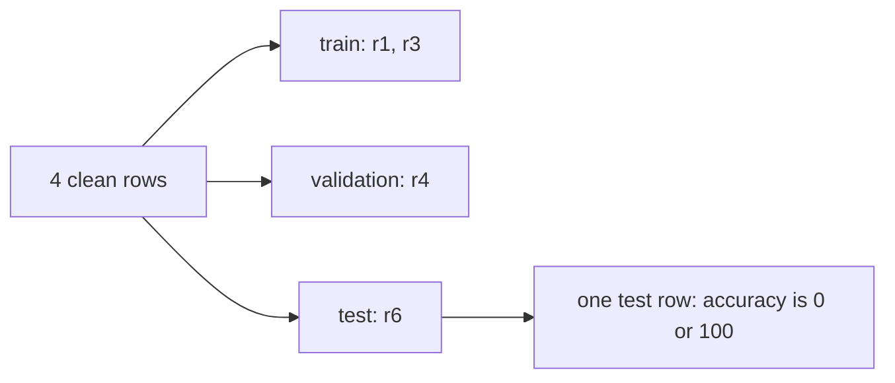
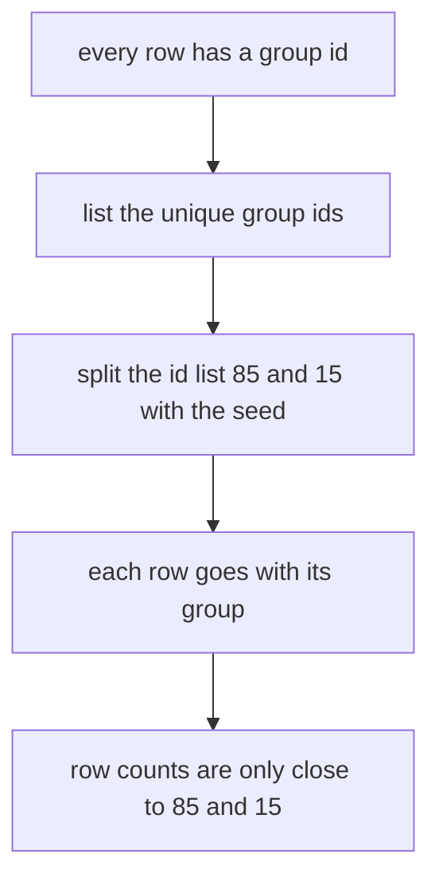
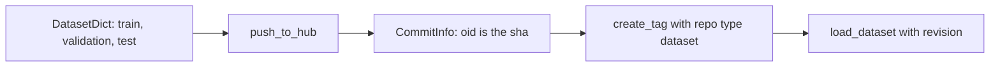
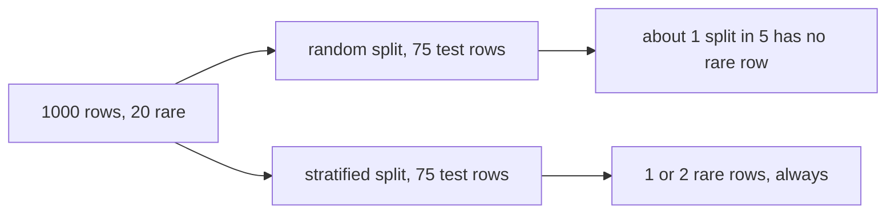

# **Domain Dataset and Splits: Cutting, Freezing and Documenting the Data**

*Stage 03 Data Engineering, note 08 of 09. It follows note 07, which scrubbed personal data from the rows. Note 06 (synthetic data) is still to be written and is not needed here.*

---

## **1. The Running Example**

After notes 04, 05 and 07 the six rows are four: r1, r3, r4 and r6 (with the email scrubbed). Now they must be cut into a **train** part (rows the model learns from), a **validation** part (rows used to choose settings) and a **test** part (rows looked at once, at the end, to report a score).

| id | question | answer | role in the first cut (illustrative) |
|---|---|---|---|
| r1 | What does softmax do? | Gives probabilities. | train |
| r3 | Why use warmup? | Avoids unstable early updates. | train |
| r4 | What is attention? | Tokens weigh other tokens. | validation |
| r6 | My email is a scrubbed tag, why is my loss flat? | Check the learning rate. | test |



With one test row, a score can only be 0 or 100 points. That is the whole problem of this note in small: a split is only as useful as it is large, clean and recorded.

The order of work matters too. Suppose the split had been made on the original six rows, three and three, before notes 04 and 05. Row r2 is a near-duplicate of r1. At random, r1 and r2 land on different sides with probability 0.6, which is 12 of the 20 possible splits (hand-calculated, checked by listing all 20 in the script). If r1 is in train and r2 in test, the test row has a twin in train, and the score is inflated. Row r5 is worse, because it was copied from an evaluation set.

| What you will learn |
|---|
| How to cut a clean dataset into train, validation and test so that no row leaks from one part to another. |
| How many test rows you need before a score means something, and how much a small test set can fool you. |
| How to freeze the cut, save a version that others can load again, and write the card that explains it. |

---

## **2. What the Trainer and the Hub Read**

### **2.1 The definitions**

A **split** divides the rows into parts that share no row. The **train** part feeds the gradient updates. The **validation** part is used to compare settings, such as the learning rate or the number of epochs, and to decide when to stop. The **test** part is used once, after all choices are made, to report the final score. **Leakage** means information from validation or test reaching training, through a copied row, a near-duplicate, or a choice made while looking at the test score.

A **seed** is a fixed number that starts a random shuffle. A **revision** on the Hugging Face Hub is a version of a dataset repository: a **commit sha** (a long hexadecimal name of one saved state), a branch such as main, or a tag. A **data card** is the README.md file of a dataset repository. It holds a YAML block of metadata (license, language, size, tasks) and a text body (Hub documentation).

The order is: dedup (note 04), decontamination (note 05), scrubbing (note 07), then the split, then freezing the ids, seed and sha, then the push and the card. Dedup, decontamination and scrubbing come before the split, so a copy cannot be placed on both sides, and the split is made once on the final text.

### **2.2 The random split and its rounding**

**Intuition.** Shuffle the rows, cut off the first part as the test part. The library function is `Dataset.train_test_split`. In the installed version (datasets 5.2.0, read on 22 November 2026) its arguments include `test_size`, `shuffle` (default on), `stratify_by_column` and `seed`. It has no group argument (read from the signature).

**Precise statement.** The test size is the share times the rows, rounded up, and the train part takes the rest. This was measured: 10 rows with share 0.15 gave 8 and 2, 4 rows with share 0.25 gave 3 and 1, and 1,000 rows with 0.15 gave 850 and 150.

```text
shuffle the row ids with the seed
n_test  = ceil(share * N)
test    = the first n_test ids
train   = the other ids
```

**The 85, 7.5, 7.5 cut takes two steps.** A single call makes only two parts. Cut 15 percent first, then cut that part in half. Measured on 1,000 rows: 850, then 75 and 75. A single call with share 0.075 gives 925 and 75, which leaves no validation part.

Section 6.2 shows the arithmetic.

**Beginner trap.** Using `shuffle=False` on rows that are sorted by source or by date. The test part is then one source or the newest rows, which is a different question from a random test.

**When to use.** As the default when rows are independent, classes are balanced and no row has a near twin.

### **2.3 The stratified split**

**Intuition.** A **stratified** split keeps the share of every group the same in each part. It protects small groups, such as a rare topic, from landing entirely in train.

**Precise statement.** `stratify_by_column` needs a **ClassLabel** column, a column that stores each group as a whole number with a list of names. A plain string column raises a ValueError (measured). `class_encode_column` converts a string column. Small groups are fragile. On a stand-in with 1,000 rows, two stratified steps behaved like this (measured, seed 0):

| rows in the rare class | train, validation, test | note |
|---|---|---|
| 1 | error | least populated class has only 1 member |
| 2 | 2, 0, 0 | no error, and the class is missing from validation and test |
| 5 | error | second step fails |
| 10 | error | second step fails |
| 14 | 12, 1, 1 | works |
| 20 | 17, 2, 1 | works |

I did not test every size between 2 and 14, so treat 14 as the smallest size seen to work, and merge any group below 20 into an "other" group (cell 4 does this).

```text
check that every group has at least 20 rows, else merge it into other
cast the group column to ClassLabel
step 1: split 15 percent, stratified
step 2: split that part in half, stratified
```

**Beginner trap.** A tiny group that silently vanishes from validation and test. The code runs, and the group is simply never scored.

**When to use.** When some groups hold under about 10 percent of the rows, or when you report scores per group.

### **2.4 The group split**

**Intuition.** Some rows belong together: turns of one conversation, rows from one source document, rows that are near-duplicates of each other. If such rows are split apart, one side holds a near copy of the other. A **group split** sends every row of a group to the same part.

**Precise statement.** The library has no group argument, so the split is done on the list of group ids, and each row follows its group. The groups can be the clusters from note 04 (rows with no twin form a group of one). Scikit-learn has `GroupShuffleSplit` and `StratifiedGroupKFold` (checked to exist, version 1.9.1, not used here).



```text
groups = unique(group id of each row)
test_groups = random 15 percent of groups, with the seed
test  = rows whose group is in test_groups
train = the other rows
```

**Worked example.** Five conversations with 2, 2, 3, 1 and 2 rows. Test gets 1 group (15 percent of 5, rounded up), so it holds 1, 2 or 3 rows, whichever group is drawn.

**Beginner trap.** Expecting exact row counts. A group of 3 can push the test share well above the target.

**When to use.** Conversations with several turns, rows from one document, and any dataset where note 04 found clusters.

### **2.5 The seed and the saved ids**

**Intuition.** A seed makes a split repeatable, but it should not be the only record of it.

**Precise statement.** Measured in datasets 5.2.0: the same seed gave the same test ids, and seed 43 gave a different test (18 of 150 ids in common, about the 22.5 expected by chance). Whether the same seed gives the same split in an older or newer version of the library was not checked. So save the ids of each part to a file and keep a fingerprint, a SHA-256 hash of that file. Anyone can then check that they hold the same split.

**Beginner trap.** Trying other seeds until the test score looks good. The test part is then chosen using test results, which is leakage. Pick the seed once, write it down, and never change it after you have seen a score.

### **2.6 Push, revision and tag**

**Intuition.** A branch name such as main moves. A sha or a tag does not. Record the sha of the exact data a model was trained on.



**Precise statement.** All calls below were read from the installed signatures (datasets 5.2.0, huggingface_hub 2.4.0). They were not run against the Hub, because the sandbox has no Hub access.

```text
final = DatasetDict({"train": train, "validation": validation, "test": test})
info  = final.push_to_hub(repo_id, private=True, commit_message=...)
sha   = info.oid                       # CommitInfo has oid and commit_url
HfApi().create_tag(repo_id, tag="v1", repo_type="dataset")
load_dataset(repo_id, revision="v1")   # a commit sha or a tag also works
HfApi().dataset_info(repo_id, revision="v1").sha
```

The `revision` argument takes a commit sha or a git tag (datasets documentation). `create_tag` has a `repo_type` argument whose default is None, so pass `"dataset"` explicitly. That a missing `repo_type` means a model repository is from general knowledge, not verified here.

**Beginner trap.** Writing "main" in the training config. Next month it points at different data.

### **2.7 The data card**

The Hub documentation says a card should explain responsible use and known biases, and that the YAML block can hold license, language, pretty_name, task_categories and size_categories. `DatasetCardData` accepts those fields, and a card was built and saved offline for this note. The body sections below are my own list, not a Hub rule (**added by me, not in the source note**).

| section | what it holds | comes from |
|---|---|---|
| sources and licenses | one row per source, license, usable or not | note 03 |
| cleaning | dedup threshold, tool versions, rows removed | note 04 |
| decontamination | n-gram size, cut, evaluation sets checked, rows removed | note 05 |
| personal data | tool, entity types, audit counts, date | note 07 |
| splits | method, sizes, seed, group and stratify columns, fingerprint | this note |
| revision | repository, tag, commit sha | section 2.6 |
| limits | test size and its interval, groups too small to score | section 6.4 |

**Beginner trap.** A card that says "anonymized" when the audit in note 07 only supports "scrubbed".

### **2.8 Comparison and assumptions**

| method | protects against | does not protect against | needs | assumes |
|---|---|---|---|---|
| random split | nothing special | rare groups missed, twins across parts | seed | rows are independent |
| stratified split | missing rare groups | twins across parts | ClassLabel column, groups of 14 or more | the group label is right |
| group split | twins and turns across parts | missing rare groups | group ids from note 04 | clusters are complete |
| saved ids and sha | silent change of data | a bad split | a file and a Hub repository | the sha is recorded with each run |

---

## **3. Why It Matters, With Numbers**

- A score on the test part is a measurement, and a small test part gives a wide error bar.
- Every choice made while looking at validation or test scores uses up some of their honesty.
- A split you cannot reproduce is a split you cannot defend.

**Why note 07 is not enough.** After note 07 the four rows are clean, but a set of four rows has no useful test: one test row means a score of 0 or 100. At 1,000 rows the cut 85, 7.5, 7.5 gives 75 test rows, so one row moves accuracy by 100 over 75, which is 1.3333 points (hand-calculated). That looks small. The interval says otherwise.

A score of 54 right out of 75 is 0.72, with a plain 95 percent range of 0.62 to 0.82 (hand-calculated in section 6.4). With 1,000 test rows the range would shrink to about plus or minus 2.8 points. Two models with scores 0.72 and 0.76 on these rows cannot be told apart, and section 6.6 gives the size of gap that can.

**Order matters.** Splitting before note 04 leaves twins on both sides. Splitting after, with groups, removes them. Then run the note 05 scan once more with your own test part treated as the evaluation set, and your train part as the rows scanned, because the point of the test part is that training never saw it.

---

## **4. The Extra Classic Example: A Rare Class**

The running example has four rows and hides what a split does to a small group. Take 1,000 rows of deep learning questions in two groups: 980 about common topics and 20 about one rare topic. The rare topic matters, and there are only 20 rows of it.

| quantity | value | label |
|---|---|---|
| rows, rare rows, test rows | 1,000, 20, 75 | setup |
| expected rare rows in test | 20 times 75 over 1,000 equals 1.5 | hand-calculated |
| chance a random test holds none | 0.207 | script |
| rare rows in a stratified test, 200 seeds | 1 or 2 every time | measured |
| random splits with none in test, 200 seeds | 32 | measured |



**Hand check.** Each rare row misses the test part with probability 0.925, which is 1 minus 75 over 1,000. For 20 rows, the chance that all miss is close to 0.925 to the power 20, which is 0.2103. The exact value is 0.2070 (script, from counting subsets). The measured count of 32 zero-rare splits in 200 seeds (0.16) is a little below that, which is within sampling noise for 200 draws.

**What it hides.** When the test part has no rare row, the score on that topic is not low, it is absent. And with 1 or 2 rare rows in the test, the score for that topic is 0, 50 or 100 percent, so it says very little. Stratifying fixes the absence, not the noise. The way to say something about a rare topic is more rare rows, not a better split.

---

## **5. The Procedure You Run**

1. Finish notes 04, 05 and 07 first, and keep the final text of each row.
2. Decide the unit of a row (one question and answer, or a whole conversation) and split by the whole conversation.
3. Read the cluster ids from note 04. If clusters exist, plan a group split (section 2.4).
4. Pick the sizes from the interval math (section 6.4 and section 6.5), not from habit.
5. Merge groups below 20 rows, cast to ClassLabel and stratify if you need per-group scores (section 2.3).
6. Fix the seed and write it in `configs/08-split.yaml` (format below, placeholders in angle brackets).
7. Split, then save the id lists and their fingerprint (cell 6).
8. Run the note 05 scan between your test part and your train part. Remove any train row that overlaps the test.
9. Push to a private Hub repository, tag it, and record the sha (section 2.6).
10. Write the card (section 2.7) and the settings file. Then never open the test part until the final report.

```text
seed: 42
sizes: train 850, validation 75, test 75
method: group split on note 04 clusters, then stratified on source
min_group_rows: 20
ids_fingerprint: <first 12 characters of the SHA-256>
source_revision: <commit sha of the raw data>
```

---

## **6. The Math, Step by Step**

This section is the arithmetic of split sizes, test noise, rare groups and leaked pairs. To cover the steps, do each calculation yourself on paper, then compare with the boxed value.

### **6.1 Notation**

| symbol | read aloud | meaning | in the running example |
|---|---|---|---|
| $N$ | N | rows before the split | 1,000 (illustrative) |
| $s_{\text{va}}$, $s_{\text{te}}$ | share validation, share test | wanted shares | 0.075 each |
| $N_{\text{tr}}$, $N_{\text{va}}$, $N_{\text{te}}$ | rows in each part | sizes after the split | 850, 75, 75 |
| $A$ | A | measured accuracy on the test part | 0.72 |
| $\varepsilon$ | epsilon | half-width of the 95 percent range | 0.1016 |
| $\varepsilon_{\text{diff}}$ | epsilon diff | half-width for a gap between two accuracies | 0.1437 |
| $\omega$ | omega | 1.96, from note 07 | 1.96 |
| $\text{se}$ | standard error | $\sqrt{A(1-A)/N_{\text{te}}}$ | 0.0518 |
| $v$ | v | settings tried on validation | 10 |
| $\text{top}_v$ | top v | expected maximum of $v$ standard normal values | 1.5388 |
| $K$, $K_{\text{te}}$ | K | rows of a rare group, how many of them are in test | 20, 1.5 on average |
| $\Psi$, $\psi$ | psi | near-duplicate pairs, chance a pair has exactly one member in test | 50, 0.1389 |
| $\varphi$, $a_0$, $a_1$, $I$ | phi, a zero, a one, I | leaked share, clean accuracy, leaked accuracy, inflation (note 05) | 0.0926, 0.60, 0.95, 0.0324 |
| $D$, $E$, $R$, $\bar T$ | tokens, epochs, tokens per second, mean length | as in notes 01 and 03 | 1,305,600, 3, 4,000, 512 |

**Reading tips.** The letter $A$ is the observed accuracy of note 05, here measured on the test part. The letter $p$ stays the softmax probability of note 01, so a rate of correct answers is never called $p$ in this note. The letter $K$ is a count of rows and never a number of hash functions, which is $\kappa$. The symbol $\Psi$ counts pairs and $\psi$ is a chance, so they do not clash with the logits $z$. The validation loss uses the token loss $\ell_t$ and its gradient from note 01 section 9.4, which are not repeated here.

### **6.2 Split sizes with rounding**

$$N_{\text{te}} = \lceil s_{\text{te}} N \rceil, \qquad N_{\text{tr}} = N - N_{\text{te}}$$

**What it says.** The held-out part is rounded up, and the other part takes the rest. A two step cut applies it twice.

**Worked example.** We compute the 85, 7.5, 7.5 cut on $N = 1000$.

**Step 1.** First hold out 15 percent.

$$N_1 = \lceil 0.15 \times 1000 \rceil = \boxed{150}$$

**Step 2.** Train is the rest.

$$N_{\text{tr}} = 1000 - 150 = \boxed{850}$$

**Step 3.** Cut the 150 in half.

$$N_{\text{te}} = \lceil 0.5 \times 150 \rceil = \boxed{75}$$

**Step 4.** Validation is the rest of the 150.

$$N_{\text{va}} = 150 - 75 = \boxed{75}$$

| rows | share | calculation | train, test |
|---|---|---|---|
| 1,000 | 0.15 | ceil of 150 is 150 | 850, 150 |
| 4 | 0.25 | ceil of 1 is 1 | 3, 1 |
| 10 | 0.15 | ceil of 1.5 is 2 | 8, 2 |

**Extreme case.** With 1,001 rows the first step gives 151, and the second gives a test part of 76 and a validation part of 75, so the test part gets the extra row.

**Beginner trap.** Expecting 7.5 percent of 10 rows to be 0.75 rows. It rounds up to 1.

**Check.** The two parts of every row of the table sum to the rows, and the measured sizes in section 2.2 match.

### **6.3 One row in points**

$$\Delta A_{\text{row}} = \frac{100}{N_{\text{te}}} \ \text{points}$$

**What it says.** Each test row you get right or wrong changes the accuracy by this many points.

**Worked example.** We compute it for 75 test rows.

$$\frac{100}{75} = \boxed{1.3333}$$

For 4, 25, 300 and 1,000 test rows the same step is 25, 4, 0.3333 and 0.1 points.

**Extreme case.** One test row: every score is 0 or 100.

**Beginner trap.** Reading a 1.33 point step as the size of the noise. The noise is many steps wide (section 6.4).

**Check.** Seventy-five steps of 1.3333 points sum to 100 points.

### **6.4 The half-width of a test score**

$$\varepsilon = \omega \sqrt{\frac{A(1-A)}{N_{\text{te}}}}$$

**What it says.** With 95 percent confidence the true accuracy lies within $\varepsilon$ of the measured accuracy. It is the normal range, and the Wilson range of note 07 section 6.5 is safer near 0 and 1.

**Worked example.** We compute it for 54 right answers out of 75.

**Step 1.** The accuracy.

$$A = \frac{54}{75} = \boxed{0.72}$$

**Step 2.** The spread of one answer.

$$A(1-A) = 0.72 \times 0.28 = \boxed{0.2016}$$

**Step 3.** Divide by the rows.

$$\frac{0.2016}{75} = \boxed{0.002688}$$

**Step 4.** Square root, the standard error.

$$\text{se} = \sqrt{0.002688} = \boxed{0.051846}$$

**Step 5.** Multiply by 1.96.

$$\varepsilon = 1.96 \times 0.051846 = \boxed{0.1016}$$

So the normal range is 0.6184 to 0.8216, and the Wilson range is 0.6096 to 0.8090 (script).

| test rows | half-width at accuracy 0.72 |
|---|---|
| 75 | 0.1016 |
| 150 | 0.0719 |
| 300 | 0.0508 |
| 1,000 | 0.0278 |

**Extreme case.** At accuracy 0.5 the half-width on 75 rows is largest, 0.1132. At accuracy 1.0 the normal formula gives zero, which is wrong. Use the Wilson range there.

**Beginner trap.** Quoting 72.0 percent with no range.

**Check.** The Wilson formula of note 07 section 6.5 with $n = 75$ gives a range of similar width, 0.6096 to 0.8090.

### **6.5 How many test rows you need**

$$N_{\text{te}} = \frac{\omega^2 A(1-A)}{\varepsilon^2}$$

**What it says.** It solves the half-width formula for the rows. Choose the half-width you can live with first.

**Worked example.** We compute the rows for a half-width of 0.05 at accuracy 0.5.

**Step 1.** Square omega.

$$\omega^2 = 1.96^2 = \boxed{3.8416}$$

**Step 2.** Multiply by the spread.

$$3.8416 \times 0.25 = \boxed{0.9604}$$

**Step 3.** Divide by the squared half-width.

$$\frac{0.9604}{0.0025} = 384.16 \;\Rightarrow\; \boxed{385}$$

At accuracy 0.72 the spread is 0.2016, so $3.8416 \times 0.2016 / 0.0025 = 309.79$, which rounds up to 310.

**Extreme case.** A half-width of 0.01 at accuracy 0.5 needs 9,604 rows, so a tight test is expensive.

**Beginner trap.** Planning the test size from the share (7.5 percent) and not from the half-width.

**Check.** At $N_{\text{te}} = 385$ the half-width formula gives $1.96\sqrt{0.25/385} = 0.0499$.

### **6.6 The gap between two models**

$$\varepsilon_{\text{diff}} = \omega \sqrt{\frac{2A(1-A)}{N_{\text{te}}}} = \sqrt{2}\,\varepsilon$$

**What it says.** If two models are scored on separate samples, their scores differ by chance by up to this much. A gap smaller than $\varepsilon_{\text{diff}}$ does not show that one model is better. Two models scored on the same rows have errors that are partly shared, so a paired comparison is tighter. That depends on how often the models disagree, and it is not worked here.

**Worked example.** We compute it for 75 rows at accuracy 0.72.

**Step 1.** Double the spread.

$$2 \times 0.2016 = \boxed{0.4032}$$

**Step 2.** Divide by the rows.

$$\frac{0.4032}{75} = \boxed{0.005376}$$

**Step 3.** Square root.

$$\sqrt{0.005376} = \boxed{0.07332}$$

**Step 4.** Multiply by 1.96.

$$\varepsilon_{\text{diff}} = 1.96 \times 0.07332 = \boxed{0.1437}$$

A gap of 0.76 against 0.72 is 4 points, far below 14.4 points.

**Extreme case.** With 1,000 test rows the same formula gives 0.0393, about 3.9 points.

**Beginner trap.** Calling a 4 point gain on 75 rows an improvement.

**Check.** The ratio of 0.1437 to 0.1016 is 1.4142, which is $\sqrt{2}$ (script assert).

### **6.7 The cost of choosing on validation**

$$\text{inflation} \approx \text{top}_v \cdot \text{se}$$

**What it says.** When $v$ settings have the same true accuracy, the best of their $v$ noisy validation scores is on average $\text{top}_v$ standard errors too high.

For $v$ equal to 1, 2, 5, 10 and 20 the value of $\text{top}_v$ is 0, 0.5642, 1.1630, 1.5388 and 1.8675 (numerical integration in the script). **Illustrative** assumption: independent errors and equal true accuracy.

**Worked example.** We compute it for 10 settings on 75 validation rows.

**Step 1.** Take $\text{top}_{10} = 1.5388$ and $\text{se} = 0.051846$.

**Step 2.** Multiply.

$$1.5388 \times 0.051846 = \boxed{0.0798}$$

So the winner looks about 8 points better than it is.

**Extreme case.** With $v = 1$ there is no choice and no inflation.

**Beginner trap.** Reporting the validation score of the chosen setting as its expected score. Report the test score instead, measured once.

**Check.** For $v = 2$ the exact value is $1/\sqrt{\pi} = 0.5642$, which the script reproduces.

### **6.8 Missing a rare group**

$$P(K_{\text{te}} = 0) = \frac{\binom{N-K}{N_{\text{te}}}}{\binom{N}{N_{\text{te}}}} \approx \left(1 - \frac{N_{\text{te}}}{N}\right)^{K}, \qquad \mathbb{E}[K_{\text{te}}] = \frac{K N_{\text{te}}}{N}$$

**What it says.** The left side counts the test sets with no rare row. The approximation treats each rare row as missing the test independently.

**Worked example.** We compute it for $N = 1000$, $K = 20$ and $N_{\text{te}} = 75$.

**Step 1.** The share outside the test.

$$1 - \frac{75}{1000} = \boxed{0.925}$$

**Step 2.** Take the natural log.

$$\ln 0.925 = \boxed{-0.077962}$$

**Step 3.** Multiply by 20.

$$20 \times (-0.077962) = \boxed{-1.55923}$$

**Step 4.** Exponentiate.

$$e^{-1.55923} = \boxed{0.2103}$$

The exact value is 0.2070 and $P(K_{\text{te}} \le 1) = 0.5498$ (script). The expected count is $20 \times 75 / 1000 = \boxed{1.5}$.

**Extreme case.** With $K = 1$ the chance of a miss is 0.925, so a single rare row is usually missed.

**Beginner trap.** Taking "7.5 percent of the rows" to mean "7.5 percent of every group".

**Check.** The product of 75 factors $(980 - i)/(1000 - i)$ equals the exact value (script assert).

### **6.9 Near-duplicate pairs across a random split**

$$\psi = \frac{2N_{\text{te}}(N - N_{\text{te}})}{N(N-1)}, \qquad \varphi = \frac{\Psi\,\psi}{N_{\text{te}}}, \qquad I = \varphi\,(a_1 - a_0)$$

**What it says.** A pair has exactly one member in the test part with chance $\psi$. In that case the other member is in train or validation, and the test row has a twin outside the test. Then $\varphi$ is the share of test rows with a twin, and $I$ is the inflation of note 05.

**Worked example.** We compute it for $N = 1000$, $N_{\text{te}} = 75$ and $\Psi = 50$ pairs, with clean accuracy $a_0 = 0.60$ and leaked accuracy $a_1 = 0.95$ (**illustrative**).

**Step 1.** The chance a pair is split.

$$\psi = \frac{2 \times 75 \times 925}{1000 \times 999} = \frac{138{,}750}{999{,}000} = \boxed{0.1389}$$

**Step 2.** Expected rows with a twin.

$$50 \times 0.1389 = \boxed{6.94}$$

**Step 3.** The leaked share.

$$\varphi = \frac{6.94}{75} = \boxed{0.0926}$$

**Step 4.** The inflation.

$$I = 0.0926 \times (0.95 - 0.60) = \boxed{0.0324}$$

So the score reads about 3.2 points too high.

**Extreme case.** A group split keeps every pair together, so $\varphi = 0$.

**Beginner trap.** Splitting first and deduplicating each part by itself. A pair split across parts is never seen by either dedup run.

**Check.** On the six rows of the running example, $N = 6$, $N_{\text{te}} = 3$: $\psi = 2 \times 3 \times 3 / (6 \times 5) = 18/30 = 0.6$, and listing all 20 splits gives 12 with the pair apart (script).

### **6.10 GPU calculations**

The split costs nothing on a GPU. The cost comes after, when training reads the 850 train rows. Use the series budget of 20 percent of VRAM for the logits, $V = 151{,}936$ and the batch formula of note 01 section 9.7 at $T = 512$ (**illustrative**, logits only, activations not included). One run reads $D = 850 \times 512 \times 3 = 1{,}305{,}600$ tokens. At an **illustrative** 4,000 tokens per second that is 326.4 seconds, or 0.09067 hours, on every tier.

| tier | $B_{\max}$ at $T=512$ | steps per epoch | batches to score 75 rows | cost of one run (dollars, illustrative) | largest full fine-tune (billions) |
|---|---|---|---|---|---|
| 16 GB | 10 | 85 | 8 | 0.0535 | 0.85 |
| 24 GB | 15 | 57 | 5 | 0.0725 | 1.275 |
| 48 GB | 30 | 29 | 3 | 0.1768 | 2.55 |
| 80 GB | 51 | 17 | 2 | 0.2267 | 4.25 |
| 141 GB | 90 | 10 | 1 | 0.4116 | 7.49 |
| 180 GB | 115 | 8 | 1 | 0.5667 | 9.56 |
| 288 GB | 185 | 5 | 1 | 0.6437 | 15.30 |

Steps per epoch are $\lceil 850 / B_{\max} \rceil$, and batches to score are $\lceil 75 / B_{\max} \rceil$. The cost is 0.09067 hours times the Modal price per hour of note 00.

### **6.11 All formulas and rules**

| formula | answer |
|---|---|
| two step cut of 1,000 rows | 850, 75, 75 |
| one test row of 75 | 1.3333 points |
| half-width, 54 of 75 | 0.1016 |
| rows for half-width 0.05 | 385 at 0.5, 310 at 0.72 |
| gap needed on 75 rows | 0.1437 |
| inflation from 10 settings | 0.0798 |
| chance of no rare row, $K=20$ | 0.2103 approximate, 0.2070 exact |
| leaked share from 50 pairs | 0.0926, inflation 0.0324 |

**Pen and paper rules.**

1. Test rows are the share times the rows, rounded up.
2. One row moves accuracy by 100 over the test rows, in points.
3. The half-width is 1.96 times the square root of A times (1 minus A) over the rows.
4. A gap between two models needs about 1.41 times that half-width.
5. Choose the half-width first, then the rows.
6. Trying $v$ settings on validation adds about $\text{top}_v$ standard errors.
7. A rare group of $K$ rows is missed by a random test with chance close to $(1 - \text{share})^K$.
8. A pair is split by a random cut with chance $2N_{\text{te}}(N-N_{\text{te}})/(N(N-1))$.
9. Split after cleaning, by group, and record the seed, the ids and the sha.

---

## **7. Notebook Experiments**

**Skipped on purpose:** the model load cell, the training cell and the before and after comparison, because this note builds splits and trains nothing. The sanity cell is cell 3, and the memory and speed readout is cell 8. Cells 3 to 8 use `rows` from cell 2. Cell 6 uses the split from cell 3, and cell 7 uses the fingerprint from cell 6. Outputs are formats with placeholders, and the lines marked expected follow from section 6 (**expected, not yet verified** on real data).

```python
# ── Cell 1. Environment ──────────────────────────────────────────
#    Versions, device, memory, seed, tier and dtype
# ─────────────────────────────────────────────────────────────────
import torch, transformers, datasets, huggingface_hub

torch.manual_seed(0)
print("torch:", torch.__version__, "transformers:", transformers.__version__)
print("datasets:", datasets.__version__, "huggingface_hub:", huggingface_hub.__version__)

if torch.cuda.is_available():
    properties = torch.cuda.get_device_properties(0)
    vram_gb = properties.total_memory / 1e9
    tier = min(size for size in (16, 24, 48, 80, 141, 180, 288) if size + 2 >= vram_gb)
    dtype = torch.bfloat16 if properties.major >= 8 else torch.float16
    print("gpu:", properties.name, "vram:", round(vram_gb, 1), "tier:", tier, "dtype:", dtype)
else:
    print("gpu: none, splitting runs on CPU")
```

```text
torch: <version>  transformers: <version>
datasets: <version>  huggingface_hub: <version>
gpu: <name> vram: <gb> tier: <tier> dtype: <dtype>
```

```python
# ── Cell 2. Data and chat template ───────────────────────────────
#    First 1000 rows of Capybara, an id column, one rendered row
#    The Hub declares no license, so use it for statistics only
# ─────────────────────────────────────────────────────────────────
from datasets import load_dataset
from transformers import AutoTokenizer

rows = load_dataset("trl-lib/Capybara", split="train[:1000]")
rows = rows.add_column("id", list(range(len(rows))))
tokenizer = AutoTokenizer.from_pretrained("Qwen/Qwen2.5-0.5B-Instruct")

text = tokenizer.apply_chat_template(rows[0]["messages"], tokenize=False)
tokens = tokenizer(text, add_special_tokens=False).input_ids
print("columns:", rows.column_names)
print("rows:", len(rows), "first row tokens:", len(tokens))
```

```text
columns: ['source', 'messages', 'id']      (column order may differ)
rows: 1000 first row tokens: <n>
```

```python
# ── Cell 3. The 85, 7.5, 7.5 cut and the hand numbers ────────────
#    Reproduces sections 6.2, 6.3 and 6.4
# ─────────────────────────────────────────────────────────────────
import math
from datasets import DatasetDict

first = rows.train_test_split(test_size=0.15, seed=42)
second = first["test"].train_test_split(test_size=0.5, seed=42)
train, validation, test = first["train"], second["train"], second["test"]
final = DatasetDict({"train": train, "validation": validation, "test": test})

print("train:", len(train), "validation:", len(validation), "test:", len(test))
print("one test row moves accuracy by", round(100 / len(test), 4), "points")
spread = math.sqrt(0.72 * 0.28 / len(test))
print("half-width at 0.72:", round(1.96 * spread, 4))
```

```text
train: 850 validation: 75 test: 75               (expected, section 6.2)
one test row moves accuracy by 1.3333 points     (expected, section 6.3)
half-width at 0.72: 0.1016                       (expected, section 6.4)
```

```python
# ── Cell 4. Stratify on the source column ────────────────────────
#    Merge small sources, cast to ClassLabel, split twice
# ─────────────────────────────────────────────────────────────────
from collections import Counter

counts = Counter(rows["source"])
small = {name for name, count in counts.items() if count < 20}
labels = ["other" if name in small else name for name in rows["source"]]
if labels.count("other") < 20:
    top = counts.most_common(1)[0][0]
    labels = [top if label == "other" else label for label in labels]

coded = rows.add_column("label", labels).class_encode_column("label")
step1 = coded.train_test_split(test_size=0.15, seed=42, stratify_by_column="label")
step2 = step1["test"].train_test_split(test_size=0.5, seed=42, stratify_by_column="label")
names = coded.features["label"].names
share = Counter(step2["test"]["label"])
print("sources merged into other:", len(small), "classes:", len(names))
for index, count in share.most_common(5):
    print("test rows:", names[index], count)
```

**Dry run.** Groups under 20 rows are merged first, because two stratified steps failed or dropped small groups in the check of section 2.3.

```text
sources merged into other: <n> classes: <n>
test rows: <source name> <count>      (five lines)
```

```python
# ── Cell 5. Group split on a toy cluster key ─────────────────────
#    The key is the first 8 words of the first user message
#    In your data, use the cluster ids from note 04 instead
# ─────────────────────────────────────────────────────────────────
import re
from datasets import Dataset

def cluster_key(row):
    """Return the first 8 lowercase words of the first user message."""
    words = re.findall(r"[a-z0-9]+", row["messages"][0]["content"].lower())
    return " ".join(words[:8])

keys = [cluster_key(row) for row in rows]
parts = Dataset.from_dict({"key": sorted(set(keys))}).train_test_split(test_size=0.15, seed=42)
test_keys = set(parts["test"]["key"])
test_ids = [i for i, key in enumerate(keys) if key in test_keys]
train_ids = [i for i, key in enumerate(keys) if key not in test_keys]
both = {keys[i] for i in train_ids} & test_keys
print("clusters:", len(set(keys)), "rows:", len(keys))
print("train rows:", len(train_ids), "test rows:", len(test_ids))
print("clusters on both sides:", len(both))
```

```text
clusters: <n> rows: 1000
train rows: <n> test rows: <n>
clusters on both sides: 0
```

```python
# ── Cell 6. Freeze the split ─────────────────────────────────────
#    Save the ids, hash them, push only if you set push to True
# ─────────────────────────────────────────────────────────────────
import hashlib, json

ids = {"train": list(train["id"]), "validation": list(validation["id"]), "test": list(test["id"])}
payload = json.dumps(ids, sort_keys=True).encode()
fingerprint = hashlib.sha256(payload).hexdigest()
with open("split-ids.json", "w") as handle:
    json.dump(ids, handle)
print("fingerprint:", fingerprint[:12])

push = False
if push:
    from huggingface_hub import HfApi
    repo_id = "your-name/your-dataset"
    info = final.push_to_hub(repo_id, private=True, commit_message="seed 42 " + fingerprint[:12])
    HfApi().create_tag(repo_id, tag="v1", repo_type="dataset")
    print("commit:", info.oid)
    print("tag sha:", HfApi().dataset_info(repo_id, revision="v1").sha)
```

**Dry run.** The push needs a token and a repository name, so it stays off. The two printed shas should match.

```text
fingerprint: <12 hex characters>
commit: <sha>                  (only if push is True)
tag sha: <sha>
```

```python
# ── Cell 7. The data card ────────────────────────────────────────
#    YAML metadata plus a body, saved as README.md
# ─────────────────────────────────────────────────────────────────
from huggingface_hub import DatasetCard, DatasetCardData

meta = DatasetCardData(language="en", license="other", pretty_name="Domain questions",
                       size_categories="n<1K", source_datasets=["original"],
                       task_categories=["text-generation"])
body = f"""# Domain questions
## Sources and licenses
One row per source, see the license table (note 03).
## Cleaning
Dedup, decontamination and scrubbing, see notes 04, 05 and 07.
## Splits
train {len(train)}, validation {len(validation)}, test {len(test)}, seed 42.
Split ids fingerprint: {fingerprint[:12]}
## Limits
With {len(test)} test rows, a score has a 95 percent half-width near 0.10.
"""
DatasetCard("---\n" + meta.to_yaml() + "\n---\n" + body).save("README.md")
print("card characters:", len(body))
```

```text
card characters: <n>
```

```python
# ── Cell 8. Speed and memory readout ─────────────────────────────
#    Rows per second of the split and peak memory of this process
# ─────────────────────────────────────────────────────────────────
import resource, time

start = time.perf_counter()
for repeat in range(5):
    rows.train_test_split(test_size=0.15, seed=repeat)
seconds = time.perf_counter() - start
peak_mb = resource.getrusage(resource.RUSAGE_SELF).ru_maxrss / 1024
print("rows per second:", round(5 * len(rows) / seconds))
print("peak memory MB:", round(peak_mb))
```

```text
rows per second: <n>
peak memory MB: <n>
```

### **7.1 Results table template**

Fill one row per tier you used. VRAM used should be near zero.

| tier | GPU seen | VRAM used (GB) | rows per second | peak memory (MB) | notes |
|---|---|---|---|---|---|
| 16 GB | | | | | |
| 24 GB | | | | | |
| 48 GB | | | | | |
| 80 GB | | | | | |
| 141 GB | | | | | |
| 180 GB | | | | | |
| 288 GB | | | | | |

### **7.2 Expected behavior (expected, not yet verified)**

Cell 3 should print 850, 75 and 75. In cell 4 the test part should hold every merged class, with counts close to 7.5 percent of each class. In cell 5 the last line must be 0 clusters on both sides. Speed should not depend on the GPU tier, so compare trends only. GPU runs are not exactly reproducible, but the split is, for a given library version and seed.

### **7.3 If you run out of memory**

Splitting 1,000 rows uses little memory. For very large sets, split a list of ids and select rows from disk. When you train on the split later, lower the batch size and the maximum length, add gradient accumulation, turn on gradient checkpointing, use bfloat16 where the capability is 8 or more, and use a smaller rank (covered in later notes).

---

## **8. Pitfalls and Limits**

### **Pitfalls that really bite**

1. **Splitting before cleaning.** A near-duplicate pair is split apart with chance 0.6 on six rows, and 0.1389 on 1,000 rows with a 75 row test.
2. **A test part that is too small.** At 75 rows the half-width is about 10 points, and a 4 point gain means nothing.
3. **Choosing among many settings on validation.** Ten equal settings add about 8 points to the best score on 75 rows (illustrative).
4. **Stratifying on a string, or on a tiny group.** A string column raises a ValueError, a group of 1, 5 or 10 rows made the second step fail, and a group of 2 vanished from validation and test (measured).
5. **Rerolling the seed.** Changing the seed after you saw a test score turns the test part into a tuning set.
6. **Splitting one conversation, one document or one user across parts.** The test part then holds text the model has seen almost whole.
7. **Recording "main" as the version.** It moves. Record a tag and a commit sha.

### **Limits that remain**

K-fold and nested cross-validation are not covered, and a paired test on shared rows is not worked. `train_test_split` cannot stratify and group together. The interval math assumes independent rows, which the group split is meant to secure. The Hub calls were read from signatures and docs, not run.

### **Debugging checklist**

- Did notes 04, 05 and 07 run before the split, on the final text?
- Are groups kept whole, and does every stratified class have at least 20 rows after merging?
- Is the half-width you can afford smaller than the gap you want to detect?
- Are the seed, ids, fingerprint and sha written in `configs/08-split.yaml` and on the card?

---

## **9. How This Shows Up in Language Models**

- A held-out set only measures generalization if no row, near copy or paraphrase of it is in training. Note 05 gives the scan, and this note gives the discipline of freezing it.
- Instruction tuning sets often hold multi-turn conversations, so the unit of the split is the conversation.
- Per-topic scores of a fine-tuned model need enough rows per topic, which stratified splitting alone cannot create.

**Added by me, not in the source note:** the interval math, the winner's curse figure, the rare group odds and the small group failures of stratified splitting are my additions.

**Next.** Note 09 turns all of this into the pre-flight checklist and the acceptance gate, and note 06 on synthetic data is still to be written.

---

## **10. Self-Test**

**Q1.** A dataset has 2,000 rows and an 80, 10, 10 split. Accuracy on the test part is 0.8. Find the number of test rows and the 95 percent half-width.

**Q2.** Spot the mistake: "I split the rows first, then removed duplicates inside train and inside test, so there is no leak."

**Q3.** Spot the mistake: `ds.train_test_split(test_size=0.15, stratify_by_column="topic")` is called on a column of topic names stored as strings.

**Q4.** Spot the mistake: "Model B scored 0.76 and model A scored 0.72 on the same 75 test rows, so B is better."

**Q5.** A rare topic has 10 rows among 1,000. The test part has 75 rows. Find the approximate chance a random test part holds none of them.

**Answers.**

1. Test rows are $\lceil 0.1 \times 2000 \rceil = 200$. The half-width is $1.96\sqrt{0.8 \times 0.2 / 200} = 1.96 \times 0.02828 = \boxed{0.0554}$, about 5.5 points.
2. A pair split across the parts is never seen by either dedup run. Deduplicate before the split, or keep clusters whole with a group split.
3. A string column is not allowed. It raises a ValueError. Convert it with `class_encode_column`, and merge groups under 20 rows first.
4. The gap is 4 points, and about 14.4 points is needed on separate samples of 75 rows. A paired comparison could be tighter, but one run of 75 rows does not show it.
5. $0.925^{10}$. Step 1: $\ln 0.925 = -0.077962$. Step 2: times 10 gives $-0.77962$. Step 3: $e^{-0.77962} = \boxed{0.4586}$. The exact value is 0.4569.

---

## **11. Sources and Verification**

**Sources used.**

- Hugging Face Hub documentation, Dataset Cards: https://huggingface.co/docs/hub/datasets-cards
- Hugging Face datasets documentation, Create a dataset card: https://huggingface.co/docs/datasets/en/dataset_card
- Hugging Face datasets documentation, loading methods (the `revision` argument): https://huggingface.co/docs/datasets/package_reference/loading_methods
- Hugging Face huggingface_hub documentation, Repository Cards (dataset revision as a git sha): https://huggingface.co/docs/huggingface_hub/en/package_reference/cards
- The installed packages datasets 5.2.0 and huggingface_hub 2.4.0, scikit-learn 1.9.1 (signatures and behaviour, read on 22 November 2026).
- Note 05 for the leak and inflation formulas, note 07 for the Wilson range.

**Verification note.** A standard library script reproduced every hand number with asserts. A separate CPU run of the datasets library on a synthetic stand-in measured the split sizes, the seed behaviour, the stratify errors and the rare group counts. The notebook cells passed `ast.parse`. Cells 3 to 8 were also run on CPU against a synthetic stand-in in place of Capybara. That run found that `train["id"]` returns a Column object and not a list in datasets 5.2.0, so cell 6 wraps it in `list`. The GPU and Hub cells were not run.

**Checked on the web.** That a dataset card is a README.md with a YAML block of metadata, that the `revision` argument of `load_dataset` takes a commit sha or a tag, and that a card holds license, language, pretty_name, task_categories and size_categories.

**From general knowledge, not verified here.** That a missing `repo_type` means a model repository. That the same seed gives the same split across library versions (not checked). The 1.54 value of $\text{top}_{10}$ is a known property of normal maxima, here computed by the script.

**Not checked.** Real runs of `push_to_hub`, `create_tag` and `dataset_info` on the Hub. The source distribution of the first 1,000 rows of Capybara. Sizes of stratified classes between 2 and 14 rows. Paired tests and cross-validation.

**Corrections to the source note.** The source file was not attached, so these are checked against the claims in the handoff.

| claim | correction |
|---|---|
| 85, 7.5, 7.5 gives 75 test rows at 1,000 rows, so one row moves accuracy by 1.33 points | confirmed (measured sizes 850, 75, 75), and the 95 percent half-width is about 10 points, so 1.33 is not the noise |
| stratified splits keep groups balanced | only for a ClassLabel column, and small groups fail or vanish |
| one split call makes three parts | `train_test_split` makes two parts, so a three part split takes two calls |
| the seed fixes the split | true within one version (measured), so also save ids and a fingerprint |
| a Hub dataset has one version | each push is a commit, so record a tag and the commit sha |

---

## **Appendix B. Where the Numbers Come From**

- **Hand-calculated and script-checked:** the 0.6 pair chance, split sizes, points per row, half-widths, rows needed, the gap, the rare group chance, the pair leak and the GPU table.
- **Measured:** the split sizes, seed behaviour, stratify errors and the 200 seed rare group counts, from the datasets library on a synthetic stand-in.
- **Illustrative:** 1,000 rows, 20 rare rows, 50 pairs, accuracies of 0.60, 0.72 and 0.95, 4,000 tokens per second, 10 settings.
- **From sources:** the card fields and the revision argument.
- **Expected, not yet verified:** the outputs of the notebook cells on real data.