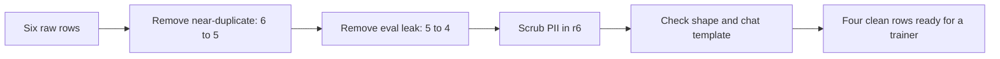
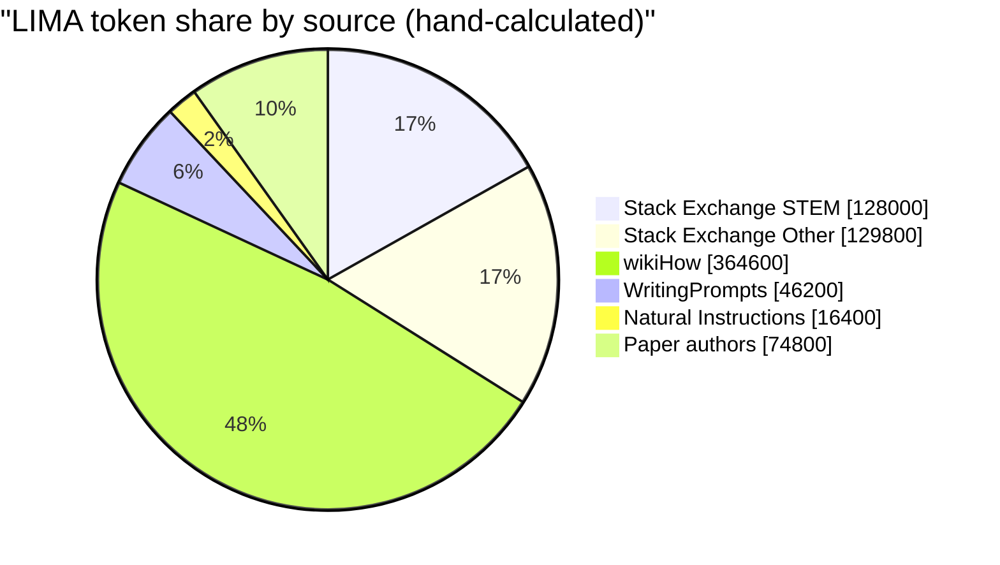
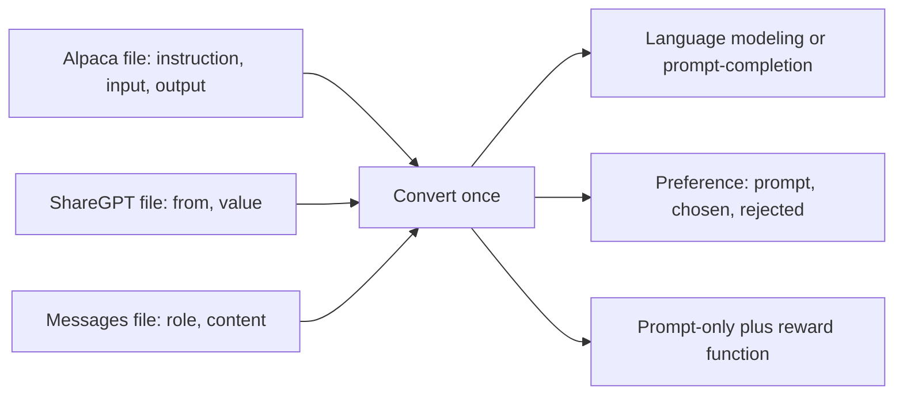
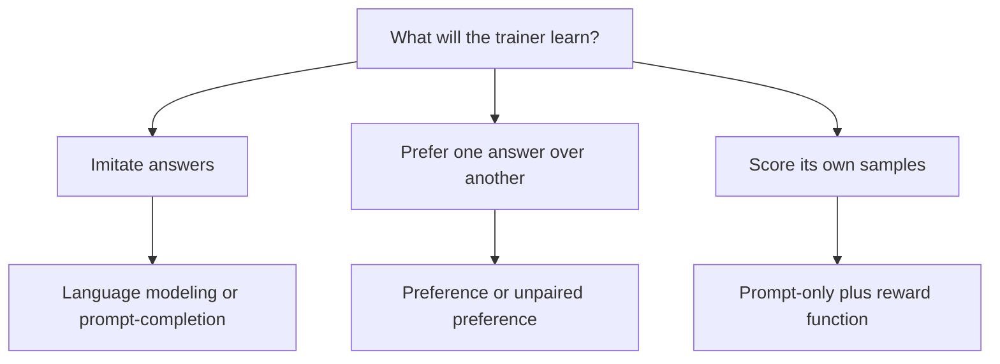
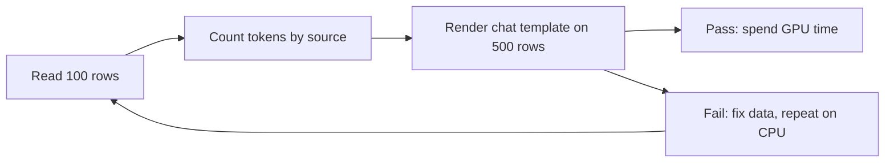

# **Why Data and Data Shapes**

**Scope.** Stage 03 Data Engineering, note 01 of 09. This is the first note of the stage, so it comes right before the Stage 04 Training Core notes and every training, alignment and evaluation step after them will read the data you defend here. This note explains why the dataset is the first thing to defend, which data shapes a trainer can read, and which checks cost nothing on a CPU. Deduplication is covered in note 04, decontamination in note 05, synthetic data in note 06, PII and licensing law in note 07, and splits and the domain dataset in note 08.

**Idea.** A trainer does not read your intentions, it reads columns, and every row in those columns gets a vote on the loss. If the shape is wrong the run crashes or silently trains on the wrong tokens. If the rows are duplicated, leaked or badly balanced, the run finishes and the model is simply worse. Both problems are visible on a CPU in minutes, and both cost hours on a GPU.

**Where the numbers come from.**

- Hand-calculated: every worked example in sections 5, 6 and 9, using small numbers.
- Measured: every number labelled measured was produced by a verification script on tiny CPU values in a sandbox, using only the Python standard library.
- Expected: how the GPU cells should behave. These cells were not run, because the sandbox has no GPU. Expected outputs are shapes of output, never invented results.
- Illustrative: the toy row losses, the 85 percent usable memory, and the 20 percent logits budget.
- From sources: the LIMA table in section 6, the 9k of 52k figure, and the free GPU hours on the Lightning AI pricing page. The pricing numbers change, so read your own account before you plan.

**Contents.**

1. The Running Example: Six Rows of Training Data
2. Vocabulary Mapped to the Story
3. Three Core Ideas
4. The Definition in Plain Words, Then Formal
5. Why Training Alone Is Not Enough
6. The Extra Classic Example: Row Share Versus Token Share
7. Data Shapes and What Each Trainer Reads
8. The Five Rules and How to Check Each
9. Math Notation, Explained Step by Step
10. Experiment Guide for Jupyter on GPU
11. Limits and When It Fails
12. Common Pitfalls
13. Connection to Language Models and Modern AI
14. Connection to the Next Topic
15. Glossary
16. Self-Test With Answers
17. Key Points
18. Sources and Verification

---

## 1. The Running Example: Six Rows of Training Data

Imagine you want a small model to answer short questions about deep learning. You collect six question and answer pairs. Looking at them quickly, they seem fine. Looking closely, three of them have a problem.

| id | question | answer | what is wrong |
|---|---|---|---|
| r1 | What does softmax do? | Gives probabilities. | nothing |
| r2 | What does the softmax do? | Softmax gives probabilities. | near-duplicate of r1 |
| r3 | Why use warmup? | Avoids unstable early updates. | nothing |
| r4 | What is attention? | Tokens weigh other tokens. | nothing |
| r5 | What does dropout do? | Randomly zeroes activations. | copied word for word from the evaluation set |
| r6 | My email is asha@example.com, why is my loss flat? | Check the learning rate. | contains an email address |

This six-row dataset is the running example for all nine notes of Stage 03. Each note fixes one kind of problem in it. The path from six raw rows to a dataset a trainer can safely read looks like this.



**The new ingredient.** There is no earlier topic in this series to build on, so the new ingredient is the dataset itself. Until now a dataset was something you downloaded. From here it is the thing under test.

For the loss examples later we also need a toy tokenizer. Use one word as one token. For row r1 the question has 4 toy tokens (what, does, softmax, do) and the answer has 3 toy tokens (gives, probabilities, and an end marker called eos). In section 9 these are the numbers behind every loss calculation.

---

## 2. Vocabulary Mapped to the Story

| in the story | name | meaning |
|---|---|---|
| one question and answer pair | **row** | one training example |
| the word "question" or "answer" | **field** | one named column of a row |
| which fields a row has | **shape** | the pattern of fields a trainer expects |
| how the six rows are saved on disk | **storage format** | a file layout such as Alpaca, ShareGPT or messages |
| the part a trainer actually reads | **trainer shape** | the shape after conversion, covered in section 7 |
| who said the line | **role** | user, assistant, system or tool |
| the markers around each turn | **chat template** | the recipe that turns a list of turns into one string with special markers |
| markers such as the end of a turn | **special tokens** | reserved tokens that carry structure, not words |
| which tokens count in the loss | **loss mask** | a 0 or 1 per token, 1 means the token is trained on |
| r2 repeating r1 | **near-duplicate** | two rows that differ in a few words but mean the same |
| r5 sitting in the exam | **decontamination** | removing training rows that also appear in an evaluation set |
| where each row came from | **provenance** | the recorded source, license and date of a row |

---

## 3. Three Core Ideas

**Idea 1. The trainer reads a shape, not your file.** Your six rows may live in an Alpaca file, but the trainer wants a specific set of fields. A mismatch either crashes or, worse, is accepted and trains on the wrong tokens. Tied to the story: r1 saved as question and answer fields is useless until it becomes a user turn and an assistant turn.

**Idea 2. Every row has a vote, and duplicates vote twice.** The loss is an average over rows. In the story, r1 and r2 are the same fact, so softmax gets two votes while warmup and attention get one each. Section 5 puts numbers on this.

**Idea 3. Cheap checks come first.** Reading rows, counting tokens, and rendering the chat template need no GPU. A mistake found on a CPU costs a minute. The same mistake found after training costs the whole run.

---

## 4. The Definition in Plain Words, Then Formal

**Plain words.** A **dataset** is a list of rows. Each row has fields. A dataset is ready for training when you can say where every row came from, whether you may use it, that it has no duplicates, that no evaluation row leaked into it, that its shape matches the trainer, that it has a version, and that someone can read a document describing all of this.

**Formal.** A dataset is $D = \{d_1, \dots, d_N\}$ with $N$ rows. Each row $d_i$ has a shape $S(d_i)$, which is the set of its field names. A trainer $\mathcal{T}$ accepts a set of shapes $A(\mathcal{T})$. The dataset is readable by the trainer when $S(d_i) \in A(\mathcal{T})$ for every row $i$.

For the six rows saved as `question` and `answer`, $S(d_i) = \{\text{question}, \text{answer}\}$. A language modeling trainer accepts $\{\text{text}\}$, $\{\text{messages}\}$ and the prompt-completion pair, so the six rows are not readable until they are converted (section 7).

**Check.** A shape check is one line of code over all rows, so run it on all $N$, not on the first row.

---

## 5. Why Training Alone Is Not Enough

A perfect training loop cannot undo a bad dataset. Two small calculations show this on the running example, and one source-backed fact shows that volume is not the lever.

### 5.1 A duplicate changes the average

Take rows r1 to r4 with illustrative row losses $L_1 = 0.8$, $L_2 = 0.8$, $L_3 = 1.5$, $L_4 = 1.1$. Topics are softmax for r1 and r2, warmup for r3, attention for r4.

With the duplicate:

$$\begin{aligned}
\bar L &= \frac{0.8 + 0.8 + 1.5 + 1.1}{4} \\[6pt]
       &= \frac{4.2}{4} \\[6pt]
       &= \boxed{1.0500}
\end{aligned}$$

Without r2:

$$\begin{aligned}
\bar L &= \frac{0.8 + 1.5 + 1.1}{3} \\[6pt]
       &= \frac{3.4}{3} \\[6pt]
       &= \boxed{1.1333}
\end{aligned}$$

The softmax topic holds $2/4 = 50\%$ of the votes with the duplicate and $1/3 = 33.33\%$ without it. The model is pulled harder toward softmax only because r2 repeats r1. This is measured by the verification script and matches section 9.3.

### 5.2 A mistake found late costs GPU hours

The source file warns that a chat template mismatch can waste "ten GPU-hours". Suppose you lose exactly 10 GPU hours. On the Lightning AI free tier the starting free hours differ by GPU. Using the pricing page numbers (75, 31, 5, 2 hours), the lost share is $10 / H_{\text{free}}$.

| GPU | free hours to start | 10 hours lost is | calculation |
|---|---|---|---|
| T4 | 75 | 13.3 percent | $10 / 75 = 0.1333$ |
| L4 | 31 | 32.3 percent | $10 / 31 = 0.3226$ |
| L40S | 5 | 200.0 percent | $10 / 5 = 2.0$ |
| RTX PRO 6000 | 2 | 500.0 percent | $10 / 2 = 5.0$ |

On the two largest GPUs you cannot even afford a 10 hour mistake. This is why the CPU checks in section 8 come before any GPU run.

### 5.3 More rows are not the lever

The LIMA paper trained a 65B model on exactly 1,000 curated examples, and reports that ablations show vastly diminishing returns from more data unless prompt diversity also grows, with major gains from quality. The AlpaGasus paper trains on only 9k filtered rows out of the 52k used for Alpaca.

$$\frac{1000}{52000} = \boxed{0.0192} \qquad \frac{9}{52} = \boxed{0.1731}$$

So LIMA uses 1.92 percent of the Alpaca row count and AlpaGasus uses 17.31 percent (rounded paper counts).

**Read this honestly.** The source note claims "data beats algorithm, every time". Neither paper says that as a general law. Each shows one setting where a small curated set matched or beat a large one. Also, a paper titled "Long is more for alignment" reports that simply picking the longest responses is a hard baseline to beat, so any quality filter should be compared against simple baselines.

---

## 6. The Extra Classic Example: Row Share Versus Token Share

The running example has no lengths, so it hides a trap: a source can be a small share of rows and a huge share of tokens. The LIMA paper gives exactly the numbers we need in its Table 1.

**Setup (from the LIMA paper, Table 1).** The unit of the length columns is as printed in the paper.

| source | rows $n_k$ | avg input | avg output |
|---|---|---|---|
| Stack Exchange STEM | 200 | 117 | 523 |
| Stack Exchange Other | 200 | 119 | 530 |
| wikiHow | 200 | 12 | 1811 |
| Reddit WritingPrompts | 150 | 34 | 274 |
| Natural Instructions | 50 | 236 | 92 |
| Paper authors (Group A) | 200 | 40 | 334 |

The loss averages over tokens, so a source with long answers gets more of the gradient than its row count suggests.



**Hand check.** Tokens per source are $\tau_k = n_k (\text{in}_k + \text{out}_k)$.

| source | calculation | $\tau_k$ | row share | token share |
|---|---|---|---|---|
| Stack Exchange STEM | $200 \times (117 + 523)$ | 128,000 | 20.0% | 16.8% |
| Stack Exchange Other | $200 \times (119 + 530)$ | 129,800 | 20.0% | 17.1% |
| wikiHow | $200 \times (12 + 1811)$ | 364,600 | 20.0% | 48.0% |
| WritingPrompts | $150 \times (34 + 274)$ | 46,200 | 15.0% | 6.1% |
| Natural Instructions | $50 \times (236 + 92)$ | 16,400 | 5.0% | 2.2% |
| Paper authors | $200 \times (40 + 334)$ | 74,800 | 20.0% | 9.8% |

The total is 759,800, close to the "roughly 750,000 tokens" in the paper. wikiHow is 20 percent of the rows but 48 percent of the tokens. The script matches every number in this table.

**Beginner trap.** Checking source balance by row count only, as "no source above 25 percent", would pass this dataset while one source carries almost half the loss.

---

## 7. Data Shapes and What Each Trainer Reads

### 7.1 Storage format versus trainer shape

Alpaca, ShareGPT and messages files are **storage formats**. A **trainer shape** is what the trainer reads after conversion. The source note lists them in one table, which hides the conversion step.



Which shape each TRL trainer expects, from the TRL dataset formats page:

| trainer | expected shape |
|---|---|
| SFTTrainer | language modeling or prompt-completion |
| DPOTrainer | preference |
| KTOTrainer | unpaired preference, or preference |
| RewardTrainer | preference |
| GRPOTrainer | prompt-only plus reward function |

The trainers other than SFT are covered in the alignment stages. Here we only need their shapes.



### 7.2 Language modeling and messages

**Intuition.** One string, or one conversation, that the model learns to continue.

**Precise statement.** Standard form has a `text` field. Conversational form has a `messages` list of role and content pairs, and the trainer applies the chat template for you.

```text
row = { "text": string }
row = { "messages": [ {role, content}, ... ] }
loss = averaged over every token by default
```

**Worked example.** Row r1 as messages:

```text
{"messages": [{"role": "user", "content": "What does softmax do?"},
              {"role": "assistant", "content": "Gives probabilities."}]}
```

**Beginner trap.** On a language modeling shape the loss covers every token, including the question, unless you ask for assistant-only loss.

**When to use.** Chat tuning with whole conversations. Assumes the model's chat template is correct.

### 7.3 Prompt-completion

**Intuition.** Split each row into what the model is given and what it must produce.

**Precise statement.** Fields `prompt` and `completion`. For a prompt-completion dataset, the TRL SFT trainer computes the loss on the completion tokens only by default, and `completion_only_loss` controls this.

```text
row = { "prompt": [turns], "completion": [turns] }
labels = token id if token is in completion else -100
```

**Worked example.** Row r1 has 4 prompt tokens and 3 completion tokens, so the mask is 0, 0, 0, 0, 1, 1, 1. The response share is $3/7 = 0.4286$ (section 9.5).

**Beginner trap.** Expecting prompt tokens to train when the default skips them, or the reverse.

**When to use.** Whenever you want the loss on answers only. Prefer this over language modeling for question answering.

### 7.4 Tool-calling

**Intuition.** The model must learn to emit a call, then continue after seeing the result.

**Precise statement.** The conversation messages include `tool_calls` and `tool` role messages, and a `tools` column holds the available tools as JSON schemas. The TRL trainer accepts `tools` as a list or as a JSON string.

```text
row = { "messages": [..., assistant with tool_calls, tool result, ...],
        "tools": [JSON schema, ...] }
```

**Worked example.** A one-tool row has 4 messages (user, assistant call, tool result, assistant answer) and 1 tool schema.

**Beginner trap.** Forgetting the `tools` column. Then the template cannot render the tool block and the model never sees the schema.

**When to use.** Agent fine-tunes. Assumes the model's chat template supports tools.

### 7.5 Preference

**Intuition.** Show the model two answers to one question and say which is better.

**Precise statement.** Fields `prompt`, `chosen`, `rejected`. In the explicit prompt form the `chosen` and `rejected` fields hold only the assistant turn. In the implicit prompt form they hold the full conversation and no `prompt` field.

```text
explicit: { prompt: [user turn], chosen: [assistant turn], rejected: [assistant turn] }
implicit: { chosen: [user turn, assistant turn], rejected: [user turn, assistant turn] }
```

**Beginner trap.** Mixing both. The source note's example sets `prompt` and also repeats the user turn inside `chosen` and `rejected`. Pick one form.

**Hard-negative rule.** Pairs where chosen and rejected are almost equally good teach more than obvious wins. This is an engineering heuristic from the source note, measured in the labs.

**When to use.** Preference tuning, covered in the alignment stage.

### 7.6 Unpaired preference

**Intuition.** One answer with a thumbs up or thumbs down, no pair needed.

**Precise statement.** Fields `prompt`, `completion` and a boolean `label`.

```text
row = { "prompt": [turns], "completion": [turns], "label": true or false }
```

**Beginner trap.** The source note names the boolean column `desirable`. In TRL the column is `label`.

**When to use.** You only have good or bad feedback per answer, for example from a user thumbs button.

### 7.7 Prompt-only plus a reward function

**Intuition.** The data has no answers. The model writes answers and a function scores them.

**Precise statement.** The dataset holds `prompt`. The score comes from reward code passed to the trainer, not from a column.

```text
row = { "prompt": [turns] }
reward = function(completion) returns a number
```

**Worked example.** For the prompt "What is 47 times 83?" the reward code checks the answer against 3901.

**Beginner trap.** Storing a Python lambda as a string in the dataset and calling `eval` on it. The source note shows this pattern. Run reward code as code you wrote, never as text you load from a file.

**When to use.** Tasks with a checkable answer, covered in the reinforcement learning stage.

### 7.8 Converting storage to trainer shape

```text
input:  Alpaca row {instruction, input, output}
step 1: user = instruction, plus a blank line and input when input is not empty
step 2: messages = [ {user, content=user}, {assistant, content=output} ]
step 3: prompt = messages without the last turn, completion = the last turn
```

**Worked example.** Row r1 has an empty input, so `user = "What does softmax do?"`, and `prompt` holds one user turn while `completion` holds one assistant turn. The script checks these roles.

### 7.9 Comparison and assumptions

| shape | needs labels from a person or model | loss covers | assumption |
|---|---|---|---|
| language modeling | no, only text | all tokens by default | template is correct |
| prompt-completion | no | completion only by default | prompt and completion split cleanly |
| tool-calling | no | assistant tokens | template supports tools |
| preference | yes, a ranking | a pair of completions | chosen is really better |
| unpaired preference | yes, a thumb | one completion | labels are balanced enough |
| prompt-only plus reward | no, only a checker | sampled completions | the reward cannot be gamed |

---

## 8. The Five Rules and How to Check Each

The five rules in the source note are heuristics. Each one has a check cheap enough to run before training.

| rule | meaning | cheapest check | covered in |
|---|---|---|---|
| diversity over volume | many different prompts beat many repeats | count distinct prompts, share by source and by tokens | notes 04 and 06 |
| hard negatives | close pairs teach more than obvious pairs | read 20 pairs, count the close calls | note 08 and lab 3 |
| decontamination | no eval row inside training | n-gram overlap with the eval set | note 05 |
| format consistency | rendered text matches the template | render 500 rows, look at the length histogram | note 02 |
| PII and licensing | you know what is inside and may use it | provenance table, scrub audit | note 07 |

The loop to run on a CPU before spending GPU time:



**Rule.** Read 100 random rows before anything else. If quality is bad in 100, it is bad in 1 million.

**Read this honestly.** The source note says the EU AI Act applies from 2 August 2026. That claim was not verified in this note. It is checked in note 07, which is the legal note.

---

## 9. Math Notation, Explained Step by Step

This section lists every symbol and every formula used in the notes, with a worked example for each. Cover the steps, do the calculation yourself on paper, then compare with the boxed value.

### 9.1 Notation table

| symbol | read aloud | meaning | in the running example |
|---|---|---|---|
| $N$ | N | number of rows | 6 raw rows, 4 clean rows |
| $n_k$ | n sub k | rows from source $k$ | 200 for wikiHow |
| $\rho_k$ | rho sub k | row share of source $k$ | 0.20 |
| $\tau_k$ | tau sub k | tokens from source $k$ | 364,600 |
| $\tau$ | tau | total tokens | 759,800 |
| $\sigma_k$ | sigma sub k | token share of source $k$ | 0.480 |
| $c_k$ | c sub k | rows about topic $k$ | 2 for softmax |
| $w_k$ | w sub k | vote share of topic $k$ | 0.50 |
| $L_i$ | L sub i | loss of row $i$ | 0.8 for r1 |
| $\bar L$ | L bar | mean loss over rows | 1.05 |
| $x$ | x | prompt tokens | what, does, softmax, do |
| $y_t$ | y sub t | response token $t$ | gives, probabilities, eos |
| $m_t$ | m sub t | loss mask at position $t$ | 0 for prompt, 1 for response |
| $\ell_t$ | ell sub t | loss at position $t$ | 1.6094 |
| $\pi_\theta$ | pi theta | model distribution | the model being trained |
| $\theta$ | theta | model parameters | 0.5B weights |
| $z$ | z | logits, the raw scores | $[2,0,0,0,0]$ |
| $p$ | p | probabilities from softmax | $[0.6488, 0.0878, \dots]$ |
| $\mathbf{1}_y$ | one-hot of y | vector with 1 at the target | $[1,0,0,0,0]$ |
| $r$ | r | response share of tokens | 3/7 |
| $T$ | T | sequence length in tokens | 4096 |
| $B$ | B | batch size | 1 |
| $V$ | V | vocabulary size | 151,936 |
| $b$ | b | bytes per logit value | 4 |
| $P$ | P | number of parameters | 0.5 billion |
| $M$ | M | memory in bytes | 8.0 GB |
| $H_{\text{free}}$ | H free | free GPU hours | 75 on a T4 |
| $H_{\text{lost}}$ | H lost | wasted GPU hours | 10 |
| $f$ | f | lost share of free hours | 0.1333 |

**Reading tips.** The letter $t$ always means a token position. Shares use Greek letters ($\rho$ for rows, $\sigma$ for tokens) so they never clash with $t$ or $T$. The word "tokens" in the LIMA table is the unit printed in the paper.

### 9.2 Row share and token share

$$\rho_k = \frac{n_k}{N} \qquad \tau_k = n_k \,(\text{in}_k + \text{out}_k) \qquad \sigma_k = \frac{\tau_k}{\tau}$$

**What it says.** A source's share of rows is how many examples it has. Its share of tokens is how much text it has. The loss averages over tokens, so the token share is closer to its real influence.

**Worked example: wikiHow in LIMA.**

$$\begin{aligned}
\rho &= \frac{200}{1000} = \boxed{0.20} \\[8pt]
\tau_k &= 200 \times (12 + 1811) \\[6pt]
       &= 200 \times 1823 \\[6pt]
       &= \boxed{364600} \\[8pt]
\sigma_k &= \frac{364600}{759800} \\[6pt]
         &= \boxed{0.4799}
\end{aligned}$$

**Extreme case.** If one source holds every row, $\rho = 1$ and $\sigma = 1$, so there is no balance at all. If a source has very long rows, $\sigma$ rises while $\rho$ stays put, which is the wikiHow case.

**Beginner trap.** Reporting only $\rho$.

**Check.** Matches the table in section 6.

### 9.3 Mean loss and topic vote share

$$\bar L = \frac{1}{N} \sum_{i=1}^{N} L_i \qquad w_k = \frac{c_k}{N}$$

**What it says.** Each row adds its loss to the average. A topic with $c_k$ rows holds $c_k / N$ of the votes.

**Worked example.** From section 5.1, with the duplicate $N = 4$, $c = 2$:

$$\begin{aligned}
\sum L_i &= 0.8 + 0.8 + 1.5 + 1.1 \\[6pt]
         &= 4.2 \\[10pt]
\bar L &= \frac{4.2}{4} = \boxed{1.0500} \\[10pt]
w_{\text{softmax}} &= \frac{2}{4} = \boxed{0.5000}
\end{aligned}$$

Removing r2 gives $N = 3$, $\bar L = 3.4/3 = \boxed{1.1333}$ and $w = 1/3 = \boxed{0.3333}$.

**Extreme case.** If all $N$ rows are the same fact, $w = 1$, so the model sees a single fact $N$ times. If every row is a different topic, $w_k = 1/N$ for each.

**Beginner trap.** Thinking duplicates only waste compute. They also tilt the average.

### 9.4 Token loss, the mask, and the gradient

$$\ell_t = -\log \pi_\theta(y_t \mid x, y_{<t}) \qquad L = \frac{\sum_t m_t\, \ell_t}{\sum_t m_t}$$

**What it says.** At each position, the loss is the negative log of the probability the model gave the correct token. The mask $m_t$ turns positions on or off, and the average divides by the number of positions that are on.

**Tiny full example.** Vocabulary of 5 tokens: gives, probabilities, sums, one, eos. The sequence has three scored positions:

- Position 0 is a prompt position. Its illustrative loss is 3.0 and $m = 0$.
- Position 1 has uniform logits $z = [0,0,0,0,0]$ and target index 1.
- Position 2 has logits $z = [2,0,0,0,0]$ and target index 0.

**Step 1. Softmax at position 1.**

$$\begin{aligned}
p_j &= \frac{e^{0}}{5 \, e^{0}} \\[6pt]
    &= \boxed{0.2} \quad \text{for every } j
\end{aligned}$$

**Step 2. Loss at position 1.**

$$\begin{aligned}
\ell_1 &= -\log(0.2) \\[6pt]
       &= \log 5 \\[6pt]
       &= \boxed{1.6094}
\end{aligned}$$

**Step 3. Softmax at position 2.**

$$\begin{aligned}
e^{2} &= 7.3891 \\[6pt]
\text{sum} &= 7.3891 + 4 \times 1 = 11.3891 \\[6pt]
p_0 &= \frac{7.3891}{11.3891} = \boxed{0.6488} \\[6pt]
p_{1..4} &= \frac{1}{11.3891} = \boxed{0.0878} \text{ each}
\end{aligned}$$

**Step 4. Loss at position 2.**

$$\begin{aligned}
\ell_2 &= -\log(0.6488) \\[6pt]
       &= \boxed{0.4327}
\end{aligned}$$

**Step 5. Masked average.** The prompt position has $m = 0$, so it adds nothing and does not count in the divisor.

$$\begin{aligned}
L &= \frac{0 \times 3.0 + 1 \times 1.6094 + 1 \times 0.4327}{0 + 1 + 1} \\[8pt]
  &= \frac{2.0421}{2} \\[8pt]
  &= \boxed{1.0210}
\end{aligned}$$

**Gradient derivation.** For one position with target $y$ and probabilities $p_k = e^{z_k} / \sum_j e^{z_j}$:

$$\ell = -z_y + \log \sum_j e^{z_j}$$

Differentiate with respect to logit $z_k$:

$$\begin{aligned}
\frac{\partial \ell}{\partial z_k} &= -\mathbf{1}[k = y] + \frac{e^{z_k}}{\sum_j e^{z_j}} \\[8pt]
&= p_k - \mathbf{1}[k = y]
\end{aligned}$$

In vector form the gradient is $p - \mathbf{1}_y$.

**Step 6. Gradient at position 2.** Target index 0:

$$\begin{aligned}
p - \mathbf{1}_y &= [0.6488 - 1,\ 0.0878,\ 0.0878,\ 0.0878,\ 0.0878] \\[6pt]
&= \boxed{[-0.3512,\ 0.0878,\ 0.0878,\ 0.0878,\ 0.0878]}
\end{aligned}$$

**Step 7. Scale by the mask average.** Two positions are on, so each position's gradient is divided by 2:

$$\boxed{[-0.1756,\ 0.0439,\ 0.0439,\ 0.0439,\ 0.0439]}$$

**Check.** The gradient entries sum to zero: $-0.3512 + 4 \times 0.0878 = 0$. A finite difference check in the script matches all five entries.

**Extreme case.** If the model is certain and right, $p_y \to 1$ and the gradient goes to zero. If it is certain and wrong, $p_y \to 0$ and the target entry goes to $-1$.

**Beginner trap.** Dividing by the total token count instead of $\sum m_t$, which shrinks the gradient of rows with long prompts.

### 9.5 Response share

$$r = \frac{\sum_t m_t}{T}$$

**What it says.** The fraction of the row that is trained on.

**Worked example.** Row r1 with the toy tokenizer:

$$\begin{aligned}
\sum m_t &= 3 \\[6pt]
T &= 4 + 3 = 7 \\[6pt]
r &= \frac{3}{7} = \boxed{0.4286}
\end{aligned}$$

**Extreme case.** With no prompt, $r = 1$. With a very long prompt and a short answer, $r$ is small, and the row adds little signal for its cost.

**Beginner trap.** Counting special tokens in $T$ without counting them in the mask. The chat template adds markers around the answer, so the real $r$ on a real tokenizer differs slightly. Cell 4 measures it.

### 9.6 Full fine-tuning memory per parameter

$$M = 16\,P \ \text{bytes}$$

**What it says.** With mixed precision and the Adam optimizer, a common rule is 2 bytes for the half precision weight, 2 for its gradient, and 12 for the optimizer state (a full precision copy of the weight plus two moving averages, 4 bytes each). Activations are extra. This is a rule of thumb, not a measurement.

**Worked example.** A 0.5 billion parameter model:

$$\begin{aligned}
M &= 16 \times 0.5 \times 10^{9} \\[6pt]
  &= \boxed{8.0 \times 10^{9}} \text{ bytes} \\[6pt]
  &= \boxed{8.0\ \text{GB}}
\end{aligned}$$

The weights alone in half precision are $2 \times 0.5 \times 10^9 = 1000$ MB.

**Largest full fine-tune per GPU.** Let 85 percent of the VRAM be usable (illustrative) and ignore activations, so $P_{\max} = 0.85 \times \text{VRAM} / 16$:

| GPU | VRAM | calculation | $P_{\max}$ |
|---|---|---|---|
| T4 | 16 GB | $0.85 \times 16 \times 10^9 / 16$ | 0.85 B |
| L4 | 24 GB | $0.85 \times 24 \times 10^9 / 16$ | 1.275 B |
| L40S | 48 GB | $0.85 \times 48 \times 10^9 / 16$ | 2.55 B |
| RTX PRO 6000 | 96 GB | $0.85 \times 96 \times 10^9 / 16$ | 5.10 B |

**Extreme case.** If you freeze most weights and train a small adapter, the 12 bytes of optimizer state apply only to the trained part, so the limit rises a lot. That is covered in the LoRA notes.

**Beginner trap.** Treating this as a fit guarantee. Activations and the logits in section 9.7 come on top.

### 9.7 Logits memory

$$M_{\text{logits}} = B \cdot T \cdot V \cdot b$$

**What it says.** The model outputs one score per vocabulary token at every position. Stored in full precision ($b = 4$ bytes) that is large when $V$ is large, and it grows with the row length $T$. This is the link between the length distribution of your data and GPU memory.

**Worked example.** Qwen2.5-0.5B-Instruct has $V = 151{,}936$ in its config. For $B = 1$, $T = 4096$:

$$\begin{aligned}
M_{\text{logits}} &= 1 \times 4096 \times 151936 \times 4 \\[6pt]
&= 4096 \times 607744 \\[6pt]
&= \boxed{2{,}489{,}319{,}424}\ \text{bytes} \\[6pt]
&= \boxed{2.4893\ \text{GB}}
\end{aligned}$$

**Longest row per GPU.** Let the logits take at most 20 percent of VRAM (illustrative), so $T_{\max} = 0.2 \times \text{VRAM} / (4V)$ with $4V = 607{,}744$:

| GPU | 20 percent of VRAM | calculation | $T_{\max}$ |
|---|---|---|---|
| T4 | 3.2 GB | $3.2 \times 10^9 / 607744$ | 5,265 |
| L4 | 4.8 GB | $4.8 \times 10^9 / 607744$ | 7,898 |
| L40S | 9.6 GB | $9.6 \times 10^9 / 607744$ | 15,796 |
| RTX PRO 6000 | 19.2 GB | $19.2 \times 10^9 / 607744$ | 31,592 |

**Extreme case.** At $T = 1$ the logits take 607,744 bytes, tiny. At the model's full context of 32,768 tokens they take $8 \times 2.4893 = 19.9146$ GB, which does not fit on a T4 or an L4 at all.

**Beginner trap.** Forgetting that this is only a lower bound. The loss code can make extra copies of the logits.

**Check.** The cell 7 readout lets you compare the predicted value with the measured peak.

### 9.8 Lost share of free hours

$$f = \frac{H_{\text{lost}}}{H_{\text{free}}}$$

**Worked example.** 10 lost hours on an L4:

$$\begin{aligned}
f &= \frac{10}{31} \\[6pt]
  &= \boxed{0.3226}
\end{aligned}$$

**Extreme case.** $f > 1$ means the mistake costs more than the free allowance, as on the L40S and RTX PRO 6000 in section 5.2.

**Beginner trap.** Treating the free hours as permanent. They are a starting grant that changes.

### 9.9 All formulas and answers

| formula | worked input | answer |
|---|---|---|
| $\rho_k = n_k / N$ | 200 of 1000 | 0.20 |
| $\sigma_k = \tau_k / \tau$ | 364,600 of 759,800 | 0.4799 |
| $\bar L$ with duplicate | 0.8, 0.8, 1.5, 1.1 | 1.0500 |
| $\bar L$ without duplicate | 0.8, 1.5, 1.1 | 1.1333 |
| $w_{\text{softmax}}$ | 2 of 4, then 1 of 3 | 0.5000, 0.3333 |
| $\ell_1$ | uniform over 5 | 1.6094 |
| $\ell_2$ | $p_0 = 0.6488$ | 0.4327 |
| masked mean $L$ | $0, 1.6094, 0.4327$ | 1.0210 |
| gradient at position 2 | $p - \mathbf{1}_y$ | $[-0.3512, 0.0878 \times 4]$ |
| $r$ | 3 of 7 | 0.4286 |
| $M = 16P$ | $P = 0.5\text{B}$ | 8.0 GB |
| $M_{\text{logits}}$ | $T = 4096$ | 2.4893 GB |
| $f$ on a T4 | 10 of 75 | 0.1333 |

### 9.10 Pen-and-paper rules

1. Write the shares as row share and token share, always both.
2. Write the mask next to every loss, then divide by the number of ones.
3. A duplicate is one extra vote for the same fact.
4. The gradient of softmax cross entropy is $p$ minus the one-hot target. It sums to zero.
5. A larger vocabulary multiplies every sequence length in the logits cost.
6. Convert bytes to GB only at the end, with $10^9$.
7. Multiply by 16 for full fine-tune parameter memory, then add activations.
8. When a number comes from a pricing page, write the date you read it.
9. Round only the last line of a calculation.
10. Check each result a second way, and name the section that matches.

---

## 10. Experiment Guide for Jupyter on GPU

These cells run in a notebook on a Lightning AI Studio with a GPU attached. They were checked for syntax but not run here, so the sandbox had no GPU. Each cell is under 25 lines and can be rerun alone, after cells 1 to 3.

**Assumptions stated.** The library versions are whatever your Studio has, and cell 1 prints them. The `dtype` argument needs a recent transformers (the v5 docs use it, and older releases used `torch_dtype`). The model is Qwen2.5-0.5B-Instruct because its config is public, it is small enough for all four GPUs, and its vocabulary of 151,936 makes the logits calculation visible. The dataset slice is `trl-lib/Capybara`, which has a `messages` column and a `source` column, so it can show section 6 on real data. Read its dataset card for the license before you reuse it anywhere.

**The four GPUs, small to large.**

| GPU | VRAM | free hours to start (pricing page) | dtype to load |
|---|---|---|---|
| T4 | 16 GB | 75 | float16, no native bfloat16 |
| L4 | 24 GB | 31 | bfloat16 |
| L40S | 48 GB | 5 | bfloat16 |
| RTX PRO 6000 | 96 GB | 2 | bfloat16 |

The free hours and prices on the pricing and models pages of Lightning AI do not fully agree: one page lists 2 free hours for the RTX PRO 6000 and another lists 3. Treat all of these as approximate and read your own account. The bfloat16 rule is general knowledge: a T4 has compute capability 7.5, and the cell below picks the dtype from the capability, so you do not need to remember it.

**Model choice.** Qwen2.5-0.5B-Instruct has about 0.5B parameters, so by section 9.6 a full fine-tune of it needs about 8 GB plus activations. That fits all four GPUs, though a T4 leaves little room for long rows.

```python
# ── Cell 1. Environment and GPU check ────────────────────────────
#    Print versions, device, VRAM and capability
#    Pick the dtype from the capability, not from the GPU name
# ─────────────────────────────────────────────────────────────────
import random
import torch
import transformers
import datasets
import trl

random.seed(42)
torch.manual_seed(42)

for name, module in [("torch", torch), ("transformers", transformers),
                     ("datasets", datasets), ("trl", trl)]:
    print(name, module.__version__)

props = torch.cuda.get_device_properties(0)
capability = torch.cuda.get_device_capability(0)
print("device", props.name)
print(f"vram = {props.total_memory / 1e9:.1f} GB")
print("capability", capability)

dtype = torch.bfloat16 if capability[0] >= 8 else torch.float16
print("dtype", dtype)
```

```text
torch <version>
transformers <version>
datasets <version>
trl <version>
device <GPU name>
vram = <16.x, 24.x, 48.x or 96.x> GB
capability (<major>, <minor>)
dtype <torch.float16 on a T4, torch.bfloat16 on the others>
```

```python
# ── Cell 2. Toy rows and chat template ───────────────────────────
#    The six running-example rows
#    Render row r1 with the real chat template
# ─────────────────────────────────────────────────────────────────
from transformers import AutoTokenizer

model_name = "Qwen/Qwen2.5-0.5B-Instruct"
tokenizer = AutoTokenizer.from_pretrained(model_name)

toy_rows = [
    ("r1", "What does softmax do?", "Gives probabilities."),
    ("r2", "What does the softmax do?", "Softmax gives probabilities."),
    ("r3", "Why use warmup?", "Avoids unstable early updates."),
    ("r4", "What is attention?", "Tokens weigh other tokens."),
    ("r5", "What does dropout do?", "Randomly zeroes activations."),
    ("r6", "My email is asha@example.com, why is my loss flat?", "Check the learning rate."),
]

row_id, question, answer = toy_rows[0]
messages = [{"role": "user", "content": question},
            {"role": "assistant", "content": answer}]
full_text = tokenizer.apply_chat_template(messages, tokenize=False)
print(full_text)
```

```text
<the rendered conversation with the model's special markers around each turn>
```

Read the rendered text line by line. Some templates add a default system turn when you give none. If yours does, those extra tokens appear in every row, and you want to know that now.

```python
# ── Cell 3. Model load ───────────────────────────────────────────
#    Load in the dtype picked in cell 1
#    Print parameter count and weights memory
# ─────────────────────────────────────────────────────────────────
from transformers import AutoModelForCausalLM

model = AutoModelForCausalLM.from_pretrained(model_name, dtype=dtype).to("cuda")

params = sum(p.numel() for p in model.parameters())
print(f"params = {params / 1e9:.3f} B")
print("vocab_size", model.config.vocab_size)
print(f"weights memory = {torch.cuda.memory_allocated() / 1e9:.2f} GB")
print(f"full finetune rule 16P = {16 * params / 1e9:.2f} GB")
```

```text
params = <about 0.49> B
vocab_size 151936
weights memory = <about 1.0> GB
full finetune rule 16P = <about 7.9> GB
```

```python
# ── Cell 4. Sanity check: response share ─────────────────────────
#    Reproduce section 9.5 on the real tokenizer
#    The prompt render must be a prefix of the full render
# ─────────────────────────────────────────────────────────────────
prompt_text = tokenizer.apply_chat_template(
    messages[:1], tokenize=False, add_generation_prompt=True)

prompt_ids = tokenizer(prompt_text, add_special_tokens=False).input_ids
full_ids = tokenizer(full_text, add_special_tokens=False).input_ids

assert full_ids[:len(prompt_ids)] == prompt_ids, "prompt is not a prefix"

labels = [-100] * len(prompt_ids) + full_ids[len(prompt_ids):]
response_tokens = len(full_ids) - len(prompt_ids)
print("prompt tokens", len(prompt_ids))
print("response tokens", response_tokens)
print(f"response share = {response_tokens / len(full_ids):.4f}")
```

```text
prompt tokens <n>
response tokens <n>
response share = <value above 0.0 and below 1.0>
```

The toy tokenizer gave 3 of 7. A real tokenizer splits words and adds markers, so the number differs. The assert is the real check: if the prompt render is not a prefix of the full render, your mask would cut the wrong tokens. Note the markers around the answer count as response tokens here, because they come after the generation prompt.

```python
# ── Cell 5. One forward and backward step ────────────────────────
#    No optimizer, no training. Training starts in the SFT note
#    Measure loss and peak memory on one real row
# ─────────────────────────────────────────────────────────────────
input_ids = torch.tensor([full_ids], device="cuda")
label_ids = torch.tensor([labels], device="cuda")

torch.cuda.reset_peak_memory_stats()
output = model(input_ids=input_ids, labels=label_ids)
output.loss.backward()

print(f"loss on r1 = {output.loss.item():.4f}")
print(f"peak memory = {torch.cuda.max_memory_allocated() / 1e9:.2f} GB")
model.zero_grad(set_to_none=True)
```

```text
loss on r1 = <a positive number, often between 1 and 5 for a short answer>
peak memory = <a little above the weights memory in cell 3>
```

```python
# ── Cell 6. Length and source shares on real data ────────────────
#    Section 6 on a real dataset: row share versus token share
#    First 2000 rows of Capybara
# ─────────────────────────────────────────────────────────────────
from collections import Counter, defaultdict
from datasets import load_dataset

data = load_dataset("trl-lib/Capybara", split="train[:2000]")
rows, tokens, lengths = Counter(), defaultdict(int), []

for row in data:
    text = tokenizer.apply_chat_template(row["messages"], tokenize=False)
    count = len(tokenizer(text, add_special_tokens=False).input_ids)
    rows[row["source"]] += 1
    tokens[row["source"]] += count
    lengths.append(count)

lengths.sort()
print("p50", lengths[len(lengths) // 2], "p95", lengths[int(0.95 * len(lengths))], "max", lengths[-1])
for source, n in rows.most_common():
    print(f"{source:16s} rows {n / len(data):6.1%}  tokens {tokens[source] / sum(lengths):6.1%}")
```

```text
p50 <n> p95 <n> max <n>
<source name>    rows <pct>  tokens <pct>
...
```

Look for a source whose token share is far above its row share, exactly like wikiHow in section 6. Compare your p95 and max with the $T_{\max}$ column in section 9.7 for your GPU.

```python
# ── Cell 7. Memory and speed readout ─────────────────────────────
#    Peak memory and tokens per second at three lengths
#    Compare with the logits formula from section 9.7
# ─────────────────────────────────────────────────────────────────
import time

for seq_len in [512, 1024, 2048]:
    ids = torch.randint(0, model.config.vocab_size, (1, seq_len), device="cuda")
    torch.cuda.reset_peak_memory_stats()
    torch.cuda.synchronize()
    start = time.time()
    model(input_ids=ids, labels=ids).loss.backward()
    torch.cuda.synchronize()
    seconds = time.time() - start
    peak = torch.cuda.max_memory_allocated() / 1e9
    logits_gb = seq_len * model.config.vocab_size * 4 / 1e9
    print(f"T={seq_len:5d}  peak {peak:5.2f} GB  logits {logits_gb:5.2f} GB  {seq_len / seconds:8.0f} tok/s")
    model.zero_grad(set_to_none=True)
```

```text
T=  512  peak <x> GB  logits 0.31 GB  <n> tok/s
T= 1024  peak <x> GB  logits 0.62 GB  <n> tok/s
T= 2048  peak <x> GB  logits 1.24 GB  <n> tok/s
```

The logits column is hand-calculated: for example $2048 \times 151936 \times 4 = 1.2447 \times 10^9$ bytes. The first pass includes warm-up, so ignore the speed at $T = 512$ and compare the other two.

### 10.1 Results table template

Fill one row per GPU you ran.

| GPU | peak GB at 512 | peak GB at 1024 | peak GB at 2048 | tok/s at 2048 | loss on r1 | p95 length |
|---|---|---|---|---|---|---|
| T4 | | | | | | |
| L4 | | | | | | |
| L40S | | | | | | |
| RTX PRO 6000 | | | | | | |

The before and after comparison on fixed prompts is skipped in this note, because nothing is trained here. It appears in the SFT note.

### 10.2 Expected behavior (expected, not yet verified)

- Peak memory grows with $T$, and part of the growth tracks the logits column.
- Tokens per second is higher on larger GPUs. A T4 should be the slowest of the four.
- The loss on r1 is positive. It does not need to match any hand number, because the real model, not the toy one, produced it.
- The prefix assert in cell 4 passes. If it fails, stop and read the rendered text.

### 10.3 If you run out of memory

1. Lower the sequence length in cell 7 first, because logits grow with it.
2. Lower the batch size, which is already 1 here, so move to a smaller model next.
3. Use gradient accumulation to keep the effective batch size.
4. Turn on gradient checkpointing (`model.gradient_checkpointing_enable()`).
5. Keep half precision weights, as cell 3 does.
6. For real training later, use a smaller adapter rank, covered in the LoRA notes.

GPU runs are not exactly reproducible, so compare trends across lengths and GPUs, not exact numbers.

---

## 11. Limits and When It Fails

**What the checks need.** A person who reads at least 100 rows, a tokenizer that matches the model, and a CPU. They do not need a GPU.

**What they cost.** Minutes for rows and tokens. Longer for near-duplicate search and decontamination, covered in notes 04 and 05.

**Where they fail.**

- Shape checks pass but the content is wrong. The six rows can have perfect shape and still be wrong answers.
- Quality filters are noisy. A judge model can prefer long or fluent answers, and the "Long is more for alignment" result is a warning that simple baselines can match fancy filters.
- Token share assumes the loss is token averaged. With a different reduction, the balance changes.
- The 16 bytes per parameter rule and the 20 percent logits budget are rules of thumb, so use them to rule out a GPU, never to promise a fit.
- Free GPU hours and prices change. Numbers in this note come from pages read on one day.

---

## 12. Common Pitfalls

1. **Checking one row instead of all.** A shape error in row 4000 crashes at step 4000. Check all rows.
2. **Reading row share only.** Section 6 shows how one source can carry half the tokens.
3. **Tokenizing twice.** The chat template already adds special tokens. If you render with `tokenize=False`, tokenize later with `add_special_tokens=False`, as the Hugging Face docs advise, or the markers get doubled.
4. **Mixing preference forms.** Explicit prompt and implicit prompt in one dataset.
5. **Wrong boolean column.** Use `label`, not `desirable`, for unpaired preference in TRL.
6. **Loading reward code from text.** Never `eval` a string stored in a dataset.
7. **Picking bfloat16 on a T4.** Use the capability check in cell 1.
8. **Planning around free hours as if permanent.** They are a one-time grant that has changed before.

**Debugging checklist.**

- Did I print the rendered text of at least one row from each source?
- Does the prompt render form a prefix of the full render?
- Do I know the p95 token length and my GPU's $T_{\max}$?
- Are row share and token share both written down?
- Do all rows pass the shape check, not only the first?

---

## 13. Connection to Language Models and Modern AI

| topic idea | in a chat model or agent |
|---|---|
| messages with roles | the conversation a chat model reads, rendered by its chat template |
| prompt-completion mask | training only on assistant replies so the model does not learn to write user turns |
| tool-calling shape | an agent learning to emit a call, read the result, and continue |
| preference shape | a model learning which of two replies people prefer |
| prompt-only plus reward | an agent trained against a checker, such as a unit test |

**Point 1. Alignment data may be about style.** The LIMA authors state a Superficial Alignment Hypothesis: a model learns almost all knowledge in pretraining, and alignment mostly teaches which output format to use. Their 1,000 example result supports a small, diverse, consistent set. It does not prove this holds for every skill, for example long multi-step tool use.

**Point 2. Trainers define the shapes.** TRL documents the shapes in section 7 and applies the chat template for conversational data. The storage format you pick only matters up to the conversion step.

**Point 3. Templates differ across models.** Hugging Face documents that a generation prompt, the marker that starts an assistant turn, is needed by some templates and ignored by others, and that Llama and Mistral style models place the assistant reply right after the end of the user instruction marker. This is why you render rows with the target model's own template and not a generic one.

**Added (not in the source note).** The row share versus token share check, the logits memory link to row length, and the per GPU budget table.

---

## 14. Connection to the Next Topic

Next is note 02, which turns the storage-to-trainer conversion of section 7.8 into a full chat template check on 500 rows.

| order | topic | what it adds | status |
|---|---|---|---|
| 01 | Why data and data shapes | shapes, shares, cheap checks | this note |
| 02 | Formats and chat templates | conversion, template rendering, token counts | next |
| 03 | Dataset catalog and licenses | where data comes from, what you may use | planned |
| 04 | Quality and deduplication | exact and near-duplicate removal | planned |
| 05 | Decontamination | removing eval leaks | planned |
| 06 | Synthetic data | rubric generation, model collapse | planned |
| 07 | PII and the EU AI Act | scrubbing and documentation | planned |
| 08 | Domain dataset and splits | build, split, version | planned |
| 09 | Pre-flight and acceptance gate | the exit checklist | planned |
| Stage 04 | Training Core | the training loop that reads this data | planned |

The roadmap order was not pasted, so this order is assumed from the Stage 03 split.

---

## 15. Glossary

| term | meaning with the running example |
|---|---|
| **dataset** | the list of six rows |
| **row** | one question and answer pair such as r1 |
| **field** | one named column, such as the question |
| **shape** | which fields a row has, for example question and answer |
| **storage format** | how rows sit on disk, such as an Alpaca file |
| **trainer shape** | the shape a trainer reads, such as prompt-completion |
| **role** | who spoke: user for the question, assistant for the answer |
| **chat template** | the recipe that wraps turns in markers before tokenizing |
| **special tokens** | reserved tokens such as the end of a turn |
| **loss mask** | the 0 or 1 per token, 0 for the prompt in r1 |
| **near-duplicate** | r2, a re-worded copy of r1 |
| **decontamination** | removing r5 because it is in the evaluation set |
| **provenance** | the record of where r1 to r6 came from |
| **row share** | a source's fraction of rows, 20 percent for wikiHow in LIMA |
| **token share** | a source's fraction of tokens, 48 percent for wikiHow in LIMA |
| **prompt-completion** | the shape with a prompt part and a completion part |
| **preference** | the shape with a prompt, a chosen and a rejected answer |
| **unpaired preference** | the shape with one answer and a true or false label |
| **prompt-only** | the shape with questions and no answers |
| **logits** | the raw scores per vocabulary token at each position |

---

## 16. Self-Test With Answers

**Q1.** Four rows have losses 0.6, 0.6, 0.6 and 1.8, and the first three are the same fact. Find $\bar L$ with and without the repeats (keep one copy), and the vote share of that fact in each case.

**Q2.** Source A has 100 rows of 50 tokens each. Source B has 20 rows of 400 tokens each. Find the row share and token share of B.

**Q3.** A batch has $B = 2$, $T = 1000$, $V = 50{,}000$ and fp32 logits. Find the logits memory.

**Q4.** A prompt has 12 tokens and the response has 28 tokens. Find the response share.

**Q5.** Spot the mistake: a DPO row is `{"prompt": "...", "chosen": "...", "label": true}`.

**Q6.** Spot the mistake: "Each of my 4 sources has 25 percent of the rows, so no source dominates."

**Q7.** Why set `add_special_tokens=False` after `apply_chat_template(tokenize=False)`?

**Q8.** Why does cell 1 pick the dtype from the capability?

**Answers.**

**A1.** With repeats: $(0.6 + 0.6 + 0.6 + 1.8)/4 = 3.6/4 =$ $\boxed{0.9}$, and the fact holds $3/4 = 75\%$. Keeping one copy: $(0.6 + 1.8)/2 =$ $\boxed{1.2}$, and the fact holds $1/2 = 50\%$.

**A2.** Tokens: A has $100 \times 50 = 5000$, B has $20 \times 400 = 8000$, total 13,000. Row share of B is $20/120 =$ $\boxed{0.1667}$. Token share of B is $8000/13000 =$ $\boxed{0.6154}$.

**A3.** $2 \times 1000 \times 50000 \times 4 = 400{,}000{,}000$ bytes $=$ $\boxed{0.4\ \text{GB}}$.

**A4.** $28 / (12 + 28) = 28/40 =$ $\boxed{0.7}$.

**A5.** The `label` field belongs to unpaired preference rows, which hold one `completion`. A DPO row needs both `chosen` and `rejected`.

**A6.** Row share does not give token share. One source can have long rows and carry most of the loss, as wikiHow does in section 6. Check token share too.

**A7.** The template already inserted the special tokens into the string. Tokenizing again with defaults would add them a second time.

**A8.** A T4 has compute capability 7.5, below the 8 needed for native bfloat16, so it should load float16. The capability check handles any GPU without naming it.

---

## 17. Key Points

1. A trainer reads a shape, not your file. Convert storage formats to the trainer shape once.
2. Check the shape on every row, not the first row.
3. Every row has a vote, and a duplicate votes twice.
4. Report row share and token share. The loss follows tokens.
5. Mask the prompt when you want to train on answers only, and divide by the number of masked-in tokens.
6. The softmax cross entropy gradient is $p - \mathbf{1}_y$, and it sums to zero.
7. Logits memory is $B \cdot T \cdot V \cdot 4$ bytes, so the longest rows set the GPU limit.
8. The free GPU tier is small. A 10 hour mistake is 13 percent of a T4 allowance and more than all of an L40S allowance.
9. Do the CPU checks first: read 100 rows, count tokens by source, render the template on 500 rows.

---

## 18. Sources and Verification

**Sources used.**

- LIMA: Less Is More for Alignment, https://arxiv.org/abs/2305.11206
- AlpaGasus: Training a Better Alpaca with Fewer Data, https://proceedings.iclr.cc/paper_files/paper/2024/hash/9543942c237ded1b39b1fd37259ff88e-Abstract-Conference.html
- Long Is More for Alignment, https://arxiv.org/abs/2402.04833 (title and abstract snippet only)
- TRL dataset formats, SFT trainer, DPO, KTO and reward trainer docs, read through Context7 from https://github.com/huggingface/trl/tree/main/docs/source
- Hugging Face chat templates, https://huggingface.co/docs/transformers/chat_templating
- Hugging Face advanced chat templates, https://huggingface.co/docs/transformers/main/en/chat_template_advanced
- Transformers models guide for `dtype`, read through Context7 for v5.19.0
- Lightning AI pricing, https://api.lightning.ai/pricing/
- Lightning AI models page, https://lightning.ai/models
- Qwen2.5-0.5B-Instruct config, https://huggingface.co/Qwen/Qwen2.5-0.5B-Instruct/raw/main/config.json
- trl-lib/Capybara dataset page, https://huggingface.co/datasets/trl-lib/Capybara

**Checked by running code.** The verification script reproduced, with assert statements, every hand-calculated number in sections 5, 6 and 9: the mean losses and vote shares, the 6 to 4 row count, the LIMA row and token shares, the GPU budget table, the logits bytes, the loss example including a finite difference gradient check, the response share, and the Alpaca to messages to prompt-completion conversion. The torch autograd check was skipped because torch was not installed in the sandbox. All seven code cells in section 10 were checked with `ast.parse`.

**Checked on the web.** The LIMA figures and hypothesis, the AlpaGasus 9k of 52k claim (from search result snippets), the TRL shapes per trainer, the `label` column, the explicit and implicit preference forms, tool-calling columns, `completion_only_loss` default behavior, the chat template markers and `add_special_tokens` advice, the `dtype` argument, the Lightning free hours (two pages agree on 75, 31 and 5, and disagree on the RTX PRO 6000 at 2 versus 3), and the Qwen2.5-0.5B-Instruct vocabulary size of 151,936.

**From general knowledge, not verified here.** The 16 bytes per parameter rule, the T4 lacking native bfloat16, and the Qwen template adding a default system turn (cell 2 lets you confirm that last one yourself).

**Corrections to the source note.**

- The unpaired preference column is `label` in TRL, not `desirable`.
- In a preference row with an explicit prompt, `chosen` and `rejected` hold only the assistant turn. The source mixes both forms.
- GRPO data is prompt-only with reward code passed to the trainer. A verifier lambda stored as text in the dataset is unsafe.
- Alpaca, ShareGPT and messages are storage formats. The TRL docs show `role` and `content` fields, so ShareGPT's `from` and `value` need conversion.
- The source says ChatML is used by Mistral. The Hugging Face docs describe Llama and Mistral templates as placing the assistant reply right after the end of the user instruction marker, so it is better to say that all of them take a messages list and render it differently.
- Not corrected, only flagged: the EU AI Act dates and the "data beats algorithm, every time" claim are not verified in this note (see sections 5.3 and 8).