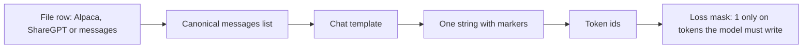
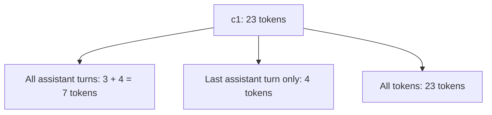
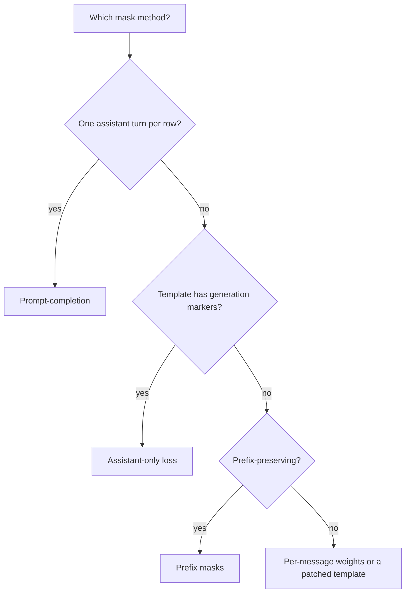
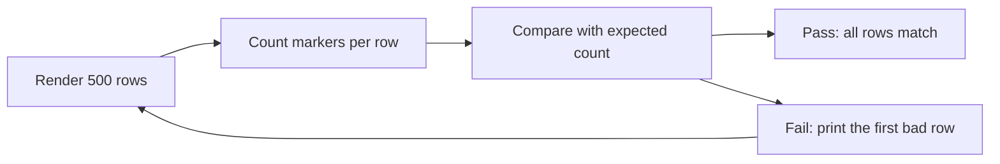

# **Formats and Chat Templates**

**Scope.** Stage 03 Data Engineering, note 02 of 09. Note 01 showed which shapes a trainer reads. This note follows one row all the way from a file on disk to the exact tokens and the exact loss mask the trainer sees. It covers the storage formats (Alpaca, ShareGPT, OpenAI messages), the chat template, special tokens, default system turns, and multi-turn loss masks. Licenses are covered in note 03, deduplication in note 04, and decontamination in note 05.

**Idea.** A conversation is a list of turns, but a model only reads a flat string of tokens. The chat template is the recipe that flattens one into the other, and it adds markers, sometimes a hidden system turn, and decides which tokens the loss can touch. Two datasets with identical words can train differently if their templates or masks differ, and no length histogram will tell you.

**Where the numbers come from.**

- Hand-calculated: every worked example in sections 5, 6 and 9, on a toy tokenizer where one word is one token.
- Measured: every number labelled measured came from the verification script on CPU, using only the Python standard library.
- Expected: how the GPU cells should behave. The sandbox has no GPU, so they were not run, and printed outputs are formats, not results.
- Illustrative: the per-token losses in section 9.5 and the content-length spread in section 9.6.
- From sources: template markers, default system turns, and field names, read from the model files and docs listed in section 18.

**Contents.**

1. The Running Example: One Row Through Two Templates
2. Vocabulary Mapped to the Story
3. Three Core Ideas
4. The Definition in Plain Words, Then Formal
5. Why the Previous Note Is Not Enough
6. The Extra Classic Example: Which Turns Get Trained
7. Formats, Templates and Masks
8. The Render Check on 500 Rows
9. Math Notation, Explained Step by Step
10. Experiment Guide for Jupyter on GPU
11. Limits and When It Fails
12. Common Pitfalls
13. Connection to Language Models and Modern AI
14. Connection to the Next Topic
15. Glossary
16. Self-Test With Answers
17. Key Points
18. Sources and Verification

---

## 1. The Running Example: One Row Through Two Templates

Take row r1 from note 01: "What does softmax do?" with the answer "Gives probabilities." Add a second round to make a short chat, and call it c1:

| turn | role | words |
|---|---|---|
| 1 | user | What does softmax do? |
| 2 | assistant | Gives probabilities. |
| 3 | user | Why exp? |
| 4 | assistant | Keeps scores positive. |

We keep the toy tokenizer from note 01: one word is one token, punctuation is ignored. Now we need a chat template. Two invented templates, with the markers a real one would have:

| template | each turn is written as | once at the start |
|---|---|---|
| A, ChatML style | start marker, role, words, end marker | nothing |
| B, Llama style | header start, role, header end, words, turn end | one begin marker |

So r1 is rendered as:

```text
A: <s> user what does softmax do <e> <s> assistant gives probabilities <e>
B: <b> <h> user </h> what does softmax do <t> <h> assistant </h> gives probabilities <t>
```



**The new ingredient.** Note 01 counted tokens as plain words and took the response share as 3 of 7. Here the template adds markers, so the same row has more tokens and a smaller trained share. This note refines the note 01 number (section 5).

---

## 2. Vocabulary Mapped to the Story

| in the story | name | meaning |
|---|---|---|
| the four turns of c1 | **messages list** | an ordered list of role and content pairs, the canonical form |
| the markers around each turn | **special tokens** | reserved tokens that carry structure, such as a turn end |
| template A or B | **chat template** | the recipe that turns a messages list into one string |
| the extra tokens a template adds | **overhead** | tokens that are not your words |
| the marker that starts the assistant turn when the model must answer | **generation prompt** | the header added at the end so the model knows to write |
| the end marker the model writes last | **end-of-turn token** | the token whose generation tells the system to stop |
| the hidden first turn some templates add | **default system turn** | a system message inserted when you give none |
| tokens the model must produce | **trained span** | assistant words plus their end marker |
| tokens that fill short rows in a batch | **padding** | filler tokens that are never trained on |
| rendering turn by turn gives the same prefix | **prefix-preserving template** | adding a message never changes how earlier messages look |

---

## 3. Three Core Ideas

**Idea 1. The template is part of the data.** The same six words give 12 tokens under template A and 15 under template B. Train with one template and serve with another and the model sees markers it never learned.

**Idea 2. Hidden tokens count.** A default system turn, a date block, or a begin marker is added to every row. They cost tokens and dilute the trained share.

**Idea 3. The mask is a decision, not a default.** Which turns of a chat get a loss depends on your trainer and your format. The default differs across tools (section 7.6).

---

## 4. The Definition in Plain Words, Then Formal

**Plain words.** A **chat template** takes a list of turns and writes one string. Tokenizing that string gives the ids the model reads. A **loss mask** says, for each id, whether the model must learn to produce it.

**Formal.** A template is a function $\mathcal{R}$ from a messages list $M = (m_1, \dots, m_n)$ to a token sequence $\mathcal{R}(M)$ of length $T$. The loss mask is $m_t \in \{0, 1\}$ for $t = 1..T$. It is the **trained span** when $m_t = 1$ exactly on the tokens of assistant content and its end-of-turn token. A template is **prefix-preserving** when, for every $k$, the render of the first $k$ messages is a prefix of the render of all $n$ messages.

The mask is built from prefixes: the tokens of assistant turn $k$ are the ones in $\mathcal{R}(m_1..m_k)$ that are not in $\mathcal{R}(m_1..m_{k-1}, \text{generation prompt})$. This works only if the template is prefix-preserving, which is checked in cell 6.

---

## 5. Why the Previous Note Is Not Enough

Note 01 gave the response share of r1 as $3/7 = 0.4286$ with no template. Real data always has one, so the number changes.

| rendering | total tokens | trained tokens | trained share |
|---|---|---|---|
| no template (note 01) | 7 | 3 | 0.4286 |
| template A | 12 | 3 | 0.2500 |
| template B | 15 | 3 | 0.2000 |
| template A plus a default system turn of 12 words | 27 | 3 | 0.1111 |

Hand check for template A with a default system turn: the system turn adds a start marker, the role, 12 words and an end marker, which is $1 + 1 + 12 + 1 = 15$ tokens. So $12 + 15 = 27$ and $3/27 = 0.1111$. The script matches every row of this table (measured).

**Refinement.** Note 01 section 9.5 gave $r = 3/7$. That is the share without a template. From here on, $r$ is computed after the template.

---

## 6. The Extra Classic Example: Which Turns Get Trained

The single-turn row r1 hides a question: in a four-turn chat, which assistant turns count? Conversation c1 under template A:

| turn | rendered tokens | count |
|---|---|---|
| user 1 | start, user, what, does, softmax, do, end | 7 |
| assistant 1 | start, assistant, gives, probabilities, end | 5 |
| user 2 | start, user, why, exp, end | 5 |
| assistant 2 | start, assistant, keeps, scores, positive, end | 6 |
| total | | 23 |

The start marker and role of an assistant turn belong to the generation prompt, so the trained tokens of assistant 1 are "gives, probabilities, end" and of assistant 2 are "keeps, scores, positive, end".



| mask choice | trained tokens | share of 23 |
|---|---|---|
| all assistant turns | 7 | 0.3043 |
| last assistant turn only | 4 | 0.1739 |
| all tokens | 23 | 1.0000 |

Hand check: $7/23 = 0.3043$ and $4/23 = 0.1739$. The script builds the mask from prefixes and gets 7 and 4 (measured).

**Beginner trap.** Training on all tokens teaches the model to write user turns and markers. Training on the last turn only throws away three trained tokens per extra turn.

---

## 7. Formats, Templates and Masks

### 7.1 The three storage formats

**Intuition.** Different tools wrote different files. Each one is a way to store the same list of turns.

| format | fields | roles | source |
|---|---|---|---|
| Alpaca | `instruction`, `input`, `output`, optional `system`, `history` | implicit: user then assistant | LLaMA-Factory docs |
| ShareGPT | `conversations` of `from` and `value`, optional `system`, `tools` | human, gpt, function_call, observation | LLaMA-Factory docs |
| OpenAI messages | `messages` of `role` and `content`, optional `tools`, `weight` | system, user, assistant, tool | OpenAI docs |

The Anyscale guide describes the OpenAI format as ShareGPT with `role` and `content` in place of `from` and `value`.

**Precise statement.** All three convert to one canonical form, the messages list.

```text
alpaca row      -> user content = instruction, plus a newline and input when input is not empty
                   assistant content = output
sharegpt turns  -> role map: human to user, gpt to assistant, system to system
                   check: human and observation sit at odd positions, gpt and function_call at even
openai messages -> already canonical
```

**Worked example.** `{"instruction": "Explain warmup.", "input": "Keep it short.", "output": "It ramps the rate."}` becomes a user turn "Explain warmup." then a newline then "Keep it short.", and an assistant turn "It ramps the rate."

**Beginner trap.** The joiner between instruction and input is a convention. LLaMA-Factory uses one newline. The source note's code uses a blank line. Either works if you use one everywhere, and mixed joiners across files create hidden variants.

**Beginner trap 2.** In the Alpaca format of LLaMA-Factory, the `history` responses are also learned during SFT. If you put old answers there only as context, they still get a loss.

### 7.2 Tool messages

**Intuition.** A tool call is an assistant turn that contains a call instead of words, followed by a tool result turn.

**Precise statement.** In the OpenAI format, an assistant message may hold `tool_calls` with no `content`, and a `tool` message answers it with a matching `tool_call_id`. The `arguments` field is a JSON string, not an object, and the record carries the `tools` array.

```text
user:      "Weather in Paris?"
assistant: tool_calls = [ {id: call_1, function: {name: get_weather, arguments: "{\"city\": \"Paris\"}"}} ]
tool:      tool_call_id = call_1, content = "{\"temp\": 18}"
assistant: "It is 18 degrees in Paris."
```

**Beginner trap.** Different templates render the tool turn differently. The Qwen2.5 template writes a tool result as a user turn wrapped in tool response tags, so your tool role is not a real role there.

### 7.3 Special tokens and the end of a turn

**Intuition.** The model must learn when to stop, so the stop token has to be inside the trained span.

**Precise statement.** Each family has its own markers. Qwen2.5 uses a start and end marker pair per turn, its `eos_token` is the turn end marker, and its `pad_token` is a different token. Llama 3.1 uses begin of text, header start and header end around the role, and an end-of-turn token, and Meta also lists a separate padding token for fine-tuning.

**Worked example.** From the Qwen2.5 tokenizer config: the end marker has id 151645 and the pad token has id 151643, two different ids. A Llama cookbook issue discusses that the end-of-turn token is the right one to train with while the model config and the tokenizer disagree on the eos id (128001 versus 128009).

**Beginner trap.** Setting the pad token equal to the eos token is common. If the loss code then masks every position whose id equals the pad id, it also masks the real end marker, and the model never learns to stop (section 9.5).

### 7.4 Default system turns

**Intuition.** Some templates add a system turn when you give none.

**Precise statement.** The Qwen2.5 template writes "You are Qwen, created by Alibaba Cloud. You are a helpful assistant." as the first turn when the first message is not a system message. The Llama 3.1 template writes a block with a knowledge cutoff date and "Today Date" even when you pass no system prompt, and the date comes from a template variable called `date_string`.

**Why it matters.** Every row carries these tokens, so they dilute the trained share (section 5). For Llama 3.1 the "Today Date" changes the rendered text on a different day unless you fix `date_string`. Render once and store the text, or pass a fixed date, so that a dataset snapshot is reproducible.

### 7.5 Tokenizing the rendered text

**Precise statement.** The template already contains every special token it needs. After `apply_chat_template(tokenize=False)`, tokenize with `add_special_tokens=False`, as the Hugging Face docs advise, or markers such as a begin token get doubled.

### 7.6 Building the loss mask

**Intuition.** You want the loss on assistant words and their end marker and nothing else.



| method | how | needs | default in |
|---|---|---|---|
| prompt-completion | split into prompt and completion, trainer masks the prompt | a clean split, one assistant turn | TRL for prompt-completion data |
| assistant-only loss | the template marks assistant spans, trainer reads the marks | `generation` markers inside the template | TRL with `assistant_only_loss=True` |
| prefix masks | render prefixes and mark the new tokens | a prefix-preserving template | your own code, cell 6 |
| per-message weight | a 0 or 1 on each assistant message | a platform that reads `weight` | OpenAI format, Fireworks docs |

TRL documents that assistant-only loss needs the template to include the `generation` and `endgeneration` keywords, that it patches templates for known families such as Qwen3, and that most model templates do not include them natively. The Qwen2.5 template read for this note contains no such keyword, so do not assume the flag works on it without testing.

**Defaults differ.** OpenAI treats `weight` as 1 for every assistant message unless you set it. LLaMA-Factory learns every `gpt` and `function_call` turn. TRL with assistant-only loss trains every assistant message. So "all assistant turns" is the usual default, and "last turn only" is a choice you must make.

**Prefix-preserving.** Some templates drop reasoning from earlier assistant turns, which changes how earlier turns render when you add a message. The TRL chat template notes call this property prefix-preserving and say that DeepSeek-R1-distill style templates re-render assistant turns without their reasoning. For such templates the prefix method fails, as the toy template C does in the script.

### 7.7 Comparison and assumptions

| choice | strength | assumption that can fail |
|---|---|---|
| render with the target model's own template | matches how the model is served | the template version is the one you will serve |
| write your own template string | full control, no hidden turns | you must keep it identical at serve time |
| store rendered text | reproducible, no date drift | you must re-render if the template changes |
| store messages, render at train time | flexible | a library update can change the output |

---

## 8. The Render Check on 500 Rows

Note 01 introduced the check "render 500 rows". Here is what to look for.



```text
for each row:
    text = render(messages)
    expected = number of messages, plus 1 if the template adds a default system turn
    assert count of start markers == expected
    assert count of end markers == expected
print rows that fail, and the first failing text
```

**Read this honestly.** The source note says a bimodal length distribution means two templates are mixed. That is unreliable. Two templates differ by a handful of tokens, while real answers differ by hundreds. Section 9.6 shows with numbers that the length histogram does not reveal a mix. Count markers instead.

**Beginner trap.** Looking at one rendered row. A template difference may appear only in multi-turn rows or only in rows with tools.

---

## 9. Math Notation, Explained Step by Step

This section lists every new symbol and formula. Cover the steps, do the calculation yourself on paper, then compare with the boxed value. Symbols from note 01 keep their meaning: $x$, $y_t$, $m_t$, $\ell_t$, $T$, $B$, $V$, $L$.

### 9.1 Notation table

| symbol | read aloud | meaning | in the running example |
|---|---|---|---|
| $n$ | n | number of turns in a conversation | 2 for r1, 4 for c1 |
| $C$ | C | content tokens, the words only | 6 for r1 |
| $k$ | k | overhead tokens per turn | 3 for A, 4 for B |
| $c$ | c | overhead tokens once per conversation | 0 for A, 1 for B |
| $T$ | T | rendered length in tokens | 12 for r1 under A |
| $d$ | d | default system turn tokens | 15 |
| $r$ | r | trained share, trained tokens over $T$ | 0.2500 |
| $m_t$ | m sub t | trained mask, 1 on the trained span | 1 on 3 of 12 |
| $\ell_t$ | ell sub t | token loss at position $t$ | 1.2 for "gives" |
| $\Delta$ | delta | length gap between two templates | 3 |
| $q$ | q | share of rows rendered with template B | 0.5 |
| $\operatorname{Var}$ | variance | spread of lengths squared | 3.5 |
| $W$ | W | padding waste fraction | 0.1944 |
| $T_i$ | T sub i | rendered length of row $i$ in a batch | 12, 13, 15, 18 |

**Reading tips.** The letter $c$ here means a constant overhead and never a count of rows, which was $c_k$ in note 01. The letter $q$ is used for a mixing share so it does not clash with $\pi_\theta$.

### 9.2 Rendered length

$$T = C + k\,n + c$$

**What it says.** The length of a rendered conversation is its words, plus a fixed cost per turn, plus a fixed cost once.

**Worked example.** Row r1: $C = 4 + 2 = 6$ content tokens, $n = 2$ turns.

$$\begin{aligned}
T_A &= 6 + 3 \times 2 + 0 \\[6pt]
    &= 6 + 6 \\[6pt]
    &= \boxed{12} \\[12pt]
T_B &= 6 + 4 \times 2 + 1 \\[6pt]
    &= 6 + 9 \\[6pt]
    &= \boxed{15}
\end{aligned}$$

Conversation c1: $C = 4 + 2 + 2 + 3 = 11$, $n = 4$.

$$\begin{aligned}
T_A &= 11 + 3 \times 4 = \boxed{23} \\[6pt]
T_B &= 11 + 4 \times 4 + 1 = \boxed{28}
\end{aligned}$$

**Extreme case.** If $k = 0$ and $c = 0$, then $T = C$, which is note 01. For a very long chat the term $k\,n$ grows with the number of turns while $C$ may stay small.

**Beginner trap.** Counting only words and then being surprised that the batch does not fit.

**Check.** The render in section 1 and the script both give 12, 15, 23 and 28 (measured).

### 9.3 Overhead share and trained share

$$\text{overhead share} = \frac{k\,n + c + d}{T} \qquad r = \frac{\sum_t m_t}{T}$$

**What it says.** How much of the row is not your words, and how much of the row is trained on.

**Worked example.** Row r1 under B:

$$\begin{aligned}
\text{overhead share} &= \frac{4 \times 2 + 1}{15} \\[6pt]
&= \frac{9}{15} = \boxed{0.6000} \\[12pt]
r &= \frac{3}{15} = \boxed{0.2000}
\end{aligned}$$

Under A: overhead $6/12 = 0.5000$ and $r = 3/12 = \boxed{0.2500}$. With the 15 token default system turn, $T = 27$ and $r = 3/27 = \boxed{0.1111}$.

**Extreme case.** If the answer is 500 tokens, the same 9 overhead tokens are under 2 percent of the row. Overhead hurts most on short rows.

**Beginner trap.** Quoting the note 01 value $3/7$ for a real tokenizer.

### 9.4 Trained tokens in a conversation

$$\sum_t m_t = \sum_{j \,\in\, \text{assistant turns}} \left( C_j + 1 \right)$$

**What it says.** For each assistant turn, the trained tokens are its words $C_j$ plus one end marker. The header (start marker and role) is not trained.

**Worked example.** Conversation c1 with assistant turns of 2 and 3 words:

$$\begin{aligned}
\text{turn 1} &= 2 + 1 = 3 \\[6pt]
\text{turn 2} &= 3 + 1 = 4 \\[6pt]
\sum_t m_t &= 3 + 4 = \boxed{7} \\[10pt]
r &= \frac{7}{23} = \boxed{0.3043}
\end{aligned}$$

Last turn only: $4/23 = \boxed{0.1739}$. All tokens: $23/23 = \boxed{1.0000}$.

**Extreme case.** With $n = 2$ and one assistant turn this reduces to section 9.3. With many short assistant turns the all-assistant mask trains much more than the last-turn mask.

**Beginner trap.** Counting the assistant header as trained. The model never has to write it, since the generation prompt provides it.

**Check.** Matches the table in section 6 and the prefix based mask in the script (measured).

### 9.5 Masked mean and the end marker

$$L = \frac{\sum_t m_t\,\ell_t}{\sum_t m_t} \qquad \frac{\partial L}{\partial z_t} = \frac{m_t}{\sum_s m_s}\,\left(p_t - \mathbf{1}_{y_t}\right)$$

**What it says.** The loss is the mean over trained tokens. The gradient at each trained position is $p - \mathbf{1}_y$, derived in note 01 section 9.4, scaled by one over the number of trained tokens. A masked position gets zero gradient.

**Tiny worked example.** Use illustrative token losses. Assistant 1 has tokens gives, probabilities, end with losses 1.2, 0.9, 0.3. Assistant 2 has keeps, scores, positive, end with losses 1.6, 1.1, 0.7, 0.2.

**Step 1. All assistant turns.**

$$\begin{aligned}
\text{sum} &= (1.2 + 0.9 + 0.3) + (1.6 + 1.1 + 0.7 + 0.2) \\[6pt]
&= 2.4 + 3.6 = 6.0 \\[6pt]
L &= \frac{6.0}{7} = \boxed{0.8571}
\end{aligned}$$

**Step 2. Last turn only.**

$$L = \frac{3.6}{4} = \boxed{0.9000}$$

**Step 3. The end marker masked by mistake.** Remove the two end positions (0.3 and 0.2):

$$\begin{aligned}
\text{sum} &= 6.0 - 0.3 - 0.2 = 5.5 \\[6pt]
L &= \frac{5.5}{5} = \boxed{1.1000}
\end{aligned}$$

**Step 4. The gradient at the first end marker.** A loss of 0.3 means $p = e^{-0.3}$:

$$\begin{aligned}
p &= e^{-0.3} = 0.7408 \\[6pt]
p - 1 &= \boxed{-0.2592} \\[8pt]
\text{scaled by } \tfrac{1}{7} &= \boxed{-0.0370}
\end{aligned}$$

With that position masked the gradient is exactly 0, so nothing pushes the model to raise the probability of stopping.

**Extreme case.** If every trained position is masked, $\sum m_t = 0$ and the mean is undefined, so a row with an empty trained span must be removed.

**Beginner trap.** A higher loss in step 3 looks like a harder dataset. It is a masking bug.

### 9.6 Why the length histogram cannot show a template mix

Suppose a share $q$ of rows use template B and the rest use A, on the same content. Then:

$$\operatorname{Var}(T) = \operatorname{Var}(C) + q\,(1 - q)\,\Delta^2$$

**What it says.** The mix adds a small term to the spread. Two humps appear only when the gap $\Delta$ is larger than about two standard deviations of the content (a standard result for an equal mixture of two bell curves, from general knowledge).

**Worked example.** Four rows with content 6, 7, 8, 9 and $n = 2$. Template A gives 12, 13, 14, 15. Template B gives 15, 16, 17, 18, so $\Delta = 9 - 6 = 3$.

$$\begin{aligned}
\operatorname{Var}(C) &= \frac{2.25 + 0.25 + 0.25 + 2.25}{4} = 1.25 \\[8pt]
q(1-q)\Delta^2 &= 0.5 \times 0.5 \times 9 = 2.25 \\[8pt]
\operatorname{Var}(T) &= 1.25 + 2.25 = \boxed{3.5}
\end{aligned}$$

Direct check on all eight lengths 12 to 18 with mean 15: squared distances are 9, 4, 1, 0, 0, 1, 4, 9, which sum to 28, and $28/8 = 3.5$.

The standard deviation of the content is $\sqrt{1.25} = 1.118$, so $\Delta / 1.118 = \boxed{2.68}$, just above 2. That toy set barely separates.

**Real data (illustrative).** If the content spread is $300$ tokens and $\Delta = 3$, then $\Delta / 300 = \boxed{0.01}$. The mix is invisible.

**Extreme case.** At $q = 0$ or $q = 1$ the extra term is zero, since there is no mix.

**Beginner trap.** Trusting a smooth histogram. Count the markers per row instead (section 8).

### 9.7 Padding waste and batch size per GPU

$$W = 1 - \frac{\sum_i T_i}{B \cdot \max_i T_i} \qquad B_{\max} = \left\lfloor \frac{0.2 \cdot \text{VRAM}}{4\,V\,T} \right\rfloor$$

**What it says.** A batch is padded to its longest row, and the waste is the share of padded positions. The second formula reuses the logits memory rule from note 01 section 9.7, with the same illustrative 20 percent budget, to find the largest batch for a sequence length $T$.

**Worked example, padding.** Four rows of lengths 12, 13, 15, 18:

$$\begin{aligned}
\sum_i T_i &= 12 + 13 + 15 + 18 = 58 \\[6pt]
B \cdot \max T_i &= 4 \times 18 = 72 \\[6pt]
W &= 1 - \frac{58}{72} = \boxed{0.1944}
\end{aligned}$$

**Worked example, batch size.** With $V = 151{,}936$, so $4V = 607{,}744$. For an L4 at $T = 1024$:

$$\begin{aligned}
0.2 \times 24 \times 10^{9} &= 4.8 \times 10^{9} \\[6pt]
4\,V\,T &= 607744 \times 1024 = 622{,}329{,}856 \\[6pt]
B_{\max} &= \left\lfloor \frac{4.8 \times 10^{9}}{622{,}329{,}856} \right\rfloor = \lfloor 7.713 \rfloor = \boxed{7}
\end{aligned}$$

**The GPU ladder, small to large (measured by the script).** Each tier stands for every GPU with that memory, as listed in `00-index.md`.

| GPU tier | VRAM | $B_{\max}$ at $T=512$ | at $T=1024$ | at $T=2048$ |
|---|---|---|---|---|
| T4 | 16 GB | 10 | 5 | 2 |
| L4 | 24 GB | 15 | 7 | 3 |
| L40S | 48 GB | 30 | 15 | 7 |
| A100 80GB or H100 | 80 GB | 51 | 25 | 12 |
| H200 | 141 GB | 90 | 45 | 22 |
| B200 | 180 GB | 115 | 57 | 28 |
| B300 | 288 GB | 185 | 92 | 46 |

$B_{\max}$ is per GPU. With data parallel training each GPU holds its own batch and its own logits, so adding GPUs raises the total batch but not this number.

**Extreme case.** If one row is far longer than the rest, $W$ approaches 1 and the batch is mostly padding. Sorting rows by length before batching, or packing rows, lowers $W$.

**Beginner trap.** Treating $B_{\max}$ as a guarantee. It covers only the logits and the 20 percent share is illustrative, so weights, gradients and activations come on top.

### 9.8 All formulas and answers

| formula | input | answer |
|---|---|---|
| $T = C + kn + c$ for r1, A and B | $C=6$, $n=2$ | 12 and 15 |
| $T$ for c1, A and B | $C=11$, $n=4$ | 23 and 28 |
| overhead share, B | 9 of 15 | 0.6000 |
| $r$, A, B and A with default system | 3 of 12, 15, 27 | 0.2500, 0.2000, 0.1111 |
| $\sum m_t$, c1 | $(2+1) + (3+1)$ | 7 |
| $r$, c1 all assistant, last only | 7 and 4 of 23 | 0.3043, 0.1739 |
| masked mean, all assistant | 6.0 over 7 | 0.8571 |
| masked mean, last only | 3.6 over 4 | 0.9000 |
| masked mean, end markers masked | 5.5 over 5 | 1.1000 |
| gradient at an end marker | $e^{-0.3} - 1$, over 7 | $-0.2592$, $-0.0370$ |
| $\operatorname{Var}(T)$ for the mix | $1.25 + 2.25$ | 3.5 |
| $W$ | lengths 12, 13, 15, 18 | 0.1944 |
| $B_{\max}$, L4, $T=1024$ | $4.8 \times 10^9 / 622{,}329{,}856$ | 7 |

### 9.9 Pen-and-paper rules

1. Always write $T = C + kn + c$ before comparing lengths.
2. The trained span is assistant words plus one end marker per assistant turn.
3. The header of an assistant turn is never trained.
4. Count default system tokens in $d$ and in $T$.
5. A masked position has gradient exactly zero.
6. Divide the loss by the number of ones in the mask, not by $T$.
7. Compare a template mix by its marker counts, not its histogram.
8. Padding waste is one minus total over batch times maximum.
9. Floor the batch size, never round it up.
10. Check each number a second way, and name the section that matches.

---

## 10. Experiment Guide for Jupyter on GPU

These cells run in a GPU notebook: a Lightning AI Studio, a Modal Notebook, or your organization's cluster. They were checked for syntax and not run, since the sandbox has no GPU. Run cells 1 and 2 first. After that each cell can be rerun alone, except that cells 6 to 8 need cell 5.

**Assumptions stated.**

- Model: Qwen2.5-0.5B-Instruct, same as note 01, so the vocabulary is 151,936 and the memory formulas carry over.
- Dataset: the first 500 rows of `trl-lib/Capybara`, which has a `messages` column. Read its license on the dataset card before reuse (note 03 covers licenses).
- Library versions: whatever your Studio has. The `dtype` argument needs a recent transformers.
- Second tokenizer: the Llama 3 family is gated on the Hub. To compare a second template, accept its license and log in, then repeat cell 2 with its name. This is optional.

**The GPU ladder, small to large.** The formulas use VRAM only. The RTX PRO 6000 (96 GB) and consumer RTX cards are not separate tiers, because their memory falls on or between these tiers.

| tier | stands for | where you can run it | dtype | $B_{\max}$ at $T=512$ |
|---|---|---|---|---|
| 16 GB | T4 | Lightning free hours, Modal | float16 | 10 |
| 24 GB | L4, A10 | Lightning free hours (L4), Modal | bfloat16 | 15 |
| 48 GB | L40S | Lightning free hours, Modal | bfloat16 | 30 |
| 80 GB | A100 80GB, H100 | Modal, Lightning paid | bfloat16 | 51 |
| 141 GB | H200 | Modal, Lightning paid | bfloat16 | 90 |
| 180 GB | B200 | Modal | bfloat16 | 115 |
| 288 GB | B300 | Modal, needs CUDA 13.1 or newer | bfloat16 | 185 |

Modal's Starter plan gives $30 of free credit every month, and Lightning's free grant is one time, so plan the bigger tiers on Modal. The Modal docs say Hopper GPUs (H100, H200) have more mature library support than Blackwell GPUs (B200, B300). Check your CUDA and library versions before assuming a Blackwell run works.

```python
# ── Cell 1. Environment and GPU check ────────────────────────────
#    Versions, device, VRAM, capability, seed
#    Pick the dtype from the capability
# ─────────────────────────────────────────────────────────────────
import random
import torch
import transformers
import datasets

random.seed(42)
torch.manual_seed(42)

print("torch", torch.__version__)
print("transformers", transformers.__version__)
print("datasets", datasets.__version__)

props = torch.cuda.get_device_properties(0)
capability = torch.cuda.get_device_capability(0)
print("device", props.name, f"{props.total_memory / 1e9:.1f} GB", capability)

dtype = torch.bfloat16 if capability[0] >= 8 else torch.float16
print("dtype", dtype)
```

```text
torch <version>
transformers <version>
datasets <version>
device <GPU name> <16.x up to 288.x> GB (<major>, <minor>)
dtype <torch.float16 on a T4, torch.bfloat16 on the others>
```

```python
# ── Cell 2. Render c1 and count the default system turn ──────────
#    Same chat with no system message and with an explicit one
#    The difference is the hidden default turn
# ─────────────────────────────────────────────────────────────────
from transformers import AutoTokenizer

model_name = "Qwen/Qwen2.5-0.5B-Instruct"
tokenizer = AutoTokenizer.from_pretrained(model_name)

c1 = [
    {"role": "user", "content": "What does softmax do?"},
    {"role": "assistant", "content": "Gives probabilities."},
    {"role": "user", "content": "Why exp?"},
    {"role": "assistant", "content": "Keeps scores positive."},
]
explicit = [{"role": "system", "content": "Be brief."}] + c1

def count(messages):
    text = tokenizer.apply_chat_template(messages, tokenize=False)
    return len(tokenizer(text, add_special_tokens=False).input_ids)

print(tokenizer.apply_chat_template(c1, tokenize=False))
print("tokens, no system given:", count(c1))
print("tokens, explicit short system:", count(explicit))
```

```text
<|im_start|>system
You are Qwen, created by Alibaba Cloud. You are a helpful assistant.<|im_end|>
<|im_start|>user
What does softmax do?<|im_end|>
...
tokens, no system given: <n>
tokens, explicit short system: <a smaller n>
```

The first lines are expected from the model's template file. The two counts depend on the real tokenizer, and the first should be larger by roughly the length of the default system sentence minus "Be brief."

```python
# ── Cell 3. Convert storage formats to messages ──────────────────
#    Alpaca and ShareGPT rows to the canonical list
#    Check that ShareGPT turns alternate
# ─────────────────────────────────────────────────────────────────
alpaca = {"instruction": "Explain warmup.", "input": "Keep it short.",
          "output": "It ramps the rate."}
sharegpt = [{"from": "human", "value": "Hi"}, {"from": "gpt", "value": "Hello"}]
role_map = {"human": "user", "gpt": "assistant", "system": "system"}

def from_alpaca(row):
    user = row["instruction"] + ("\n" + row["input"] if row["input"] else "")
    return [{"role": "user", "content": user},
            {"role": "assistant", "content": row["output"]}]

def from_sharegpt(turns):
    messages = [{"role": role_map[t["from"]], "content": t["value"]} for t in turns]
    for i, message in enumerate(messages):
        expected = "user" if i % 2 == 0 else "assistant"
        assert message["role"] == expected, f"bad order at turn {i}"
    return messages

print(from_alpaca(alpaca))
print(from_sharegpt(sharegpt))
```

```text
[{'role': 'user', 'content': 'Explain warmup.\nKeep it short.'}, {'role': 'assistant', 'content': 'It ramps the rate.'}]
[{'role': 'user', 'content': 'Hi'}, {'role': 'assistant', 'content': 'Hello'}]
```

```python
# ── Cell 4. Marker count check on 500 rows ───────────────────────
#    Every turn must have one start and one end marker
#    The Qwen template adds one extra system turn when none is given
# ─────────────────────────────────────────────────────────────────
from datasets import load_dataset

data = load_dataset("trl-lib/Capybara", split="train[:500]")
bad, lengths = 0, []

for row in data:
    messages = row["messages"]
    text = tokenizer.apply_chat_template(messages, tokenize=False)
    expected = len(messages) + (0 if messages[0]["role"] == "system" else 1)
    if text.count("<|im_start|>") != expected or text.count("<|im_end|>") != expected:
        bad += 1
    lengths.append(len(tokenizer(text, add_special_tokens=False).input_ids))

lengths.sort()
print("rows with a wrong marker count:", bad, "of", len(data))
print("p50", lengths[250], "p95", lengths[475], "max", lengths[-1])
```

```text
rows with a wrong marker count: <0 if all rows are clean> of 500
p50 <n> p95 <n> max <n>
```

A nonzero count means some rows contain marker text inside their content or a template quirk. Print the first bad row and read it.

```python
# ── Cell 5. Model load and the eos versus pad check ──────────────
#    Load in the dtype from cell 1
#    Print eos and pad tokens
# ─────────────────────────────────────────────────────────────────
from transformers import AutoModelForCausalLM

model = AutoModelForCausalLM.from_pretrained(model_name, dtype=dtype).to("cuda")

print(f"weights memory = {torch.cuda.memory_allocated() / 1e9:.2f} GB")
print("eos", tokenizer.eos_token, tokenizer.eos_token_id)
print("pad", tokenizer.pad_token, tokenizer.pad_token_id)
assert tokenizer.eos_token_id != tokenizer.pad_token_id, "pad equals eos"
```

```text
weights memory = <about 1.0> GB
eos <|im_end|> 151645
pad <|endoftext|> 151643
```

The ids come from the model's tokenizer config. If you try another model whose pad equals eos, the assert fires, and you should set a separate pad token before training.

```python
# ── Cell 6. Sanity check: trained span from prefixes ─────────────
#    Reproduce section 6 on the real tokenizer
#    Each prefix render must be a prefix of the full render
# ─────────────────────────────────────────────────────────────────
def encode(messages, generation=False):
    text = tokenizer.apply_chat_template(
        messages, tokenize=False, add_generation_prompt=generation)
    return tokenizer(text, add_special_tokens=False).input_ids

full_ids = encode(c1)
labels = [-100] * len(full_ids)

for k, message in enumerate(c1):
    if message["role"] != "assistant":
        continue
    prefix = encode(c1[:k], generation=True)
    upto = encode(c1[:k + 1])
    assert upto[:len(prefix)] == prefix and full_ids[:len(upto)] == upto
    labels[len(prefix):len(upto)] = full_ids[len(prefix):len(upto)]

trained = sum(1 for value in labels if value != -100)
print("tokens", len(full_ids), "trained", trained, f"share {trained / len(full_ids):.4f}")
```

```text
tokens <n> trained <n> share <between 0.0 and 1.0>
```

The toy share was $7/23 = 0.3043$. The real share is lower, because the real template adds a default system turn and a newline after each end marker, and the newline counts as trained here. If the assert fails, your template is not prefix-preserving, so use another mask method from section 7.6.

```python
# ── Cell 7. Loss under three masks ───────────────────────────────
#    No optimizer, no training. Training starts in the SFT note
#    Same tokens, three different masks
# ─────────────────────────────────────────────────────────────────
input_ids = torch.tensor([full_ids], device="cuda")
last_start = len(encode(c1[:3], generation=True))
last_only = [-100] * len(full_ids)
last_only[last_start:] = full_ids[last_start:]

masks = {"assistant only": labels, "last turn only": last_only, "all tokens": full_ids}

with torch.no_grad():
    for name, mask in masks.items():
        label_ids = torch.tensor([mask], device="cuda")
        loss = model(input_ids=input_ids, labels=label_ids).loss
        print(f"{name:16s} loss = {loss.item():.4f}")
```

```text
assistant only   loss = <value>
last turn only   loss = <value>
all tokens       loss = <value>
```

```python
# ── Cell 8. Memory and speed against batch size ──────────────────
#    Peak memory at T=512 for batch 1, 2 and 4
#    Compare with the logits formula from note 01
# ─────────────────────────────────────────────────────────────────
import time

for batch in [1, 2, 4]:
    ids = torch.randint(0, model.config.vocab_size, (batch, 512), device="cuda")
    torch.cuda.reset_peak_memory_stats()
    torch.cuda.synchronize()
    start = time.time()
    model(input_ids=ids, labels=ids).loss.backward()
    torch.cuda.synchronize()
    seconds = time.time() - start
    peak = torch.cuda.max_memory_allocated() / 1e9
    logits = batch * 512 * model.config.vocab_size * 4 / 1e9
    print(f"B={batch}  peak {peak:5.2f} GB  logits {logits:4.2f} GB  {batch * 512 / seconds:8.0f} tok/s")
    model.zero_grad(set_to_none=True)
```

```text
B=1  peak <x> GB  logits 0.31 GB  <n> tok/s
B=2  peak <x> GB  logits 0.62 GB  <n> tok/s
B=4  peak <x> GB  logits 1.24 GB  <n> tok/s
```

The logits column is hand-calculated: $4 \times 512 \times 151936 \times 4 = 1.2447 \times 10^9$ bytes. The first pass includes warm-up, so ignore the speed at $B = 1$.

### 10.1 Results table template

| GPU | marker count failures | p95 length | loss assistant only | loss last only | peak GB at B=4 | tok/s at B=4 |
|---|---|---|---|---|---|---|
| T4 | | | | | | |
| L4 | | | | | | |
| L40S | | | | | | |
| A100 80GB or H100 | | | | | | |
| H200 | | | | | | |
| B200 | | | | | | |
| B300 | | | | | | |

The before and after comparison on fixed prompts is skipped, because nothing is trained here. It appears in the SFT note. The tokenizer outputs and the mask do not depend on the GPU, so the first three columns should match across GPUs.

### 10.2 Expected behavior (expected, not yet verified)

- The default system turn makes the no-system count larger than the explicit-system count.
- The all-token loss is not equal to the assistant-only loss, because prompt tokens are easier or harder than answers.
- Peak memory grows with batch size, and part of the growth tracks the logits column.
- Larger GPUs fit larger batches, in line with the $B_{\max}$ table. Speed gains are smaller than the size gains, since a 0.5B model at $B = 4$ may not fill a large GPU.

### 10.3 If you run out of memory

1. Lower the batch size in cell 8, then lower $T$.
2. Use gradient accumulation to keep the effective batch.
3. Turn on gradient checkpointing with `model.gradient_checkpointing_enable()`.
4. Keep half precision weights, as cell 5 does.
5. Sort rows by length before batching to cut padding.

GPU runs are not exactly reproducible, so compare trends, not exact numbers.

---

## 11. Limits and When It Fails

**What the checks need.** A tokenizer that matches the model you will serve, and a person who reads the rendered text.

**Where they fail.**

- The marker count check cannot see a wrong joiner, such as one newline versus two, between instruction and input.
- The prefix method fails on templates that rewrite earlier turns, such as ones that strip earlier reasoning.
- Assistant-only loss depends on `generation` markers that many templates lack, so a flag can be silent or fail.
- Template versions drift. A model repo can change its template, and the same messages then render differently.
- Memory tiers ignore speed, and the batch size formula is per GPU and counts only the logits.
- The toy numbers use one word per token. Real tokenizers split words, so the real shares differ.

---

## 12. Common Pitfalls

1. **Training and serving with different templates.** The model meets markers it never saw.
2. **Doubled special tokens.** Tokenizing a rendered string with default settings adds a begin token twice.
3. **Pad equals eos.** The real end marker can be masked and the model never learns to stop.
4. **Hidden system turns.** Default system and date blocks inflate every row and dilute the trained share.
5. **Date drift.** A "Today Date" in a template changes the text on another day.
6. **Alpaca history is trained.** Old answers meant as context still get a loss.
7. **Mixed joiners.** One newline in some files and a blank line in others.
8. **Trusting a flag.** Check the mask on one row by printing which tokens have labels.

**Debugging checklist.**

- Did I print one rendered row per source and per number of turns?
- Does the marker count match the expected count for all 500 rows?
- Do eos and pad differ?
- Is every prefix render a prefix of the full render?
- Did I count default system tokens in the length?

---

## 13. Connection to Language Models and Modern AI

| topic idea | in a chat model or agent |
|---|---|
| chat template | how a served chat model turns your conversation into tokens, so it must match training |
| generation prompt | the assistant header that makes the model start answering |
| end-of-turn token | what the serving system watches for to stop generation |
| default system turn | the identity or date block a model family was trained with |
| tool turns | how an agent call and its result are written into the context |

**Point 1. Templates are model specific.** Hugging Face documents that chat templates carry the special tokens a model needs and that you should not add them a second time. Qwen2.5 and Llama 3.1 differ in markers, in default system turns and in how tools are written.

**Point 2. Tooling support for masks is uneven.** TRL documents assistant-only loss, needs template markers for it, and bundles patched templates for some families. This is why the prefix method in cell 6 is useful as a template-independent check.

**Point 3. Format fields carry training decisions.** The OpenAI `weight` field and the LLaMA-Factory `history` behavior decide which turns train, and they are easy to miss when converting formats.

**Added (not in the source note).** The overhead formula, the trained-share refinement, the padding and batch size per GPU table, and the marker count check.

---

## 14. Connection to the Next Topic

Next is note 03: the dataset catalog and licenses. It tells you where rows come from and what you may do with them, before you convert and train.

| order | topic | what it adds | status |
|---|---|---|---|
| 01 | Why data and data shapes | shapes, shares, cheap checks | done |
| 02 | Formats and chat templates | conversion, templates, masks | this note |
| 03 | Dataset catalog and licenses | sources and permitted use | next |
| 04 | Quality and deduplication | exact and near-duplicate removal | planned |
| 05 | Decontamination | removing eval leaks | planned |
| 06 | Synthetic data | rubric generation, model collapse | planned |
| 07 | PII and the EU AI Act | scrubbing and documentation | planned |
| 08 | Domain dataset and splits | build, split, version | planned |
| 09 | Pre-flight and acceptance gate | the exit checklist | planned |

The roadmap order was not pasted, so this order is assumed from the Stage 03 split.

---

## 15. Glossary

| term | meaning with the running example |
|---|---|
| **messages list** | the four turns of c1 as role and content pairs |
| **chat template** | template A or B, the recipe that writes the turns as one string |
| **special tokens** | the start and end markers in template A |
| **overhead** | the 6 non-word tokens in r1 under template A |
| **generation prompt** | the start marker and role that open the assistant turn |
| **end-of-turn token** | the end marker the model writes after "probabilities" |
| **default system turn** | the 15 token system turn added when none is given |
| **trained span** | "gives probabilities end", 3 tokens in r1 |
| **padding** | filler added so 12, 13, 15 and 18 token rows share one batch |
| **prefix-preserving template** | a template like A where the first two turns render the same inside c1 |
| **loss mask** | 1 on the trained span and 0 elsewhere |
| **storage format** | the Alpaca, ShareGPT or messages file the row came from |
| **canonical form** | the messages list every file is converted to |
| **joiner** | the newline between instruction and input |

---

## 16. Self-Test With Answers

**Q1.** A conversation has a user turn "Why warmup?" and an assistant turn "Avoids spikes." Find $T$ under templates A and B.

**Q2.** Find the overhead share for template B in Q1.

**Q3.** A chat has three assistant turns of 5 words and three user turns of 4 words, under template A. Find the trained share.

**Q4.** A batch has rows of 10, 20 and 30 tokens. Find the padding waste.

**Q5.** For an L4 at $T = 1024$ and $V = 151{,}936$, find $B_{\max}$ with the 20 percent budget.

**Q6.** Spot the mistake: "I set the pad token to the eos token, which is safe because padding is ignored by the loss."

**Q7.** Spot the mistake: "My length histogram has one hump, so all rows use one template."

**Q8.** Why must a template be prefix-preserving for the prefix mask method?

**Answers.**

**A1.** $C = 2 + 2 = 4$, $n = 2$. Template A: $4 + 3 \times 2 + 0 =$ $\boxed{10}$. Template B: $4 + 4 \times 2 + 1 =$ $\boxed{13}$.

**A2.** $(4 \times 2 + 1)/13 = 9/13 =$ $\boxed{0.6923}$.

**A3.** Content $C = 3 \times 5 + 3 \times 4 = 27$, $n = 6$, so $T = 27 + 3 \times 6 = 45$. Trained tokens $= 3 \times (5 + 1) = 18$. Share $= 18/45 =$ $\boxed{0.4}$.

**A4.** Sum is 60 and $3 \times 30 = 90$, so $W = 1 - 60/90 =$ $\boxed{0.3333}$.

**A5.** $0.2 \times 24 \times 10^9 = 4.8 \times 10^9$ and $607744 \times 1024 = 622{,}329{,}856$. The ratio is 7.713, floored to $\boxed{7}$.

**A6.** If the loss code masks every position whose id equals the pad id, it also masks the real end marker. The model never learns to stop. Use a separate pad token.

**A7.** A template mix shifts lengths by a few tokens, while real content varies by hundreds. In section 9.6 the shift over the spread is 0.01, so a mix is invisible. Count markers per row instead.

**A8.** The method renders prefixes and marks the new tokens. If adding a message changes how earlier turns look, the prefix is not a prefix of the full render, and the marked positions are wrong.

---

## 17. Key Points

1. Convert every storage format to one messages list, then render with the target model's template.
2. Rendered length is $T = C + kn + c$, and real templates also add hidden turns.
3. The trained span is assistant words plus one end marker per assistant turn.
4. Divide the loss by the number of trained tokens, and a masked token has zero gradient.
5. Never let the pad token equal the eos token, or the end marker can be masked.
6. Defaults differ across tools, so decide which assistant turns to train and verify the mask by printing it.
7. Check templates by counting markers per row, not by looking at the length histogram.
8. Render once and store the text, or fix template variables such as dates, so the dataset is reproducible.
9. Pick batch size from the logits budget and sequence length, then check peak memory.

---

## 18. Sources and Verification

**Sources used.**

- Qwen2.5-0.5B-Instruct tokenizer config (chat template, eos and pad tokens), https://huggingface.co/Qwen/Qwen2.5-0.5B-Instruct/raw/main/tokenizer_config.json
- Llama 3.1 prompt format, Meta, https://github.com/meta-llama/llama-models/blob/main/models/llama3_1/prompt_format.md
- Llama 3.1 default date block discussion, https://huggingface.co/meta-llama/Llama-3.1-8B-Instruct/discussions/179
- Llama cookbook issue on the end-of-turn token as eos, https://github.com/meta-llama/llama-cookbook/issues/640
- LLaMA-Factory data README (Alpaca and ShareGPT), https://github.com/hiyouga/LLaMA-Factory/blob/main/data/README.md
- Anyscale dataset preparation guide, https://docs.anyscale.com/llm/fine-tuning/data-preparation
- OpenAI supervised fine-tuning guide, https://developers.openai.com/api/docs/guides/supervised-fine-tuning
- OpenAI cookbook chat fine-tuning data prep, https://developers.openai.com/cookbook/examples/chat_finetuning_data_prep
- Fireworks fine-tuning docs (weight and trainable fields), https://docs.fireworks.ai/fine-tuning/fine-tuning-models
- TRL SFT trainer docs (assistant-only loss), read through Context7 from https://github.com/huggingface/trl/blob/main/docs/source/sft_trainer.md
- TRL chat templates README (prefix-preserving, generation markers), https://github.com/huggingface/trl/blob/main/trl/chat_templates/README.md
- Hugging Face chat templates, https://huggingface.co/docs/transformers/chat_templating
- Modal pricing and GPU docs (the GPU ladder), https://modal.com/pricing and https://modal.com/docs/guide/gpu

**Checked by running code.** The verification script reproduced, with asserts, every hand-calculated number in sections 5, 6, 9 and 16: lengths 12, 15, 23 and 28, trained shares including the default system case, the prefix-built masks of 7 and 4 tokens, the masked means and the end marker gradient, the variance of the template mix, the padding waste, the batch sizes for the seven GPU tiers, and the format conversions. It also confirms that a template that rewrites earlier turns fails the prefix check. All eight code cells in section 10 were checked with `ast.parse`.

**Checked on the web.** The Qwen2.5 default system sentence, its eos and pad tokens, and the absence of a `generation` keyword in its template. The Llama 3.1 markers, default date block and `date_string` variable. The Alpaca and ShareGPT fields, the odd and even turn rule, and the learned history responses. The OpenAI `weight` field and tool call shape. The TRL requirement for `generation` markers and the prefix-preserving idea.

**From general knowledge, not verified here.** The rule that an equal mixture of two bell curves shows two humps only when the gap exceeds about two standard deviations. The 20 percent logits budget is an illustrative choice, not a rule.

**Corrections to the source note.**

- The source says a bimodal length distribution means two templates are mixed. Section 9.6 shows a mix is usually invisible in lengths, so count markers instead. This is my analysis with illustrative numbers, not an experiment.
- The source says ChatML is the standard used by many models. The roles and content list is common, but each model's rendered markers differ, as Llama and Qwen show.
- The source joins instruction and input with a blank line. LLaMA-Factory uses one newline. Either works if you use one joiner everywhere.
- The source prints a Llama 3 example with no hidden turns. The Llama 3.1 template adds a date block by default, so its output differs.
- Corrected from note 01: the response share $3/7$ was the share without a template, and the real value is lower (section 5).