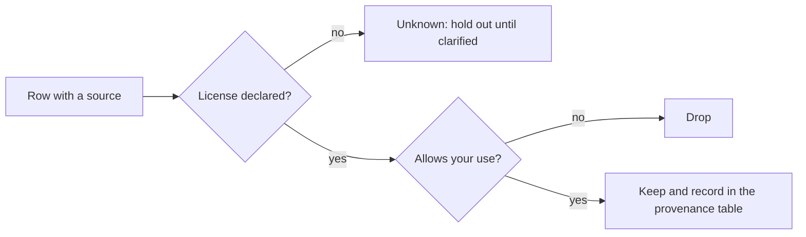
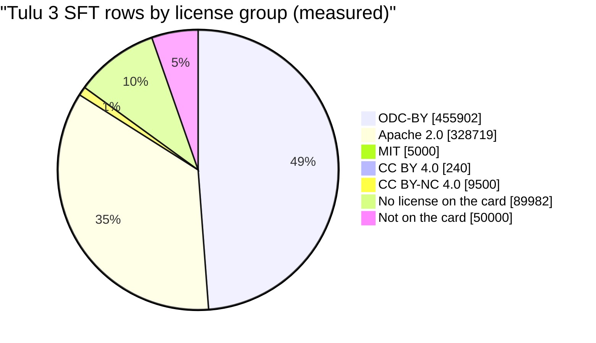
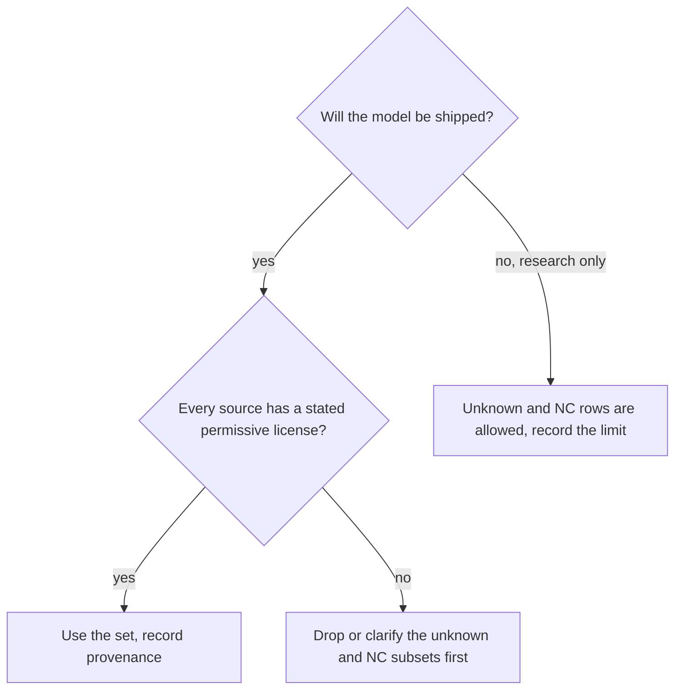
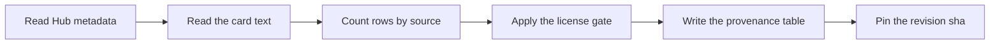

# **Dataset Catalog and Licenses**

**Scope.** Stage 03 Data Engineering, note 03 of 09. Notes 01 and 02 showed how a row becomes tokens and a loss mask. This note asks the question that comes before training: may you use this row at all? It covers the public dataset catalog, how to read a dataset card, what the common licenses allow, and how to audit a mixture row by row. Deduplication is covered in note 04, decontamination in note 05, synthetic data in note 06, and PII and the EU AI Act in note 07. This is not legal advice.

**Idea.** A dataset has a headline license on its page, but the license that matters belongs to each row's source. A mixture can carry one friendly headline over many different terms, and a missing license is not a free license. The audit takes minutes on a CPU, and a mistake found after training can force you to throw the model away.

**Where the numbers come from.**

- Hand-calculated: every worked example in sections 5, 6 and 9.
- Measured: row counts and source counts read from the Hugging Face datasets server, license tags read from the Hub metadata, and every calculation reproduced by the verification script on CPU in the sandbox.
- Expected: how the notebook cells should behave. The cells were not run, since the sandbox has no GPU or Hub login, and printed outputs are formats unless a number says it was measured.
- Illustrative: the length buckets in section 9.4, the 150 token mean row, and the 5,000 tokens per second in section 9.5. Replace them with your own measurements.
- From sources: license names and terms. All Hub metadata was read in November 2026 and can change.

**Contents.**

1. The Running Example: Where Each Row Came From
2. Vocabulary Mapped to the Story
3. Three Core Ideas
4. The Definition in Plain Words, Then Formal
5. Why the Previous Notes Are Not Enough
6. The Extra Classic Example: The Tulu 3 Mixture
7. The Catalog and How to Read It
8. The License Audit Procedure
9. Math Notation, Explained Step by Step
10. Experiment Guide for Jupyter on GPU
11. Limits and When It Fails
12. Common Pitfalls
13. Connection to Language Models and Modern AI
14. Connection to the Next Topic
15. Glossary
16. Self-Test With Answers
17. Key Points
18. Sources and Verification

---

## 1. The Running Example: Where Each Row Came From

Back to the six rows. So far each had a defect in its content. Now each also has a source and a license. These sources are invented for teaching.

| id | source | license | may train on it |
|---|---|---|---|
| r1 | set A | CC BY-SA 3.0 | yes |
| r2 | set A | CC BY-SA 3.0 | yes |
| r3 | set B | Apache 2.0 | yes |
| r4 | set B | Apache 2.0 | yes |
| r5 | benchmark C | MIT | no, it is an evaluation set |
| r6 | logs D | MIT | yes, PII is handled in note 07 |

All six rows pass the shape and template checks of notes 01 and 02. One of them, r5, still must not be trained on. A license check catches what a shape check cannot.



**The new ingredient.** Notes 01 and 02 treated every row as usable. Here each row carries a license, and the dataset carries a **provenance table** with one line per source.

---

## 2. Vocabulary Mapped to the Story

| in the story | name | meaning |
|---|---|---|
| set A, set B, logs D | **source** | where a group of rows came from |
| the license on set A | **license** | the written terms for using a source |
| asking for credit | **attribution** | a duty to name the creator, the BY in a license name |
| set A must stay open | **share-alike** | the SA in a license name, derived material carries the same terms |
| a license that blocks selling | **non-commercial** | the NC in a license name, no commercial use |
| Apache 2.0 or MIT | **permissive license** | few conditions beyond keeping notices |
| the line for each source | **provenance** | recorded source, license and date |
| benchmark C | **evaluation-only set** | data kept for testing, never for training |
| a license shown on the page | **headline license** | the one label for a whole dataset |
| a combined dataset | **mixture** | a dataset built from several sources |
| one source inside a mixture | **subset** | a part of a mixture with its own terms |
| a model wrote the answers | **model-generated data** | data whose terms may include the generator's terms |
| a download that needs a click | **gated** | access requires accepting terms first |

---

## 3. Three Core Ideas

**Idea 1. The license belongs to the source, not the file.** A mixture has a headline license, but each subset keeps its own. In the story, a file holding r1 to r6 would carry three different licenses.

**Idea 2. The most restrictive source sets what you may do.** One non-commercial row makes the whole mixture non-commercial. One share-alike source adds a duty to the whole result.

**Idea 3. A card is a claim, not a guarantee.** Check the metadata, then the subset list, then the real counts. Cards can be incomplete or out of date, as section 6 shows with measured numbers.

---

## 4. The Definition in Plain Words, Then Formal

**Plain words.** A **license audit** reads the license of every source in your data, decides which rows you may train on, and writes down the result.

**Formal.** A dataset has $N$ rows split into sources $k = 1..K$ with $n_k$ rows each. Each source has a license label $g_k$, taken from a set of groups such as permissive, non-commercial, or unknown. Let $\text{OK}$ be the set of groups that allow your use. The usable share is

$$u = \frac{\sum_{k:\, g_k \in \text{OK}} n_k}{N}$$

and your dataset is **clean for the use** when every row you train on has $g_k \in \text{OK}$ and is recorded in the provenance table.

**Check.** The word "unknown" is its own group and is not in $\text{OK}$. A source with no license is not allowed until someone clarifies it.

---

## 5. Why the Previous Notes Are Not Enough

On the toy rows, notes 01 and 02 give a clean render of all six rows. Add the license column and the result changes.

| check | rows kept | share of six |
|---|---|---|
| shape and template (notes 01, 02) | 6 | 1.0000 |
| plus license gate, r5 is evaluation-only | 5 | 0.8333 |

Hand check: $5 / 6 = 0.8333$.

The same gap shows up on real data. The Tulu 3 SFT mixture loads and renders without error. Its headline license is ODC-BY. Yet section 6 shows that only 48.5 percent of its rows are under ODC-BY, 14.9 percent have no license on the card, and 1.0 percent are non-commercial. No shape check reveals that.

**Beginner trap.** Treating "the dataset loads" as "the dataset is usable".

---

## 6. The Extra Classic Example: The Tulu 3 Mixture

The running example has one license per row. A real mixture hides how many licenses can sit under one headline. The Tulu 3 SFT mixture card says the collection is ODC-BY, "different licenses apply to subsets", and "some portions are non-commercial".

**Setup.** Row counts are measured from the `source` column on the datasets server (939,343 rows, 19 sources). Licenses are as written on the dataset card.

| subset | rows | license on the card |
|---|---|---|
| Persona MATH | 149,960 | ODC-BY |
| Evol CodeAlpaca | 107,276 | Apache 2.0 |
| WildChat GPT-4 | 100,000 | ODC-BY |
| Aya | 100,000 | Apache 2.0 |
| FLAN v2 converted | 89,982 | none listed |
| NuminaMath TIR | 64,312 | Apache 2.0 |
| Persona GSM | 49,980 | ODC-BY |
| WildGuardMix | 50,000 | Apache 2.0 |
| WildJailbreak | 50,000 | ODC-BY |
| OpenMath 2 GSM8K | 50,000 | not on the card |
| Persona Python | 34,999 | ODC-BY |
| Persona IF | 29,980 | ODC-BY |
| Persona Algebra | 20,000 | ODC-BY |
| CoCoNot | 10,983 | ODC-BY |
| SciRIFF | 10,000 | ODC-BY |
| No Robots | 9,500 | CC BY-NC 4.0 |
| OASST1 | 7,131 | Apache 2.0 |
| TableGPT | 5,000 | MIT |
| Hardcoded | 240 | CC BY 4.0 |



**Hand check.** Group sums:

| group | calculation | rows | share of 939,343 |
|---|---|---|---|
| ODC-BY | sum of nine subsets | 455,902 | 0.4853 |
| Apache 2.0 | $107276 + 100000 + 64312 + 50000 + 7131$ | 328,719 | 0.3499 |
| MIT | one subset | 5,000 | 0.0053 |
| CC BY 4.0 | one subset | 240 | 0.0003 |
| CC BY-NC 4.0 | one subset | 9,500 | 0.0101 |
| none listed | FLAN v2 | 89,982 | 0.0958 |
| not on the card | OpenMath 2 GSM8K | 50,000 | 0.0532 |

The row total is $455902 + 328719 + 5000 + 240 + 9500 + 89982 + 50000 = 939343$. The script matches every line (measured).

**What the card hides.** The card text says 939,344 samples and lists subset counts that sum to 889,344. The 50,000 row gap is the OpenMath 2 GSM8K subset, which exists in the data but not in the card's list, so its license is not stated there. The card also gives 7,132 for OASST1 where the data has 7,131. Always compare the list with the counts.

**Beginner trap.** Reading the headline and stopping. The non-commercial part is 1.0 percent of rows, but the unknown part is 14.9 percent, fifteen times larger.

---

## 7. The Catalog and How to Read It

### 7.1 Reading a dataset card

**Intuition.** The page has a label, but the label is one field in a record.

**Precise statement.** The Hub stores, per dataset, a list of tags (for example `license:mit` and a size range), a `gated` flag, a revision hash called `sha`, and the card text. A license tag may be missing, and the card text may carry more detail than the tag.

```text
for each dataset:
    read tags: license, size range
    read gated flag
    read card text: subsets, generator model, intended use
    record the sha of the revision you used
```

**Worked example.** The Alpaca record has the tag `license:cc-by-nc-4.0`, and its card says the 52,000 instructions came from OpenAI's text-davinci-003 engine. Two facts matter: a non-commercial license, and a generator with its own terms.

**Beginner trap.** Using the first license you see. Read the card text for subsets and for the generator.

**When to use.** Before you download anything large.

### 7.2 SFT data

Row counts are measured on the datasets server. License tags come from the Hub metadata.

| dataset | rows | license tag | notes |
|---|---|---|---|
| Alpaca | 52,002 | CC BY-NC 4.0 | generated by text-davinci-003, non-commercial |
| Dolly 15k | 15,011 | CC BY-SA 3.0 | written by Databricks employees, card says commercial use is allowed under the terms |
| OpenHermes 2.5 | 1,001,551 | none declared | compilation tagged GPT-4 and distillation |
| Tulu 3 SFT mixture | 939,343 | ODC-BY headline | subset licenses vary (section 6) |
| UltraChat 200k | 515,311 over four splits | MIT | filtered from UltraChat, generated with ChatGPT APIs |
| Capybara (TRL copy) | 15,806 train, 200 test | none declared | used for statistics in notes 01 and 02 |

### 7.3 Preference data

| dataset | rows | license tag | notes |
|---|---|---|---|
| UltraFeedback | 63,967 | MIT | about 64K prompts, four responses each |
| HH-RLHF | 169,352 | MIT | card says it is meant for preference models, not for supervised training of dialogue agents |
| Argilla DPO mix 7k | 7,500 | MIT | small, filtered to highly rated chosen responses |
| Tulu 3 8B preference mixture | 272,898 | ODC-BY headline | card says some portions are non-commercial |

### 7.4 Tool use

| dataset | rows | license tag | notes |
|---|---|---|---|
| Glaive function calling v2 | 112,960 | Apache 2.0 | single and multi-turn |
| xLAM function calling 60k | 60,000 (card) | CC BY 4.0 | gated, you accept terms to download, synthetic |

ToolBench and ToolACE were not checked.

### 7.5 Reasoning and evaluation sets

| dataset | license tag | use |
|---|---|---|
| GSM8K | MIT | train split for training, test split for evaluation |
| MATH (EleutherAI copy) | MIT | same |
| MBPP | CC BY 4.0 | code, check the split |
| HumanEval | MIT | 164 problems, evaluation only |
| MMLU, MMLU-Pro | MIT | evaluation only |
| LiveCodeBench lite | a Creative Commons tag | evaluation, check the exact variant |

The train and test split usage for GSM8K and MATH is general knowledge. AIME and ARC-AGI were not checked.

### 7.6 Pretraining corpora

SmolLM-Corpus has the tag ODC-BY and a size range of 100 million to 1 billion rows. It is pretraining data and not SFT data. Know the difference before you mix them.

### 7.7 What the common licenses mean

This table is general knowledge, not legal advice.

| license | what it allows | what it asks |
|---|---|---|
| MIT, Apache 2.0 | commercial use | keep the notice, Apache also grants patent rights |
| CC BY 4.0, ODC-BY | commercial use | give credit |
| CC BY-SA 3.0 | commercial use | derived material carries the same terms |
| CC BY-NC 4.0 | non-commercial use only | give credit |
| none declared | nothing is granted | ask the owner, treat as unusable until then |

Whether a trained model counts as derived material under share-alike is unsettled, so ask a lawyer before shipping.

### 7.8 The license gate

```text
for each source k:
    group = license tag of k (or "unknown")
    if group is unknown or non-commercial and use is commercial: hold or drop
    if source is an evaluation set: drop from training
    if group is share-alike: record the duty in the provenance table
    record source, license, sha, date
usable share = kept rows / all rows
```

**Worked example.** Toy rows: r5 is an evaluation set, so it is dropped. The share-alike duty from r1 and r2 is recorded. Five rows remain.

**Beginner trap.** Dropping only the NC rows and keeping the unknown ones.

### 7.9 Comparison and assumptions



| choice | strength | assumption that can fail |
|---|---|---|
| use a clean small set (Dolly, UltraFeedback) | easy to defend | it is big enough for your task |
| use a mixture and audit subsets | more data | every subset license is findable |
| generate your own data (note 06) | you control terms | the generator's terms allow it |
| use unknown-license data for research only | fast | you never ship the model |

---

## 8. The License Audit Procedure



1. Read the tags: license, size range, gated flag.
2. Read the card for subset lists and generator names.
3. Count rows by source from the data, not from the card.
4. Apply the gate in section 7.8.
5. Write one provenance line per source into `domain_dataset/03-provenance-table.md`: source, license, rows, sha, date read, decision.
6. Pin the revision sha so the data you trained on can be found again.

**Beginner trap.** Trusting step 2 without step 3, as the Tulu card shows.

---

## 9. Math Notation, Explained Step by Step

This section lists the new symbols and every formula with a worked example. Cover the steps, do the calculation yourself, then compare with the boxed value. The tiny softmax and gradient example is derived in note 01 section 9.4, and this note adds no new model, so it does not repeat it.

### 9.1 Notation table

| symbol | read aloud | meaning | in the running example |
|---|---|---|---|
| $g$ | g | license group of a source | permissive, non-commercial, unknown |
| $n_g$ | n sub g | rows in group $g$ | 455,902 for ODC-BY |
| $\rho_g$ | rho sub g | row share of group $g$ (as in note 01) | 0.4853 |
| $u$ | u | usable share after the license gate | 0.8333 on the toy rows |
| $L_{\text{cut}}$ | L cut | the length where rows are cut | 4096 |
| $T_{\max}$ | T max | longest row the logits allow (note 01) | 5,265 on a 16 GB tier |
| $\bar T$ | T bar | mean tokens per row | 150 |
| $E$ | E | number of epochs | 3 |
| $D$ | D | total tokens processed | 23,400,900 |
| $R$ | R | training speed in tokens per second | 5,000 |

**Reading tips.** The letter $g$ is a license group here and nothing else. The symbol $\rho$ keeps its meaning from note 01, a row share, now computed per group.

### 9.2 Group share and usable share

$$\rho_g = \frac{n_g}{N} \qquad u = \sum_{g \in \text{OK}} \rho_g$$

**What it says.** A group's share of rows, and the share of rows in groups that allow your use.

**Worked example: the Tulu 3 mixture, commercial use, only stated permissive licenses count.**

$$\begin{aligned}
n_{\text{OK}} &= 455902 + 328719 + 5000 + 240 \\[6pt]
&= 789861 \\[10pt]
u &= \frac{789861}{939343} \\[6pt]
&= \boxed{0.8409}
\end{aligned}$$

Unknown rows:

$$\begin{aligned}
n_{\text{unknown}} &= 89982 + 50000 = 139982 \\[6pt]
\rho_{\text{unknown}} &= \frac{139982}{939343} = \boxed{0.1490}
\end{aligned}$$

Dropping only the non-commercial rows keeps $(939343 - 9500)/939343 = \boxed{0.9899}$. The two answers differ by 15 points, and the difference is the unknown rows.

**Toy rows.** $u = 5/6 = \boxed{0.8333}$.

**Extreme case.** If every group is allowed, $u = 1$. If none is, $u = 0$ and there is nothing to train on.

**Beginner trap.** Calling unknown rows allowed, which gives 0.9899 instead of 0.8409.

**Check.** The script matches (measured).

### 9.3 Combined terms: the most restrictive rule

$$\text{commercial}(D) = \bigwedge_{k} \text{commercial}(g_k) \qquad \text{share-alike}(D) = \bigvee_{k} \text{share-alike}(g_k)$$

**What it says.** A mixture is commercially usable only if every source is. It carries a share-alike duty if any source does. The symbol $\bigwedge$ means all, and $\bigvee$ means at least one.

**Worked example.** Toy training rows r1, r2, r3, r4, r6:

| row | license | commercial | share-alike |
|---|---|---|---|
| r1 | CC BY-SA 3.0 | true | true |
| r2 | CC BY-SA 3.0 | true | true |
| r3 | Apache 2.0 | true | false |
| r4 | Apache 2.0 | true | false |
| r6 | MIT | true | false |

All five are commercial, so the commercial result is true. Two are share-alike, so the share-alike result is true.

Now add one row r7 with CC BY-NC 4.0. Its commercial value is false, so the combined commercial value becomes false for the whole set. Six rows are fine and one row spoils the rest.

**Extreme case.** One non-commercial row among a million permissive rows still makes the set non-commercial.

**Beginner trap.** Averaging licenses. There is no "mostly commercial".

### 9.4 Truncation and the smallest tier

$$\text{truncated share} = \frac{\#\{\text{rows with } T_i > L_{\text{cut}}\}}{N} \qquad \text{tier}(L_{\text{cut}}) = \min\{\text{VRAM} : T_{\max}(\text{VRAM}) \ge L_{\text{cut}}\}$$

**What it says.** Rows longer than the cut are truncated or dropped, and the cut you can afford depends on the GPU tier. $T_{\max}$ comes from the logits rule in note 01 section 9.7, with $V = 151{,}936$ and a 20 percent budget (illustrative).

**Worked example.** Illustrative length buckets for 1,000 rows:

| bucket (tokens) | rows |
|---|---|
| up to 2,048 | 700 |
| 2,049 to 4,096 | 200 |
| 4,097 to 8,192 | 70 |
| 8,193 to 16,384 | 25 |
| 16,385 to 32,768 | 5 |

At $L_{\text{cut}} = 4096$:

$$\begin{aligned}
\#\{T_i > 4096\} &= 70 + 25 + 5 = 100 \\[6pt]
\text{truncated share} &= \frac{100}{1000} = \boxed{0.1000}
\end{aligned}$$

**The ladder, small to large (measured by the script).** $T_{\max}$ values are 5,265 (16 GB), 7,898 (24 GB), 15,796 (48 GB), 26,326 (80 GB), 46,401 (141 GB), 59,235 (180 GB) and 94,776 (288 GB).

| $L_{\text{cut}}$ | truncated share | smallest tier that fits |
|---|---|---|
| 2,048 | 0.300 | 16 GB |
| 4,096 | 0.100 | 16 GB |
| 8,192 | 0.030 | 48 GB |
| 16,384 | 0.005 | 80 GB |
| 32,768 | 0.000 | 141 GB |

Read one row: at $L_{\text{cut}} = 8192$ the 24 GB tier gives $T_{\max} = 7898 < 8192$, so it fails, and the 48 GB tier gives $15796 \ge 8192$.

**Extreme case.** At $L_{\text{cut}} = 0$ everything is cut. At the maximum length nothing is cut, but the tier may not exist in your budget.

**Beginner trap.** Choosing the GPU first and the cut second. The long tail of your data decides the tier, or the cut.

### 9.5 Tokens, hours and cost of one run

$$D = N \,\bar T\, E \qquad \text{hours} = \frac{D}{3600\,R} \qquad \text{cost} = \text{hours} \times \text{price}$$

**What it says.** Total tokens processed, time at a measured speed, and money at an hourly price.

**Worked example.** Alpaca sized data: $N = 52{,}002$, an illustrative mean of 150 tokens, 3 epochs, 5,000 tokens per second (illustrative), on a T4 at $0.59 per hour (Modal rate, read in November 2026):

$$\begin{aligned}
D &= 52002 \times 150 \times 3 \\[6pt]
  &= \boxed{23{,}400{,}900} \\[10pt]
\text{hours} &= \frac{23400900}{3600 \times 5000} \\[6pt]
&= \boxed{1.3000} \\[10pt]
\text{cost} &= 1.3 \times 0.59 = \boxed{0.7670}
\end{aligned}$$

That is $0.767 / 30 = \boxed{0.0256}$, about 2.6 percent of one month's $30 Modal credit.

**Extreme case.** If $R$ doubles the cost halves. If $E = 0$ the cost is zero and nothing is learned.

**Beginner trap.** Using a speed measured on one GPU with the price of another. Take $R$ from note 02 cell 8 on the tier you price.

### 9.6 All formulas and answers

| formula | input | answer |
|---|---|---|
| $\rho_g$ for ODC-BY in Tulu 3 | 455,902 of 939,343 | 0.4853 |
| $u$ for Tulu 3, stated permissive | 789,861 of 939,343 | 0.8409 |
| $\rho_{\text{unknown}}$ | 139,982 of 939,343 | 0.1490 |
| rows kept if only NC is dropped | 929,843 of 939,343 | 0.9899 |
| $u$ for the toy rows | 5 of 6 | 0.8333 |
| truncated share at 4,096 | 100 of 1,000 | 0.1000 |
| smallest tier for 8,192 | $T_{\max} \ge 8192$ | 48 GB |
| $D$ | $52002 \times 150 \times 3$ | 23,400,900 |
| hours | $D / (3600 \times 5000)$ | 1.3000 |
| cost on a T4 | $1.3 \times 0.59$ | 0.7670 |

### 9.7 Pen-and-paper rules

1. Count rows by source from the data, never from the card.
2. Unknown is its own group and is not allowed.
3. The headline license covers only the rows whose source says so.
4. One non-commercial row makes the whole set non-commercial.
5. Evaluation-only sets leave the training set before any count.
6. Pick the cut $L_{\text{cut}}$ first, then the smallest tier that fits it.
7. Price a run with the speed measured on that same tier.
8. Write the date you read a price or a license.
9. Record the revision sha with each source.
10. Check each result a second way, and name the section that matches.

---

## 10. Experiment Guide for Jupyter on GPU

These cells run in a GPU notebook: a Lightning AI Studio, a Modal Notebook, or your organization's cluster. They were checked for syntax and not run. Cells 2 and 3 need internet access, and cell 2 may need a Hub login for gated data. Run cell 1 first. Cell 6 uses variables from cells 1 and 5.

**Assumptions stated.**

- Skipped on purpose: model load, the training cell, the before and after comparison, and the memory readout. This note audits data, so none of those apply. Use note 02 cell 8 for the speed in cell 6.
- The model used for lengths is the Qwen2.5-0.5B-Instruct tokenizer, same as notes 01 and 02. The slice is `trl-lib/Capybara`, which has no license tag on the Hub, so use it for statistics only.
- The GPU ladder and the tier prices are in `00-index.md`.

```python
# ── Cell 1. Environment and GPU tier ─────────────────────────────
#    Versions, device, VRAM, and the ladder tier of this GPU
#    Reported memory is slightly off the label, so allow 2 GB
# ─────────────────────────────────────────────────────────────────
import random
import torch
import transformers
import datasets

random.seed(42)
torch.manual_seed(42)
print("torch", torch.__version__, "transformers", transformers.__version__)
print("datasets", datasets.__version__)

vram_gb = torch.cuda.get_device_properties(0).total_memory / 1e9
print("device", torch.cuda.get_device_name(0), f"{vram_gb:.1f} GB")

vocab = 151936
tiers = [16, 24, 48, 80, 141, 180, 288]
tier = max(t for t in tiers if t <= vram_gb + 2)
longest_row = int(0.2 * tier * 1e9 // (4 * vocab))
print("tier", tier, "GB  longest row from logits", longest_row)
```

```text
torch <version> transformers <version>
datasets <version>
device <GPU name> <memory> GB
tier <16, 24, 48, 80, 141, 180 or 288> GB  longest row from logits <5265 up to 94776>
```

```python
# ── Cell 2. License metadata from the Hub ────────────────────────
#    Read the license tag, gated flag and size tag per dataset
#    "none declared" is a result, not an error
# ─────────────────────────────────────────────────────────────────
from huggingface_hub import HfApi

api = HfApi()
names = ["tatsu-lab/alpaca", "databricks/databricks-dolly-15k",
         "teknium/OpenHermes-2.5", "allenai/tulu-3-sft-mixture",
         "openbmb/UltraFeedback", "Anthropic/hh-rlhf",
         "Salesforce/xlam-function-calling-60k", "trl-lib/Capybara"]

for name in names:
    info = api.dataset_info(name)
    licenses = [t.split(":", 1)[1] for t in info.tags if t.startswith("license:")]
    sizes = [t.split(":", 1)[1] for t in info.tags if t.startswith("size_categories:")]
    print(f"{name:38s} {licenses or 'none declared'} gated={info.gated} {sizes}")
```

```text
tatsu-lab/alpaca                       ['cc-by-nc-4.0'] gated=False ['10K<n<100K']
databricks/databricks-dolly-15k        ['cc-by-sa-3.0'] gated=False ['10K<n<100K']
teknium/OpenHermes-2.5                 none declared gated=False ['1M<n<10M']
allenai/tulu-3-sft-mixture             ['odc-by'] gated=False ['100K<n<1M']
...
```

The first four lines are what the Hub metadata showed when this note was written. The rest follow the same format. If any line differs, the Hub changed, and your result is the newer fact.

```python
# ── Cell 3. Sanity check: Tulu 3 source counts ───────────────────
#    Read the source column counts from the datasets server
#    Reproduce the 939,343 total and the group shares of section 9.2
# ─────────────────────────────────────────────────────────────────
import json
import urllib.request

url = ("https://datasets-server.huggingface.co/statistics"
       "?dataset=allenai/tulu-3-sft-mixture&config=default&split=train")
with urllib.request.urlopen(url) as reply:
    stats = json.load(reply)

column = next(c for c in stats["statistics"] if c["column_name"] == "source")
counts = column["column_statistics"]["frequencies"]
total = sum(counts.values())
print("sources", len(counts), "rows", total, "reported", stats["num_examples"])
assert total == stats["num_examples"]

non_commercial = counts["ai2-adapt-dev/no_robots_converted"]
unlisted = (counts["ai2-adapt-dev/flan_v2_converted"]
            + counts["ai2-adapt-dev/tulu_v3.9_open_math_2_gsm8k_50k"])
print(f"non-commercial {non_commercial / total:.4f}  unlisted {unlisted / total:.4f}")
print(f"stated permissive {1 - (non_commercial + unlisted) / total:.4f}")
```

```text
sources 19 rows 939343 reported 939343
non-commercial 0.0101  unlisted 0.1490
stated permissive 0.8409
```

These three numbers were measured when this note was written and match section 9.2. If the dataset is updated, the counts can change.

```python
# ── Cell 4. Provenance table and combined terms ──────────────────
#    One line per row: source, license, may it be trained on
#    Apply the most restrictive rule of section 9.3
# ─────────────────────────────────────────────────────────────────
rows = [
    ("r1", "set A", "CC-BY-SA-3.0", True),
    ("r2", "set A", "CC-BY-SA-3.0", True),
    ("r3", "set B", "Apache-2.0", True),
    ("r4", "set B", "Apache-2.0", True),
    ("r5", "benchmark C", "MIT", False),
    ("r6", "logs D", "MIT", True),
]
commercial = {"CC-BY-SA-3.0": True, "Apache-2.0": True, "MIT": True,
              "CC-BY-NC-4.0": False}

print("id   source       license        train")
for row_id, source, license_name, train in rows:
    print(f"{row_id:4s} {source:12s} {license_name:14s} {train}")

used = [license_name for _, _, license_name, train in rows if train]
print("usable share:", len(used) / len(rows))
print("commercial use allowed:", all(commercial[name] for name in used))
print("share-alike applies:", any(name == "CC-BY-SA-3.0" for name in used))
```

```text
id   source       license        train
r1   set A        CC-BY-SA-3.0   True
...
usable share: 0.8333333333333334
commercial use allowed: True
share-alike applies: True
```

```python
# ── Cell 5. Long tail against the tier of this GPU ───────────────
#    Share of rows longer than each cut point
#    Compare each cut with the longest row this GPU can hold
# ─────────────────────────────────────────────────────────────────
from datasets import load_dataset
from transformers import AutoTokenizer

tokenizer = AutoTokenizer.from_pretrained("Qwen/Qwen2.5-0.5B-Instruct")
data = load_dataset("trl-lib/Capybara", split="train[:500]")
lengths = []

for row in data:
    text = tokenizer.apply_chat_template(row["messages"], tokenize=False)
    lengths.append(len(tokenizer(text, add_special_tokens=False).input_ids))

for cut in [2048, 4096, 8192, 16384]:
    over = sum(1 for n in lengths if n > cut) / len(lengths)
    print(f"cut {cut:6d}  truncated {over:6.1%}  fits this GPU: {cut <= longest_row}")
print("mean tokens", sum(lengths) / len(lengths))
```

```text
cut   2048  truncated <pct>  fits this GPU: <True or False>
cut   4096  truncated <pct>  fits this GPU: <True or False>
cut   8192  truncated <pct>  fits this GPU: <True or False>
cut  16384  truncated <pct>  fits this GPU: <True or False>
mean tokens <n>
```

```python
# ── Cell 6. Tokens, hours and cost of one run ────────────────────
#    Rate comes from note 02 cell 8, so measure it on your GPU first
#    Price per hour is the Modal rate for your tier
# ─────────────────────────────────────────────────────────────────
price_per_hour = {16: 0.59, 24: 0.80, 48: 1.95, 80: 2.50,
                  141: 4.54, 180: 6.25, 288: 7.10}

rows_count = 15806   # Capybara train rows, from the Hub metadata
mean_tokens = sum(lengths) / len(lengths)
epochs = 3
rate = 5000          # tokens per second, replace with your measurement

tokens = rows_count * mean_tokens * epochs
hours = tokens / (rate * 3600)
cost = hours * price_per_hour[tier]
print(f"tokens {tokens:,.0f}  hours {hours:.3f}  cost ${cost:.3f}")
print(f"share of the $30 monthly credit {cost / 30:.2%}")
```

```text
tokens <n>  hours <x>  cost $<y>
share of the $30 monthly credit <z>%
```

For the 80 GB tier the price table uses the A100 80GB rate. The H100 costs more, at $3.95 per hour.

### 10.1 Results table template

| GPU tier | longest row from logits | truncated share at 4,096 | truncated share at 8,192 | rate in tokens per second | cost of one run |
|---|---|---|---|---|---|
| 16 GB (T4) | | | | | |
| 24 GB (L4) | | | | | |
| 48 GB (L40S) | | | | | |
| 80 GB (A100 or H100) | | | | | |
| 141 GB (H200) | | | | | |
| 180 GB (B200) | | | | | |
| 288 GB (B300) | | | | | |

The truncated shares do not depend on the GPU, so those two columns should match across rows. Only the longest row, the speed and the cost change.

### 10.2 Expected behavior (expected, not yet verified)

- Cell 2 shows no license for OpenHermes 2.5 and Capybara, and a license for the others.
- Cell 3 gives 19 sources and the same three shares as section 9.2, unless the dataset was updated.
- Cell 5 shows a truncated share that falls as the cut rises, and a fit flag that turns True from some cut upward.
- Cell 6 shows a cost that scales with price per hour and falls as the rate rises.

### 10.3 If a cell fails

1. Cell 2 or 3 fails with an access error: the network or login is the cause, so check the Studio network settings.
2. A gated dataset refuses: accept its terms on the Hub page and log in.
3. Cell 5 runs slowly: lower the slice from 500 rows to 100.
4. A key is missing in cell 3: the source names in the dataset changed, so print `counts` and read the keys.

GPU and network runs are not exactly reproducible. Compare trends, not exact decimals.

---

## 11. Limits and When It Fails

**What the audit needs.** The Hub metadata, the card text, and a person who reads both.

**Where it fails.**

- A license tag can be missing, wrong, or older than the data. A tag is a claim by the uploader.
- A mixture can contain rows whose own license the card never states, as the 50,000 row subset in section 6 shows.
- Model-generated data may carry the generator's terms on top of the dataset license. The tag does not show this.
- A license tells you what you may do with copyright. It does not tell you whether the rows contain personal data, which is covered in note 07.
- Share-alike for a trained model is unsettled, and I cannot settle it.
- The numbers in this note are one day's snapshot. Datasets and licenses change.

---

## 12. Common Pitfalls

1. **Reading the headline only.** The Tulu 3 headline covers 48.5 percent of its rows.
2. **No license means free.** It means nothing is granted.
3. **Dropping NC but keeping unknown.** In section 9.2 that is 15 points of rows.
4. **Training on an evaluation set.** HumanEval, MMLU and the test splits are for measuring, covered in note 05.
5. **Trusting a card's list.** Count the real rows by source.
6. **Forgetting the generator.** Alpaca came from text-davinci-003, UltraChat from ChatGPT APIs.
7. **Skipping gated terms.** The terms you accept are part of the license.
8. **Not pinning the revision.** Data can change after you read the card, so record the sha.

**Debugging checklist.**

- Do I have a provenance line for every source?
- Does the sum of my source counts equal the dataset size?
- Which rows are in the unknown group, and who can clarify them?
- Is any evaluation set inside my training data?
- Did I write down the date and the sha?

---

## 13. Connection to Language Models and Modern AI

| dataset type | in a chat model or agent |
|---|---|
| SFT mixture such as Tulu 3 | the instruction-following data behind an open chat model (the card says the Tulu 3 models were trained on it) |
| preference data such as UltraFeedback | which of two replies a model learns to prefer |
| function calling data such as xLAM | how an agent learns to emit tool calls |
| evaluation sets such as HumanEval | the test a model is scored on, never its lessons |
| pretraining corpora such as SmolLM-Corpus | the base knowledge before any of the above |

**Point 1. Mixtures are research artifacts.** The Tulu 3 card calls its mixture a research artifact and says different licenses apply to subsets. A model trained on it inherits that mix of terms.

**Point 2. Many catalog sets contain model outputs.** Alpaca came from text-davinci-003, UltraChat from ChatGPT APIs, and OpenHermes 2.5 is tagged GPT-4 distillation. The terms of those generators are separate from the dataset license.

**Point 3. The source stage file and the Hub disagree in several places.** The corrections list in section 18 shows which, so recheck each dataset before every project.

**Added (not in the source note).** The group share formula, the most restrictive rule, the truncation to tier table, and the cost formula.

---

## 14. Connection to the Next Topic

Next is note 04: quality and deduplication. It takes the rows that passed this license gate and removes exact and near-duplicates with hashing and MinHash.

| order | topic | what it adds | status |
|---|---|---|---|
| 01 | Why data and data shapes | shapes, shares, cheap checks | done |
| 02 | Formats and chat templates | conversion, templates, masks | done |
| 03 | Dataset catalog and licenses | sources, licenses, provenance | this note |
| 04 | Quality and deduplication | exact and near-duplicate removal | next |
| 05 | Decontamination | removing eval leaks | planned |
| 06 | Synthetic data | rubric generation, model collapse | planned |
| 07 | PII and the EU AI Act | scrubbing and documentation | planned |
| 08 | Domain dataset and splits | build, split, version | planned |
| 09 | Pre-flight and acceptance gate | the exit checklist | planned |

The roadmap order was not pasted, so this order is assumed.

---

## 15. Glossary

| term | meaning with the running example |
|---|---|
| **source** | set A, set B, logs D, or benchmark C |
| **license** | the terms of set A, CC BY-SA 3.0 |
| **attribution** | the duty to credit set A's authors |
| **share-alike** | the duty to keep set A's terms on derived data |
| **non-commercial** | a license that would block a r7 from a CC BY-NC source |
| **permissive license** | Apache 2.0 for set B, MIT for logs D |
| **provenance** | the table that lists each source, license, date and revision |
| **evaluation-only set** | benchmark C, so r5 leaves training |
| **headline license** | the one label on a mixture such as ODC-BY on Tulu 3 |
| **mixture** | a dataset built from several sources, like the six toy rows |
| **subset** | one source inside a mixture, like Persona MATH inside Tulu 3 |
| **model-generated data** | rows whose answers a model wrote, like Alpaca |
| **gated** | a dataset that asks you to accept terms before download |
| **usable share** | 5 of 6 on the toy rows |

---

## 16. Self-Test With Answers

**Q1.** A dataset has 1,000 rows: 700 under MIT, 200 under CC BY-NC 4.0, and 100 with no license. Find the usable share for commercial use.

**Q2.** A set of 1,000 rows has 500 rows up to 1,024 tokens, 300 up to 2,048, 150 up to 4,096, 40 up to 8,192 and 10 up to 16,384. Find the truncated share at a cut of 4,096.

**Q3.** Find the smallest tier that fits a cut of 12,000, using the $T_{\max}$ values of section 9.4.

**Q4.** A run has 20,000 rows, a mean of 200 tokens, 2 epochs and a speed of 4,000 tokens per second, on an L4 at $0.80 per hour. Find the hours and the cost.

**Q5.** Spot the mistake: "The Tulu 3 mixture is ODC-BY, so I can use every row commercially."

**Q6.** Spot the mistake: "The dataset has no license tag, so nothing forbids commercial use."

**Q7.** The Tulu card lists subsets summing to 889,344 rows, but the dataset has 939,343. Where is the difference?

**Q8.** Why is HumanEval never part of a training set?

**Answers.**

**A1.** Only the MIT rows are stated permissive: $700 / 1000 =$ $\boxed{0.7}$. The NC and unlicensed rows are excluded.

**A2.** Rows above 4,096 are $40 + 10 = 50$, so the share is $50 / 1000 =$ $\boxed{0.05}$.

**A3.** $T_{\max}$ is 7,898 for 24 GB, which is below 12,000, and 15,796 for 48 GB, which is above. The answer is $\boxed{48\ \text{GB}}$.

**A4.** $D = 20000 \times 200 \times 2 = 8{,}000{,}000$. Hours $= 8000000 / (3600 \times 4000) =$ $\boxed{0.5556}$. Cost $= 0.5556 \times 0.80 =$ $\boxed{0.4444}$ dollars.

**A5.** The headline covers only the ODC-BY subsets, 48.5 percent of the rows. One subset is non-commercial (1.0 percent), and 14.9 percent have no license on the card.

**A6.** No license means no permission was granted. Treat the rows as unusable until the owner clarifies.

**A7.** A 50,000 row subset, OpenMath 2 GSM8K, is in the data but missing from the card's list, so its license is not stated there. The card also gives 7,132 for OASST1 where the data has 7,131.

**A8.** It is an evaluation set with 164 problems. Training on it makes your scores measure memory and not skill, covered in note 05.

---

## 17. Key Points

1. A dataset's license belongs to each source, and a mixture's headline hides the rest.
2. Unknown is its own group, and it is not allowed.
3. The most restrictive source sets what you may do with the whole set.
4. Count rows by source from the data, and compare with the card.
5. Evaluation-only sets never enter training.
6. Model-generated data may carry the generator's terms.
7. The usable share is $u = \sum_{g \in \text{OK}} \rho_g$, and on Tulu 3 it is 0.8409.
8. Choose the cut length first, then the smallest GPU tier that fits it.
9. Record source, license, date and revision sha in a provenance table.

---

## 18. Sources and Verification

**Sources used.**

- Hub dataset metadata, read at `https://huggingface.co/api/datasets/<id>` for tatsu-lab/alpaca, databricks/databricks-dolly-15k, teknium/OpenHermes-2.5, allenai/tulu-3-sft-mixture, HuggingFaceH4/ultrachat_200k, stingning/ultrachat, openbmb/UltraFeedback, Anthropic/hh-rlhf, argilla/dpo-mix-7k, allenai/llama-3.1-tulu-3-8b-preference-mixture, Salesforce/xlam-function-calling-60k, glaiveai/glaive-function-calling-v2, openai/openai_humaneval, openai/gsm8k, EleutherAI/hendrycks_math, google-research-datasets/mbpp, TIGER-Lab/MMLU-Pro, cais/mmlu, livecodebench/code_generation_lite, HuggingFaceTB/smollm-corpus, AI-MO/NuminaMath-TIR, HuggingFaceH4/no_robots, ai2-adapt-dev/flan_v2_converted, trl-lib/Capybara
- Datasets server row counts, `https://datasets-server.huggingface.co/size?dataset=<id>`
- Datasets server source counts for Tulu 3, `https://datasets-server.huggingface.co/statistics?dataset=allenai/tulu-3-sft-mixture&config=default&split=train`
- Tulu 3 SFT mixture card, https://huggingface.co/datasets/allenai/tulu-3-sft-mixture
- Hugging Face Hub Python docs for `HfApi.dataset_info`, read through Context7
- Modal pricing, https://modal.com/pricing (hourly prices for the cost formula)

**Checked by running code.** The verification script reproduced, with asserts, every hand-calculated number in sections 5, 6, 9 and 16: the 19 source counts and the 939,343 total, the license group sums and shares, the 889,344 card sum and the 50,000 gap, the usable share, the most restrictive rule, the truncation table and the smallest tier, and the cost calculation. All six cells in section 10 were checked with `ast.parse`.

**Checked on the web.** Every license tag, size range and gated flag in the catalog tables, all row counts except xLAM (the server refused the size request, so 60,000 comes from its card), and the Tulu 3 card's subset list and its non-commercial note.

**From general knowledge, not verified here.** The meaning of each license in section 7.7, the unsettled question of share-alike for trained models, the use of the GSM8K and MATH train splits for training, and the Alpaca duty to follow the generator's terms. I am not a lawyer.

**Not checked.** ToolBench, ToolACE, AIME, ARC-AGI, the multimodal sets, Wikipedia, Common Crawl and The Stack.

**Corrections to the source note.**

- Alpaca was generated by text-davinci-003 per its card, not GPT-3.5. This resolves a flag from note 01.
- OpenHermes 2.5: the source says Apache 2.0 (mostly). The Hub metadata declares no license.
- Tulu 3 SFT: the source says NuminaMath-TIR is cc-by-nc-4.0. Both the card and the repo metadata say Apache 2.0. The only non-commercial subset on the card is No Robots, at 9,500 rows.
- Tulu 3 SFT: the card omits a 50,000 row subset and gives no license for FLAN v2.
- xLAM 60k: the source says CC BY-NC 4.0. The Hub metadata says CC BY 4.0, and the repo is gated.
- Argilla DPO mix: the source says about 50K. The dataset `argilla/dpo-mix-7k` has 7,500 rows.
- UltraChat: the source says 1.5M. The UltraChat 200k card says the original has 1.4M dialogues, and the 200k copy has 515,311 rows across four splits.
- Tulu 3 preference mixture: the source says about 300K. The 8B mixture has 272,898 rows.
- HH-RLHF: the source lists it as preference data, which fits. Its card adds that it is not meant for supervised training of dialogue agents.
- Rounded row counts in the source (52K, 1M, 113K, 64K, 170K) match the measured counts of 52,002, 1,001,551, 112,960, 63,967 and 169,352.