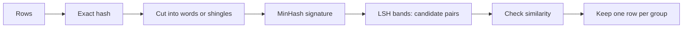
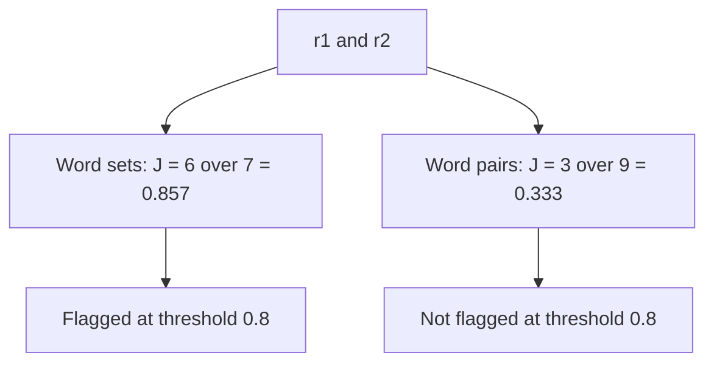

# **Quality and Deduplication**

**Scope.** Stage 03 Data Engineering, note 04 of 09. Notes 01 to 03 told you what a row looks like, how it becomes tokens, and whether you may use it. This note asks whether the rows are worth training on once, or are repeats. It covers the quality checks, exact duplicates, near-duplicates with MinHash and LSH, embedding-based duplicates, and what reading 100 rows can and cannot prove. Decontamination, which is duplicate removal between training and evaluation data, is covered in note 05, synthetic data in note 06, and PII in note 07.

**Idea.** Every row votes in the loss, so a repeat is an extra vote for the same fact. An exact repeat is found with a hash. A reworded repeat needs a similarity score, and the score depends on how you cut the text into pieces. Every step after the hash is probabilistic, so you tune a threshold, check the result by reading, and accept that more removal is not always better.

**Where the numbers come from.**

- Hand-calculated: every worked example in sections 5, 6 and 9.
- Measured: produced by the verification script on tiny CPU values using only the Python standard library. A second CPU check ran `datasketch` 2.0.0, installed from PyPI, in the sandbox to read its chosen banding, its sketch sizes, and its result on the toy rows.
- Expected: how the GPU cells should behave. The sandbox has no GPU, so they were not run, and printed outputs are formats.
- Illustrative: the 1,000 clusters, the 0.9 cosine cut, the 384 dimensions, and the 20 percent memory budget.
- From sources: the FineWeb, Lee et al., SemDeDup and datasketch facts in section 18.

**Contents.**

1. The Running Example: Two Rows That Say the Same Thing
2. Vocabulary Mapped to the Story
3. Three Core Ideas
4. The Definition in Plain Words, Then Formal
5. Why the Previous Notes Are Not Enough
6. The Extra Classic Example: Words Versus Shingles
7. Finding Duplicates: Hashes, MinHash, LSH and Embeddings
8. Reading Rows and Measuring Quality
9. Math Notation, Explained Step by Step
10. Experiment Guide for Jupyter on GPU
11. Limits and When It Fails
12. Common Pitfalls
13. Connection to Language Models and Modern AI
14. Connection to the Next Topic
15. Glossary
16. Self-Test With Answers
17. Key Points
18. Sources and Verification

---

## 1. The Running Example: Two Rows That Say the Same Thing

For this note each toy row is its question and answer joined into one text, and tokens are words as before.

| id | text | words |
|---|---|---|
| r1 | what does softmax do gives probabilities | 6 |
| r2 | what does the softmax do softmax gives probabilities | 8 |
| r3 | why use warmup avoids unstable early updates | 7 |
| r4 | what is attention tokens weigh other tokens | 7 |
| r5 | what does dropout do randomly zeroes activations | 7 |
| r6 | my email is asha@example.com why is my loss flat check the learning rate | 13 |

Rows r1 and r2 are the same fact reworded. An exact-match check cannot see this, because the strings differ. This note finds r2 and removes it, going from 6 rows to 5. The license gate of note 03 and the decontamination of note 05 both concern r5, and this note leaves r5 alone.



**The new ingredient.** Notes 01 to 03 judged each row on its own. Now a row is judged against the other rows, so we need a similarity score between two rows.

---

## 2. Vocabulary Mapped to the Story

| in the story | name | meaning |
|---|---|---|
| a string that matches another exactly | **exact duplicate** | two rows equal after normalization |
| r2 next to r1 | **near-duplicate** | two rows that differ but are very similar |
| lower-casing and trimming | **normalization** | making equal things look equal before comparing |
| a fixed-length fingerprint of a string | **hash** | the output of a function like SHA-256 |
| the words of a row, or runs of words | **shingle** | a piece of a row used as one element |
| 6 shared out of 7 | **Jaccard similarity** | shared elements divided by all elements |
| a few numbers standing in for a row | **MinHash signature** | a short fingerprint that keeps the Jaccard similarity |
| slices of the signature | **band** | a group of signature entries compared together |
| two rows sharing a band | **candidate pair** | a pair worth checking, found without comparing everything |
| the cut at 0.8 | **threshold** | the similarity above which rows count as duplicates |
| a group of linked rows | **duplicate cluster** | rows connected by duplicate pairs |
| a pair we should catch but miss | **false negative** | a real duplicate that is not found |
| a pair we flag by mistake | **false positive** | a non-duplicate that is flagged |
| a vector for the meaning of a row | **embedding** | numbers a model produces for a text |
| the angle between two vectors | **cosine similarity** | a score from the angle between two embeddings |

---

## 3. Three Core Ideas

**Idea 1. Similarity is a number, and you choose the cut.** r1 and r2 score 0.857 on words and 0.333 on word pairs. Which one is right depends on what you want to catch (section 6).

**Idea 2. Compare short fingerprints, not whole rows.** MinHash turns each row into a small signature, and LSH finds likely pairs without comparing every row with every other row.

**Idea 3. Every step after the hash is a probability.** The method can miss real duplicates and flag false ones, so you measure its behavior with an S-curve (section 9.4) and check the result by hand.

---

## 4. The Definition in Plain Words, Then Formal

**Plain words.** Two rows are **exact duplicates** if they are the same after normalization. They are **near-duplicates** if their similarity passes a threshold. **Deduplication** keeps one row from each group of duplicates.

**Formal.** Let row $i$ have a set $S_i$ of pieces (words or shingles). The similarity of two rows is

$$J(S_i, S_j) = \frac{|S_i \cap S_j|}{|S_i \cup S_j|}$$

Rows $i$ and $j$ are near-duplicates when $J(S_i, S_j) \ge J_{\min}$. Link every near-duplicate pair, take the connected groups, and keep one row per group. The number of rows removed is the number of rows minus the number of groups.

**Check.** Two rows with the same word set but different order have $J = 1$. This measure ignores order, which is why section 6 compares it with shingles.

---

## 5. Why the Previous Notes Are Not Enough

After notes 01 to 03 the six rows have valid shapes, clean templates and stated licenses, and r2 is still there. Three numbers show the cost.

**The vote.** Note 01 section 9.3 showed that keeping the duplicate gives softmax 2 of 4 votes and a mean loss of 1.0500, against 1.1333 without it.

**The tokens.** r2 has 8 of the 48 words in the six rows, so $8/48 = 0.1667$ of the tokens go to a repeat. On real data the share is smaller, but it costs GPU time on every epoch.

**The evidence on real data.** Lee et al. report that over 1 percent of the unprompted output of language models trained on standard datasets is copied verbatim from training data, and that deduplicated data cut emitted memorized text about tenfold while the datasets shrank by up to 19 percent. Their data is web text (C4), not instruction data, so treat it as evidence for pretraining and as a warning for fine-tuning.

**Beginner trap.** Believing that exact-match dedup is enough. It would keep r2.

---

## 6. The Extra Classic Example: Words Versus Shingles

The running example hides a design choice: what is one element of a row? Cut r1 and r2 two ways.

**Setup.**

| cut | r1 pieces | r2 pieces |
|---|---|---|
| single words (as a set) | what, does, softmax, do, gives, probabilities (6) | what, does, the, softmax, do, gives, probabilities (7) |
| word pairs (2-shingles) | what does, does softmax, softmax do, do gives, gives probabilities (5) | what does, does the, the softmax, softmax do, do softmax, softmax gives, gives probabilities (7) |

r2 has 8 words but only 7 different ones, since "softmax" appears twice, and a set keeps one copy.



**Hand check.**

| cut | shared | all | Jaccard |
|---|---|---|---|
| single words | 6 | 7 | 0.8571 |
| word pairs | 3 (what does, softmax do, gives probabilities) | $5 + 7 - 3 = 9$ | 0.3333 |

The script gives the same numbers (measured). A MinHash estimate with 128 permutations from `datasketch` gave 0.8438 and 0.3750 (measured, CPU).

**What it hides.** The same pair is a duplicate under one cut and not under the other. FineWeb cuts text into 5-word shingles, which finds copied passages and mostly misses rewording. For short instruction rows, word sets catch reworded repeats such as r2, but they also over-match rows that share many common words.

**Beginner trap.** Copying the 5-gram setting from pretraining papers to short instruction data and then wondering why obvious repeats survive.

---

## 7. Finding Duplicates: Hashes, MinHash, LSH and Embeddings

### 7.1 Exact duplicates with a hash

**Intuition.** Turn each row into a fixed fingerprint. Equal rows give equal fingerprints.

**Precise statement.** Normalize the text, encode it, and hash with SHA-256. Rows with the same digest are exact duplicates. Normalization decides what counts as equal.

```text
key = sha256( lowercase( collapse_whitespace( text ) ) )
keep the first row for each key
```

**Worked example.** Three strings: "What does softmax do?", the same with a trailing space, and the same in lower case. After strip alone there are 2 distinct keys. After lowercasing and collapsing whitespace there is 1 (measured).

**Beginner trap.** The source note strips whitespace only, so a case difference slips through. Also, Python's built-in `hash` for strings changes between runs, so never use it as a stored key.

**Which text to hash.** For instruction data, hash the first user turn. Two rows with the same prompt and different answers are a conflict, and a full-row hash would keep both.

**When to use.** Always first, since it is cheap and exact.

### 7.2 Shingles and Jaccard

**Intuition.** Compare rows by the pieces they share.

**Precise statement.** Cut each row into a set of pieces and compute $J$ as in section 4.

```text
pieces(row) = set of words, or of n consecutive words
J(A, B) = |A intersect B| / |A union B|
```

**Worked example.** Section 6.

**Beginner trap.** Comparing all pairs. For $N$ rows that is $N(N-1)/2$ pairs. For 1,001,551 rows (OpenHermes 2.5) it is 501,551,702,025 pairs (measured).

### 7.3 MinHash

**Intuition.** Instead of comparing two large sets, compare a few numbers that agree with probability equal to the similarity.

**Precise statement.** Give every piece a number with a hash function. The MinHash of a set under that function is the smallest number among its pieces. Two sets have the same MinHash with probability exactly $J$, because the smallest number in the union is equally likely to belong to any element of the union, and the two sets agree when it lies in the intersection. Use $\kappa$ different hash functions to get a signature, and estimate $J$ by the fraction of positions that agree.

```text
for each of kappa hash functions h:
    signature[h] = min over pieces x of h(x)
estimate(J) = fraction of positions where two signatures are equal
```

**Worked example.** Number the 7 different words: what 0, does 1, softmax 2, do 3, gives 4, probabilities 5, the 6. r1 uses ids 0 to 5. r2 uses ids 0 to 6. Four toy hash functions give these values for ids 0 to 6:

| function | ids 0 to 6 | min over r1 | min over r2 | agree |
|---|---|---|---|---|
| $h_1 = (3x + 1) \bmod 7$ | 1, 4, 0, 3, 6, 2, 5 | 0 | 0 | yes |
| $h_2 = (2x + 3) \bmod 7$ | 3, 5, 0, 2, 4, 6, 1 | 0 | 0 | yes |
| $h_3 = (5x + 2) \bmod 7$ | 2, 0, 5, 3, 1, 6, 4 | 0 | 0 | yes |
| $h_4 = (x + 1) \bmod 7$ | 1, 2, 3, 4, 5, 6, 0 | 1 | 0 | no |

Three of four agree, so the estimate is $3/4 = 0.75$ against the true $6/7 = 0.857$. The only way the two sets disagree is when the smallest number belongs to "the", which is 1 of 7 elements, and that explains $6/7$. With 4 functions the estimate is rough, with 128 it is close (section 9.3).

**Beginner trap.** Using few hash functions and trusting the estimate.

**When to use.** Whenever pairwise comparison is too slow.

### 7.4 LSH banding

**Intuition.** Two similar rows have mostly equal signatures. Cut each signature into bands and compare only the bands. Rows that agree on a whole band become candidates.

**Precise statement.** Split $\kappa$ signature entries into $n_{\text{band}}$ bands of $n_{\text{row}}$ entries. A pair is a candidate if at least one band matches in all its entries. For similarity $s$ the probability is

$$P_{\text{cand}}(s) = 1 - \left(1 - s^{\,n_{\text{row}}}\right)^{n_{\text{band}}}$$

```text
for each row:
    for each band: key = (band index, tuple of its entries)
    rows with the same key are candidates
check candidates, link duplicate pairs, keep one row per group
```

**Worked example.** `datasketch` picks the banding itself for a threshold and a signature length. For threshold 0.8 and 128 permutations it chose 9 bands of 13 rows (measured, and my own copy of its search gave the same). FineWeb uses 14 bands of 8 rows on 112 hashes (from the FineWeb paper).

**Beginner trap.** Expecting every pair above the threshold to be found. At 9 by 13 a pair with $J = 0.857$ is a candidate with probability 0.7283, so about 27 percent are missed. On 200 random seeds the toy pair r1 and r2 was found 153 times, which is 0.765, close to the prediction (measured, CPU).

**The source code.** The source note's function inserts the first row specially and then inserts each row that finds no match. Three things to know. The special case for row 0 is not needed. The result depends on row order, since the first row of a group is the one kept. And it keeps one row per group only by greedy matching, while FineWeb links pairs and keeps one random row per connected cluster. Since `datasketch` 2.0.0 the default permutation scheme is 32-bit, which halves sketch memory and changes hash values, so rebuild any saved index.

**When to use.** Datasets too large for pairwise comparison, at threshold 0.8 or similar.

### 7.5 Embedding duplicates

**Intuition.** Reworded rows with no shared words can still mean the same thing, and an embedding model maps them to nearby vectors.

**Precise statement.** The SemDeDup recipe embeds each item, clusters the embeddings with k-means, computes cosine similarity inside each cluster, and treats pairs above a cut as duplicates. Clustering keeps the cost near $N^2/K$ pairs for $K$ equal clusters instead of $N^2$. SemDeDup kept the item farthest from the cluster center.

```text
embed every row with a small encoder, normalize to length 1
cosine(a, b) = a dot b
duplicates = pairs with cosine above the cut, inside each cluster
```

**Worked example.** Two unit vectors at an angle of 0.2 radians have cosine $\cos 0.2 = 0.980$, which passes a 0.9 cut. This is where the GPU enters, covered in section 9.6.

**Beginner trap.** Setting the cut by feel. Two rows near each other in meaning can teach different things, such as two proofs of one theorem, so use conservative cuts and read samples.

**When to use.** After exact and MinHash steps, on the rows left.

### 7.6 Comparison and assumptions

| method | catches | misses | cost | assumption |
|---|---|---|---|---|
| exact hash | identical after normalization | any wording change | one pass on CPU | normalization is right |
| MinHash on word sets | reworded repeats, shared vocabulary | same meaning, new words | signatures, CPU | threshold and cut suit the data |
| MinHash on 5-word shingles | copied passages | rewording | signatures, CPU | rows are long enough to have shingles |
| embeddings with cosine | same meaning, new words | opposite meanings that look close | encoder on GPU plus pair search | the encoder fits your domain |

**Read this honestly.** The evidence in this section is from pretraining text. FineWeb tried MinHash across all 96 snapshots and removed as much as 90 percent of the oldest ones, and the models trained on that were not better than on the non-deduplicated data, while deduplicating each snapshot on its own matched RefinedWeb. More removal is not automatically better. No source I read measured these choices on instruction data.

---

## 8. Reading Rows and Measuring Quality

**Read 100 random rows first.** The source says that if quality is bad in 100 rows it is bad in a million. That is true for common defects and false for rare ones, as section 9.7 shows with numbers.

**Then measure.**

| check | how | covered in |
|---|---|---|
| token length distribution | p50, p95 and max, then pick a cut | note 02 cell 4, note 03 cell 5 |
| source balance | row share and token share per source | note 01 section 6 |
| exact duplicates | hash of the normalized first user turn | this note, cell 2 |
| near-duplicates | MinHash, then read a sample of the flagged pairs | this note, cell 3 |
| semantic duplicates | embeddings on the remaining rows | this note, cell 5 |
| label sanity | per-class counts and a sample check | note 08 |
| refusal and safety coverage | count refusal rows if the model faces the public | note 08 |

**Write a report.** Save counts to `quality/04-dedup-report.json`: rows in, rows removed by the exact pass, rows removed by the near pass, rows removed by the embedding pass, rows out, plus the threshold and signature length you used. The acceptance gate in note 09 asks for this.

**Beginner trap.** Reporting only the final count. Without the per-pass counts you cannot tell which step removed what.

---

## 9. Math Notation, Explained Step by Step

This section lists the new symbols and every formula, with a worked example. Cover the steps, do the calculation yourself, then compare with the boxed value. The softmax and gradient example is derived in note 01 section 9.4, and this note adds no new model computation, so it does not repeat it.

### 9.1 Notation table

| symbol | read aloud | meaning | in the running example |
|---|---|---|---|
| $S_i$ | S sub i | set of pieces of row $i$ | 6 words for r1 |
| $J$ | J | Jaccard similarity | 0.8571 for r1 and r2 |
| $J_{\min}$ | J min | duplicate threshold | 0.8 |
| $\hat J$ | J hat | MinHash estimate of $J$ | 0.75 with 4 functions |
| $\kappa$ | kappa | number of hash functions | 128 |
| $\text{SE}$ | S E | standard error of $\hat J$ | 0.0309 |
| $n_{\text{band}}$, $n_{\text{row}}$ | bands, rows | LSH bands and entries per band | 9 and 13 |
| $s$ | s | true similarity of a pair | 0.857 |
| $P_{\text{cand}}(s)$ | P cand | chance a pair becomes a candidate | 0.7283 |
| $w_{\text{sig}}$ | w sig | bytes per signature entry | 4 |
| $M_{\text{sig}}$ | M sig | signature memory in bytes | 480,943,616 for Tulu 3 |
| $d$ | d | embedding size | 384 |
| $w_{\text{sim}}$ | w sim | bytes per similarity value | 2 |
| $B_{\text{blk}}$ | B block | rows of the similarity matrix done at once | 1,597 on a 16 GB tier |
| $\lambda$ | lambda | share of rows with a defect | 0.01 |
| $n_{\text{read}}$ | n read | rows you read by hand | 100 |

**Reading tips.** The letter $\kappa$ is the number of hash functions, so it never clashes with $k$, the overhead per turn in note 02. Bands and rows have long names so they never clash with $B$ and $b$ from note 01.

### 9.2 Jaccard similarity

$$J(A, B) = \frac{|A \cap B|}{|A \cup B|} = \frac{|A \cap B|}{|A| + |B| - |A \cap B|}$$

**What it says.** The share of all distinct pieces that both rows have.

**Worked example: r1 and r2 as word sets.**

$$\begin{aligned}
|A| &= 6 \\[6pt]
|B| &= 7 \\[6pt]
|A \cap B| &= 6 \\[6pt]
|A \cup B| &= 6 + 7 - 6 = 7 \\[8pt]
J &= \frac{6}{7} = \boxed{0.8571}
\end{aligned}$$

**Worked example: the same rows as word pairs.**

$$\begin{aligned}
|A| &= 5 \qquad |B| = 7 \qquad |A \cap B| = 3 \\[6pt]
|A \cup B| &= 5 + 7 - 3 = 9 \\[8pt]
J &= \frac{3}{9} = \boxed{0.3333}
\end{aligned}$$

**Extreme case.** Identical sets give 1. Sets with nothing in common give 0. All other toy pairs score below 0.4 on words (the largest is r1 with r5 at 0.3, measured).

**Beginner trap.** Forgetting that a set keeps one copy of a repeated word, which is why r2 has 7 and not 8 pieces.

### 9.3 MinHash estimate and its error

$$\Pr[\text{two MinHashes agree}] = J \qquad \hat J = \frac{\#\text{agreeing positions}}{\kappa} \qquad \text{SE} = \sqrt{\frac{J\,(1 - J)}{\kappa}}$$

**What it says.** Each hash function is one coin flip that lands "agree" with probability $J$. The estimate is the average of $\kappa$ flips, and its typical error shrinks with $\sqrt{\kappa}$.

**Worked example.** From section 7.3, 3 of 4 agree:

$$\hat J = \frac{3}{4} = \boxed{0.75}$$

Standard error for $J = 6/7$:

$$\begin{aligned}
J(1 - J) &= \frac{6}{7} \times \frac{1}{7} = 0.12245 \\[8pt]
\text{SE}_{\kappa = 4} &= \sqrt{\frac{0.12245}{4}} = \sqrt{0.03061} = \boxed{0.1750} \\[10pt]
\text{SE}_{\kappa = 128} &= \sqrt{\frac{0.12245}{128}} = \sqrt{0.000957} = \boxed{0.0309}
\end{aligned}$$

The toy error of $0.75 - 0.857 = -0.107$ is inside one standard error of 0.175. With $\kappa = 128$ the typical error is about 0.03, and the real run on r1 and r2 gave $0.8438$, an error of $-0.0134$ (measured).

**Extreme case.** At $J = 0$ or $J = 1$ the error is 0. It is largest at $J = 0.5$.

**Beginner trap.** Quadrupling $\kappa$ halves the error, it does not quarter it.

### 9.4 The LSH S-curve

$$P_{\text{cand}}(s) = 1 - \left(1 - s^{\,n_{\text{row}}}\right)^{n_{\text{band}}} \qquad \text{midpoint} \approx \left(\frac{1}{n_{\text{band}}}\right)^{1 / n_{\text{row}}}$$

**What it says.** A pair is missed only if every band fails to match. One band matches with probability $s^{n_{\text{row}}}$. The curve rises steeply near the midpoint.

**Worked example: FineWeb, 14 bands of 8 rows, $s = 0.7$.**

$$\begin{aligned}
s^{8} &= 0.7^{8} = 0.05765 \\[6pt]
1 - s^{8} &= 0.94235 \\[6pt]
(0.94235)^{14} &= 0.4355 \\[6pt]
P_{\text{cand}} &= 1 - 0.4355 = \boxed{0.5645}
\end{aligned}$$

This matches the 56 percent in the FineWeb paper. Midpoint: $(1/14)^{1/8} = 0.7190$.

**Worked example: the toy pair under `datasketch` banding, 9 bands of 13 rows, $s = 6/7$.**

$$\begin{aligned}
s^{13} &= 0.857143^{13} = 0.13480 \\[6pt]
(1 - 0.13480)^{9} &= 0.27167 \\[6pt]
P_{\text{cand}} &= \boxed{0.7283}
\end{aligned}$$

**The two curves (measured by the script).**

| $s$ | 14 by 8 (FineWeb) | 9 by 13 (threshold 0.8, 128 hashes) |
|---|---|---|
| 0.50 | 0.0533 | 0.0011 |
| 0.60 | 0.2111 | 0.0117 |
| 0.70 | 0.5645 | 0.0839 |
| 0.75 | 0.7716 | 0.1946 |
| 0.80 | 0.9235 | 0.3988 |
| 0.85 | 0.9884 | 0.6864 |
| 0.90 | 0.9996 | 0.9286 |
| 0.95 | 1.0000 | 0.9985 |

The 9 by 13 curve has midpoint 0.8445. At exactly the 0.8 threshold only about 40 percent of pairs are found, and above 0.9 nearly all. The search the library does balances the missed share against the falsely flagged share, so its curve sits near the threshold and not on it.

**Extreme case.** One row per band ($n_{\text{row}} = 1$) gives $1 - (1 - s)^{n_{\text{band}}}$, so many unrelated pairs become candidates. One band ($n_{\text{band}} = 1$) gives $s^{n_{\text{row}}}$, which is strict.

**Beginner trap.** Reading the threshold as a guarantee. Pairs near it are caught only some of the time.

### 9.5 Signature memory

$$M_{\text{sig}} = N \cdot \kappa \cdot w_{\text{sig}}$$

**What it says.** One signature entry per hash function per row. This is CPU memory.

**Worked example.** Tulu 3 SFT mixture, 939,343 rows, $\kappa = 128$, 32-bit entries:

$$\begin{aligned}
M_{\text{sig}} &= 939343 \times 128 \times 4 \\[6pt]
&= 939343 \times 512 \\[6pt]
&= \boxed{480{,}943{,}616}\ \text{bytes} \approx 0.481\ \text{GB}
\end{aligned}$$

The older 64-bit scheme doubles it to 0.962 GB. For OpenHermes 2.5 (1,001,551 rows) it is 0.513 GB and 1.026 GB. The index that holds the band tables adds more, which I did not measure.

**Extreme case.** Doubling $\kappa$ doubles the memory and gives a better estimate, as section 9.3 shows.

**Beginner trap.** Expecting this to need a GPU. MinHash runs on a CPU.

### 9.6 Dense similarity on the GPU ladder

$$M_{\text{sim}} = N^{2}\, w_{\text{sim}} \qquad N_{\max} = \left\lfloor \sqrt{\frac{0.2 \cdot \text{VRAM}}{w_{\text{sim}}}} \right\rfloor \qquad B_{\text{blk}} = \left\lfloor \frac{0.2 \cdot \text{VRAM}}{w_{\text{sim}}\, N} \right\rfloor$$

**What it says.** An $N$ by $N$ matrix of 16-bit similarities takes $2N^2$ bytes. Allow it 20 percent of the VRAM (illustrative) and solve for $N$. If $N$ is larger, compute $B_{\text{blk}}$ rows at a time, so the number of blocks is $\lceil N / B_{\text{blk}} \rceil$.

**Worked example.** An L4 (24 GB tier):

$$\begin{aligned}
0.2 \times 24 \times 10^{9} &= 4.8 \times 10^{9} \\[6pt]
\frac{4.8 \times 10^{9}}{2} &= 2.4 \times 10^{9} \\[6pt]
N_{\max} &= \left\lfloor \sqrt{2.4 \times 10^{9}} \right\rfloor = \boxed{48{,}989}
\end{aligned}$$

**The ladder, small to large (measured by the script).** Tiles for $N = 1{,}001{,}551$ rows (OpenHermes 2.5):

| GPU tier | VRAM | $N_{\max}$ | $B_{\text{blk}}$ | blocks |
|---|---|---|---|---|
| T4 | 16 GB | 40,000 | 1,597 | 628 |
| L4 | 24 GB | 48,989 | 2,396 | 419 |
| L40S | 48 GB | 69,282 | 4,792 | 210 |
| A100 80GB or H100 | 80 GB | 89,442 | 7,987 | 126 |
| H200 | 141 GB | 118,743 | 14,078 | 72 |
| B200 | 180 GB | 134,164 | 17,972 | 56 |
| B300 | 288 GB | 169,705 | 28,755 | 35 |

**The work does not shrink.** For $d = 384$ the pair products take $2N^2 d = 2 \times (1{,}001{,}551)^2 \times 384 = 7.70 \times 10^{14}$ operations at any tier. A bigger GPU needs fewer, larger blocks and does each faster, but the total work is fixed. SemDeDup's clustering cuts it by comparing only inside clusters. With an illustrative $K = 1000$ equal clusters the pair count falls from $5.02 \times 10^{11}$ to about $N^2 / K = 1.0 \times 10^{9}$.

**Extreme case.** At $N = 100{,}000$ the matrix is $10^{10} \times 2 = 20$ GB, which is above the 20 percent budget on every tier below 141 GB. At $N = 10^{6}$ it is 2 TB, which fits no tier.

**Beginner trap.** Treating $N_{\max}$ as a guarantee. The comparison and the upper-triangle step make extra copies, so the real peak is a few times the matrix (cell 6).

### 9.7 What reading 100 rows can prove

$$P_{\text{seen}} = 1 - (1 - \lambda)^{n_{\text{read}}} \qquad \lambda_{95\%} = 1 - 0.05^{\,1 / n_{\text{read}}} \approx \frac{3}{n_{\text{read}}}$$

**What it says.** The first is the chance you see at least one bad row when a share $\lambda$ are bad. The second is the 95 percent upper bound on $\lambda$ after reading $n$ rows and finding none (the "rule of three" is general knowledge).

**Worked example. A 1 percent defect, 100 rows read.**

$$\begin{aligned}
(1 - 0.01)^{100} &= 0.366 \\[6pt]
P_{\text{seen}} &= 1 - 0.366 = \boxed{0.6340}
\end{aligned}$$

A 5 percent defect gives $1 - 0.95^{100} = \boxed{0.9941}$.

**Worked example. Nothing found in 100 rows.**

$$\begin{aligned}
0.05^{1/100} &= e^{\ln(0.05)/100} = e^{-0.02996} = 0.9705 \\[6pt]
\lambda_{95\%} &= 1 - 0.9705 = \boxed{0.0295}
\end{aligned}$$

You can say only that fewer than about 3 percent are bad. To have 95 percent chance of catching a 1 percent defect you must read $\lceil \ln 0.05 / \ln 0.99 \rceil = \boxed{299}$ rows. For a 5 percent defect, 59 rows.

**Extreme case.** A defect at 0.1 percent needs about 2,995 rows to see with 95 percent probability.

**Beginner trap.** Reading 100 clean rows and certifying the dataset. A 1 percent defect is missed entirely 36.6 percent of the time.

### 9.8 All formulas and answers

| formula | input | answer |
|---|---|---|
| $J$ on word sets | 6 shared of 7 | 0.8571 |
| $J$ on word pairs | 3 shared of 9 | 0.3333 |
| $\hat J$ with 4 functions | 3 of 4 agree | 0.75 |
| $\text{SE}$, $\kappa = 4$ and $128$ | $J = 6/7$ | 0.1750 and 0.0309 |
| $P_{\text{cand}}$ FineWeb at $s = 0.7$ | 14 by 8 | 0.5645 |
| $P_{\text{cand}}$ toy pair | 9 by 13 at $s = 6/7$ | 0.7283 |
| $M_{\text{sig}}$ Tulu 3 | $939343 \times 128 \times 4$ | 480,943,616 bytes |
| $N_{\max}$ on 24 GB | $\sqrt{2.4 \times 10^9}$ | 48,989 |
| $B_{\text{blk}}$ on 16 GB at $N = 1{,}001{,}551$ | $3.2 \times 10^9 / (2N)$ | 1,597 |
| $P_{\text{seen}}$, 1 percent defect | 100 rows | 0.6340 |
| $\lambda_{95\%}$, none in 100 rows | $1 - 0.05^{1/100}$ | 0.0295 |
| rows to read for a 1 percent defect | $\lceil \ln 0.05 / \ln 0.99 \rceil$ | 299 |

### 9.9 Pen-and-paper rules

1. Write the pieces first (words or shingles), because the answer depends on them.
2. A set keeps one copy of each piece.
3. $J$ is shared over all distinct, and all distinct is $|A| + |B| - |A \cap B|$.
4. A MinHash agreement is one coin flip with chance $J$.
5. Standard error is $\sqrt{J(1-J)/\kappa}$, so four times the hashes halves it.
6. A pair is missed only when every band fails.
7. Near the threshold the LSH answer is a probability, not a yes.
8. Signature memory is rows times hashes times bytes.
9. A dense similarity matrix grows with the square of the rows.
10. Reading $n$ clean rows bounds the defect rate by about $3/n$, and no lower.

---

## 10. Experiment Guide for Jupyter on GPU

These cells run in a GPU notebook: a Lightning AI Studio, a Modal Notebook, or your organization's cluster. They were checked for syntax and not run. Cells 2 to 4 run on the CPU, and cells 5 and 6 use the GPU. Run cell 1 first. Cells 3 to 6 reuse the `prompts` list from cell 2, and cell 6 reuses `torch`.

**Assumptions stated.**

- Install first: `pip install datasketch` (version 2 or newer, which has the 32-bit default scheme).
- Data: the first 2,000 rows of `trl-lib/Capybara`, which has no license on the Hub, so use it for statistics only. The key for each row is its first user turn.
- Encoder: `sentence-transformers/all-MiniLM-L6-v2` (Apache 2.0 tag, 384 dimensions, about 22 million parameters). The mean pooling in cell 5 is the documented recipe for this encoder, so check its card.
- Skipped on purpose: the language model load, the training cell and the before and after comparison, since this note cleans data. Cell 6 stands in for the memory and speed readout.

**The GPU ladder.** Cells 1 and 6 use the same tiers as before: 16 GB (T4), 24 GB (L4, A10), 48 GB (L40S), 80 GB (A100 80GB, H100), 141 GB (H200), 180 GB (B200) and 288 GB (B300). The dense similarity limits are in section 9.6.

```python
# ── Cell 1. Environment and GPU tier ─────────────────────────────
#    Versions, device, VRAM, ladder tier and the largest dense matrix
#    Reported memory is slightly off the label, so allow 2 GB
# ─────────────────────────────────────────────────────────────────
import math
import random
import torch
import transformers
import datasets

random.seed(42)
torch.manual_seed(42)
print("torch", torch.__version__, "transformers", transformers.__version__)
print("datasets", datasets.__version__)

vram_gb = torch.cuda.get_device_properties(0).total_memory / 1e9
print("device", torch.cuda.get_device_name(0), f"{vram_gb:.1f} GB")

tiers = [16, 24, 48, 80, 141, 180, 288]
tier = max(t for t in tiers if t <= vram_gb + 2)
n_max = math.isqrt(int(0.2 * tier * 1e9 / 2))
print("tier", tier, "GB  largest dense matrix rows", n_max)
```

```text
torch <version> transformers <version>
datasets <version>
device <GPU name> <memory> GB
tier <16 up to 288> GB  largest dense matrix rows <40000 up to 169705>
```

```python
# ── Cell 2. Exact duplicates on the first user turn ──────────────
#    Normalize, hash with SHA-256, count distinct keys
#    Strip-only key versus lower-case, whitespace-collapsed key
# ─────────────────────────────────────────────────────────────────
import hashlib
from datasets import load_dataset

data = load_dataset("trl-lib/Capybara", split="train[:2000]")
prompts = [next(m["content"] for m in row["messages"] if m["role"] == "user")
           for row in data]

strip_keys, norm_keys = set(), set()
for prompt in prompts:
    strip_keys.add(hashlib.sha256(prompt.strip().encode("utf-8")).hexdigest())
    collapsed = " ".join(prompt.lower().split())
    norm_keys.add(hashlib.sha256(collapsed.encode("utf-8")).hexdigest())

print("rows", len(prompts))
print("distinct after strip", len(strip_keys))
print("distinct after lower and whitespace", len(norm_keys))
```

```text
rows 2000
distinct after strip <n>
distinct after lower and whitespace <a number at most the line above>
```

```python
# ── Cell 3. Near-duplicates with MinHash and LSH ─────────────────
#    Word sets versus 3-word shingles, threshold 0.8, 128 permutations
#    Keep a row only when no earlier kept row matches
# ─────────────────────────────────────────────────────────────────
from datasketch import MinHash, MinHashLSH

def signature(pieces):
    mh = MinHash(num_perm=128)
    for piece in pieces:
        mh.update(piece.encode("utf-8"))
    return mh

def count_kept(piece_sets):
    lsh = MinHashLSH(threshold=0.8, num_perm=128)
    kept = 0
    for i, pieces in enumerate(piece_sets):
        mh = signature(pieces)
        if not lsh.query(mh):
            lsh.insert(i, mh)
            kept += 1
    return kept

tokens = [p.lower().split() for p in prompts]
words = [set(t) for t in tokens]
triples = [{" ".join(t[i:i + 3]) for i in range(max(len(t) - 2, 1))} for t in tokens]
print("kept with word sets", count_kept(words), "of", len(prompts))
print("kept with 3-word shingles", count_kept(triples), "of", len(prompts))
```

```text
kept with word sets <n> of 2000
kept with 3-word shingles <n> of 2000
```

```python
# ── Cell 4. Sanity check: the toy pair r1 and r2 ─────────────────
#    Reproduce 6 over 7 and 3 over 9 from section 6
#    The 128-permutation estimate should land within about 0.04
# ─────────────────────────────────────────────────────────────────
r1 = "what does softmax do gives probabilities".split()
r2 = "what does the softmax do softmax gives probabilities".split()

def shingles(words_list, size):
    return {" ".join(words_list[i:i + size]) for i in range(len(words_list) - size + 1)}

cuts = [("words", set(r1), set(r2)),
        ("bigrams", shingles(r1, 2), shingles(r2, 2))]
for name, first, second in cuts:
    exact = len(first & second) / len(first | second)
    estimate = signature(first).jaccard(signature(second))
    print(f"{name:8s} exact {exact:.4f}  estimate {estimate:.4f}")
```

```text
words    exact 0.8571  estimate 0.8438
bigrams  exact 0.3333  estimate 0.3750
```

These two lines were measured on a CPU with `datasketch` 2.0.0 and its default seed. A different seed changes the estimates by about the standard error, 0.03.

```python
# ── Cell 5. Semantic duplicates with embeddings on the GPU ───────
#    Mean-pooled MiniLM vectors in half precision, cosine matrix
#    Count prompt pairs above 0.9
# ─────────────────────────────────────────────────────────────────
from transformers import AutoModel, AutoTokenizer

name = "sentence-transformers/all-MiniLM-L6-v2"
encoder_tokenizer = AutoTokenizer.from_pretrained(name)
encoder = AutoModel.from_pretrained(name, dtype=torch.float16).to("cuda").eval()

vectors = []
with torch.no_grad():
    for start in range(0, len(prompts), 64):
        batch = encoder_tokenizer(prompts[start:start + 64], padding=True, truncation=True,
                                  max_length=128, return_tensors="pt").to("cuda")
        hidden = encoder(**batch).last_hidden_state
        mask = batch["attention_mask"].unsqueeze(-1).to(hidden.dtype)
        pooled = (hidden * mask).sum(1) / mask.sum(1)
        vectors.append(torch.nn.functional.normalize(pooled, dim=-1))

embeddings = torch.cat(vectors)
similarity = embeddings @ embeddings.T
print("embeddings", tuple(embeddings.shape))
print("pairs above 0.9:", (torch.triu(similarity, diagonal=1) > 0.9).sum().item())
```

```text
embeddings (2000, 384)
pairs above 0.9: <n>
```

```python
# ── Cell 6. Memory and speed of the similarity matrix ────────────
#    Random unit vectors, N = 2000, 4000, 8000
#    Compare peak memory with N squared times 2 bytes
# ─────────────────────────────────────────────────────────────────
import time

for n in [2000, 4000, 8000]:
    vectors = torch.randn(n, 384, device="cuda", dtype=torch.float16)
    vectors = torch.nn.functional.normalize(vectors, dim=-1)
    torch.cuda.reset_peak_memory_stats()
    torch.cuda.synchronize()
    start = time.time()
    similarity = vectors @ vectors.T
    count = (torch.triu(similarity, diagonal=1) > 0.9).sum().item()
    torch.cuda.synchronize()
    peak = torch.cuda.max_memory_allocated() / 1e9
    print(f"N={n:5d}  peak {peak:5.2f} GB  matrix {n * n * 2 / 1e9:5.2f} GB  {time.time() - start:.3f} s")
    del similarity
```

```text
N= 2000  peak <x> GB  matrix 0.01 GB  <t> s
N= 4000  peak <x> GB  matrix 0.03 GB  <t> s
N= 8000  peak <x> GB  matrix 0.13 GB  <t> s
```

The matrix column is hand-calculated: $8000^2 \times 2 = 1.28 \times 10^8$ bytes. The peak should sit above it, because the upper-triangle step and the comparison make extra copies.

### 10.1 Results table template

| GPU tier | $N_{\max}$ (cell 1) | exact distinct after strip | kept, word sets | kept, 3-shingles | pairs above 0.9 | peak GB at N=8000 |
|---|---|---|---|---|---|---|
| 16 GB (T4) | | | | | | |
| 24 GB (L4) | | | | | | |
| 48 GB (L40S) | | | | | | |
| 80 GB (A100 or H100) | | | | | | |
| 141 GB (H200) | | | | | | |
| 180 GB (B200) | | | | | | |
| 288 GB (B300) | | | | | | |

The exact and MinHash counts run on the CPU, so they should match across GPUs. Only $N_{\max}$ and the memory and speed columns depend on the tier. The embedding pair count can differ slightly across GPUs because half-precision arithmetic is not identical.

### 10.2 Expected behavior (expected, not yet verified)

- The distinct count after lower-casing and whitespace collapsing is at most the strip-only count.
- Word sets flag more pairs than 3-word shingles on short prompts, so more rows are kept with shingles.
- The pair count in cell 5 is a count of semantically close prompts, which can include rows MinHash did not flag.
- The peak memory in cell 6 is a few times the matrix size and grows about four times when $N$ doubles.
- Larger GPUs finish faster, though the small $N$ here may not fill them.

### 10.3 If you run out of memory

1. Lower $N$ in cell 6, or compute the similarity matrix in blocks of $B_{\text{blk}}$ rows from section 9.6.
2. Lower the batch size from 64 in cell 5.
3. Lower `max_length` from 128.
4. Keep half precision, as cells 5 and 6 do.
5. Move to a larger tier, or cluster first and compare inside clusters.

GPU runs are not exactly reproducible, so compare trends, not exact numbers.

---

## 11. Limits and When It Fails

**What the checks need.** A good choice of pieces, a threshold chosen on data you have read, and a person who reads samples of what was removed.

**Where they fail.**

- Word sets over-match short rows that share common words and miss rewording that shares no words.
- LSH misses a share of pairs near the threshold, about 27 percent at $J = 0.857$ with 9 by 13.
- Embedding cuts are set by eye, and rows close in meaning can teach different things.
- The evidence for dedup is from pretraining text, and global dedup in FineWeb did not help. No source I read measured these choices on instruction data.
- Dedup within a dataset does not remove overlap with your evaluation sets, which is note 05.
- Removing rows can shift balance. Check row share and token share again after dedup.

---

## 12. Common Pitfalls

1. **Exact dedup only.** It keeps every reworded repeat.
2. **Copying the 5-gram setting.** It catches copied passages in long text, not short reworded rows.
3. **Hashing the whole row for SFT data.** The same prompt with different answers survives.
4. **Trusting the threshold.** Pairs near it are caught only some of the time.
5. **Order-dependent results.** The first row seen is the one kept, so fix the order or the seed.
6. **Saved indexes after an upgrade.** `datasketch` 2.0.0 changed the default scheme, so rebuild.
7. **Certifying from 100 rows.** Zero defects in 100 only bounds the rate near 3 percent.
8. **Skipping the report.** Without per-pass counts you cannot explain the final size.

**Debugging checklist.**

- Did I normalize before hashing and record how?
- What are the pieces, and what is the threshold?
- Did I read 20 flagged pairs and 20 unflagged near pairs?
- What did each pass remove?
- Did the source balance change after removal?

---

## 13. Connection to Language Models and Modern AI

| topic idea | in a chat model or agent |
|---|---|
| repeats in the training data | a model that recites training text or over-weights common phrasings |
| exact and near dedup | the standard cleanup before pretraining and often before fine-tuning |
| semantic dedup | thinning templated or redundant instruction data |
| train and test overlap | inflated evaluation scores, covered in note 05 |

**Point 1. Repeats cause memorization.** Lee et al. found that over 1 percent of unprompted output of models trained on standard datasets was copied from training data, and about tenfold less after dedup, with datasets up to 19 percent smaller. They also found 4.6 percent of the C4 validation set and 14.4 percent of the RealNews validation set had a near-duplicate in training.

**Point 2. More removal is not always better.** FineWeb's global MinHash across all 96 snapshots removed up to 90 percent of the oldest ones and did not beat the non-deduplicated data in their ablation, while per-snapshot dedup matched RefinedWeb.

**Point 3. Embedding dedup can help efficiency.** SemDeDup reports about a 15 percent efficiency gain on C4 text, with its own caveat that text needs more careful cuts than images. Both are pretraining results.

**Added (not in the source note).** The shingle-versus-word comparison, the standard error and S-curve calculations, the dense-matrix tiers, and the reading-rows probability.

---

## 14. Connection to the Next Topic

Next is note 05: decontamination. It uses the same overlap idea between your training rows and your evaluation sets, with n-gram matching and the evaluation harness.

| order | topic | what it adds | status |
|---|---|---|---|
| 01 | Why data and data shapes | shapes, shares, cheap checks | done |
| 02 | Formats and chat templates | conversion, templates, masks | done |
| 03 | Dataset catalog and licenses | sources, licenses, provenance | done |
| 04 | Quality and deduplication | exact, near and semantic duplicates | this note |
| 05 | Decontamination | removing eval leaks | next |
| 06 | Synthetic data | rubric generation, model collapse | planned |
| 07 | PII and the EU AI Act | scrubbing and documentation | planned |
| 08 | Domain dataset and splits | build, split, version | planned |
| 09 | Pre-flight and acceptance gate | the exit checklist | planned |

The roadmap order was not pasted, so this order is assumed.

---

## 15. Glossary

| term | meaning with the running example |
|---|---|
| **exact duplicate** | two rows equal after normalization, none in the six toy rows |
| **near-duplicate** | r2 next to r1, with $J = 0.857$ on words |
| **normalization** | lower-casing and collapsing spaces before hashing |
| **hash** | the SHA-256 fingerprint of a normalized row |
| **shingle** | one word, or one run of words, used as a piece |
| **Jaccard similarity** | 6 over 7 for r1 and r2 |
| **MinHash signature** | the 128 minimum hash values of a row |
| **band** | a slice of 13 signature entries in the 9 by 13 banding |
| **candidate pair** | r1 and r2 when they share a band |
| **threshold** | 0.8, the cut for duplicates |
| **duplicate cluster** | the group {r1, r2} |
| **false negative** | a real duplicate pair that LSH does not propose |
| **false positive** | a non-duplicate pair that is flagged |
| **embedding** | a 384-number vector for a row |
| **cosine similarity** | the dot product of two unit embeddings |

---

## 16. Self-Test With Answers

**Q1.** Set $A = \{a, b, c, d\}$ and set $B = \{c, d, e\}$. Find $J$.

**Q2.** An LSH index uses 10 bands of 5 rows. Find the chance a pair with $s = 0.5$ becomes a candidate.

**Q3.** Find the standard error of a MinHash estimate with 100 hash functions when $J = 0.5$.

**Q4.** Find the signature memory for 2,000,000 rows with 128 hash functions and 4-byte entries.

**Q5.** A dense fp16 similarity matrix for 50,000 rows must fit in 20 percent of VRAM. Which is the smallest tier on the ladder that fits it?

**Q6.** Spot the mistake: "I read 100 rows and found no bad ones, so fewer than 1 percent are bad."

**Q7.** Spot the mistake: "I used 5-word shingles, so r2 will be removed as a repeat of r1."

**Q8.** Why can LSH with 9 bands of 13 rows miss the pair r1 and r2?

**Answers.**

**A1.** Shared: $\{c, d\}$, so 2. All: $\{a, b, c, d, e\}$, so 5. $J = 2/5 =$ $\boxed{0.4}$.

**A2.** $0.5^5 = 0.03125$. $(1 - 0.03125)^{10} = 0.7280$. $P = 1 - 0.7280 =$ $\boxed{0.2720}$.

**A3.** $\sqrt{0.5 \times 0.5 / 100} = \sqrt{0.0025} =$ $\boxed{0.05}$.

**A4.** $2{,}000{,}000 \times 128 \times 4 = 1{,}024{,}000{,}000$ bytes $=$ $\boxed{1.024\ \text{GB}}$.

**A5.** The matrix is $50000^2 \times 2 = 5 \times 10^9$ bytes. The 24 GB tier allows $0.2 \times 24 = 4.8$ GB, which is below 5, and the 48 GB tier allows 9.6 GB. The answer is $\boxed{48\ \text{GB}}$.

**A6.** Zero defects in 100 rows only bounds the defect rate by about 2.95 percent. If 1 percent of rows are bad, you see none 36.6 percent of the time.

**A7.** r1 and r2 share only 3 of 9 word pairs, so $J = 0.333$, far below 0.8. Long shingles find copied passages, not reworded rows.

**A8.** At $J = 0.857$ the candidate probability is 0.7283, so about 27 percent of such pairs are missed. A run over 200 seeds found it 153 times (0.765).

---

## 17. Key Points

1. Exact hashing is the first and cheapest pass, and it depends on normalization.
2. Near-duplicate scores depend on the pieces: words gave 0.857 and word pairs gave 0.333 for the same two rows.
3. MinHash agreement has probability equal to the Jaccard similarity, and its error is $\sqrt{J(1-J)/\kappa}$.
4. LSH finds candidates with $P = 1 - (1 - s^{n_{\text{row}}})^{n_{\text{band}}}$, which is a probability near the threshold and not a guarantee.
5. MinHash signatures take rows times hashes times bytes of CPU memory, 0.481 GB for Tulu 3 at 32 bits.
6. A dense similarity matrix grows with $N^2$, so choose the GPU tier by $N_{\max}$ or tile the work.
7. Reading 100 clean rows bounds the defect rate by about 3 percent, and 299 rows are needed to catch a 1 percent defect with 95 percent probability.
8. More removal is not always better. Check balance after each pass and read samples.
9. Write the per-pass counts to `quality/04-dedup-report.json`.

---

## 18. Sources and Verification

**Sources used.**

- The FineWeb Datasets (Penedo et al.), Section 3.4 and Appendix E.1, https://arxiv.org/html/2406.17557
- Deduplicating Training Data Makes Language Models Better (Lee et al.), https://arxiv.org/abs/2107.06499 and https://aclanthology.org/2022.acl-long.577/
- SemDeDup (Abbas et al.), https://arxiv.org/html/2303.09540v3 and https://github.com/facebookresearch/SemDeDup/
- datasketch documentation for MinHash and MinHash LSH (version 2.0.0), https://ekzhu.com/datasketch/minhash.html and https://ekzhu.com/datasketch/lsh.html
- datasketch on PyPI, https://pypi.org/project/datasketch/
- Model metadata for sentence-transformers/all-MiniLM-L6-v2, https://huggingface.co/sentence-transformers/all-MiniLM-L6-v2
- Dataset row counts from note 03 for Tulu 3 SFT (939,343) and OpenHermes 2.5 (1,001,551)

**Checked by running code.** The verification script reproduced, with asserts, every hand-calculated number in sections 5, 6, 9 and 16: the toy Jaccard scores and the other pair scores, the four-function MinHash and its standard errors, the FineWeb probabilities and the two S-curve tables, the banding search that gave 9 by 13 and 11 by 10, the signature memory, the exact-duplicate normalization, the reading-rows probabilities and the 299 and 59 row counts, and the dense matrix tiers and tiles for all seven GPU tiers. A separate CPU check with `datasketch` 2.0.0 read its chosen banding, its entry sizes (512 bytes for 128 entries in the default scheme and 1,024 in the legacy one), the toy estimates 0.8438 and 0.3750, the toy run that kept r1, r3, r4, r5 and r6, and the 153 catches in 200 seeds. All six cells in section 10 were checked with `ast.parse`.

**Checked on the web.** The FineWeb parameters and probabilities (5-grams, 112 hashes, 14 by 8, 56, 77 and 92 percent at 0.7, 0.75 and 0.8, and 98.8 percent at 0.85), the global versus per-snapshot dedup result, the Lee et al. claims (over 1 percent copied, tenfold less, up to 19 percent smaller, 4.6 and 14.4 percent overlap), the SemDeDup recipe and its C4 efficiency claim, the datasketch 2.0.0 scheme change, and the encoder's license tag.

**From general knowledge, not verified here.** The rule of three, the claim that two equal mixture humps need no extra assumption, Python's per-run string `hash`, the mean pooling recipe for the encoder, and the roughly 22 million parameters of the encoder.

**Corrections to the source note.**

- The source code strips whitespace only, so case differences survive. Normalize case and whitespace, and hash the first user turn for chat data.
- The source's MinHash function special-cases row 0, depends on row order, and uses single words, which makes it a word-set test and not a shingle test.
- The source's 0.8 threshold with 128 permutations means 9 bands of 13 rows in `datasketch`, which catches only about 40 percent of pairs at exactly 0.8.
- The source does not mention that `datasketch` 2.0.0 changed the default permutation scheme, so saved indexes must be rebuilt.
- The source's "if the quality is bad in 100, it is bad in 1M" is true only for common defects. Rare defects are missed often.
- Not corrected, only flagged: "5K diverse examples beat 50K near-duplicates" is a heuristic. The evidence read here is from pretraining text.