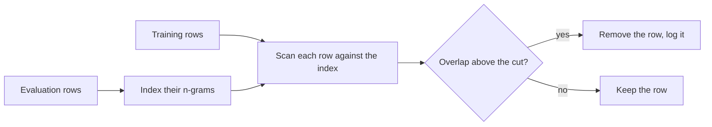
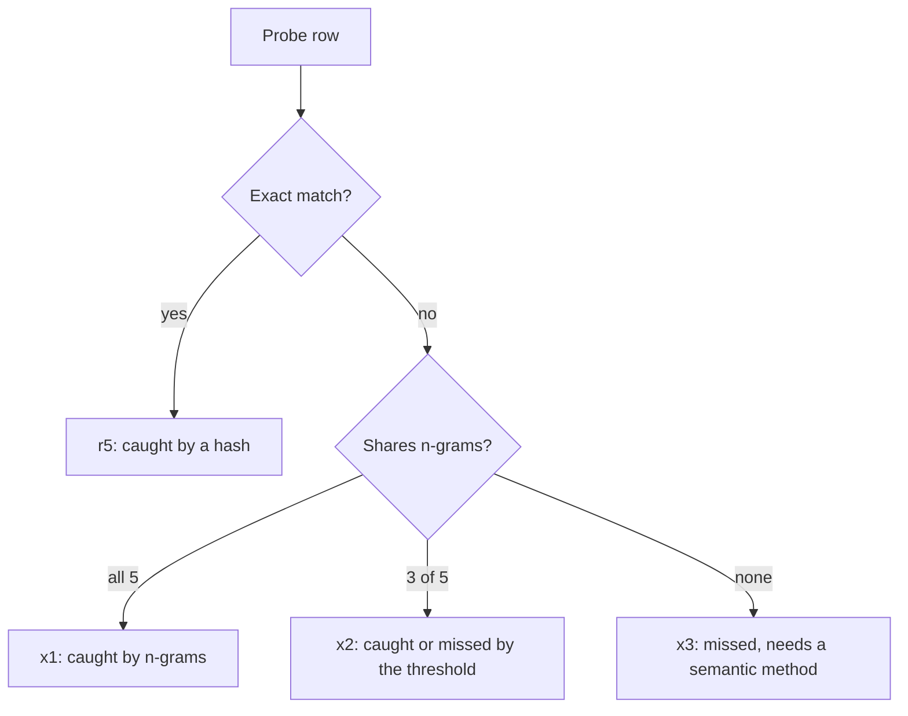
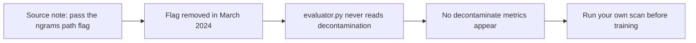

# **Decontamination**

**Scope.** Stage 03 Data Engineering, note 05 of 09. Note 04 removed repeats inside one dataset. This note removes overlap between your training data and the evaluation sets you will report scores on. It covers exact matching, n-gram overlap in the style of GPT-3 and Tulu 3, what each method misses, a model-based check for memorized text, how much a leak can move a score, and what the evaluation harness does today. Synthetic data, which can carry leaks of its own, is covered in note 06. The held-out split of your own dataset is covered in note 08.

**Idea.** A score on a benchmark measures skill only if the model has not seen the answers. If a benchmark row, or a close copy of it, sits in the training data, the score measures memory. N-gram matching finds copies and light edits, and it cannot find a paraphrase. So decontamination is a set of tests with known blind spots, and the last line of defense is an evaluation set that nobody has seen.

**Where the numbers come from.**

- Hand-calculated: every worked example in sections 5, 6 and 9.
- Measured: produced by the verification script on tiny CPU values using only the Python standard library. One extra CPU check searched the `lm_eval` 0.4.13 package, downloaded from PyPI in the sandbox, for decontamination code.
- Expected: how the notebook cells should behave. The sandbox has no GPU and cannot reach the Hub, so the cells were not run, and printed outputs are formats unless a number says it was measured.
- Illustrative: the 100 n-grams per evaluation row, the 300 token mean row, the 5 percent leak rate, the accuracies 0.40 and 0.90, and the 20 percent logits budget.
- From sources: the GPT-3, Tulu 3, Yang et al. and Min-K% Prob facts in section 18.

**Contents.**

1. The Running Example: A Row Copied From the Exam
2. Vocabulary Mapped to the Story
3. Three Core Ideas
4. The Definition in Plain Words, Then Formal
5. Why the Previous Notes Are Not Enough
6. The Extra Classic Example: Three Ways a Leak Can Hide
7. Detecting Leaks: Exact Match, N-grams, Token Coverage and Model Scores
8. The Decontamination Procedure
9. Math Notation, Explained Step by Step
10. Experiment Guide for Jupyter on GPU
11. Limits and When It Fails
12. Common Pitfalls
13. Connection to Language Models and Modern AI
14. Connection to the Next Topic
15. Glossary
16. Self-Test With Answers
17. Key Points
18. Sources and Verification

---

## 1. The Running Example: A Row Copied From the Exam

After note 04 the toy training set has five rows: r1, r3, r4, r5 and r6. Now add a tiny evaluation set with two rows.

| id | text | words |
|---|---|---|
| e1 | what does dropout do randomly zeroes activations | 7 |
| e2 | why use label smoothing improves calibration | 6 |

Row r5 has the same text as e1. Note 03 flagged r5's source, benchmark C, as evaluation-only. This note catches the same row from its content, which also works when the source is unlabelled. The path through the stage is now 6 rows, 5 after note 04, and 4 after this note.



**The new ingredient.** Note 04 compared rows with rows of the same dataset. Here the comparison is between two datasets, and it is one-sided: the question is how much of the evaluation row appears in a training row.

---

## 2. Vocabulary Mapped to the Story

| in the story | name | meaning |
|---|---|---|
| r5 equals e1 | **contamination** | evaluation content that also appears in training data |
| e1 and e2 | **evaluation set** | rows used to measure the model, never to train it |
| three words in a row | **n-gram** | a run of $\nu$ consecutive words |
| the set of all runs of e1 | **gram set** | the distinct n-grams of one row |
| how much of e1 is inside r5 | **containment** | shared n-grams divided by the n-grams of the evaluation row |
| words of e1 covered by a shared run | **token coverage** | the share of evaluation tokens that sit inside a shared n-gram |
| the cut for removal | **overlap threshold** | the coverage above which a row is flagged |
| a copy with new words | **rephrased sample** | a row with the same meaning but different wording |
| a stored fingerprint of an n-gram | **hash** | a fixed-size number made from the text |
| a leak that raises the score | **score inflation** | observed accuracy minus clean accuracy |
| a test the model never saw | **fresh evaluation set** | rows written or collected after training data was fixed |

---

## 3. Three Core Ideas

**Idea 1. One-sided overlap is what matters.** The question is how much of the evaluation row is inside a training row, not how similar the two rows are. A short evaluation row hidden inside a long training row has low Jaccard similarity and full containment.

**Idea 2. Every method has a blind spot.** Exact match misses anything embedded or edited. N-grams miss paraphrase. Embeddings are hard to calibrate. Nothing here proves a benchmark is clean.

**Idea 3. A leak can hide inside the noise of the score.** On a 164 problem benchmark, a 2.5 point inflation is smaller than the usual error of the score (section 9.6).

---

## 4. The Definition in Plain Words, Then Formal

**Plain words.** A training row is **contaminated** with respect to an evaluation set when enough of an evaluation row appears in it. **Decontamination** removes those training rows, or the whole training dataset, and records what was removed.

**Formal.** Let $Q$ be an evaluation row and $X$ a training row. Cut both into n-grams of $\nu$ words. Let $\mathcal{G}_\nu(Q)$ be the gram set of $Q$ and $L_Q$ its length in words. The containment and the token coverage are

$$\gamma(Q, X) = \frac{\lvert \mathcal{G}_\nu(Q) \cap \mathcal{G}_\nu(X) \rvert}{\lvert \mathcal{G}_\nu(Q) \rvert} \qquad \chi(Q, X) = \frac{\#\{\text{tokens of } Q \text{ inside a shared n-gram}\}}{L_Q}$$

A training row is flagged when $\chi(Q, X) > \chi_{\min}$ for some evaluation row $Q$. A training dataset is contaminated when the evaluation rows it overlaps make up more than a set share of the evaluation set.

**Check.** Both measures divide by the evaluation side. Neither depends on how long the training row is.

---

## 5. Why the Previous Notes Are Not Enough

Notes 01 to 04 give clean shapes, templates, licenses and no repeats. Row r5 is still in the data, and the evaluation would count it as seen.

| stage | rows | what happened |
|---|---|---|
| after note 04 | 5 | r1, r3, r4, r5, r6 |
| after this note | 4 | r5 is flagged and removed |

Hand check: one of five rows is flagged, so $4/5 = 0.8$ of the rows remain. One of the two evaluation rows is hit, so $1/2 = 0.5$ of the evaluation set is contaminated (measured).

**The same problem on real data.** The Tulu 3 paper found that Evol CodeAlpaca overlapped 70.7 percent of the HumanEval instances. With 164 HumanEval problems that is about $0.707 \times 164 = 115.9$, roughly 116 problems. The paper released a decontaminated version, and its table of decontaminated datasets says 3.5 percent of that dataset was removed. This matters for note 03, because the Tulu 3 SFT mixture uses decontaminated versions of five datasets, Evol CodeAlpaca among them.

**Beginner trap.** Treating decontamination as the same job as deduplication. Dedup compares a dataset with itself, and decontamination compares it with the sets you will be judged on.

---

## 6. The Extra Classic Example: Three Ways a Leak Can Hide

The running example has one clean copy. Real leaks are messier. Add three probe rows that are not part of the six. All three come from e1.

**Setup.** Using trigrams ($\nu = 3$). Row e1 has 5 trigrams: "what does dropout", "does dropout do", "dropout do randomly", "do randomly zeroes", "randomly zeroes activations".

| probe | text | what changed |
|---|---|---|
| r5 | what does dropout do randomly zeroes activations | nothing, an exact copy |
| x1 | my notes what does dropout do randomly zeroes activations during training | the question is embedded in more text |
| x2 | what does dropout do randomly sets activations to zero | the end is reworded |
| x3 | how does dropout work it randomly switches off units | a full paraphrase |



**Hand check.**

| probe | exact | shared trigrams | containment | token coverage |
|---|---|---|---|---|
| r5 | yes | 5 | 1.0000 | 1.0000 |
| x1 | no | 5 | 1.0000 | 1.0000 |
| x2 | no | 3 | 0.6000 | 0.7143 |
| x3 | no | 0 | 0.0000 | 0.0000 |

For x2 the shared trigrams are "what does dropout", "does dropout do" and "dropout do randomly". They cover words 1 to 5 of the 7 in e1, so the coverage is $5/7 = 0.7143$. The script matches every row (measured).

**What it hides.** Three different outcomes from one source row. An exact hash finds only r5. N-grams find x1 and x2. Nothing here finds x3. With a coverage cut of 0.5, x2 is flagged, and with 0.75 it is not, so the cut decides.

**Beginner trap.** Reading Jaccard for x1. Its union has $5 + 9 - 5 = 9$ trigrams, so $J = 5/9 = 0.5556$, which would not pass a 0.8 cut, even though the whole evaluation row is inside it.

---

## 7. Detecting Leaks: Exact Match, N-grams, Token Coverage and Model Scores

### 7.1 Exact match

**Intuition.** Hash each normalized evaluation row and each training row. Equal hashes are the same row.

**Precise statement.** Lowercase, collapse whitespace, hash with SHA-256, compare. This is the exact pass of note 04, run across two datasets.

```text
keys = { hash(normalize(row)) for each evaluation row }
flag every training row whose key is in keys
```

**Worked example.** r5 equals e1, so it is flagged. x1, x2 and x3 are not.

**Beginner trap.** Calling the benchmark clean after this pass. It finds only identical rows.

### 7.2 N-gram overlap, any match (GPT-3)

**Intuition.** If a long enough run of words appears in both, the overlap is unlikely to be chance.

**Precise statement.** GPT-3 defines a gram as a lowercase, whitespace-delimited word with no punctuation. A benchmark example is dirty if it shares any $\nu$-gram with any training document. For the overlap analysis $\nu$ is the 5th percentile example length in words, clipped to the range 8 to 13. For filtering training data, the 13-gram plus a 200 character window around it was removed, which splits the document. Pieces under 200 characters were dropped, documents split into more than 10 pieces were removed, and 13-grams matching more than 10 training documents were ignored as common phrases.

```text
for each training document:
    for each n-gram in it:
        if n-gram is in the evaluation index and in fewer than 11 documents:
            remove it and a 200 character window, splitting the document
    drop pieces under 200 characters
    if split into more than 10 pieces: drop the document
```

**Worked example.** Toy rows with $\nu = 3$: r5, x1 and x2 share at least one trigram with e1, so all are flagged. x3 shares none.

**Read this honestly.** OpenAI's filtering had a bug that removed overlaps only partly, mostly for long documents such as books. Retraining was too expensive, so the paper measured the effect instead. A detector that runs is not the same as a detector that works.

**Beginner trap.** Setting $\nu$ too small. Section 9.4 shows a false match at $\nu = 2$.

**When to use.** When you want a conservative flag and can accept some false positives.

### 7.3 Token coverage with a threshold (Tulu 3)

**Intuition.** Measure how much of the evaluation row sits inside shared runs, and flag when it is more than half.

**Precise statement.** Tulu 3 uses 8-gram matching on prompts only, following Llama 3 and a second paper, because completions in training data are often regenerated. A test token matches a training row when the two share an 8-gram that contains the token. A test instance overlaps a training instance when more than 50 percent of its tokens match. A training dataset is contaminated when it overlaps more than 2 percent of the instances of any evaluation. Datasets contaminated with the unseen evaluations were removed whole. For development evaluations, the whole dataset was removed if that did not hurt the model, and only the matching rows otherwise.

```text
index the n-grams of every evaluation row, remembering which row each came from
for each training prompt (every user turn):
    for each evaluation row it shares an n-gram with:
        coverage = covered tokens of the evaluation row / its length
        flag the training row if coverage > 0.5
dataset is contaminated if flagged evaluation rows > 2 percent of that evaluation
```

**Worked example.** Toy rows with $\nu = 3$: r5 and x1 have coverage 1.0, and x2 has 0.7143, so all three pass a 0.5 cut. At a cut of 0.75, x2 is not flagged.

**Beginner trap.** Checking only the first user turn of a chat. Check every user turn.

**When to use.** As the default for instruction data.

### 7.4 Rephrased samples and semantic methods

**Intuition.** Meaning can survive when words do not.

**Precise statement.** Yang et al. show that rephrased or translated benchmark samples slip past n-gram overlap, and that models trained on them reach very high scores. Llama 2 13B on MMLU went from 54.8 to 89.9 with rephrased questions, GSM8K from 28.7 to 95.3, and CodeLlama 13B on HumanEval from 36.0 to 81.1. On rephrased HumanEval their 10-gram test scored an F1 of 0, and embedding similarity and an LLM-based detector did better. Tulu 3 tried embedding matching and dropped it, because it was hard to tell similar subject matter from real paraphrase.

**Worked example.** x3 shares no trigram with e1, so every n-gram method returns 0.

**Beginner trap.** Concluding that a zero from an n-gram test means no contamination.

**When to use.** For high-stakes benchmarks, add an embedding search with a person reading the top matches.

### 7.5 A model-based check: Min-K% Prob

**Intuition.** A model finds text it saw in training less surprising, and it has fewer very unlikely words in it.

**Precise statement.** For a text of tokens, take the log-probability of each token. Keep the lowest $\alpha$ share and average them. A higher score means the text looks more familiar to the model. The paper found $\alpha = 20$ percent best in its sweep, and an average AUC of 0.72 on its WikiMIA benchmark, 7.4 percent above the best baseline.

```text
logprobs = log p(token t given earlier tokens) for each token t
lowest = the alpha share of logprobs with the smallest values
score = mean(lowest)
```

**Worked example.** Section 9.7 on eight illustrative token log-probabilities.

**Read this honestly.** An AUC of 0.72 is modest. The score is a hint about one model and one text, and it cannot clear a benchmark. It also works best on fixed-length inputs.

**When to use.** To ask whether the base model you will evaluate has probably seen your evaluation rows, when you cannot see its training data.

### 7.6 What the evaluation harness does today

The source note tells you to run the EleutherAI harness with `--decontamination_ngrams_path` and to read the metrics with the `decontaminate` suffix. That does not work on current releases.

| check | result |
|---|---|
| the flag in `lm_eval` 0.4.13 | not found anywhere in the package (measured) |
| the flag's history | removed in a merged pull request in March 2024, with the note that no alternative path existed |
| `evaluator.py` in 0.4.13 | no mention of decontamination (measured) |
| the `decontaminate` filter in 0.4.13 | its `apply` method is `pass` (measured) |
| the docs page | still describes the feature, and its usage example shows no flag |
| the code that remains | `get_train_overlap` and the `Janitor` class exist but nothing calls them |

An open issue from October 2026 says the same about the master branch, and says the 825 GB of Pile n-gram files the documented procedure needs can no longer be downloaded. That last point is second-hand, and I did not run the harness itself.



**Takeaway.** Do the decontamination yourself, before training, and record the counts. Do not rely on a harness flag.

### 7.7 Comparison and assumptions

| method | catches | misses | cost | assumption |
|---|---|---|---|---|
| exact hash | identical rows | anything edited or embedded | one pass | normalization is right |
| n-gram any match, $\nu$ 8 to 13 | copies, embedded text | paraphrase, translation | one scan plus a small index | $\nu$ is long enough to avoid chance matches |
| token coverage above 0.5 | copies and light edits | paraphrase | same as above | the cut suits your data |
| embeddings plus reading | many paraphrases | translation, close but different questions | encoder on GPU | someone reads the matches |
| Min-K% Prob | text the model likely saw | most unseen leaks and some false alarms | one forward pass per row | you have the model and a reference to compare against |
| a fresh private test set | everything that was never published | nothing it never saw | writing new rows | it stays private |

---

## 8. The Decontamination Procedure


1. List every evaluation set you will report, before you build the training set.
2. Index the n-grams of the evaluation rows. This index is small, and section 9.5 shows how much smaller it is than an index of the training data.
3. Scan the training prompts, every user turn of every chat.
4. Flag rows by any overlap at $\nu \ge 8$, and by coverage above 0.5. Record both.
5. Read 20 flagged rows and 20 unflagged rows with partial overlap.
6. Remove the flagged rows, or the whole dataset if it overlaps more than 2 percent of an evaluation.
7. Plant a few evaluation rows into the training data and check that the pipeline flags every one.
8. Write the counts per evaluation set to `results/05-decontamination-report.json`: rows scanned, rows flagged, rows removed, the evaluation rows hit, $\nu$ and the cut.
9. Keep a fresh private test set that never leaves your control.

**Beginner trap.** Skipping step 7. A pipeline that flags nothing might be clean or broken, and only a planted copy tells you which.

---

## 9. Math Notation, Explained Step by Step

This section lists the new symbols and every formula, with a worked example. Cover the steps, do the calculation yourself, then compare with the boxed value. The per-token loss and its gradient are derived in note 01 section 9.4, and this note reuses the log-probability $\log p = -\ell_t$ from it.

### 9.1 Notation table

| symbol | read aloud | meaning | in the running example |
|---|---|---|---|
| $Q$, $X$ | Q, X | an evaluation row, a training row | e1, r5 |
| $\nu$ | nu | n-gram size in words | 3 for the toy, 8 for Tulu 3 |
| $L_Q$ | L of Q | length of $Q$ in words | 7 for e1 |
| $\mathcal{G}_\nu(Q)$ | gram set | distinct n-grams of $Q$ | 5 trigrams |
| $\gamma$ | gamma | containment of $Q$ in $X$ | 0.6000 for x2 |
| $\chi$ | chi | token coverage of $Q$ by $X$ | 0.7143 for x2 |
| $\chi_{\min}$ | chi min | coverage cut for flagging | 0.5 |
| $G_Q$, $G_X$ | G sub Q, G sub X | n-grams in the evaluation index, n-grams scanned | 16,400 and 293,454,443 |
| $F$ | F | expected false matches from hash collisions | 2.6089e-07 |
| $\varphi$ | phi | share of evaluation rows that are leaked | 0.05 |
| $a_0$, $a_1$ | a zero, a one | accuracy on clean rows, on leaked rows | 0.40 and 0.90 |
| $A$, $I$ | A, I | observed accuracy, inflation | 0.425 and 0.025 |
| $N_Q$ | N sub Q | number of evaluation rows | 164 |
| $\alpha$ | alpha | share of lowest-probability tokens kept | 0.25 |
| $S_\alpha$ | S alpha | Min-K% score | $-2.75$ |
| $P$ | P | parameters of the scoring model (note 01) | 0.5 billion |

**Reading tips.** The letter $\nu$ is the n-gram size, so it never clashes with $n$ (turns in note 02) or $n_k$ (rows in note 01). The symbols $\gamma$ and $\chi$ are used so they do not clash with $c$ (overhead in note 02) or $\sigma$ (token share in note 01). The threshold is $\chi_{\min}$ and not $\theta$, which stays the model parameters.

### 9.2 How many n-grams a row has

$$G = L - \nu + 1$$

**What it says.** A row of $L$ words has $L - \nu + 1$ windows of $\nu$ words.

**Worked example.** Evaluation row e1 and probe x1 with $\nu = 3$:

$$\begin{aligned}
G_{e1} &= 7 - 3 + 1 = \boxed{5} \\[6pt]
G_{x1} &= 11 - 3 + 1 = \boxed{9}
\end{aligned}$$

**Extreme case.** At $\nu = L$ there is one n-gram, the whole row. At $\nu > L$ there are none, so GPT-3 compares the whole example when it is shorter than the n-gram size.

**Beginner trap.** Forgetting that a repeated n-gram counts once in a set.

### 9.3 Containment and token coverage

$$\gamma(Q, X) = \frac{\lvert \mathcal{G}_\nu(Q) \cap \mathcal{G}_\nu(X) \rvert}{\lvert \mathcal{G}_\nu(Q) \rvert} \qquad \chi(Q, X) = \frac{\text{covered tokens of } Q}{L_Q}$$

**What it says.** Containment counts shared n-grams. Coverage counts the words of $Q$ that lie inside at least one shared n-gram.

**Worked example: probe x2.**

$$\begin{aligned}
\text{shared trigrams} &= 3 \\[6pt]
\gamma &= \frac{3}{5} = \boxed{0.6000} \\[10pt]
\text{covered words} &= \text{words 1 to 5} = 5 \\[6pt]
\chi &= \frac{5}{7} = \boxed{0.7143}
\end{aligned}$$

**Worked example: probe x1, containment against Jaccard.**

$$\begin{aligned}
\gamma &= \frac{5}{5} = \boxed{1.0000} \\[10pt]
J &= \frac{5}{5 + 9 - 5} = \frac{5}{9} = \boxed{0.5556}
\end{aligned}$$

**Extreme case.** If $Q$ is fully inside $X$, then $\gamma = \chi = 1$ however long $X$ is, while Jaccard can fall toward 0.

**Beginner trap.** Using Jaccard from note 04 across datasets. It dilutes a short evaluation row hidden in a long training row.

**Check.** The script matches the table in section 6 (measured).

### 9.4 The cut and the n-gram size

$$\text{flag } X \text{ if } \chi(Q, X) > \chi_{\min} \qquad \nu \text{ large enough that chance overlaps are rare}$$

**What it says.** A higher cut flags fewer rows and misses more edits. A smaller $\nu$ flags more chance matches.

**Worked example: the cut on x2.** With $\chi = 0.7143$:

$$\begin{aligned}
\chi_{\min} = 0.5 &: \; 0.7143 > 0.5 \Rightarrow \boxed{\text{flagged}} \\[6pt]
\chi_{\min} = 0.75 &: \; 0.7143 > 0.75 \text{ is false} \Rightarrow \boxed{\text{not flagged}}
\end{aligned}$$

**Worked example: chance overlap.** Evaluation row e2 and training row r3 share the word pair "why use":

$$\begin{aligned}
\nu = 2 &: \; \text{shared} = 1, \quad \gamma = \frac{1}{5} = \boxed{0.2000} \\[8pt]
\nu = 3 &: \; \text{shared} = 0, \quad \gamma = \boxed{0.0000}
\end{aligned}$$

At $\nu = 2$ any-match would flag r3 falsely. This is why GPT-3 used a minimum of 8 on real tasks.

**Extreme case.** $\chi_{\min} = 0$ flags any shared n-gram. $\chi_{\min} = 1$ flags only full copies.

**Beginner trap.** Choosing the cut after seeing which rows you would lose.

### 9.5 Hash width and index size

$$F = \frac{G_Q \cdot G_X}{2^{\text{bits}}} \qquad M_{\text{index}} = G \cdot 8 \ \text{bytes}$$

**What it says.** Each of the $G_X$ n-grams you scan can collide by accident with each of the $G_Q$ n-grams in the index, with chance $2^{-\text{bits}}$. The index stores one 8-byte hash per n-gram.

**Worked example.** HumanEval with an illustrative 100 n-grams per problem and OpenHermes 2.5 sized data (1,001,551 rows) with an illustrative 300 token mean and $\nu = 8$:

$$\begin{aligned}
G_Q &= 164 \times 100 = 16400 \\[6pt]
G_X &= 1001551 \times (300 - 8 + 1) = \boxed{293{,}454{,}443}
\end{aligned}$$

Expected false matches with a 32-bit hash:

$$F_{32} = \frac{16400 \times 293454443}{2^{32}} = \boxed{1120.5}$$

With a 64-bit hash:

$$F_{64} = \frac{16400 \times 293454443}{2^{64}} = \boxed{2.6089 \times 10^{-7}}$$

Memory, indexing the evaluation side: $16400 \times 8 = \boxed{131{,}200}$ bytes. Indexing the training side: $293454443 \times 8 = \boxed{2.3476}$ GB. The training-side index is about 17,894 times larger (measured).

**Extreme case.** A 32-bit hash gives over a thousand false flags, so it is unusable at this scale. A 64-bit hash makes false flags negligible.

**Beginner trap.** Indexing the training data. Index the small evaluation set and stream the training rows past it. This is CPU memory, not GPU memory.

### 9.6 How much a leak inflates a score

$$A = (1 - \varphi)\,a_0 + \varphi\,a_1 \qquad I = A - a_0 = \varphi\,(a_1 - a_0) \qquad \text{SE} = \sqrt{\frac{A\,(1 - A)}{N_Q}}$$

**What it says.** The observed accuracy mixes clean and leaked rows. The inflation is the leaked share times the accuracy gap. The standard error is the usual noise of an accuracy.

**Worked example.** $\varphi = 0.05$, $a_0 = 0.40$, $a_1 = 0.90$:

$$\begin{aligned}
A &= 0.95 \times 0.40 + 0.05 \times 0.90 \\[6pt]
  &= 0.380 + 0.045 = \boxed{0.4250} \\[10pt]
I &= 0.05 \times (0.90 - 0.40) = \boxed{0.0250}
\end{aligned}$$

Noise on two benchmarks:

$$\begin{aligned}
\text{SE}_{164} &= \sqrt{\frac{0.425 \times 0.575}{164}} = \boxed{0.0386} \\[10pt]
\text{SE}_{1319} &= \sqrt{\frac{0.425 \times 0.575}{1319}} = \boxed{0.0136} \\[10pt]
\frac{I}{\text{SE}_{164}} &= \boxed{0.648} \qquad \frac{I}{\text{SE}_{1319}} = \boxed{1.837}
\end{aligned}$$

So 5 percent of 164 problems is 8.2 leaked problems, and the 2.5 point inflation is under one standard error on HumanEval. On the 1,319 test questions of GSM8K it is about 1.8 standard errors.

**Extreme case.** With full memorization of rephrased rows, Yang et al. report GSM8K going from 28.7 to 95.3 for a 13B model, which no noise can hide.

**Beginner trap.** Comparing the full score with a clean-subset score and calling a small gap proof. The clean subset can differ in difficulty from the whole set, a limitation GPT-3's authors raise themselves.

**Check.** Section 18 lists the benchmark sizes used here (164 measured on the Hub, 1,319 from 8,792 total minus 7,473 training rows).

### 9.7 The Min-K% score

$$S_\alpha(x) = \frac{1}{\lvert E_\alpha \rvert} \sum_{t \in E_\alpha} \log p(x_t \mid x_{<t})$$

where $E_\alpha$ is the set of the $\alpha$ share of tokens with the smallest log-probabilities.

**What it says.** Average the log-probabilities of the least likely tokens. A text the model has seen has few very surprising tokens, so its score is closer to zero.

**Worked example.** Eight tokens, $\alpha = 0.25$ so 2 tokens are kept. Illustrative log-probabilities, using $\log p = -\ell_t$ from note 01:

| text | log-probabilities | lowest two | $S_\alpha$ |
|---|---|---|---|
| seen | $-0.2, -0.1, -3.0, -0.4, -0.1, -2.5, -0.3, -0.2$ | $-3.0, -2.5$ | $-2.75$ |
| unseen | $-1.2, -2.8, -4.0, -3.1, -1.5, -3.6, -2.2, -2.9$ | $-4.0, -3.6$ | $-3.80$ |

$$\begin{aligned}
S_\alpha(\text{seen}) &= \frac{-3.0 + (-2.5)}{2} = \boxed{-2.75} \\[8pt]
S_\alpha(\text{unseen}) &= \frac{-4.0 + (-3.6)}{2} = \boxed{-3.80}
\end{aligned}$$

For comparison, the plain mean log-probability is $-0.85$ for the seen text and $-2.6625$ for the unseen.

**Extreme case.** $\alpha = 1$ is the plain mean. A very small $\alpha$ looks only at the single worst token.

**Beginner trap.** Reading one score alone. A threshold needs reference texts known to be unseen.

### 9.8 The GPU ladder: which model can score, and how big a batch

$$P_{\max} = \frac{0.85 \cdot \text{VRAM}}{2} \qquad B_{\max} = \left\lfloor \frac{0.2 \cdot \text{VRAM}}{4\,V\,T} \right\rfloor$$

**What it says.** Scoring needs the model weights in half precision, 2 bytes per parameter, and ignores the key-value cache and activations (illustrative). The batch limit reuses the logits rule from notes 01 and 02, because the scorer builds a 32-bit copy of the logits.

**Worked example.** An L40S (48 GB tier):

$$\begin{aligned}
P_{\max} &= \frac{0.85 \times 48 \times 10^{9}}{2} \\[6pt]
&= 20.4 \times 10^{9} = \boxed{20.4\ \text{billion}}
\end{aligned}$$

**The ladder, small to large (measured by the script).** With $V = 151{,}936$:

| GPU tier | VRAM | largest model to score | $B_{\max}$ at $T=512$ | at $T=1024$ |
|---|---|---|---|---|
| T4 | 16 GB | 6.8 B | 10 | 5 |
| L4 | 24 GB | 10.2 B | 15 | 7 |
| L40S | 48 GB | 20.4 B | 30 | 15 |
| A100 80GB or H100 | 80 GB | 34.0 B | 51 | 25 |
| H200 | 141 GB | 59.9 B | 90 | 45 |
| B200 | 180 GB | 76.5 B | 115 | 57 |
| B300 | 288 GB | 122.4 B | 185 | 92 |

A batch of 16 at $T = 512$ builds a 32-bit logits copy of $16 \times 512 \times 151936 \times 4 = \boxed{4.9786}$ GB. That is above the 20 percent budget on the 16 and 24 GB tiers, whose limits at $T = 512$ are 10 and 15, and it fits from 48 GB. Cell 7 tests this.

**Extreme case.** Scoring needs no gradients or optimizer state, so a model that cannot be trained on a tier can often still be scored there.

**Beginner trap.** Forgetting that the scoring job is cheap. The expensive part of decontamination is the CPU scan of the training data.

### 9.9 All formulas and answers

| formula | input | answer |
|---|---|---|
| $G = L - \nu + 1$ | e1 and x1, $\nu = 3$ | 5 and 9 |
| $\gamma$ for x2 | 3 of 5 | 0.6000 |
| $\chi$ for x2 | 5 of 7 | 0.7143 |
| $\gamma$ and $J$ for x1 | 5 of 5, and 5 of 9 | 1.0000 and 0.5556 |
| $\gamma$ at $\nu = 2$, e2 against r3 | 1 of 5 | 0.2000 |
| $G_X$ | $1001551 \times 293$ | 293,454,443 |
| $F_{32}$ and $F_{64}$ | $16400 \times G_X / 2^{\text{bits}}$ | 1120.5 and $2.6089 \times 10^{-7}$ |
| index bytes, evaluation side | $16400 \times 8$ | 131,200 |
| $A$ and $I$ | $\varphi = 0.05$, 0.40, 0.90 | 0.4250 and 0.0250 |
| $\text{SE}$ at 164 and 1,319 rows | $A = 0.425$ | 0.0386 and 0.0136 |
| $S_\alpha$, seen and unseen | $\alpha = 0.25$ | $-2.75$ and $-3.80$ |
| $P_{\max}$ on 48 GB | $0.85 \times 48 / 2$ | 20.4 B |

### 9.10 Pen-and-paper rules

1. Divide by the evaluation side, never the training side.
2. Count a repeated n-gram once.
3. Coverage counts words, containment counts n-grams, so compute both.
4. Pick $\nu$ of 8 or more for real text, and say what you picked.
5. A 32-bit hash is never enough at scale, use 64 bits.
6. Index the small set and stream the large one.
7. Compute the standard error before you read a score gap.
8. A zero from an n-gram test is not a clean bill of health.
9. A Min-K% score needs a reference group.
10. Check each result a second way, and name the section that matches.

---

## 10. Experiment Guide for Jupyter on GPU

These cells run in a GPU notebook: a Lightning AI Studio, a Modal Notebook, or your organization's cluster. They were checked for syntax and not run. Cells 2 to 5 run on the CPU and cells 6 and 7 use the GPU. Run cell 1 first. Cells 5 and 6 reuse names from cell 4, and cell 7 reuses `model` from cell 6.

**Assumptions stated.**

- Evaluation set: the 1,319 GSM8K test questions (`openai/gsm8k`, config `main`, MIT tag). Training stand-in: the first 2,000 rows of `trl-lib/Capybara`, which has no license on the Hub, so statistics only.
- Matching: 8-word n-grams, lowercase, split on whitespace. GPT-3 also removed punctuation, and these cells keep it attached to words, so treat the counts as a lower bound.
- A planted control of 10 evaluation questions is added to the training texts, so the scan has a known answer.
- The scoring model is Qwen2.5-0.5B-Instruct, as in earlier notes.
- Skipped on purpose: the training cell and the before and after comparison, since nothing is trained here.

```python
# ── Cell 1. Environment and GPU tier ─────────────────────────────
#    Versions, device, VRAM, ladder tier, largest model to score
#    Reported memory is slightly off the label, so allow 2 GB
# ─────────────────────────────────────────────────────────────────
import random
import torch
import transformers
import datasets

random.seed(42)
torch.manual_seed(42)
print("torch", torch.__version__, "transformers", transformers.__version__)
print("datasets", datasets.__version__)

props = torch.cuda.get_device_properties(0)
capability = torch.cuda.get_device_capability(0)
vram_gb = props.total_memory / 1e9
print("device", props.name, f"{vram_gb:.1f} GB", capability)

tiers = [16, 24, 48, 80, 141, 180, 288]
tier = max(t for t in tiers if t <= vram_gb + 2)
dtype = torch.bfloat16 if capability[0] >= 8 else torch.float16
print("tier", tier, "GB  largest model to score", 0.85 * tier / 2, "billion parameters")
```

```text
torch <version> transformers <version>
datasets <version>
device <GPU name> <memory> GB (<major>, <minor>)
tier <16 up to 288> GB  largest model to score <6.8 up to 122.4> billion parameters
```

```python
# ── Cell 2. Does the installed harness decontaminate? ────────────
#    pip install lm-eval
#    Search the installed package for the flag the source note names
# ─────────────────────────────────────────────────────────────────
import pathlib
import lm_eval

root = pathlib.Path(lm_eval.__file__).parent
sources = {path: path.read_text(encoding="utf-8") for path in root.rglob("*.py")}
flag_files = [p.name for p, text in sources.items() if "decontamination_ngrams_path" in text]
evaluator_text = sources[root / "evaluator.py"]

print("files naming the flag:", flag_files)
print("evaluator.py mentions decontamination:", "decontamin" in evaluator_text.lower())
```

```text
files naming the flag: []
evaluator.py mentions decontamination: False
```

These two lines were measured on a CPU against `lm_eval` 0.4.13. Your installed version may differ, and if it prints a file name, read that file before you trust it.

```python
# ── Cell 3. Sanity check: toy n-gram methods ─────────────────────
#    Reproduce section 6: exact match, containment and coverage
#    Evaluation row e1 against r5, x1, x2 and x3, n = 3 words
# ─────────────────────────────────────────────────────────────────
def grams(words, size):
    return [" ".join(words[i:i + size]) for i in range(len(words) - size + 1)]

def overlap(eval_words, train_words, size):
    eval_grams = grams(eval_words, size)
    shared = set(eval_grams) & set(grams(train_words, size))
    covered = set()
    for i, gram in enumerate(eval_grams):
        if gram in shared:
            covered.update(range(i, i + size))
    return len(shared) / len(eval_grams), len(covered) / len(eval_words)

e1 = "what does dropout do randomly zeroes activations".split()
probes = {"r5": e1,
          "x1": "my notes what does dropout do randomly zeroes activations during training".split(),
          "x2": "what does dropout do randomly sets activations to zero".split(),
          "x3": "how does dropout work it randomly switches off units".split()}
for name, words in probes.items():
    containment, coverage = overlap(e1, words, 3)
    print(f"{name}  exact {words == e1}  containment {containment:.4f}  coverage {coverage:.4f}")
```

```text
r5  exact True  containment 1.0000  coverage 1.0000
x1  exact False  containment 1.0000  coverage 1.0000
x2  exact False  containment 0.6000  coverage 0.7143
x3  exact False  containment 0.0000  coverage 0.0000
```

These four lines were measured by the script and match section 6.

```python
# ── Cell 4. Index the evaluation side ────────────────────────────
#    Hash every 8-word gram of the GSM8K test questions to 8 bytes
#    The index is small because the evaluation set is small
# ─────────────────────────────────────────────────────────────────
import hashlib
from datasets import load_dataset

def hashed(words, size=8):
    return [hashlib.blake2b(" ".join(words[i:i + size]).encode(), digest_size=8).digest()
            for i in range(len(words) - size + 1)]

questions = load_dataset("openai/gsm8k", "main", split="test")["question"]
index = {}
for question_id, question in enumerate(questions):
    for gram in hashed(question.lower().split()):
        index.setdefault(gram, set()).add(question_id)

print("evaluation rows", len(questions))
print("index entries", len(index), " bytes at 8 per entry", len(index) * 8)
```

```text
evaluation rows 1319
index entries <n>  bytes at 8 per entry <8 times n>
```

```python
# ── Cell 5. Scan the training texts with a planted control ───────
#    Flag training rows that share any 8-gram with a question
#    The 10 planted questions must all be found
# ─────────────────────────────────────────────────────────────────
train = load_dataset("trl-lib/Capybara", split="train[:2000]")
texts = [next(m["content"] for m in row["messages"] if m["role"] == "user")
         for row in train]
texts += questions[:10]

flagged_rows, hit_questions = 0, set()
for text in texts:
    hits = set()
    for gram in hashed(text.lower().split()):
        hits |= index.get(gram, set())
    flagged_rows += bool(hits)
    hit_questions |= hits

print("rows scanned", len(texts), " flagged", flagged_rows)
print("evaluation rows hit", len(hit_questions))
assert len(hit_questions) >= 10, "the planted control was not found"
```

```text
rows scanned 2010  flagged <at least 10>
evaluation rows hit <at least 10>
```

The assert is the check. If it fails, the scan is broken, and no other number in this cell can be trusted.

```python
# ── Cell 6. Min-K% score on the GPU ──────────────────────────────
#    Mean log-probability of the 20 percent least likely tokens
#    Compare a question with its reversed word order
# ─────────────────────────────────────────────────────────────────
from transformers import AutoModelForCausalLM, AutoTokenizer

name = "Qwen/Qwen2.5-0.5B-Instruct"
tokenizer = AutoTokenizer.from_pretrained(name)
model = AutoModelForCausalLM.from_pretrained(name, dtype=dtype).to("cuda").eval()

def min_k_score(text, alpha=0.2):
    ids = tokenizer(text, return_tensors="pt").input_ids.to("cuda")
    with torch.no_grad():
        logits = model(input_ids=ids).logits[0, :-1].float()
    logprobs = torch.log_softmax(logits, dim=-1).gather(1, ids[0, 1:, None])[:, 0]
    kept = logprobs.sort().values[:max(1, int(alpha * logprobs.numel()))]
    return kept.mean().item()

for question in questions[:3]:
    reversed_text = " ".join(reversed(question.split()))
    print(f"{min_k_score(question):8.3f}  {min_k_score(reversed_text):8.3f}")
```

```text
<score of question 1>  <score of its reversed version>
<score of question 2>  <score of its reversed version>
<score of question 3>  <score of its reversed version>
```

The reversed text is an unseen control with a known answer: its score should be lower. That checks the code. It does not show whether the questions were memorized, because that needs reference texts known to be unseen.

```python
# ── Cell 7. Memory of scoring against batch size ─────────────────
#    Forward only, T = 512, batch 1, 4 and 16
#    An out-of-memory result is a valid result
# ─────────────────────────────────────────────────────────────────
import time

for batch in [1, 4, 16]:
    ids = torch.randint(0, model.config.vocab_size, (batch, 512), device="cuda")
    torch.cuda.reset_peak_memory_stats()
    try:
        start = time.time()
        with torch.no_grad():
            scores = torch.log_softmax(model(input_ids=ids).logits.float(), dim=-1)
        torch.cuda.synchronize()
        peak = torch.cuda.max_memory_allocated() / 1e9
        print(f"B={batch:3d}  peak {peak:6.2f} GB  {batch * 512 / (time.time() - start):9.0f} tok/s")
    except torch.cuda.OutOfMemoryError:
        print(f"B={batch:3d}  out of memory")
    scores = None
    torch.cuda.empty_cache()
```

```text
B=  1  peak <x> GB  <n> tok/s
B=  4  peak <x> GB  <n> tok/s
B= 16  peak <x> GB or out of memory
```

The 32-bit logits copy at $B = 16$ is $4.98$ GB by hand, so on the 16 and 24 GB tiers expect a peak well above the batch 4 value, and possibly an out-of-memory result.

### 10.1 Results table template

| GPU tier | largest model to score (cell 1) | $B_{\max}$ at $T=512$ | peak GB at B=4 | peak GB at B=16 or OOM | tok/s at B=4 |
|---|---|---|---|---|---|
| 16 GB (T4) | | | | | |
| 24 GB (L4) | | | | | |
| 48 GB (L40S) | | | | | |
| 80 GB (A100 or H100) | | | | | |
| 141 GB (H200) | | | | | |
| 180 GB (B200) | | | | | |
| 288 GB (B300) | | | | | |

The CPU results of cells 2 to 5 do not depend on the GPU. Record the flagged-row count and the hit-question count once.

### 10.2 Expected behavior (expected, not yet verified)

- Cell 2 prints an empty list and `False` on `lm_eval` 0.4.13.
- Cell 3 matches section 6 exactly.
- Cell 5 flags at least the 10 planted rows. Capybara may flag a few more, since GSM8K questions are common on the web.
- Cell 6 gives a lower score to the reversed text than to the question.
- Cell 7 peak memory grows with batch size, and the 16 and 24 GB tiers show the most pressure at $B = 16$.

### 10.3 If you run out of memory

1. Lower the batch size in cell 7, or lower the length $T$.
2. Take the log-softmax in chunks of rows, not on the whole batch at once.
3. Keep half precision weights, as cell 6 does, and score a smaller model.
4. Move to a larger tier, using section 9.8 for the model size.

GPU and Hub runs are not exactly reproducible, so compare trends, not exact decimals.

---

## 11. Limits and When It Fails

**What the checks need.** The evaluation rows, a consistent normalization, and a person who reads flagged rows.

**Where they fail.**

- N-gram methods miss paraphrase and translation, and the evidence in section 7.4 shows that a model can still be inflated by them.
- Multiple-choice questions can give false positives when different questions share option patterns, as Yang et al. report.
- Checking prompts only, as Tulu 3 does, assumes completions are regenerated. If completions are copied, check them too.
- The Min-K% score has an average AUC of 0.72 and needs a reference group.
- The harness path in the source note does not exist in current releases (section 7.6).
- A leak that came in through pretraining is outside your control. You can only measure the model and document the risk.
- Synthetic data made by a model can carry leaked benchmark content, which Yang et al. found in data generated by GPT-3.5 and GPT-4 (note 06).

---

## 12. Common Pitfalls

1. **Relying on the harness flag.** It does not exist in `lm_eval` 0.4.13.
2. **An n-gram size that is too small.** Two-word matches flag common phrases.
3. **A 32-bit hash.** About 1,120 expected false matches at the scale in section 9.5.
4. **Indexing the training side.** It is 17,894 times larger than indexing the evaluation side.
5. **Checking one turn.** Scan every user turn of every chat.
6. **Reporting a clean subset as the benchmark.** It is a different, smaller set.
7. **Removing only exact matches.** x1 and x2 get through.
8. **No planted control.** A silent pipeline might be broken.

**Debugging checklist.**

- Which evaluation sets did I list, and in what order relative to building the data?
- What are $\nu$ and the cut, and did I record them?
- Did the planted copies come back flagged?
- Did I read flagged and borderline rows?
- Do I have a fresh private test set?

---

## 13. Connection to Language Models and Modern AI

| topic idea | in a chat model or agent |
|---|---|
| train and test overlap | benchmark scores that overstate what a released model can do |
| n-gram coverage on prompts | the filter open-model teams run on instruction data before training |
| dataset-level removal | dropping a whole public dataset because it overlaps an evaluation |
| rephrased leaks | a model tuned on paraphrased tests that scores like a much larger one |
| fresh private tests | the only evaluation that cannot have leaked |

**Point 1. Tulu 3 made it a design constraint.** It checked prompts with 8-gram matching and a 50 percent coverage cut, removed datasets that overlapped more than 2 percent of an evaluation, and listed contaminated public sets: Evol CodeAlpaca with 70.7 percent of HumanEval, NuminaMath-TIR with 18.2 percent of MATH, and LMSYS-Chat-1M with 46.5 percent of AlpacaEval. It did not include the last four contaminated datasets in its table of public datasets.

**Point 2. N-grams do not stop rephrasing.** Yang et al. trained 7B and 13B models on rephrased benchmark rows and got GPT-4-level scores while 10-gram overlap found nothing. The paper urges the community to use stronger detection and fresh one-time exams.

**Point 3. The tooling is thinner than the docs suggest.** The harness documents decontamination, but the current release does not run it. Plan to own this step.

**Added (not in the source note).** The one-sided coverage measure, the hash width and index memory calculation, the score inflation versus noise comparison, the Min-K% worked example and the scoring-model GPU ladder.

---

## 14. Connection to the Next Topic

Next is note 06: synthetic data. It covers rubric-driven generation, ranking with a judge model, model collapse when a model trains on its own output, and why synthetic data needs the same decontamination you just did.

| order | topic | what it adds | status |
|---|---|---|---|
| 01 | Why data and data shapes | shapes, shares, cheap checks | done |
| 02 | Formats and chat templates | conversion, templates, masks | done |
| 03 | Dataset catalog and licenses | sources, licenses, provenance | done |
| 04 | Quality and deduplication | exact, near and semantic duplicates | done |
| 05 | Decontamination | removing evaluation leaks | this note |
| 06 | Synthetic data | rubric generation, model collapse | next |
| 07 | PII and the EU AI Act | scrubbing and documentation | planned |
| 08 | Domain dataset and splits | build, split, version | planned |
| 09 | Pre-flight and acceptance gate | the exit checklist | planned |

The roadmap order was not pasted, so this order is assumed.

---

## 15. Glossary

| term | meaning with the running example |
|---|---|
| **contamination** | r5 sitting in the training data while e1 is in the exam |
| **evaluation set** | e1 and e2 |
| **n-gram** | a run of 3 words in the toy, 8 words in Tulu 3 |
| **gram set** | the 5 distinct trigrams of e1 |
| **containment** | 3 of 5 for x2 |
| **token coverage** | 5 of 7 words of e1 covered for x2 |
| **overlap threshold** | the 0.5 coverage above which a row is flagged |
| **rephrased sample** | x3, a paraphrase of e1 that shares no trigram |
| **hash** | the 8-byte fingerprint stored for each n-gram |
| **score inflation** | 0.025 on a benchmark with 5 percent leaked rows |
| **fresh evaluation set** | rows written after the training data was frozen |

---

## 16. Self-Test With Answers

**Q1.** A row has 12 words. How many 8-grams does it have?

**Q2.** An evaluation row has the words a to j (10 words). A training row contains the runs "a b c d e" and "h i j", in that order, with other words between them. With $\nu = 3$, find the containment and the token coverage.

**Q3.** An index holds 1,000 evaluation n-grams, and you scan $10^9$ training n-grams with a 64-bit hash. Find the expected number of false matches.

**Q4.** A benchmark has 10 percent leaked rows, clean accuracy 0.50 and leaked accuracy 0.90. Find the inflation.

**Q5.** Five token log-probabilities are $-1, -3, -0.5, -2, -4$. Find the Min-K% score for $\alpha = 0.4$.

**Q6.** Spot the mistake: "The n-gram check flagged nothing, so the benchmark is clean."

**Q7.** Spot the mistake: "I ran the harness with `--decontamination_ngrams_path` and saw no `decontaminate` metrics, so my data is clean."

**Q8.** Why did GPT-3 ignore 13-grams that matched more than 10 training documents?

**Answers.**

**A1.** $12 - 8 + 1 =$ $\boxed{5}$.

**A2.** The evaluation trigrams are abc, bcd, cde, def, efg, fgh, ghi, hij, so there are 8. Shared ones: abc, bcd, cde and hij, so 4. Containment is $4/8 =$ $\boxed{0.5}$. The covered words are a to e and h to j, which is 8 of 10, so the coverage is $\boxed{0.8}$.

**A3.** $\dfrac{1000 \times 10^{9}}{2^{64}} = \dfrac{10^{12}}{1.8447 \times 10^{19}} =$ $\boxed{5.42 \times 10^{-8}}$.

**A4.** $I = 0.10 \times (0.90 - 0.50) =$ $\boxed{0.04}$, four points.

**A5.** With $\alpha = 0.4$ and 5 tokens, keep 2. The lowest two are $-4$ and $-3$. The score is $(-4 - 3)/2 =$ $\boxed{-3.5}$.

**A6.** N-gram tests miss paraphrase and translation. Yang et al. report a 10-gram F1 of 0 on rephrased HumanEval, so a zero tells you only that no copy or light edit was found.

**A7.** The flag was removed in March 2024, and `lm_eval` 0.4.13 does not read decontamination in its evaluator. Missing metrics mean the step never ran, not that the data is clean.

**A8.** Inspection showed that most of them were common phrases, boilerplate or cultural quotes that the model should learn, not leaks.

---

## 17. Key Points

1. Decontamination compares your training data with the evaluation sets you will report, and the measure divides by the evaluation side.
2. Exact match finds only copies, n-grams find copies and light edits, and nothing here finds a paraphrase.
3. Tulu 3's rule is 8-gram matching on prompts with a coverage cut of 50 percent, and a dataset is dropped if it overlaps more than 2 percent of an evaluation.
4. Index the small evaluation set, hash with 64 bits, and stream the training data past it.
5. A leak of 5 percent inflates a score by 2.5 points here, which is below one standard error on a 164 problem benchmark.
6. The harness decontamination flag in the source note does not exist in current releases, so run your own scan.
7. Plant a canary and check that the pipeline finds it.
8. Min-K% Prob is a hint about one model, with an average AUC of 0.72.
9. Write the counts per evaluation set to `results/05-decontamination-report.json`, and keep a fresh private test set.

---

## 18. Sources and Verification

**Sources used.**

- Language Models are Few-Shot Learners (Brown et al.), Appendix C, https://arxiv.org/pdf/2005.14165 and the NeurIPS supplement, https://proceedings.neurips.cc/paper_files/paper/2020/file/1457c0d6bfcb4967418bfb8ac142f64a-Supplemental.pdf
- Tulu 3: Pushing Frontiers in Open Language Model Post-Training (Lambert et al.), Section 3.2 and Appendix B.2 (the table numbers differ between paper versions), https://arxiv.org/html/2411.15124v2
- Rethinking Benchmark and Contamination for Language Models with Rephrased Samples (Yang et al.), https://arxiv.org/abs/2311.04850
- Detecting Pretraining Data from Large Language Models (Shi et al.), https://proceedings.iclr.cc/paper_files/paper/2024/hash/e32ad85fa27be4a9868d55703f01323e-Abstract-Conference.html
- lm-evaluation-harness decontamination docs, https://github.com/EleutherAI/lm-evaluation-harness/blob/main/docs/decontamination.md
- Pull request 1533 (removed `decontamination_ngrams_path`), https://github.com/EleutherAI/lm-evaluation-harness/pull/1533
- Issue 3481 (current state of decontamination), https://github.com/EleutherAI/lm-evaluation-harness/issues/3481
- `lm_eval` 0.4.13 wheel from PyPI, searched locally
- Datasets server sizes for openai/gsm8k and openai/openai_humaneval, `https://datasets-server.huggingface.co/size?dataset=<id>`

**Checked by running code.** The verification script reproduced, with asserts, every hand-calculated number in sections 5, 6, 9 and 16: the toy overlap table and Jaccard, the cut and the false overlap at $\nu = 2$, the toy pipeline from five rows to four with one of two evaluation rows hit, the hash collision counts and index sizes, the inflation and standard errors, the Min-K% examples, and the scoring ladder for seven GPU tiers. A separate CPU check searched the `lm_eval` 0.4.13 package: the flag name appears nowhere, `evaluator.py` has no mention of decontamination, and the `decontaminate` filter body is `pass`. All seven cells in section 10 were checked with `ast.parse`.

**Checked on the web.** The GPT-3 procedure (13-gram, 8 to 13 range, 200 character window, more than 10 pieces, more than 10 documents, the bug), the Tulu 3 method and thresholds and the numbers in its decontamination table and its Appendix B.2 table (re-read in versions 1 and the current PDF), the Yang et al. results and the 10-gram F1 of 0, the Min-K% definition, the $\alpha = 20$ percent choice and the 0.72 average AUC, the harness docs and the merged pull request, and the benchmark sizes.

**From general knowledge, not verified here.** The 2 bytes per parameter for half precision weights, the birthday-style estimate $G_Q G_X / 2^{\text{bits}}$ for expected hash collisions (it treats hashes as uniform), and the use of the standard error of a proportion. The statement about the 825 GB Pile n-gram files is second-hand from an issue comment.

**Not checked.** The harness on the master branch beyond the 0.4.13 package and the two linked pages, the Llama 3 contamination procedure itself (Tulu 3 cites it), and the code of the LLM-based decontaminator.

**Corrections to the source note.**

- The source says to use the harness's n-gram file flow with `--decontamination_ngrams_path`. The flag was removed in March 2024 and is absent from `lm_eval` 0.4.13, whose evaluator never reads decontamination.
- The source says a `decontaminate()` API of the kind shown in tutorials does not exist. The functions `get_train_overlap` and the `Janitor` class do exist in the repository, but nothing calls them, so the practical conclusion is that the flow does not run.
- The source says to "read the `*_decontaminate` metrics". The docs describe that suffix, but the current evaluation path does not produce them.
- Lab 4 of the source (generate n-gram files and run the harness against MMLU, HumanEval and GSM8K) cannot run as written. Use the scan in cells 4 and 5, or the open-instruct scripts that Tulu 3 used, and say so in the lab.
- The source gives no method, n-gram size or cut. Choose and record them, for example $\nu = 8$ and coverage above 0.5 as in Tulu 3.