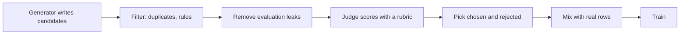
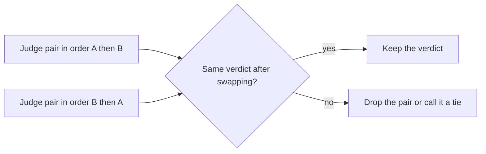
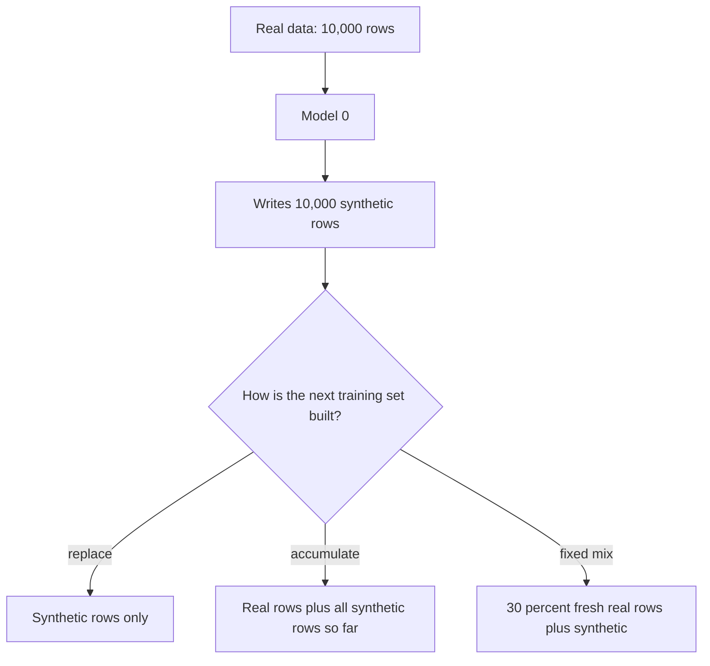

# **Synthetic Data**

*Stage 03 Data Engineering, note 06. Follows note 05, which removed evaluation leaks from the training data.*

---

## **1. The Running Example: One Prompt, Three Answers, One Preference Pair**

Take the prompt from row r1: "What does softmax do?" Instead of reading an answer from a file, we ask a model to write answers. The model that writes them is the **generator**, and each answer it writes is a **candidate**. Rows written this way are **synthetic data**: rows whose prompt or answer was produced by a model, not by a person.

A second model, the **judge**, scores each candidate against a **rubric**, a short list of things a good answer must do. We use four aspects, each rated from 1 to 5: helpfulness, instruction following, honesty and truthfulness. The mean of the four ratings is the candidate's score. The toy ratings below are illustrative.

| candidate | answer | ratings | mean |
|---|---|---|---|
| c1 | Softmax turns raw scores into probabilities that add up to one. | 5, 4, 5, 4 | 4.5 |
| c2 | It gives probabilities. | 4, 4, 4, 3 | 3.75 |
| c3 | It sorts the tokens. | 2, 3, 2, 2 | 2.25 |

The best candidate, c1, becomes the **chosen** answer. The **rejected** answer is picked from the candidates with a lower mean. Picking c2 gives a **hard negative**, a pair where both answers are close in quality, with a gap of $4.5 - 3.75 = 0.75$. Picking c3 gives an obvious pair with a gap of $4.5 - 2.25 = 2.25$. The pair is then stored as a prompt with a chosen and a rejected answer, the preference shape from note 01.



**The new ingredient.** Until now every row came from a person or a file with a license. Now a model can write rows, so we have to ask how many survive the checks, how good they are, how much real data must stay in the mix, and whose terms apply to the generator's output.

| **What you will learn** |
|---|
| How a model writes training rows, and how a judge picks the chosen and rejected answers. |
| Why training on your own model's output can lose rare cases, and how a share of real data prevents it. |
| How much a run costs per accepted row, and which GPU tier holds the generator. |

---

## **2. How Synthetic Data Is Made and Judged**

### **2.1 The definition in plain words, then formal**

**Plain words.** A synthetic dataset is made by prompting a generator, keeping only the candidates that pass checks, and mixing them with real rows. The part of the dataset that people wrote or collected is the **real data**.

**Formal.** A dataset has $N$ rows, split into real rows and synthetic rows. The **real share** is $\rho_{\text{real}} = N_{\text{real}} / N$, the same row share idea as $\rho_g$ in note 03, with the groups real and synthetic. Candidates pass through stages $s = 1, \dots, S$, and stage $s$ keeps a share $y_s$ of what it receives. The **yield** is $Y = \prod_s y_s$, so to end with $N_{\text{acc}}$ accepted rows you must generate $N_{\text{cand}} = N_{\text{acc}} / Y$ candidates.

**Check.** If no stage removes anything, $Y = 1$. Every stage with $y_s < 1$ raises the number of candidates you must pay for.

### **2.2 The pipeline: generate, filter, judge, decontaminate, mix**

**Intuition.** Writing rows is cheap, so the work is in deciding which rows to keep.

**Precise statement.** The source note lists five steps: generate candidates with a strong model using a rubric, filter by quality, rank with a judge and an explicit rubric, decontaminate against your evaluation sets, and train on the result. Two checks from earlier notes apply again to synthetic rows. A generator repeats itself, so run the dedup of note 04, including a check against your real rows. A generator may also have seen benchmark text, so run the scan of note 05. Yang et al. found benchmark leaks in synthetic data made by GPT-3.5 and GPT-4.

```text
for each prompt:
    candidates = generator(prompt, sampling settings, rubric in the prompt)
    drop exact and near duplicates (note 04), also against real rows
    drop rows that overlap an evaluation set (note 05)
    score each candidate with the judge and the rubric
    keep candidates above the score cut, or build a chosen and rejected pair
mix with real rows at a recorded real share
write the generator, its version, its terms and the date to the provenance table (note 03)
```

**Worked example.** Section 3 multiplies the keep rates of three stages to get a yield of 0.6174.

**Beginner trap.** Judging before deduplicating. You pay for the judge on rows you then throw away.

**When to use.** Whenever you need more rows than you have, a rare case, or preference pairs at scale.

### **2.3 Where prompts come from: seeds and personas**

**Intuition.** A generator needs something to start from, and the starting point shapes the variety of the result.

**Precise statement.** Two real recipes, both read from their sources:

- **Seed tasks.** Stanford Alpaca started from 175 human-written seed tasks and asked text-davinci-003 to produce new instructions, ending with 52,000 unique instructions at a cost of less than 500 dollars. The Hub copy has 52,002 rows.
- **Persona-driven prompts.** Tulu 3 gave a generator a short persona, such as a machine learning researcher, and asked it to write a prompt that persona would ask. Five subsets of the Tulu 3 SFT mixture are persona-driven: math, grade school math, Python, algebra and instruction following. The dataset cards say the answers came from GPT-4o and Claude 3.5 Sonnet.

```text
seed or persona -> generator writes a prompt -> generator writes an answer -> filters
```

**Worked example.** The five persona subsets hold $149960 + 49980 + 34999 + 20000 + 29980 = 284{,}919$ rows, which is $284919 / 939343 = 0.3033$ of the Tulu 3 SFT mixture of note 03 (measured counts). The Tulu 3 team states that 43 percent of its 939,344 prompts were synthetic and made in house.

**Beginner trap.** Expecting variety from one prompt template. A single template with random sampling produces rows that share a voice, so mix personas, seeds and sources.

**When to use.** Seeds when you have a few good examples. Personas when you need broad coverage of a skill.

### **2.4 LLM judges and their biases**

**Intuition.** A judge model reads a candidate and scores it, which is faster than a person and has its own habits.

**Precise statement.** Zheng et al. studied judges on MT-Bench and Chatbot Arena and named three habits. **Position bias** is preferring an answer because of where it appears. When they swapped the order, GPT-4 gave a consistent verdict 65.0 percent of the time, Claude-v1 23.8 percent and GPT-3.5 46.2 percent. **Verbosity bias** is preferring longer answers: a test that padded an answer with repeated text fooled Claude-v1 and GPT-3.5 in 91.3 percent of cases and GPT-4 in 8.7 percent. **Self-enhancement bias** is favoring answers from the same model. GPT-4 favored itself with a 10 percent higher win rate and Claude-v1 with 25 percent, though the paper says the data cannot settle this. GPT-4 agreed with human voters 85 percent of the time on non-tie votes, and humans agreed with each other 81 percent.



The probability-weighted score is a second way to use a judge. Instead of reading the digit the judge prints, read the probabilities of the digits 1 to 5 and take their weighted average. The G-Eval paper does this to get finer-grained scores (section 6.3 works an example).

**Worked example.** If a judge flips its verdict on 35 percent of swapped pairs, its order alone decides those pairs (section 6.4).

**Beginner trap.** Trusting one pass of a judge. Swap the order, use a rubric, and check the judge against about 50 human labels.

**When to use.** Whenever you filter or rank candidates without reading all of them.

### **2.5 Building preference pairs**

**Intuition.** A preference pair teaches a model which of two answers to prefer, so the pair should differ in quality, not in length.

**Precise statement.** Tulu 3 followed the UltraFeedback recipe. A judge, GPT-4o in the version of August 2024, rated every response from 1 to 5 on four aspects, helpfulness, instruction following, honesty and truthfulness. The chosen response had the highest mean rating, and the rejected response was a random pick among the responses with a lower mean. The source note adds the hard-negative rule from note 01: pairs where chosen and rejected are almost equally good teach more than obvious pairs.

```text
for each prompt with candidates c and mean ratings:
    chosen = candidate with the highest mean
    rejected = a random candidate with a lower mean
    gap = chosen mean minus rejected mean
store {prompt, chosen, rejected}, explicit prompt form (note 01)
```

**Worked example.** Section 1: chosen c1, rejected c2 gives a gap of 0.75, rejected c3 gives 2.25.

**Beginner trap.** Always picking the worst candidate as rejected. The pairs become easy, and the model learns little.

**When to use.** Preference tuning, covered in the alignment stage.

### **2.6 Model collapse and the real-data share**

**Intuition.** A model trained on a sample of its own output sees fewer rare cases than the original data had, so each generation forgets a little more.

**Precise statement.** **Model collapse** is the degradation of models trained on data made by earlier models. Shumailov et al. (Nature, 2024) show that the tails of the original distribution disappear first, in what they call early collapse, and later the distribution narrows to something very different, late collapse. Finite samples alone cause part of it, because a rare case may not appear in the sample. Gerstgrasser et al. compare two ways of using synthetic data. If each generation **replaces** the data, the test error in their regression analysis grows by a fixed amount per generation. If each generation **accumulates**, adding new synthetic data to everything before, the error stays below a fixed bound, and they report the same pattern in language model experiments. The source note says to mix in real data and set a real-data mixing ratio. The evidence says the more precise rule is to keep the real data and add to it, not to replace it.

```text
replace:    data(i) = synthetic from model(i-1)
accumulate: data(i) = real + synthetic from models 0 to i-1
fixed mix:  data(i) = alpha of fresh real data + (1 - alpha) synthetic
```

**Worked example.** Section 4 tables the real share and the error for all three, and section 6.7 works the chance of losing a rare case.

**Beginner trap.** Treating a fixed mixing ratio as a proven cure. It is a design choice, and the supporting results come from specific settings.

**When to use.** Whenever synthetic rows come from a model related to the one you train, which includes your own.

### **2.7 The tool the source names: distilabel**

**Precise statement.** The source note names the distilabel library and shows imports from it. The latest release on PyPI is 1.5.3, uploaded on 28 January 2025, so the source's remark that the last release dates from January 2025 is still true (measured). Two of its imports do not work in that version:

| import in the source note | result in 1.5.3 (measured) |
|---|---|
| `distilabel.models.InferenceAPIModel` | not found |
| `distilabel.models.TextGeneration` | not found |
| `distilabel.steps.tasks.TextGeneration` | found |
| `distilabel.models.OpenAILLM` and `InferenceEndpointsLLM` | found |
| `distilabel.steps.tasks.UltraFeedback` and `SelfInstruct` | found |
| `distilabel.steps.LoadDataFromHub` and `distilabel.pipeline.Pipeline` | found |

**Beginner trap.** Pasting import lines from a tutorial. Run cell 2 of the notebook first, and pin the version.

The source also names LangSmith, PromptTools and a Hugging Face auto-DPO generator. I did not check those.

### **2.8 Who owns the output: generator terms**

This is not legal advice. Note 03 showed that a dataset license is not the whole story, and generated rows are the clearest case.

| generator family | what its terms say about using outputs to train a model | how well checked |
|---|---|---|
| OpenAI models | the Terms of Use list, among what you may not do, using Output to develop models that compete with OpenAI; business terms are separate and have limited exceptions | the Terms of Use page read directly, business terms through a secondary source |
| Llama 3.1 | the license allows outputs to improve other models, if the new model's name starts with Llama and carries the "Built with Llama" notice; Llama 2 and Llama 3 forbade this | secondary summaries only, the license text is gated and was not read |
| Apache 2.0 or MIT models | no restriction on outputs beyond the license notice | general knowledge, not checked per model |

The Tulu 3 persona dataset cards say that outputs from GPT models are subject to OpenAI's terms and outputs from Claude to Anthropic's terms, even though the dataset carries the ODC-BY license.

**Beginner trap.** Reading "open-weight generators are safer" as a rule. The terms vary by model and version.

### **2.9 Comparison and assumptions**

| source of rows | strength | assumption that can fail |
|---|---|---|
| seeds plus a generator (Alpaca style) | cheap, fast | the seeds cover what you need |
| personas plus a generator (Tulu 3 style) | broad coverage of a skill | the personas differ in ways that matter |
| your own model, sampled, then judged | matches your model | the judge is better than the generator |
| rewriting real rows | stays close to real data | the rewrite keeps the meaning |

---

## **3. Why It Matters, With Numbers**

Three ideas to keep in mind:

- A generator can write rows faster than you can check them.
- Only a share of candidates survive the checks, and you pay for all of them.
- Replacing real data with synthetic data loses rare cases, and adding to it does not.

After note 05 the real rows are deduplicated and free of evaluation leaks. New synthetic rows bring the same problems back, and they bring new ones.

**The yield.** Illustrative keep rates for one run: deduplication keeps 0.90, the evaluation scan keeps 0.98 and the judge cut keeps 0.70.

$$\begin{aligned}
Y &= 0.90 \times 0.98 \times 0.70 \\[6pt]
  &= 0.8820 \times 0.70 \\[6pt]
  &= \boxed{0.6174}
\end{aligned}$$

To end with 1,000 accepted rows you must generate $1000 / 0.6174 = 1619.7$, so 1,620 candidates (section 6.5).

**The scale in real datasets.** Alpaca's 52,002 rows are all generated. In Tulu 3, 43 percent of 939,344 prompts were synthetic by the team's own count, and the five persona subsets alone are 30.33 percent of the SFT mixture rows (section 2.3).

**Beginner trap.** Planning the generation budget from the number of rows you want. Plan it from the yield.

---

## **4. The Extra Classic Example: Replace, Accumulate or Mix**

The running example has one round of generation. The risk of synthetic data shows up over several rounds, where each model is trained and then writes the data for the next. Take 10,000 real rows and 10,000 synthetic rows added per generation. Error is in units of the error scale $e_0$ of the Gerstgrasser et al. regression analysis, set to 1.



**Hand check.** The real share after $i$ generations:

| generation $i$ | replace | accumulate | calculation for accumulate | fixed mix |
|---|---|---|---|---|
| 0 | 1.0000 | 1.0000 | $10000 / 10000$ | 0.3000 |
| 1 | 0.0000 | 0.5000 | $10000 / 20000$ | 0.3000 |
| 2 | 0.0000 | 0.3333 | $10000 / 30000$ | 0.3000 |
| 3 | 0.0000 | 0.2500 | $10000 / 40000$ | 0.3000 |
| 4 | 0.0000 | 0.2000 | $10000 / 50000$ | 0.3000 |
| 5 | 0.0000 | 0.1667 | $10000 / 60000$ | 0.3000 |

The error after $n$ generations in the paper's regression setting, with $e_0 = 1$: replace grows to $n$, so 5 after five generations. Accumulate adds $1/i^2$ each generation:

| $n$ | replace | accumulate sum | calculation |
|---|---|---|---|
| 1 | 1 | 1.0000 | $1$ |
| 2 | 2 | 1.2500 | $1 + 0.25$ |
| 3 | 3 | 1.3611 | $1.25 + 0.1111$ |
| 4 | 4 | 1.4236 | $1.3611 + 0.0625$ |
| 5 | 5 | 1.4636 | $1.4236 + 0.04$ |

The accumulate sum can never pass $\pi^2 / 6 = 1.6449$. The script matches both tables (measured).

**What it hides.** In the accumulate case the real share keeps falling, to 0.1667 at generation 5, and the error is still bounded. The real share alone is not the whole story: what matters is that the real rows stay in the data. Keep that finding apart from the claim that a particular share is safe, which none of the sources give.

**Beginner trap.** Reading the fixed mix row as a result. The constant 0.3 is an input to the design, not an outcome.

---

## **5. The Checks Before You Train on It**


1. Set a floor for real data and write down the real share you will use.
2. Record the generator, its version, its terms, the sampling settings and the date, in the provenance table of note 03.
3. Remove exact and near duplicates, also against the real rows (note 04).
4. Scan against every evaluation set you will report (note 05).
5. Judge with a rubric, swap the order, and compare the judge with about 50 human labels using the chance-corrected agreement of section 6.4.
6. Read 59 accepted rows. By section 6.7 that is enough to see a 5 percent defect with 95 percent probability.
7. Write the counts for each stage to `synthetic/06-candidates.jsonl` and the rubric to `synthetic/06-rubric.yaml`.

**Beginner trap.** Checking only the final rows. Without counts for each stage you cannot tell where the yield went.

---

## **6. The Math, Step by Step**

This section lists every symbol and formula in the note, with a worked example. Cover the steps, do the calculation yourself, then compare with the boxed value. The softmax and its gradient are derived in note 01 section 9.4, and this note reuses the softmax for the judge score.

### **6.1 Notation table**

| symbol | read aloud | meaning | in the running example |
|---|---|---|---|
| $v_{cj}$ | v sub c j | rating of candidate $c$ on aspect $j$ | 5 for c1 on aspect 1 |
| $\bar v_c$ | v bar c | mean rating of candidate $c$ | 4.5 for c1 |
| $p_k$ | p sub k | probability of the rating digit $k$ | 0.5206 for digit 4 |
| $\hat v$ | v hat | probability-weighted rating | 3.7813 |
| $P_o$, $P_e$ | P o, P e | observed agreement, agreement expected by chance | 0.70 and 0.50 |
| $\omega$ | omega | chance-corrected agreement (Cohen's kappa) | 0.40 |
| $y_s$, $Y$ | y sub s, Y | keep rate of stage $s$, overall yield | 0.6174 |
| $N_{\text{acc}}$, $N_{\text{cand}}$ | N acc, N cand | accepted rows wanted, candidates to generate | 1,000 and 1,620 |
| $N_R$, $N_S$ | N R, N S | real rows, synthetic rows added per generation | 10,000 each |
| $i$ | i | generation number | 3 |
| $\rho_{\text{real}}(i)$ | rho real | real share after $i$ generations | 0.2500 |
| $e_0$ | e zero | error scale of the paper's regression, set to 1 | 1 |
| $p$ | p | share of rows with a rare case | 0.05 |
| $n_{\text{samp}}$ | n samp | rows sampled | 20 |
| $n_{\text{layer}}$, $h_{kv}$, $d_{\text{head}}$ | | layers, key-value heads, size of one head | 24, 2, 64 |
| $M_{KV}$ | M K V | key-value cache bytes of one sequence | 6,291,456 |
| $B_{\text{seq}}$ | B seq | sequences that fit at once | 2,002 on 16 GB |
| $\bar T_{\text{out}}$ | T bar out | mean generated tokens per candidate | 300 |

**Reading tips.** The letter $\omega$ is the chance-corrected agreement, so it never clashes with $\kappa$, the number of hash functions in note 04. The letter $i$ counts generations, and $t$ still means a token position. The letter $p$ is a probability, as in notes 01 and 05.

### **6.2 The rubric mean and the preference pair**

$$\bar v_c = \frac{1}{4} \sum_{j=1}^{4} v_{cj} \qquad \text{chosen} = \arg\max_c \bar v_c \qquad \text{gap} = \bar v_{\text{chosen}} - \bar v_{\text{rejected}}$$

**What it says.** The score of a candidate is the mean of its aspect ratings. The best score is chosen, and the gap measures how different the rejected answer is.

**Worked example: candidate c1.**

$$\begin{aligned}
\bar v_{c1} &= \frac{5 + 4 + 5 + 4}{4} \\[6pt]
&= \frac{18}{4} = \boxed{4.5}
\end{aligned}$$

Candidates c2 and c3:

$$\begin{aligned}
\bar v_{c2} &= \frac{4 + 4 + 4 + 3}{4} = \boxed{3.75} \\[8pt]
\bar v_{c3} &= \frac{2 + 3 + 2 + 2}{4} = \boxed{2.25}
\end{aligned}$$

Gaps for the two choices of rejected answer:

$$\begin{aligned}
\text{gap}_{c2} &= 4.5 - 3.75 = \boxed{0.75} \\[8pt]
\text{gap}_{c3} &= 4.5 - 2.25 = \boxed{2.25}
\end{aligned}$$

**Extreme case.** If all candidates have the same mean, there is no chosen answer, so drop the prompt. If the gap is large, the pair is easy.

**Beginner trap.** Averaging aspects that matter unequally. A wrong answer with a friendly tone can score well on helpfulness, so read a sample of high scores.

**Check.** The script matches (measured).

### **6.3 The probability-weighted rating**

$$p_k = \frac{e^{z_k}}{\sum_{m=1}^{5} e^{z_m}} \qquad \hat v = \sum_{k=1}^{5} k\, p_k$$

**What it says.** The judge outputs a score for each of the digits 1 to 5. A softmax turns the five scores into probabilities, and the weighted average of the digits is a finer score than the digit alone.

**Tiny full worked example.** A vocabulary of five tokens, the digits 1 to 5, with illustrative logits $z = [-1, 0, 1, 2, 1]$.

**Step 1. The exponentials.**

$$\begin{aligned}
e^{-1} &= 0.3679 \\[4pt]
e^{0} &= 1.0000 \\[4pt]
e^{1} &= 2.7183 \\[4pt]
e^{2} &= 7.3891 \\[4pt]
e^{1} &= 2.7183
\end{aligned}$$

**Step 2. The sum.**

$$0.3679 + 1.0000 + 2.7183 + 7.3891 + 2.7183 = \boxed{14.1936}$$

**Step 3. The probabilities.**

$$p = \left[\frac{0.3679}{14.1936}, \frac{1.0000}{14.1936}, \frac{2.7183}{14.1936}, \frac{7.3891}{14.1936}, \frac{2.7183}{14.1936}\right] = \boxed{[0.0259,\ 0.0705,\ 0.1915,\ 0.5206,\ 0.1915]}$$

**Step 4. The weighted rating.**

$$\begin{aligned}
\hat v &= 1(0.0259) + 2(0.0705) + 3(0.1915) + 4(0.5206) + 5(0.1915) \\[6pt]
&= 0.0259 + 0.1410 + 0.5745 + 2.0824 + 0.9575 \\[6pt]
&= \boxed{3.7813}
\end{aligned}$$

The most likely digit is 4, and the weighted rating is 3.78, so the judge is less sure than the single digit suggests. The per-token loss and the gradient $p - \mathbf{1}_y$ are derived in note 01 section 9.4 and are not needed here, since the judge is not trained.

**Extreme case.** If one digit has probability 1, then $\hat v$ equals that digit. If all five are equal, $\hat v = 3$.

**Beginner trap.** Comparing weighted ratings from two different judges. The scales differ.

**Check.** The probabilities sum to 1, and the script matches (measured). The general idea is from the G-Eval paper. The numbers here are illustrative.

### **6.4 Judge agreement and chance**

$$P_o = \frac{\text{pairs where judge and humans agree}}{\text{all pairs}} \qquad P_e = \sum_{\text{verdict}} P(\text{judge says it})\,P(\text{human says it}) \qquad \omega = \frac{P_o - P_e}{1 - P_e}$$

**What it says.** Raw agreement looks good even for a judge that guesses. The chance-corrected value $\omega$ removes the agreement you would get by luck.

**Worked example.** 100 pairs, with illustrative counts: both choose A 40, both choose B 30, judge A and human B 20, judge B and human A 10.

$$\begin{aligned}
P_o &= \frac{40 + 30}{100} = \boxed{0.70} \\[10pt]
P(\text{judge A}) &= \frac{40 + 20}{100} = 0.60 \qquad P(\text{human A}) = \frac{40 + 10}{100} = 0.50 \\[10pt]
P_e &= 0.60 \times 0.50 + 0.40 \times 0.50 = \boxed{0.50} \\[10pt]
\omega &= \frac{0.70 - 0.50}{1 - 0.50} = \boxed{0.40}
\end{aligned}$$

A raw agreement of 70 percent is only 0.40 once chance is removed. Position bias is measured differently: a flip rate of $1 - 0.65 = \boxed{0.35}$ for the GPT-4 consistency of 65.0 percent reported by Zheng et al.

**Extreme case.** $\omega = 1$ is perfect agreement, $\omega = 0$ is chance, and $\omega < 0$ is worse than chance.

**Beginner trap.** Quoting raw agreement. With two options a coin flip already agrees about 50 percent of the time.

**Check.** The script matches (measured).

### **6.5 Yield and candidates needed**

$$Y = \prod_{s} y_s \qquad N_{\text{cand}} = \left\lceil \frac{N_{\text{acc}}}{Y} \right\rceil$$

**What it says.** Each stage keeps a share of what reaches it, and the shares multiply.

**Worked example.** From section 3:

$$\begin{aligned}
Y &= 0.90 \times 0.98 \times 0.70 = \boxed{0.6174} \\[10pt]
\frac{1000}{0.6174} &= 1619.7 \\[6pt]
N_{\text{cand}} &= \lceil 1619.7 \rceil = \boxed{1620}
\end{aligned}$$

**Extreme case.** If one stage keeps 0, no candidates survive. If $Y = 1$, every candidate is accepted.

**Beginner trap.** Adding the removed shares. Removing 10, 2 and 30 percent in turn does not remove 42 percent, because each stage works on what the last one kept.

**Check.** The script matches (measured).

### **6.6 Real share and error over generations**

$$\rho_{\text{real}}(i) = \begin{cases} 0 & \text{replace, } i \ge 1 \\[4pt] \dfrac{N_R}{N_R + i\,N_S} & \text{accumulate} \\[8pt] \alpha & \text{fixed mix} \end{cases} \qquad E_{\text{replace}}(n) = n\,e_0 \qquad E_{\text{accum}}(n) = e_0 \sum_{i=1}^{n} \frac{1}{i^2} < e_0\,\frac{\pi^2}{6}$$

**What it says.** The first part is the share of real rows in the training set. The second part is the test error of the regression analysis of Gerstgrasser et al., in units of $e_0$. It is a result for linear regression, and the paper reports the same pattern in language model experiments.

**Worked example: generation 3 with accumulation.**

$$\begin{aligned}
\rho_{\text{real}}(3) &= \frac{10000}{10000 + 3 \times 10000} \\[6pt]
&= \frac{10000}{40000} = \boxed{0.2500}
\end{aligned}$$

Error after 5 generations:

$$\begin{aligned}
E_{\text{replace}}(5) &= \boxed{5} \\[10pt]
E_{\text{accum}}(5) &= 1 + 0.25 + 0.1111 + 0.0625 + 0.04 = \boxed{1.4636} \\[10pt]
\frac{\pi^2}{6} &= \boxed{1.6449}
\end{aligned}$$

**Extreme case.** As $n$ grows, replace grows without limit, and accumulate approaches 1.6449 and stops.

**Beginner trap.** Quoting 1.6449 as an error you can expect in a language model. It is a bound in a simplified model.

**Check.** Matches the tables of section 4 (measured).

### **6.7 Losing a rare case**

$$P_{\text{miss}} = (1 - p)^{n_{\text{samp}}} \qquad n_{\text{samp}} \ge \left\lceil \frac{\ln 0.05}{\ln (1 - p)} \right\rceil$$

**What it says.** A case that makes up a share $p$ of the data is missing from a sample of $n_{\text{samp}}$ rows with probability $(1-p)^{n_{\text{samp}}}$. This is how the tails of a distribution vanish in each round of sampling. The second formula is the sample size that sees the case with 95 percent probability, the same rule as for reading rows in note 04.

**Worked example.** A case with $p = 0.05$ and a sample of 20:

$$\begin{aligned}
0.95^{20} &= \boxed{0.3585} \\[8pt]
P_{\text{seen}} &= 1 - 0.3585 = \boxed{0.6415} \\[10pt]
n_{\text{samp}} &\ge \frac{\ln 0.05}{\ln 0.95} = 58.4 \;\Rightarrow\; \boxed{59}
\end{aligned}$$

**Extreme case.** At $p = 0.5$ a sample of 20 almost always sees the case. At $p = 0.001$ you need about 3,000 rows.

**Beginner trap.** Thinking a 20 row sample is fair to a 5 percent case. It misses the case more than a third of the time.

**Check.** Section 5 uses 59 rows for the reading step, and the script matches (measured).

### **6.8 The key-value cache, the GPU ladder and the cost of generation**

$$M_{KV} = 2\, n_{\text{layer}}\, h_{kv}\, d_{\text{head}}\, w\, T \qquad B_{\text{seq}} = \left\lfloor \frac{0.85 \cdot \text{VRAM} - 2P}{M_{KV}} \right\rfloor \qquad \text{cost per accepted row} = \frac{N_{\text{cand}}\, \bar T_{\text{out}}}{3600\,R} \cdot \frac{\text{price}}{N_{\text{acc}}}$$

**What it says.** While a model generates, it stores a key and a value for every token of every sequence. The factor 2 is the key plus the value, $w = 2$ bytes for half precision, and $T$ is the sequence length. The weights take $2P$ bytes. The last formula turns the speed $R$ in tokens per second and the hourly price into a cost per accepted row. The cache formula is general knowledge, and the head size is derived as hidden size over heads.

**Worked example: the cache of Qwen2.5-0.5B.** From its config, 24 layers, 14 heads, 2 key-value heads and a hidden size of 896, so a head has $896 / 14 = 64$ values.

$$\begin{aligned}
\text{per token} &= 2 \times 24 \times 2 \times 64 \times 2 = \boxed{12{,}288}\ \text{bytes} \\[8pt]
M_{KV}(512) &= 12288 \times 512 = \boxed{6{,}291{,}456}\ \text{bytes}
\end{aligned}$$

For a T4 (16 GB tier), with weights of $2 \times 0.5 \times 10^9 = 1.0$ GB (illustrative, the real count is a little under):

$$\begin{aligned}
0.85 \times 16 \times 10^{9} - 1.0 \times 10^{9} &= 12.6 \times 10^{9} \\[8pt]
B_{\text{seq}} &= \left\lfloor \frac{12.6 \times 10^{9}}{6291456} \right\rfloor = \boxed{2002}
\end{aligned}$$

**The ladder, small to large (measured by the script).** The largest generator uses the weights-only rule of note 05, $0.85 \cdot \text{VRAM} / 2$, and leaves no room for the cache, so treat it as an upper bound.

| GPU tier | VRAM | largest generator (weights only) | 512-token sequences at once, 0.5B generator |
|---|---|---|---|
| T4 | 16 GB | 6.8 B | 2,002 |
| L4 | 24 GB | 10.2 B | 3,083 |
| L40S | 48 GB | 20.4 B | 6,326 |
| A100 80GB or H100 | 80 GB | 34.0 B | 10,649 |
| H200 | 141 GB | 59.9 B | 18,890 |
| B200 | 180 GB | 76.5 B | 24,159 |
| B300 | 288 GB | 122.4 B | 38,750 |

**Worked example: cost.** For the 1,620 candidates of section 6.5 with an illustrative mean of 300 generated tokens, an illustrative speed of 2,000 tokens per second, and a T4 at 0.59 dollars per hour (Modal rate, read in November 2026):

$$\begin{aligned}
\text{tokens} &= 1620 \times 300 = \boxed{486{,}000} \\[8pt]
\text{hours} &= \frac{486000}{3600 \times 2000} = \boxed{0.0675} \\[8pt]
\text{cost} &= 0.0675 \times 0.59 = \boxed{0.0398}\ \text{dollars}
\end{aligned}$$

That is about 4 cents for 1,000 accepted rows. Replace the speed with your own measurement from cell 7, since a faster GPU has a different $R$.

**Extreme case.** At $T = 1$ the cache is 12,288 bytes per sequence, and at 4,096 tokens it is 8 times the 512-token value.

**Beginner trap.** Sizing a generator from its weights alone. The cache grows with every sequence you run at once.

**Check.** The KV cache of 1,000 sequences of 512 tokens is $1000 \times 6291456 = 6.2915$ GB (measured), and cell 7 tests the formula.

### **6.9 All formulas and answers**

| formula | input | answer |
|---|---|---|
| $\bar v_c$ | c1: 5, 4, 5, 4 | 4.5 |
| gap for c2 and c3 | $4.5 - 3.75$, $4.5 - 2.25$ | 0.75 and 2.25 |
| $\hat v$ | $z = [-1, 0, 1, 2, 1]$ | 3.7813 |
| $P_o$, $P_e$, $\omega$ | 40, 30, 20, 10 | 0.70, 0.50, 0.40 |
| flip rate | $1 - 0.65$ | 0.35 |
| $Y$ | $0.90 \times 0.98 \times 0.70$ | 0.6174 |
| $N_{\text{cand}}$ | $\lceil 1000 / 0.6174 \rceil$ | 1,620 |
| $\rho_{\text{real}}(3)$, accumulate | $10000 / 40000$ | 0.2500 |
| $E_{\text{accum}}(5)$ and the bound | $\sum 1/i^2$ and $\pi^2/6$ | 1.4636 and 1.6449 |
| $P_{\text{miss}}$, $p = 0.05$, 20 rows | $0.95^{20}$ | 0.3585 |
| rows to see a 5 percent case | $\lceil \ln 0.05 / \ln 0.95 \rceil$ | 59 |
| $M_{KV}(512)$ and $B_{\text{seq}}$ on 16 GB | 12,288 per token | 6,291,456 and 2,002 |
| cost for 1,620 candidates | $0.0675 \times 0.59$ | 0.0398 dollars |

### **6.10 Pen-and-paper rules**

1. Write the rubric before you read any candidate.
2. Compute the mean of the ratings, then the gap, before you pick the rejected answer.
3. Swap the order of every judged pair at least once.
4. Report chance-corrected agreement, never raw agreement alone.
5. Multiply the keep rates, never add the removed shares.
6. Round the number of candidates up.
7. Write the real share of every training set.
8. Prefer adding to the data over replacing it.
9. A 20 row sample misses a 5 percent case more than a third of the time.
10. Check each result a second way, and name the section that matches.

---

## **7. Notebook Experiments on GPU**

These cells run in a GPU notebook: a Lightning AI Studio, a Modal Notebook, or your organization's cluster. They were checked for syntax and not run. Cells 2, 3 and 6 run on the CPU. Cells 4, 5 and 7 use the GPU. Run cell 1 first. Cells 5 to 7 reuse names from cell 4, and cell 7 reuses `text` and `tokenizer`.

**Assumptions stated.**

- Install first: `pip install distilabel` for cell 2 (this note was checked with 1.5.3).
- The generator and the judge are both Qwen2.5-0.5B-Instruct. It is far too small to be a good judge, so cell 5 shows the mechanics only, and a real judge should be a stronger model.
- Skipped on purpose: the training cell and the before and after comparison, since nothing is trained here. Cell 7 is the memory and speed readout.
- The model load is part of cell 4.

```python
# ── Cell 1. Environment and GPU tier ─────────────────────────────
#    Versions, device, VRAM, ladder tier, largest generator, sequences
#    Reported memory is slightly off the label, so allow 2 GB
# ─────────────────────────────────────────────────────────────────
import random
import torch
import transformers
import datasets

random.seed(42)
torch.manual_seed(42)
print("torch", torch.__version__, "transformers", transformers.__version__)
print("datasets", datasets.__version__)

props = torch.cuda.get_device_properties(0)
capability = torch.cuda.get_device_capability(0)
vram_gb = props.total_memory / 1e9
print("device", props.name, f"{vram_gb:.1f} GB", capability)

tiers = [16, 24, 48, 80, 141, 180, 288]
tier = max(t for t in tiers if t <= vram_gb + 2)
dtype = torch.bfloat16 if capability[0] >= 8 else torch.float16
sequences = int((0.85 * tier * 1e9 - 1e9) // (2 * 24 * 2 * 64 * 2 * 512))
print("tier:", tier, "GB  largest generator:", 0.85 * tier / 2, "B  sequences:", sequences)
```

```text
torch <version> transformers <version>
datasets <version>
device <GPU name> <memory> GB (<major>, <minor>)
tier: <16 up to 288> GB  largest generator: <6.8 up to 122.4> B  sequences: <2002 up to 38750>
```

```python
# ── Cell 2. Which distilabel names exist? ────────────────────────
#    pip install distilabel   (this note was checked with 1.5.3)
#    The source note imports two names that may not exist
# ─────────────────────────────────────────────────────────────────
import importlib
import importlib.metadata

print("distilabel version:", importlib.metadata.version("distilabel"))
checks = [("distilabel.models", "InferenceAPIModel"), ("distilabel.models", "TextGeneration"),
          ("distilabel.models", "OpenAILLM"), ("distilabel.models", "InferenceEndpointsLLM"),
          ("distilabel.steps.tasks", "TextGeneration"), ("distilabel.steps.tasks", "UltraFeedback"),
          ("distilabel.steps.tasks", "SelfInstruct"), ("distilabel.steps", "LoadDataFromHub"),
          ("distilabel.pipeline", "Pipeline")]

for module_name, name in checks:
    module = importlib.import_module(module_name)
    print(f"{module_name}.{name}:", "found" if hasattr(module, name) else "not found")
```

```text
distilabel version: 1.5.3
distilabel.models.InferenceAPIModel: not found
distilabel.models.TextGeneration: not found
distilabel.models.OpenAILLM: found
distilabel.models.InferenceEndpointsLLM: found
distilabel.steps.tasks.TextGeneration: found
distilabel.steps.tasks.UltraFeedback: found
distilabel.steps.tasks.SelfInstruct: found
distilabel.steps.LoadDataFromHub: found
distilabel.pipeline.Pipeline: found
```

These lines were measured on a CPU with `distilabel` 1.5.3. A newer version may differ.

```python
# ── Cell 3. Sanity check: the toy numbers ────────────────────────
#    Rubric means, the weighted rating, the yield and the tail
#    Reproduce sections 1, 6.3, 6.5 and 6.7 on plain Python numbers
# ─────────────────────────────────────────────────────────────────
import math

scores = {"c1": [5, 4, 5, 4], "c2": [4, 4, 4, 3], "c3": [2, 3, 2, 2]}
means = {name: sum(values) / len(values) for name, values in scores.items()}
chosen = max(means, key=means.get)
print("means:", means, " chosen:", chosen)

logits = [-1.0, 0.0, 1.0, 2.0, 1.0]
exps = [math.exp(z) for z in logits]
probs = [e / sum(exps) for e in exps]
rating = sum((k + 1) * p for k, p in enumerate(probs))
print("probabilities:", [round(p, 4) for p in probs], " rating:", round(rating, 4))

yield_rate = 0.90 * 0.98 * 0.70
print("yield:", round(yield_rate, 4), " candidates for 1000:", math.ceil(1000 / yield_rate))
print("tail missed:", round(0.95 ** 20, 4))
```

```text
means: {'c1': 4.5, 'c2': 3.75, 'c3': 2.25}  chosen: c1
probabilities: [0.0259, 0.0705, 0.1915, 0.5206, 0.1915]  rating: 3.7813
yield: 0.6174  candidates for 1000: 1620
tail missed: 0.3585
```

These four lines match the script (measured).

```python
# ── Cell 4. Generate candidate answers ───────────────────────────
#    Four sampled answers to one prompt, with the chat template
#    Needs cell 1 for the dtype
# ─────────────────────────────────────────────────────────────────
from transformers import AutoModelForCausalLM, AutoTokenizer

name = "Qwen/Qwen2.5-0.5B-Instruct"
tokenizer = AutoTokenizer.from_pretrained(name)
model = AutoModelForCausalLM.from_pretrained(name, dtype=dtype).to("cuda").eval()

messages = [{"role": "user", "content": "What does softmax do?"}]
text = tokenizer.apply_chat_template(messages, tokenize=False, add_generation_prompt=True)
inputs = tokenizer(text, add_special_tokens=False, return_tensors="pt").to("cuda")

with torch.no_grad():
    output = model.generate(**inputs, do_sample=True, temperature=0.8, top_p=0.9,
                            max_new_tokens=60, num_return_sequences=4)

start = inputs.input_ids.shape[1]
candidates = tokenizer.batch_decode(output[:, start:], skip_special_tokens=True)
for i, candidate in enumerate(candidates):
    print(f"candidate {i}: {candidate[:80]!r}")
```

```text
candidate 0: '<first 80 characters>'
candidate 1: '<first 80 characters>'
candidate 2: '<first 80 characters>'
candidate 3: '<first 80 characters>'
```

```python
# ── Cell 5. Probability-weighted judge rating ────────────────────
#    Ask for one digit from 1 to 5 and read the logits of the digits
#    A model this small is a weak judge, so this shows the mechanics
# ─────────────────────────────────────────────────────────────────
digit_ids = [tokenizer.encode(str(k), add_special_tokens=False)[0] for k in range(1, 6)]

def weighted_rating(question, answer):
    prompt = (f"Question: {question}\nAnswer: {answer}\n"
              "Rate the answer from 1 (bad) to 5 (excellent). Reply with one digit.")
    chat = [{"role": "user", "content": prompt}]
    rendered = tokenizer.apply_chat_template(chat, tokenize=False, add_generation_prompt=True)
    batch = tokenizer(rendered, add_special_tokens=False, return_tensors="pt").to("cuda")
    with torch.no_grad():
        logits = model(**batch).logits[0, -1, digit_ids].float()
    probs = torch.softmax(logits, dim=-1)
    return sum((k + 1) * p.item() for k, p in enumerate(probs))

for candidate in candidates:
    print(f"rating: {weighted_rating(messages[0]['content'], candidate):.3f}")
```

```text
rating: <a number between 1 and 5>
rating: <a number between 1 and 5>
rating: <a number between 1 and 5>
rating: <a number between 1 and 5>
```

```python
# ── Cell 6. Gate the candidates: exact and near duplicates ───────
#    Hash for exact repeats, word-set Jaccard 0.8 for near repeats
#    The same idea as note 04, applied to the candidates of cell 4
# ─────────────────────────────────────────────────────────────────
import hashlib

def jaccard(first, second):
    union = first | second
    return len(first & second) / len(union) if union else 0.0

kept, seen_hashes, seen_sets = [], set(), []
for candidate in candidates:
    normalized = " ".join(candidate.lower().split())
    digest = hashlib.sha256(normalized.encode("utf-8")).hexdigest()
    words = set(normalized.split())
    if digest in seen_hashes or any(jaccard(words, other) >= 0.8 for other in seen_sets):
        continue
    kept.append(candidate)
    seen_hashes.add(digest)
    seen_sets.append(words)

print("candidates:", len(candidates), " kept:", len(kept))
```

```text
candidates: 4  kept: <between 1 and 4>
```

```python
# ── Cell 7. Memory and speed of batched generation ───────────────
#    64 new tokens for batch 1, 8 and 32, greedy decoding
#    Compare peak memory with the key-value cache formula
# ─────────────────────────────────────────────────────────────────
import time

per_token_bytes = 2 * 24 * 2 * 64 * 2
for batch in [1, 8, 32]:
    batch_inputs = tokenizer([text] * batch, add_special_tokens=False, return_tensors="pt").to("cuda")
    torch.cuda.reset_peak_memory_stats()
    try:
        start_time = time.time()
        with torch.no_grad():
            result = model.generate(**batch_inputs, do_sample=False, max_new_tokens=64)
        torch.cuda.synchronize()
        seconds = time.time() - start_time
        cache_gb = batch * result.shape[1] * per_token_bytes / 1e9
        peak_gb = torch.cuda.max_memory_allocated() / 1e9
        print(f"batch: {batch:3d}  peak: {peak_gb:5.2f} GB  cache: {cache_gb:5.3f} GB  "
              f"speed: {batch * 64 / seconds:7.0f} tok/s")
    except torch.cuda.OutOfMemoryError:
        print(f"batch: {batch:3d}  out of memory")
```

```text
batch:   1  peak: <x> GB  cache: <y> GB  speed: <n> tok/s
batch:   8  peak: <x> GB  cache: <y> GB  speed: <n> tok/s
batch:  32  peak: <x> GB  cache: <y> GB  speed: <n> tok/s
```

The cache column is hand-calculated: each sequence holds about 80 prompt tokens plus 64 new ones, at 12,288 bytes per token. The peak should sit above the weights plus the cache, because of temporary buffers.

### **7.1 Results table template**

| GPU tier | largest generator (cell 1) | sequences at once (cell 1) | peak GB at batch 32 | tok/s at batch 32 | candidates kept (cell 6) |
|---|---|---|---|---|---|
| 16 GB (T4) | | | | | |
| 24 GB (L4) | | | | | |
| 48 GB (L40S) | | | | | |
| 80 GB (A100 or H100) | | | | | |
| 141 GB (H200) | | | | | |
| 180 GB (B200) | | | | | |
| 288 GB (B300) | | | | | |

The CPU results of cells 2, 3 and 6 do not depend on the GPU, except that sampling makes the candidates differ from run to run.

### **7.2 Expected behavior (expected, not yet verified)**

- Cell 2 prints the same found and not found lines as the table in section 2.7 for version 1.5.3.
- Cell 3 prints the four measured lines.
- The four candidates in cell 4 differ from each other and from run to run.
- The ratings in cell 5 are between 1 and 5, and a small model may rate every answer about the same.
- Peak memory in cell 7 grows with batch size, and the cache column grows in proportion.
- Larger GPUs fit the batch of 32 with room to spare, while a T4 has the least room.

### **7.3 If you run out of memory**

1. Lower the batch size in cell 7, or lower `max_new_tokens`.
2. Generate in chunks and write each chunk to disk.
3. Keep half precision weights, as cell 4 does.
4. Use a smaller generator, or move to a larger tier with the table in section 6.8.

GPU runs are not exactly reproducible, so compare trends, not exact numbers.

---

## **8. Pitfalls and Limits**

**Pitfalls that really bite.**

1. **Replacing real data with synthetic data.** Rare cases vanish, and each round loses more.
2. **No record of the real share.** If you do not write it down, you cannot reproduce the run.
3. **One-pass judging.** Position bias flips about a third of GPT-4's verdicts when the order changes.
4. **No human check of the judge.** Raw agreement hides chance, so measure $\omega$ on about 50 labels.
5. **Skipping the scans.** Synthetic rows need the dedup of note 04 and the evaluation scan of note 05 too.
6. **Ignoring generator terms.** A dataset license does not remove the terms of the model that wrote the rows.
7. **One template, one voice.** Rows from one prompt style look alike and teach one style.
8. **Pasting imports from a tutorial.** Two of the source's distilabel imports do not exist in 1.5.3.

**Limits that remain.**

- The strongest evidence on collapse is from specific experiments, and the accumulate bound is for a linear regression model.
- Judges are biased, and a model as small as the one in cell 5 cannot be trusted, so use a stronger judge for real work.
- The cost and speed numbers are illustrative until you measure them in cell 7.
- The license summaries are not legal advice, and the Llama 3.1 summary comes from secondary sources.

**Debugging checklist.**

- What is the real share, and where is it written down?
- Which generator, version, terms and date made these rows?
- Did I swap the order of the judge, and what is its chance-corrected agreement?
- What did each stage remove, and what is the yield?
- Did I run the dedup and the evaluation scan on the synthetic rows?

---

## **9. How This Shows Up in Language Models**

- Alpaca came from 175 seed tasks and text-davinci-003, with 52,000 instructions for less than 500 dollars, and it trained a small chat model. Its origin is also why its rows carry a non-commercial tag and the generator's terms.
- In Tulu 3, 43 percent of the 939,344 prompts were synthetic, the persona subsets used GPT-4o and Claude 3.5 Sonnet, and its preference data used a GPT-4o judge with four aspects rated 1 to 5.
- Judges are useful and biased: GPT-4 agreed with humans 85 percent of the time on non-tie votes, and still flipped its answer on 35 percent of swapped pairs.
- Collapse is real but not inevitable: replacing real data loses the tails, and accumulating it keeps the error bounded in the settings studied.
- The generator's terms travel with its output: OpenAI's terms forbid using its output to build competing models, and Llama 3.1 allows it with naming rules.

The source note presents mixing real data as the cure. The papers show the sharper point, that adding to the data does not hurt in the studied settings and replacing it does. Added by me, not in the source note: the yield calculation, the chance-corrected agreement, the probability-weighted rating, the key-value cache table for the GPU ladder and the cost per accepted row.

**Next.** Note 07 covers PII and the EU AI Act: what to scrub and what to document before the data leaves your hands.

---

## **10. Self-Test**

**Q1.** A pipeline keeps 80 percent after dedup, 90 percent after the evaluation scan and 50 percent after the judge. How many candidates must you generate to end with 900 accepted rows?

**Q2.** You start with 2,000 real rows and add 1,000 synthetic rows per generation, keeping everything. What is the real share after 3 generations?

**Q3.** Spot the mistake: "My judge preferred the first answer in 100 of 100 pairs, so it is very accurate."

**Q4.** Spot the mistake: "The Tulu 3 persona data is ODC-BY, so no other terms apply."

**Q5.** A case makes up 2 percent of your data. What is the chance a sample of 50 rows misses it?

**Answers.**

**A1.** $Y = 0.8 \times 0.9 \times 0.5 = 0.36$. Candidates needed: $900 / 0.36 =$ $\boxed{2500}$.

**A2.** $2000 / (2000 + 3 \times 1000) = 2000 / 5000 =$ $\boxed{0.4}$.

**A3.** A judge that always prefers the first slot shows position bias, not accuracy. Swap the order and check whether the verdicts agree, then compare with human labels.

**A4.** The dataset card says outputs from GPT models are subject to OpenAI's terms and Claude outputs to Anthropic's terms. The headline license does not remove the generator's terms.

**A5.** $0.98^{50} =$ $\boxed{0.3642}$, so the sample misses the case more than a third of the time.

---

## **11. Sources and Verification**

**Sources used.**

- distilabel on PyPI, https://pypi.org/project/distilabel/ (version, release date and package contents read from the package itself)
- AI models collapse when trained on recursively generated data (Shumailov et al., Nature 2024), https://www.nature.com/articles/s41586-024-07566-y
- Is Model Collapse Inevitable? Breaking the Curse of Recursion by Accumulating Real and Synthetic Data (Gerstgrasser et al.), https://arxiv.org/abs/2404.01413
- Judging LLM-as-a-Judge with MT-Bench and Chatbot Arena (Zheng et al.), https://arxiv.org/abs/2306.05685
- G-Eval: NLG Evaluation using GPT-4 with Better Human Alignment (Liu et al.), https://arxiv.org/abs/2303.16634
- Tulu 3: Pushing Frontiers in Open Language Model Post-Training (Lambert et al.), https://arxiv.org/html/2411.15124v2, and the Ai2 Tulu 3 release post
- Tulu 3 persona dataset cards on the Hugging Face Hub (math and code subsets)
- Stanford Alpaca repository and the CRFM Alpaca post, https://github.com/tatsu-lab/stanford_alpaca and https://crfm.stanford.edu/2023/03/13/alpaca.html
- OpenAI Terms of Use, https://openai.com/policies/row-terms-of-use/ (consumer terms read directly, business terms through secondary summaries)
- Llama 3.1 license, read through secondary summaries only (distil.md, infro.io, kontinent.ai and a Zenn article), because the license text is gated
- Qwen2.5-0.5B-Instruct config, https://huggingface.co/Qwen/Qwen2.5-0.5B-Instruct/raw/main/config.json (for the key-value cache)
- Modal pricing, https://modal.com/pricing (hourly rates for the cost formula)

**Verification note.** A script reproduced every hand-calculated number with asserts, and all seven notebook cells passed `ast.parse`. A separate CPU check read the real distilabel package: version 1.5.3 uploaded on 28 January 2025, and the found and not found names of cell 2. The GPU cells were not run, so their outputs are formats.

**Checked on the web.** The model collapse claims of both papers, the position, verbosity and self-enhancement figures and the 85 and 81 percent agreement of Zheng et al., the probability-weighted score of G-Eval, the Tulu 3 persona and preference procedure and the 43 percent synthetic share, the Alpaca seed and cost figures, and the OpenAI clause on competing models.

**From general knowledge, not verified here.** The key-value cache formula and the 2 bytes per element, the head size of 64 as hidden size over heads, the formula for chance-corrected agreement, and the Apache 2.0 and MIT remark in section 2.8. The weighted-rating worked example uses illustrative logits.

**Not checked.** LangSmith, PromptTools and the Hugging Face auto-DPO generator named in the source, the Persona Hub paper itself, the Self-Instruct filtering rules, the Anthropic terms in detail, the Llama 3.1 license text, and the exact error formulas of the regression analysis beyond the summary in section 6.6.

**Corrections to the source note.**

- The source imports `InferenceAPIModel` and `TextGeneration` from `distilabel.models`. Neither exists in version 1.5.3. `TextGeneration` lives in `distilabel.steps.tasks`, and the model classes are named `OpenAILLM`, `InferenceEndpointsLLM` and similar. The source's remark that the latest release dates from January 2025 is correct.
- The source says to mix in real data with a real-data mixing ratio. The evidence says replacing data causes collapse and accumulating avoids it in the studied settings, so a fixed ratio is a design choice, not a proven cure.
- The source says outputs from a closed model have murky terms and open-weight generators are safer. The terms are specific: OpenAI forbids using its output to build competing models, Llama 2 and 3 forbade training other models and Llama 3.1 allows it with naming rules.
- The source says to rank with an LLM judge and an explicit rubric. It does not mention judge biases, so swap positions and calibrate the judge against human labels.

---

## **Appendix A. Where the Numbers Come From**

- Hand-calculated: every worked example in sections 1, 3, 4 and 6.
- Measured: produced by the verification script on CPU using only the Python standard library, and by one CPU check of the `distilabel` 1.5.3 package and its PyPI record.
- Expected: how the notebook cells should behave. The GPU cells were not run, and their outputs are formats.
- Illustrative: the toy ratings, the logits, the keep rates 0.90, 0.98 and 0.70, the 10,000 real and synthetic rows, the 300 token mean, the 2,000 tokens per second, the 95 percent target and the 85 and 20 percent memory budgets.
- From sources: the figures from the Tulu 3, Alpaca, Zheng et al., Gerstgrasser et al. and Shumailov et al. papers and pages listed in section 11, and the Modal price, read in November 2026.