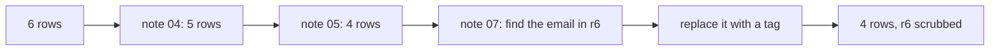
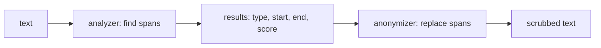
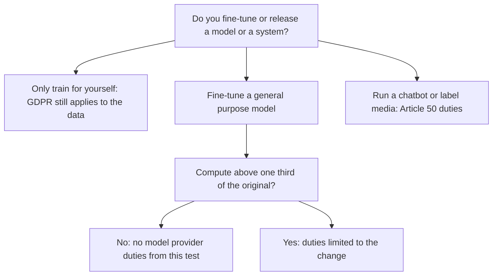
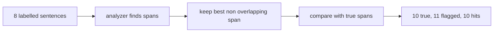
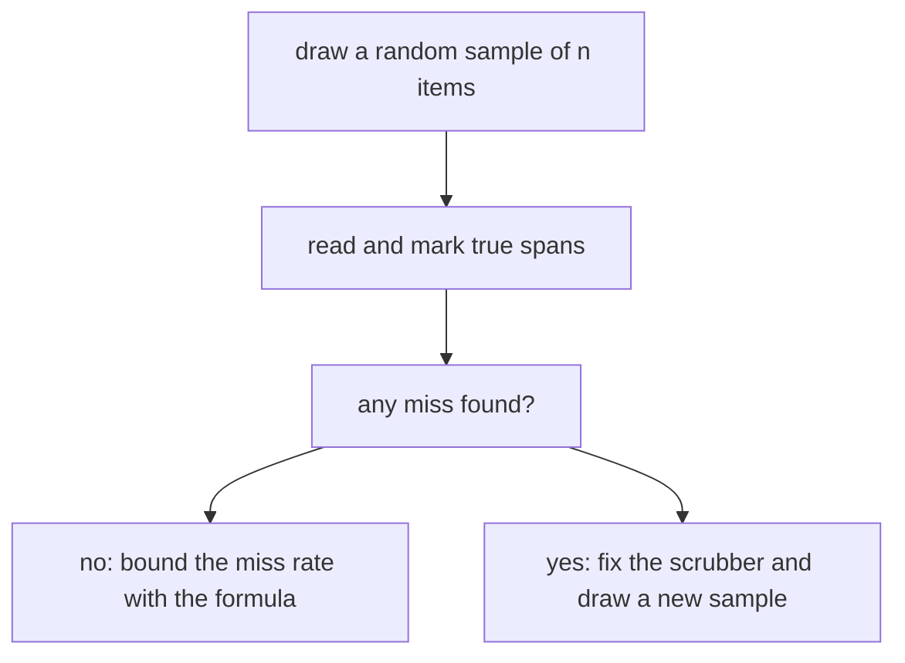

# **PII and the EU AI Act: Scrubbing Personal Data and Keeping a Record**

*Stage 03 Data Engineering, note 07 of 09. It follows note 05, which removed rows that overlap an evaluation set. Note 06 (synthetic data) is still to be written and is not needed here. This note is not legal advice.*

---

## **1. The Running Example**

After notes 04 and 05, the six rows are down to four: r1, r3, r4 and r6. Row r2 was a near-duplicate and r5 was copied from an evaluation set. Row r6 passed every check so far, yet it holds a real looking email address.

| id | question | answer | state after note 05 |
|---|---|---|---|
| r1 | What does softmax do? | Gives probabilities. | kept |
| r3 | Why use warmup? | Avoids unstable early updates. | kept |
| r4 | What is attention? | Tokens weigh other tokens. | kept |
| r6 | My email is asha@example.com, why is my loss flat? | Check the learning rate. | kept, holds an email |



Under the toy tokenizer (one word is one token), r6 has 9 question words and 4 answer words, so 13 content tokens. Template A adds 3 per turn, so r6 has 19 tokens. Template B adds 4 per turn plus 1, so it has 22 tokens. Five of them are trained tokens (4 answer words and the end marker).

| What you will learn |
|---|
| How to find personal details in rows, replace them, and measure how well that worked. |
| What the GDPR and the EU AI Act ask of someone who builds a training set, and which dates are fixed (not legal advice). |
| How to turn a small check of a few rows into an honest statement about the whole dataset. |

---

## **2. What the Scrubber and the Rules Read**

### **2.1 The definitions**

**Personal data** is, in the GDPR (Article 4), any information that relates to an identified or identifiable person. An identifier such as a name, an ID number, location data or an online identifier is enough. **PII** (personally identifiable information) is the everyday short form: names, emails, phone numbers, addresses, card numbers, IP addresses. Personal data is the wider legal idea, and a PII list is only a practical way to find part of it.

**Processing** means almost anything done with the data, and the same Article lists collection, storage, use and erasure. So a file that merely sits on your disk is already being processed.

**Pseudonymised** data can no longer be tied to a person without extra information that is kept apart. Recital 26 says such data is still personal data. **Anonymous** information is information that does not relate to an identifiable person. The GDPR does not cover it. To judge this, Recital 26 says to count all means reasonably likely to be used, including the cost and time needed to identify someone.

A **span** is a stretch of text with a start and an end position. To **scrub** a row is to find the PII spans and replace each with a placeholder tag. Scrubbing is a step toward anonymity. It does not by itself make the dataset anonymous, because the words around a span can still point to a person.

### **2.2 Two ways to find spans**

**Pattern rules** match fixed shapes such as an email, an IP address or a card number. **A tagger** is a trained model that labels words as a PERSON, LOCATION, ORGANIZATION and so on. Presidio, the library used here, runs both. Its analyzer returns a list of results, each with an entity type, a start, an end and a confidence score.

Intuition: patterns are sharp on fixed shapes and blind elsewhere. A tagger reads context, so it finds names, but it also guesses wrong on technical words.

**Beginner trap.** Trusting the confidence score as a probability of being right. In the check in section 4, a wrong ORGANIZATION guess scored 0.85, the same score as a correct PERSON.

**When to use.** Use both, then measure (section 2.5).

### **2.3 What to put in place of a span**

| policy | result for the email in r6 | keeps sentence shape | links rows of one person |
|---|---|---|---|
| delete the span | my email is why is my loss flat | no | no |
| typed tag | my email is EMAIL_ADDRESS (in angle brackets) why is my loss flat | yes | no |
| same fake value per person | my email is a fixed fake address | yes | yes, so still pseudonymised |
| realistic random value | my email is a random fake address | yes | no |

Presidio's default replacement is the typed tag, and the check in section 7 shows it (measured). Deleting changes row length (12 tokens instead of 13 here), and a typed tag keeps it. A consistent fake value keeps who-is-who, which is useful, but by the definition above it is pseudonymisation and the rows stay personal data.

### **2.4 The Presidio flow**

```text
analyzer = AnalyzerEngine(nlp engine, languages)
results  = analyzer.analyze(text, language)        # spans with type and score
clean    = anonymizer.anonymize(text, results)     # needs results, replaces spans
```



The anonymizer does not look for anything. It only edits the spans it is given. Calling it without `analyzer_results` raises a TypeError (measured in section 7). When two results overlap, its default conflict rule merges them. On r6 the analyzer found an EMAIL_ADDRESS at positions 12 to 28 with score 1.0, and also a URL at 17 to 28 with score 0.5. The merged output was my email is followed by the email tag.

**Worked example.** The text is r6. Step 1: the analyzer finds two overlapping results. Step 2: the anonymizer merges them into one span. Step 3: the span is replaced by the tag. Token count stays 13. Hand check of the positions: the words before the email, my email is and a space, take 12 characters, so the span starts at 12. The email has 16 characters, so it ends at 28.

**Beginner trap.** Skipping the analyzer step, or running it with the wrong language or a different tagger model than the one you audited.

**When to use.** Any text column that may hold personal text, before the data leaves your machine.

### **2.5 The audit**

A human reads a random sample of rows and marks the true PII spans. Comparing them with the scrubber's spans gives three counts. A **hit** is a flagged span that overlaps a true span. A **false alarm** is a flagged span with no true span. A **miss** is a true span that was not flagged. Misses are the privacy risk. False alarms damage the data, for example by turning the word warmup into an organization tag.

**Beginner trap.** Auditing rows that you already know are easy. The sample must be random and drawn from the real data.

### **2.6 What the EU AI Act asks, and of whom**

Read dates and duties from the table below. Several pages written before July 2026 still show the old high-risk date of 2 August 2026.

| date | what applies | source type |
|---|---|---|
| 2 February 2025 | prohibited practices and AI literacy | secondary, FPF |
| 2 August 2025 | rules for general purpose AI model providers | Commission guidelines, FPF |
| 24 and 27 July 2026 | the Digital Omnibus on AI, Regulation 2026/1744, published and in force | Parliament summary, secondary |
| 2 August 2026 | general application, Article 50 transparency, Commission enforcement starts | Commission news page |
| 2 December 2026 | two new prohibitions, and content marking for generative systems already on the market | Parliament summary, secondary |
| 2 August 2027 | models placed on the market before 2 August 2025 must comply | Commission guidelines, FPF |
| 2 December 2027 | high-risk rules for the Annex III list (employment, education and others) | Parliament summary, secondary |
| 2 August 2028 | high-risk rules for products under Annex I | Parliament summary, secondary |

The roles matter more than the dates. A **provider of a general purpose model** must keep technical documentation, give information to downstream builders, keep a copyright policy and publish a summary of the content used for training (Article 53, as the guidelines describe it). Someone who only **fine-tunes** such a model becomes a provider only if the change is significant in generality, capabilities or systemic risk. As an indicative test, the Commission uses the compute spent on the change, greater than one third of the original model's training compute (guidelines, part 3.2). If the original compute is unknown and cannot be estimated, the cut is one third of $10^{23}$ FLOP, about $3.3 \times 10^{22}$, or one third of $10^{25}$ FLOP, about $3.3 \times 10^{24}$, when the original model has systemic risk. A modifier's duties are limited to the modification. The guidelines also say they do not bind and that each case is judged on its own.



Two more items touch data work. The Omnibus lets providers and deployers process special categories of personal data to detect and correct bias, but only when strictly necessary and under listed safeguards. It does not create a duty to do so, and the GDPR still applies alongside. On consent, the GDPR (Article 6) lists six lawful bases and consent is only the first. The EDPB opinion on AI models (December 2024) discusses legitimate interest with a three step test. It also says whether a model is anonymous is judged case by case.

### **2.7 Comparison and assumptions**

| method | finds well | fails on | cost | assumes |
|---|---|---|---|---|
| pattern rules | emails, IP addresses, card numbers | names, odd formats | very low | fixed shapes |
| tagger model | names, places | technical words, new formats | low on CPU | text like its training data |
| random audit | the real miss rate | rare spans, small samples | human time | the sample is random |
| drop the row | everything in it | loses good data | none | few rows are affected |

---

## **3. Why It Matters, With Numbers**

- A row can pass every check from notes 03 to 05 and still hold a person's email.
- Scrubbing replaces spans. It does not make a dataset anonymous, and it does not remove the raw copy.
- A scrubber is a measuring tool, so its error rates need an audit, not only a run.

**Why note 05 is not enough.** Decontamination compares rows with an evaluation set. Row r6 has no overlap, so it survives, and the table shows what that leaves.

| stage | rows | rows with PII | share |
|---|---|---|---|
| start | 6 | 1 | 1 of 6 |
| after note 04 | 5 | 1 | 1 of 5 |
| after note 05 | 4 | 1 | 1 of 4 (0.25, hand-calculated) |
| after note 07 | 4 | 0 found | 0 found, not 0 proven |

**The loss mask does not help.** In r6 the email sits in the question, so its loss mask value $m_t$ is 0 and the trained share is 5 of 19, which is 0.2632 under template A and 0.2273 under template B (hand-calculated, script-checked). The mask only removes the direct loss term. The row on disk still holds the email, and under the definition in section 2.1 storing it is processing. The gradient steps are in note 01 section 9.4.

**Order matters.** If two rows differ only in the email, scrubbing makes them equal. In the pipeline order of this series, dedup and decontamination run on the original text first, so placeholders cannot create false duplicates or hide real overlaps. Scrub before any copy leaves your machine.

---

## **4. The Extra Classic Example: An Eight Sentence Audit**

The running example has one span and one hit, so precision and recall are trivially 1.0. It hides false alarms and the effect of sample size. This audit uses eight labelled sentences about deep learning with invented people and numbers. A separate CPU run used presidio-analyzer 2.2.366, spaCy 3.8.18 and en_core_web_sm 3.8.0, read on 21 November 2026. The counts are **measured**.

| row | text (shortened) | true spans | flagged | hits | what the tool found |
|---|---|---|---|---|---|
| 1 | email me at priya.nair at example.org | 1 | 1 | 1 | EMAIL_ADDRESS, 1.0 |
| 2 | my phone is +1 415 555 0132 | 1 | 1 | 1 | PHONE_NUMBER, 0.75 |
| 3 | Adam with warmup is stable | 0 | 1 | 0 | ORGANIZATION on the word warmup |
| 4 | a name, an IP address and an email | 3 | 3 | 3 | PERSON, IP_ADDRESS, EMAIL_ADDRESS |
| 5 | call me on 0172 555 0147 | 1 | 1 | 1 | DATE_TIME on the phone number |
| 6 | softmax turns scores into probabilities | 0 | 0 | 0 | nothing |
| 7 | a card number and a person name | 2 | 2 | 2 | CREDIT_CARD, PERSON |
| 8 | ping Ananya at an email | 2 | 2 | 2 | LOCATION on the name, EMAIL_ADDRESS |



**Hand check.** The totals are 10 true spans, 11 flagged and 10 hits. So there is 1 false alarm and 0 misses. Precision is 10 over 11, which is 0.9091. Recall is 10 over 10, which is 1.0. F1 is 20 over 21, which is 0.9524. The verification script reproduced these with asserts.

**What it hides.** Three oddities came from the tagger, not from the patterns: a false alarm, a phone number labelled DATE_TIME and a first name labelled LOCATION. The last two still cover the right text, so they are removed, but the tag that replaces them would be wrong. Also, 10 of 10 hits is a tiny sample, and section 6.5 shows it cannot tell recall 0.72 from 1.0. My sentences are clean and short, so real text will be harder.

---

## **5. The Procedure You Run**

1. List every column that can hold personal text (questions, answers, system prompts, metadata).
2. Pick the entity types you will look for and write them down.
3. Run the analyzer on a copy of the data, then the anonymizer with those results.
4. Draw a random audit sample and decide the pass rule before reading it, for example zero misses in 299 rows (section 6.4).
5. Count hits, false alarms and misses in spans, and compute precision, recall and a Wilson interval.
6. Record the result in `domain_dataset/07-pii-audit.md`: tool and version, entity types, counts, the rule, the result, the date and what was not covered.
7. Keep the raw copy in a restricted place or delete it, because it is still personal data.
8. In the data card, write what you did. Do not write that the data is anonymous.
9. Keep with it the license table (note 03), the audit file and, if you fine-tune a larger model, your compute estimate (section 6.6).

---

## **6. The Math, Step by Step**

This section is the arithmetic behind the audit, the miss count, the sample size and the compute test. To cover the steps, do each calculation yourself on paper, then compare with the boxed value.

### **6.1 Notation**

| symbol | read aloud | meaning | in the running example |
|---|---|---|---|
| $\text{TP}$, $\text{FP}$, $\text{FN}$ | hits, false alarms, misses | span counts in the audit | 10, 1, 0 |
| $\text{prec}$, $\text{rec}$, $F_1$ | precision, recall, F one | quality scores | 0.9091, 1.0, 0.9524 |
| $N$ | rows | rows in the dataset | 100,000 (illustrative) |
| $\mu$ | mu | true spans per row | 0.02 (illustrative) |
| $N_{\text{span}}$, $N_{\text{miss}}$ | total spans, missed spans | spans in the dataset, spans left after scrubbing | 2,000 and 100 |
| $n_{\text{audit}}$ | audit size | items read in the audit | 100 |
| $\delta$ | delta | allowed chance of being wrong, 0.05 | 0.05 |
| $\lambda_{\text{up}}$ | lambda up | upper bound on the miss rate | 0.0295 |
| $\omega$ | omega | normal quantile for 95 percent, 1.96 | 1.96 |
| $\text{Lo}$, $\text{Hi}$ | low, high | ends of the Wilson interval | 0.7225 and 1.0 |
| $\Xi$ | xi | training compute of one fine-tune, in FLOP | $9.216 \times 10^{15}$ |
| $\Xi_{\text{orig}}$, $\Xi_{\text{fb}}$ | original, fallback | original compute, fallback cut | $\Xi_{\text{fb}} = 3.33 \times 10^{22}$ |
| $P$, $D$, $E$, $R$ | parameters, tokens, epochs, tokens per second | as in notes 01 and 03 | 0.5 billion, 3,072,000, 3, 20,000 |

**Reading tips.** The letter $\lambda$ is the same kind of rate as in note 04, here a miss rate. The letter $\delta$ is the allowed error and $\alpha$ stays the Min-K share from note 05. The symbol $\omega$ is used so it never clashes with the logits $z$. The symbol $\Xi$ is compute, so it never clashes with the content tokens $C$ of note 02. The symbol $\mu$ is a rate of spans, not a mean row length.

### **6.2 Precision, recall and F1**

$$\text{prec} = \frac{\text{TP}}{\text{TP}+\text{FP}}, \qquad \text{rec} = \frac{\text{TP}}{\text{TP}+\text{FN}}, \qquad F_1 = \frac{2\,\text{TP}}{2\,\text{TP}+\text{FP}+\text{FN}}$$

**What it says.** Precision asks how many flagged spans were right. Recall asks how many true spans were found. $F_1$ blends them, and it equals the harmonic mean of the two. A hit means the flagged span overlaps a true span, so a wrong label still counts as a hit.

**Worked example.** We compute the scores for the audit in section 4.

**Step 1.** Read the counts: $\text{TP}=10$, $\text{FP}=1$, $\text{FN}=0$.

**Step 2.** Precision.

$$\text{prec} = \frac{10}{10+1} = \boxed{0.9091}$$

**Step 3.** Recall.

$$\text{rec} = \frac{10}{10+0} = \boxed{1.0}$$

**Step 4.** $F_1$.

$$F_1 = \frac{2 \cdot 10}{2 \cdot 10 + 1 + 0} = \frac{20}{21} = \boxed{0.9524}$$

**Extreme case.** A scrubber that flags every word has recall 1.0 and a tiny precision. A scrubber that flags nothing has recall 0 and an undefined precision (0 over 0).

**Beginner trap.** Reporting recall alone, or counting rows instead of spans.

**Check.** The harmonic form gives $2 \cdot 0.9091 \cdot 1.0 / (0.9091 + 1.0) = 0.9524$, the same as section 4.

### **6.3 Missed spans in a whole dataset**

$$N_{\text{span}} = \mu N, \qquad N_{\text{miss}} = N_{\text{span}}\,(1-\text{rec})$$

**What it says.** Missed spans are the spans the scrubber does not catch. The count scales with the number of true spans.

**Worked example.** We compute missed spans for $N = 100{,}000$ rows and $\mu = 0.02$ spans per row.

**Step 1.** Total spans.

$$N_{\text{span}} = 0.02 \times 100{,}000 = \boxed{2{,}000}$$

| recall | calculation | missed spans |
|---|---|---|
| 0.70 | 2,000 times 0.30 | 600 |
| 0.95 | 2,000 times 0.05 | 100 |
| 0.99 | 2,000 times 0.01 | 20 |

**Extreme case.** Recall 1.0 gives 0 misses, but only for the span kinds the audit covered.

**Beginner trap.** Measuring recall on an easy sample and applying it to harder real text.

**Check.** Per 1,000 rows at recall 0.95: $1000 \times 0.02 \times 0.05 = 1$ span, and $100 / 100{,}000 \times 1000 = 1$. The same.

### **6.4 How many clean items do you need**

$$\lambda_{\text{up}} = 1 - \delta^{1/n_{\text{audit}}}, \qquad n_{\text{audit}} = \frac{\ln \delta}{\ln(1-\lambda_{\text{up}})}$$

**What it says.** If $n_{\text{audit}}$ items show no miss, then with chance $1-\delta$ the true miss rate is below $\lambda_{\text{up}}$. It is the reading rows math of note 04.

**Worked example.** We compute the bound for 100 clean items.

**Step 1.** Take the log.

$$\ln 0.05 = \boxed{-2.9957}$$

**Step 2.** Divide by 100.

$$\frac{-2.9957}{100} = \boxed{-0.029957}$$

**Step 3.** Exponentiate.

$$e^{-0.029957} = \boxed{0.970487}$$

**Step 4.** Subtract from 1.

$$\lambda_{\text{up}} = 1 - 0.970487 = \boxed{0.0295}$$

**Sample size for 1 percent.**

$$n_{\text{audit}} = \frac{-2.9957}{\ln 0.99} = \frac{-2.9957}{-0.0100503} = 298.07 \;\Rightarrow\; \boxed{299}$$



**Extreme case.** One clean item gives a bound of 0.95, which says almost nothing.

**Beginner trap.** The unit. One hundred clean rows bound the rate per row. To bound recall you need spans: 100 true spans with no miss give recall of at least 0.9705.

**Check.** The rule of three gives $3/100 = 0.03$ and $3/299 = 0.0100$, close to the exact values (section 6.5 compares it with a Wilson interval).

### **6.5 The Wilson interval for recall**

$$\text{Lo},\ \text{Hi} = \frac{p + \frac{\omega^2}{2n} \mp \omega\sqrt{\frac{p(1-p)}{n} + \frac{\omega^2}{4n^2}}}{1 + \frac{\omega^2}{n}}$$

**What it says.** It gives a 95 percent range for a rate $p$ measured on $n$ items. It stays honest when $p$ is near 0 or 1.

**Worked example.** We compute the range for 10 hits out of 10 spans, so $p=1$ and $n=10$.

**Step 1.** Square $\omega$.

$$\omega^2 = 1.96^2 = \boxed{3.8416}$$

**Step 2.** The denominator.

$$1 + \frac{3.8416}{10} = \boxed{1.38416}$$

**Step 3.** The centre term.

$$1 + \frac{3.8416}{20} = \boxed{1.19208}$$

**Step 4.** The spread term.

$$1.96 \times \sqrt{0 + \frac{3.8416}{400}} = 1.96 \times 0.098 = \boxed{0.19208}$$

**Step 5.** The two ends.

$$\text{Lo} = \frac{1.19208 - 0.19208}{1.38416} = \boxed{0.7225}, \qquad \text{Hi} = \frac{1.19208 + 0.19208}{1.38416} = \boxed{1.0}$$

For 100 of 100 the low end is 0.963, and for precision 10 of 11 the range is 0.6226 to 0.9838 (script, measured). One span moves recall by 0.10 at $n=10$ and by 0.01 at $n=100$.

**Extreme case.** At $p=1$ the high end is exactly 1.0, so only the low end carries information.

**Beginner trap.** Quoting 100 percent recall from 10 spans.

**Check.** The zero miss bound at 100 gives a recall of at least 0.9705, while the Wilson low end is 0.963. They differ because Wilson is two sided at 95 percent and the bound is one sided at 95 percent.

### **6.6 The compute test**

$$\Xi \approx 6\,P\,D, \qquad D = N\,\bar T\,E, \qquad \text{indicative test: } \Xi > \tfrac{1}{3}\,\Xi_{\text{orig}}$$

**What it says.** For a dense transformer, the guidelines estimate training compute as 6 times parameters times tokens (annex A.2). A change counts toward becoming a provider when its compute passes one third of the original. If $\Xi_{\text{orig}}$ is unknown, the fallback is $\Xi_{\text{fb}} = 10^{23}/3$, or $10^{25}/3$ for a model with systemic risk. The guidelines accept an error margin of 30 percent on the estimate.

**Worked example.** We compute one small fine-tune: 2,000 rows, mean length 512 tokens, 3 epochs, $P = 0.5 \times 10^{9}$ (rounded, illustrative).

**Step 1.** Tokens.

$$D = 2000 \times 512 \times 3 = \boxed{3{,}072{,}000}$$

**Step 2.** Compute.

$$\Xi = 6 \times 0.5\times10^{9} \times 3.072\times10^{6} = \boxed{9.216\times10^{15}}$$

**Step 3.** Fallback cut.

$$\Xi_{\text{fb}} = \frac{10^{23}}{3} = \boxed{3.333\times10^{22}}$$

**Step 4.** The share.

$$\frac{9.216\times10^{15}}{3.333\times10^{22}} = \boxed{2.765\times10^{-7}}$$

**Step 5.** Tokens needed to reach the cut.

$$D^{*} = \frac{3.333\times10^{22}}{6 \times 0.5\times10^{9}} = \boxed{1.111\times10^{13}}$$

| model size | tokens to reach the plain fallback |
|---|---|
| 0.5 billion | $1.111 \times 10^{13}$ |
| 8 billion | $6.944 \times 10^{11}$ |
| 70 billion | $7.937 \times 10^{10}$ |

**Extreme case.** With $P = 70$ billion the cut is reached near 79 billion tokens, which is a large but real dataset.

**Beginner trap.** Counting only the kept rows. The guidelines say to count all compute that contributed to parameter updates. They also say forward passes that made non-public synthetic data count toward the systemic risk estimate (covered in note 06).

**Check.** The same share from tokens: $3{,}072{,}000 / 1.111\times10^{13} = 2.765\times10^{-7}$.

### **6.7 GPU calculations**

A tagger such as spaCy runs on CPU. A GPU matters only if you use a language model as the scrubber. The largest model you can score in half precision is $0.85 \times \text{VRAM} / 2$ billion parameters (general knowledge, as in the index). The cost assumes an **illustrative** 10,000 tokens per second on every tier, which is not realistic, so it only shows the price spread for 1,000,000 rows of 300 tokens. That is 8.333 hours.

| tier | largest model to score (billions) | cost of 8.333 hours (dollars, illustrative) |
|---|---|---|
| 16 GB | 6.8 | 4.92 |
| 24 GB | 10.2 | 6.67 |
| 48 GB | 20.4 | 16.25 |
| 80 GB | 34.0 | 20.83 |
| 141 GB | 59.9 | 37.83 |
| 180 GB | 76.5 | 52.08 |
| 288 GB | 122.4 | 59.17 |

Eight sharded GPUs fit at most 272.0, 479.4, 612.0 and 979.2 billion parameters on 80, 141, 180 and 288 GB, before the key value cache. At an **illustrative** 20,000 tokens per second, reaching $D^{*}$ for a 0.5 billion model takes $5.556 \times 10^{8}$ seconds, about 17.6 years.

### **6.8 All formulas and rules**

| formula | answer |
|---|---|
| precision, recall, F1 on the audit | 0.9091, 1.0, 0.9524 |
| missed spans at recall 0.95 | 100 of 2,000 |
| miss bound, 100 clean items | 0.0295 |
| items for a 1 percent bound | 299 |
| Wilson range, 10 of 10 | 0.7225 to 1.0 |
| fine-tune compute | $9.216\times10^{15}$ FLOP |
| fallback cut, plain and systemic | $3.33\times10^{22}$, $3.33\times10^{24}$ |

**Pen and paper rules.**

1. Count spans, not rows, for recall.
2. Always report false alarms next to misses.
3. A hit is an overlap, so check the tag as well.
4. Zero misses in $n$ items bounds the rate by $1-0.05^{1/n}$.
5. Ten spans cannot tell 0.72 from 1.0.
6. Compute is $6PD$, and $D$ is rows times mean length times epochs.
7. Take one third of the original compute, or the fallback when it is unknown.
8. Dates change, so read the Official Journal before you plan.

---

## **7. Notebook Experiments**

The scrubber runs on CPU, so the GPU check only records where you ran. **Skipped on purpose:** the model load cell, the training cell and the before and after training comparison, because this is a data note with no training. Cell 3 uses the tokenizer from cell 2. Cells 4 to 7 use the engine from cell 3. Cell 6 also uses cell 5, and cell 7 uses cell 6 and the rows from cell 2. Install first in a shell: `pip install presidio-analyzer presidio-anonymizer spacy` and `python -m spacy download en_core_web_sm`. Outputs marked **measured** were run on CPU for this note. The others are formats with placeholders.

```python
# ── Cell 1. Environment ──────────────────────────────────────────
#    Versions, device, memory, seed, tier and dtype
# ─────────────────────────────────────────────────────────────────
import torch, transformers, datasets, spacy
from importlib.metadata import version

torch.manual_seed(0)
print("torch:", torch.__version__, "transformers:", transformers.__version__)
print("datasets:", datasets.__version__, "spacy:", spacy.__version__)
print("presidio_analyzer:", version("presidio-analyzer"))

if torch.cuda.is_available():
    properties = torch.cuda.get_device_properties(0)
    vram_gb = properties.total_memory / 1e9
    dtype = torch.bfloat16 if properties.major >= 8 else torch.float16
    print("gpu:", properties.name, "vram:", round(vram_gb, 1), "dtype:", dtype)
else:
    print("gpu: none, the scrubber runs on CPU")
```

**Dry run.** The `if` branch picks bfloat16 when the compute capability major is 8 or more. Match the printed memory to a tier with 2 GB of slack.

```text
torch: <version>  transformers: <version>
datasets: <version>  spacy: 3.8.18 (measured)
presidio_analyzer: 2.2.366 (measured)
gpu: <name> vram: <gb> dtype: <dtype>
```

```python
# ── Cell 2. Data and chat template ───────────────────────────────
#    First 1000 rows of Capybara, one row rendered with the template
#    No license is declared on the Hub, so use it for statistics only
# ─────────────────────────────────────────────────────────────────
from datasets import load_dataset
from transformers import AutoTokenizer

rows = load_dataset("trl-lib/Capybara", split="train[:1000]")
tokenizer = AutoTokenizer.from_pretrained("Qwen/Qwen2.5-0.5B-Instruct")

toy = [
    {"role": "user", "content": "My email is asha@example.com, why is my loss flat?"},
    {"role": "assistant", "content": "Check the learning rate."},
]
text = tokenizer.apply_chat_template(toy, tokenize=False)
print("rows:", len(rows))
print("rendered characters:", len(text))
print(text[:60].replace("\n", " "))
```

**Dry run.** The template adds a default system turn because none was given. Always render with `tokenize=False`.

```text
rows: 1000
rendered characters: <n>
<|im_start|>system You are Qwen, created by Alibaba Cloud. ...
```

```python
# ── Cell 3. Engine and the r6 sanity check ───────────────────────
#    Reproduces the hand result for r6 and counts real tokens
# ─────────────────────────────────────────────────────────────────
from presidio_analyzer import AnalyzerEngine
from presidio_analyzer.nlp_engine import NlpEngineProvider
from presidio_anonymizer import AnonymizerEngine

config = {"nlp_engine_name": "spacy", "models": [{"lang_code": "en", "model_name": "en_core_web_sm"}]}
nlp_engine = NlpEngineProvider(nlp_configuration=config).create_engine()
analyzer = AnalyzerEngine(nlp_engine=nlp_engine, supported_languages=["en"])
anonymizer = AnonymizerEngine()

r6 = "my email is asha@example.com why is my loss flat check the learning rate"
results = analyzer.analyze(text=r6, language="en")
for result in results:
    print("found:", result.entity_type, result.start, result.end, round(result.score, 2))
print("scrubbed:", anonymizer.anonymize(text=r6, analyzer_results=results).text)

email_tokens = len(tokenizer("asha@example.com", add_special_tokens=False).input_ids)
print("real tokens in the email:", email_tokens, "toy tokens: 1")
```

**Dry run.** Two overlapping results appear, and the anonymizer merges them into one span.

```text
found: EMAIL_ADDRESS 12 28 1.0     (measured)
found: URL 17 28 0.5               (measured)
scrubbed: my email is <EMAIL_ADDRESS> why is ... the learning rate   (measured)
real tokens in the email: <n> toy tokens: 1
```

```python
# ── Cell 4. Scan the slice for entity types ──────────────────────
#    Statistics only, nothing is saved or published
# ─────────────────────────────────────────────────────────────────
from collections import Counter

entity_counts = Counter()
rows_with_hit = 0
for row in rows.select(range(200)):
    text = " ".join(message["content"] for message in row["messages"])
    found = analyzer.analyze(text=text[:2000], language="en")
    entity_counts.update(result.entity_type for result in found)
    rows_with_hit += 1 if found else 0

print("rows scanned: 200")
print("rows with at least one result:", rows_with_hit)
for entity_type, count in entity_counts.most_common(6):
    print(entity_type, count)
```

**Dry run.** Each row's messages are joined, cut at 2,000 characters, and analyzed. Expect many hits from the tagger entity types on technical text (expected, not yet verified).

```text
rows scanned: 200
rows with at least one result: <n>
<ENTITY TYPE> <count>   (six lines)
```

```python
# ── Cell 5. The eight audit sentences ────────────────────────────
#    Each item is (text, list of true PII strings)
# ─────────────────────────────────────────────────────────────────
audit_rows = [
    ("email me at priya.nair@example.org about the loss curve", ["priya.nair@example.org"]),
    ("my phone is +1 415 555 0132 so call after the run", ["+1 415 555 0132"]),
    ("Adam with warmup is stable for this model", []),
    ("Rahul Verma trained it on server 192.168.1.20 and mailed rahul@example.com",
     ["Rahul Verma", "192.168.1.20", "rahul@example.com"]),
    ("call me on 0172 555 0147 about the batch size", ["0172 555 0147"]),
    ("softmax turns scores into probabilities", []),
    ("my card 4111 1111 1111 1111 expired, ask Meera Iyer", ["4111 1111 1111 1111", "Meera Iyer"]),
    ("ping Ananya at ananya@example.com", ["Ananya", "ananya@example.com"]),
]
def keep_best_spans(results):
    """Keep the highest score span first and drop spans that overlap it."""
    kept = []
    for result in sorted(results, key=lambda item: -item.score):
        if all(result.end <= other.start or result.start >= other.end for other in kept):
            kept.append(result)
    return kept

print("audit rows:", len(audit_rows))
```

**Dry run.** The helper resolves overlaps, such as the email and URL results on r6. The true spans per row are 1, 1, 0, 3, 1, 0, 2 and 2, which is 10 in total.

```text
audit rows: 8
```

```python
# ── Cell 6. Audit metrics ────────────────────────────────────────
#    Count hits, false alarms and misses, then the scores
# ─────────────────────────────────────────────────────────────────
hits = flagged = true_total = 0
for text, truths in audit_rows:
    spans = keep_best_spans(analyzer.analyze(text=text, language="en"))
    true_spans = []
    for item in truths:
        begin = text.index(item)
        true_spans.append((begin, begin + len(item)))
    flagged += len(spans)
    true_total += len(true_spans)
    for span in spans:
        for begin, end in true_spans:
            if span.start < end and begin < span.end:
                hits += 1
                break
print("true:", true_total, "flagged:", flagged, "hits:", hits)
print("precision:", round(hits / flagged, 4), "recall:", round(hits / true_total, 4))
print("F1:", round(2 * hits / (flagged + true_total), 4))
```

**Dry run.** Row 3 adds 1 to flagged and 0 to hits. Every other row has equal flagged and hits.

```text
true: 10 flagged: 11 hits: 10        (measured)
precision: 0.9091 recall: 1.0        (measured)
F1: 0.9524                           (measured)
```

```python
# ── Cell 7. Before and after, speed, audit file ──────────────────
#    Fixed prompts, rows per second, peak memory, record to disk
# ─────────────────────────────────────────────────────────────────
import resource, time

fixed = [r6, "softmax turns scores into probabilities"]
for text in fixed:
    found = analyzer.analyze(text=text, language="en")
    after = anonymizer.anonymize(text=text, analyzer_results=found).text
    print("before:", text[:45])
    print("after: ", after[:45])

start = time.perf_counter()
for row in rows.select(range(50)):
    analyzer.analyze(text=row["messages"][0]["content"][:2000], language="en")
rate = 50 / (time.perf_counter() - start)
peak_mb = resource.getrusage(resource.RUSAGE_SELF).ru_maxrss / 1024
print("rows per second:", round(rate, 1), "peak memory MB:", round(peak_mb))

with open("07-pii-audit.md", "w") as handle:
    handle.write(f"true {true_total}, flagged {flagged}, hits {hits}\n")
```

**Dry run.** The first prompt changes and the second prompt does not. The audit file keeps the counts. Add the tool versions and the date by hand.

```text
before: my email is asha@example.com why is my loss flat
after:  my email is <EMAIL_ADDRESS> why is my loss flat   (measured)
before: softmax turns scores into probabilities
after:  softmax turns scores into probabilities
rows per second: <n>  peak memory MB: <n>
```

### **7.1 Results table template**

Fill one row per tier you used. The scrubber is CPU bound, so VRAM used should be near zero.

| tier | GPU seen | VRAM used (GB) | rows per second | peak memory (MB) | notes |
|---|---|---|---|---|---|
| 16 GB | | | | | |
| 24 GB | | | | | |
| 48 GB | | | | | |
| 80 GB | | | | | |
| 141 GB | | | | | |
| 180 GB | | | | | |
| 288 GB | | | | | |

### **7.2 Expected behavior (expected, not yet verified)**

Pattern entities (EMAIL_ADDRESS, IP_ADDRESS, CREDIT_CARD, PHONE_NUMBER) should be right more often than tagger entities (PERSON, LOCATION, ORGANIZATION, DATE_TIME) on technical text. In the eight sentence check, the one false alarm and both wrong labels came from the tagger (measured). Speed should not depend on the GPU tier, so compare trends only.

### **7.3 If you run out of memory**

Process fewer rows per call, cut each text (cell 4 cuts at 2,000 characters), and run in chunks with `datasets.map`. If you move to a language model scrubber, then lower the batch size and the maximum length, and use bfloat16 when the capability is 8 or more. Gradient accumulation, checkpointing and smaller rank do not apply, because nothing trains here. GPU runs are not exactly reproducible, so compare trends.

---

## **8. Pitfalls and Limits**

### **Pitfalls that really bite**

1. **Calling the anonymizer alone.** It needs `analyzer_results` and raises a TypeError without them (measured).
2. **Calling scrubbed data anonymous.** Recital 26 sets a high test, and the EDPB says model anonymity is judged case by case.
3. **A tiny audit.** Ten spans with no miss still allow recall as low as 0.7225.
4. **Ignoring false alarms.** The word warmup became an organization in the check, and that destroys a training concept.
5. **Trusting the tag.** A phone number labelled DATE_TIME is removed, but the replacement tag is wrong.
6. **Believing the loss mask protects.** The email is masked in the loss, but it stays in the file and in the model's input.
7. **Scrubbing in the wrong order.** Run dedup and decontamination on the original text first (section 3).
8. **Trusting old dates.** Pages written before July 2026 show 2 August 2026 for high-risk rules.

### **Limits that remain**

This check used English, short sentences and the small tagger. Spans that only identify a person in combination (a rare job, a town, a date) are not found by span matching. Differential privacy and model extraction tests are not covered. The guidelines on modifiers are not binding.

### **Debugging checklist**

- Did the analyzer run with the same language and tagger model you audited?
- Did you pass the analyzer results to the anonymizer?
- Is the audit sample random and counted in spans?
- Did you record the tool version, the date and the rule before reading?
- Is the raw copy restricted or deleted?
- Did you read the dates from an official page this month?

---

## **9. How This Shows Up in Language Models**

- Models can repeat training text, so a leaked span can come back out of a model. Note 04 cites the measured share for duplicates.
- The EDPB opinion asks whether personal data can be extracted from a model by queries, which is why scrubbing alone is not a claim of anonymity.
- A fine-tune of a general purpose model is far below the modifier test (section 6.6), but a very large run could reach the fallback.
- A chatbot built on your model carries the Article 50 duty to tell users it is an AI system, since 2 August 2026.
- Special category data for bias checks has a narrow allowance, and the GDPR still applies.

**Added by me, not in the source note:** the audit table, the Wilson interval and the loss mask point are my additions.

**Next.** Note 08 builds the domain dataset and its splits, and note 06 on synthetic data is still to be written.

---

## **10. Self-Test**

**Q1.** An audit has 12 true spans, 15 flagged spans and 9 hits. Find precision, recall and $F_1$.

**Q2.** Spot the mistake: "We replaced every email with a tag, so the dataset is anonymous under the GDPR."

**Q3.** Spot the mistake: `AnonymizerEngine().anonymize(text=text)` is used to scrub a row.

**Q4.** Two hundred rows are read and none leaks. Give the 95 percent bound on the miss rate per row.

**Q5.** Spot the mistake: "A 70 billion model fine-tuned on $5 \times 10^{10}$ tokens crosses the plain fallback cut."

**Answers.**

1. Precision is $9/15 = 0.6$, recall is $9/12 = 0.75$, and $F_1 = 18/27 = \boxed{0.6667}$.
2. Replacing spans is only a step. The words around a span can still identify a person, and Recital 26 asks about all means reasonably likely to be used.
3. The call has no analyzer results. It raises a TypeError, so run the analyzer first.
4. $1 - 0.05^{1/200} = \boxed{0.0149}$.
5. The compute is $6 \times 70\times10^{9} \times 5\times10^{10} = 2.1\times10^{22}$, which is below $3.333\times10^{22}$. It reaches the cut only near $7.94\times10^{10}$ tokens.

---

## **11. Sources and Verification**

**Sources used.**

- FPF, The AI Act implementation timeline under the AI Omnibus: https://fpf.org/blog/the-ai-act-implementation-timeline-what-changes-under-the-ai-omnibus/
- Commission news, enforcement and transparency from 2 August 2026: https://digital-strategy.ec.europa.eu/en/news/commission-starts-enforcing-ai-act-rules-and-new-transparency-requirements-2-august
- European Parliament Legislative Observatory, summary of the final act: https://oeil.europarl.europa.eu/oeil/en/procedure-document-summary/pdf?id=1910754
- Bratby Law, the amended timetable: https://bratby.law/digital-omnibus-ai-high-risk-delay
- Commission guidelines on general purpose AI models, annex (parts 3.2 and 5 and annex A.2): http://ai-act-service-desk.ec.europa.eu/sites/default/files/2025-07/guidelines_on_the_scope_of_the_obligations_for_generalpurpose_ai_models_established_by_regulation_1cx2atxgq79us4n3x8jfgyy1qlm_118340-3.pdf
- EDPB, Opinion 28/2024 summary: https://www.edpb.europa.eu/news/edpb-opinion-on-ai-models-gdpr-principles-support-responsible-ai_en
- GDPR Article 4, Recital 26 and Article 6 (unofficial copy): https://gdpr-info.eu/art-4-gdpr/ , https://gdpr-info.eu/recitals/no-26/ , https://gdpr-info.eu/art-6-gdpr/
- Presidio getting started, text: https://microsoft.github.io/presidio/getting_started/getting_started_text

**Verification note.** A standard library script reproduced every hand number with asserts, and the cells passed `ast.parse`. The GPU cells were not run. A separate CPU run of presidio-analyzer 2.2.366 with spaCy 3.8.18 and en_core_web_sm 3.8.0 produced the measured r6 and eight sentence results. The anonymizer signature was read from the installed package.

**Checked on the web.** The Omnibus is Regulation (EU) 2026/1744, published 24 July 2026 and in force 27 July 2026. The high-risk dates are 2 December 2027 and 2 August 2028, and the 2 December 2026 items are as in the table. Commission enforcement starts 2 August 2026. The modifier test and fallback cuts are in the guidelines. The EDPB and GDPR points are as quoted.

**From general knowledge, not verified here.** The scoring memory rule of 2 bytes per parameter. That a data governance article (Article 10) applies to high-risk systems. The final public training summary template. The list of five Presidio operators.

**Not checked.** The Official Journal text itself (EUR-Lex would not render, so I read the Parliament summary and two secondary sources). Whether PII-Codes exists (two searches found nothing by that name). The Capybara scan was not run. Non-English text and national laws.

**Corrections to the source note.** The source file was not attached, so these are checked against the claims in the handoff.

| claim | correction |
|---|---|
| fallback cuts of about 3e21 and 3e24 FLOP | one third of $10^{23}$ and $10^{25}$ is about $3.3\times10^{22}$ and $3.3\times10^{24}$ |
| the anonymizer call skips the analyzer step | it cannot run, because `analyzer_results` is required |
| consent as the basis | consent is one of six bases in Article 6, and legitimate interest is discussed by the EDPB |
| "significantly modified" | the test is a significant change in generality, capabilities or systemic risk, with a compute criterion that does not bind |
| PII-Codes exists | not found, so not verified |

---

## **Appendix B. Where the Numbers Come From**

- **Hand-calculated and script-checked:** toy token counts, trained shares, all of section 6, the quiz answers.
- **Measured:** the r6 Presidio output and the eight sentence counts (CPU, 21 November 2026).
- **Illustrative:** 100,000 rows, 0.02 spans per row, 0.5 billion parameters, 10,000 and 20,000 tokens per second.
- **From sources:** dates, the one third rule and the fallback cuts, the 30 percent error margin.
- **Expected, not yet verified:** the notebook cell outputs marked as formats.