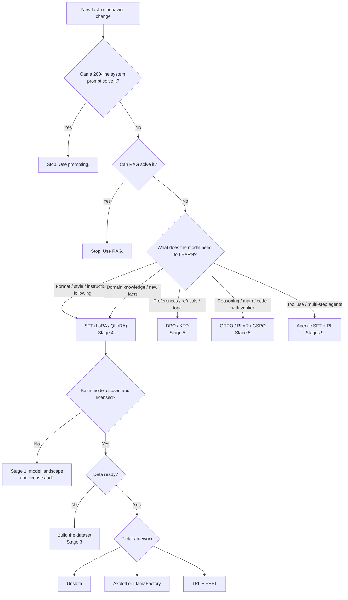

# HuggingFace Learning Roadmap — End-to-End Master, Model-Refreshed (November 2026)

> [!info] What this document is
> One authoritative roadmap, merged from **eight** overlapping notes: two "core stack" references (a prose walkthrough and a topic checklist), a five-file fine-tuning track (overview, methods, data, frameworks, capstones), and a standalone 1,499-line "LLM Fine-Tuning & Inference Engineering Roadmap (2026)" that covers model families, KV-cache theory, distributed training, and production inference. Nothing has been dropped. Every checklist item, code block, lab, schedule line, table row, and decision rule from the eight sources appears below, corrected against library releases, model cards, papers, and vendor documentation as of **3 November 2026**.
>
> The earlier documents were written against September 2026 pins; the newest source was compiled in May 2026. Between those dates the base-model field turned over almost completely, and several technique claims in the newer source are stronger than the published or shipped evidence. Corrections are applied in place and every one is logged in the companion **Research and Version Audit (Nov 2026) — Model Refresh** file.

> [!warning] The shape of the plan changed again
> The original calendar ran Oct–Dec 2026 with "W5 = Capstone 1" landing on 3–9 Nov 2026. That week is now. The calendar is re-anchored to the next 24 weeks (Nov 2026 → Apr 2027), the fine-tuning material is folded into one 12-stage spine rather than a parallel side-quest, and **three stages are new**: model landscape and base-model selection (Stage 1), distributed training at scale (Stage 8), and agentic fine-tuning with RL harnesses (Stage 9). Stage 7 becomes the inference-systems stage because the KV-cache and disaggregation material in the new source is engineering content, not a footnote.

> [!success] The practitioner rules that survive both merges
> 1. **Don't fine-tune first.** Prompting → RAG → fine-tuning, in that order.
> 2. **SFT first, RL later.** No RL algorithm works well without a seeded SFT base.
> 3. **Data beats algorithm, every time.** The dominant failure mode of a fine-tune is bad data, not a bad optimizer.
> 4. **Released is not the same as fine-tunable.** A frontier model you can call by API is a different engineering artifact from a base whose weights you can adapter-tune on your own GPU. Every model in this roadmap is labelled on both axes.
> 5. **KV cache and GRPO are to inference and fine-tuning what SQL and transactions are to web engineering.** Understand them mechanically before touching production.

---

## Source inventory and merge map

The eight source documents, what each contributed, and where its content now lives.

| # | Source document | Size | Role in the merge | Landed in |
|---|---|---|---|---|
| S1 | `First.md` — core stack prose | 1,638 lines | Prose walkthrough, code, schedule, repo layout, "One Rule" | Stages 0–11, plus Schedule / Repo / Rule sections |
| S2 | `Second.md` — core stack checklist | 1,053 lines | Topic-by-topic checklist; ~40 items absent from S1 | Stage checklists (per-topic blocks) |
| S3 | `00 - Overview & Index.md` | 179 lines | Decision tree, 5-file structure, 2026 changes, 6-week plan | Stage spine, Method-selection gate, Schedule |
| S4 | `01 - Methods Deep Dive.md` | 361 lines | LoRA family, DPO family, RLVR, distillation | Stage 4 + Stage 5 |
| S5 | `02 - Data & Datasets.md` | 418 lines | Formats, dataset catalog, 5 data rules, labs | Stage 3 |
| S6 | `03 - Frameworks & Tools 2026.md` | 606 lines | Framework race, decision tables, serving bridge, 6 labs | Stage 6 + Stage 10 |
| S7 | `04 - Capstones & JD Alignment.md` | 399 lines | 4 capstones, JD mapping, interview bank, ship checklist | Stage 11 |
| S8 | `LLM Fine-Tuning & Inference Engineering Roadmap (2026)` (pasted text) | 1,499 lines | Model-family landscape, attention/KV theory, post-training stack, inference engineering, distributed training, LLMOps, key papers, production checklist, model decision framework | Stages 1, 2, 4, 5, 7, 8, 9, 10, 11, plus back matter |

Every source file is represented. The per-item crosswalk that proves it is in the audit file, section "Source coverage matrix".

## Stage spine and dependency map

Twelve stages. Each one is a precondition for the next, with one optional fork at Stage 7 (specialization) and one optional depth track at Stage 8 (distributed training, required only for models above ~30B).

```
STAGE 0  Platform Foundation            huggingface_hub 2.4.0 · datasets 5.1.0
   |                                      auth, repos, data loading, formats
   v
STAGE 1  Model Landscape and Selection  released vs open-weight vs fine-tunable
   |                                      license matrix · VRAM matrix · shortlist
   v
STAGE 2  Core ML Stack                  transformers 5.22.1 · tokenizers 0.23.3
   |                                      evaluate / lighteval / lm-eval · attention theory
   v
STAGE 3  Data Engineering               formats · catalogs · 5 rules · decontamination
   |                                      licensing · synthetic data · domain dataset
   v
STAGE 4  Training Core                  accelerate 1.15.0 · peft 0.21.2 · trl 1.17.1 SFT
   |                                      LoRA/QLoRA · optimizers · checkpoints
   v
STAGE 5  Alignment and Post-Training    DPO family · GRPO/RLVR · GSPO · distillation
   |                                      preferences, verifiable rewards, compression
   v
STAGE 6  Frameworks at Scale            unsloth · axolotl 0.21.1 · LlamaFactory 0.9.5
   |                                      torchtitan 0.4.0 · verl 0.9.1 · OpenRLHF · SkyRL
   |                                      the same job expressed as config vs code
   v
STAGE 7  Specialization and Low-Level   sentence-transformers 6.2.0 · diffusers 0.42.1
   |                                      timm 1.0.30 · bitsandbytes · kernels · Triton
   |                                      embeddings, VLMs, diffusion, audio, kernels
   |                                      (optional fork)
   v
STAGE 8  Distributed Training at Scale  FSDP / ZeRO-3 · TP · PP · EP · DeepEP / Hybrid-EP
   |                                      (depth track: required above ~30B parameters)
   v
STAGE 9  Agentic Fine-Tuning and RL    agent traces · ART/RULER · ASTRA · CM2
   |                                      orchestrator/sub-agent decomposition
   |                                      tool environments · agent evaluation
   v
STAGE 10 Inference Systems and Serving  vLLM 0.33.0 · SGLang 0.5.23 · KV cache stack
   |                                      speculative decoding · PD disaggregation
   |                                      quantization in production · multi-LoRA
   v
STAGE 11 Capstones, Portfolio, JD       5 public artifacts · JD mapping · interview bank
```

## Method-selection gate

The decision tree from the fine-tuning overview survives the merge intact, with two changes: SFT is Stage 4 rather than a separate track, and the DPO/GRPO branches point at Stage 5. Stage 1 sits before all of it because base-model choice determines what the rest is even possible.



## Base-model shortlist for hands-on experimentation

The refreshed landscape is in Stage 1. This is the working shortlist the rest of the roadmap assumes — chosen for *experimentability*, not for leaderboard position.

| Role | Model | Params (total / active) | Context | License | Consumer-GPU path | Why this one |
|---|---|---|---|---|---|---|
| Text SFT default | `Qwen/Qwen3-4B-Instruct-2507` | 4B | 32K+ | Apache-2.0 | QLoRA, ~10–12 GB | Text-only, fast, stable, no gated terms |
| Text SFT, thinking | `Qwen/Qwen3.5-4B` | 4B | 262K | Apache-2.0 | bf16 LoRA (no 4-bit) | Hybrid thinking/non-thinking, 201 languages |
| Multimodal default | `google/gemma-4-E4B` | 8B (4.5B effective) | 256K | Apache-2.0 | QLoRA, ~10 GB | Text + image (+audio), best VRAM/quality ratio |
| Edge / edge RL | `google/gemma-4-E2B` | 5.1B (2.3B effective) | 128K | Apache-2.0 | QLoRA, ~8 GB | Smallest member that still takes image + audio |
| Frontier open, single node | `Qwen/Qwen3.8-27B` | 27B dense | 262K native → 1M YaRN | Apache-2.0 | QLoRA ~24 GB | Dense VLM with MTP, video, per-turn thinking control |
| Dense reasoning, larger | `Qwen/Qwen3.6-27B` | 27B dense | 262K | Apache-2.0 | QLoRA ~24 GB | Current mid-size reasoning line |
| Frontier MoE (weights) | `mistralai/Mistral-Large-4-1T-A52B` | ~1T / 52B | 1M | Mistral Ecosystem Open-Weight | 8×B300, FP8 | LoRA SFT example ships in TRL 1.17.0 |
| Frontier MoE (weights) | `moonshotai/Kimi-K3` | 2.8T / 104B | 1,048,576 | Kimi K3 License | 8×GB300+ | KDA + MLA hybrid, thinking always on |
| Frontier MoE (weights) | `Qwen/Qwen3.8-2.4T-A95B` | 2.4T / 95B | — | Qwen custom Max License | rack-scale | Largest open-weight Qwen |
| Frontier MoE (weights) | `meta-models/Muse-Spark-Open-816B-A42B` | 816B / 42B | 1M | Muse Model License | ≥700 GB NVFP4 | Text + image + video + audio; gated |
| Frontier MoE (weights) | `zai-org/GLM-5.3` | 320B / 18B | — | MIT | rack-scale | MIT-licensed, 18B active |
| API-only frontier | Kimi K3.1 Pro | 2.8T / 104B | 1M | not announced | n/a | Weights promised 4 Nov 2026 — treat as API-only until they land |
| Embedding | `nvidia/Nemotron-3.5-Embed-8B-BF16` | 8.4B | 32,768 tokens | NVIDIA Open | 4096-dim | ViDoRe v3.1 leader among dense retrieval models |
| Reranker | `nvidia/Nemotron-3.5-Rerank-8B-BF16` | 8B | 32,768 tokens | NVIDIA Open | cross-encoder | Beats Qwen3-VL-Reranker-8B on combined image+text |

Three of these deserve an explicit caution: **Qwen3.5 and Qwen3.8 should not be QLoRA'd at 4-bit** (higher-than-normal quantization error; Unsloth's own warning, plus bitsandbytes cannot hold 4-bit `nn.Parameter` for MoE experts), **Mistral Large 4's ecosystem license is not MIT** (MaaS requires a separate commercial agreement), and **TGI is archived** and must never be the default serving engine for anything released after March 2026.

## Corrections applied to the sources

These are the substantive edits. The first twelve were applied in the first merge; the rest are new in this refresh. Each one is sourced in the audit file.

| # | Source claim | Corrected to (Nov 2026) |
|---|---|---|
| 1 | `huggingface_hub` 1.x; "Python 3.9 or newer" | `huggingface_hub` **2.4.0**; Python **≥3.10**, and **≥3.11** for `transformers`/`trl` [1][2][3] |
| 2 | `datasets` 4.x | `datasets` **5.1.0**; streaming shuffle defaults changed, agent-trace loading added [4][5] |
| 3 | TRL "v0.15.0 (Mar 2026)"; PPO in experimental tier | TRL **1.17.1**; PPO **removed** in 1.13.0; `trl.losses` removed in 1.14.0; KTO/Distillation are stable [6][7] |
| 4 | "Axolotl v0.29.0 (Feb 2026)" | Axolotl **0.21.1** (27 Oct 2026) — the 0.29.0 line does not exist [8] |
| 5 | Six-way framework race incl. TorchTune | **Five-way plus three RL stacks**: TorchTune is **unmaintained** (last release 0.6.1, Apr 2025); use TorchTitan, verl, OpenRLHF, SkyRL, Tinker [9][10][11][12] |
| 6 | `from awq import AutoAWQForCausalLM` for AWQ quantization | **AutoAWQ is deprecated and AutoGPTQ unmaintained** → use **GPTQModel 7.8.0** or **llm-compressor 0.15.0** [13][14] |
| 7 | LlamaFactory "GUI era / point and click" | LlamaFactory **0.9.5** carries **CVE-2026-58116** (CVSS 9.3 RCE via the WebUI model path, no patched release). Never expose the WebUI [15][16] |
| 8 | "DPO improves MT-Bench by ≥5%" as an acceptance criterion | MT-Bench is saturated/unmaintained → gate on **IFEval + Arena-Hard-Auto v2 + AlpacaEval 2.0 + a domain held-out set**; treat MT-Bench gaps <0.1–0.2 as noise |
| 9 | `from lm_eval.decontamination.decontaminate import decontaminate(...)` | That API does not exist. lm-eval detects contamination over **precomputed n-gram files** via `--decontamination_ngrams_path` and reports `*_decontaminate` metrics [17] |
| 10 | "EU AI Act now applies" | The Act applies **progressively**: 2 Aug 2026 (main rules + enforcement + Art. 50), **2 Dec 2026** (new prohibitions + Art. 50(2) transition), 2 Dec 2027 (Annex III), 2 Aug 2028 (Annex I), after the Digital Omnibus entered into force 27 Jul 2026 [18][19][20] |
| 11 | Capstone bases: Llama-3.2-3B/1B, Qwen2.5-1.5B | Current open bases: **Qwen3-4B-Instruct-2507** (text-only), **Qwen3.5-4B** and **Gemma 4 E4B** (multimodal) — pick by VRAM and modality, not by habit [21][64][65] |
| 12 | vLLM `--max-lora-rank` "choices 1–512" | Exact choices: **1, 8, 16, 32, 64, 128, 256, 320, 512**; default 16. `--max-loras` default **1** [22][23] |
| 13 | S8 model table (May 2026): Kimi K2.6, GLM-5.1, MiMo-V2.5-Pro, DeepSeek V4-Pro, Qwen3.5-397B, Nemotron Ultra | All superseded by releases through 3 Nov 2026: **GLM-5.3** (9 Sep), **MiMo-V2.6-Pro** (22 Sep), **Kimi K3** (16 Jul), **Qwen3.6** (Apr) and **Qwen3.8** (Aug), **Nemotron 3.5 family** (Oct), **Mistral Large 4** (29–31 Oct), **Muse Spark Open** (15 Oct), **Beam 1.0** (5 Oct), **LongCat-2.5** (2 Nov) [67][70][81][88] |
| 14 | S8: "Kimi K3.1 Pro" treated as a released open model | **API-only as of 3 Nov 2026.** The `moonshotai` Hub organisation lists K2.5, K2.6, K2.7-Code, K3 and Kimi-Linear, but **no K3.1 repo**; weights are promised for 4 Nov 2026. Do not plan an adapter run against it [81] |
| 15 | S8: "Gemma 4 E4B QLoRA runs in < 5 minutes on an RTX 3060 12 GB" | Unsloth's Gemma 4 guide publishes **~10 GB VRAM for E4B QLoRA** and ~8 GB for E2B, and recommends E4B QLoRA *over* E2B LoRA; it publishes **no "<5 min" training-time figure**. Keep the VRAM claim, drop the timing claim [76] |
| 16 | S8: "Gemma 4 26B-A4B fits in ~12 GB with Unsloth QLoRA" | Unsloth: **26B-A4B LoRA needs >40 GB**, and 4-bit MoE training is additionally blocked because bitsandbytes has no 4-bit `nn.Parameter` for MoE experts. The 12 GB figure is wrong [76] |
| 17 | S8: "Unsloth MoE optimisation: ~12× faster, >35% less VRAM" | Current Unsloth documentation claims **~1.5× faster and ~50–60% less VRAM than FA2** setups for Gemma 4/Qwen3.8, plus a dedicated MoE fast path. Measure your own run; the 12× figure is not in current docs [76][78] |
| 18 | S8: "DeepSeek V4 needs `--trust-remote-code` (custom kernels not in Transformers)" | `deepseek-ai/DeepSeek-V4.1-Flash-1017` ships **native `transformers` support**, MIT license, 1M context, image-text-to-text. Remote code is no longer the default path [83] |
| 19 | S8: "Qwen3.5 on vLLM requires ≥ 0.17.0" | vLLM is at **0.33.0** (2 Nov 2026) and pins `transformers>=5.16.1,<5.20.0`; the 0.17.0 floor is two years of releases out of date [106][107] |
| 20 | S8: TurboQuant = "PolarQuant + QJL", "≥6× reduction", "zero measurable accuracy loss" | Upstream vLLM merged TurboQuant (PR #38479, shipped in **v0.20.0**) as a v1 attention backend using **Hadamard rotation + scalar quantization**, and **deliberately omits QJL** because QJL "hurts attention quality by amplifying variance through softmax". Shipped presets measure 2.6× to 4.9× with +1.17% to +20.59% perplexity drift [91][106] |
| 21 | S8: "KVTC 20×, NVIDIA, <1% drop" | arXiv 2511.01815, accepted **ICLR 2026**: up to 20× preserving reasoning and long-context accuracy, 40×+ in specific cases, brief calibration, no model changes. Correct on substance; it is a research reference implementation, not a first-class vLLM feature [92] |
| 22 | S8: "Hybrid-EP gives 514% throughput improvement over baseline EP" | NVIDIA's own technical blog (2 Feb 2026) reports Hybrid-EP over DeepEP as **+14% on DeepSeek-V3** (829 → 943 TFLOPs/GPU), +8% on Megatron-FSDP, +5.5% BF16 / +9.9% MXFP8 on Qwen3-235B. The 514% figure is unsupported [116] |
| 23 | S8: "TGI in maintenance mode as of December 2025" | Understated. The TGI repository was **archived by its owner on 21 March 2026** and is read-only. Models released after that date fail TGI health checks. Never default to TGI [115] |
| 24 | S8: "Qwen3-TTS-Tokenizer-12Hz is proprietary" | The tokenizer ships **openly** as `Qwen/Qwen3-TTS-Tokenizer-12Hz` alongside the Base models under Apache-2.0. Drop "proprietary" [72][73] |
| 25 | S8: "GRPO-λ: +3–4.5 pts on math benchmarks" | The paper (arXiv 2510.00194) claims **30–40% better than GRPO on math benchmarks** via critic-free TD and eligibility-trace reformulation; the "+3–4.5 points" figure is not the paper's claim [95] |
| 26 | S8: "GRPO family includes `loss_type='gspo'`" | TRL 1.17.1 implements GSPO as **`importance_sampling_level="sequence"` with `loss_type="grpo"`** (plus `beta=0.0`, `epsilon=3e-4`, `epsilon_high=4e-4`, `steps_per_generation=4`). The accepted `loss_type` values are `grpo`, `dr_grpo`, `dapo`, `bnpo`, `cispo`, `sapo`, `luspo`, `vespo` — **`gspo` is not one of them** and will raise [102][104] |
| 27 | S8 engine table: vLLM ~12,500 tok/s, SGLang ~16,200 tok/s, LMDeploy ~16,200 tok/s | Those figures carry no model, hardware, precision, or concurrency, so they are not comparable. vLLM's own reporting — 25K total TPS/GPU on Qwen3.5-397B-A17B-NVFP4 with GB200 NVL72 disaggregated serving — is the shape of a defensible throughput claim [110] |
| 28 | S8: "GLM-5.1 754B/40B, trained on 100K Huawei Ascend 910B" | Current Z.ai line is **GLM-5.3** (9 Sep 2026), 320B total / 18B active, MIT, with BF16 and Flash variants on the Hub [88] |
| 29 | S8: "Alibaba-NLP/gte-Qwen2-7B — Top MTEB 2026" | A stale ranking. MTEB's current model space lists **Nemotron 3.5 Embed 8B** (ViDoRe v3.1 61.17 nDCG@10, first among dense retrieval models on 20 Oct 2026) and **Nemotron-3-Embed-8B** (RTEB-16 78.46, multilingual leader on 16 Jul 2026). Rankings move monthly — pin a date with every number [41][89][90] |
| 30 | S8: "DeepSeek V4-Flash $0.14/1M in — cheapest frontier-tier 2026" | A May-2026 snapshot. The Oct-2026 price field has moved (Mistral Large 4 lists $0.70/M in, $0.07/M cached, $2.10/M out). Re-check the vendor page before any cost model [69] |
| 31 | S8: "Llama 4 — avoid, 700M MAU clause" | Correct in substance. The same pattern now appears in **Muse Spark Open**, whose Muse Model License requires notifying Meta and signing a separate agreement once aggregate gross revenue exceeds **US$20M in any 12-month period** for a Model-as-a-Service business [85] |
| 32 | S8: "Kimi K2.6 — 1T/32B, 262K context, Modified MIT" | Current: **Kimi K3**, 2.8T total / 104B active, 1,048,576 context, under the **Kimi K3 License** (MIT-style, with a >US$20M-revenue negotiation trigger). The BrowseComp 60.6 → 78.4 agent-swarm figure is vendor-reported [81] |
| 33 | S8: "MiniMax M2.7 ~230B MoE"; "Nemotron Ultra 253B" | Current: **MiniMax M3.1 Flash** (19 Oct 2026) and the **Nemotron 3.5 family** (Bolt 74B-A9B, Super VL 120B/12B, Embed 8B, Rerank 8B, ASR/Transcribe, Dory 1.0-4B) |
| 34 | Master pin `transformers 5.22.1` used for both training and serving | **vLLM 0.32.0+ requires `transformers>=5.16.1,<5.20.0`** while TRL's Mistral-Large-4 SFT example requires `transformers>=5.22.0`. Use two environments, or pin `transformers 5.19.x` for the serving side. See the engine pin matrix [6][107] |
| 35 | S8: "Haven (YC 2025) — hundreds of LoRA adapters, <1s cold start"; "Tunix (Google) — TPU clusters, JAX-native" | Neither was re-verified against a primary source in this refresh. Both remain in the framework table as **pointers**, deliberately outside the version ledger |
| 36 | "vLLM 0.33.0 is the current stable release" | vLLM **0.33.0 is on PyPI as of 2 Nov 2026** (Python ≥3.11, <3.15). The GitHub tag `v0.33.0rc3` is the release candidate; `v0.32.0` (18 Oct 2026) was the previous stable, and it is the release that dropped Python 3.10 and introduced the `transformers<5.20.0` upper bound [106][107][119] |
| 37 | S8: "Qwen3.5 technical report — 201 languages" | Verified as a Qwen3.5-family claim. The Qwen3.8-27B card does not restate the language count, so attribute it to the Qwen3.5 report rather than to the newest card [70] |

---

## Environment and version ledger

Most tutorials online were written for older versions. The libraries below had major releases, and old code will fail or warn. This roadmap is written against the current lines. Always check your installed versions before debugging.

```bash
pip list | grep -i -E "transformers|datasets|huggingface|trl|peft|accelerate|sentence|evaluate|kernels"
```

| Library | Current line | Uploaded | What changed (the things that break old tutorials) |
|---|---|---|---|
| `transformers` | 5.22.1 | 30 Oct 2026 | PyTorch only (TensorFlow and Flax removed). The summarization, translation, question-answering and text2text-generation pipelines were removed. `torch_dtype` became `dtype`. `Trainer(tokenizer=...)` became `processing_class=...`. `encode_plus()` removed — call the tokenizer directly. `TRANSFORMERS_CACHE` ignored, use `HF_HOME`. Requires `huggingface_hub` 1.31–2.x, Python ≥3.11 |
| `huggingface_hub` | 2.4.0 | — | `huggingface-cli` removed, use `hf`. HTTP backend moved from requests to httpx2. `hf_xet` is the default transfer backend, `hf_transfer` removed. `Repository` and `HfFolder` removed. CLI and Python renames (Stage 0 table). Python ≥3.10 |
| `datasets` | 5.1.0 | 5 Oct 2026 | Loading scripts and `trust_remote_code` removed (data must be Parquet, CSV, JSON, and so on). `ds["col"]` returns a lazy `Column` object, not a list. `Sequence` replaced by `List`. Audio and video decoding uses torchcodec. Streaming shuffle defaults changed. Agent-trace loading added |
| `trl` | 1.17.1 | 30 Oct 2026 | Stable trainers: SFT, DPO, KTO, Reward, RLOO, GRPO, Distillation. Most other methods (IPO, ORPO, CPO, GKD, and the removed PPO lineage) live under `trl.experimental` or are gone. `SFTConfig(max_seq_length=...)` became `max_length=...`. `DataCollatorForCompletionOnlyLM` replaced by `completion_only_loss` and `assistant_only_loss`. The fused Triton logprob+entropy kernel in `trl.kernels` is the default. `GRPOConfig` now accepts `importance_sampling_level` (token/sequence) and eight `loss_type` values, and can take an `environment_factory` instead of a dataset |
| `peft` | 0.21.2 | 1 Oct 2026 | Adapter formats and `LoraConfig` target-module handling; QLoRA + MoE still unsupported at 4-bit by bitsandbytes |
| `accelerate` | 1.15.0 | 9 Sep 2026 | `Accelerator` state, `prepare` semantics, FSDP/DeepSpeed plugin wiring |
| `sentence-transformers` | 6.2.0 | 21 Oct 2026 [123] | Training uses `SentenceTransformerTrainer`. The old `model.fit()` path is deprecated. v5 adds `SparseEncoder`; v6 adds `MultiVectorEncoder` and `merge()` across all four encoder types. From v5.4 internal modules moved (for example `sentence_transformers.sentence_transformer.losses`), top-level imports are unchanged |
| `evaluate` | 0.4.6 | 18 Sep 2025 | Still works for classic metrics. Hugging Face now recommends LightEval for LLM evaluation; use lm-evaluation-harness for standard benchmarks. No release since Sep 2025 |
| `lighteval` | 0.13.0 | 24 Nov 2025 | Task-generation and custom-task model for LLM-as-judge suites |
| `lm-eval` | 0.4.13 | 31 Aug 2026 | Standard benchmark harness; decontamination via precomputed n-gram files |
| `kernels` | 0.18.1 | 2 Nov 2026 | Fast moving. Kernel builds are tied to your torch and CUDA version, so check the kernel repo if loading fails |
| `diffusers` | 0.42.1 | 27 Oct 2026 [124] | Adds FLUX.3 Image Klein, Fibo 2.0, Kandinsky 6, SANA-WM and RFD4-Proteína; Python floor is 3.11 |
| `unsloth` | 2026.10.11 | 30 Oct 2026 [120] | Day-0 support for Gemma 4 and Qwen3.8; GRPO/GSPO/DAPO/Dr.GRPO; Vision RL; long-context RL (380K ctx at ~5 GB VRAM); dynamic NVFP4 quants |
| `axolotl` | 0.21.1 | 27 Oct 2026 [121] | **Python ≥3.12** — a hard floor that breaks the shared 3.11 base environment |
| `llamafactory` | 0.9.5 | 30 May 2026 | Broadest model coverage, WebUI with an unpatched RCE; CLI-only use |
| `torchtitan` | 0.4.0 | 28 Oct 2026 | PyTorch-native large-scale training and RL reference implementation |
| `verl` | 0.9.1 | 20 Sep 2026 | HybridFlow RL orchestration; Python ≥3.10, <3.13 |
| `openrlhf` | 0.11.2 | 14 Sep 2026 | Ray-based RLHF/PPO stack |
| `skyrl` | 0.4.0 | 1 Oct 2026 | Agentic RL; Python ≥3.12 |
| `vllm` | 0.33.0 | 2 Nov 2026 | Python ≥3.11, <3.15; `transformers>=5.16.1,<5.20.0` |
| `sglang` | 0.5.23 | 30 Oct 2026 | RadixAttention, EAGLE3/DART integration, disaggregated serving |
| `torch` | 2.15.0 | 28 Oct 2026 | Python ≥3.11 |
| `triton` | 3.9.0 | 27 Oct 2026 | Python ≥3.11 |
| `bitsandbytes` | 0.50.2 | 27 Aug 2026 | 8-bit optimizers, NF4; still no 4-bit `nn.Parameter` for MoE experts |

Install the base environment once (Python 3.11 or newer for the full stack, because `transformers` 5.22.1 and `trl` 1.17.1 both require it):

```bash
pip install -U huggingface_hub datasets transformers accelerate evaluate
pip install -U peft trl safetensors tokenizers
```

Two install traps worth knowing before you start: `transformers` and `datasets` both cap `huggingface_hub` below 3.0, so a hub 3 prerelease will break the stack; and `trl` pulls `accelerate>=1.11` and `datasets>=4.7`, which is why the Stage 0 `datasets` line has to be 5.x.

### Engine pin matrix

The single most common way this roadmap breaks is a version conflict between the training stack and the serving stack. They are currently in tension, so use two environments.

| Environment | Purpose | Pin | Notes |
|---|---|---|---|
| `train` | TRL, PEFT, Unsloth, Axolotl | `transformers==5.22.1`, `trl==1.17.1`, `peft==0.21.2`, `accelerate==1.15.0` | TRL's Mistral-Large-4 LoRA example needs `transformers>=5.22.0`, `peft>=0.21.0`, `accelerate>=1.15.0` [6] |
| `serve` | vLLM, SGLang | `transformers>=5.16.1,<5.20.0`, `tokenizers>=0.23.2` | Enforced by vLLM 0.32.0+; the `v0.32.0` release also dropped Python 3.10 [107] |
| `axolotl` (optional) | Config-driven training | Python **3.12+**, Axolotl 0.21.1 | Its own interpreter, because of the Python floor [8][122] |
| `edge` | llama.cpp / MLX / Ollama | independent of `transformers` | GGUF path; no Python stack required |

```
train env  ──adapter.safetensors──►  serve env (vLLM 0.33.0 / SGLang 0.5.23)
transformers 5.22.1                    transformers 5.19.x
```

The adapter is the only artifact that crosses the boundary. Never try to serve from the training environment.

---

# Stage 0 — Platform Foundation

**Outcome:** you can authenticate against the Hub, move models and datasets in both directions, and load, transform, and re-publish any dataset shape without a local copy. **Status carried from the source notes: DONE** (W1–W4 of the original schedule).

## HuggingFace Hub and `huggingface_hub` 2.4.0

The Hub is the GitHub of ML: models, datasets, Spaces, and Jobs. `huggingface_hub` is the Python and CLI client. Version 2 moved the HTTP stack to **httpx2/httpcore2**, requires **Python ≥3.10**, and renamed a batch of CLI subcommands and Python functions [3][24].

**Authentication**
- `login()`, `notebook_login()`, `interpreter_login()`
- Environment variable `HF_TOKEN`
- CLI: `hf auth login`, `hf auth whoami`
- Switching between multiple saved tokens
- `logout()` and `whoami()`
- Fine-grained tokens versus read and write tokens — give each project the least access it needs

**Downloading**
- `hf_hub_download()` for a single file
- `snapshot_download()` for an entire repo
- Specific revisions and branches
- `allow_patterns` and `ignore_patterns` filters
- Gated model access and `GatedRepoError` handling
- Offline mode with cached files (`HF_HUB_OFFLINE=1`)
- CLI: `hf download`
- Cache location controlled by `HF_HOME`
- Fast transfers use `hf_xet` automatically (the old `hf_transfer` is gone)

**Uploading**
- `upload_file()` for a single file
- `upload_folder()` for a directory
- `CommitOperationAdd` for atomic multi-file commits
- `create_commit()` for full commit control
- Ignoring files during upload
- CLI: `hf upload` — note the v2 rename from `hf upload-large-folder`

**Repository management**
- `create_repo()` for model, dataset, space
- `delete_repo()`
- `list_models()`, `list_datasets()`, `list_spaces()` → **renamed to `search_*` in hub v2**
- `model_info()`, `dataset_info()`
- `repo_exists()`

**Spaces management (API only)**
- `get_space_runtime()`
- `pause_space()`, `restart_space()`
- Space hardware management

**Error handling**
- Catch `HfHubHTTPError` and subclasses (`GatedRepoError`, `RepositoryNotFoundError`) — the library no longer uses `requests`, so `requests` exception handlers will never fire.

**v2 API rename table** [3][24]

| hub v1 | hub v2 | Note |
|---|---|---|
| `hf repo` | `hf repos` | pluralized |
| `hf repo-files delete` | `hf repos delete-files` | |
| `hf upload-large-folder` | `hf upload` | storage flag now `--volume` |
| `hf jobs ps` | `hf jobs --status` / `--label` | filters replace positional listing |
| `list_models()` | `search_models()` | |
| `upload_large_folder()` | `upload_folder()` | |
| `duplicate_space()` | `duplicate_repo()` | |
| `repo_type_and_id_from_hf_id()` | `parse_hf_uri()` | |
| `huggingface-cli` | `hf` | the old entry point is gone entirely |
| `from huggingface_hub.utils import httpx` | — | compatibility shim for the httpx2 move |

**Key install**
```bash
pip install -U huggingface_hub
```

**Key imports**
```python
from huggingface_hub import (
    login, logout, whoami,
    hf_hub_download, snapshot_download,
    upload_file, upload_folder,
    create_repo, delete_repo,
    HfApi, CommitOperationAdd
)
```

**CLI quick reference**
```bash
hf auth login
hf auth whoami
hf download Qwen/Qwen3-1.7B --local-dir ./qwen
hf upload username/my-model ./my-model
```

**Agent Skills for the CLI.** The Hub now ships a set of Agent Skills that teach a coding agent the `hf` surface: `hf-cli` (generated from your locally installed CLI, so it tracks your version), `huggingface-datasets`, `huggingface-llm-trainer` (TRL SFT/DPO/GRPO on HF Jobs), `huggingface-community-evals`, `huggingface-vision-trainer`, `huggingface-trackio`, `gradio`, and `transformers-js`. They install with `hf skills add <name>` (add `--global` for all projects) and are refreshed with `hf skills update -g`; `hf update` refreshes the globally installed skill. They follow the Agent Skills spec and work with Claude Code, Codex, Gemini CLI, and Cursor, with `AGENTS.md` as the fallback for clients that do not support skills [25][26][27].

```bash
hf skills add hf-cli --global
hf skills list
hf skills update -g
```

## Datasets 5.1.0

The data layer. Built on Apache Arrow, so large datasets are memory-mapped from disk instead of loaded into RAM. Version 5 is the current line; loading scripts and `trust_remote_code` remain removed, `ds["col"]` still returns a lazy `Column`, `Sequence` remains replaced by `List`, and audio/video decoding goes through torchcodec [4][5].

**Loading — all sources**
```python
from datasets import load_dataset, Dataset, load_from_disk

load_dataset("stanfordnlp/imdb")                  # from Hub
load_dataset("stanfordnlp/imdb", split="train")   # a specific split
load_dataset("stanfordnlp/imdb", split="train[:10%]")  # split slice
load_dataset("csv", data_files="data.csv")        # local CSV
load_dataset("json", data_files="data.jsonl")     # local JSONL
load_dataset("parquet", data_files="data.parquet")  # local Parquet
load_dataset("text", data_files="notes.txt")      # plain text, one row per line
load_dataset("csv", data_files={"train": "tr.csv", "test": "te.csv"})  # files mapped to splits
Dataset.from_dict({...})                          # from Python dict
Dataset.from_pandas(df)                           # from Pandas
Dataset.from_list([...])                          # from list of dicts
Dataset.from_generator(gen_fn)                    # from a generator
load_from_disk("./saved")                         # from disk (save_to_disk output)
```

Loading with **configs and subsets** is the same call with a second argument. If you see "Dataset scripts are no longer supported", look for a Parquet version of the dataset on the Hub or convert it yourself — do not pass `trust_remote_code`.

**Inspecting**
```python
ds.features         # schema
ds.column_names
ds.shape, ds.num_rows, ds.num_columns
ds[0]               # first row as dict
ds[-1]              # last row
ds[:5]              # slice of rows (dict of lists)
ds["text"]          # lazy Column object, not a list
list(ds["text"])    # materialize the full column as a list
ds[0]["text"]       # one value
```

**Row operations**
```python
ds.sort("label")
ds.sort("label", reverse=True)
ds.shuffle(seed=42)
ds.select([0, 1, 2])
ds.filter(lambda x: x["label"] == 1)
ds.filter(lambda x, idx: idx % 2 == 0, with_indices=True)
ds.skip(1000).take(10)
ds.train_test_split(test_size=0.2, seed=42)
ds.train_test_split(test_size=0.2, stratify_by_column="label")
ds.shard(num_shards=4, index=0)
```

**Column operations**
```python
from datasets import Value, ClassLabel, List

ds.rename_column("text", "review")
ds.rename_columns({"text": "review", "label": "target"})
ds.remove_columns(["label"])
ds.add_column("length", values)
ds.cast_column("label", Value("float32"))
ds.flatten()
ds.select_columns(["text", "label"])
ds.align_labels_with_mapping(label2id, "label")
```

Schema types to know: `Value`, `ClassLabel`, `List` (replaces the old `Sequence`), `Image`, `Audio`.

**Transformation**
```python
ds.map(fn)                                  # row by row
ds.map(fn, batched=True)                    # batch processing (much faster)
ds.map(fn, batched=True, batch_size=1000)
ds.map(fn, num_proc=4)                      # multiprocessing
ds.map(fn, remove_columns=["text"])         # map and drop columns
ds.map(fn, with_indices=True)
ds.with_transform(fn)                       # on-the-fly, applied when rows are accessed
ds.with_format("torch")                     # non-destructive format change
```

A batched `map` can return more rows than it received (generate several rows from one), as long as every column grows consistently.

**Combining**
```python
from datasets import concatenate_datasets, interleave_datasets

concatenate_datasets([ds1, ds2])
interleave_datasets([ds1, ds2], probabilities=[0.7, 0.3], seed=42)
```

**Export and format**
```python
ds.to_pandas()
ds.to_dict()
ds.to_list()
ds.to_csv("out.csv")
ds.to_json("out.jsonl")
ds.to_parquet("out.parquet")
ds.to_polars()          # Arrow -> Polars without a pandas round-trip
ds.to_iterable_dataset()  # material dataset -> stream
ds.data                 # the underlying Arrow table
ds.set_format("torch", columns=["input_ids", "label"])
ds.set_format("numpy")
ds.set_format("pandas")
ds.reset_format()
```

**Save and push**
```python
ds.save_to_disk("./my_dataset")
load_from_disk("./my_dataset")
ds.push_to_hub("username/my-dataset")
ds.push_to_hub("username/my-dataset", private=True)
ds.push_to_hub("username/my-dataset", num_proc=8)   # faster upload
dataset_dict.push_to_hub("username/my-dataset")     # DatasetDict: all splits at once
```

Also learn: dataset cards and README metadata for your pushed datasets, pushing a specific split, and private versus public datasets.

**Streaming (large datasets)**
```python
ds = load_dataset("allenai/c4", "en", split="train", streaming=True)
for example in ds:
    print(example["text"])
list(ds.take(10))
ds.skip(1000).take(10)
ds.map(fn)            # lazy, runs as you iterate
ds.filter(fn)
ds.shuffle(seed=42, buffer_size=10_000)
```

Streaming returns an `IterableDataset` supporting `map`, `filter`, `shuffle`, `take`, `skip`, and `interleave_datasets`. To keep a subset, build a regular `Dataset` from it with `Dataset.from_generator`.

> [!warning] datasets 5.x shuffle default changed
> Streaming `shuffle()` now defaults to `buffer_size=1000` and `max_buffer_input_shards=10`. A training run that "shuffles differently" after the upgrade is usually this, not a seeding bug. Pass explicit `buffer_size` if reproducibility matters.

**Agent traces.** datasets 5.x adds first-class loading of agent traces (tool-call conversations harvested from coding agents) into a normalized `messages` schema, built on the `teich` package pinned at 0.1.5 in the 5.1.0 metadata. This is the data substrate for agent-behavior SFT and is the natural bridge between Stage 3 and Stage 5 [5].

**Python dict deep dive**
```python
from collections import Counter

ds[0]                   # first row as dict
ds[:5]                  # dict of lists
ds.features.keys()      # column names
ds.features.items()     # name + type pairs
ds.to_dict()            # full dict
ds.to_list()            # list of row dicts
"text" in ds.features   # check column exists
Counter(ds["label"])    # count values
[row for row in ds if row["label"] == 1]   # comprehension
```

**Key install**
```bash
pip install -U datasets
```

---

# Stage 1 — Model Landscape and Base-Model Selection

**Outcome:** you can take a task constraint, narrow it to one base model, and defend the choice on four axes — capability, license, memory footprint, and tooling support. Nothing is trained in this stage; everything downstream depends on it.

> [!important] The distinction that decides this stage
> **Released**, **open-weight**, and **fine-tunable in this roadmap** are three different sets. Mistral Large 4, Kimi K3, Muse Spark Open, Qwen3.8-2.4T and GLM-5.3 are all *released* and all *open-weight*, and none of them is fine-tunable on anything a learner or a small team owns. Kimi K3.1 Pro is *released* (API) and not yet *open-weight*. Qwen3-4B-Instruct-2507 and Gemma 4 E4B are the only models in the frontier-adjacent set that are fine-tunable on a consumer GPU. Every table below is labelled on both axes, because a roadmap that blurs them sends people to spend a week downloading 1 TB of weights they cannot train.

## Refreshed landscape as of 3 November 2026

The October–November 2026 release window moved the field more than the previous six months combined. Six families arrived or matured inside a single quarter, and two of them are directly fine-tunable in the sense this roadmap cares about.

| Model | Lab | Released | Total / active | Context | License | Fine-tunable here? | Notes |
|---|---|---|---|---|---|---|---|
| Mistral Large 4 | Mistral | 29–31 Oct 2026 | ~1T / 52B | 1M | Mistral Ecosystem Open-Weight | No — 8×B300 FP8 LoRA [67][68] | Natively multimodal (Pixtral-style vision encoder), 128 routed experts + 1 shared, 160+ languages, reasoning effort low/medium/high (default high, cannot be disabled), native function calling with strict JSON schema, embedded DSpark speculative draft head |
| Kimi K3 | Moonshot AI | 16 Jul 2026 | 2.8T / 104B | 1,048,576 | Kimi K3 License | No — vLLM recipe needs ≥8×GB300 [81] | 93 layers: 1 dense + 69 KDA + 24 Gated MLA; 896 routed experts (top-16) + 2 shared; latent MoE dim 3584; SiTU-GLU; vocab 160K; native text+image+video through a 401M-parameter MoonViT-V2 vision encoder; thinking always on, `reasoning_effort` low/high/max (default max); MXFP4 weights with MXFP8 activations, QAT from SFT |
| Kimi K3.1 Pro | Moonshot AI | API 23–24 Oct 2026 | 2.8T / 104B | 1M | not announced | **No — weights promised 4 Nov 2026** | The `moonshotai` Hub organisation has no K3.1 repository as of 3 Nov 2026 [129]. Plan against the API only |
| Qwen3.8-2.4T-A95B | Alibaba | 12 Aug 2026 | 2.4T / 95B | — | Qwen custom Max License | No — rack scale | Largest open-weight Qwen line |
| Qwen3.8-27B | Alibaba | 14 Aug 2026 | 27B dense | 262K native → 1M YaRN | Apache-2.0 | **Yes — QLoRA at 24 GB** [70] | Dense unified VLM; 64 layers = 16×(3×Gated DeltaNet→FFN + 1×Gated Attention→FFN), hidden 5120; native video, hour-scale; MTP-trained; thinking default ON with `enable_thinking=False` and `reasoning_effort` xhigh/medium/low |
| Qwen3.6-27B | Alibaba | 22 Apr 2026 | 27B dense | 262K | Apache-2.0 | **Yes — QLoRA at 24 GB** [71] | Current mid-size reasoning line; Qwen3.6-35B-A3B (16 Apr) is the MoE sibling |
| Qwen3.5 family | Alibaba | 2 Mar 2026 | 0.8B–397B | 262K | Apache-2.0 | Yes, **bf16 LoRA only** | 201 languages; Gated DeltaNet + sparse MoE hybrid; early-fusion multimodal. **Do not QLoRA at 4-bit** |
| Gemma 4 family | Google | 31 Mar / 2 Apr / 16 Apr 2026 | E2B 2.3B eff · E4B 4.5B eff · 12B 11.95B · 26B-A4B · 31B 30.7B | 128K / 256K | Apache-2.0 | **Yes — E2B ~8 GB, E4B ~10 GB, 31B QLoRA ~22 GB** [75][76] | E2B/E4B/12B take image **and audio**; 140+ languages; MTP gives 1.4–2.2× faster inference |
| GLM-5.3 | Z.ai | 9 Sep 2026 | 320B / 18B | — | MIT | No — rack scale | MIT-licensed frontier MoE; BF16 and Flash variants on the Hub [88] |
| MiMo-V2.6-Pro | Xiaomi | 22 Sep 2026 | 1.02T | 1M | MIT | No | Long-horizon agentic |
| Muse Spark Open | Meta | 15 Oct 2026 | 816B / 42B | 1M | Muse Model License | No — ≥700 GB NVFP4 / 2 TB BF16 [84][85] | Text + image + video + audio in, text out; 256 experts, top-8; vocab 202,048; `reasoning_effort` low/medium/high/xhigh (default xhigh); gated behind manual approval |
| Muse Glimmer 30B | Meta | Oct 2026 | 30B | — | Muse Model License | Gated; weights on the Hub [86][130] | The same-organisation sibling worth watching for a single-node agentic workflow |
| Beam 1.0 | deepset | 5–16 Oct 2026 | 501.3B / 23.4B | — | Apache-2.0 | No | Added to `transformers` v5.20.1 |
| LFM2.5-24B-A2B [125] | Liquid AI | 13–14 Oct 2026 | 24B / 2.45B | — | LFM Open License v1.0 | Gated | 2.45B active makes it the cheapest high-quality MoE per active parameter |
| Nemotron 3.5 family | NVIDIA | 15–28 Oct 2026 | Bolt 74B-A9B · Super VL 120B/12B · Embed 8B · Rerank 8B · ASR · Transcribe · Dory 1.0-4B | varies | NVIDIA Open | Bolt/Dory on multi-GPU only | The most complete enterprise family: text, vision, retrieval, speech [89][90] |
| LongCat-2.5 | Meituan | 2 Nov 2026 | — | — | — | No | Most recent release in the window |
| DeepSeek V4.1 Flash | DeepSeek | 2026 | 284B-class / 13B active | 1M | MIT | No | Native `transformers` support, image-text-to-text, **no Jinja chat template** — use the reference `encoding` implementation [83] |
| Qwen3-TTS 0.6B / 1.7B | Alibaba | 22 Jan 2026 | 0.6B / 1.7B | — | Apache-2.0 | **Yes** | 3-second voice cloning, 10 languages, ~97 ms streaming latency, trained on 5M+ hours [72][74] |
| EmbeddingGemma 2 | Google | 2026 (transformers v5.19) | — | 512/256/128 truncatable | Apache-2.0 | Yes | 768-dim cross-modal (text/image/audio/video) [41] |
| jina-reranker-v3.5 | jina.ai | 20 Jul 2026 | — | — | — | — | Current compact reranker |
| KURE-Reranker-nano | KURE | 9 Sep 2026 | — | — | — | — | Smallest reranker in the current MTEB space |

## May 2026 leaderboard snapshot, retained with corrections

The source document's May 2026 table is preserved because it is a useful record of how fast the frontier moved. Every row is now stale in at least one column, and the two rows that are still strategically useful are the DeepSeek and Gemma rows.

| Rank then | Model | Lab | Total / active | Context | Key strength | License | Status now |
|---|---|---|---|---|---|---|---|
| ~1 | Kimi K2.6 [82] | Moonshot AI | 1T / 32B | 262K | Coding agents; PARL swarm; GPQA ~90% | Modified MIT | Superseded by Kimi K3 (2.8T / 104B, 1M ctx) |
| ~2 | MiMo-V2.5-Pro | Xiaomi | 1.02T / 42B | 1M | Long-horizon agentic; engineering | Open | Superseded by MiMo-V2.6-Pro (22 Sep 2026) |
| ~3 | DeepSeek V4-Pro | DeepSeek | 1.6T / 49B | 1M | Math/coding; Hybrid Attention | MIT | Line continues as DeepSeek V4.1 Flash, MIT, native Transformers support |
| ~4 | GLM-5.1 | Z.ai | 754B / 40B | 200K | SWE-Bench Pro leader | MIT | Superseded by GLM-5.3 (320B / 18B) |
| ~5 | Qwen3.5-397B-A17B | Alibaba | 397B / 17B | 262K | GPQA 88.4%; multilingual; multimodal | Apache-2.0 | Extended by Qwen3.6 (Apr) and Qwen3.8 (Aug) |
| ~6 | Gemma 4 31B | Google | 31B dense | 256K | Best efficiency; AIME 89.2% | Apache-2.0 | **Still the current Western default** |
| ~7 | Llama 4 Scout | Meta | 109B / 17B | 10M | Extreme context; multimodal | Meta Custom | Still the longest open context; train at 8K–32K, not 10M |
| ~8 | Nemotron Ultra | NVIDIA | 253B dense | 3M | Enterprise; reasoning; efficient | Open | Superseded by Nemotron 3.5 family |
| ~9 | MiniMax M2.7 | MiniMax | ~230B MoE | 1M | Productivity; tool use | Open | Superseded by MiniMax M3.1 Flash (19 Oct 2026) |
| ~10 | DeepSeek V4-Flash | DeepSeek | 284B / 13B | 1M | Best price-per-effort | MIT | API price field has moved since May; re-check before costing |

The trend line the source noted still holds, with one correction: MIT/Apache-2.0 is *not* the universal norm at the frontier. The October–November wave introduced three custom licenses — Qwen's Max License for the 2.4T model, Mistral's Ecosystem Open-Weight License, and Meta's Muse Model License — each with a revenue-triggered clause. License auditing stopped being a formality in October 2026.

## Model families, by type

The source document organised the landscape by parameter class, which is still the right frame for "what can I actually train". Each subsection below keeps that structure and refreshes the numbers.

### Small language models (under 4B effective parameters)

| Model | Params | Release | Notes |
|---|---|---|---|
| Gemma 4 E2B | 2.3B effective (5.1B with embeddings) | Apr 2026 | Google; multimodal with audio; Apache-2.0; 35 layers, 512 sequence width, 128K context |
| Gemma 4 E4B | 4.5B effective (8B with embeddings) | Apr 2026 | Google; edge + multimodal; 42 layers, 512 SW, 256K context |
| Qwen3.5-0.8B / 2B | 0.8–2B | Mar 2026 | Alibaba; native multimodal; thinking mode |
| Qwen3-1.7B | 1.7B | 2025 | GRPO-friendly; hybrid reasoning |
| Phi-4-mini | 3.8B | 2025 | Microsoft; strong reasoning per parameter |
| SmolLM2 | 135M–1.7B | 2024 | Hugging Face; edge-optimised |
| Gemma-3-1B / 2B | 1–2B | 2025 | Google; CPU/mobile baseline |
| Llama-3.2-1B/3B | 1–3B | 2024 | Meta; instruction-tuned |

Single consumer GPU (8–16 GB VRAM) with QLoRA or bf16 LoRA. Gemma 4 E2B QLoRA runs in ~8 GB VRAM; Gemma 4 E4B QLoRA in ~10 GB. Qwen3.5-0.8B bf16 LoRA needs ~3 GB. GRPO on a small model is viable — Unsloth documents Gemma 4 E2B RL in the same low-VRAM band. Target for on-device, edge, and serverless deployment.

The Qwen3.5 family is **not recommended for QLoRA at 4-bit**, dense or MoE, because of higher-than-normal quantization error; use bf16 LoRA instead.

```python
from unsloth import FastLanguageModel
import torch

model, tokenizer = FastLanguageModel.from_pretrained(
    model_name    = "google/gemma-4-E4B",
    max_seq_length= 4096,
    dtype         = None,   # auto-detect BF16
    load_in_4bit  = True,   # QLoRA
)

model = FastLanguageModel.get_peft_model(
    model,
    r              = 16,
    target_modules = ["q_proj", "k_proj", "v_proj", "o_proj",
                      "gate_proj", "up_proj", "down_proj"],
    lora_alpha     = 16,
    lora_dropout   = 0,        # Unsloth-optimised; keep at 0
    bias           = "none",
    use_gradient_checkpointing = "unsloth",
)
```

```python
from unsloth import FastLanguageModel

model, tokenizer = FastLanguageModel.from_pretrained(
    model_name    = "Qwen/Qwen3.5-2B",
    max_seq_length= 2048,
    dtype         = torch.bfloat16,  # bf16; NOT load_in_4bit for Qwen3.5
    load_in_4bit  = False,
)

# Qwen3.5 uses transformers v5 — older versions will not work
# thinking mode: /think and /no_think tokens in user prompts
# preserve_thinking=True in API for multi-turn agentic workflows (Qwen3.6+)
```

### Dense language models (7B–72B)

| Model | Params | Release | Notes |
|---|---|---|---|
| Gemma 4 31B | 30.7B dense (60 layers) | Apr 2026 | 256K context; Apache-2.0; QLoRA ~22 GB [75][76] |
| Qwen3.8-27B | 27B dense | Aug 2026 | Unified VLM, 262K native / 1M YaRN, MTP, per-turn thinking control [70] |
| Qwen3.6-27B | 27B dense | Apr 2026 | Current mid-size reasoning line [71] |
| Qwen3.5-9B / 27B | 9–27B | Mar 2026 | Natively multimodal; thinking/non-thinking modes |
| Qwen3-7B / 14B / 32B / 72B | 7–72B | 2025 | Hybrid thinking mode; strong reasoning |
| Mistral Small 4 | ~22B | 2026 | Vision + reasoning |
| DeepSeek-R1 distills | 1.5B–70B | 2025 | RL-trained reasoning |
| Llama 4 Scout | 109B / 17B active | Apr 2025 | 10M context; multimodal; Meta Custom license |

Gemma 4 31B needs an A100-class card for bf16 LoRA. `transformers` v5 is required for the Qwen3.5 generation. Llama 4 Scout fine-tuning should focus on LoRA over the attention layers, and the 10M-token context is a serving feature, not a training one — train at 8K–32K.

```python
from transformers import AutoModelForCausalLM, AutoTokenizer
from peft import LoraConfig, get_peft_model, TaskType

model = AutoModelForCausalLM.from_pretrained(
    "google/gemma-4-31b-it",
    dtype         = torch.bfloat16,
    device_map    = "auto",
)

lora_config = LoraConfig(
    r              = 64,
    lora_alpha     = 128,
    target_modules = ["q_proj", "k_proj", "v_proj", "o_proj",
                      "gate_proj", "up_proj", "down_proj"],
    lora_dropout   = 0.05,
    bias           = "none",
    task_type      = TaskType.CAUSAL_LM,
)
model = get_peft_model(model, lora_config)
model.print_trainable_parameters()
# trainable params: ~160M / 31B = 0.5%

# Keras alternative (official Google tooling):
# import keras_hub
# gemma_lm = keras_hub.models.GemmaCausalLM.from_preset("gemma4_31b_instruct")
# gemma_lm.backbone.enable_lora(rank=16)
```

### Mixture-of-experts models

| Model | Total params | Active params | Release | Notes |
|---|---|---|---|---|
| Qwen3.8-2.4T-A95B | 2.4T | 95B | Aug 2026 | Qwen custom Max License |
| Mistral Large 4 | ~1T | 52B | Oct 2026 | 128 routed experts + 1 shared; 1M ctx; multimodal; DSpark draft head [67] |
| Kimi K3 | 2.8T | 104B | Jul 2026 | KDA + MLA hybrid; 1M ctx; Kimi K3 License [81] |
| Muse Spark Open | 816B | 42B | Oct 2026 | Text+image+video+audio; 256 experts top-8; Muse Model License [84] |
| Beam 1.0 | 501.3B | 23.4B | Oct 2026 | Apache-2.0; in `transformers` v5.20.1 |
| GLM-5.3 | 320B | 18B | Sep 2026 | MIT [88] |
| Qwen3.6-35B-A3B | 35B | 3B | Apr 2026 | Apache-2.0 |
| LFM2.5-24B-A2B | 24B | 2.45B | Oct 2026 | LFM Open License v1.0 |
| Qwen3.5-397B-A17B | 397B | 17B | Mar 2026 | Native multimodal; Gated Delta + sparse MoE |
| Qwen3.5-122B-A10B | 122B | 10B | Mar 2026 | Strong mid-tier; 262K context |
| GLM-5.1 | 754B | 40B | Apr 2026 | Huawei Ascend 910B trained; zero NVIDIA dependency; MIT |
| MiMo-V2.5-Pro | ~1.02T | 42B | Apr 2026 | 1M ctx; agentic; long-horizon engineering |
| MiniMax M2.7 | ~230B | — | 2026 | 1M context; productivity |
| Llama 4 Maverick | ~400B | 17B | Apr 2025 | Multimodal; Meta Custom license |
| Qwen3-235B-A22B | 235B | 22B | 2025 | SOTA open MoE (pre-Qwen3.5) |
| DeepSeek-V3 | 671B | 37B | 2024 | MLA + FP8 training |
| Mixtral-8×7B | 47B | 12.9B | 2023 | Baseline MoE reference |

Architecture advances worth knowing before you fine-tune an MoE:

- **DeepSeek V4 hybrid attention** — Compressed Sparse Attention (CSA) plus Heavily Compressed Attention (HCA) reaches ~27% of single-token inference FLOPs versus V3.2 at 1M context, which is what makes 1M-token context affordable without linear approximations.
- **GLM-5.1** was the first top-tier open model trained with zero NVIDIA dependency (100K Huawei Ascend 910B chips). Hardware diversity is now a real selection criterion for a self-hosted shop.
- **Qwen3.5/3.8** use a hybrid Gated DeltaNet + attention stack; the Qwen3.8-27B dense card shows the shape clearly: 64 layers arranged as 16 × (3 × Gated DeltaNet→FFN + 1 × Gated Attention→FFN).
- **Kimi K3** alternates KDA (69 layers) and Gated MLA (24 layers) with one dense layer, 896 routed experts at top-16 plus 2 shared, latent MoE dimension 3584, SiTU-GLU activation, 160K vocab.

Fine-tuning practice for MoE, with the numbers corrected:

- **Qwen3.5 MoE (35B-A3B / 122B-A10B):** bf16 LoRA, not 4-bit — bitsandbytes cannot hold 4-bit `nn.Parameter` for MoE experts, so MoE QLoRA is blocked outright. `Qwen3.5-35B-A3B` bf16 LoRA needs ~74 GB VRAM [79].
- **DeepSeek V4 Flash, not Pro:** fine-tune Flash (284B / 13B active); Pro at 1.6T / 49B needs a rack. Flash now has native Transformers support, so the `--trust-remote-code` requirement from the May source is gone [83].
- **Llama 4 Maverick:** 8× H100 minimum even with QLoRA because of expert tensor size; most teams tune Scout and serve Maverick stock.
- **Expert collapse:** monitor the per-expert utilisation histogram during training and alert if any expert falls below ~1% utilisation.
- **GSPO over GRPO** for MoE RL, because sequence-level importance ratios stabilise sparse-expert training [94][96].

```python
# Qwen3.5 MoE fine-tune with Unsloth (bf16, NOT 4-bit)
from unsloth import FastLanguageModel
import torch

model, tokenizer = FastLanguageModel.from_pretrained(
    model_name    = "Qwen/Qwen3.5-35B-A3B-Instruct",
    max_seq_length= 4096,
    dtype         = torch.bfloat16,  # bf16 — do NOT use load_in_4bit for MoE
    load_in_4bit  = False,
)
# Unsloth ships a dedicated MoE fast path; measure your own step time.
```

### Vision-language models

| Model | Notes |
|---|---|
| Qwen3.8-27B | Dense unified VLM, native text+image+video, 262K context, thinking controls [70] |
| Qwen3.5-VL / Omni | Early-fusion native multimodal (vision + audio), 262K context |
| Qwen2.5-VL-7B / 72B | 2025 SOTA VLM; dynamic resolution; video; still widely fine-tuned |
| Gemma 4 E4B / E2B / 12B | Text + image, with audio on E2B/E4B/12B [75] |
| InternVL3-8B / 78B | MPO training; strong multimodal reasoning |
| Llama 4 Scout / Maverick | Open-weight multimodal; Scout 10M ctx; Maverick video-capable |
| LLaVA-NeXT | Any-resolution; widely documented |
| PaliGemma 2 | Google; MLP adapter; compact and strong |
| DeepSeek-VL2 | Dynamic tiling; MoE backbone |
| UI-TARS-1.5 (ByteDance) | GUI agent; browser/computer/phone control |

Architecture: vision encoder → projection layer (linear / MLP / Q-Former) → LLM decoder.

Early fusion is the 2026 frontier: Qwen3.5 trains multimodal tokens jointly from pretraining instead of bolting on an adapter, reaching parity with dedicated VLMs on reasoning, coding, and agents. It is harder to fine-tune but a stronger base.

Fine-tuning strategies, in increasing cost:

1. **Projector only** — freeze vision encoder and LLM, train the projection layer. Fastest, least data.
2. **LLM LoRA + projector** — freeze vision encoder, LoRA the LLM, train the projector. The standard.
3. **Full fine-tune** — unfreeze everything, multi-GPU required, best quality.

**Image-LoRA** applies LoRA specifically to image-relevant attention weights and preserves text reasoning better than standard LoRA on VLMs. **GRPO on VLMs** with verifiable rewards (wildfire detection, driving analysis) has a published DGX Spark playbook from NVIDIA.

```python
from unsloth import FastVisionModel

# Gemma 4 E4B multimodal — vision fine-tuning
model, tokenizer = FastVisionModel.from_pretrained(
    "google/gemma-4-E4B-it",
    load_in_4bit = True,
)
model = FastVisionModel.get_peft_model(
    model,
    finetune_vision_layers   = False,  # freeze vision encoder by default
    finetune_language_layers = True,
    finetune_attention_modules = True,
    finetune_mlp_modules     = True,
    r = 16, lora_alpha = 16,
)
```

```python
from transformers import Qwen2VLForConditionalGeneration, AutoProcessor
from peft import get_peft_model, LoraConfig, TaskType

model = Qwen2VLForConditionalGeneration.from_pretrained(
    "Qwen/Qwen2.5-VL-7B-Instruct",
    dtype=torch.bfloat16, device_map="auto"
)
lora_config = LoraConfig(
    r=64, lora_alpha=128, lora_dropout=0.05,
    target_modules=["q_proj", "k_proj", "v_proj", "o_proj",
                    "gate_proj", "up_proj", "down_proj"],
    bias="none", task_type=TaskType.CAUSAL_LM,
)
model = get_peft_model(model, lora_config)
for param in model.model.visual.parameters():
    param.requires_grad = False  # freeze vision encoder
```

### Diffusion models

| Model | Notes |
|---|---|
| FLUX.1-dev / schnell | Black Forest Labs; flow matching; strongest open T2I of the 2026 generation |
| FLUX.1-Kontext | Edit-in-context; instruction-following image editing |
| FLUX.3 Image Klein | Added in `diffusers` 0.42 (Oct 2026) |
| Wan2.1 | Video generation; fine-tunable |
| Stable Diffusion 3.5 | DiT architecture |
| CogVideoX-5B | Video generation |

Core concepts:

- **Forward process:** add Gaussian noise over T steps, `q(xₜ|xₜ₋₁) = N(xₜ; √(1-β)xₜ₋₁, βI)`.
- **Reverse process:** learn to denoise, `pθ(xₜ₋₁|xₜ) = N(xₜ₋₁; μθ(xₜ,t), Σθ(xₜ,t))`.
- **DDPM objective:** predict noise ε, MSE loss `||ε - εθ(xₜ, t)||²`.
- **Latent diffusion:** a VAE encodes the image to a latent, diffusion runs in latent space, 4–8× cheaper.
- **Flow matching (FLUX):** a direct ODE path from noise to data; more stable, faster convergence.

Fine-tuning methods:

- **LoRA:** 100–1000 steps; best for style transfer.
- **DreamBooth:** full fine-tune on 3–25 subject images with a rare token (`sks dog`); regularisation images prevent forgetting.
- **Textual inversion:** learn a new token embedding; minimal data, limited flexibility.
- **ControlNet:** trainable encoder copy; needs paired (image, condition) data.

```python
from diffusers import FluxPipeline
from peft import LoraConfig

pipe = FluxPipeline.from_pretrained(
    "black-forest-labs/FLUX.1-dev", dtype=torch.bfloat16
)
lora_config = LoraConfig(
    r=16, lora_alpha=32,
    target_modules=[
        "transformer_blocks.*.attn.to_q",
        "transformer_blocks.*.attn.to_k",
        "transformer_blocks.*.attn.to_v",
        "transformer_blocks.*.attn.to_out.0",
        "single_transformer_blocks.*.attn.to_q",
        "single_transformer_blocks.*.attn.to_k",
        "single_transformer_blocks.*.attn.to_v",
    ],
    bias="none",
)
# 200–1000 steps for style; 500–2000 for DreamBooth
# Requires >= 24 GB VRAM for FLUX BF16
```

### Audio models

ASR:

| Model | Notes |
|---|---|
| Whisper-large-v3 | OpenAI; strong multilingual ASR; seq2seq |
| Distil-Whisper | ~6× faster; distillation from v3 |
| Nemotron 3.5 ASR Streaming 0.6B | Streaming ASR; added to vLLM 0.32.0 |
| Nemotron 3.5 Transcribe | Transcription endpoint, 2.8% WER on NVIDIA's internal tracker |
| Voxtral Mini 3B | Mistral; Apache-2.0; beats Whisper large-v3 on internal benchmarks; ~9.5 GB bf16; llama.cpp native |
| Granite Speech 4.1 2B | IBM; 5.33% WER; Apache-2.0 |

TTS:

| Model | Release | Notes |
|---|---|---|
| Qwen3-TTS | 22 Jan 2026 | 0.6B–1.7B; 3-second voice cloning; 10 languages; ~97 ms streaming latency; Apache-2.0; trained on 5M+ hours [72][74] |
| Parler-TTS | 2024 | Decoder-only; description-conditioned voice cloning |
| CSM-1B (Sesame) | 2025 | Conversational; LoRA via Unsloth |
| Kokoro | 2024 | Lightweight; fast inference |
| F5-TTS | 2024 | Flow-matching TTS; fast fine-tuning |

Qwen3-TTS fine-tuning notes:

- `Qwen3-TTS-12Hz-1.7B-Base` and `Qwen3-TTS-12Hz-0.6B-Base` are the fine-tuning targets; the three variants are Base (clone + fine-tune target), CustomVoice (nine timbres plus instruction control), and VoiceDesign (1.7B only).
- The `Qwen3-TTS-Tokenizer-12Hz` is part of the **open** release under Apache-2.0, not proprietary.
- Single-speaker fine-tuning is supported; multi-speaker was still in development.
- CUDA required; an MLX port for Mac was in progress.
- The technical report's training recipe is DPO on speech preference pairs, then rule-based rewards with **GSPO** for capability and stability, then lightweight speaker fine-tuning [74].

```python
from transformers import WhisperForConditionalGeneration
from peft import get_peft_model, LoraConfig
import evaluate

model = WhisperForConditionalGeneration.from_pretrained(
    "openai/whisper-large-v3", load_in_8bit=True, device_map="auto"
)
lora_config = LoraConfig(
    r=32, lora_alpha=64,
    target_modules=["q_proj", "v_proj"],
    lora_dropout=0.05, bias="none",
)
model = get_peft_model(model, lora_config)

wer_metric = evaluate.load("wer")
def compute_metrics(pred):
    pred_ids   = pred.predictions
    label_ids  = pred.label_ids
    label_ids[label_ids == -100] = processor.tokenizer.pad_token_id
    pred_str   = processor.tokenizer.batch_decode(pred_ids,  skip_special_tokens=True)
    label_str  = processor.tokenizer.batch_decode(label_ids, skip_special_tokens=True)
    return {"wer": wer_metric.compute(predictions=pred_str, references=label_str)}
```

### Embedding models

| Model | Dim | Notes |
|---|---|---|
| nvidia/Nemotron-3.5-Embed-8B-BF16 | 4,096 | 8.4B params; 32,768 max tokens; ViDoRe v3.1 61.17 nDCG@10, first among dense retrieval models on 20 Oct 2026; Sentence-Transformers compatible [89] |
| nvidia/Nemotron-3-Embed-8B-BF16 | 4,096 | RTEB-16 78.46, multilingual leader on 16 Jul 2026; ViDoRe-v3 text 60.60; MMTEB retrieval 75.45 |
| nvidia/Nemotron-3.5-Embed-1B | — | Smaller variant; NVFP4 build for Blackwell |
| EmbeddingGemma 2 | 768 | Cross-modal (text/image/audio/video); truncatable to 512/256/128 [41] |
| BAAI/bge-m3 | 1,024 | Multi-lingual, multi-granularity |
| intfloat/e5-mistral-7b | 4,096 | Instruction-following embeddings |
| Alibaba-NLP/gte-Qwen2-7B | 3,584 | Was "top MTEB 2026" in May; superseded |
| nomic-embed-text-v2-moe | 768 | MoE embedding model |
| Cohere embed-v4 | 1,536 | Multimodal embeddings |

Training objectives:

- **InfoNCE / MultipleNegativesRankingLoss** — standard contrastive loss with in-batch negatives.
- **Matryoshka Representation Learning (MRL)** — one training pass produces usable embeddings at 64/128/256/512/768/1024 dimensions.
- **Hard negative mining** — mine with BM25 or embedding similarity, never random; this is the single largest quality lever.
- **GISTEmbedLoss** — teacher-guided hard-negative selection.
- **RLVR for embeddings** — a downstream task verifier scores embedding quality, the 2026 frontier direction.

```python
from sentence_transformers import SentenceTransformer, SentenceTransformerTrainer
from sentence_transformers.losses import MultipleNegativesRankingLoss, MatryoshkaLoss

model      = SentenceTransformer("BAAI/bge-base-en-v1.5")
inner_loss = MultipleNegativesRankingLoss(model)
loss       = MatryoshkaLoss(
    model=model, loss=inner_loss,
    matryoshka_dims=[768, 512, 256, 128, 64],
)
# Training data: {"anchor": ..., "positive": ..., "negative": ...}
# Hard negatives are critical — mine with BM25 or embedding similarity
```

## License audit for the candidate set

License is a selection constraint, not a legal footnote. Three of the five October–November frontier releases carry revenue-triggered clauses, so this table decides real commercial outcomes.

| License family | Models in scope | Commercial use | Trigger to watch | Practical rule |
|---|---|---|---|---|
| Apache-2.0 | Qwen3.5/3.6/3.8-27B, Gemma 4, Beam 1.0, Kolibri-1, Nanbeige4.3-33B, Mage-VL-Cowork, Qwen3-TTS | Yes, including commercial and MaaS | None | Default choice. Use it unless there is a reason not to |
| MIT | DeepSeek V4.x, GLM-5.3, MiMo-V2.6-Pro | Yes | None | Equivalent in practice to Apache-2.0 for most uses; keep the NOTICE handling difference in mind |
| Kimi K3 License | Kimi K3 | Yes | >US$20M revenue requires negotiation with Moonshot | Treat as MIT-with-a-clause; read §3 before any product launch [81] |
| Mistral Ecosystem Open-Weight | Mistral Large 4 | Yes for weights and internal use | **MaaS requires a separate Mistral commercial license** | Free weights ≠ free service. If you sell inference built on it, you need a contract [67][68] |
| Muse Model License | Muse Spark Open, Muse Glimmer 30B | Yes, including fine-tuning, derivatives, distillation, sublicensing | MaaS with aggregate gross revenue >US$20M in any 12-month period requires notifying Meta and entering a separate written agreement | Gated download, full legal name, date of birth, organisation name required. Plan the commercial conversation early [84][85][87] |
| LFM Open License v1.0 | LFM2.5-24B-A2B, LFM3 [125] | Commercial use only below **US$10M annual revenue**; qualified non-profits exempt for non-commercial and research use; internal research, testing and evaluation permitted | The revenue threshold also applies per downstream customer | Free for learning and research; re-license before scaling [125] |
| Meta Custom (Llama 4) | Llama 4 Scout, Maverick | Yes with conditions | The 700M monthly-active-user clause | Avoid if you might reach that scale [85] |
| NVIDIA Open | Nemotron 3.5 family, Nemotron Ultra | Yes, including commercial | Standard NVIDIA Open Model License terms | The enterprise-friendly default for multi-model stacks |
| Qwen custom Max License | Qwen3.8-2.4T-A95B | Restricted relative to Apache-2.0 | Read before use; the 27B model is Apache-2.0 and is the one you will actually train | Keep the two Qwen3.8 releases separate in your model registry |
| Community License | Qwen3.8 Flash-Next family | Yes, with conditions | Qwen Community License 1.0 terms | Read the terms; not Apache-2.0 |

Three rules follow directly. First, **MIT ≠ Modified MIT ≠ Apache-2.0 ≠ "open"**: the source document's own closing rule called this out, and the October wave made it more important, not less. Second, **"open weights" does not mean "open source"** — Muse Spark Open permits modification and redistribution, but attaches a usage policy and a revenue trigger. Third, **a fine-tune inherits the base licence** unless the licence says otherwise; Muse Spark explicitly permits fine-tuning and derivatives, LFM does not grant commercial use above its threshold, and Kimi K3 requires negotiation above its own.

## Memory and hardware matrix

This is the table that decides the base model, because a model you cannot fit is not a candidate. Unsloth's published numbers are the reference; the column is what the configuration needs, not what the weights alone cost.

| Model | QLoRA (4-bit) | bf16 LoRA | Full fine-tune | Practical notes |
|---|---|---|---|---|
| Gemma 4 E2B | ~8 GB | 8–10 GB | not attempted | Smallest member that still takes image + audio |
| Gemma 4 E4B | ~10 GB | ~17 GB | not attempted | **Recommended** over E2B LoRA: bigger model, negligible quantisation difference [76] |
| Gemma 4 12B Unified | 7–8 GB (inference) | 13–14 GB (inference) | — | 25 GB for bf16 inference |
| Gemma 4 26B-A4B | blocked | >40 GB | — | 4-bit MoE is blocked by bitsandbytes; use bf16 LoRA |
| Gemma 4 31B | ~22 GB | ~56 GB (27B-class) | — | Fits a 24 GB card with QLoRA |
| Qwen3.5-0.8B | not recommended | ~3 GB | — | bf16 LoRA only |
| Qwen3.5-2B | not recommended | ~5 GB | — | bf16 LoRA only |
| Qwen3.5-4B | not recommended | ~10 GB | — | bf16 LoRA only |
| Qwen3.5-9B | not recommended | ~22 GB | — | bf16 LoRA only |
| Qwen3.5-27B | not recommended | ~56 GB | — | bf16 LoRA only |
| Qwen3.5-35B-A3B | blocked (MoE) | ~74 GB | — | bf16 LoRA; 8×80 GB or 2×140 GB |
| Qwen3.6-27B | ~24 GB | >36 GB | 4× QLoRA VRAM | Native vision, video, 262K context [71] |
| Qwen3.8-27B | ~24 GB | >36 GB | 4× QLoRA VRAM | QLoRA and RL both documented at 24 GB [78] |
| Qwen3.8-27B (NVFP4) | 40.2 GB peak (vs 72.9 GB bf16) | — | — | Unsloth dynamic NVFP4 quant; also 17 GB RAM via dynamic GGUFs [79] |
| Mistral Large 4 | — | 8×B300 FP8 | — | TRL ships a LoRA SFT example for it on a single 8×B300 node [6] |
| Kimi K3 | — | ≥8×GB300 | — | vLLM recipe requirement [81] |
| Muse Spark Open | — | 2 TB BF16 / 700 GB NVFP4 | — | Also optimised for two Mac Studio M5 Ultra via MLX [84] |
| FLUX.1-dev BF16 | — | ≥24 GB | — | Diffusion LoRA at r=16 |

Gemma 4 inference memory, for reference when you are serving rather than training: E2B 4 GB at 4-bit, 5–8 GB at 8-bit, 10 GB at bf16; E4B 5.5–6 GB / 9–12 GB / 16 GB; 12B Unified 7–8 GB / 13–14 GB / 25 GB. Unsloth's dynamic NVFP4 builds need 7 GB (E2B), 9 GB (E4B) and 11 GB (12B) and are 1.12–1.26× faster than bf16 on Blackwell [77]. Google's recommended sampling for Gemma 4 is `temperature=1.0`, `top_p=0.95`, `top_k=64`.

## Base-model decision framework

The source document's decision tree, rewritten against the November 2026 landscape. Each branch answers a real constraint, and each points at models that are actually trainable in this roadmap unless the answer says otherwise.

```
Goal: pick the right base model for fine-tuning.

"I need the best open-weight coding/agent model with an open license"
  → Qwen3.8-27B (Apache-2.0; dense; QLoRA at 24 GB)           ← trainable here
  → DeepSeek V4.1 Flash (MIT; 13B active)                      ← serve, not train
  → GLM-5.3 (MIT)                                             ← serve, not train
  → Kimi K3 (Kimi K3 License)                                  ← serve, not train

"I need the best efficiency for consumer-GPU fine-tuning"
  → Gemma 4 E4B (4.5B effective; Apache-2.0; QLoRA ~10 GB)      ← trainable here
  → Gemma 4 26B-A4B (bf16 LoRA, >40 GB)
  → Qwen3.5-2B (bf16 LoRA ~5 GB)

"I need native multimodal (text + image + audio)"
  → Qwen3.8-27B (text + image + video, 262K)                   ← trainable here
  → Gemma 4 E4B (text + image + audio)
  → Qwen3.5 family (early fusion, 201 languages)

"I need extreme long context (>256K tokens)"
  → Qwen3.8-27B (262K native, 1M via YaRN)                     ← trainable here
  → Llama 4 Scout (10M; train at 8K–32K)
  → DeepSeek V4 / Kimi K3 / MiMo-V2.6-Pro (1M)

"I need enterprise deployment with MIT or Apache licence"
  → Qwen3.8-27B (Apache-2.0)
  → Gemma 4 (Apache-2.0; no MAU clause; Google tooling)
  → GLM-5.3 / DeepSeek V4 (MIT)
  → Avoid: Mistral Large 4 as a service (MaaS needs a separate contract),
           Muse Spark Open as a service above US$20M revenue,
           LFM above US$10M revenue

"I need multi-turn RL or agentic fine-tuning"
  → Base: Qwen3.8-27B (24 GB RL) or Qwen3.6-27B
  → GSPO for MoE stability; GRPO-family for dense
  → Orchestrator/sub-agent decomposition for long-horizon tasks (Stage 9)

"I need the best reasoning per active parameter"
  → Gemma 4 31B (QLoRA 22 GB, Apache-2.0)                     ← trainable here
  → Qwen3.6-35B-A3B (3B active)
```

## Model landscape pre-flight checklist

- [ ] The chosen base is **open-weight**, not API-only, if the plan involves any adapter training.
- [ ] The licence has been read in full, and the revenue trigger (if any) is compatible with the intended product.
- [ ] The base is in the `transformers` version window that the serving engine accepts, or the adapter is exported separately.
- [ ] The target model is confirmed to support the modality you need (image, audio, video) — not assumed from the family name.
- [ ] VRAM for the chosen configuration is written down before the dataset is built.
- [ ] Thinking/reasoning mode behaviour is known for the base: on by default, togglable, or always on.
- [ ] The chat template is confirmed to exist. DeepSeek V4.1 Flash ships **no Jinja chat template** and needs the reference `encoding` implementation [83].
- [ ] Gated models have the access request submitted — approval for Muse Spark Open needs full legal name, date of birth, and organisation name [84].
- [ ] A dated snapshot of every leaderboard number used in a decision has been saved, because retrieval rankings move monthly [41].

# Stage 2 — Core ML Stack

**Outcome:** you can take any model on the Hub, run it, fine-tune it with the built-in `Trainer`, and measure it with a metric that matches the task. This is the stage the source notes marked **NEXT**.

## Transformers 5.22.1

The most important library in the ecosystem: 1M+ pretrained models for text, vision, audio, and multimodal tasks. Version 5 is PyTorch-only and requires **Python ≥3.11** and `huggingface_hub` in the 1.31–2.x range [1][2].

**Step A — Pipeline API**
```python
from transformers import pipeline

# text
classifier = pipeline("text-classification")
generator  = pipeline("text-generation", model="Qwen/Qwen3-1.7B")
ner        = pipeline("token-classification", aggregation_strategy="simple")
fill       = pipeline("fill-mask", model="bert-base-uncased")
zero_shot  = pipeline("zero-shot-classification")
embedder   = pipeline("feature-extraction")

# vision
img_class  = pipeline("image-classification")
obj_detect = pipeline("object-detection")

# audio
asr = pipeline("automatic-speech-recognition", model="openai/whisper-large-v3")

# run
result = classifier("HuggingFace is amazing!")
```

**Pipeline task inventory (verify with `get_supported_tasks()`)**

```python
import transformers
from transformers.pipelines import get_supported_tasks

print(transformers.__version__)
print(get_supported_tasks())
```

Text
- text-classification — sentiment, topic, intent (`sentiment-analysis` alias)
- token-classification — NER, POS tagging (`ner` alias)
- question-answering — extractive QA
- table-question-answering
- text-generation — open-ended generation and chat
- fill-mask — masked language modeling
- zero-shot-classification — no training needed
- feature-extraction — embeddings from any model

Vision
- image-classification
- object-detection
- image-segmentation
- mask-generation
- zero-shot-image-classification
- zero-shot-object-detection
- depth-estimation
- image-to-image
- image-feature-extraction
- keypoint-matching
- video-classification

Audio
- automatic-speech-recognition — Whisper and others
- audio-classification
- zero-shot-audio-classification
- text-to-audio
- text-to-speech

Multimodal
- image-text-to-text — vision-language chat, captioning
- visual-question-answering
- document-question-answering
- any-to-any

**Pipelines removed in Transformers 5** — `summarization`, `translation`, `text2text-generation`, `image-to-text` (replaced by `image-text-to-text`), and `conversational` (removed earlier). Two replacements:

```python
# Option 1: a modern chat model through the text-generation pipeline
chat = pipeline("text-generation", model="Qwen/Qwen3-1.7B")
messages = [{"role": "user", "content": "Summarize in one sentence: " + text}]
out = chat(messages, max_new_tokens=100)
print(out[0]["generated_text"][-1]["content"])

# Option 2: a seq2seq model called directly with generate()
from transformers import AutoTokenizer, AutoModelForSeq2SeqLM

tok   = AutoTokenizer.from_pretrained("google/flan-t5-base")
model = AutoModelForSeq2SeqLM.from_pretrained("google/flan-t5-base")
inputs = tok("summarize: " + text, return_tensors="pt", truncation=True)
ids = model.generate(**inputs, max_new_tokens=80)
print(tok.decode(ids[0], skip_special_tokens=True))
```

If you must follow an old tutorial that uses the removed pipelines, install the older line in a separate environment: `pip install -U "transformers<5"`.

**Step B — AutoTokenizer + AutoModel**
```python
import torch
from transformers import AutoTokenizer, AutoModelForSequenceClassification

tokenizer = AutoTokenizer.from_pretrained("bert-base-uncased")
model     = AutoModelForSequenceClassification.from_pretrained("bert-base-uncased", num_labels=2)

inputs = tokenizer("Hello world", return_tensors="pt")
with torch.no_grad():
    outputs = model(**inputs)
probs = outputs.logits.softmax(-1)
```

**Step C — Task-specific model classes**

Natural language understanding
```python
AutoModelForSequenceClassification   # text classification, sentiment
AutoModelForTokenClassification      # NER, POS tagging
AutoModelForQuestionAnswering        # extractive span QA
AutoModelForMultipleChoice           # multiple choice
```

Natural language generation
```python
AutoModelForCausalLM                 # GPT-style decoder models
AutoModelForMaskedLM                 # BERT-style fill-mask
AutoModelForSeq2SeqLM                # encoder-decoder: T5, BART
AutoModelForSpeechSeq2Seq            # Whisper-style ASR
```

Vision
```python
AutoModelForImageClassification
AutoModelForObjectDetection
AutoModelForSemanticSegmentation
AutoModelForInstanceSegmentation
AutoModelForDepthEstimation
AutoModelForImageToImage
```

Vision plus language (multimodal)
```python
AutoModelForImageTextToText          # LLaVA, Qwen-VL, PaliGemma, SmolVLM style models
AutoModelForVisualQuestionAnswering
AutoModelForDocumentQuestionAnswering
```

Audio
```python
AutoModelForAudioClassification
AutoModelForCTC                      # Wav2Vec2-style ASR
```

Base and preprocessing
```python
AutoModel                # raw hidden states, embeddings
AutoConfig               # architecture config
AutoImageProcessor       # image preprocessing
AutoFeatureExtractor     # audio preprocessing
AutoProcessor            # tokenizer + image/audio processor for multimodal models
```

**Step D — Trainer**
```python
import numpy as np
import evaluate
from datasets import load_dataset
from transformers import (
    AutoTokenizer, AutoModelForSequenceClassification,
    DataCollatorWithPadding, Trainer, TrainingArguments,
)

ds    = load_dataset("stanfordnlp/imdb")
tok   = AutoTokenizer.from_pretrained("distilbert-base-uncased")
model = AutoModelForSequenceClassification.from_pretrained(
    "distilbert-base-uncased", num_labels=2
)

def tokenize(batch):
    return tok(batch["text"], truncation=True, max_length=256)

tokenized = ds.map(tokenize, batched=True)
accuracy  = evaluate.load("accuracy")

def compute_metrics(eval_pred):
    logits, labels = eval_pred
    preds = np.argmax(logits, axis=-1)
    return accuracy.compute(predictions=preds, references=labels)

training_args = TrainingArguments(
    output_dir="./results",
    num_train_epochs=3,
    per_device_train_batch_size=16,
    per_device_eval_batch_size=64,
    warmup_steps=500,
    weight_decay=0.01,
    eval_strategy="epoch",
    save_strategy="epoch",
    load_best_model_at_end=True,
    bf16=True,                    # mixed precision on Ampere or newer GPUs, use fp16=True on older GPUs
)

trainer = Trainer(
    model=model,
    args=training_args,
    train_dataset=tokenized["train"],
    eval_dataset=tokenized["test"],
    processing_class=tok,         # replaces the old tokenizer= argument
    data_collator=DataCollatorWithPadding(tok),
    compute_metrics=compute_metrics,
)

trainer.train()
trainer.save_model("./my-model")
trainer.push_to_hub("username/my-model")
```

**Trainer topic checklist**
- `TrainingArguments` — all training hyperparameters
- `Trainer` — standard supervised training loop
- `Seq2SeqTrainer` and `Seq2SeqTrainingArguments` — for seq2seq models that use `generate()`
- `TrainerCallback` and `EarlyStoppingCallback`
- `compute_metrics` — custom evaluation function
- Mixed precision: `bf16=True` on newer GPUs, `fp16=True` on older GPUs
- Data collators:
  - `DataCollatorWithPadding` — classification
  - `DataCollatorForSeq2Seq` — summarization, translation
  - `DataCollatorForLanguageModeling` — causal and masked LM
  - `DataCollatorForTokenClassification` — NER

**Model loading and saving**
```python
model = AutoModelForCausalLM.from_pretrained(
    "Qwen/Qwen3-1.7B",
    dtype="auto",          # load in the saved precision (v5 name, was torch_dtype)
    device_map="auto",     # place layers across available GPUs and CPU
)
model.save_pretrained("./model")
tokenizer.save_pretrained("./model")
model.push_to_hub("username/my-model")
tokenizer.push_to_hub("username/my-model")
```
Also write a model card (README.md) for every model you push, and load community kernels through `attn_implementation` (for example `attn_implementation="kernels-community/flash-attn2"`).

**Generation**
```python
from transformers import GenerationConfig, TextStreamer, TextIteratorStreamer

inputs = tokenizer("Once upon a time", return_tensors="pt").to(model.device)

out = model.generate(
    **inputs,
    max_new_tokens=100,       # prefer this over max_length
    do_sample=True,
    temperature=0.7,
    top_k=50,
    top_p=0.9,
    repetition_penalty=1.1,
)
print(tokenizer.decode(out[0], skip_special_tokens=True))

gen_cfg = GenerationConfig(max_new_tokens=100, do_sample=True, temperature=0.7)
model.generate(**inputs, generation_config=gen_cfg)

model.generate(**inputs, max_new_tokens=100, streamer=TextStreamer(tokenizer))
```

Decoding strategies: greedy, beam search (`num_beams`), sampling (`do_sample=True`), temperature, top-k, top-p (nucleus), repetition penalty, length penalty, constrained generation, and token-by-token streaming with `TextStreamer` / `TextIteratorStreamer`.

Chat models: format conversations with `tokenizer.apply_chat_template(messages, add_generation_prompt=True, return_tensors="pt")`.

**Architectures to know**

Encoder-only (understanding): BERT, RoBERTa, DistilBERT, ALBERT, DeBERTa, XLM-RoBERTa.

Decoder-only (generation): GPT-2, Llama 3/4 family, Mistral, Qwen family (Qwen2.5, Qwen3, Qwen3.5, Qwen3.8), Gemma family, Phi family, Falcon TII.

Encoder-decoder (seq2seq): T5 and Flan-T5, BART, Pegasus, mT5, MarianMT, NLLB.

Vision: ViT, DeiT, Swin Transformer, DINOv2, CLIP and SigLIP.

Multimodal: LLaVA, Idefics, PaliGemma, Qwen-VL, SmolVLM.

Audio: Whisper, Wav2Vec 2.0, HuBERT.

**What to practice**
- Sentiment analysis on IMDB with BERT or DistilBERT
- Text generation with GPT-2 and a small chat model
- Named entity recognition
- Question answering with `AutoModelForQuestionAnswering`
- Summarization with T5 using `generate()`
- Speech recognition with Whisper
- Image classification with ViT

**Key install**
```bash
pip install -U transformers torch
pip install -U "transformers[torch]"   # all torch deps
```

## Tokenizers 0.23.3

The fast tokenization library (written in Rust) that powers all `AutoTokenizer` classes. It is how models actually read text [28].

```python
from transformers import AutoTokenizer

tokenizer = AutoTokenizer.from_pretrained("bert-base-uncased")

enc = tokenizer(
    "Hello world how are you?",
    truncation=True,
    padding="max_length",
    max_length=128,
    return_tensors="pt",
)

print(enc.input_ids)         # token IDs
print(enc.attention_mask)    # 1 for real tokens, 0 for padding
print(enc.token_type_ids)    # segment IDs for sentence pairs

tokenizer("question text", "context text", truncation="only_second")
tokenizer.decode(enc.input_ids[0], skip_special_tokens=True)

tokenizer.cls_token     # [CLS]
tokenizer.sep_token     # [SEP]
tokenizer.pad_token     # [PAD]
tokenizer.unk_token     # [UNK]
tokenizer.mask_token    # [MASK]

tokenizer(["sentence one", "sentence two"], padding=True, truncation=True)

enc = tokenizer("Hello world", return_offsets_mapping=True)
print(enc["offset_mapping"])   # character spans per token
print(enc.word_ids())          # token to word index

tokenizer(long_text, truncation=True, max_length=512,
          stride=128, return_overflowing_tokens=True)

tokenizer.add_tokens(["new_token"])
tokenizer.add_special_tokens({"additional_special_tokens": ["tool_token"]})
# model.resize_token_embeddings(len(tokenizer))
```

In v5, call the tokenizer directly — `encode_plus()` and `batch_encode_plus()` are removed.

**Train your own tokenizer from scratch**
```python
from tokenizers import Tokenizer
from tokenizers.models import BPE
from tokenizers.trainers import BpeTrainer
from tokenizers.pre_tokenizers import Whitespace
from transformers import PreTrainedTokenizerFast

tok = Tokenizer(BPE(unk_token="[UNK]"))
tok.pre_tokenizer = Whitespace()

trainer = BpeTrainer(
    vocab_size=30000,
    special_tokens=["[UNK]", "[CLS]", "[SEP]", "[PAD]", "[MASK]"],
)
tok.train(files=["corpus.txt"], trainer=trainer)
tok.save("tokenizer.json")

fast = PreTrainedTokenizerFast(tokenizer_object=tok, unk_token="[UNK]", pad_token="[PAD]")
fast.save_pretrained("./my-tokenizer")
```

**Key concepts**
- BPE (Byte-Pair Encoding) — GPT-style models
- Byte-level BPE — GPT-2, RoBERTa
- WordPiece — BERT
- SentencePiece and Unigram — T5, LLaMA, many multilingual models
- Character-level tokenization
- Vocabulary and `vocab_size`
- Subword tokenization — why words get split
- Why padding and truncation exist
- What `attention_mask` does and why it matters
- `token_type_ids` for sentence pairs
- `offset_mapping` and `word_ids()` for alignment (essential for NER labels)
- Padding strategies: `longest`, `max_length`, `do_not_pad`
- Truncation strategies: `longest_first`, `only_first`, `only_second`
- Overflow tokens and stride for long documents
- Chat templates for instruction-tuned models
- Fast (Rust) versus slow (Python) tokenizers — unified around the fast implementation in v5, with parallel tokenization

**Key install**
```bash
pip install -U tokenizers
```

## Evaluation stack

Three libraries with three different jobs. The source notes blurred them into "evaluate, and LightEval for LLMs". The accurate split matters because each one answers a different question [50][51][52].

| Library | Version | Job | Reach |
|---|---|---|---|
| `evaluate` | 0.4.6 (Sep 2025) | Classic metric implementations: accuracy, F1, ROUGE, BLEU | Stable but no longer the recommended path for LLM benchmarks |
| `lighteval` | 0.13.0 (Nov 2025) | HF task frameworks with inspect-ai / accelerate / nanotron / vLLM entry points, 1000+ tasks | No release since Nov 2025 — treat as stable-but-static |
| `lm-evaluation-harness` | 0.4.13 (Aug 2026) | Standard benchmark harness: MMLU, GSM8K, HellaSwag, IFEval… | The one to reach for when a JD names a benchmark |

**`evaluate` usage**
```python
import evaluate

accuracy  = evaluate.load("accuracy")
f1        = evaluate.load("f1")
rouge     = evaluate.load("rouge")
bleu      = evaluate.load("bleu")
bertscore = evaluate.load("bertscore")

result = accuracy.compute(predictions=[0, 1, 1, 0], references=[0, 1, 0, 1])
print(result)  # {"accuracy": 0.5}

for preds, refs in batches:
    accuracy.add_batch(predictions=preds, references=refs)
accuracy.compute()

clf_metrics = evaluate.combine(["accuracy", "f1", "precision", "recall"])
clf_metrics.compute(predictions=[0, 1, 1, 0], references=[0, 1, 0, 1])

evaluate.list_evaluation_modules()
```

**Metric guide**

Classification: `accuracy`, `precision`, `recall`, `f1` (binary / macro / micro / weighted), `matthews_correlation` (MCC).

Question answering: `exact_match`, `squad` (exact match plus F1).

Generation and translation: `bleu` and `sacrebleu`, `rouge` (rouge1, rouge2, rougeL), `meteor`, `ter`.

Semantic: `bertscore`, `bleurt`.

Code: `code_eval` — executes generated code; sandbox only.

Also learn: creating custom metrics and sharing them on the Hub. The full surface is `evaluate.load()`, `evaluate.combine()`, `metric.compute()`, and `metric.add_batch()` for streaming evaluation.

**lm-eval command line**
```bash
lm-eval run --model hf --model_args pretrained=Qwen/Qwen3-1.7B,dtype=bfloat16 --tasks hellaswag
lm-eval run --model vllm --model_args pretrained=./my-model --tasks ifeval
lm-eval ls tasks
```
Backend extras: `pip install "lm_eval[hf]"`, `"lm_eval[vllm]"`, `"lm_eval[api]"`.

**Decontamination — the real API.** The harness does not expose a `decontaminate(train_dataset=..., eval_datasets=[...], ngram_size=8)` function, and there is no `--decontamination_ngram_size=8` flag; both snippets in the source notes describe an API that does not exist. Contamination detection is implemented in `lm_eval/decontaminate.py` over **precomputed n-gram files**: you generate n-gram files plus `info.json` for your training set, pass the directory with `--decontamination_ngrams_path`, and the evaluator excludes contaminated documents and reports a second metric with a `decontaminate` suffix. It is **disabled by default for new tasks** unless the task overrides `should_decontaminate` and `doc_to_decontamination_query`. The harness uses 13-grams as its default basis [53][54].

**Key install**
```bash
pip install -U evaluate
pip install -U lighteval
pip install "lm_eval[hf]"
pip install scikit-learn rouge_score sacrebleu
```

---

## Attention architectures

The 2026 model landscape is mostly a story about attention. Every open frontier release changed how the KV cache is stored, and that change determines what the serving stack can do with long context.

**Standard multi-head attention:**

```
Attention(Q,K,V) = softmax(QK^T / √d_k) × V
Multi-head: Concat(head_1, ..., head_h) × W_O
where head_i = Attention(QW_i^Q, KW_i^K, VW_i^V)
```

Memory complexity is O(n²d) — quadratic in sequence length.

**Grouped-query attention (GQA):** multiple Q heads share the same K and V heads. Llama-3 uses 32 Q heads against 8 KV heads, a 4× KV cache reduction. GQA is the standard in every 2026 open LLM.

**Multi-query attention (MQA):** all Q heads share a single K/V head. Maximum savings, with a quality trade-off.

**Multi-head latent attention (MLA) — DeepSeek:** the KV cache stores only a compressed latent (`c^KV = W^{DKV} h`), decompressed at attention time, which is roughly a 50× cache reduction against MHA. Native in vLLM and SGLang.

**DeepSeek V4 hybrid attention (CSA + HCA):** Compressed Sparse Attention adds a sparse pattern with compression; Heavily Compressed Attention compresses aggressively in the tail layers. Together they reach ~27% of single-token inference FLOPs versus V3.2 at 1M-token context, which is what makes 1M context viable without linear approximations.

**FlashAttention 1 / 2 / 3:** FA1 tiles the computation so the full n×n matrix is never materialised, giving HBM reads of O(n). FA2 improves parallelism and is roughly 2× faster than FA1 on A100. FA3 is H100-optimised — warp-specialised, FP8, TMA async memory — at roughly 1.5–2× FA2, and it is the default in vLLM from 0.8 onward.

**Sparse and linear attention (frontier):** Mamba (SSM-based, O(n) complexity), RWKV (O(1) inference, parallelisable training), and the Qwen3.5/3.8 Gated Delta Network hybrid of SSM and Transformer, which is what gives those models their high inference throughput.

The practical consequence for this roadmap: KV cache size is not a serving detail, it is an architectural property that sets your context ceiling before you write a single line of serving code. Stage 10 quantifies it.

## Parallelism for training and inference

Data parallelism replicates the model and all-reduces gradients. FSDP shards parameters, gradients and optimizer states and is functionally equivalent to ZeRO-3. Tensor parallelism splits individual layers and needs NVLink. Pipeline parallelism splits layers across stages and pays a bubble of `(p-1)/m`. Expert parallelism splits MoE experts and pays an all-to-all.

The full taxonomy, the code, and the failure signatures are in Stage 8.

# Stage 3 — Data Engineering

**Why this stage exists at all:** the sources' own verdict was "a bad dataset will defeat a perfect training loop every time" and "data > algorithm, every time". Every later stage (training, alignment, evaluation, compliance) consumes this stage's output, so it sits before training rather than beside it.

## Data shapes

Match the data shape to the method before you choose a method.

| Data shape | Used for | Format | Example datasets |
|---|---|---|---|
| Instruction-completion pairs | SFT | Alpaca, ShareGPT, ChatML | Alpaca, Dolly, OpenHermes, Tulu |
| Multi-turn chat | SFT (chat) | ShareGPT, ChatML | ShareGPT, UltraChat |
| Tool-use / function-calling | SFT (agents) | OpenAI tools format | ToolBench, Glaive, xLAM |
| Preference pairs (chosen, rejected) | DPO, IPO, SimPO | `{prompt, chosen, rejected}` | UltraFeedback, HH-RLHF, Argilla DPO mix |
| Binary good/bad | KTO | `{prompt, completion, label: bool}` | Real user feedback |
| Verifiable-reward tasks | GRPO, RLVR | `{prompt, verifiable_check_fn}` | MATH, GSM8K, HumanEval, MBPP |
| Distillation | Teacher → student | Same as SFT, plus teacher logits | Teacher model outputs |

## Format specifications

The shape determines the columns, and the columns determine which trainer can consume your data without conversion.

**Alpaca (instruction-completion)**
```json
{
  "instruction": "Explain speculative decoding in 2 sentences.",
  "input": "",
  "output": "Speculative decoding uses a small draft model to propose several tokens..."
}
```

**ShareGPT (multi-turn chat)**
```json
{
  "conversations": [
    {"from": "human", "value": "What's the weather in Paris?"},
    {"from": "gpt", "value": "I don't have real-time data, but..."},
    {"from": "human", "value": "OK then what's the capital of France?"},
    {"from": "gpt", "value": "Paris."}
  ]
}
```
Each model's chat template maps `from` to role tokens. Make sure your template matches the target model's (for example Llama-3 uses `<|begin_of_text|><|start_header_id|>user<|end_header_id|>...`).

**OpenAI ChatML (the de facto standard)**
```json
{
  "messages": [
    {"role": "system", "content": "You are a helpful assistant."},
    {"role": "user", "content": "What's the capital of France?"},
    {"role": "assistant", "content": "Paris."}
  ]
}
```
Used by OpenAI, Mistral, Qwen, Yi, and most 2024–2026 models. The safest default for new projects; most frameworks auto-convert.

**OpenAI tool-calling**
```json
{
  "messages": [
    {"role": "user", "content": "What's the weather in Paris?"},
    {"role": "assistant", "content": null, "tool_calls": [
      {"id": "call_1", "type": "function", "function": {"name": "get_weather", "arguments": "{\"city\": \"Paris\"}"}}
    ]},
    {"role": "tool", "tool_call_id": "call_1", "content": "{\"temp\": 18, \"condition\": \"cloudy\"}"},
    {"role": "assistant", "content": "It's 18°C and cloudy in Paris."}
  ],
  "tools": [
    {"type": "function", "function": {"name": "get_weather", "description": "...", "parameters": {}}}
  ]
}
```
The standard for agent / function-calling fine-tunes. The model learns to call tools, receive results, and continue.

**DPO preference format**
```json
{
  "prompt": "Explain speculative decoding.",
  "chosen": [
    {"role": "user", "content": "Explain speculative decoding."},
    {"role": "assistant", "content": "Speculative decoding uses a small draft model..."}
  ],
  "rejected": [
    {"role": "user", "content": "Explain speculative decoding."},
    {"role": "assistant", "content": "Speculative decoding is a technique where you guess..."}
  ]
}
```

> [!tip] The hard-negative rule
> The most useful preference pairs are where chosen and rejected are almost equally good. If chosen is obviously better, the model learns nothing. If they are close, the model has to learn the preference.

**GRPO / RLVR format**
```json
{
  "prompt": "What is 47 * 83?",
  "verifier": "lambda completion: int(eval(completion.strip())) == 47 * 83",
  "reward": 1.0
}
```

## Public dataset catalog

SFT
| Dataset | Size | Domain | Notes |
|---|---|---|---|
| Alpaca | 52K | General instruction | The original. Self-instruct from GPT-3.5. |
| Dolly | 15K | Human-written | High quality but small. |
| OpenHermes-2.5 | 1M | Mixed | The 2024 workhorse. From GPT-4 outputs. |
| Tulu-3-SFT-mixture | 940K | Mixed (code, math, safety) | Allen AI's curated mix. 2025–2026 standard. |
| UltraChat | 1.5M | Multi-turn | Multi-turn, broad coverage. |
| SmolLM-Corpus | 2T tokens | Web | Pretraining data, not SFT. |

DPO / Preference
| Dataset | Size | Notes |
|---|---|---|
| UltraFeedback | 64K | The DPO workhorse. GPT-4 ranked responses. |
| HH-RLHF | 170K | Anthropic's helpful + harmless. |
| Argilla DPO mix | ~50K | Curated mix from Argilla. |
| Tulu-3-Preference-mixture | ~300K | Allen AI's preference mix. Strong 2026 default. |

Tool use / function calling
| Dataset | Notes |
|---|---|
| ToolBench | Multi-step tool use. |
| Glaive-function-calling-v2 | 113K samples. Single + multi-turn. |
| xLAM-function-calling-60k | Salesforce. 2025–2026 standard for function-calling SFT. |
| ToolACE | Multi-turn, complex tool use. |

Reasoning / RLVR
| Dataset | Domain | Verifier |
|---|---|---|
| MATH | Math olympiad | `\boxed{...}` parsing |
| GSM8K | Grade school math | Numeric answer |
| AIME 1983–2024 | Competition math | Integer answer |
| HumanEval / MBPP | Code | `exec` test cases |
| LiveCodeBench | Code (contamination-free) | `exec` test cases |
| MMLU-Pro | Multi-domain QA | Multiple choice |
| ARC-AGI | Abstract reasoning | Grid match |

Multimodal
| Dataset | Notes |
|---|---|
| LLaVA-Instruct | 150K. The 2024 visual instruction workhorse. |
| ShareGPT4V | 1.2M. Higher quality captions. |
| ALLaVA-4V | 1.4M. 2025. |
| Cambrian-10M | 10M. The 2025 state-of-the-art visual instruction mix. |

## The five rules

1. **Diversity over volume.** 5K diverse beats 50K near-duplicates.
2. **Hard negatives.** Preference pairs where chosen and rejected are almost equally good teach more than obvious wins.
3. **Decontamination.** Strip eval-set leakage from training data. Always.
4. **Format consistency.** Tokenize early to catch chat-template mismatches before you waste ten GPU-hours.
5. **PII and licensing.** Document provenance. The EU AI Act applies.

## Quality assessment

- Read 100 random examples. If the quality is bad in 100, it is bad in 1M.
- Check the token-length distribution. Long-tail tokens indicate bloat; trim or filter.
- Check the source distribution. If 80% of your data comes from one source, you have single-source bias.
- Check for near-duplicates with MinHash or sentence embeddings.
- Check for eval contamination (n-gram overlap with MMLU, HumanEval, and so on).

```python
# pip install datasketch
from datasketch import MinHash, MinHashLSH

def minhash_dedup(texts, threshold=0.8):
    """Remove near-duplicates using MinHash LSH."""
    lsh = MinHashLSH(threshold=threshold, num_perm=128)
    keep = []
    for i, text in enumerate(texts):
        m = MinHash(num_perm=128)
        for word in text.split():
            m.update(word.encode())
        if i == 0:
            lsh.insert(i, m)
            keep.append(i)
        else:
            if not lsh.query(m):
                lsh.insert(i, m)
                keep.append(i)
    return keep
```

For benchmark contamination specifically, use the harness's own n-gram machinery (`--decontamination_ngrams_path`) rather than a hand-rolled overlap check, so the measurement matches how the evaluation will be scored [53].

## Format consistency check

```python
from transformers import AutoTokenizer

tokenizer = AutoTokenizer.from_pretrained("meta-llama/Llama-3-8B-Instruct")

sample = {
    "messages": [
        {"role": "user", "content": "Hello"},
        {"role": "assistant", "content": "Hi there!"}
    ]
}

formatted = tokenizer.apply_chat_template(sample["messages"], tokenize=False)
print(formatted)
# <|begin_of_text|><|start_header_id|>user<|end_header_id|>
#
# Hello<|eot_id|><|start_header_id|>assistant<|end_header_id|>
#
# Hi there!<|eot_id|>

tokens = tokenizer(formatted, return_tensors="pt")
print(f"Token count: {tokens.input_ids.shape[1]}")
```

## Synthetic data

**When to use:** you do not have enough real data; you need a rare edge case; you need preference pairs at scale (generate candidates with a strong model, rank with a stronger one).

**The standard pattern**
1. Generate candidates with a strong model.
2. Filter by quality (length, format, required concepts, basic checks).
3. Rank for preference data with an LLM judge and an explicit rubric.
4. Decontaminate against your eval set.
5. Train on the result.

**Tools:** Distilabel (Argilla) for generation + filtering + ranking — note the PyPI release is 1.5.3 from Jan 2025, so pin it and read the source before relying on new features [29]; LangSmith (LangChain's tracing and eval framework) for tracing and eval; PromptTools for prompt A/B testing; HuggingFace auto-DPO data generation.

**Gotchas**
- Model collapse: training on synthetic data from the same model degrades over generations. Always mix in real data.
- Style homogenization: synthetic data carries a detectable generator voice. Mix sources.
- Hallucinations: synthetic data inherits the generator's errors. Manually verify a sample.
- Licensing: outputs from a closed model have murky terms. Open-weight generators are safer.

## Licensing and the EU AI Act

The Act applies progressively, and the fine-tuning-relevant dates are now concrete [18][19][20]:

| Date | What applies |
|---|---|
| 2 Feb 2025 | Prohibitions, definitions, AI-literacy obligations |
| 2 Aug 2025 | Governance and general-purpose AI model obligations |
| **2 Aug 2026** | Main rules: Article 50 transparency, innovation measures, **enforcement begins** for prohibitions, GPAI, transparency, AI literacy |
| **2 Dec 2026** | New prohibitions (non-consensual sexual deepfakes, CSAM) + Article 50(2) transition deadline for systems already on the market |
| 2 Dec 2027 | High-risk obligations for Annex III use cases (education, employment, law enforcement, migration…) |
| 2 Aug 2028 | High-risk obligations for AI embedded in regulated products (Annex I) |

The Digital Omnibus on AI entered into force 27 July 2026 and is what moved the high-risk dates. Systems placed on the market before 2 Aug 2026 come into scope if they are **significantly modified** — which a fine-tune of your own model can be. Document that assessment rather than assuming you are out of scope.

**Fine-tuning obligations in practice**
- Document training data provenance: where it came from, under what license, whether consent was obtained.
- Model card: intended use, limitations, training data summary.
- Risk assessment if the use case touches Annex III.
- Logging of significant model updates and eval results.
- The GPAI downstream-modifier threshold (a model whose training compute is more than one third of the original provider's, roughly 3·10²¹ FLOP, or 3·10²⁴ for systemic risk) is far above a 7B LoRA, but documenting the computation is cheap and becomes relevant if you scale.

**License landscape**

| Source | License | Commercial fine-tune OK? |
|---|---|---|
| Alpaca | CC BY-NC 4.0 | No (NC = non-commercial) |
| Dolly | CC BY-SA 3.0 | Yes (with share-alike) |
| OpenHermes-2.5 | Apache 2.0 (mostly) | Yes (check per-source) |
| Tulu-3 | ODC-BY under the AI2 license, **but the SFT mixture embeds NC subsets** (No Robots, NuminaMath-TIR cc-by-nc-4.0) | Not cleanly — audit the mixture, or use Tulu-3 subsets you have cleared |
| UltraFeedback | MIT | Yes |
| HH-RLHF | MIT | Yes |
| xLAM | CC BY-NC 4.0 | No (NC) |
| HumanEval | MIT | Yes, for evaluation only — never train on it |
| Wikipedia | CC BY-SA | Yes (with share-alike) |
| Common Crawl | Varies | Filtering required |
| The Stack / CodeParrot | Various permissive | Yes (check per-file) |

**PII and consent**
- Strip PII before training. Use Presidio, PII-Codes, or scrub with a strong LLM.
- For user-generated data, GDPR consent is required. Document the consent flow.
- For synthetic data there is less PII risk, but verify the generator did not memorize PII from its training data.

## Domain dataset construction

**Step 1 — Define the task.** "Customer support chatbot" is too vague. "SaaS billing questions, structured JSON output, with citations" is actionable.

**Step 2 — Source candidates.** Real data (past conversations, support tickets, internal docs with consent and PII scrubbing), synthetic data (generate with a strong LLM using a detailed rubric), public data (relevant Hub datasets with a license check).

**Step 3 — Filter and clean.** Deduplicate with MinHash, filter by quality, decontaminate against eval sets.

**Step 4 — Format.** Convert to the target format, apply the chat template, verify tokenization.

**Step 5 — Split.** Train 80–90%, validation 5–10% for early stopping and hyperparameter selection, test 5–10% held out and never touched during training.

**Step 6 — Version and document.** Tag it (`billing-support-v1.0`), document source, license, size, date, and quality checks performed, and store it in a versioned location (Hub dataset, S3).

## Data labs

**Lab 1 — Inspect a public dataset (0.5 day).** Take `OpenHermes-2.5` or `Tulu-3-SFT-mixture`; read 100 random examples; compute the length distribution; check for duplicates with MinHash; check for MMLU contamination.

**Lab 2 — Build a small domain dataset (1–2 days).** Pick a domain (for example "explain ML papers"); generate 1K synthetic samples with a strong model; filter by quality; format as ChatML; verify chat-template tokenization; push to the Hub with a data card.

**Lab 3 — Build a DPO dataset (1–2 days).** Reuse Lab 2's SFT data; generate 2–3 candidate completions per prompt; rank with an LLM judge and a rubric; format as `{prompt, chosen, rejected}`; verify the hard-negative distribution is not all obvious wins.

**Lab 4 — Decontamination pipeline (1 day).** Take a known-contaminated dataset; run the harness decontamination flow against MMLU, HumanEval, and GSM8K using the n-gram file path; measure how much was stripped; document the result.

**Lab 5 — Format consistency check (0.5 day).** Convert an Alpaca-format dataset to ShareGPT, ChatML, and the Llama-3 chat template; compare token counts; verify the model's chat template handles each format correctly.

## Data pre-flight checklist

- [ ] Name the three standard SFT formats and when to use each.
- [ ] What is the DPO preference format? What is the hard-negative rule?
- [ ] What is decontamination and why is it non-negotiable?
- [ ] State the five rules that actually move fine-tuning metrics.
- [ ] What license is Alpaca under? Can you fine-tune commercially on it?
- [ ] What is the EU AI Act's main impact on fine-tuning practice, and which dates apply this quarter?
- [ ] For a domain dataset, what is the right train/val/test split?
- [ ] What is MinHash used for in the data prep pipeline?
- [ ] What is model collapse? How do you prevent it with synthetic data?
- [ ] How do you assess data quality before training?

---

# Stage 4 — Training Core

**Outcome:** you can fine-tune a base model on your own data with LoRA/QLoRA on one GPU, resume a run, and save a checkpoint that another tool can load. This is where the SFT pipeline from the fine-tuning track lives.

## Accelerate 1.15.0

Runs the same PyTorch training code on a single GPU, multi-GPU, TPU, or CPU with minimal changes. It powers the `Trainer` inside Transformers [30].

```python
from accelerate import Accelerator

accelerator = Accelerator(
    mixed_precision="bf16",         # or "fp16" for older GPUs
    gradient_accumulation_steps=4,
)

model, optimizer, train_dataloader = accelerator.prepare(
    model, optimizer, train_dataloader
)

for batch in train_dataloader:
    with accelerator.accumulate(model):
        outputs = model(**batch)
        loss = outputs.loss
        accelerator.backward(loss)          # replaces loss.backward()
        accelerator.clip_grad_norm_(model.parameters(), 1.0)
        optimizer.step()
        optimizer.zero_grad()

accelerator.save_state("./checkpoint")
accelerator.load_state("./checkpoint")
```

**Core concepts**
- `Accelerator` object — central controller
- `accelerator.prepare()` — wraps model, optimizer, dataloader
- `accelerator.backward()`
- Mixed precision (fp16, bf16)
- Gradient accumulation and gradient clipping

**Training setups**
- Single GPU, multi-GPU (DDP), multi-node
- TPU and CPU-only
- DeepSpeed integration (ZeRO stages 1, 2, 3)
- FSDP (Fully Sharded Data Parallel)

**State management**
- `accelerator.save_state()` and `accelerator.load_state()`
- `accelerator.wait_for_everyone()` — sync across processes
- `accelerator.gather()` — collect tensors from all GPUs
- `accelerator.is_main_process` — run code only on rank 0

**Utilities**
- `find_executable_batch_size` — automatic batch size search on OOM
- `notebook_launcher` — run distributed training from a notebook
- `PartialState` — lightweight distributed state

**CLI**
```bash
accelerate config
accelerate test
accelerate launch train.py
accelerate launch --num_processes=4 --mixed_precision=bf16 train.py
```

**Key install**
```bash
pip install -U accelerate
```

## PEFT 0.21.2 — parameter-efficient fine-tuning

Fine-tune massive models (7B, 13B, 70B) on limited GPUs by training a tiny fraction of the weights. LoRA is the dominant technique [9].

**LoRA — the core idea.** Freeze `W ∈ R^(d×k)` and learn a low-rank update `ΔW = B @ A`, with `A ∈ R^(r×k)`, `B ∈ R^(d×r)`, and `r << min(d, k)`. Only A and B receive gradients.

```python
class LoRALinear(nn.Module):
    def __init__(self, base_linear, r=16, alpha=32, dropout=0.05):
        super().__init__()
        self.base = base_linear  # frozen
        for p in self.base.parameters():
            p.requires_grad = False
        in_dim = base_linear.in_features
        out_dim = base_linear.out_features
        self.A = nn.Parameter(torch.randn(r, in_dim) * 0.01)  # Gaussian init
        self.B = nn.Parameter(torch.zeros(out_dim, r))         # zero init
        self.scaling = alpha / r
        self.dropout = nn.Dropout(dropout)

    def forward(self, x):
        base_out = self.base(x)  # no grad
        lora_out = self.dropout(x) @ self.A.T @ self.B.T * self.scaling
        return base_out + lora_out
```

**The default LoRA configuration**

| Hyperparameter | Default | When to change |
|---|---|---|
| rank (`r`) | 16 | r=8 if memory-bound, r=64 if quality-bound |
| `lora_alpha` | 32 | Keep α = 2×r; α/r is the scaling factor |
| `target_modules` | all-linear (q, k, v, o, gate, up, down) | The original paper used only q, v; all-linear is the 2026 default |
| `lora_dropout` | 0.05–0.1 | Raise if overfitting |
| learning rate | 1e-4 to 5e-4 | 10–100× larger than full FT |
| optimizer | AdamW (PagedAdamW8bit for QLoRA) | — |
| epochs | 2–3 | Stop when eval loss plateaus |

**Memory savings.** A 7B full fine-tune in fp16 needs roughly 84 GB (14 GB weights + 14 GB gradients + 56 GB Adam state) plus activations; LoRA r=16 needs about 16 GB — a ~5× reduction. For 70B the same ratio holds: ~600 GB full FT versus ~120 GB LoRA.

```python
from transformers import AutoModelForCausalLM
from peft import LoraConfig, get_peft_model, TaskType

model = AutoModelForCausalLM.from_pretrained("Qwen/Qwen3-1.7B", dtype="auto")

config = LoraConfig(
    task_type=TaskType.CAUSAL_LM,
    r=16,
    lora_alpha=32,
    lora_dropout=0.05,
    target_modules=["q_proj", "v_proj"],   # or "all-linear"
)

model = get_peft_model(model, config)
model.print_trainable_parameters()
# trainable params: ... || all params: ... || trainable%: ...
```

Target module names differ per architecture. Print the model and read the layer names, or use `target_modules="all-linear"`.

**QLoRA — a 4-bit base with BF16 adapters**

```python
import torch
from transformers import AutoModelForCausalLM, BitsAndBytesConfig
from peft import LoraConfig, get_peft_model, prepare_model_for_kbit_training

bnb_config = BitsAndBytesConfig(
    load_in_4bit=True,
    bnb_4bit_quant_type="nf4",
    bnb_4bit_compute_dtype=torch.bfloat16,
    bnb_4bit_use_double_quant=True,
)

model = AutoModelForCausalLM.from_pretrained(
    "Qwen/Qwen2.5-7B",
    quantization_config=bnb_config,
    device_map="auto",
)

lora_config = LoraConfig(
    task_type="CAUSAL_LM", r=16, lora_alpha=32,
    lora_dropout=0.05, target_modules="all-linear",
)

model = prepare_model_for_kbit_training(model)
model = get_peft_model(model, lora_config)
```

The 4-bit quantization applies only to the frozen base; adapters train in BF16, which is why QLoRA matches fp16 LoRA closely (Dettmers et al., 2023). Reference timings from the source notes: Llama-3 8B QLoRA r=16 on an RTX 4090 takes ~4 hours versus 8–10 hours with vanilla TRL; Llama-3 70B QLoRA r=16 on a single 80GB H100 takes ~24 hours; Qwen3-30B-A3B QLoRA on H100 runs up to 1.77× faster with Unsloth than vanilla.

**Save, load, and merge adapters**
```python
model.save_pretrained("./lora-adapter")        # saves only the small adapter
model.push_to_hub("username/my-lora-adapter")

from peft import PeftModel
base  = AutoModelForCausalLM.from_pretrained("Qwen/Qwen3-1.7B", dtype="auto")
model = PeftModel.from_pretrained(base, "username/my-lora-adapter")

merged = model.merge_and_unload()   # bake the adapter into the base weights
merged.save_pretrained("./merged-model")
```
To merge a QLoRA adapter, reload the base in **16-bit** (not 4-bit), attach the adapter, then merge.

**LoRA family — know the alternatives, switch only on measurement**

| Variant | Mechanism | When it wins |
|---|---|---|
| DoRA | Decomposes `W = m * V / ||V||` where `m` is magnitude and `V/||V||` is unit direction, then trains `m` and `V` separately with LoRA on the direction | Measured LoRA underperformance at the same rank; ~1–3% on reasoning benchmarks in some studies |
| GaLore | Projects gradients into a low-rank subspace before the optimizer step | Full-rank updates needed but full-FT memory is unaffordable |
| rsLoRA | Scales by `1/sqrt(r)` instead of `α/r` | Higher ranks (r ≥ 64) |
| OLoRA | Orthogonal init for `A` | Faster convergence in some cases |
| LoHa | Low-rank + Hadamard product | More expressive at the same rank |
| LoKr | Low-rank + Kronecker product | More expressive at the same rank |
| OFT | Orthogonal update matrices | Better preservation of base behavior |
| VeRA | Shared frozen random matrices; train only scaling vectors | Smallest memory of the family |
| X-LoRA | Mixture of LoRA experts | Multi-task fine-tuning |
| AdaLoRA | Adaptive per-layer rank allocation | Unknown right rank per layer |
| IA3 | Learned activation rescaling | Few-shot adaptation, smaller than LoRA |
| LoftQ | Quantization-aware LoRA init | QLoRA from a quantized starting point |

The honest verdict from the source material, unchanged by any version drift: start with vanilla LoRA r=16, all-linear, α=32, and switch only when you have measured a problem. Most "X-LoRA beats LoRA" claims do not replicate at scale.

**Other PEFT methods** — Prefix Tuning, Prompt Tuning, P-Tuning, IA3, AdaLoRA, LoftQ.

**Task types** — `TaskType.SEQ_CLS`, `TaskType.TOKEN_CLS`, `TaskType.CAUSAL_LM`, `TaskType.SEQ_2_SEQ_LM`, `TaskType.QUESTION_ANS`.

**Multi-adapter usage** — load several adapters, switch between them, and combine them (`add`, `cat`, `svd`, `linear`).

**Key install**
```bash
pip install -U peft
```

## TRL 1.17.1 — supervised fine-tuning

TRL is the post-training primitive layer: SFT, preference optimization, and RL [6][7].

> [!warning] The tier model changed under you
> TRL v1.x splits trainers into stable (semver-guaranteed) and `trl.experimental` (APIs can change in any minor release). **PPO was removed from TRL entirely in 1.13.0** (`PPOTrainer`, `PPOConfig`, `modeling_value_head.py`), and `trl.losses` was removed in 1.14.0. The current stable set is SFT, DPO, KTO (stable since 1.8), Reward, RLOO, GRPO, and Distillation (stable since 1.10). Experimental trainers have been deleted in minor releases before — v1.14 removed six of them and v1.17 removed TPO — so pin `trl` and check release notes before upgrading.

```python
from datasets import load_dataset
from peft import LoraConfig
from trl import SFTConfig, SFTTrainer

dataset = load_dataset("trl-lib/Capybara", split="train")   # conversational "messages" format

trainer = SFTTrainer(
    model="Qwen/Qwen3-1.7B",                 # a model id string is enough
    train_dataset=dataset,
    args=SFTConfig(
        output_dir="./sft-model",
        num_train_epochs=1,
        per_device_train_batch_size=4,
        gradient_accumulation_steps=4,
        learning_rate=2e-4,                    # typical for LoRA
        bf16=True,
        max_length=1024,                       # was max_seq_length in old versions
        packing=True,                          # combine short examples for efficiency
    ),
    peft_config=LoraConfig(
        r=16, lora_alpha=32, target_modules="all-linear", task_type="CAUSAL_LM"
    ),
)

trainer.train()
trainer.save_model("./my-sft-model")
```

**SFT checklist**
- `SFTTrainer`, `SFTConfig`, `formatting_func`
- Dataset formats: plain text (`dataset_text_field`), prompt/completion `(prompt, completion)` pairs, conversational `messages`
- Chat templates and `apply_chat_template()`
- `packing` — combine short examples for efficiency; `max_length` control (was `max_seq_length`)
- `completion_only_loss` — train only on the completion (replaces `DataCollatorForCompletionOnlyLM`)
- `assistant_only_loss` — train only on assistant turns; needs a chat template with generation markers
- Integration with PEFT and LoRA
- Memory options: `gradient_checkpointing`, `activation_offloading`, chunked loss options
- `use_liger_kernel` is **deprecated** in trainers and scheduled for removal in TRL 2.0.0

> [!tip] The kernel that matters
> TRL now defaults to a **fused Triton logprob + entropy kernel** in `trl.kernels`. It is not a micro-optimization: with it, DPO's maximum sequence length rises from 10,240 to 59,392 tokens on a 79 GiB GPU. Long-context preference tuning is newly practical.

**Package extras that decide your install:** `trl[peft]` pulls PEFT ≥0.17; `trl[kernels]` pulls `transformers[kernels]`; `trl[harbor]` pulls Harbor ≥0.13 on Python ≥3.12; `trl[vlm]` pulls torchvision. Base requirements are transformers ≥4.56.2, datasets ≥4.7.0, accelerate ≥1.11.0, torch ≥2.6.0, numpy ≥1.26.0, Python ≥3.11.

**Utilities**
- `trl vllm-serve` — fast generation during online RL
- Frozen reference model for KL divergence
- Training logs and warnings for collapsed reward signals

**Key install**
```bash
pip install -U trl
pip install -U "trl[peft,kernels]"
```

## Safetensors 0.8.0

The standard format for storing neural network weights: safe, fast, and with no arbitrary code execution risk, unlike pickle-based `.bin` and `.pt` files. All modern models on the Hub use it [31].

```python
import torch
from safetensors.torch import save_file, load_file

tensors = {"weight": torch.zeros(2, 2), "bias": torch.zeros(2)}
save_file(tensors, "model.safetensors", metadata={"format": "pt"})

tensors = load_file("model.safetensors")

model.save_pretrained("./model")                 # writes model.safetensors
model = AutoModel.from_pretrained("./model")     # loads it automatically

from safetensors import safe_open
with safe_open("model.safetensors", framework="pt") as f:
    print(f.keys())                     # all tensor names
    print(f.metadata())                 # file metadata
    weight = f.get_tensor("weight")     # load one tensor only
```

**Checklist**
- Why it exists: no code execution, unlike pickle
- Format: a JSON header followed by raw tensor bytes
- Zero-copy, memory-mapped loading
- Framework support: PyTorch, NumPy, JAX
- Sharded checkpoints (`model.safetensors.index.json`)
- `save_pretrained()` uses safetensors by default; `from_pretrained()` prefers it
- Converting an old `.bin` checkpoint: load it once, then `save_pretrained()` again
- Listing tensor names without loading the weights

**Key install**
```bash
pip install -U safetensors
```

---

## Optimizers

**AdamW (standard):**

```
m_t = β₁m_{t-1} + (1-β₁)g_t
v_t = β₂v_{t-1} + (1-β₂)g_t²
θ_t = θ_{t-1} - α(m̂_t/(√v̂_t+ε) + λθ_{t-1})
β₁=0.9, β₂=0.999, ε=1e-8, λ=0.01
```

**8-bit Adam (bitsandbytes):** optimizer states in 8 bits, ~75% memory saving on optimizer state.

**Paged Adam (QLoRA):** optimizer states live in CUDA unified memory, so the optimizer cannot OOM the trainer the way a naive implementation can.

**Muon (2025–2026):** orthogonalises momentum with a Newton–Schulz iteration; used in several 2026 pretraining runs.

**LR schedule:** warmup (100–500 steps) → cosine decay. LoRA learning rates sit at 1e-4 to 5e-5; full fine-tuning at 1e-5 to 2e-5. Gemma 4's own tooling suggests 2e-4 for QLoRA and 2e-5 for full fine-tuning, with LoRA rank 16 or 32 and `lora_alpha` at twice the rank.

## SFT data preparation

- `tokenizer.apply_chat_template()` — standardised across Llama, Qwen, Gemma, DeepSeek, and it is the only correct way to render training text.
- Multi-turn format: `system → user → assistant → tool_call → tool_response → assistant`.
- `DataCollatorForCompletionOnlyLM` is gone in TRL 1.17.1; use `completion_only_loss` and `assistant_only_loss` instead.
- **Packing** concatenates short examples and buys 2–4× throughput.
- Quality beats quantity: 1K curated examples often beats 100K noisy ones.

```python
# LoRA target modules by architecture
# Llama / Mistral / Gemma 4 / DeepSeek V4-Flash
target_modules = ["q_proj", "k_proj", "v_proj", "o_proj",
                  "gate_proj", "up_proj", "down_proj"]

# Qwen3 / Qwen3.5 / Qwen3.8 (dense)
target_modules = ["q_proj", "k_proj", "v_proj", "o_proj",
                  "gate_proj", "up_proj", "down_proj"]

# Qwen3.5 MoE — same modules; Unsloth handles expert routing automatically

# BERT / RoBERTa (encoder-only)
target_modules = ["query", "value"]

# Whisper (ASR)
target_modules = ["q_proj", "v_proj"]  # encoder layers
```

## VRAM budget for supervised fine-tuning

The 8B reference row is the classical baseline; the Gemma 4 and Qwen rows are what you will actually use in Nov 2026.

| Config | Approx VRAM | Notes |
|---|---|---|
| Full FT, BF16, bs=1 (8B) | ~80 GB | A100/H100 required |
| Full FT + FSDP, 8×A100 (8B) | ~10 GB/GPU | Standard multi-GPU |
| LoRA r=64, BF16 (8B) | ~28 GB | Single A100 |
| QLoRA 4-bit r=32 (8B) | ~10 GB | RTX 3090 / 4090 |
| Unsloth QLoRA 4-bit (8B) | ~7–8 GB | Optimised kernels |
| Gemma 4 E2B, Unsloth QLoRA | ~8 GB | Smallest model that still does image + audio |
| Gemma 4 E4B, Unsloth QLoRA | ~10 GB | **The recommended default for a consumer GPU** |
| Gemma 4 31B, Unsloth QLoRA | ~22 GB | Fits a 24 GB card |
| Gemma 4 26B-A4B, LoRA | >40 GB | 4-bit MoE is blocked by bitsandbytes |
| Qwen3.5-2B, bf16 LoRA | ~5 GB | No 4-bit for Qwen3.5 |
| Qwen3.5-35B-A3B, bf16 LoRA | ~74 GB | MoE; bf16 only |
| Qwen3.8-27B, QLoRA | ~24 GB | LoRA needs >36 GB; full FT 4× more |
| Mistral Large 4, FP8 LoRA | 8×B300 node | TRL 1.17.0 ships the recipe |

## SFT framework selection

| Framework | Best for | Key feature |
|---|---|---|
| **Unsloth** | Single GPU; consumer hardware | ~1.5× faster and ~50–60% less VRAM than FA2 setups; MoE support; GRPO/GSPO/DAPO |
| **Axolotl** | Production pipelines | YAML config; FSDP + FlashAttention + QLoRA. **Python ≥3.12** |
| **LlamaFactory** | Rapid iteration | Web UI + CLI; broadest model support; **unpatched RCE in the WebUI** |
| **TRL SFTTrainer** | Hugging Face native | Most flexible; programmatic; supports `environment_factory` for agentic rollouts |
| **Tunix (Google)** | TPU clusters | JAX-native; Gemma/Llama/Qwen; GRPO. Pointer only — not re-verified in this refresh |
| **Haven (YC 2025)** | Serverless | Hundreds of LoRA adapters; claimed <1s cold start. Pointer only — not re-verified in this refresh |

## Thinking-mode handling

Qwen3, Qwen3.5, Qwen3.6+ and the Gemma 4 reasoning variants all expose a thinking mode, and mishandling it during SFT is one of the most common ways to destroy a model's reasoning ability.

```python
# Qwen3.5 — enable thinking per turn
messages = [{"role": "user", "content": "/think Solve this math problem: ..."}]
# or add to system prompt: "enable_thinking: true"

# To fully disable thinking at inference
tokenizer.apply_chat_template(messages, enable_thinking=False)

# preserve_thinking for multi-turn agentic (Qwen3.6+):
# pass preserve_thinking=True in extra_body to retain CoT across turns
```

Qwen3.8 adds a third control: `reasoning_effort` with `xhigh` (default), `medium` and `low`, alongside `enable_thinking=False` to turn reasoning off entirely for a turn, and `preserve_thinking=True` as the default that retains prior-turn reasoning across a conversation [70].

## Catastrophic forgetting

| Strategy | When to use |
|---|---|
| PEFT (LoRA) — default | Base frozen; only adapters change |
| Replay buffers | Mix 10–30% general data in a full fine-tune |
| Multi-task training | High-data regimes |
| Conservative LR | Full fine-tune; reduces the forgetting rate |
| Layer-wise LR decay | Standard practice for full fine-tuning |
| Thinking-mode preservation | Mix ≥75% reasoning-style examples to preserve `<think>` capability |

For the thinking-mode row specifically: mixing at least three-quarters reasoning-style examples into a general SFT mixture is what keeps a Qwen3.5-style model's reasoning behaviour intact. Below that threshold the model usually still works, but silently stops emitting `<think>` blocks, and you will not notice until the benchmark drops.

# Stage 5 — Alignment and Post-Training

**Outcome:** you can take an SFT checkpoint and either align it to preferences (DPO family) or train it against a verifiable reward (GRPO/RLVR), and you can compress a teacher model into a student.

## Preference optimization

**What SFT teaches, and what it does not.** SFT teaches **format** (chat template, tool use, JSON output), **style** (voice, tone, length, structure), and **behavior** (instruction-following, a domain task). It does not teach **preferences** — that is DPO. It does not teach **reasoning** — that is GRPO.

**Why preference optimization.** SFT teaches what good output looks like. Preference optimization teaches the *ordering* between good and bad outputs. The RLHF objective (reward model + PPO) can be re-derived as a supervised binary classification loss over preference pairs: the Bradley-Terry model says `P(y_w ≻ y_l | x) = σ(r(x, y_w) - r(x, y_l))`, the optimal reward is `r*(x, y) = β log(π(y|x) / π_ref(y|x)) + β log Z(x)`, and substituting back cancels `Z(x)`. That cancellation is the entire DPO paper — no reward model, no RL loop, no critic [32].

```python
def dpo_loss(policy_chosen_logp, policy_rejected_logp,
             ref_chosen_logp, ref_rejected_logp, beta=0.1):
    """policy = the model being trained, ref = frozen reference (initial model)."""
    chosen_logratio = policy_chosen_logp - ref_chosen_logp
    rejected_logratio = policy_rejected_logp - ref_rejected_logp
    loss = -F.logsigmoid(beta * (chosen_logratio - rejected_logratio)).mean()
    return loss
```

```python
from datasets import load_dataset
from trl import DPOConfig, DPOTrainer

dataset = load_dataset("trl-lib/ultrafeedback_binarized", split="train")

trainer = DPOTrainer(
    model="Qwen/Qwen3-1.7B",
    args=DPOConfig(output_dir="./dpo-model", beta=0.1),
    train_dataset=dataset,
)
trainer.train()
```

The reference model is created for you, or derived from the adapter when using PEFT. Truncation is controlled by `max_length` only — `max_prompt_length` and `max_completion_length` were removed, so filter overlong examples beforehand.

**The DPO family, selected by data shape**

| Variant | Mechanism | Data shape it needs | When it wins |
|---|---|---|---|
| **DPO** | Direct preference loss against a reference model | `(prompt, chosen, rejected)` | Clean pairs — the default |
| **IPO** | Replaces the sigmoid with MSE, bounding the margin | Noisy pairs where DPO overfits | Noisy preference data |
| **KTO** | Kahneman-Tversky; no pairs required | `(prompt, completion, desirable: bool)` | Real-world thumbs-up logs without A/B pairs |
| **SimPO** | Removes the reference model; length-normalized log-prob with a margin | Pairs, but memory-bound | Half the memory (no reference model) |
| **ORPO** | SFT and preference losses combined in one stage | Pairs | A single-stage pipeline |
| **Iterative DPO** | Generate fresh pairs with the current policy, label, repeat | A reward model to label with | Static data has saturated |

`KTO` and `Distillation` are stable trainers in TRL 1.17.1; `IPO`, `ORPO`, `CPO`, `GKD` remain in the experimental tier and can disappear in a minor release — pin and verify before a long run. The stable class names are `SFTTrainer`, `DPOTrainer`, `KTOTrainer`, `RewardTrainer`, `RLOOTrainer`, `GRPOTrainer`, and the Distillation trainer; the experimental ones are imported from their module, for example `from trl.experimental.orpo import ORPOTrainer`.

**Reward modeling** (`RewardTrainer` / `RewardConfig`) takes the same `chosen`/`rejected` format and produces a reward model for RL or for labeling iterative pairs.

## RL fine-tuning: PPO, GRPO, RLVR

**The case for RL.** Reasoning models (o1, o3, DeepSeek R1 and R1-Zero) are produced by RL fine-tuning on tasks with verifiable rewards — math answers, passing code tests, format checks. DPO cannot do this: it learns from static preference data, not from the model's own attempts.

**PPO** (Schulman et al., 2017) [34] — policy + reference + reward + **critic**, four models in memory (about 28 GB minimum for a 7B), a clipped surrogate objective, and a tuning surface of KL coefficient, clipping range, and value-loss coefficient. In 2026 it is rarely the right starting point for a new project. Note that TRL removed `PPOTrainer` in 1.13.0, so a PPO run today means a separate library (verl, OpenRLHF) or your own loop [6].

**GRPO** (Shao et al., 2024, DeepSeekMath) [33] — policy + reference + reward, **no critic**. For each prompt, sample G rollouts; the group mean is the baseline and advantages are normalized within the group. About 30% less memory than PPO and less hyperparameter-sensitive.

```python
def grpo_loss(policy_logps, ref_logps, rewards, group_size, beta=0.04, clip_range=0.2):
    """
    policy_logps: (B*G,) log probs of chosen tokens under policy
    ref_logps:    (B*G,) log probs of chosen tokens under ref
    rewards:      (B*G,) scalar reward per rollout
    """
    kl = policy_logps - ref_logps
    rewards_grouped = rewards.view(-1, group_size)
    advantages = (rewards_grouped - rewards_grouped.mean(-1, keepdim=True)) / (
        rewards_grouped.std(-1, keepdim=True) + 1e-8
    )
    advantages = advantages.view(-1)
    ratio = torch.exp(policy_logps - policy_logps.detach())
    surr1 = ratio * advantages
    surr2 = torch.clamp(ratio, 1 - clip_range, 1 + clip_range) * advantages
    loss = -torch.min(surr1, surr2).mean() + beta * kl.mean()
    return loss
```

```python
from trl import GRPOConfig, GRPOTrainer

def math_reward(completions, answer, **kwargs):
    """Reward: 1.0 if completion contains the correct answer, 0.0 otherwise."""
    rewards = []
    for completion, correct_answer in zip(completions, answer):
        match = re.search(r"\\boxed\{([^}]+)\}", completion)
        if match:
            try:
                rewards.append(1.0 if abs(float(match.group(1)) - float(correct_answer)) < 1e-3 else 0.0)
            except ValueError:
                rewards.append(0.0)
        else:
            rewards.append(0.0)
    return rewards

trainer = GRPOTrainer(
    model="Qwen/Qwen3-1.7B",
    reward_funcs=math_reward,
    args=GRPOConfig(output_dir="./grpo-model", num_generations=8, max_new_tokens=512, beta=0.04),
    train_dataset=dataset,
)
trainer.train()
```

**RLVR (RL from verifiable rewards).** When the reward is programmatically checkable, skip the learned reward model entirely. R1-Zero used rule-based accuracy rewards for math and code. The 2025–2026 refinements in the source material: **DAPO** (open RL system with rule-based outcome rewards, 50% AIME 2024 accuracy with Qwen2.5-32B in half the baseline steps), **Dr.GRPO** (response-length bias in reward normalization), **CISPO** (MiniMax-M1 Team, 2025) (clipping replacement for training stability), **GFPO** (group-filtered preference optimization, addresses length inflation), **VIGOR** (variance-guided online rollout allocation, 2.3× fewer rollouts on math).

**RL algorithm selection**

| Task | Algorithm |
|---|---|
| Reasoning with verifiable reward (math, code) | GRPO (or DAPO / Dr.GRPO refinements) |
| General chat alignment with preference data | DPO (or KTO / SimPO if the data shape differs) |
| Output quality from human feedback (legacy) | PPO — still works, but GRPO usually wins |
| Long CoT reasoning on an SFT-seeded model | GRPO with iterative SFT merges |
| Reward hacking (the model gaming the reward) | Switch to rule-based RLVR, or add a KL drift constraint |

**The consensus pipeline**
1. SFT (QLoRA or LoRA) on 10K–100K high-quality instructions.
2. GRPO (or DPO/KTO depending on data) on top of the SFT checkpoint.
3. Optional iterative DPO to refine preferences.
4. Merge LoRA → quantize → serve.

## Distillation

Train a small model to mimic a large one — teacher → student — usually with a KL term between token distributions: `L = α·KL(p_student ‖ p_teacher) + (1-α)·CE(y, p_student)`.

Use it when you need a smaller, faster, cheaper model of similar quality, or when you cannot serve the teacher (cost, latency, licensing). Two caveats from the source material that remain true: distilled models are typically **less calibrated** and have **different optimal quantization thresholds**, and supervising on the teacher's outputs alone (SFT) discards information the logit distribution carries. Always re-evaluate the distilled model on your actual workload.

**Tools:** `transformers` + a custom training loop, `accelerate` for multi-GPU, TextBrewer for task-specific distillation, `distilwhisper`-style recipes for ASR, and the DeepSeek-R1-Distill family as the 2025–2026 standard for "reasoning model at small size".

## Alignment mental model

1. PEFT (the LoRA family) is the default for SFT. Vanilla LoRA r=16, all-linear, α=32, lr 1e-4 to 5e-4. Switch variants only when measured.
2. QLoRA is the de facto standard for single-GPU: NF4 + double quantization + LoRA in BF16.
3. DPO is the default for preferences. Siblings exist for different data shapes.
4. GRPO has replaced PPO for reasoning-model alignment. RLVR with rule-based rewards is the frontier.
5. The standard pipeline is SFT → DPO/GRPO. No RL works without a seeded SFT base.
6. Distillation is for compression, not new behavior.

## The post-training stack

```
Base Pretrained Model
        ↓
[Stage 1] SFT — Supervised Fine-Tuning
        ↓
[Stage 2] Preference Optimization (DPO / SimPO / KTO / ORPO)
        ↓
[Stage 3] Reasoning RL (GRPO / DAPO / Dr.GRPO / GSPO / GRPO-λ / RLVR)
        ↓
[Stage 4] Agentic RL — multi-turn tool use (Stage 9)
        ↓
Quantize + Export + Serve
```

## Preference optimization methods

| Method | Year | Reference model | Reward model | Key formula |
|---|---|---|---|---|
| PPO (RLHF) | 2022 | Yes | Yes | Complex actor-critic |
| DPO | 2023 | Yes (frozen) | No | Direct from pairs |
| IPO | 2023 | Yes | No | Better on small data |
| KTO | 2024 | Yes | No | Binary feedback |
| SimPO | 2024 | **No** | No | Average log-probability reward |
| ORPO | 2024 | **No** | No | Single-stage SFT + alignment |

**DPO objective:**

```
L_DPO = -E [ log σ ( β × [
    (log π_θ(y_w|x) - log π_ref(y_w|x))
  - (log π_θ(y_l|x) - log π_ref(y_l|x))
]) ]
β = 0.1–0.2 (KL penalty)
```

Best practice from the merge: mix roughly 80% SFT data with 20% preference data during DPO to prevent forgetting.

## Reasoning RL: the GRPO family

**GRPO — Group Relative Policy Optimization:**

```
For each prompt q:
  1. Sample G responses {o_1,...,o_G} (G = 8–64)
  2. Score: r_i = verifier(o_i, ground_truth)
  3. Advantage: A_i = (r_i - mean(r)) / std(r)
  4. Policy gradient update + KL regularization
No critic → 50% memory savings vs PPO
```

The variants that matter, and what each actually changes:

| Method | Key innovation | Use it when |
|---|---|---|
| GRPO | Group-relative advantage, no critic | General RLVR |
| DAPO | Clip-higher + dynamic sampling + token-level loss + overlong reward shaping | Long chain-of-thought reasoning |
| Dr.GRPO | Removes std normalisation and KL | Sparse rewards |
| **GSPO** | Sequence-level importance ratios | **MoE training**, where token-level ratios destabilise expert routing [94][96] |
| GRPO-λ | Critic-free TD learning with eligibility-trace credit assignment | Math and code reasoning; the paper claims 30–40% improvement over GRPO on math benchmarks [95] |
| SAPO | Soft adaptive gate replacing hard clipping | Off-policy drift in long runs |
| LUSPO | Length-unbiased sequence PO, a GSPO modification | Sequence-level IS with length bias problems |
| VESPO | Variational sequence-level soft PO, asymmetric Gamma weighting | Sequence-level stability |

TRL 1.17.1 implements all of these through two arguments, and the distinction matters because getting them wrong silently produces the wrong objective:

```python
from trl import GRPOConfig

training_args = GRPOConfig(
    output_dir="grpo-gspo",
    # GSPO as the TRL paper index specifies it
    importance_sampling_level="sequence",
    loss_type="grpo",
    beta=0.0,             # GSPO sets KL regularisation to zero
    epsilon=3e-4,
    epsilon_high=4e-4,
    gradient_accumulation_steps=1,
    steps_per_generation=4,   # partition the rollout batch into 4 mini-batches
)
```

`GRPOConfig.loss_type` accepts exactly `grpo`, `dr_grpo`, `dapo`, `bnpo`, `cispo`, `sapo`, `luspo` and `vespo` [102]. There is **no `gspo` value** — GSPO is `importance_sampling_level="sequence"` with `loss_type="grpo"`. TRL also warns that combining `importance_sampling_level="sequence"` with `bnpo`, `dr_grpo`, `dapo` or `cispo` re-weights sequences by completion length instead of optimising the per-sequence objective, and that TRL's `GRPOTrainer` has an `environment_factory` mode for environment-driven rollouts [103][104][105].

## Verifier design

The verifier is the actual algorithm. A weak verifier trains a model to exploit the verifier.

```python
# Math verifier
def math_verifier(response: str, ground_truth: str) -> float:
    extracted = extract_answer(response)  # parse \boxed{} or final line
    return 1.0 if extracted == ground_truth else 0.0

# Code verifier
def code_verifier(response: str, test_cases: list) -> float:
    code   = extract_code_block(response)
    passed = run_tests(code, test_cases)
    return len(passed) / len(test_cases)  # partial credit

# Format verifier
def format_verifier(response: str) -> float:
    has_think  = "" in response and "" in response
    has_answer = "" in response
    return 0.2 * has_think + 0.8 * has_answer
```

Partial credit on code is worth the extra effort: a binary pass/fail signal on a 200-test suite produces a reward gradient so sparse that most groups have zero variance, and GRPO cannot learn from a group where every sample scores identically.

Reward-hacking mitigation, in order of how often it matters: hold out a verifier variant the model never trains against; check that partial credit correlates with the fraction of tests passed rather than with code length; log the reward distribution per group, because a group where all rewards are equal contributes no gradient and is usually a formatting bug; and audit a sample of the highest-reward trajectories by hand every few hundred steps.

## Gradient-free fine-tuning

```
1. Sample parameter perturbations: {ε_1, ..., ε_N}
2. Evaluate via inference + verifiable reward: {r_1, ..., r_N}
3. Estimate gradient: ∇ ≈ (1/Nσ²) Σ(ε_i × r_i)
4. Update: θ ← θ + α∇
No backpropagation. Works natively in quantized environments.
```

**QES (Quantized Evolution Strategies)** fine-tunes directly in NF4/INT4 and sidesteps gradient instability through the quantisation itself. It is reported as competitive with GRPO on mathematical reasoning, and it remains emerging. For a learner it is a useful weekend project: it requires no backward pass, runs against the same verifiers, and makes the estimator's variance visible in a way that backprop-based training never does.

## Alignment pre-flight checklist

- [ ] State the LoRA forward pass in one equation.
- [ ] What is the default LoRA config (r, α, target_modules, lr)?
- [ ] How much memory does QLoRA save versus full FT on a 70B model?
- [ ] What does DPO optimize? Why is it "direct"?
- [ ] Compare DPO, IPO, KTO, SimPO, ORPO. When does each win?
- [ ] What is GRPO? Why does it beat PPO for reasoning?
- [ ] What is RLVR? Name two examples of verifiable rewards.
- [ ] State the consensus pipeline.
- [ ] When do you use full fine-tuning instead of LoRA?
- [ ] What is DoRA? When does it beat LoRA?
- [ ] Which TRL trainers are stable in 1.17.1, and which were removed?

---

# Stage 6 — Frameworks at Scale

**Outcome:** you can express the same training job as configuration (Axolotl, LlamaFactory) or as code (TRL + PEFT), and you know which RL stack to reach for at each scale.

> [!warning] The "six-way race" is now five plus three
> The source notes listed Axolotl, Unsloth, LlamaFactory, TRL, PEFT, and TorchTune. **TorchTune's last release was 0.6.1 in April 2025** and the project is unmaintained [10]. The meta-framework slot is now **TorchTitan 0.4.0** (with the TitanRL line) [11], and the RL-engine slot is split across **verl 0.9.1** [12], **OpenRLHF 0.11.2** [13], **SkyRL 0.4.0** [35], and the hosted **Tinker API 0.37.0** [36]. Building new work on TorchTune in November 2026 is a dead end.

## Framework decision table

Pick by hardware and scale first, then by method.

| Situation | Framework | Why |
|---|---|---|
| Single consumer GPU (RTX 4090, 3090) | Unsloth | 2–5× faster, lowest memory, longest context |
| Multi-GPU, complex parallelism | Axolotl | FSDP2, DeepSpeed, TP, CP, EP composable |
| GUI / no-code / broad model coverage | LlamaFactory | LlamaBoard web UI, 100+ models — **local only, see the CVE** |
| RLHF / GRPO / DPO research | TRL | Reference implementation, the primitive layer |
| Production, config-driven, multi-tenant | Axolotl | YAML config, deep parallelism matrix |
| Large-scale pretraining / post-training research | TorchTitan | Meta's maintained PyTorch-native path, TitanRL |
| Distributed RL at scale | verl / OpenRLHF / SkyRL / Tinker | Trainer-agnostic RL engines, hosted or self-hosted |
| Custom research, full control | TRL + PEFT | Maximum flexibility, lowest abstractions |

**The layer cake:** PEFT (adapters) at the bottom. TRL (trainers) on top. Axolotl and LlamaFactory wrap both. Unsloth replaces some kernels. TorchTitan, verl, and friends use native PyTorch instead. Most projects end up using two or three of these layers.

**Version ledger for the stack** — release dates are from each project's own release page [8][9][10][11][12][13][35][36][37][59]

| Framework | Current release | Date | Notes |
|---|---|---|---|
| Unsloth | v0.1.913-beta (PyPI `2026.10.11`) | 30 Oct 2026 | Single-GPU speed leader |
| Axolotl | v0.21.1 | 27 Oct 2026 | The source note's "v0.29.0" does not exist |
| LlamaFactory | v0.9.5 | 30 May 2026 | Carries an unpatched critical CVE |
| TRL | v1.17.1 | 30 Oct 2026 | PPO removed in 1.13 |
| PEFT | v0.21.2 | 1 Oct 2026 | |
| TorchTitan | v0.4.0 | 28 Oct 2026 | Replaces TorchTune |
| TorchTune | v0.6.1 | 7 Apr 2025 | **Unmaintained** |
| verl | v0.9.1 | 20 Sep 2026 | |
| OpenRLHF | v0.11.2 | 14 Sep 2026 | |
| SkyRL | v0.4.0 | 1 Oct 2026 | |
| Tinker | 0.37.0 | 2 Nov 2026 | Hosted LoRA/fine-tuning API |
| AgentLightning | 1.0.2 | 29 Sep 2026 | Agent RL orchestration [37] |

## Unsloth — single-GPU training

Hand-written Triton kernels for LoRA/QLoRA training, a drop-in replacement for the HF stack on supported models [59].

**Why it wins**
- ~2× speedup on supported models versus vanilla Transformers.
- 30–50% memory reduction.
- Automatic 4-bit quantization (NF4 + double quant).
- Longer context: up to 8× vanilla on the same GPU.
- 7.3× speedup on MoE (gpt-oss-20b on B200 at 8K context: 712 ms versus 5,227 ms per step).

**Reference numbers from the source material**

| Setup | Time | versus baseline |
|---|---|---|
| Llama 3.1 8B QLoRA r=32 on RTX 4090 (Alpaca) | ~2× faster | TRL + FA2 |
| Llama 3.2 8B QLoRA r=16 on RTX 4090 | ~4 hours | vs 8–10 hours vanilla |
| Qwen3-30B-A3B QLoRA on H100 | 1.77× faster | vs vanilla |
| gpt-oss-20b BF16 on B200 at 8K context | 712 ms/step | 7.3× vs Transformers v5 |

```python
from unsloth import FastLanguageModel
from trl import SFTTrainer
from transformers import TrainingArguments

model, tokenizer = FastLanguageModel.from_pretrained(
    model_name="unsloth/Llama-3.2-8B-Instruct-bnb-4bit",
    max_seq_length=2048,
    load_in_4bit=True,
)

model = FastLanguageModel.get_peft_model(
    model,
    r=16, lora_alpha=32,
    target_modules="all-linear",
    lora_dropout=0.05, bias="none",
    use_gradient_checkpointing="unsloth",
)

trainer = SFTTrainer(
    model=model, tokenizer=tokenizer,
    train_dataset=my_dataset,
    args=TrainingArguments(per_device_train_batch_size=2, gradient_accumulation_steps=4, ...),
)
trainer.train()
```

**Use it for:** single GPU, especially consumer; Llama, Qwen, Mistral, Phi, Gemma, gpt-oss; long context (8K–128K) where memory matters; quick iteration.

**Avoid it for:** multi-GPU (its documented weak point); models outside the supported list; TRL/PEFT features that Unsloth has not caught up with.

## Axolotl — multi-GPU configuration layer

YAML-driven wrapper over Transformers, PEFT, TRL, Accelerate, DeepSpeed. The most feature-complete framework [8].

**Why it wins**
- Deepest parallelism matrix: FSDP2, DeepSpeed ZeRO-2/3, TP, CP, EP composable via DeviceMesh.
- YAML config for every hyperparameter.
- Broadest model support of the wrapper frameworks.
- Most training methods (SFT, DPO, IPO, KTO, ORPO, GRPO, SimPO, reward modeling).

```yaml
# axolotl_config.yml
base_model: meta-llama/Llama-3.1-8B
model_type: LlamaForCausalLM
tokenizer_type: AutoTokenizer

datasets:
  - path: tatsu-lab/alpaca
    type: alpaca
  - path: argilla/distilabel-intel-orca-dpo-pairs
    type: chatml.argilla

# adapter: lora   # LoRA / QLoRA
# full_finetuning: true  # Full SFT

lora_r: 16
lora_alpha: 32
lora_dropout: 0.05
lora_target_modules: all-linear

load_in_4bit: true
bnb_4bit_quant_type: nf4
bnb_4bit_compute_dtype: bfloat16

num_epochs: 3
micro_batch_size: 2
gradient_accumulation_steps: 4
learning_rate: 2e-4
optimizer: adamw_bnb_8bit
lr_scheduler_type: cosine

fsdp: full_shard auto_wrap  # FSDP2
fsdp_config:
  fsdp_activation_checkpointing: true
# deepspeed: deepspeed_configs/zero3_bf16.json

sequence_packing: true

rl: dpo
dpo_beta: 0.1

output_dir: ./outputs/llama3-alpaca-lora
```

```bash
accelerate launch -m axolotl.cli.train axolotl_config.yml
```

**Use it for:** multi-GPU / multi-node; production training pipelines; composed parallelism (FSDP2 + TP + CP + EP); one config file for the whole run.

**Avoid it for:** a single consumer GPU (Unsloth is faster); custom code (the wrapper is thick); GUI workflows.

## LlamaFactory — web UI and security constraints

ACL 2024 system demo paper turned production framework [17]. 100+ model architectures (LLMs and VLMs), a LlamaBoard web UI, multiple backends (Transformers, Liger Kernel, Unsloth, Megatron-LM, KTransformers), and OFT support.

```bash
pip install llamafactory
llamafactory-cli webui  # Open browser, point and click
llamafactory-cli train \
  --model_name_or_path meta-llama/Llama-3.1-8B \
  --template llama3 \
  --dataset alpaca_gpt4_en \
  --output_dir ./llama3_lora \
  --finetuning_type lora \
  --lora_rank 16 \
  --quantization_bit 4 \
  --per_device_train_batch_size 2 \
  --gradient_accumulation_steps 4 \
  --num_train_epochs 3.0 \
  --learning_rate 5e-5
```

> [!danger] CVE-2026-58116 — do not expose the WebUI
> LLaMA-Factory through 0.9.5 contains a **remote code execution** vulnerability (CVSS-B 9.3, Critical): the WebUI passes a user-supplied model path unvalidated into `AutoTokenizer.from_pretrained()` / `AutoModel.from_pretrained()` with a hardcoded `trust_remote_code=True`, so a malicious model repo executes arbitrary code with the server process's privileges. NVD lists **no patched version** for 0.9.5 [15][16]. An earlier RCE through the `vhead_file` checkpoint path was fixed in 0.9.4 by loading with `weights_only=True` [38]. The vendor's advisory list also carries an SSRF guard-bypass issue (CVE-2026-85673) [38].
>
> Operational rule: use LlamaFactory **CLI-only, on localhost, with no inbound exposure**, or do not use it at all until a patched release lands. `llamafactory-cli webui` binds a server that must never face a network.

## TRL — trainer primitives

HuggingFace's RL and preference-optimization library, and the canonical reference implementation [6][7]. Other frameworks call into it.

```python
from trl import SFTTrainer, SFTConfig
from transformers import AutoModelForCausalLM, AutoTokenizer
from datasets import load_dataset

model = AutoModelForCausalLM.from_pretrained("meta-llama/Llama-3.1-8B")
tokenizer = AutoTokenizer.from_pretrained("meta-llama/Llama-3.1-8B")
dataset = load_dataset("tatsu-lab/alpaca", split="train")

trainer = SFTTrainer(
    model=model, tokenizer=tokenizer, train_dataset=dataset,
    args=SFTConfig(
        output_dir="./llama3-sft",
        per_device_train_batch_size=2, gradient_accumulation_steps=4,
        num_train_epochs=3, learning_rate=2e-4,
        # assistant_only_loss=True,
        # packing=True,
    ),
)
trainer.train()
```

```python
from trl import DPOTrainer, DPOConfig
dataset = load_dataset("argilla/ultrafeedback-binarized-preferences-cleaned", split="train")

trainer = DPOTrainer(
    model=model, ref_model=None,  # ref_model=None uses LoRA's frozen base as ref
    tokenizer=tokenizer, train_dataset=dataset,
    args=DPOConfig(
        output_dir="./llama3-dpo",
        per_device_train_batch_size=2, gradient_accumulation_steps=4,
        num_train_epochs=1, learning_rate=5e-5, beta=0.1,
    ),
)
trainer.train()
```

**Use it for:** RL work, calling trainers directly with no wrapper overhead, research on alignment algorithms, and being the library another framework calls into. TRL also carries the long-context machinery the source notes referenced: Ring Attention support and ALST/Ulysses sequence splitting for multi-GPU training.

**Avoid it for:** one-click setups (LlamaFactory's GUI), or maximum single-GPU speed (Unsloth) and maximum multi-GPU control (Axolotl).

## PEFT — adapter formats

The adapter standard [9]. Almost every other framework calls into it, and the format is what makes multi-LoRA serving possible.

```
adapter_config.json   # metadata (r, alpha, target_modules, base_model_name)
adapter_model.safetensors  # the A and B matrices
```

A LoRA trained with Axolotl loads directly in vLLM, SGLang, TGI, TensorRT-LLM, and Together. That portability is the entire argument for keeping adapters separate from merged weights.

**Use it for:** LoRA/QLoRA/DoRA and friends; swapping adapters without reloading the base model.

**Avoid it for:** full fine-tuning (use TRL/Transformers directly); adapter methods PEFT does not implement.

## TorchTitan and the RL engines

**TorchTitan 0.4.0** is Meta's maintained PyTorch-native path: native `torch.compile`, DTensor, FSDP2, with the TitanRL line for post-training research. It replaced TorchTune as the "PyTorch-native option" in the source notes, and it is the frame to use for large-scale pretraining or post-training research where the vanilla HF stack is not enough [11].

**verl 0.9.1** is a trainer-agnostic RL engine with strong support for PPO, GRPO, and multi-turn agent rollouts, and is the usual choice when you need PPO back or deep rollout control [12]. **OpenRLHF 0.11.2** covers the same ground with Ray-based scaling and a PPO/REINFORCE++ focus [13]. **SkyRL 0.4.0** targets agent RL end to end and can drive a local Tinker-compatible backend [35]. **Tinker 0.37.0** is a hosted API for LoRA training and RL against remote models — attractive when you have no GPUs but a budget [36]. **AgentLightning 1.0.2** sits above the trainers to orchestrate agent RL with credit assignment across steps [37].

## Training quantization — bitsandbytes 0.50.2

The library that makes QLoRA possible: 4-bit (NF4, FP4) and 8-bit weight quantization with minimal quality loss [39].

- 8-bit quantization — `BitsAndBytesConfig(load_in_8bit=True)`
- 4-bit quantization — `BitsAndBytesConfig(load_in_4bit=True)`
- NF4 — NormalFloat4, best quality for 4-bit
- FP4 — Float4, alternative to NF4
- Double quantization — quantize the quantization constants
- Compute dtypes: float16 for older GPUs, bfloat16 for A100, H100, and newer; float32 for CPU
- `BitsAndBytesConfig` passed as `quantization_config` in Transformers
- `device_map="auto"` with quantized models
- `prepare_model_for_kbit_training()` before attaching PEFT adapters
- 8-bit optimizers: `bnb.optim.Adam8bit`, `bnb.optim.AdamW8bit`, paged variants `paged_adamw_8bit` / `paged_adamw_32bit`, and `optim="paged_adamw_8bit"` in `TrainingArguments`

## Distributed training

**Accelerate** — the standard launch tool; `accelerate config`, `accelerate launch`; works with TRL, PEFT, Axolotl, LlamaFactory.

**DeepSpeed** — ZeRO-1/2/3 (optimizer state / gradients / parameters sharding); ZeRO-3 + LoRA is "QLoRA with sharding"; older but well tested; 70B+ on multi-node.

**FSDP2** — PyTorch-native Fully Sharded Data Parallel v2 with DTensor-based sharding; the default for multi-GPU; used by TorchTitan, available in Transformers via Accelerate; 13B+ on multi-GPU.

| Scale | Strategy |
|---|---|
| Single GPU | Unsloth (or PEFT + bitsandbytes) |
| 2–4 GPUs, one node | FSDP2 via Accelerate, or DeepSpeed ZeRO-2/3 |
| 8 GPUs, one node | FSDP2, DeepSpeed ZeRO-3, or TP+CP |
| 16+ GPUs, multi-node | FSDP2 + TP, or DeepSpeed + TP, or Megatron-LM through the LlamaFactory backend |
| MoE models | EP + TP combo |

## Framework labs

**Lab 1 — Train the same model with three frameworks (1–2 days).** Pick a small model (Qwen3-4B-Instruct-2507, Gemma 4 E2B, or Qwen3.5-4B); train SFT with Unsloth, TRL, and Axolotl on the same data with matched hyperparameters; compare training time, peak memory, final loss, and eval scores.

**Lab 2 — DPO with TRL (1 day).** Take the Lab 1 SFT checkpoint; train DPO on UltraFeedback or a subset with `DPOTrainer`; evaluate on IFEval, your domain eval, and a capability regression set.

**Lab 3 — GRPO with TRL (1–2 days).** Take the SFT checkpoint; set up GRPO on GSM8K or your math domain; define a verifiable reward (`\boxed{}` answer match); train; evaluate on the held-out test set.

**Lab 4 — Multi-LoRA serving (1 day).** Train three LoRA adapters on different tasks; serve with vLLM `--enable-lora`; hot-swap between adapters per request; measure latency, throughput, and memory.

**Lab 5 — Full pipeline, LoRA → merge → quantize → vLLM (1–2 days).** Train LoRA; merge the adapter into the base; quantize to INT4; serve with vLLM; benchmark TTFT, TPOT, and throughput against the FP16 base on identical hardware.

**Lab 6 — Edge deployment (1 day).** Train a LoRA on a small model; merge and convert to GGUF Q4_K_M; serve with llama.cpp or Ollama; deploy on a phone or laptop.

## Framework-specific constraints that will break your run

### Unsloth: the Qwen3.5 / Qwen3.8 4-bit restriction

Unsloth's own documentation states plainly that QLoRA at 4-bit is **not recommended for the Qwen3.5 models, dense or MoE, because of higher-than-normal quantization differences**. Two separate mechanisms are behind this. The first is empirical: the family's hybrid Gated DeltaNet attention quantises worse than standard attention at 4-bit. The second is structural: bitsandbytes has no 4-bit `nn.Parameter` path for MoE experts, so MoE QLoRA is not merely discouraged but blocked.

The documented bf16 LoRA footprints are 3 GB (0.8B), 5 GB (2B), 10 GB (4B), 22 GB (9B), 56 GB (27B) and 74 GB (35B-A3B). Qwen3.8-27B is the exception that works at 4-bit: Unsloth documents QLoRA at 24 GB, LoRA above 36 GB, and RL on 24 GB, with the NVFP4 build peaking at 40.2 GB instead of 72.9 GB [78][79].

Two more Unsloth details worth knowing before you commit an afternoon to it. Qwen3.5 and Qwen3.8 share the `qwen3_5` architecture, so they use the Qwen3.5 RL path and you must **disable fast vLLM inference** (`fast_inference=False`) for models vLLM cannot serve. And the MXFP4 quant builds were retired before 27 February, so anything you cached locally needs re-downloading.

### TRL: the Mistral Large 4 LoRA example

TRL 1.17.0 added a working LoRA SFT example for `mistralai/Mistral-Large-4-1T-A52B` on a single 8×B300 node over FP8 weights. It requires `transformers>=5.22.0`, `peft>=0.21.0` and `accelerate>=1.15.0` [6]. That requirement is the reason the engine pin matrix exists: the serving side cannot use the same `transformers` version, so the adapter file is the only thing that crosses between environments.

### Axolotl: a separate interpreter

Axolotl 0.21.1 requires **Python ≥3.12**, while the rest of the stack runs on 3.11. Keep it in its own virtual environment; a shared environment will fail at install, not at run time, which is the better of the two failure modes.

### TGI: archived, not merely in maintenance mode

The `text-generation-inference` repository was **archived by its owner on 21 March 2026** and is read-only [115]. Models released after that date fail TGI health checks, and Hugging Face's own inference documentation now points new deployments at vLLM or SGLang. TGI remains in the framework table as historical context and as a source of the API conventions it invented, but it is never the answer to "which engine should I run".

## Unsloth GRPO configuration

Unsloth's `GRPOConfig` exposes the same knobs as TRL, plus a fast-path switch:

```python
from trl import GRPOConfig

args = GRPOConfig(
    output_dir="grpo-unsloth",
    loss_type="gspo",            # Unsloth accepts the alias; TRL does not
    epsilon=0.2,
    epsilon_high=0.28,           # DAPO-style
    delta=1.5,
    beta=0.0,                    # no reference model
    scale_rewards="group",       # group | batch | none
    mask_truncated_completions=True,
    fast_inference=False,        # required for models vLLM cannot serve, e.g. Qwen3.5
)
```

The `loss_type` values Unsloth exposes are `grpo`, `dr_grpo`, `dapo`, `bnpo` and `gspo` [80]. Unsloth's documented wins are roughly 2× speed and 70–80% less VRAM for GRPO on gpt-oss 20B, and a 2× / 70%-memory result for the Qwen3.5 GSPO notebook. It also supports vision RL (GRPO and GSPO on VLMs) and long-context RL at 380K context in about 5 GB of VRAM.

Note the asymmetry carefully: TRL 1.17.1 does not accept `loss_type="gspo"`, but Unsloth's patched trainer does. Use the TRL spelling (`importance_sampling_level="sequence"` + `loss_type="grpo"`) in shared code and switch only in the Unsloth notebook.

## Framework selection rules that survive

1. **Single consumer GPU:** Unsloth, always. The alternative is fighting your own memory allocator.
2. **Multi-GPU production pipeline:** Axolotl, in its own Python 3.12 environment, with the config committed to the repository.
3. **Maximum control, or anything the framework does not expose:** TRL + PEFT directly, which is also the only way to use `environment_factory` for agentic rollouts.
4. **Rapid model-by-model iteration:** LlamaFactory CLI — never the WebUI, which carries an unpatched RCE.
5. **RL at scale:** verl, OpenRLHF or SkyRL, not a training framework with an RL shim. Unsloth is the exception, and it is a good one for single-node RL.
6. **TPU clusters:** Tunix. Pointer only — it was not re-verified against a primary source in this refresh.

## Framework pre-flight checklist

- [ ] For each of Unsloth, Axolotl, LlamaFactory, TRL, PEFT, TorchTitan: state the best use case.
- [ ] When does Unsloth win? When does it lose?
- [ ] What is the speedup number for Unsloth, and on what hardware?
- [ ] What is TRL's relationship to Axolotl and LlamaFactory?
- [ ] What is the PEFT adapter format? Why does it matter for serving?
- [ ] For a 70B QLoRA on 8×H100, which framework do you pick?
- [ ] For a 7B LoRA on an RTX 4090, which framework do you pick?
- [ ] What is the multi-LoRA serving pattern, and why is it the default?
- [ ] Sketch the LoRA → merge → quantize → serve pipeline.
- [ ] Which framework from the source notes is now unmaintained, and what replaces it?
- [ ] What is the LlamaFactory WebUI CVE, and what is the operational rule that follows from it?

---

# Stage 7 — Specialization and Low-Level

**Outcome:** one of three optional specializations (embeddings, vision, generative media) plus the performance layer — bitsandbytes 0.50.2, kernels 0.18.1, Triton 3.9.0, and CUDA [39][56][61][62]. Pick the specialization that matches the target role; the low-level path is for when you hit memory or speed walls.

## Sentence Transformers 6.2.0

For RAG, semantic search, embeddings, similarity, clustering, reranking. Sentence-BERT and its variants live here, along with cross-encoders and, since v5, sparse encoders [40].

```python
from sentence_transformers import SentenceTransformer, util

model = SentenceTransformer("all-MiniLM-L6-v2")

sentences = ["This is a cat", "This is a dog", "Paris is beautiful"]
embeddings = model.encode(sentences, normalize_embeddings=True)
print(embeddings.shape)   # (3, 384)

print(model.similarity(embeddings, embeddings))
sim = util.cos_sim(embeddings[0], embeddings[1])

query = model.encode("What is a pet?", normalize_embeddings=True)
hits = util.semantic_search(query, embeddings, top_k=2)
```

**Core concepts**
- Sentence embeddings versus token embeddings
- Cosine similarity and dot score
- Bi-encoder versus cross-encoder
- Pooling strategies: mean, CLS, max
- Dense versus sparse embedding models (`SparseEncoder`, new in v5; v6 adds the `MultiVectorEncoder` late-interaction type, and `merge()` now works across all four encoder types)

**Popular models**
- `all-MiniLM-L6-v2` — fast, small, general purpose
- `all-mpnet-base-v2` — higher quality general purpose
- `multi-qa-MiniLM` — optimized for QA search
- `paraphrase-multilingual` — many languages
- `BAAI/bge` series — strong retrieval models
- `intfloat/e5` series — strong retrieval models
- MTEB leaderboard — check it for the current best model for your task

> [!tip] Leaderboard reading, November 2026
> MTEB v2 boards score 41 (English) and 131 (multilingual) tasks and rank by Borda count, so row order is not mean-score order. The leading open-weight general embedders are QZhou-Embedding (75.97) and Qwen3-Embedding-8B (75.23, Apache 2.0, 32K context); the multilingual v2 leader is Microsoft's `harrier-oss-v1-27b` (MIT, 74.27, 5,376 dims — expensive to store). Prefer **RTEB** (held-out sets the maintainers evaluate) over MTEB-only claims, and check the live board before committing [41].
>
> For reranking, the open-weight leaders include Qwen3-Reranker-4B (0.6367 retrieval average) and `bge-reranker-v2-m3`; NVIDIA's Nemotron-3.5-Rerank-8B landed 20 Oct 2026. Reranking top-100 lifted Recall@5 from 0.695 to 0.816 in one independent study — and made top-20 worse, so measure on your own queries.

**Operations**
- `encode()` with `normalize_embeddings`
- `model.similarity()` for similarity matrices
- `util.semantic_search()`, `util.cos_sim()`, `util.dot_score()`
- Paraphrase mining and clustering embeddings

**Cross encoders**
- `CrossEncoder` for reranking
- Bi-encoder retrieval followed by cross-encoder reranking for RAG
- Score normalization
- `CrossEncoderTrainer` for training rerankers

**Fine-tuning**
```python
from datasets import Dataset
from sentence_transformers import (
    SentenceTransformer,
    SentenceTransformerTrainer,
    SentenceTransformerTrainingArguments,
)
from sentence_transformers.losses import MultipleNegativesRankingLoss

model = SentenceTransformer("all-MiniLM-L6-v2")

train_ds = Dataset.from_dict({
    "anchor":   ["How do I reset my password?", "Where is my order?"],
    "positive": ["Steps to reset your account password", "Track your package status"],
})

loss = MultipleNegativesRankingLoss(model)

args = SentenceTransformerTrainingArguments(
    output_dir="./my-embedding-model",
    num_train_epochs=3,
    per_device_train_batch_size=32,
)

trainer = SentenceTransformerTrainer(
    model=model, args=args, train_dataset=train_ds, loss=loss,
)
trainer.train()
model.save_pretrained("./my-embedding-model")
model.push_to_hub("username/my-embedding-model")
```

**Losses:** `CosineSimilarityLoss` (regression pairs), `ContrastiveLoss` (positive/negative pairs), `TripletLoss` (anchor, positive, negative), `MultipleNegativesRankingLoss` (best default for retrieval), `MatryoshkaLoss` (flexible embedding sizes).

**Evaluators during training:** `EmbeddingSimilarityEvaluator`, `InformationRetrievalEvaluator`, `RerankingEvaluator`. Plus hard negative mining and `push_to_hub()`.

Import paths: from v5.4 losses and evaluators live under `sentence_transformers.sentence_transformer.losses`; top-level imports such as `SentenceTransformer` are unchanged. The old `model.fit()` with `InputExample` and a `DataLoader` is the deprecated route. A `train-sentence-transformers` skill is published in the Hub Skills registry, so a coding agent can run the training workflow end to end [25].

**Key install**
```bash
pip install -U sentence-transformers
pip install -U "sentence-transformers[train]"
```

## Diffusers 0.42.1

The Transformers equivalent for diffusion models. Stable Diffusion, SDXL, FLUX, and ControlNet live here [42].

```python
import torch
from diffusers import DiffusionPipeline

pipe = DiffusionPipeline.from_pretrained(
    "stable-diffusion-v1-5/stable-diffusion-v1-5",
    torch_dtype=torch.float16,
).to("cuda")
image = pipe("a photo of an astronaut riding a horse").images[0]
image.save("output.png")

pipe = DiffusionPipeline.from_pretrained(
    "black-forest-labs/FLUX.1-dev",       # gated: accept the license on the Hub first
    torch_dtype=torch.bfloat16,
)
pipe.enable_model_cpu_offload()           # fit on smaller GPUs

from diffusers import AutoPipelineForImage2Image
pipe = AutoPipelineForImage2Image.from_pretrained(...)
output = pipe(prompt="...", image=init_image, strength=0.75).images[0]

from diffusers import AutoPipelineForInpainting
from diffusers import StableDiffusionControlNetPipeline, ControlNetModel
```

The original `runwayml/stable-diffusion-v1-5` repo is no longer the home of that model — use the community-hosted `stable-diffusion-v1-5/stable-diffusion-v1-5`. Diffusers 0.42.1 (27 Oct 2026) carries a security patch, which is a good reason to be on it.

**Pipeline types:** text-to-image, image-to-image, inpainting, outpainting, text-to-video, image-to-video, text-to-audio, unconditional generation, and the auto pipelines `AutoPipelineForText2Image`, `AutoPipelineForImage2Image`, `AutoPipelineForInpainting`. Named classes worth knowing: `StableDiffusionPipeline`, `FluxPipeline`, the generic `DiffusionPipeline`, CogVideoX and AnimateDiff for video, and AudioLDM2 for text-to-audio.

**Core concepts:** forward noising and reverse denoising; denoising steps (more steps: better quality, slower); guidance scale; negative prompts; seeds for reproducibility; latent diffusion in a compressed latent space.

**Schedulers:** DDPM, DDIM, DPMSolverMultistep, Euler, EulerAncestral, PNDM, UniPC — and swapping schedulers on an existing pipeline.

**Notable models and adapters:** SD 1.5, SDXL, SD3, FLUX.1; ControlNet (canny edges, depth, pose, segmentation, scribble); IP-Adapter for image prompts; LoRA for diffusion models; Textual Inversion.

**Memory and speed:** `enable_attention_slicing()`, VAE slicing and tiling, `enable_model_cpu_offload()`, xformers memory-efficient attention, `torch.compile()` for speed, float16 versus bfloat16.

**Key install**
```bash
pip install -U diffusers
pip install -U "diffusers[torch]"
```

## timm 1.0.30

1000+ pretrained vision models: ResNet, ViT, EfficientNet, Swin Transformer, ConvNeXt, and more [43].

```python
import timm

timm.list_models("resnet*")
timm.list_models("vit*", pretrained=True)

model = timm.create_model("resnet50", pretrained=True)
model = timm.create_model("vit_base_patch16_224", pretrained=True)

model = timm.create_model("efficientnet_b0", pretrained=True, num_classes=10)

model = timm.create_model("resnet50", pretrained=True, num_classes=0)
features = model(image_tensor)   # (batch, 2048) embeddings

backbone = timm.create_model("resnet50", pretrained=True,
                             features_only=True, out_indices=(1, 2, 3, 4))

data_config = timm.data.resolve_model_data_config(model)
transforms  = timm.data.create_transform(**data_config, is_training=False)
```

**Architecture families:** ResNet family (ResNet18, 34, 50, 101, 152), EfficientNet (B0–B7), ViT, Swin, ConvNeXt, DenseNet, MobileNet, RegNet, MaxViT, DINOv2-based models, EfficientViT.

**Operations:** `timm.create_model()`, `pretrained=True`, `num_classes`, `num_classes=0` for feature extraction, `global_pool`, custom classifier heads, partial fine-tuning (freeze the trunk, train the head), `features_only=True` with `out_indices`.

**Preprocessing:** `resolve_model_data_config()` and `create_transform()` always give the right mean, std, and input size per model.

**Key install**
```bash
pip install -U timm
```

## Bitsandbytes 0.50.2, kernels 0.18.1, Triton 3.9.0, CUDA

Learn this when you hit GPU memory or speed limitations.

**Bitsandbytes** — see Stage 6 for the quantization and optimizer checklist.

**HuggingFace `kernels` library** [56]
```python
from kernels import get_kernel

kernel = get_kernel("kernels-community/flash-attn2")
# each kernel repo documents its own functions on its model card,
# for example flash_attn_func and flash_attn_varlen_func
# out = kernel.flash_attn_func(q, k, v, causal=True)
```
Kernels are built for specific torch and CUDA versions. If `get_kernel` fails, check the kernel repo's compatibility notes or pin the `kernels` package version. Transformers can also load community kernels directly, for example `attn_implementation="kernels-community/flash-attn2"`. To write and publish your own kernels, study the `kernel-builder` tooling in the Kernels docs.

**Triton — Python-based GPU programming**
```python
import torch
import triton
import triton.language as tl

@triton.jit
def add_kernel(x_ptr, y_ptr, output_ptr, n_elements, BLOCK_SIZE: tl.constexpr):
    pid = tl.program_id(axis=0)                      # which block am I
    block_start = pid * BLOCK_SIZE
    offsets = block_start + tl.arange(0, BLOCK_SIZE)
    mask = offsets < n_elements                      # guard the tail
    x = tl.load(x_ptr + offsets, mask=mask)
    y = tl.load(y_ptr + offsets, mask=mask)
    tl.store(output_ptr + offsets, x + y, mask=mask)

def add(x: torch.Tensor, y: torch.Tensor):
    out = torch.empty_like(x)
    n = out.numel()
    grid = lambda meta: (triton.cdiv(n, meta["BLOCK_SIZE"]),)
    add_kernel[grid](x, y, out, n, BLOCK_SIZE=1024)
    return out
```

**Triton checklist:** `@triton.jit`, `tl.program_id()`, `tl.arange()`, `tl.load()` and `tl.store()` with masks, `BLOCK_SIZE` as `tl.constexpr`, `triton.autotune()` for config search, `triton.testing.do_bench()` to benchmark, fusion of multiple ops into one kernel. Practice order: vector addition, softmax, matrix multiplication, then Flash Attention from scratch.

**Raw CUDA with PyTorch**
```python
from torch.utils.cpp_extension import load_inline

cuda_kernel = """
__global__ void add_kernel(const float* a, const float* b, float* c, int n) {
    int i = blockIdx.x * blockDim.x + threadIdx.x;
    if (i < n) c[i] = a[i] + b[i];
}
"""
```
To make this callable from Python you also need a small C++ wrapper that allocates the output tensor, computes the grid and block sizes, and launches the kernel, exposed with `load_inline(name=..., cpp_sources=..., cuda_sources=..., functions=[...])`.

**CUDA checklist:** `__global__`, `__device__`, `__host__`; launching kernels with grid and block dimensions; `cudaMalloc`, `cudaMemcpy`, `cudaFree`; shared memory (`__shared__`) and `__syncthreads()`; atomic operations; cuBLAS and cuDNN (CNN primitives); PyTorch C++ extensions and pybind11.

**GPU concepts:** thread/block/grid hierarchy; global, shared, register, constant memory; memory coalescing; occupancy; warps (32 threads); bank conflicts in shared memory; the roofline model for memory-bound versus compute-bound analysis.

**Kernels worth knowing:** Flash Attention and Flash Attention 2 (memory-efficient attention), fused LayerNorm and RMSNorm, fused RoPE (Llama, Mistral, Qwen), Paged Attention (vLLM's serving innovation), fused cross-entropy (lower training memory), Triton matmul (can beat cuBLAS at specific shapes).

**Study order**
```
1. CUDA by Example (book)
2. Triton tutorials: https://triton-lang.org/main/getting-started/tutorials
3. HuggingFace Kernels docs: https://huggingface.co/docs/kernels
4. PyTorch custom C++ and CUDA extension guide
5. NVIDIA CUDA Programming Guide
6. Flash Attention paper (Dao et al, 2022)
```

**Key install**
```bash
pip install -U kernels
pip install -U triton
pip install -U bitsandbytes
```

---

## Quantization theory

Weight formats, and what each one costs an 8B model:

| Format | Bits | Memory (8B) | Notes |
|---|---|---|---|
| BF16 | 16 | 16 GB | Training standard; H100 native |
| FP8 E4M3 | 8 | 8 GB | H100+; needs calibration |
| INT8 AWQ | 8 | 8 GB | Activation-aware; fast inference |
| INT8 GPTQ | 8 | 8 GB | Layer-wise calibration |
| NF4 (QLoRA) | 4 | 4 GB | Training only; not serving |
| INT4 AWQ | 4 | 4 GB | Consumer GPU serving |
| GGUF Q4_K_M | ~4.5 | ~4.5 GB | llama.cpp / Ollama format |
| FP4 NVFP4 | 4 | 4 GB | Blackwell (B100/B200); 2× FP8 speed |

> [!important] Two orthogonal axes
> **Weight quantization and KV cache quantization are independent.** FP8 weights with a 4-bit KV cache is a valid and common 2026 production configuration, and choosing one does not commit you to the other. The failure mode to avoid is picking a KV format because the weight format "felt compressed".

## Retrieval stack: encoder, reranker, and what to actually fine-tune

The November 2026 retrieval landscape, and the practical split between the two model families.

| Component | What it does | Current models | Fine-tune it? |
|---|---|---|---|
| Bi-encoder (embedder) | Maps query and document into one vector each; scores by similarity | `nvidia/Nemotron-3.5-Embed-8B-BF16` (4,096-dim, 32,768 tokens), `nvidia/Nemotron-3-Embed-8B-BF16`, EmbeddingGemma 2 (768-dim cross-modal), `BAAI/bge-m3`, `intfloat/e5-mistral-7b` | Yes — contrastive, with hard negatives |
| Cross-encoder (reranker) | Scores query and document jointly, one pair at a time | `nvidia/Nemotron-3.5-Rerank-8B-BF16`, `jina-reranker-v3.5`, `KURE-Reranker-nano`, `KaLM-Reranker-V1-Small`, `Qwen3-VL-Reranker-8B` | Yes — but only with a judgement dataset |

Nemotron 3.5 Embed 8B leads the dense retrieval models on MTEB's ViDoRe v3.1 split with 61.17 nDCG@10 as of 20 October 2026, and its reranker reaches 60.49 on the combined image+text task against 59.17 for Qwen3-VL-Reranker-8B [89][90]. Both are Sentence-Transformers compatible, so the training code below applies unchanged. Save the date alongside the number: MTEB rankings move every month.

**Matryoshka training** is the technique that makes one embedder serve several vector dimensions:

```python
from sentence_transformers import SentenceTransformer, SentenceTransformerTrainer
from sentence_transformers.losses import MultipleNegativesRankingLoss, MatryoshkaLoss

model      = SentenceTransformer("BAAI/bge-base-en-v1.5")
inner_loss = MultipleNegativesRankingLoss(model)
loss       = MatryoshkaLoss(
    model=model, loss=inner_loss,
    matryoshka_dims=[768, 512, 256, 128, 64],
)
# Training data: {"anchor": ..., "positive": ..., "negative": ...}
# Hard negatives are critical — mine with BM25 or embedding similarity
```

The two mistakes that ruin embedding fine-tuning are: training with random negatives, and evaluating only on the metric you trained against. Mine hard negatives with BM25 or embedding similarity, and evaluate on a separate retrieval benchmark with a held-out corpus.

Reranker training is a different shape. The training signal is a relevance judgement, not a contrastive pair, so the dataset is (query, positive document, judged-negative document) with graded labels, and the evaluation is nDCG@10 on a query set you did not train on.

## Audio and vision specialisation

**ASR LoRA** is the most reliable of the specialisations because the metric is unambiguous:

```python
from transformers import WhisperForConditionalGeneration
from peft import get_peft_model, LoraConfig

model = WhisperForConditionalGeneration.from_pretrained(
    "openai/whisper-large-v3", load_in_8bit=True, device_map="auto"
)
lora_config = LoraConfig(
    r=32, lora_alpha=64,
    target_modules=["q_proj", "v_proj"],
    lora_dropout=0.05, bias="none",
)
model = get_peft_model(model, lora_config)
```

For 2026-grade ASR baselines, compare against Nemotron 3.5 ASR Streaming (0.6B) and Nemotron 3.5 Transcribe, Voxtral Mini 3B (Apache-2.0, llama.cpp-native) and Granite Speech 4.1 2B (5.33% WER, Apache-2.0). If your Whisper fine-tune does not beat these on your own audio, the adapter is not earning its keep.

**TTS fine-tuning** targets are `Qwen/Qwen3-TTS-12Hz-1.7B-Base` and `Qwen/Qwen3-TTS-12Hz-0.6B-Base`. The `Qwen/Qwen3-TTS-Tokenizer-12Hz` ships openly under Apache-2.0 alongside them. The published training recipe is DPO on speech preference pairs, then rule-based rewards with GSPO for capability and stability, then a lightweight speaker fine-tune [74].

**Diffusion** LoRA targets the FLUX attention projections, trains in 200–1000 steps for style and 500–2000 for DreamBooth, and needs ≥24 GB VRAM at BF16. `diffusers` 0.42.1 added FLUX.3 Image Klein, Fibo 2.0, Kandinsky 6, SANA-WM and RFD4-Proteína, and raised its Python floor to 3.11.

```python
from diffusers import FluxPipeline
from peft import LoraConfig

pipe = FluxPipeline.from_pretrained(
    "black-forest-labs/FLUX.1-dev", dtype=torch.bfloat16
)
lora_config = LoraConfig(
    r=16, lora_alpha=32,
    target_modules=[
        "transformer_blocks.*.attn.to_q",
        "transformer_blocks.*.attn.to_k",
        "transformer_blocks.*.attn.to_v",
        "single_transformer_blocks.*.attn.to_q",
        "single_transformer_blocks.*.attn.to_k",
        "single_transformer_blocks.*.attn.to_v",
    ],
    bias="none",
)
```

**Vision-language** LoRA freezes the vision encoder by default and trains the LLM side; enabling the projector is the middle option and full unfreezing is the expensive one. Unsloth's `FastVisionModel` path with `finetune_vision_layers=False` is the lowest-risk starting point, and `UnslothVisionDataCollator` is required for conversational vision datasets.

## Specialisation selection

| If your work is… | Learn | Skip |
|---|---|---|
| Retrieval quality | Embedder training, hard negatives, Matryoshka | Diffusion, TTS |
| Document understanding | VLM LoRA, projector tuning, page-level OCR data | Whisper |
| Voice interfaces | Qwen3-TTS speaker fine-tuning, Whisper LoRA | Diffusion |
| Image generation | FLUX LoRA, DreamBooth, ControlNet | Whisper, TTS |
| Latency-critical serving | KV cache work (Stage 10) | Diffusion |
| Model quality at the frontier | No specialisation — Stage 5 covers it | Everything here |

# Stage 8 — Distributed Training at Scale

**Outcome:** you can take a model that does not fit on one GPU and put it on a node or a rack — choosing between FSDP/ZeRO-3, tensor parallelism, pipeline parallelism and expert parallelism on evidence rather than habit, and you can read a training log well enough to tell whether the bottleneck is compute, communication or data.

> [!warning] This is a depth track, not a gate
> Stages 0–7 and 9–11 are all reachable on a single 24 GB card. Stage 8 matters when the base model is bigger than your GPU, when you are training an MoE, or when you are running RL rollouts that need throughput. If your base fits in 24 GB and your dataset is under 100K samples, do Stage 8 last and do it deliberately.

## The parallelism taxonomy

Five axes, each solving a different problem. Choosing well is mostly about knowing which resource is actually scarce.

| Axis | What it splits | Communication pattern | Use when | Cost |
|---|---|---|---|---|
| Data parallelism (DP / DDP) | The batch | Gradient all-reduce | The model fits and you have spare compute | Gradient sync cost grows with model size |
| Sharded data parallelism (FSDP / ZeRO-3) | Parameters, gradients, optimizer states | All-gather + reduce-scatter | The model does not fit on one GPU | Communication volume, but no extra hardware |
| Tensor parallelism (TP) | Individual layers, across GPUs | All-reduce per layer, twice | Ultra-high-speed interconnect inside a node | Needs NVLink; degrades badly over Ethernet |
| Pipeline parallelism (PP) | Layers, across stages | Point-to-point send/recv | More GPUs than a node has NVLink | Pipeline bubble, `bubble fraction = (p-1)/m` |
| Expert parallelism (EP) | MoE experts | All-to-all dispatch/combine | MoE models | All-to-all is the hardest pattern to optimise |

Context parallelism, sequence parallelism and disaggregated prefill extend the same idea across sequence dimensions; they appear in Stage 10 on the serving side.

## Sharded data parallelism in practice

FSDP is the modern default, and ZeRO-3 is the same idea with a different vocabulary. The equivalences are worth stating because they come up in every interview:

- **ZeRO-1** shards optimizer states.
- **ZeRO-2** adds gradient sharding.
- **ZeRO-3** adds parameter sharding — functionally equivalent to FSDP `FULL_SHARD`.
- **ZeRO-Offload** moves optimizer states to CPU; **ZeRO-Infinity** extends this to NVMe.

```python
from torch.distributed.fsdp import FullyShardedDataParallel as FSDP, MixedPrecision, ShardingStrategy
from torch.distributed.fsdp.wrap import transformer_auto_wrap_policy

mp_policy = MixedPrecision(
    param_dtype  = torch.bfloat16,
    reduce_dtype = torch.float32,
    buffer_dtype = torch.bfloat16,
)
model = FSDP(
    model,
    auto_wrap_policy   = transformer_auto_wrap_policy,
    mixed_precision    = mp_policy,
    sharding_strategy  = ShardingStrategy.FULL_SHARD,
    device_id          = torch.cuda.current_device(),
)
```

### DeepSpeed ZeRO-3 with offload, as an Axolotl config

```yaml
deepspeed:
  zero_stage: 3
  offload_optimizer_device: cpu
  offload_param_device: cpu
  overlap_comm: true
  contiguous_gradients: true
  reduce_bucket_size: 5e8
  stage3_prefetch_bucket_size: 5e8
  stage3_param_persistence_threshold: 1e6
  bf16:
    enabled: true
  gradient_clipping: 1.0
```

Offload trades PCIe bandwidth for HBM capacity. It is a last resort for a 7B–13B model on a consumer node, and roughly mandatory once the optimizer states no longer fit in aggregate GPU memory.

### Production multi-GPU config (Llama 4 Scout shape)

```yaml
base_model: meta-llama/Llama-4-Scout-17B-16E-Instruct
model_type: LlamaForCausalLM

datasets:
  - path: your_dataset
    type: sharegpt
    conversation: chatml

adapter: lora
lora_r: 64
lora_alpha: 128
lora_dropout: 0.05
lora_target_modules:
  - q_proj
  - v_proj
  - k_proj
  - o_proj
  - gate_proj
  - up_proj
  - down_proj

sequence_len: 8192        # use 8K–32K during SFT; not full 10M ctx
micro_batch_size: 2
gradient_accumulation_steps: 4
num_epochs: 3
optimizer: adamw_8bit
lr_scheduler: cosine
learning_rate: 2e-4
warmup_ratio: 0.03

bf16: auto
tf32: true
flash_attention: true
gradient_checkpointing: true

fsdp:
  - full_shard
  - auto_wrap
fsdp_config:
  fsdp_transformer_layer_cls_to_wrap: LlamaDecoderLayer

output_dir: ./outputs/llama4-scout-run-001
```

Two details in that config are load-bearing. `sequence_len: 8192` is a training choice, not a model limit — training at the model's advertised maximum context is a way to spend a GPU-month discovering OOM. And `fsdp_config.fsdp_transformer_layer_cls_to_wrap` must name the actual decoder class of the model you loaded, or FSDP will shard at the wrong granularity and lose most of its benefit.

## Expert parallelism and the MoE training problem

Expert parallelism is the hardest communication pattern in modern training: every token has to be dispatched to the GPUs holding its chosen experts, and then gathered back. DeepEP and Hybrid-EP are the two current implementations.

**DeepEP** is DeepSeek's own library: high-throughput and low-latency all-to-all kernels for MoE dispatch and combine, with FP8 support, low-precision and NVLink weight exchange for redundant experts. Version 2 refactored expert parallelism, moved to the NCCL Gin backend, and reports up to 1.3× peak performance with roughly 4× fewer streaming-multiprocessor resources than version 1, with scale-up to EP2048. It requires Hopper-class GPUs (SM90 or later with the SM90 PTX ISA), CUDA 12.3+, PyTorch 2.10+, NCCL 2.30.4+, NVLink inside a node and RDMA between nodes [117].

**Hybrid-EP** is NVIDIA's variant of the same idea, built on TMA instructions for minimal SM usage and a larger NVLink domain, with fine-grained communication–computation overlap for single-batch scenarios and PCIe fallback for non-NVLink environments [117].

### What Hybrid-EP is actually worth

The source document claimed "514% throughput improvement over baseline EP". NVIDIA's own technical blog from 2 February 2026 reports something much more modest and much more useful:

| Workload | Baseline | With Hybrid-EP | Delta |
|---|---|---|---|
| DeepSeek-V3 | 829 TFLOPs/GPU | 943 TFLOPs/GPU | **+14%** |
| Megatron-FSDP | — | — | **+8%** |
| Qwen3-235B, BF16 | — | — | **+5.5%** |
| Qwen3-235B, MXFP8 | — | — | **+9.9%** |

A 14% end-to-end win on a flagship model is a real result; a 514% claim is a category error. Quote the measured deltas, not the headline [116].

In Megatron Core, both backends are selected the same way:

```bash
# Cross-node dispatch (DeepEP)
--moe-token-dispatcher-type=flex --moe-flex-dispatcher-backend=deepep

# Intra-node / multi-node NVLink dispatch (HybridEP)
--moe-token-dispatcher-type=flex --moe-flex-dispatcher-backend=hybridep
```

The operational rule that follows from the topology: keep expert-parallel and tensor-parallel traffic inside the NVLink domain whenever possible, because EP×TP all-to-all is the most expensive collective in the stack [118].

### Megatron-Core path, for scale

Megatron-LM's October 2026 state includes MFSDP v2, MoE execution paths (DeepEP V2, MoonEP, Mixture-of-Kittens), dynamic context parallelism, hybrid attention, disaggregated inference, and a fix for HybridEP NCCL routing-map all-gather. Megatron Core 0.19 (August 2026) adds `HybridModel` with router balancing, packed-sequence dispatch and CUDA-graph-compatible activation offloading. NeMo Megatron Bridge 0.6.0 (19 August 2026) adds GLM-5.2 with fused cuDNN dynamic-sparse attention and 128K THD-packed context parallelism; Bridge 0.5.0 (22 June 2026) added Qwen3.5, DeepSeek V4, GLM-5, Gemma 4 and Falcon H1 support.

Published Megatron throughput numbers, for calibration: DeepSeek-V3 671B on 256 GB300 at 1,648 TFLOPs/s per GPU (6,338 tokens/s per GPU); Qwen3-235B-A22B at 8,832 tokens/s per GPU; Nemotron 3 Ultra in NVFP4 at 3,744 tokens/s per GPU. Treat them as an upper bound for a heavily optimised configuration, not as a promise for your cluster.

## Diagnosing a slow distributed run

The three bottlenecks produce three different log signatures, and they are worth memorising because the first instinct is almost always wrong.

| Symptom | Likely cause | Check | Fix |
|---|---|---|---|
| GPU utilisation near 100% but throughput flat | Compute-bound, or a bad kernel | `nvidia-smi dmon`, per-GPU power draw | Check sequence length, micro-batch size, whether FlashAttention is actually enabled |
| GPUs idle in bursts, collective time high | Communication-bound | `NCCL_DEBUG=INFO`, `nsys` trace, NVLink health | Move EP/TP traffic inside the NVLink domain; overlap comm and compute; enable `overlap_comm` |
| One GPU slower than the rest | Straggler or bad data | Per-rank step time distribution, dataset shard sizes | Fix the sampler; check for a shard with pathological sequence lengths |
| Steady loss but OOM on restart | Prefetch too aggressive | `stage3_prefetch_bucket_size`, `stage3_param_persistence_threshold` | Lower the prefetch bucket; raise the persistence threshold |
| All-reduce slow on Ethernet | Interconnect, not software | `nvidia-smi topo -p2p r`, NCCL topology output | Expect 3–10× penalty versus NVLink for TP; restructure to keep TP intra-node |

A fast sanity check before blaming the framework:

```bash
nvidia-smi topo -p2p r          # peer access between every pair
python -c "import torch; print(torch.cuda.get_device_capability())"
df -h /dev/shm                 # too-small shm breaks NCCL and dataloader workers
```

## Multi-node launch

```bash
# Single node
accelerate launch --num_processes 8 train_sft.py \
  --config_file configs/zero3.yaml

# Multi-node: node 0
accelerate launch --num_processes 8 --num_machines 2 --machine_rank 0 \
  --main_process_ip 10.0.0.1 --main_process_port 29500 \
  --rdzv_backend c10d --rdzv_endpoint 10.0.0.1:29500 train_sft.py

# node 1
accelerate launch --num_processes 8 --num_machines 2 --machine_rank 1 \
  --main_process_ip 10.0.0.1 --main_process_port 29500 \
  --rdzv_backend c10d --rdzv_endpoint 10.0.0.1:29500 train_sft.py
```

The rendezvous endpoint must be reachable from every node on the same port, and the shared filesystem must be mounted identically on all nodes if the run writes checkpoints. Both failures present as a hang with no error message, which is why they belong in a pre-flight checklist rather than in a debugging session.

## Distributed training pre-flight checklist

- [ ] The model actually does not fit on one GPU — the reason for going distributed is written down.
- [ ] The interconnect topology is known: which pairs have NVLink or PCIe P2P, and which cross nodes only over RDMA.
- [ ] TP groups are placed inside a single node. EP×TP is kept inside the NVLink domain.
- [ ] The sharding strategy matches the goal: `FULL_SHARD` for memory, `SHARD_GRAD_OP` when communication is the constraint. ZeRO-3 is FSDP Full Shard under a different name.
- [ ] Gradient checkpointing is enabled, and you have measured what it costs in step time.
- [ ] Effective batch size is computed across all ranks and matches the intent, not just the per-device value.
- [ ] `fsdp_transformer_layer_cls_to_wrap` names the real decoder class of the loaded model.
- [ ] MoE runs have an expert-utilisation histogram instrumented, with an alert below ~1% utilisation on any expert.
- [ ] Checkpointing writes to shared storage and has been tested by resuming from it, not just by saving to it.
- [ ] A single-rank dry run has completed on the same data before the multi-node launch.

# Stage 9 — Agentic Fine-Tuning and RL Harnesses

**Outcome:** you can train an agent that uses tools over multiple turns, with a reward that is either verifiable or checklist-decomposed, and you can evaluate whether the agent got better rather than merely longer.

> [!danger] The hard part is not the algorithm
> Agentic post-training fails on three things, in this order: no environment to roll out in, a reward that rewards the wrong behaviour, and an evaluation that cannot distinguish a better agent from a more verbose one. Every framework in this stage is a solution to one of those three problems, not to the gradient maths.

## Why this is a separate stage

Through Stage 5 you trained a model that answers. Stage 9 trains a model that **acts**: it calls tools, reads their output, decides what to do next, and stops when the task is done. That changes the data type (trajectories, not prompt–response pairs), the reward type (outcomes, not preferences), the training loop (rollouts against an environment, so the trainer needs a server), and the evaluation (task completion, not answer similarity).

The pipeline for the whole post-training stack, for reference:

```
Base Pretrained Model
        ↓
[Stage 1] SFT — Supervised Fine-Tuning
        ↓
[Stage 2] Preference Optimization (DPO / SimPO / KTO / ORPO)
        ↓
[Stage 3] Reasoning RL (GRPO / DAPO / Dr.GRPO / GSPO / GRPO-λ / RLVR)
        ↓
[Stage 4] Agentic RL (multi-turn, tool use, environment-driven)
        ↓
Quantize + Export + Serve
```

Stage 4 of that diagram is this stage, and it is the one that needs infrastructure you do not build from scratch.

## The four named systems

| System | What it contributes | Released | Reference |
|---|---|---|---|
| **ART** (OpenPipe) | Agent Reinforcement Trainer: GRPO over multi-turn agent trajectories, with the trainer and the inference server split across processes | 2026 | [101] |
| **RULER** | Relative Universal LLM-Elicited Rewards: an LLM judge that *ranks* groups of trajectories instead of scoring them absolutely | 2026 | [101] |
| **ASTRA** | Fully automated synthesis of agentic trajectories and executable, rule-verifiable tool environments | 30 Jan 2026 | [97][98] |
| **CM2** | Checklist rewards: open-ended objectives decomposed into fine-grained binary criteria with evidence grounding | NeurIPS 2026 | [99][100] |

Plus one pattern observed in a deployed frontier model, rather than a paper: **orchestrator plus frozen sub-agents**.

## ART and RULER

ART is the most directly usable of the four for a learner, because it runs GRPO over real multi-turn rollouts against a live vLLM server.

The architecture matters. ART's server process hosts the model in vLLM, trains with GRPO, saves a LoRA adapter, and reloads that adapter into vLLM for the next generation round; the client process owns the environment and the trajectory collection. Each rollout captures the full message sequence — system, user, assistant, and tool calls and tool responses — so the credit assignment question becomes "which tool call in this trajectory produced the outcome".

RULER supplies the reward. Instead of asking a judge for a score from 1 to 5 and averaging, it asks the judge to *rank* the trajectories in a group. GRPO only needs relative advantage within a group, so ranking is enough, and it removes the calibration problem that makes scalar judge rewards unstable. ART's own results report matching or exceeding handcrafted rewards on three of four benchmarks.

ART ships with a LangGraph integration, and its examples include "Qwen 3.8 27B learns to search emails using RULER" and a 2048 environment. Its AutoRL mode generates the training inputs automatically and uses RULER to produce rewards with no human-labelled data at all — which is the cheapest possible entry point if you have a simulator worth playing. Weights & Biases Training ships ART plus RULER with a managed serverless RL backend, and Unsloth's GRPO trainer is the underlying implementation.

```python
# Conceptual shape of an ART-style round
# (the library owns this loop; the point is to know what it does)
for step in range(max_steps):
    trajectories = env.reset_batch(num_prompts)          # one environment instance per prompt
    for turn in range(max_turns):
        completions = server.generate(trajectories.state, model=base + adapter)
        trajectories.step(completions, env)               # tool calls executed, results appended
    rewards = ruler.rank(trajectories)                    # relative ranking inside each group
    adapter = grpo_trainer.train(trajectories, rewards)   # LoRA updated, reloaded into the server
```

## ASTRA: synthesising the environment

ASTRA solves the part nobody wants to build: a realistic tool environment with a deterministic reward. Its pipeline has two halves.

**Trajectory synthesis** starts from MCP server documentation and builds a tool dependency graph, then generates tasks, collects trajectories, and scores them to produce SFT data:

```
mcp_servers.jsonl → Graph construction → Task generation → LLM interaction → Reward assessment → SFT data
```

**Environment synthesis** turns question–answer pairs into executable environments:

```
QA data → Question decomposition → Tool necessity check → Verification → Environment synthesis → Tool merging
```

The scale is the point: the released models were trained against a tool pool of **1,585 MCP servers, 19,036 tools across 41 domains**, with schema-level dependency analysis used to generate executable, parameter-satisfiable tool chains. The resulting environments are Python programs, validated by sandboxed execution, which is what makes the rewards deterministic and multi-turn RL possible without a human in the loop.

The training methodology is SFT to establish tool-calling behaviour and multi-turn priors, then online multi-turn RL with verifiable rewards, using adaptive batch filling, batch-level token-loss averaging, and an **F1-style trajectory-level reward** that balances completion against interaction efficiency: recall is the fraction of required sub-tasks solved, precision divides solved sub-tasks by tool invocations, and the reward is their harmonic mean. That last part is the design idea worth stealing even if you never run ASTRA — it penalises the agent for flailing, which a naive task-completion reward does not.

The released models are `ASTRA-14B-Thinking-v1` (from Qwen3-14B) and `ASTRA-32B-Thinking-v1` (from Qwen3-32B), with the full pipeline, environments and models published [97][98].

## CM2: checklist rewards for open-ended tasks

CM2 targets the case where you cannot write a verifier at all. Instead of replacing outcome rewards with checklists, it decomposes each turn's intended behaviour into fine-grained binary criteria with explicit evidence grounding and structured metadata, turning open-ended judging into stable classification-style decisions.

Two design choices make it work. **Sparse reward assignment with dense evaluation criteria**: only a few of the criteria carry reward, but every criterion is evaluated, so the model gets a consistent signal about what good behaviour looks like without being trained on a noisy dense scalar. And a **scalable LLM-simulated tool environment** that handles 5,000+ tools, avoiding the engineering cost of building a real tool set.

Measured from an 8B base model trained on an 8K-example RL dataset, CM2 improves over its SFT counterpart by 8 points on τ²-Bench, 10 points on BFCL-V4 and 12 points on ToolSandbox [99]. The code is built on `verl` v0.6.1 with a `verl_v0.6.1_checklist` variant [100].

For a learner, the transferable lesson is narrower than the framework: when you cannot verify an outcome, write the rubric first, decompose it into binary checks with evidence attached, and reward only the checks you are confident about.

## Orchestrator and frozen sub-agents

The pattern the source document observed in deployed frontier models, and the one Anthropic's agentic research roles now describe as their core problem, is decomposition rather than depth.

The idea: train an **orchestrator** with RL to decompose a task and delegate to frozen copies of a sub-agent, rather than training one model to do everything. Kimi K3.1 Pro's public description is an orchestrator trained to decompose a request and delegate to frozen sub-agent copies; the vendor-reported result is a jump on BrowseComp from 60.6% to 78.4% for the swarm over the single agent [81]. Treat the specific numbers as vendor-reported — the architecture pattern is the part worth copying.

```
             ┌───────────────────────────┐
  task ───►  │  Orchestrator (trained)   │ ───► decompose ───► ┌──────────────┐
             │  decides: solve / split   │                    │ Sub-agent A  │ frozen
             └───────────────────────────┘ ───► delegate ───►  ├──────────────┤
                                  │                         │ Sub-agent B  │ frozen
                                  └── assemble ◄──────────── └──────────────┘
```

Two engineering consequences. The sub-agents stay frozen, so you can reuse a single set of specialist models for many orchestrator runs, and the orchestration policy is a much smaller training problem than end-to-end agent capability. The cost is a context-budget problem: the orchestrator's context must hold every sub-agent's report, so delegation granularity becomes a first-class hyperparameter rather than a prompt detail.

## Doing it inside TRL

TRL 1.17.1 grew an environment-driven mode that makes a local version of this possible without a separate framework: `GRPOTrainer` accepts an `environment_factory` instead of a `train_dataset`, in which case the environment owns the prompt generation and the trainer drives `max_steps` rounds of reset/step [103].

```python
from trl import GRPOConfig, GRPOTrainer

training_args = GRPOConfig(
    output_dir="grpo-agent",
    loss_type="grpo",
    importance_sampling_level="token",
    beta=0.0,
    num_generations=8,
    max_steps=500,
    use_vllm=True,
    vllm_mode="server",
    # vllm_importance_sampling_mode="token_truncate"  # correct train/inference mismatch
)
```

The `environment_factory` contract is simple: each row of the dataset routes to one environment for the rollout, and the environment returns the prompt, the tool observations, and the final reward. That is the seam where ASTRA-style synthesised environments, a real MCP server, or a simulator plugs in.

## Agent evaluation

An agent that scores better on a similarity metric is not necessarily better. The current benchmark set, and what each one measures:

| Benchmark | What it measures | Notes |
|---|---|---|
| **τ²-Bench (tau2-Bench)** | Multi-turn tool use with a customer-service simulator | The hardest of the three for a first agent |
| **BFCL-V4** | Function-calling correctness and multi-turn robustness | The standard Berkeley function-calling leaderboard |
| **ToolSandbox** | State-dependent tool execution in a simulated environment | Rewards actual state changes, not just call syntax |
| **RULER** | Long-context retrieval under interference | Also the reward model used by ART |
| **NIAH** | Needle-in-a-haystack | The degenerate case of the above |
| **SWE-Bench Verified** | End-to-end software-engineering tasks in a real repo | The capstone-grade benchmark for coding agents |

A practical evaluation protocol for agent work:

1. Hold out environments, not just task instances. If you tune on the same tool set you evaluate on, you have measured memorisation.
2. Report the number of tool calls per solved task, not only the solve rate. An agent that solves 60% of tasks with 4 calls each is usually better than one that solves 70% with 30 calls each.
3. Report partial credit and failure mode. "Called the wrong tool" and "called the right tool with the wrong argument" need different fixes.
4. Re-run each configuration at least three times. Agent variance is high enough that a single run is noise.
5. Keep a fixed judge model and a fixed judge prompt. Changing the judge between runs silently changes the metric.

## Agentic fine-tuning pre-flight checklist

- [ ] The environment is implemented and runs standalone, with a deterministic seed.
- [ ] The reward is verifiable, or decomposed into binary criteria with evidence attached.
- [ ] The judge (if any) is version-pinned and its prompt is stored alongside the results.
- [ ] Tool calls are executed in a sandbox, and the model cannot reach the network directly.
- [ ] Each trajectory records the full message history, including tool calls and tool responses.
- [ ] Tool-call count and tokens-per-task are logged alongside the reward.
- [ ] Held-out environments are reserved before any tuning.
- [ ] The base model supports the tool format natively, or a format layer was added during SFT.
- [ ] The SFT warm-start exists before RL begins. Cold-start RL on a tool-using policy is a waste of GPU hours.
- [ ] The comparison baseline is the SFT model, evaluated with the same harness and the same judge.
- [ ] Variance is measured: at least three runs per configuration.

# Stage 10 — Production Serving

**Outcome:** you can take a trained adapter, decide between merged and multi-LoRA deployment, quantize for the target hardware, serve it, and benchmark it under a budget.

## The deployment decision

```
Trained LoRA adapter
   |
   +--> Multi-LoRA serve (keep adapters separate) --> one base, many tenants
   |
   +--> Merge into base --> quantize --> serve
            |
            +--> INT4 (GPTQModel / llm-compressor) --> datacenter GPU (vLLM / SGLang)
            +--> FP8 (llm-compressor)               --> H100 / H200 / B200
            +--> GGUF Q4_K_M (llama.cpp convert)   --> edge: laptop, Mac, phone
```

**Merge the adapter**
```python
from peft import PeftModel
from transformers import AutoModelForCausalLM

base = AutoModelForCausalLM.from_pretrained("meta-llama/Llama-3-8B-Instruct")
model = PeftModel.from_pretrained(base, "./outputs/llama3-alpaca-lora")
merged = model.merge_and_unload()
merged.save_pretrained("./outputs/llama3-alpaca-merged")
```

> [!warning] The source notes' AWQ code no longer works
> `from awq import AutoAWQForCausalLM` is dead: **AutoAWQ is officially deprecated** (last validated against torch 2.6 / transformers 4.51.3) and **AutoGPTQ is unmaintained**. The live path is **GPTQModel 7.8.0** for GPTQ/AWQ work, or **llm-compressor 0.15.0** — vLLM's own recommendation for AWQ and FP8 W8A8 quantization, since the AWQ functionality moved out of vLLM into llm-compressor [14][60].

**Quantize for a datacenter GPU**
```bash
# GPTQModel for GPTQ/AWQ
pip install -U gptqmodel

# llm-compressor for FP8 W8A8 and AWQ
pip install -U llmcompressor compressed-tensors
```

**Quantize for edge (GGUF)**
```bash
# llama.cpp's convert + quantize tooling
python convert_hf_to_gguf.py ./outputs/llama3-alpaca-merged --outfile model.gguf
./llama-quantize model.gguf model-q4_k_m.gguf Q4_K_M
```
GGUF Q4_K_M retains roughly 92% of the quality of the unquantized model at a quarter of the weight size. Note that **GGUF support in vLLM is experimental** and requires the out-of-tree `vllm-gguf-plugin`; for a production GGUF path, run llama.cpp or Ollama.

**Serve — vLLM 0.33.0** [58]
```bash
# merged + quantized model
vllm serve ./outputs/llama3-alpaca-awq \
  --tensor-parallel-size 1 \
  --dtype fp16 \
  --max-model-len 4096

# multi-LoRA: keep the base and swap adapters
vllm serve meta-llama/Llama-3-8B-Instruct \
  --enable-lora \
  --lora-modules lora1=./outputs/lora1 lora2=./outputs/lora2 \
  --max-loras 8 \
  --max-lora-rank 16
# then call: {"model": "lora1", ...}
```

The LoRA knobs in vLLM, with their real defaults [22][23]:

| Flag | Default | Notes |
|---|---|---|
| `--enable-lora` | off | Enables adapter handling |
| `--max-loras` | **1** | Maximum LoRAs in a single batch — raise it or you serialize tenants |
| `--max-lora-rank` | **16** | Allowed values: 1, 8, 16, 32, 64, 128, 256, 320, 512 — it must cover your adapter's `r` |
| `--lora-dtype` | auto | Defaults to base model dtype |
| `--max-cpu-loras` | = `max_loras` | Host-side adapter cache; must be ≥ `max_loras` |
| `--fully-sharded-loras` | off | Shard all LoRA computation under tensor parallelism; faster at long context, high rank, or large TP |
| `--lora-target-modules` | all supported | Restrict which modules LoRA touches |
| `--specialize-active-lora` | off | Capture separate CUDA graphs per active-adapter count |
| `--default-mm-loras` | none | Per-modality default adapters for multimodal models |

**Serve — SGLang 0.5.23** [57]
```bash
python -m sglang.launch_server \
  --model-path meta-llama/Llama-3-8B-Instruct \
  --lora-paths ./outputs/lora1 ./outputs/lora2 \
  --max-loras-per-batch 8 \
  --max-loaded-loras 16 \
  --lora-backend csgmv
```
`--max-loras-per-batch` defaults to 8 including the base model; `--lora-backend csgmv` is the default backend and reports a 20–80% latency improvement over the alternative path for multi-adapter workloads.

**Why multi-LoRA is the default.** One base model plus many fine-tuned adapters equals one serving bill, with adapters hot-swapped per request. vLLM, SGLang, TGI, and TensorRT-LLM all support it [63], and the PEFT adapter format is portable across all three — which is why keeping the adapter separate from the merged weights is a deployment decision, not just a training detail.

**Local and edge runtimes**
- **llama.cpp** — GGUF, CPU/Metal/CUDA, the reference edge path.
- **Ollama 0.19+** — packaged local inference with an MLX backend on Apple Silicon.
- **MLX-LM 0.32.2** — LoRA, QLoRA, DoRA, and full fine-tuning on Apple Silicon, which makes a Mac Studio a legitimate fine-tuning box for a 70B QLoRA [44].
- **4-bit QAT checkpoints** — NVFP4 W4A16 builds for Hopper and Blackwell, and native Q4_0 GGUF builds for llama.cpp and Ollama, are published for Qwen3.5-4B, Qwen3.8-27B, and Gemma 4 E4B/12B; the Gemma E4B Q4_0 build reports 2× lower KL against the unquantized model than Google's own QAT, and the NVFP4 build reports +35% output throughput over BF16 on H100 [66].

## Compute options when you have no GPU

Cost and VRAM per option, for a 7B–13B QLoRA and for a served endpoint.

| Option | Typical cost | Shape |
|---|---|---|
| HF Spaces, T4 small | $0.40/h, 16 GB | Small QLoRA runs, demos [45][55] |
| HF Spaces, L4 | $0.80/h, 24 GB | 7B–13B QLoRA [45] |
| HF Spaces, A10G large | $1.50/h, 24 GB | Same, larger RAM [45] |
| HF Spaces, A100 large | $2.50/h, 80 GB | 13B–33B QLoRA, GRPO [45] |
| HF Spaces, RTX PRO 6000 | $2.75/h, 96 GB | Largest Spaces GPU [45][46] |
| HF GPU Instances, H100 | $4.50/h, 80 GB | Dedicated instances, not Spaces [46] |
| HF GPU Instances, H200 / B200 | $5.00/h / $9.25/h | FP8 training and serving [46] |
| HF ZeroGPU | Free tier 5 min/day; PRO 40 min/day; $1 per 10 min of credit | RTX Pro 6000 Blackwell, 48 GB (`large`) or 96 GB (`xlarge`); `xlarge` costs 2× quota [47][55] |
| HF Jobs | Per-minute billing, default 30-minute timeout | Batch training and eval [48] |
| Tinker | Hosted API | LoRA and RL without GPUs [36] |

Notes worth knowing: H100 is **no longer available in Spaces** (removed December 2025) but is available as a GPU Instance [46]. ZeroGPU does not support `torch.compile`, though ahead-of-time compilation works with torch ≥2.8. Free personal accounts can host two ZeroGPU Spaces; PRO ($9/month) raises that to ten and multiplies the daily quota by eight [45][47]. Spaces hardware can also be set programmatically through `huggingface_hub`.

## Evaluation gates for a served model

The source notes accepted "DPO improves MT-Bench by ≥5%" as a capstone criterion. MT-Bench is saturated and effectively unmaintained, and score differences of 0.1–0.2 on it are noise. Replace it with a panel that measures distinct failure modes:

| Gate | What it catches | Note |
|---|---|---|
| IFEval | Instruction-following regressions | Deterministic, so small deltas are meaningful |
| Arena-Hard-Auto v2 | Relative quality against strong baselines | Automated pairwise judging |
| AlpacaEval 2.0 | Length-controlled win rate | Controls the length bias |
| Domain held-out set | Your actual task | Never touched in training |
| Capability regression (MMLU, GSM8K, HumanEval) | Catastrophic forgetting | Report the delta, not the absolute |
| Format compliance | Reward hacking in GRPO | Should be ≥95% |

## Serving engines

| Engine | Best workload | Core idea | Status |
|---|---|---|---|
| **vLLM** | General; bursty traffic | PagedAttention; broadest ecosystem; TurboQuant, PD disaggregation, NIXL | **Default choice.** 0.33.0 (2 Nov 2026) [106] |
| **SGLang** | Shared-prefix, multi-turn, agentic | RadixAttention (trie prefix reuse); EAGLE3/DART integrated | **Default choice.** 0.5.23 [57] |
| **TensorRT-LLM** | Maximum throughput, NVIDIA-only | Engine compilation, FP8/FP4, expert parallelism | NVIDIA-only; measure before adopting |
| **LMDeploy** | Consumer GPUs; INT4 | KV quantization; lightweight | Niche, but strong on small GPUs |
| **llama.cpp** | Edge; CPU; no GPU | GGUF; k-quants; portable | The only sane CPU path |
| **Ollama** | Developer local UX | Zero-config GGUF wrapper with a GUI | A UI over llama.cpp, not a training tool |
| **TGI** | — | — | **Archived 21 Mar 2026.** Read-only; do not deploy anything new on it [115] |

llama.cpp and Ollama are local runtimes, not fine-tuning tools and not part of the training pipeline. Their role in this roadmap is the edge and on-device configuration only. For production serving at scale, use vLLM or SGLang.

**vLLM core concepts:** PagedAttention, continuous batching, automatic prefix caching, chunked prefill (default in V1), FP8, `torch.compile`, and the TurboQuant attention backend.

**SGLang core concepts:** RadixAttention (trie-based prefix caching), EAGLE3 and DART integrated, FlashInfer backend.

## The KV cache, measured

```
KV Cache bytes = 2 × n_layers × n_kv_heads × d_head × dtype_bytes × seq_len

Llama-3-8B (FP16, 32 layers, 8 KV heads, 128 d_head):
= 2 × 32 × 8 × 128 × 2 × seq_len = 131,072 bytes/token ≈ 0.125 MB/token
At 128K context: ~16 GB KV cache (beyond 16 GB model weights)
At 1M context:  ~125 GB — exceeds GPU HBM
```

Everything below exists because that formula, applied to a long-context request, exceeds the card. The ordering is deliberate: each layer buys more than the one above it, and the first three are effectively free.

| Strategy | Mechanism | Status |
|---|---|---|
| **Paged KV (PagedAttention)** | Fixed-size blocks, dynamic allocation, non-contiguous | Universal baseline |
| **Prefix caching / APC** | Hash prefixes; reuse KV for identical prefixes | Standard in vLLM and SGLang; RadixAttention is SGLang's default mechanism |
| **KV quantization (scalar)** | FP8 or INT8 per value | Production-ready, ~2× saving |
| **TurboQuant** | Vector quantization of KV, online and training-free | Shipped in vLLM since 0.20.0 [91][106] |
| **KVTC** | PCA decorrelation + adaptive quantization + entropy coding | ICLR 2026 research reference implementation [92] |
| **KV offloading** | Spill to CPU / NVMe | LMCache, HiCache |
| **PD separation** | Prefill and decode own separate KV pools | Large-scale standard [108] |
| **Architectural compression** | MLA, CSA, HCA | Built into DeepSeek V3/V4 and Qwen hybrid stacks |

### The full KV stack, in the order you should apply it

```
Layer 1: PagedAttention / blocked KV         — required baseline
Layer 2: Prefix caching (APC / RadixAttention) — 85–95% saving on shared prefixes
Layer 3: Scalar KV quant (FP8 / INT8)         — ~2× saving; production-ready
Layer 4a: TurboQuant                          — online, no calibration
Layer 4b: KVTC                                — maximum ratio, brief calibration
Layer 5: KV offloading (CPU/NVMe)             — 1M+ context; LMCache, HiCache
Layer 6: PD separation                        — large-scale; KVTC reduces transfer cost
Layer 7: Architectural (MLA / CSA / HCA)      — built into the model, not optional
```

### TurboQuant, as it actually ships

TurboQuant (arXiv 2504.19874) is an online vector quantisation method for the KV cache: roughly 3.5 bits per value, training-free, data-oblivious, and within `sqrt(3π/2) ≈ 2.7×` of the Shannon lower bound on distortion [91].

What the paper describes is a two-stage algorithm: **PolarQuant**, which multiplies the input by a random orthogonal matrix so coordinates concentrate to a Gaussian and a pre-computed Lloyd-Max codebook applies without per-block normalisation constants; and **QJL error correction**, a 1-bit Johnson-Lindenstrauss residual that removes the systematic bias MSE-optimal quantisers introduce into inner products.

What vLLM actually ships is a subset. TurboQuant was merged upstream through PR #38479 and shipped in **vLLM v0.20.0** as a v1 attention backend, using **Hadamard rotation plus scalar quantisation**, and it **deliberately omits QJL** — the upstream discussion concluded that QJL "hurts attention quality by amplifying variance through softmax" [106]. The shipped presets and their measured costs:

| Flag | KV compression | Perplexity cost |
|---|---|---|
| `--kv-cache-dtype turboquant_k8v4` | 2.6× | +1.17% |
| `--kv-cache-dtype turboquant_4bit_nc` | 3.8× | +2.71% |
| `--kv-cache-dtype turboquant_k3v4_nc` | ~3.5× | +10.63% |
| `--kv-cache-dtype turboquant_3bit_nc` | 4.9× | +20.59% |

This is the correction that matters most in this refresh. The source document's "≥6× reduction with zero measurable accuracy loss" describes the paper's best case under its own evaluation, not the configuration you can enable in vLLM today. The upstream presets trade 1–3% perplexity for a 2.6–3.8× memory win, and the 3-bit preset costs 20%. Run the perplexity check on your own model before enabling any of them. On Apple Silicon, vLLM-metal supports TurboQuant at 2.5–5× [106].

If you want the paper's exact algorithm rather than the shipped approximation, implement it yourself — the OSS implementations from the source document (`0xSero/turboquant`, `hackimov/turboquant-kv`, `Alberto-Codes/turboquant-vllm`) predate the upstream merge and still exist, but the source's advice to run with `--enforce-eager` until a patch lands is now obsolete: upstream ships a native backend rather than a monkey-patch, so `torch.compile` no longer bypasses it.

### KVTC, and when it beats TurboQuant

KVTC (arXiv 2511.01815, accepted ICLR 2026) applies JPEG-style transform coding to the KV cache:

```
Step 1: Calibration (one-time)
  Forward calibration set → collect KV statistics → fit PCA basis per layer

Step 2: Compression pipeline
  a) Remove RoPE positional bias before PCA
  b) PCA-based decorrelation: project into principal components
  c) Adaptive quantization: dynamic programming assigns bits per component
  d) Entropy coding: DEFLATE over quantized coefficients

Step 3: Storage — on-GPU (decompress on demand) or NVMe (serialized)
```

The two methods are not competitors; they serve different failure modes.

| Method | Compression | Accuracy | Calibration | Online |
|---|---|---|---|---|
| FP8 KV | ~2× | near-lossless | None | Yes |
| TurboQuant (shipped presets) | 2.6–4.9× | small perplexity cost | None | Yes |
| KVTC (default) | up to 20× | preserves reasoning and long-context accuracy | Brief | No |
| KVTC (aggressive) | 40×+ | noticeable degradation | Brief | No |

```
TurboQuant: no calibration; streaming; online; enough when KV is a throughput problem
KVTC:       maximum compression; multi-turn reuse; PD separation;
            stored KV on NVMe; calibration acceptable
```

The KVTC paper reports up to 20× compression while preserving reasoning and long-context accuracy, with 40×+ in specific cases. It remains a research reference implementation rather than a first-class vLLM feature, so plan on engineering effort if you deploy it [92].

## Prefill and decode

```
PREFILL PHASE                        DECODE PHASE
─────────────────────                ─────────────────────────
Full prompt → parallel               One token per autoregressive step
Matrix × Matrix (GEMM)               Matrix × Vector (GEMV)
Compute-bound                        Memory-bandwidth-bound
Metric: TTFT                         Metric: TPOT
GPU utilization: HIGH                GPU utilization: < 1% compute

Optimizations:                       Optimizations:
  Chunked prefill (default vLLM V1)    Speculative decoding (EAGLE3, DART)
  Flash Attention                      Continuous batching
  Batch prefill together               KV quantization (TurboQuant / KVTC)
```

**Chunked prefill** splits large prompts into 512-token chunks interleaved with decode steps, which prevents head-of-line blocking where one long prompt stalls every other request. It is the default in vLLM V1.

**Continuous batching** schedules at iteration level: a finished request exits immediately and a new one enters. Near-zero GPU idle time, and 3–10× the throughput of static batching.

## Speculative decoding

A draft model proposes K tokens; the target verifies all K in one pass. It is mathematically lossless — the output distribution is unchanged — so the only question is whether the acceptance rate is worth the draft cost.

| Method | Draft source | Memory | Notes |
|---|---|---|---|
| **EAGLE3** | Draft head on target hidden states | ~400M params | De-facto standard; 2–6× speedup |
| **DART** | Diffusion-inspired non-autoregressive drafter | ~Qwen3-1.7B size | **6.8× lower draft latency than EAGLE3 on H100**, 53.3× vs standard speculative sampling; best for k=8+ draft lengths [93] |
| **Medusa / MTP** | Tree-structured parallel heads | hundreds of M | Multi-token prediction; DeepSeek and Qwen style. Qwen3.8-27B was trained with MTP [70] |
| **DSpark** | Draft head embedded in the target model | 3 MLA layers, 3 tokens/forward, 2048-token sliding window, 4.2 GB BF16 | Ships inside Mistral Large 4 [67] |
| **N-gram** | Statistical from the KV cache | Zero | Repetitive outputs |

DART (arXiv 2601.19278, 27 January 2026) generates all K draft tokens in parallel instead of autoregressively, which is where the latency reduction comes from; the paper reports roughly 30% average end-to-end speedup over EAGLE3 and up to 65% on code workloads, with 2.03–3.44× end-to-end gains and Qwen3 1.7B–32B drafts [93].

Two operational rules. **Fine-tuned targets need their draft head retrained** — a generic EAGLE3 head has a materially lower acceptance rate against an adapter-tuned model. And speculative decoding **hurts** when the batch is larger than 32, when outputs are shorter than 100 tokens, or when the acceptance rate falls below 50%.

## Prefill/decode disaggregation

```
Prefill instances (H100/A100):    Decode instances (A10G/L4):
  Compute-bound prefill             Memory-bandwidth-bound decode
  Build KV cache                    Receive KV blocks over RDMA
  → Transfer KV                      Run continuous batching
```

The proxy ties the pair together. For each request it calls the prefill instance with `max_tokens=1` and `kv_transfer_params: {"do_remote_decode": true}`; the prefill instance computes the KV cache, holds the blocks and returns `kv_transfer_params` pointing at them; the proxy then forwards the original request to the decode instance, which pulls the blocks before generating.

vLLM ships nine connector types upstream, including **NIXL** (NVIDIA's transfer layer over UCX, the default for high-performance PD), **LMCache**, **Mooncake**, **AMD's MoRI-IO**, and a `MultiConnector` that chains them [108][109]. The `--kv-transfer-config` form looks like this:

```bash
--kv-transfer-config '{
  "kv_connector":"NixlConnector",
  "kv_role":"kv_both",
  "kv_buffer_device":"cuda",
  "kv_connector_extra_config":{"backends":["UCX","GDS"]}
}'
```

For multi-turn and agentic workloads, **bidirectional** KV transfer reuses blocks the decode node already holds instead of recomputing them, which the vLLM team reports cuts TTFT by up to 3.3× on long multi-turn prompts. Such a proxy needs a `conversation_id` in each request body to scope the cache across turns; without it the proxy cannot link turns and silently falls back to no-cache behaviour [111].

Two practical notes. A push-based NIXL connector now writes KV directly into decode memory over RDMA, taking the router relay and decode-side allocation off the TTFT critical path. And LMCache's technical report measures a 1.53–1.84× reduction in mean TTFT and 1.12–1.66× in mean ITL against vLLM's native PD disaggregation across four models, by copying each chunk of KV into a GPU buffer during chunked prefill and transferring it to a matching buffer on the decoder side [112][113].

The connector choice is a fabric decision as much as a software one: NIXL for single-cluster RDMA, LMCache for tiered HBM → DRAM → NVMe with a shared prefix index, Mooncake for a cluster-scale cache pool, MoRI-IO for AMD fabrics [114].

Measure the transfer before you benchmark anything else. If decode's `KV Transfer metrics` line shows an average transfer time in the hundreds of milliseconds, fix the fabric — the number lands on TTFT and caps throughput, and a misconfigured network usually slows collectives too.

## Quantization in production

```
Interactive chat (latency-sensitive):
  Weights:    FP8 (H100) or INT4 AWQ (A100/consumer)
  KV:         TurboQuant preset with the smallest perplexity cost
  Speculative: EAGLE3 or DART if batch < 8
  Engine:     SGLang (RadixAttention for multi-turn)

High-throughput batch inference:
  Weights:    FP8 or INT4 AWQ
  KV:         TurboQuant or KVTC if maximum compression is needed
  Speculative: off (high concurrency)
  Engine:     vLLM or TensorRT-LLM; chunked prefill

Edge / on-device:
  Weights:    GGUF Q4_K_M (llama.cpp / Ollama)
  KV:         standard
  Engine:     llama.cpp or Ollama

Multi-turn / agentic (long history):
  Weights:    FP8 or INT4 AWQ
  KV:         KVTC, the multi-turn KV reuse case
  Engine:     SGLang (RadixAttention) + LMCache for the offload tier
```

Mistral Large 4, as a concrete reference for a frontier open-weight model at serving time: GGUF builds run from UD-IQ1_S at 233 GB through UD-IQ1_M at 260 GB to BF16 at 2.1 TB, with FP8 and NVFP4 variants for Blackwell; vLLM is the recommended engine [67].

## Serving pre-flight checklist (November 2026)

- [ ] The engine is vLLM or SGLang. TGI is archived and is never the answer for a new deployment.
- [ ] `transformers` in the serving environment satisfies the engine's constraint (`>=5.16.1,<5.20.0` for vLLM 0.32.0+).
- [ ] Chunked prefill is on, and prefix caching is on for any RAG or system-prompt-heavy workload.
- [ ] KV cache memory is budgeted for the target context length using the formula, not estimated.
- [ ] A KV compression preset has been measured for perplexity drift on your own model, not assumed lossless.
- [ ] The KV transfer path has been timed, and the fabric has been verified.
- [ ] Speculative decoding is enabled only where the acceptance rate justifies it, and the draft head has been retrained after fine-tuning.
- [ ] Multi-turn workloads carry a `conversation_id` for the proxy.
- [ ] TTFT, TPOT and throughput are measured at the target concurrency and reported.
- [ ] The adapter used for training is the one being served — same hash, same base model revision.

## Serving pre-flight checklist

- [ ] Merged or multi-LoRA? Can you state the cost and latency trade-off?
- [ ] Does `--max-lora-rank` cover the rank of your adapter? Is `--max-loras` above 1?
- [ ] Which quantization format, and why? Does your serving engine support it natively?
- [ ] Is GGUF being served by vLLM (experimental, plugin needed) or by llama.cpp/Ollama (supported)?
- [ ] Have you measured TTFT p50/p95/p99, TPOT, and throughput at batch 1, 8, 32?
- [ ] Is there a quantization quality delta on your domain eval, and what is its budget?
- [ ] Are you serving behind a rate limiter, with a canary, and with observability?

---

# Stage 11 — Capstones, Portfolio and JD Alignment

**The rule:** every skill in this roadmap should produce a public artifact. Every capstone must be public on GitHub with a clean README, real numbers, a stated baseline, reproduction instructions, and a benchmark rather than a claim.

## Capstone 1 — Domain QLoRA fine-tune, quantize, serve (3 weeks)

**Goal.** Take a base model, QLoRA fine-tune it on a real domain dataset, merge, quantize to INT4, serve with vLLM, and benchmark end to end.

**What you build**
- A domain dataset (1K–5K samples, public on the Hub with a data card).
- A QLoRA training script (Unsloth, or TRL + PEFT for the writeup).
- The merged FP16 model and the INT4 quantized model.
- A vLLM server serving the quantized model.
- A benchmark script measuring eval scores, TTFT, TPOT, and throughput.
- A comparison report: base model vs FT-FP16 vs FT-INT4.

**Stack.** Base model: `Qwen/Qwen3-4B-Instruct-2507` for a text-only path, `Qwen/Qwen3.8-27B` (QLoRA at 24 GB) for a multimodal path, or `Qwen/Qwen3.5-4B` / `google/gemma-4-E4B` (Apache 2.0, multimodal) when you want a vision-capable checkpoint — all three train on a single 24 GB GPU with QLoRA [21][64][65]. Training: Unsloth or TRL + PEFT. Quantization: GPTQModel or llm-compressor. Serving: vLLM 0.33.0. Quality evals: `lm-evaluation-harness` 0.4.13 plus your domain eval.

**Benchmarks to report**
- Training time and peak memory during training.
- Eval scores (MMLU, your domain eval) for base, FT-FP16, FT-INT4.
- TTFT p50, p95, p99 for each.
- TPOT p50, p95, p99 for each.
- Throughput at batch 1, 8, 32 for each.
- Model size on disk for each.

**Acceptance criteria**
- [ ] Public dataset on the Hub with a data card.
- [ ] Training script runs in under 4 hours on a single A100/H100 (or A10G/L4 for the small base).
- [ ] Quantization quality loss under 2% on the domain eval.
- [ ] Throughput improvement of INT4 over FP16 of at least 1.5×.
- [ ] Numbers reproducible from the README.

## Capstone 2 — DPO for preference alignment (2–3 weeks)

**Goal.** Take an SFT model (or Capstone 1's output), apply DPO on a preference dataset, and prove it improves alignment without losing capability.

**What you build**
- An SFT base model.
- A preference dataset (UltraFeedback subset or your own).
- A DPO training script (TRL `DPOTrainer`, TRL 1.17.1).
- Evaluation: IFEval, Arena-Hard-Auto v2, your domain eval, capability regression evals.
- A writeup comparing SFT-only versus SFT+DPO.

**Benchmarks to report**
- DPO training loss curve (chosen versus rejected reward margin).
- IFEval and domain eval score: SFT versus SFT+DPO.
- Capability regression: SFT versus SFT+DPO on MMLU, HumanEval.
- Qualitative examples: 5–10 prompts where DPO helped and 5 where it did not.
- Reference model comparison: DPO with a separate reference model versus LoRA-as-reference.

**Acceptance criteria**
- [ ] DPO improves the primary alignment gate (IFEval / AlpacaEval 2.0) by a margin larger than judge noise — report the delta and the judged sample size, not a percentage.
- [ ] Capability regression on MMLU under 1%.
- [ ] No catastrophic forgetting; capability evals still in the normal range.
- [ ] Cleanly visualized loss curves and eval bar charts.
- [ ] Reproducible from the README.

## Capstone 3 — GRPO for reasoning improvement (3–4 weeks)

**Goal.** Take an SFT base model, apply GRPO with a verifiable reward on a reasoning task (math or code), and prove improvement on the target task.

**What you build**
- An SFT base model small enough for one GPU (Qwen3.5-4B, Gemma 4 E2B, or Qwen3-4B-Instruct-2507).
- A reasoning task with a verifiable reward (GSM8K, MATH subset, HumanEval, MBPP).
- A GRPO training script (TRL `GRPOTrainer`).
- A programmatically verifiable reward function.
- Evaluation: held-out test set, capability regression, qualitative examples.

**The reward function**
```python
import re

def math_reward(completions, answer, **kwargs):
    """Reward: 1.0 if completion contains the correct answer, 0.0 otherwise."""
    rewards = []
    for completion, correct_answer in zip(completions, answer):
        match = re.search(r"\\boxed\{([^}]+)\}", completion)
        if match:
            try:
                rewards.append(1.0 if abs(float(match.group(1)) - float(correct_answer)) < 1e-3 else 0.0)
            except ValueError:
                rewards.append(0.0)
        else:
            rewards.append(0.0)
    return rewards
```

**Benchmarks to report**
- GRPO training curve (mean reward, group variance).
- Held-out test accuracy: SFT versus SFT+GRPO.
- Capability regression: SFT versus SFT+GRPO on MMLU and IFEval.
- Format compliance: does the model actually use `\boxed{}` after GRPO?
- Qualitative examples: 10 reasoning traces before and after.
- Compute cost: G=8 rollouts × 1000 steps = 8,000 generations; report GPU-hours.

**Acceptance criteria**
- [ ] GRPO improves held-out test accuracy by at least 10% over SFT-only.
- [ ] Format compliance rate at or above 95% after GRPO.
- [ ] Capability regression on MMLU under 3%.
- [ ] No reward hacking — the model is not gaming the format.
- [ ] Cleanly visualized curves and a sample of reasoning traces.
- [ ] Reproducible from the README.

## Bonus capstone — Multi-LoRA serving (1 week)

**Goal.** Train three LoRA adapters on three tasks, serve them with vLLM's multi-LoRA, hot-swap per request, benchmark the overhead.

**Artifacts:** three small adapters (for example "summarize", "translate to French", "extract JSON"); a vLLM server with `--enable-lora`; a routing client; a benchmark of hot-swap overhead versus single-adapter serving.

**Benchmarks:** latency overhead of multi-LoRA versus single-LoRA; memory usage of three adapters versus one; throughput at batch 1, 8, 32.

## Capstone sequence

Order the three capstones plus the bonus around the calendar below.

| # | Capstone | Stage | Target window |
|---|---|---|---|
| 1 | Domain QLoRA + quantize + serve | Stages 2, 3, 7 | Dec 2026 |
| 2 | DPO for preference alignment | Stage 5 | Jan 2027 |
| 3 | GRPO for reasoning | Stage 5 | Feb–Mar 2027 |
| Bonus | Multi-LoRA serving | Stage 10 | Any time |

All three should be public on GitHub before the target application window. Combined with the inference-side capstones from the sibling roadmap, that is eight to nine public artifacts.

## JD alignment

Which role asks for which skill, and which capstone answers it.

| JD source | Required skill | Covered by |
|---|---|---|
| Anthropic Research Engineer, Agents | Agent harnesses, rigorous quantitative evals for agentic tasks, automated model/prompt evaluation across the training and product lifecycle, optimized **data mixes** for agentic training, plus large-scale RL and multi-agent systems | Stages 2, 4, 8 — capstones 1, 2, 3 [49] |
| AI Engineer (General / Applied) | Fine-tuning, PEFT, model customization | Stage 4 — capstone 1 |
| Multimodal AI Engineer | Fine-tuning, vision-language tuning | Stage 7 — extend capstone 1 to a VLM |
| Inference Engineer | LoRA serving, multi-LoRA, deployment | Stage 10 — bonus capstone |

The Anthropic Research Engineer, Agents posting is the most useful target specification in the source material, because it shows what the market now values in a fine-tuning engineer: **harnesses, evals, and data mixes, not only weights**. The responsibilities read: ideate, develop, and compare agent harnesses (memory, context compression, communication architectures); design and implement rigorous quantitative benchmarks for large-scale agentic tasks; assist with automated evaluation of models and prompts across the training and product lifecycle; help create and optimize data mixes for model training that maximize performance on agentic tasks. Representative projects include designing a novel agent harness that outperforms existing agents, designing a novel eval for multi-agent interaction, building a scaled model-evaluation framework driven by model-based evaluation, and finetuning a model to maximize performance with a particular set of agent tools or harness [49]. Read that list as a specification: the missing pieces in a fine-tuning-only portfolio are **eval infrastructure and agent-harness design**, and Stage 11's eval panels plus the agent-trace data pipeline are where you close them.

**Role-by-role coverage**

*Role 1 — AI Engineer (General / Applied).* Fine-tuning is listed but not as an explicit top skill; the implicit expectation is "you can take a base model and adapt it to a domain." Capstone 1 covers this fully. Questions you can answer: How would you adapt a base model to a domain with no labeled data? LoRA versus QLoRA — when to use which? How do you evaluate a fine-tuned model? What is multi-LoRA serving?

*Role 3 — Multimodal AI Engineer.* Fine-tuning is in the tech stack. Extend Capstone 1 to a VLM with LLaVA-style data. Questions: How would you fine-tune a VLM on a custom image+text dataset? What is different about LoRA on a vision-language model?

*Role 4 — Inference Engineer.* LoRA serving, multi-LoRA, and adapter hot-swap are core. Bonus capstone plus Stage 10. Questions: How do you serve 50 fine-tuned adapters on one base model? What is the memory overhead of multi-LoRA serving?

*Role 5 — Harness / Agent Infrastructure Engineer.* "Fine-tuning for agents" sits in the what's-missing list. Capstones 1, 2, and 3 cover it. Questions: How would you fine-tune a model for agent behavior? What is the difference between SFT and DPO for agent alignment?

## Interview question bank

**Foundational**
- [ ] What is LoRA? Why is it preferred over full fine-tuning?
- [ ] What is the difference between LoRA, QLoRA, and DoRA?
- [ ] State the default LoRA config (r, α, target_modules, lr).
- [ ] How much memory does QLoRA save versus full FT on a 70B model?
- [ ] What is the DPO loss? Why is it "direct"?
- [ ] Compare DPO, IPO, KTO, SimPO, ORPO. When does each win?
- [ ] What is GRPO? Why does it beat PPO for reasoning?
- [ ] What is RLVR? Name two examples of verifiable rewards.
- [ ] State the consensus pipeline (SFT → DPO → GRPO).
- [ ] What is the LoRA adapter format? How does it interact with vLLM?

**Practical**
- [ ] How do you pick a fine-tuning framework for a project?
- [ ] For a 7B LoRA on a single RTX 4090, which framework? For 70B on 8×H100?
- [ ] Walk me through the LoRA → merge → quantize → serve pipeline.
- [ ] How do you serve multiple LoRA adapters on one base model?
- [ ] How do you evaluate a fine-tuned model?
- [ ] What is the most common cause of fine-tuning failure? (Hint: data, not algorithm.)
- [ ] How do you decontaminate training data against an eval set?
- [ ] What is the right chat template for Llama-3? For Qwen? For Mistral?
- [ ] How do you merge a LoRA adapter into the base model?
- [ ] How do you convert a merged model to GGUF for edge deployment?

**Depth**
- [ ] Derive the DPO loss from the Bradley-Terry preference model.
- [ ] Explain why GRPO does not need a critic network.
- [ ] What is auxiliary-loss-free load balancing in MoE training?
- [ ] How does Unsloth achieve a ~2× speedup on a single GPU?
- [ ] What is the difference between TRL's `SFTTrainer` and a vanilla training loop?
- [ ] How does FSDP2 differ from ZeRO-3?
- [ ] What is the difference between sequence packing and FlashAttention's causal masking?
- [ ] How would you fine-tune a VLM?
- [ ] What is the EU AI Act's main impact on fine-tuning practice, and which dates apply this quarter?
- [ ] How would you detect reward hacking in a GRPO training run?

**Serving and systems (added in the merge)**
- [ ] What are vLLM's `--max-loras` and `--max-lora-rank` defaults, and why do they matter?
- [ ] Which quantization path is supported today, and which two are deprecated?
- [ ] When is merged deployment better than multi-LoRA, and when is it worse?
- [ ] How do you choose a compute tier for a 7B QLoRA on a budget?

## Interviewer question list

- Does the team own model fine-tuning, or is it outsourced to a vendor?
- What is the team's preferred fine-tuning framework? (Surfaces tech-stack alignment.)
- Does the team do DPO/GRPO in-house, or rely on closed APIs?
- How are fine-tuned models served — multi-LoRA, merged, quantized?
- What is the eval pipeline for a new fine-tuned checkpoint?
- How does the team handle catastrophic forgetting and capability regression?
- What is the data governance process, and how is EU AI Act compliance handled?
- What is the agent harness, and how is agent behavior evaluated?
- How are data mixes constructed and tested?
- What is the compute budget and the latency budget for a new model release?

## LLMOps pipeline

### Data pipeline

```
1. Collection → provenance (source, license, date)
2. Cleaning  → PII removal (Presidio), toxicity filter, near-dedup (MinHash LSH)
3. Quality   → perplexity, reward model score, diversity, spot-check
4. Synthetic → 70/30 synthetic/real mix (2026 standard)
              → self-instruct, back-translation, SPIN
              → generate 5–10×, filter to the best 20–30%
```

The 70/30 synthetic/real ratio is a starting point, not a rule, and it is worth remembering that synthetic data generated by a model inherits that model's biases — which is why the filtering step, not the generation step, is where the quality is won.

### Experiment tracking

```python
wandb.log({
    "train/loss"          : loss,
    "train/grad_norm"     : grad_norm,
    "train/lr"            : scheduler.get_last_lr()[0],
    "eval/loss"           : eval_loss,
    "eval/metric"         : eval_metric,
    "system/gpu_util"     : gpu_util,
    "system/gpu_memory_gb": gpu_mem / 1e9,
})
wandb.log_artifact(model_checkpoint_path, type="model")
```

Log the **token count** of the training set and the exact base-model revision alongside the loss curve. When a run regresses three weeks later, those two fields are usually the answer.

### Evaluation thresholds

| Task | Metric | Competitive 2026 threshold |
|---|---|---|
| Reasoning | AIME 2025/2026, AMC | Track the raw score; compare against the base model's own score, not a leaderboard |
| Hard science | GPQA Diamond | >75% competitive; top open models >84% |
| General knowledge | MMLU-Pro | >65% |
| Math | MATH-500, GSM8K | MATH-500 >75% |
| Code | LiveCodeBench v6, SWE-Bench | LiveCodeBench >60% |
| Agentic coding | SWE-Bench Verified | >55% competitive |
| Long context | RULER, NIAH | Task-dependent; report the curve, not the peak |
| Embedding | MTEB retrieval | >55% nDCG@10 |
| Instruction following | IFEval | Use as a gate, not a goal |

The threshold column is a sanity floor. The number that actually decides whether your fine-tune worked is the **paired delta against the base model on your own held-out set**, with a confidence interval.

### Deployment with LoRA hot-swap

```python
from vllm import LLM, SamplingParams
from vllm.lora.request import LoRARequest

llm = LLM(
    model                  = "Qwen/Qwen3-4B-Instruct-2507",
    enable_lora            = True,
    max_lora_rank          = 64,
    tensor_parallel_size   = 2,
    gpu_memory_utilization = 0.90,
    dtype                  = "bfloat16",
    enable_prefix_caching  = True,
    max_model_len          = 32768,
)
outputs = llm.generate(
    prompts,
    SamplingParams(temperature=0.7, max_tokens=512),
    lora_request=LoRARequest("adapter_v2", 1, "/path/to/lora"),
)
```

`max_lora_rank` accepts exactly 1, 8, 16, 32, 64, 128, 256, 320 and 512, with 16 as the default, and `--max-loras` defaults to 1 — which means multi-adapter serving has to be turned on explicitly [22][23].

### Cost levers

| Lever | Saving | Notes |
|---|---|---|
| QLoRA vs full fine-tune | ~90% of training cost | The default choice |
| bf16 LoRA (Qwen3.5 MoE) | Avoids QLoRA instability | Unsloth MoE fast path; 4-bit is blocked for MoE |
| TurboQuant KV | 2.6–4.9× KV → more concurrency | Training-free; measure the perplexity cost |
| KVTC KV | up to 20× → dense multi-turn | Calibration required; research-grade integration |
| INT4 AWQ weights | 4× → more concurrency | A100 and consumer GPUs |
| Spot instances | 60–80% | Requires checkpointing and resume |
| Prefix caching | 85–95% on prefill | RAG and system-prompt-heavy workloads |
| Frontier API for evaluation | — | Use a hosted frontier model as the judge, not as the product |

## Production readiness checklist

### Training

- [ ] Fine-tune a 7B model with QLoRA on a single GPU (RTX 3090 / 4090 / A6000).
- [ ] Fine-tune Gemma 4 E4B with QLoRA on a 12 GB card (~10 GB VRAM).
- [ ] Fine-tune Qwen3.5-2B with bf16 LoRA, not QLoRA.
- [ ] Fine-tune a Qwen3.5 MoE model with Unsloth bf16 LoRA (~74 GB for 35B-A3B).
- [ ] Fine-tune a 7B model with full LoRA on an A100.
- [ ] Fine-tune a 70B model with FSDP on multi-GPU (8× A100).
- [ ] Run GRPO with a custom verifier (math and code).
- [ ] Run GSPO (`importance_sampling_level="sequence"`) for MoE training stability.
- [ ] Run DPO or SimPO for preference optimisation.
- [ ] Fine-tune at least one VLM (Qwen3.8-27B, Gemma 4, or Qwen2.5-VL).
- [ ] Fine-tune Whisper for domain adaptation.
- [ ] Fine-tune a Qwen3-TTS base model for voice cloning.
- [ ] Train an embedding model with Matryoshka loss.
- [ ] Handle thinking-mode preservation in SFT data (≥75% reasoning examples).

### Serving

- [ ] Deploy vLLM with prefix caching and chunked prefill.
- [ ] Configure SGLang for multi-turn workloads with RadixAttention.
- [ ] Measure and report TTFT, TPOT and throughput at the target concurrency.
- [ ] Implement EAGLE3 speculative decoding for low-latency serving.
- [ ] Implement DART speculative decoding and compare it against EAGLE3.
- [ ] Deploy an FP8 weight-quantised model.
- [ ] Enable a TurboQuant KV preset and measure the memory and perplexity delta.
- [ ] Evaluate KVTC for a multi-turn workflow and measure TTFT against prefix recompute.
- [ ] Set up PD disaggregation for a long-output workload, and time the KV transfer.

### Engineering

- [ ] Automated evaluation pipeline (GPQA Diamond, LiveCodeBench, AIME — not just loss).
- [ ] Experiment tracking on every training run.
- [ ] PII removal from training data before any run.
- [ ] A/B test the fine-tuned model against the base with statistical significance.
- [ ] Checkpointing, with a tested recovery path from failure.
- [ ] KV cache memory budget analysis for the target deployment.
- [ ] Cost analysis: training GPU hours plus serving cost per million tokens.
- [ ] Licence audit for every model in the stack (MIT vs Apache-2.0 vs Meta Custom vs Modified MIT vs the new ecosystem licences).

### Understanding

- [ ] Derive the KV cache memory formula from first principles.
- [ ] Explain the prefill versus decode bottleneck and what optimises each.
- [ ] Explain PagedAttention block allocation with a diagram.
- [ ] Write the GRPO algorithm from scratch without reference.
- [ ] Explain why FSDP is equivalent to ZeRO-3.
- [ ] Explain why MLA reduces the KV cache by roughly 50× in DeepSeek.
- [ ] Explain what the shipped TurboQuant backend does and why it omits QJL.
- [ ] Explain why MSE-optimal quantisers are not unbiased inner-product estimators.
- [ ] Explain the KVTC pipeline (PCA + adaptive quantisation + DEFLATE).
- [ ] Compare TurboQuant and KVTC and select one for a given workload.
- [ ] Explain why DART achieves lower draft latency than EAGLE3.
- [ ] Trace the GRPO → DAPO → Dr.GRPO → GSPO → GRPO-λ lineage.
- [ ] Explain why Qwen3.5 MoE should not use 4-bit QLoRA.
- [ ] Explain DeepSeek V4's CSA + HCA and why it makes 1M-context inference cheap.
- [ ] Explain the orchestrator pattern and why decomposition beats single-agent depth for long-horizon tasks.
- [ ] Choose between GLM-5.3, Kimi K3 and DeepSeek V4 for a given licence constraint.
- [ ] Explain Gemma 4's advantage over Llama 4 Maverick on efficiency per active parameter.

## Job-market alignment, refreshed

The target-role note referenced by the source documents pointed at Anthropic's Research Engineer, Agents posting. That posting is now **closed** — the job board entry reads "This job is no longer accepting applications" [127]. The current Anthropic research board lists roles including Pre-training, Post-Training Model Evaluations, and Staff Research Engineer, Multi-Agent Scaling [126].

The role that most closely matches the agentic work in this roadmap is now **Research Engineer, Universes**, which asks for people to build training environments for long-horizon agentic tasks — novel RL environments, simulation systems, large-scale ML infrastructure, and the evaluation harnesses to measure them. It explicitly names sandboxing, containerisation, VM infrastructure and distributed systems as deep expertise [128].

That is a meaningful change of signal, and it points the portfolio in a specific direction:

| Signal | Portfolio implication |
|---|---|
| The agents role closed; the environments role is live | A fine-tune alone is no longer the differentiating artifact |
| "Environments" is now a named discipline | Stage 9 — a tool environment, a verifier, a rubric, and a held-out environment split — is the strongest differentiator in this roadmap |
| Multi-agent scaling is a separate senior track | Orchestrator/sub-agent decomposition (Stage 9) is a differentiator beyond single-agent RL |
| Search and knowledge post-training is a live track | Retrieval is not a side skill: Nemotron 3.5 Embed/Rerank, contamination control, and citation-faithful evaluation are the substrate |
| Rigour language repeats ("hypothesis", "controlled experiment", "statistically significant") | Report deltas with intervals and ablations, not single benchmark scores |

The portfolio implication in one sentence: **build an environment and an evaluation, not just an adapter.** An adapter trained on a public dataset is reproducible in an afternoon; a released tool environment with a rubric, a held-out split and an ablation table is not, and it is what both the agents and environments roles are asking for.

### Interview question bank, updated for the 2026 landscape

- Explain the KV cache memory formula and how MLA changes it.
- What did TurboQuant actually ship in vLLM, and what did it leave out?
- Why does GSPO stabilise MoE training when GRPO does not?
- How would you design a verifier for a task with no programmatic ground truth?
- What is the difference between a reward model score and a checklist reward?
- How do you detect expert collapse in an MoE fine-tune?
- Which of your models are you allowed to serve commercially, and under what condition?
- How do you pick a KV compression preset without degrading the model?
- When does speculative decoding make things slower?
- How would you evaluate an agent that uses tools?

### Interviewer question list additions (November 2026)

Prepare to be asked: which model did you fine-tune and why that one; what was the baseline; how did you know the fine-tune helped; what broke; what would you do differently; how much did it cost to train and to serve.

## The before-you-ship checklist

- [ ] README has the problem, approach, results, and reproduction.
- [ ] Dockerfile builds clean.
- [ ] Reproduction works from a fresh clone.
- [ ] Numbers are real, not theoretical.
- [ ] Baseline comparison is included.
- [ ] Limitations are honest.
- [ ] Dataset is on the Hub with a data card.
- [ ] License is set (Apache 2.0 recommended).
- [ ] The repo is linked from your GitHub profile README.
- [ ] The repo is shared on LinkedIn or X with the key chart.
- [ ] The model card documents intended use, limitations, data provenance, and eval results.

## Portfolio pre-flight

- [ ] All capstones are public on GitHub with real numbers.
- [ ] Each README has: problem, approach, results, reproduction.
- [ ] GitHub profile README links the capstones.
- [ ] Resume updated with the new skills and capstones.
- [ ] The interview bank is drilled.
- [ ] The interviewer questions are ready.

---

## Weekly schedule

Re-anchored from November 2026. The original notes' weeks 1–4 (Hub and Datasets) are complete; everything after shifts accordingly. The spine now has twelve stages, so the schedule below runs 24 weeks against the 9-stage plan in the first merge.

```
Weeks 01-02   huggingface_hub 2.4.0, CLI, Skills            DONE
Weeks 03-04   datasets 5.1.0, all operations                 DONE
Week  05      Stage 1: model landscape, licences, VRAM matrix
Weeks 06-07   transformers 5.22.1: pipeline API
Weeks 08-09   transformers: AutoModel, Trainer, generate()
Week  10      tokenizers 0.23.3
Week  11      evaluate + lighteval + lm-eval, first fine-tune
Week  12      Stage 3: data engineering, formats, 5 rules, decontamination
Week  13      accelerate 1.15.0 + multi-GPU training
Weeks 14-15   peft 0.21.2: LoRA + QLoRA
Weeks 16-17   trl 1.17.1: SFTTrainer on your own dataset
Week  18      safetensors + checkpoint hygiene
Weeks 19-20   trl: DPO + preference data
Weeks 21-22   trl: GRPO + verifiable reward (incl. GSPO config)
Week  23      Stage 6: Unsloth vs Axolotl vs TRL, same model, three frameworks
Week  24      Stage 7: specialisation fork (embeddings or VLM)
Weeks 25-26   Stage 8: distributed training (FSDP / ZeRO-3)
Weeks 27-28   Stage 9: agentic fine-tuning — environment + rubric
Weeks 29-30   Stage 10: serving, KV cache, TTFT/TPOT measurements
Weeks 31-32   Stage 11: capstones 1 and 2, public on GitHub
Week  33+     capstone 3 (GRPO), capstone 4 (agentic), multi-LoRA serving
```

**Parallel track (the original fine-tuning side-quest, preserved).** The source notes ran this 6–8 week plan alongside the inference roadmap at 25–30 hours per week total. Re-anchored to Nov 2026:

| Week | Focus | Output |
|---|---|---|
| W1 (Nov 3–9) | Methods + LoRA from scratch in PyTorch | ~150-line LoRA implementation |
| W2 (Nov 10–16) | DPO + GRPO theory, TRL hands-on | First SFT + DPO runs on a 1B–4B model |
| W3 (Nov 17–23) | Data: build a domain dataset | 1K–5K sample curated dataset, public on the Hub |
| W4 (Nov 24–30) | Frameworks: Unsloth + Axolotl comparison | Same model trained with three frameworks, compared |
| W5 (Dec 1–7) | **Capstone 1** (QLoRA → quantize → vLLM) | **Public on GitHub with eval numbers** |
| W6 (Dec 8–14) | **Capstone 2** (DPO) + serving the merged model | **Public on GitHub + vLLM serve** |
| W7–8 (Dec 15–28) | **Capstone 3** (GRPO) | **Public on GitHub with reasoning traces** |

## Repository structure

Merged from both source documents. The `00_hub` → `14_capstones` tree carries the first roadmap; the `01_theory` → `11_new_models_2026` tree carries the fine-tuning and inference roadmap. They overlap in spirit and not in files, so the merged layout below keeps one canonical path per concept.

```
llm-finetuning-engineering/
│
├── 00_hub/                       # Hub: auth, repos, download/upload
│   ├── login_methods.py
│   ├── download_upload.py
│   └── spaces_runtime.py
├── 01_datasets/                  # datasets 5.1.0: every operation
│   ├── loading_all_sources.py
│   ├── row_column_ops.py
│   ├── map_filter_transform.py
│   ├── streaming.py
│   └── dict_methods.py
├── 02_transformers/              # pipelines, AutoModel, Trainer, generation
│   ├── pipeline/
│   ├── automodel/
│   │   ├── text/
│   │   ├── vision/
│   │   ├── audio/
│   │   └── multimodal/
│   ├── tokenizer/
│   ├── generation/
│   └── trainer/
├── 03_tokenizers/
│   └── tokenization_deep_dive.py
├── 04_evaluate/
│   └── metrics.py
├── 05_accelerate/
│   └── distributed_training.py
├── 06_peft/
│   ├── lora/
│   └── qlora/
├── 07_data_engineering/
│   ├── formats/
│   ├── decontamination/
│   └── domain_dataset/
├── 08_trl/
│   ├── sft/
│   ├── dpo/
│   ├── grpo/
│   │   ├── gspo_sequence_is.py
│   │   └── verifier_design/
│   │       ├── math_verifier.py
│   │       ├── code_verifier.py
│   │       └── format_verifier.py
│   └── distillation/
├── 09_safetensors/
│   └── save_load_weights.py
├── 10_frameworks/
│   ├── unsloth/
│   ├── axolotl/
│   │   └── configs/
│   │       ├── qlora_gemma4_e4b.yaml
│   │       ├── bf16_lora_qwen35_moe.yaml
│   │       ├── fsdp_llama4_scout.yaml
│   │       └── deepspeed_zero3.yaml
│   ├── llamafactory/
│   └── torchtitan_verl/
├── 11_specialized/
│   ├── sentence_transformers/   # embeddings + Matryoshka
│   ├── diffusers/               # FLUX LoRA, DreamBooth
│   ├── timm/
│   ├── audio/                   # whisper_lora.py, qwen3_tts_finetune.py
│   └── vlm/                     # qwen2_5_vl_lora.py, gemma4_vision_unsloth.py
├── 12_advanced/
│   ├── bitsandbytes/
│   ├── kernels/
│   ├── triton/
│   ├── cuda/
│   ├── evolution_strategies/
│   └── kv_compression/
│       ├── turboquant_from_scratch.py
│       ├── kvtc_from_scratch.py
│       └── kv_compression_benchmark.py
├── 13_distributed_training/
│   ├── fsdp_llama3.py
│   ├── deepspeed_zero3_config.json
│   ├── multi_node_launch.sh
│   └── moe_expert_parallelism/
│       └── hybrid_ep_megatron.md
├── 14_serving/
│   ├── merge_quantize/
│   ├── vllm_multilora/
│   ├── vllm_lora/
│   ├── sglang/
│   ├── gguf_edge/
│   ├── kv_quantization/
│   │   ├── fp8_kv_vllm.py
│   │   ├── turboquant_integration.py
│   │   └── kvtc_pipeline.py
│   ├── speculative_decoding_eagle3.py
│   ├── dart_speculative_decoding.py
│   └── pd_disaggregation_setup.md
├── 15_agentic_rl/
│   ├── art_framework_demo.py
│   ├── multi_turn_grpo.py
│   ├── parl_orchestrator_pattern.py
│   ├── astra_pipeline.py
│   └── cm2_checklist_rewards.py
├── 16_new_models_2026/
│   ├── model_selection_matrix.md
│   ├── licence_audit.md
│   ├── gemma4_complete_guide.md
│   ├── qwen38_family.md
│   ├── deepseek_v4_deployment.md
│   ├── kimi_k3_licence.md
│   ├── mistral_large4_serving.md
│   └── qwen3_tts_guide.md
├── capstone/
│   ├── README.md
│   ├── train_recipe.yaml
│   ├── grpo_verifier.py
│   ├── serve_config.py
│   └── benchmark_results.md
├── .env.example
├── .gitignore
├── requirements.txt
├── docker/
└── README.md
```

## The One Rule

**Code lives on GitHub. Model weights live on the HuggingFace Hub.**

Never push `.bin`, `.safetensors`, or `.pt` files to GitHub. Use `model.push_to_hub()` to put weights on the Hub instead.

Never commit your `HF_TOKEN`. Keep it in `.env` and list `.env` in `.gitignore`.

## Key papers

The reading list from the fine-tuning roadmap, annotated with what each one is actually for. Every entry here is referenced somewhere in this roadmap, and the ones marked with a method note have a worked implementation in the stage listed.

| Paper | Year | Why it matters | Where it lands |
|---|---|---|---|
| LoRA (Hu et al.) | 2022 | Foundation of all PEFT | Stage 4 |
| QLoRA (Dettmers et al.) | 2023 | 4-bit fine-tuning; NF4; double quantisation | Stage 4 |
| DoRA | 2024 | Weight-decomposed LoRA | Stage 4 |
| LoRA-XS | 2023 | Tiny adapter ranks | Stage 4 |
| rsLoRA | 2023 | Rank-stabilised scaling | Stage 4 |
| FlashAttention (Dao et al.) | 2022 | Efficient attention foundation | Stage 2 |
| FlashAttention-2 | 2023 | FA2 in every modern system | Stage 2 |
| PagedAttention / vLLM (Kwon et al.) | 2023 | KV cache memory management | Stage 10 |
| DPO (Rafailov et al.) | 2023 | Direct preference optimisation | Stage 5 |
| SimPO | 2024 | Reference-model-free preference optimisation | Stage 5 |
| KTO | 2024 | Binary feedback alignment | Stage 5 |
| DeepSeek-R1 | 2025 | GRPO; RLVR; emergent reasoning | Stage 5 |
| DAPO (ByteDance) | 2025 | GRPO fixes for long chain-of-thought | Stage 5 |
| Dr.GRPO | 2025 | Debiased advantages | Stage 5 |
| GSPO (Zheng et al.) | 2025 | Sequence-level ratios; MoE stability | Stage 5 [94] |
| GRPO-λ | 2025 | Critic-free TD with eligibility traces | Stage 5 [95] |
| SGLang / RadixAttention | 2024 | Trie-based prefix caching | Stage 10 |
| DistServe / PD disaggregation | 2023 | Prefill/decode separation | Stage 10 |
| SPIN (UCLA) | 2024 | Self-play fine-tuning without extra data | Stage 3 |
| Matryoshka Embeddings | 2022 | Flexible embedding dimensions | Stage 7 |
| DeepSeek-V3 Technical Report | 2024 | MoE; MLA; FP8 training at scale | Stage 8 |
| QJL (Zandieh et al.) | AAAI 2025 | 1-bit JL transform; TurboQuant's error-correction stage | Stage 10 |
| PolarQuant | AISTATS 2026 | Rotation-based KV quantisation without normalisation overhead | Stage 10 |
| TurboQuant (Google Research) | ICLR 2026 | Near-optimal KV vector quantisation | Stage 10 [91] |
| KVTC (NVIDIA) | ICLR 2026 | Transform coding for stored KV | Stage 10 [92] |
| DART (Alibaba) | Jan 2026 | Diffusion-inspired speculative decoding | Stage 10 [93] |
| ASTRA | 2026 | Multi-turn agentic RL pipeline with synthesised environments | Stage 9 [97] |
| CM2 | NeurIPS 2026 | Checklist rewards for open-ended tool use | Stage 9 [99] |
| ART + RULER | 2026 | Agent RL trainer and relative-judge reward | Stage 9 [101] |
| Qwen3.5 Technical Report | Mar 2026 | Native multimodal; Gated Delta + sparse MoE; 201 languages | Stage 1 |
| DeepSeek V4 Technical Report | 2026 | CSA + HCA; 1M context; MoE at 1.6T | Stage 1 |
| Kimi K3 | Jul 2026 | KDA + MLA hybrid; 2.8T/104B; 1M context | Stage 1 |
| Gemma 4 Technical Report | Apr 2026 | Dense 31B and edge E2B/E4B; Apache-2.0; 140+ languages | Stage 1 [75] |
| Mistral Large 4 | Oct 2026 | Multimodal 1T MoE with an embedded DSpark drafter | Stage 1, Stage 10 [67] |

## Notes referenced but not present in this merge

The source files cross-link to notes that were not provided. They remain as pointers; nothing has been invented for them.

- `progress/phase1-hf-finetuning` — prior fine-tuning work referenced as the base of this track
- `inference-roadmap/*` (18 files) — sibling track: serving engines, quantization deep dive, MoE inference, production and reliability, capstone projects, JD alignment, daily schedule
- `targets/ai-engineering-role-taxonomy` — role taxonomy (Roles 1, 3, 4, 5 referenced in Stage 11)
- `targets/anthropic-agents` — target-role note referenced by the capstone file

## Reference list

1. Transformers v5.22.1 release — https://github.com/huggingface/transformers/releases/tag/v5.22.1
2. transformers on PyPI — https://pypi.org/project/transformers/
3. huggingface_hub on PyPI — https://pypi.org/project/huggingface_hub/
4. Datasets 5.1.0 release — https://github.com/huggingface/datasets/releases/tag/5.1.0
5. datasets on PyPI — https://pypi.org/project/datasets/
6. TRL v1.17.1 release — https://github.com/huggingface/trl/releases/tag/v1.17.1
7. trl on PyPI — https://pypi.org/project/trl/
8. Axolotl v0.21.1 release — https://github.com/axolotl-ai-cloud/axolotl/releases/tag/v0.21.1
9. PEFT v0.21.2 release — https://github.com/huggingface/peft/releases/tag/v0.21.2
10. TorchTune v0.6.1 release (last, Apr 2025) — https://github.com/meta-pytorch/torchtune/releases/tag/v0.6.1
11. TorchTitan v0.4.0 release — https://github.com/pytorch/torchtitan/releases/tag/v0.4.0
12. verl v0.9.1 release — https://github.com/verl-project/verl/releases/tag/v0.9.1
13. OpenRLHF v0.11.2 release — https://github.com/OpenRLHF/OpenRLHF/releases/tag/v0.11.2
14. GPTQModel on PyPI — https://pypi.org/project/gptqmodel/
15. NVD CVE-2026-58116 (LLaMA-Factory RCE) — https://nvd.nist.gov/vuln/detail/cve-2026-58116
16. GitHub advisory GHSA-mwc7-mf87-v3mf — https://github.com/advisories/GHSA-mwc7-mf87-v3mf
17. LlamaFactory v0.9.5 release — https://github.com/hiyouga/LlamaFactory/releases/tag/v0.9.5
18. EU AI Act implementation timeline — https://ai-act-service-desk.ec.europa.eu/en/ai-act/timeline/timeline-implementation-eu-ai-act
19. EU AI Act timeline FAQ — https://ai-act-service-desk.ec.europa.eu/en/ai-act/faq/when-does-ai-act-go-effect-what-its-timeline-implementation
20. Navigating the AI Act — https://digital-strategy.ec.europa.eu/en/faqs/navigating-ai-act
21. Qwen3.5-4B model card — https://huggingface.co/Qwen/Qwen3.5-4B
22. vLLM `serve` CLI reference (LoRA flags) — https://docs.vllm.ai/en/latest/cli/serve/
23. vLLM engine arguments (LoRAConfig) — https://docs.vllm.ai/en/latest/configuration/engine_args/
24. HuggingFace Hub CLI guide — https://huggingface.co/docs/hub/en/guides/cli
25. huggingface/skills repository — https://github.com/huggingface/skills
26. Hub Agent Skills documentation — https://huggingface.co/docs/hub/en/agents-skills
27. Hub CLI for AI Agents — https://huggingface.co/docs/hub/agents-cli.md
28. tokenizers on PyPI — https://pypi.org/project/tokenizers/
29. distilabel on PyPI — https://pypi.org/project/distilabel/
30. accelerate on PyPI — https://pypi.org/project/accelerate/
31. safetensors on PyPI — https://pypi.org/project/safetensors/
32. DPO, Rafailov et al. 2023 — https://arxiv.org/abs/2305.18290
33. GRPO, Shao et al. 2024 — https://arxiv.org/abs/2402.03300
34. PPO, Schulman et al. 2017 — https://arxiv.org/abs/1707.06347
35. SkyRL on PyPI — https://pypi.org/project/skyrl/
36. Tinker on PyPI — https://pypi.org/project/tinker/
37. AgentLightning on PyPI — https://pypi.org/project/agentlightning/
38. LlamaFactory CVE list (vendor aggregate) — https://opencve.alliance.unm.edu/cve/?vendor=hiyouga&product=llama-factory
39. bitsandbytes on PyPI — https://pypi.org/project/bitsandbytes/
40. sentence-transformers v6.2.0 release — https://github.com/huggingface/sentence-transformers/releases/tag/v6.2.0
41. MTEB leaderboard models — https://leaderboard.mteb.org/models
42. Diffusers v0.42.1 release — https://github.com/huggingface/diffusers/releases/tag/v0.42.1
43. timm on PyPI — https://pypi.org/project/timm/
44. mlx-lm on PyPI — https://pypi.org/project/mlx-lm/
45. HF Spaces overview and hardware pricing — https://huggingface.co/docs/hub/main/spaces-overview
46. HF GPU hardware and pricing — https://huggingface.co/docs/hub/spaces-gpus
47. HF ZeroGPU — https://huggingface.co/docs/hub/spaces-zerogpu
48. HF Jobs documentation — https://huggingface.co/docs/hub/jobs
49. Anthropic Research Engineer, Agents — https://www.aijobs.com/jobs/396324642-research-engineer-agents
50. Evaluate v0.4.6 release — https://github.com/huggingface/evaluate/releases/tag/v0.4.6
51. LightEval v0.13.0 release — https://github.com/huggingface/lighteval/releases/tag/v0.13.0
52. lm-evaluation-harness v0.4.13 release — https://github.com/EleutherAI/lm-evaluation-harness/releases/tag/v0.4.13
53. lm-eval decontamination guide — https://github.com/EleutherAI/lm-evaluation-harness/blob/main/docs/decontamination.md
54. lm-eval CLI interface — https://github.com/EleutherAI/lm-evaluation-harness/blob/main/docs/interface.md
55. HF pricing — https://huggingface.co/pricing
56. kernels v0.18.1 release — https://github.com/huggingface/kernels/releases/tag/v0.18.1
57. SGLang v0.5.23 release — https://github.com/sgl-project/sglang/releases/tag/v0.5.23
58. vLLM v0.33.0 release — https://github.com/vllm-project/vllm/releases/tag/v0.33.0
59. Unsloth v0.1.913-beta release — https://github.com/unslothai/unsloth/releases/tag/v0.1.913-beta
60. llm-compressor on PyPI — https://pypi.org/project/llmcompressor/
61. torch on PyPI — https://pypi.org/project/torch/
62. Triton on PyPI — https://pypi.org/project/triton/
63. TensorRT-LLM v1.2.1 release — https://github.com/NVIDIA/TensorRT-LLM/releases/tag/v1.2.1
64. Gemma 4 E4B model card — https://huggingface.co/google/gemma-4-E4B
65. Qwen3-4B-Instruct-2507 model card — https://huggingface.co/Qwen/Qwen3-4B-Instruct-2507
66. QUASAR 4-bit QAT checkpoints (NVFP4, Q4_0 GGUF) — https://huggingface.co/collections/QUASAR-QAT/all-quasar-models

67. Mistral Large 4 model card — https://huggingface.co/mistralai/Mistral-Large-4-1T-A52B
68. Mistral Large 4 licence file (Mistral Ecosystem Open-Weight License) — https://huggingface.co/mistralai/Mistral-Large-4-1T-A52B/raw/main/LICENSE
69. Mistral API pricing — https://mistral.ai/pricing
70. Qwen3.8-27B model card — https://huggingface.co/Qwen/Qwen3.8-27B
71. Qwen3.6-27B model card — https://huggingface.co/Qwen/Qwen3.6-27B
72. Qwen3-TTS 12Hz 1.7B Base model card — https://huggingface.co/Qwen/Qwen3-TTS-12Hz-1.7B-Base
73. Qwen3-TTS-Tokenizer-12Hz model — https://huggingface.co/Qwen/Qwen3-TTS-Tokenizer-12Hz
74. Qwen3-TTS technical report (arXiv 2601.15621) — https://arxiv.org/abs/2601.15621
75. Gemma 4 model card (Google DeepMind) — https://ai.google.dev/gemma/docs/core/model_card_4
76. Unsloth Gemma 4 fine-tuning guide — https://unsloth.ai/docs/models/gemma-4/train
77. Unsloth Gemma 4 run and memory guide — https://unsloth.ai/docs/models/gemma-4
78. Unsloth Qwen3.8 fine-tuning guide — https://unsloth.ai/docs/models/qwen3.8/train
79. Unsloth changelog (Qwen3.6/Qwen3.8 support and NVFP4 memory figures) — https://unsloth.ai/docs/new/changelog
80. Unsloth Qwen3 run-and-fine-tune tutorial (RL and MoE support) — https://unsloth.ai/docs/models/tutorials/qwen3-how-to-run-and-fine-tune
81. Kimi K3 model card — https://huggingface.co/moonshotai/Kimi-K3
82. Kimi K2.6 model card — https://huggingface.co/moonshotai/Kimi-K2.6
83. DeepSeek V4.1 Flash model card — https://huggingface.co/deepseek-ai/DeepSeek-V4.1-Flash-1017
84. Muse Spark Open model card — https://huggingface.co/meta-models/Muse-Spark-Open-816B-A42B
85. Muse Model License (Muse Spark Open) — https://huggingface.co/meta-models/Muse-Spark-Open-816B-A42B/blob/main/LICENSE.md
86. Muse Glimmer 30B model card — https://huggingface.co/meta-models/Muse-Glimmer-30B
87. AWS SageMaker JumpStart announcement (Muse Spark Open availability and licence) — https://aws.amazon.com/blogs/machine-learning/metas-muse-spark-open-now-available-in-amazon-sagemaker-jumpstart/
88. GLM-5.3 model card — https://huggingface.co/zai-org/GLM-5.3
89. Nemotron 3.5 Embed 8B model card — https://huggingface.co/nvidia/Nemotron-3.5-Embed-8B-BF16
90. Nemotron 3.5 Rerank 8B model card — https://huggingface.co/nvidia/Nemotron-3.5-Rerank-8B-BF16
91. TurboQuant: Online Vector Quantization with Near-optimal Distortion Rate (arXiv 2504.19874) — https://arxiv.org/abs/2504.19874
92. KVTC: KV Cache Transform Coding for Compact Storage in LLM Inference (arXiv 2511.01815) — https://arxiv.org/abs/2511.01815
93. DART: diffusion-inspired speculative decoding (arXiv 2601.19278) — https://arxiv.org/abs/2601.19278
94. GSPO: Group Sequence Policy Optimization (arXiv 2507.18071) — https://arxiv.org/abs/2507.18071
95. GRPO-λ: critic-free temporal-difference credit assignment (arXiv 2510.00194) — https://arxiv.org/abs/2510.00194
96. Qwen blog: GSPO and sequence-level policy optimisation — https://qwen.ai/blog?id=gspo
97. ASTRA: Automated Synthesis of agentic Trajectories and Reinforcement Arenas (arXiv 2601.21558) — https://arxiv.org/abs/2601.21558
98. ASTRA repository (LianjiaTech) — https://github.com/LianjiaTech/astra
99. CM2: RL with Checklist Rewards for Multi-Turn and Multi-Step Agentic Tool Use (NeurIPS 2026) — https://neurips.cc/virtual/2026/loc/atlanta/poster/152001
100. CM2 repository (verl checklist variant) — https://github.com/namezhenzhang/CM2-RLCR-Tool-Agent
101. ART: Agent Reinforcement Trainer (OpenPipe) — https://github.com/OpenPipe/ART
102. TRL v1.17.1 GRPOConfig — https://github.com/huggingface/trl/blob/v1.17.1/trl/trainer/grpo_config.py
103. TRL v1.17.1 GRPOTrainer — https://github.com/huggingface/trl/blob/v1.17.1/trl/trainer/grpo_trainer.py
104. TRL v1.17.1 paper index (GSPO, LUSPO recipes) — https://huggingface.co/docs/trl/v1.17.1/en/paper_index
105. TRL GRPO Trainer documentation — https://huggingface.co/docs/trl/en/grpo_trainer
106. vLLM releases index (v0.33.0 shipped 2 November 2026) — https://github.com/vllm-project/vllm/releases
107. vLLM v0.32.0 release (Python 3.10 dropped, transformers upper bound) — https://github.com/vllm-project/vllm/releases/tag/v0.32.0
108. vLLM disaggregated prefilling documentation (connectors and proxy contract) — https://docs.vllm.ai/en/stable/features/disagg_prefill/
109. vLLM disaggregated serving guide, 29 September 2026 — https://vllm-project.github.io/2026/09/29/disaggregated-serving-guide.html
110. vLLM blog (disaggregation, push-based NIXL, 25K TPS/GPU on GB200 NVL72) — https://vllm.ai/blog
111. vLLM disaggregated serving example (multi-turn KV reuse, conversation_id) — https://docs.vllm.ai/en/stable/examples/disaggregated/disaggregated_serving/
112. LMCache technical report (July 2026) — https://lmcache.ai/wp-content/uploads/2026/07/tech_report.pdf
113. LMCache disaggregated prefill quickstart — https://docs.lmcache.ai/getting_started/quickstart/disaggregated_prefill.html
114. Red Hat: optimising distributed AI inference, advanced deployment patterns — https://developers.redhat.com/articles/2026/06/24/optimizing-distributed-ai-inference-advanced-deployment-patterns
115. Text Generation Inference repository (archived 21 March 2026) — https://github.com/huggingface/text-generation-inference
116. NVIDIA technical blog: Hybrid Expert Parallel, 2 February 2026 — https://forums.developer.nvidia.com/t/optimizing-communication-for-mixture-of-experts-training-with-hybrid-expert-parallel/359454
117. DeepEP repository (V2, NCCL Gin backend, Hybrid-EP branch) — https://github.com/deepseek-ai/DeepEP
118. Megatron Core MoE package guide (DeepEP and HybridEP dispatchers) — https://docs.nvidia.com/megatron-core/developer-guide/0.15.0/api-guide/moe.html
119. vLLM on PyPI (0.33.0, 2 November 2026) — https://pypi.org/project/vllm/
120. Unsloth on PyPI (2026.10.11) — https://pypi.org/project/unsloth/
121. Axolotl on PyPI (0.21.1, Python ≥3.12) — https://pypi.org/project/axolotl/
122. SGLang on PyPI (0.5.23) — https://pypi.org/project/sglang/
123. sentence-transformers on PyPI (6.2.0) — https://pypi.org/project/sentence-transformers/
124. diffusers on PyPI (0.42.1) — https://pypi.org/project/diffusers/
125. LFM2.5-24B-A2B model card and LFM Open License v1.0 — https://huggingface.co/deepset/LFM2.5-24B-A2B
126. Anthropic careers board (current research engineering openings) — https://www.anthropic.com/careers/jobs?gh_src=Accel+job+board
127. Anthropic Research Engineer, Agents (closed 2026) — https://jobs.generalcatalyst.com/companies/anthropic/jobs/69411674-research-engineer-agents
128. Anthropic Research Engineer, Universes (live 2026) — https://jobs.generalcatalyst.com/companies/anthropic/jobs/69411896-research-engineer-universes
129. HuggingFace Hub models API, moonshotai organisation (no K3.1 repository as of 3 November 2026) — https://huggingface.co/api/models?author=moonshotai
130. HuggingFace Hub models API, meta-models organisation (Muse Spark Open and Muse Glimmer) — https://huggingface.co/api/models?author=meta-models
