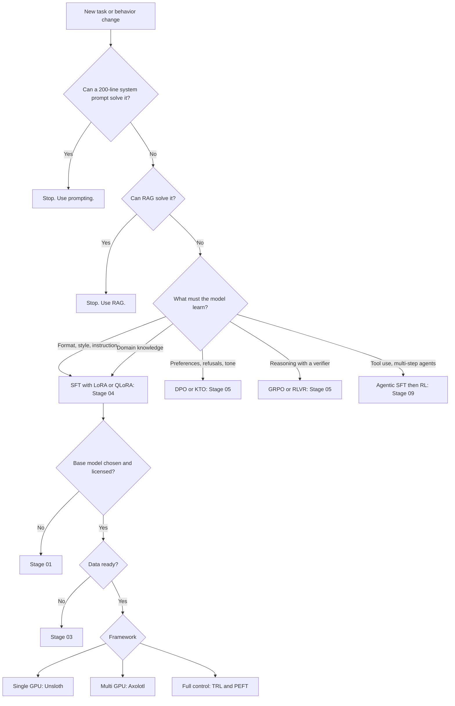

# **Finetuning From Scratch**

### **Purpose**

One roadmap that takes you from Hub basics to fine-tuning, alignment, agentic RL and production serving. It is organized as twelve stages (00 to 11). Each stage has one outcome, the concepts that matter, runnable code, and pre-flight questions. The repository layout mirrors the stages, so folder number equals stage number.

### **The five rules**

1. **Do not fine-tune first.** Prompting, then RAG, then fine-tuning, in that order.
2. **SFT first, RL later.** No RL algorithm works well without a seeded SFT base.
3. **Data beats algorithm.** The dominant failure mode of a fine-tune is bad data, not a bad optimizer.
4. **Released is not the same as fine-tunable.** An API model, an open-weight model, and a model you can adapter-tune on your own GPU are three different sets. Label every model on both axes.
5. **KV cache and GRPO are to inference and fine-tuning what SQL and transactions are to web engineering.** Understand them mechanically before touching production.

### **How to read this document**

- Stage 8 (distributed training) is a depth track. Skip it until your base model no longer fits on one GPU.
- Stage 7 is an optional fork. Pick one specialization that matches your target role.
- Every library name appears at leaf level only. Libraries change fast, so check the installed version before debugging and never trust an old tutorial.
- Install packages with `uv pip install`, not plain `pip`.

## **Repository Structure**

### **Layout**

```
llm-engineering/
├── README.md                     # stage index, status, how to run
├── pyproject.toml
├── .env.example
├── .gitignore
│
├── envs/                         # one file per isolated environment
│   ├── train.txt
│   ├── serve.txt
│   ├── axolotl.txt
│   └── edge.md
├── common/                       # importable code used by two or more stages
│   ├── evals/                    # harness wrappers, judges, metrics
│   ├── data/                     # formats, dedup, decontamination
│   ├── verifiers/                # math, code, format
│   └── bench/                    # TTFT, TPOT, throughput, VRAM logging
├── docs/
│   ├── decisions/                # dated notes: why this model or framework
│   ├── licenses.md
│   └── model_matrix.md
│
├── 00_platform/
│   ├── hub/
│   └── datasets/
├── 01_model_selection/
│   ├── models/                   # one note per model family
│   └── vram_planning/
├── 02_core_stack/
│   ├── pipelines/
│   ├── auto_classes/
│   ├── tokenization/
│   ├── trainer/
│   ├── generation/
│   └── evaluation/
├── 03_data_engineering/
│   ├── formats/
│   ├── quality/                  # dedup, decontamination
│   ├── synthetic/
│   └── domain_dataset/
├── 04_sft_peft/
│   ├── lora_from_scratch/
│   ├── qlora/
│   ├── sft_trainer/
│   └── checkpoints/              # safetensors, merge, resume
├── 05_alignment/
│   ├── preference/               # dpo, kto, simpo
│   ├── reasoning_rl/             # grpo, gspo
│   ├── distillation/
│   └── gradient_free/
├── 06_frameworks/
│   ├── unsloth/
│   ├── axolotl/
│   ├── llamafactory/
│   ├── trl_peft/
│   └── rl_engines/
├── 07_specializations/
│   ├── embeddings/
│   ├── vision_language/
│   ├── diffusion/
│   ├── audio/
│   └── gpu_kernels/
├── 08_distributed_training/
│   ├── sharded_dp/
│   ├── moe_parallelism/
│   └── multi_node/
├── 09_agentic_rl/
│   ├── environments/
│   ├── rewards/
│   ├── trainers/
│   ├── orchestration/
│   └── evals/
├── 10_inference_serving/
│   ├── quantization/
│   ├── multi_lora/
│   ├── kv_cache/
│   ├── speculative/
│   ├── disaggregation/
│   └── edge/
└── 11_capstones/
    ├── 01_domain_qlora/
    ├── 02_dpo_alignment/
    ├── 03_grpo_reasoning/
    ├── 04_agentic_environment/
    └── 05_multi_lora_serving/
```

### **Template inside every stage and capstone**

Create these on demand, but keep the names fixed.

```
NN_stage_name/
├── README.md      # outcome and the stage pre-flight questions
├── notes/
├── labs/          # runnable scripts, NN_ prefix only if sequential
├── configs/       # yaml, model names allowed in filenames here
└── results/       # metrics, plots, tables
```

Capstones add a `Dockerfile` and a `src/` directory.

### **Naming rules**

| Rule | Example |
|---|---|
| Repo name is kebab-case. Everything inside is snake_case, because hyphens break Python imports | `llm-engineering`, `moe_parallelism` |
| Stage directories are `NN_name` with NN equal to the stage number, 00 to 11, no gaps. Support directories are unnumbered | `05_alignment`, `common` |
| One to three words, at most 24 characters, a noun for the capability | `10_inference_serving` |
| No library or model names in directory names, except `06_frameworks/` where comparing libraries is the point | `04_sft_peft/qlora/` |
| No versions in filenames or directories. Put dates inside the document | `gemma.md` |
| Models appear only in config filenames as `{method}_{model}_{hardware}.yaml` | `qlora_gemma4_e4b_24gb.yaml` |
| Collections are plural, concepts are singular or mass nouns | `labs`, `alignment` |
| American spelling | `license` |
| Maximum depth is three levels under a stage | `10_inference_serving/kv_cache/turboquant.py` |

### **Operating rules**

1. Code moves into `common/` only when a second stage imports it, never in advance.
2. Create a stage folder when you reach that stage. The README index is the source of truth for status.
3. Code lives on GitHub. Model weights live on the Hub. Never commit `.bin`, `.safetensors` or `.pt` files, and never commit `HF_TOKEN`.

## **Stage Spine and Method Gate**

### **Stage spine**

```
00 Platform           auth, repos, data loading
01 Model selection    released vs open-weight vs fine-tunable, license, VRAM
02 Core stack         pipelines, tokenizers, Trainer, evaluation, attention theory
03 Data engineering   formats, quality, decontamination, synthetic data
04 SFT and PEFT       LoRA, QLoRA, SFTTrainer, checkpoints
05 Alignment          DPO family, GRPO and RLVR, distillation
06 Frameworks         Unsloth, Axolotl, TRL, RL engines
07 Specializations    embeddings, VLM, diffusion, audio, GPU kernels (optional fork)
08 Distributed        FSDP, ZeRO-3, TP, PP, EP (depth track)
09 Agentic RL         environments, rubrics, orchestrator and sub-agents
10 Inference serving  quantization, KV cache, speculative decoding, disaggregation
11 Capstones          public artifacts, portfolio, interview bank
```

### **Method-selection gate**



### **Isolated environments**

The training stack and the serving stack pin conflicting dependency ranges, so use separate environments. The adapter file is the only artifact that crosses the boundary.

| Environment | Purpose | Notes |
|---|---|---|
| `train` | TRL, PEFT, Unsloth | Newest dependency range |
| `serve` | vLLM, SGLang | Serving engines cap the allowed `transformers` range, so never serve from the training environment |
| `axolotl` | Config-driven multi-GPU training | Needs a newer Python than the rest of the stack, so it gets its own interpreter |
| `edge` | llama.cpp, MLX, Ollama | GGUF path, no Python training stack needed |

```
train env  --adapter.safetensors-->  serve env
```

```bash
uv venv envs/.train && source envs/.train/bin/activate
uv pip install -U huggingface_hub datasets transformers accelerate evaluate
uv pip install -U peft trl safetensors tokenizers
```

## **Stage 00: Platform Foundation**

### **Outcome**

You can authenticate against the Hub, move models and datasets in both directions, and load, transform and republish any dataset shape without a local copy.

### **Hub client**

The Hub hosts models, datasets, Spaces and Jobs. The Python client and the `hf` command line cover everything.

**Authentication**

- `login()`, `notebook_login()`, `whoami()`, `logout()`
- Environment variable `HF_TOKEN`
- CLI: `hf auth login`, `hf auth whoami`
- Fine-grained tokens: give each project the least access it needs

**Download**

- `hf_hub_download()` for one file, `snapshot_download()` for a repo
- Revisions, `allow_patterns`, `ignore_patterns`
- Gated access: handle `GatedRepoError`
- Offline mode: `HF_HUB_OFFLINE=1`, cache location from `HF_HOME`

**Upload and repository management**

- `upload_file()`, `upload_folder()`, `create_commit()` with `CommitOperationAdd` for atomic multi-file commits
- `create_repo()`, `delete_repo()`, `repo_exists()`, `model_info()`, `dataset_info()`
- Spaces runtime: `get_space_runtime()`, `pause_space()`, `restart_space()`

**Error handling.** The client no longer uses `requests`, so catch `HfHubHTTPError` and its subclasses instead of `requests` exceptions.

```python
from huggingface_hub import (
    login, whoami, hf_hub_download, snapshot_download,
    upload_file, upload_folder, create_repo, HfApi, CommitOperationAdd,
)
```

```bash
hf auth login
hf download Qwen/Qwen3-1.7B --local-dir ./qwen
hf upload username/my-model ./my-model
```

**Agent skills for the CLI.** The Hub ships skills that teach a coding agent the `hf` surface. Install them with `hf skills add hf-cli --global`, list with `hf skills list`, refresh with `hf skills update -g`.

### **Datasets**

Built on Apache Arrow, so large datasets are memory-mapped from disk instead of loaded into RAM. Loading scripts and `trust_remote_code` are gone. If a dataset ships only a script, find a Parquet version or convert it yourself. `ds["col"]` returns a lazy column object, not a list.

**Loading from every source**

```python
from datasets import load_dataset, Dataset, load_from_disk

load_dataset("stanfordnlp/imdb", split="train")
load_dataset("stanfordnlp/imdb", split="train[:10%]")
load_dataset("csv", data_files="data.csv")
load_dataset("json", data_files="data.jsonl")
load_dataset("parquet", data_files="data.parquet")
load_dataset("csv", data_files={"train": "tr.csv", "test": "te.csv"})
Dataset.from_dict({"text": ["a", "b"]})
Dataset.from_list([{"text": "a"}, {"text": "b"}])
Dataset.from_generator(gen_fn)
load_from_disk("./saved")
```

**Inspect, rows, columns**

```python
ds.features; ds.column_names; ds.num_rows
ds[0]; ds[:5]; list(ds["text"])

ds.sort("label"); ds.shuffle(seed=42); ds.select([0, 1, 2])
ds.filter(lambda x: x["label"] == 1)
ds.train_test_split(test_size=0.2, seed=42, stratify_by_column="label")
ds.shard(num_shards=4, index=0)

ds.rename_column("text", "review")
ds.remove_columns(["label"])
ds.cast_column("label", Value("float32"))
ds.select_columns(["text", "label"])
```

**Transform and combine**

```python
ds.map(fn, batched=True, batch_size=1000, num_proc=4, remove_columns=["text"])
ds.with_transform(fn)           # applied lazily on access
ds.with_format("torch")

from datasets import concatenate_datasets, interleave_datasets
concatenate_datasets([ds1, ds2])
interleave_datasets([ds1, ds2], probabilities=[0.7, 0.3], seed=42)
```

A batched `map` may return more rows than it received, as long as every column grows consistently.

**Export, save, push**

```python
ds.to_pandas(); ds.to_parquet("out.parquet"); ds.to_polars()
ds.save_to_disk("./my_dataset")
ds.push_to_hub("username/my-dataset", private=True, num_proc=8)
```

Always write a dataset card for pushed datasets.

**Streaming for large data**

```python
ds = load_dataset("allenai/c4", "en", split="train", streaming=True)
ds = ds.shuffle(seed=42, buffer_size=10_000).filter(fn)
list(ds.take(10))
```

Streaming shuffle uses a buffer. If a run shuffles differently after an upgrade, check the default buffer size before suspecting your seed, and pass `buffer_size` explicitly when reproducibility matters.

**Agent traces.** Recent releases can load agent traces (tool-call conversations from coding agents) into a normalized `messages` schema. This is the data substrate for agent SFT and bridges Stage 03 and Stage 09.

### **Pre-flight questions**

1. How do you load a dataset that only ships a loading script?
2. What does streaming give you, and what does it cost?
3. Why is a batched `map` much faster than a row-wise one?
4. How do you make a shuffled streaming run reproducible?

## **Stage 01: Model Landscape and Selection**

### **Outcome**

You can take a task constraint, narrow it to one base model, and defend the choice on four axes: capability, license, memory footprint, and tooling support. Nothing is trained in this stage.

### **Released, open-weight, fine-tunable**

These are three different sets. Large frontier mixture-of-experts models can be released and open-weight, yet need a rack of GPUs to adapter-tune. A small dense or edge model is the realistic target for a learner. A roadmap that blurs these sends people to download a terabyte of weights they cannot train.

### **Working shortlist for hands-on experimentation**

Chosen for experimentability, not leaderboard rank. Leaderboards move monthly, so save a dated snapshot of any ranking you use in a decision.

| Role | Model | Size | License | Consumer-GPU path |
|---|---|---|---|---|
| Text SFT default | Qwen3-4B-Instruct-2507 | 4B | Apache-2.0 | QLoRA, about 10 to 12 GB |
| Text SFT with thinking | Qwen3.5-4B | 4B | Apache-2.0 | bf16 LoRA, no 4-bit |
| Multimodal default | Gemma 4 E4B | 4.5B effective | Apache-2.0 | QLoRA, about 10 GB |
| Edge | Gemma 4 E2B | 2.3B effective | Apache-2.0 | QLoRA, about 8 GB |
| Single-node frontier open | Qwen3.8-27B | 27B dense | Apache-2.0 | QLoRA, about 24 GB |
| Reasoning per active parameter | Gemma 4 31B | 31B dense | Apache-2.0 | QLoRA, about 22 GB |
| Embedding | Nemotron 3.5 Embed 8B | 8B | NVIDIA Open | 4096-dim vectors |
| Reranker | Nemotron 3.5 Rerank 8B | 8B | NVIDIA Open | Cross-encoder |

Large open-weight MoE models (for example Kimi K3, Mistral Large 4, GLM-5.3, Muse Spark Open) are serve-only for most teams. API-only models are not candidates for adapter training at all, even if weights are promised later.

### **Architecture facts that affect fine-tuning**

- The Qwen3.5 and Qwen3.8 families use a hybrid of gated linear attention and standard attention. Do not QLoRA the Qwen3.5 family at 4-bit: quantization error is higher than normal. Use bf16 LoRA. Qwen3.8-27B is the documented exception that works at 4-bit.
- 4-bit training of MoE experts is blocked, because the quantization library cannot hold 4-bit parameters for expert tensors. Use bf16 LoRA for MoE.
- Some models ship without a Jinja chat template and need a reference encoding implementation. Confirm the template exists before building a dataset.
- Reasoning behavior differs per model: on by default, togglable, or always on. Know which before writing SFT data.

### **License audit**

License is a selection constraint. Several recent releases carry revenue-triggered clauses.

| License family | Commercial use | Trigger to watch | Rule |
|---|---|---|---|
| Apache-2.0 | Yes, including as a service | None | Default choice |
| MIT | Yes | None | Equivalent for most uses |
| Mistral Ecosystem Open-Weight | Weights and internal use | Selling inference as a service needs a separate agreement | Free weights are not a free service |
| Muse Model License | Yes, including fine-tuning | Service revenue above a stated threshold requires a separate agreement with the owner | Plan the commercial conversation early |
| LFM Open License | Below a revenue threshold | Threshold applies per customer too | Free for learning, relicense before scaling |
| Meta Custom (Llama 4) | With conditions | Large monthly-active-user clause | Avoid if you might reach that scale |
| Custom max-size licenses | Restricted | Read before use | Keep the large and small releases of one family separate in your registry |

Three rules follow. MIT, Modified MIT, Apache-2.0 and "open weights" are not interchangeable. Open weights do not mean open source. A fine-tune inherits the base license unless the license says otherwise.

### **Memory and hardware matrix**

The configuration decides the base model, because a model you cannot fit is not a candidate.

| Model | QLoRA (4-bit) | bf16 LoRA |
|---|---|---|
| Gemma 4 E2B | about 8 GB | 8 to 10 GB |
| Gemma 4 E4B | about 10 GB | about 17 GB |
| Gemma 4 26B-A4B (MoE) | blocked | more than 40 GB |
| Gemma 4 31B | about 22 GB | about 56 GB |
| Qwen3.5-2B | not recommended | about 5 GB |
| Qwen3.5-4B | not recommended | about 10 GB |
| Qwen3.5-9B | not recommended | about 22 GB |
| Qwen3.5-35B-A3B (MoE) | blocked | about 74 GB |
| Qwen3.8-27B | about 24 GB | more than 36 GB |

Prefer Gemma 4 E4B QLoRA over E2B LoRA: a bigger model with negligible quantization difference.

Weights alone for a model with $N$ parameters at $b$ bytes per parameter:

$$M_{\text{weights}} = N \cdot b$$

For an 8B model in BF16 ($b = 2$):

$$\boxed{M_{\text{weights}} = 8 \times 10^{9} \times 2 = 16\ \text{GB}}$$

### **Base-model decision framework**

```
Best open coding or agent model, open license  -> Qwen3.8-27B (trainable), others serve-only
Best efficiency on a consumer GPU              -> Gemma 4 E4B, then Qwen3.5-2B bf16
Native multimodal (text, image, audio)         -> Gemma 4 E4B, Qwen3.8-27B for image and video
Extreme context (above 256K)                   -> Qwen3.8-27B via YaRN; train at 8K to 32K regardless
Enterprise deployment                          -> Apache-2.0 or MIT; avoid revenue-triggered licenses
Multi-turn RL or agentic                       -> Qwen3.8-27B or a 4B model for fast iteration
Best reasoning per active parameter            -> Gemma 4 31B, or a small-active MoE for serving
```

### **Pre-flight checklist**

1. The base is open-weight if the plan involves any adapter training.
2. The license is read in full and any revenue trigger fits the intended product.
3. The modality you need (image, audio, video) is confirmed on the model card, not assumed from the family name.
4. VRAM for the chosen configuration is written down before the dataset is built.
5. Thinking mode behavior is known.
6. The chat template exists.
7. Gated access is requested early.
8. A dated snapshot of every leaderboard number used in the decision is saved.

## **Stage 02: Core ML Stack**

### **Outcome**

You can take any model on the Hub, run it, fine-tune it with the built-in `Trainer`, and measure it with a metric that matches the task.

### **Pipeline API**

```python
from transformers import pipeline

classifier = pipeline("text-classification")
generator  = pipeline("text-generation", model="Qwen/Qwen3-1.7B")
ner        = pipeline("token-classification", aggregation_strategy="simple")
asr        = pipeline("automatic-speech-recognition", model="openai/whisper-large-v3")
print(classifier("HuggingFace is amazing!"))
```

Task families: text (classification, token classification, generation, fill-mask, zero-shot, feature extraction), vision (classification, detection, segmentation, depth), audio (ASR, classification, text-to-speech), multimodal (image-text-to-text, document QA, any-to-any). Verify with `get_supported_tasks()`.

The summarization, translation and text2text pipelines were removed. Replace them with a chat model through `text-generation`, or call a seq2seq model's `generate()` directly.

```python
chat = pipeline("text-generation", model="Qwen/Qwen3-1.7B")
out = chat([{"role": "user", "content": "Summarize in one sentence: " + text}],
           max_new_tokens=100)
print(out[0]["generated_text"][-1]["content"])
```

### **Auto classes**

```python
import torch
from transformers import AutoTokenizer, AutoModelForSequenceClassification

tok   = AutoTokenizer.from_pretrained("bert-base-uncased")
model = AutoModelForSequenceClassification.from_pretrained("bert-base-uncased", num_labels=2)
inputs = tok("Hello world", return_tensors="pt")
with torch.no_grad():
    probs = model(**inputs).logits.softmax(-1)
```

| Family | Classes |
|---|---|
| Understanding | `AutoModelForSequenceClassification`, `...TokenClassification`, `...QuestionAnswering`, `...MultipleChoice` |
| Generation | `AutoModelForCausalLM`, `...MaskedLM`, `...Seq2SeqLM`, `...SpeechSeq2Seq` |
| Vision | `AutoModelForImageClassification`, `...ObjectDetection`, `...SemanticSegmentation` |
| Multimodal | `AutoModelForImageTextToText`, `...VisualQuestionAnswering` |
| Audio | `AutoModelForAudioClassification`, `...CTC` |
| Base and preprocessing | `AutoModel`, `AutoConfig`, `AutoImageProcessor`, `AutoFeatureExtractor`, `AutoProcessor` |

### **Trainer**

```python
import numpy as np, evaluate
from datasets import load_dataset
from transformers import (AutoTokenizer, AutoModelForSequenceClassification,
                          DataCollatorWithPadding, Trainer, TrainingArguments)

ds    = load_dataset("stanfordnlp/imdb")
tok   = AutoTokenizer.from_pretrained("distilbert-base-uncased")
model = AutoModelForSequenceClassification.from_pretrained("distilbert-base-uncased", num_labels=2)

tokenized = ds.map(lambda b: tok(b["text"], truncation=True, max_length=256), batched=True)
accuracy = evaluate.load("accuracy")

def compute_metrics(eval_pred):
    logits, labels = eval_pred
    return accuracy.compute(predictions=np.argmax(logits, axis=-1), references=labels)

args = TrainingArguments(
    output_dir="./results", num_train_epochs=3,
    per_device_train_batch_size=16, per_device_eval_batch_size=64,
    warmup_steps=500, weight_decay=0.01,
    eval_strategy="epoch", save_strategy="epoch",
    load_best_model_at_end=True, bf16=True,
)
trainer = Trainer(
    model=model, args=args,
    train_dataset=tokenized["train"], eval_dataset=tokenized["test"],
    processing_class=tok,                      # replaces the old tokenizer argument
    data_collator=DataCollatorWithPadding(tok),
    compute_metrics=compute_metrics,
)
trainer.train()
trainer.save_model("./my-model")
```

Naming changes that break old tutorials: `torch_dtype` is now `dtype`, `Trainer(tokenizer=...)` is now `processing_class=...`, `encode_plus()` is removed, and `TRANSFORMERS_CACHE` is ignored in favor of `HF_HOME`.

Collators: `DataCollatorWithPadding` (classification), `DataCollatorForSeq2Seq`, `DataCollatorForLanguageModeling`, `DataCollatorForTokenClassification`. Use `bf16=True` on newer GPUs and `fp16=True` on older ones.

### **Generation**

```python
inputs = tokenizer("Once upon a time", return_tensors="pt").to(model.device)
out = model.generate(**inputs, max_new_tokens=100, do_sample=True,
                     temperature=0.7, top_k=50, top_p=0.9, repetition_penalty=1.1)
print(tokenizer.decode(out[0], skip_special_tokens=True))
```

Decoding strategies: greedy, beam search, sampling, temperature, top-k, top-p, repetition penalty, constrained generation, streaming with `TextStreamer`. Format chat input with `tokenizer.apply_chat_template(messages, add_generation_prompt=True, return_tensors="pt")`.

### **Tokenization**

```python
enc = tokenizer("Hello world", truncation=True, padding="max_length",
                max_length=128, return_tensors="pt", return_offsets_mapping=True)
enc.input_ids; enc.attention_mask; enc.word_ids()

tokenizer(long_text, truncation=True, max_length=512, stride=128,
          return_overflowing_tokens=True)
```

Key concepts: BPE and byte-level BPE (GPT style), WordPiece (BERT), SentencePiece and Unigram (T5, LLaMA), vocabulary size, why padding and truncation exist, what `attention_mask` does, `offset_mapping` and `word_ids()` for NER alignment, overflow and stride for long documents, and chat templates.

Train your own tokenizer:

```python
from tokenizers import Tokenizer
from tokenizers.models import BPE
from tokenizers.trainers import BpeTrainer
from tokenizers.pre_tokenizers import Whitespace
from transformers import PreTrainedTokenizerFast

tok = Tokenizer(BPE(unk_token="[UNK]"))
tok.pre_tokenizer = Whitespace()
tok.train(files=["corpus.txt"], trainer=BpeTrainer(
    vocab_size=30000, special_tokens=["[UNK]", "[CLS]", "[SEP]", "[PAD]", "[MASK]"]))
fast = PreTrainedTokenizerFast(tokenizer_object=tok, unk_token="[UNK]", pad_token="[PAD]")
fast.save_pretrained("./my-tokenizer")
```

### **Evaluation stack**

Three tools, three jobs.

| Tool | Job |
|---|---|
| `evaluate` | Classic metrics: accuracy, F1, ROUGE, BLEU, BERTScore. Stable, but no longer the recommended path for LLM benchmarks |
| `lighteval` | Hugging Face task framework for LLM evaluation, including LLM-as-judge suites |
| `lm-evaluation-harness` | Standard benchmark harness: MMLU, GSM8K, HellaSwag, IFEval. Reach for it when a job description names a benchmark |

```bash
lm-eval run --model hf --model_args pretrained=Qwen/Qwen3-1.7B,dtype=bfloat16 --tasks hellaswag
lm-eval run --model vllm --model_args pretrained=./my-model --tasks ifeval
```

**Decontamination, the real API.** The harness has no `decontaminate(...)` function. Contamination detection runs over precomputed n-gram files: generate n-gram files and an `info.json` for your training set, pass the directory with `--decontamination_ngrams_path`, and the evaluator reports a second metric with a `decontaminate` suffix. It is disabled by default for new tasks unless the task opts in.

### **Attention architectures**

Standard scaled dot-product attention:

$$\text{Attention}(Q, K, V) = \text{softmax}\!\left(\frac{QK^{\top}}{\sqrt{d_k}}\right)V$$

Multi-head attention concatenates $h$ heads:

$$\text{MHA}(X) = \text{Concat}(\text{head}_1, \dots, \text{head}_h)\,W_O, \qquad \text{head}_i = \text{Attention}(XW_i^Q,\, XW_i^K,\, XW_i^V)$$

Memory for the score matrix is $O(n^2)$ in sequence length $n$.

| Variant | Idea | Effect |
|---|---|---|
| Grouped-query attention | Several query heads share one K and V head | Standard in modern open LLMs. 32 query heads over 8 KV heads gives a 4x smaller KV cache |
| Multi-query attention | All query heads share one K and V head | Maximum savings, some quality cost |
| Multi-head latent attention | Cache a compressed latent and decompress at attention time | Very large KV cache reduction |
| Sparse and compressed hybrids | Sparse patterns plus aggressive compression in some layers | Makes million-token context affordable |
| FlashAttention | Tile the computation so the full $n \times n$ matrix is never materialized | HBM reads drop to $O(n)$. Default in modern engines |
| Linear and hybrid attention | State-space or gated delta layers mixed with attention | High inference throughput |

KV cache size is an architectural property. It sets your context ceiling before you write any serving code. Stage 10 quantifies it.

### **Pre-flight questions**

1. Which pipelines were removed, and what replaces them?
2. What does `attention_mask` do and why does padding need it?
3. Why is `evaluate` not enough for LLM benchmarking?
4. How does the harness detect training-set contamination?
5. Why does grouped-query attention shrink the KV cache?

## **Stage 03: Data Engineering**

### **Outcome**

You can build, clean, format, split, version and document a domain dataset that a trainer can consume without conversion. A bad dataset defeats a perfect training loop.

### **Data shapes**

| Shape | Used for | Format |
|---|---|---|
| Instruction and completion | SFT | Alpaca, ShareGPT, ChatML |
| Multi-turn chat | Chat SFT | ShareGPT, ChatML |
| Tool use | Agent SFT | OpenAI tools format |
| Preference pairs | DPO, IPO, SimPO | `{prompt, chosen, rejected}` |
| Binary good or bad | KTO | `{prompt, completion, label}` |
| Verifiable reward | GRPO, RLVR | `{prompt, verifier}` |
| Distillation | Teacher to student | SFT format plus teacher logits |

### **Format specifications**

**ChatML (the safe default).** Used by most current models, and most frameworks convert it automatically.

```json
{"messages": [
  {"role": "system", "content": "You are a helpful assistant."},
  {"role": "user", "content": "What is the capital of France?"},
  {"role": "assistant", "content": "Paris."}
]}
```

**Alpaca**

```json
{"instruction": "Explain speculative decoding in 2 sentences.", "input": "", "output": "..."}
```

**ShareGPT.** Each model's chat template maps `from` to role tokens, so confirm it matches the target model.

```json
{"conversations": [
  {"from": "human", "value": "What is the weather in Paris?"},
  {"from": "gpt", "value": "I do not have real-time data, but..."}
]}
```

**Tool calling**

```json
{"messages": [
  {"role": "user", "content": "What is the weather in Paris?"},
  {"role": "assistant", "content": null, "tool_calls": [
    {"id": "call_1", "type": "function",
     "function": {"name": "get_weather", "arguments": "{\"city\": \"Paris\"}"}}]},
  {"role": "tool", "tool_call_id": "call_1", "content": "{\"temp\": 18}"},
  {"role": "assistant", "content": "It is 18 C in Paris."}
]}
```

**Preference pair.** The most useful pairs are those where chosen and rejected are almost equally good. If chosen is obviously better, the model learns nothing.

```json
{"prompt": "Explain speculative decoding.",
 "chosen":   [{"role": "user", "content": "..."}, {"role": "assistant", "content": "A small draft model proposes..."}],
 "rejected": [{"role": "user", "content": "..."}, {"role": "assistant", "content": "It is a technique where you guess..."}]}
```

### **The five rules**

1. **Diversity over volume.** 5K diverse examples beat 50K near-duplicates.
2. **Hard negatives.** Close pairs teach more than obvious wins.
3. **Decontamination.** Strip eval-set leakage from training data, always.
4. **Format consistency.** Tokenize early to catch chat-template mismatches before burning GPU hours.
5. **PII and licensing.** Document provenance.

### **Quality assessment**

- Read 100 random examples. If 100 are bad, the million are bad.
- Check the token-length distribution for long-tail bloat.
- Check the source distribution for single-source bias.
- Check near-duplicates with MinHash or sentence embeddings.
- Check eval contamination with n-gram overlap.

```python
from datasketch import MinHash, MinHashLSH

def minhash_dedup(texts, threshold=0.8):
    lsh = MinHashLSH(threshold=threshold, num_perm=128)
    keep = []
    for i, text in enumerate(texts):
        m = MinHash(num_perm=128)
        for word in text.split():
            m.update(word.encode())
        if not lsh.query(m):
            lsh.insert(i, m)
            keep.append(i)
    return keep
```

For benchmark contamination, use the harness n-gram machinery rather than a hand-rolled check, so the measurement matches how the evaluation is scored.

**Format consistency check**

```python
from transformers import AutoTokenizer

tokenizer = AutoTokenizer.from_pretrained("Qwen/Qwen3-4B-Instruct-2507")
sample = [{"role": "user", "content": "Hello"}, {"role": "assistant", "content": "Hi there!"}]
text = tokenizer.apply_chat_template(sample, tokenize=False)
print(text)
print("Token count:", tokenizer(text, return_tensors="pt").input_ids.shape[1])
```

### **Synthetic data**

Use it when real data is scarce, when you need rare edge cases, or when you need preference pairs at scale.

1. Generate candidates with a strong model.
2. Filter by quality: length, format, required concepts, basic checks.
3. Rank for preference data with an LLM judge and an explicit rubric.
4. Decontaminate against your eval set.
5. Train.

Gotchas: model collapse when training repeatedly on a model's own output (always mix in real data), style homogenization (mix sources), inherited hallucinations (verify a sample by hand), and murky licensing for closed-model outputs (prefer open-weight generators).

A 70/30 synthetic to real ratio is a starting point, not a rule. Quality is won in the filtering step, not the generation step.

### **Licensing and compliance**

| Source | License | Commercial fine-tune |
|---|---|---|
| Alpaca | CC BY-NC | No |
| Dolly | CC BY-SA | Yes, with share-alike |
| OpenHermes | Mostly Apache-2.0 | Yes, check per source |
| Tulu SFT mixture | Mixed, embeds non-commercial subsets | Audit the mixture first |
| UltraFeedback, HH-RLHF | MIT | Yes |
| xLAM function calling | CC BY-NC | No |
| HumanEval | MIT | Evaluation only, never train on it |
| Wikipedia | CC BY-SA | Yes, with share-alike |

The EU AI Act applies progressively. Check the official timeline for the dates that apply this quarter. A fine-tune of your own model can count as a significant modification, so document the assessment instead of assuming you are out of scope. Minimum practice: record data provenance and license, write a model card with intended use and limitations, keep a log of significant model updates and eval results, and strip PII (Presidio or an LLM scrub). For user data, document the consent flow.

### **Domain dataset construction**

1. **Define the task.** "Customer support chatbot" is too vague. "SaaS billing questions, structured JSON output, with citations" is actionable.
2. **Source candidates.** Real data with consent and PII scrubbing, synthetic data, public data with a license check.
3. **Filter and clean.** Deduplicate, filter by quality, decontaminate.
4. **Format.** Convert, apply the chat template, verify tokenization.
5. **Split.** Train 80 to 90 percent, validation 5 to 10 percent, test 5 to 10 percent held out and never touched.
6. **Version and document.** Tag it (for example `billing-support-v1.0`), record source, license, size, date and checks, store it in a versioned location.

### **Labs**

1. **Inspect a public dataset.** Read 100 random rows, plot length distribution, run MinHash, check for benchmark contamination.
2. **Build a small domain dataset.** 1K synthetic samples, filter, ChatML, verify template tokenization, push with a data card.
3. **Build a DPO dataset.** Two or three candidates per prompt, rank with a rubric judge, check that the pairs are not all obvious wins.
4. **Decontamination pipeline.** Run the n-gram flow against MMLU, HumanEval and GSM8K, measure what was stripped.
5. **Format conversion.** Convert Alpaca to ShareGPT, ChatML and a model-specific template, compare token counts.

### **Pre-flight questions**

1. Name the three standard SFT formats and when to use each.
2. What is the hard-negative rule for preference data?
3. Why is decontamination non-negotiable?
4. What is the right train, validation and test split?
5. What is model collapse and how do you prevent it?

## **Stage 04: SFT and PEFT**

### **Outcome**

You can fine-tune a base model on your own data with LoRA or QLoRA on one GPU, resume a run, and save a checkpoint another tool can load.

### **LoRA from first principles**

Freeze a weight matrix $W \in \mathbb{R}^{d \times k}$ and learn a low-rank update:

$$W' = W + \frac{\alpha}{r}\,BA, \qquad B \in \mathbb{R}^{d \times r},\quad A \in \mathbb{R}^{r \times k},\quad r \ll \min(d, k)$$

Only $A$ and $B$ receive gradients. $B$ starts at zero and $A$ at a small random value, so training starts exactly at the base model.

**Worked example, row by row.** Let $d = k = 3$, $r = 2$, $\alpha = 4$, so the scale is $s = \alpha / r = 2$.

$$B = \begin{bmatrix} 1 & 0 \\ 0 & 1 \\ 1 & 1 \end{bmatrix}, \qquad A = \begin{bmatrix} 1 & 2 & 0 \\ 0 & 1 & 3 \end{bmatrix}$$

Compute $\Delta W = BA$, one row of $B$ at a time. Each row of the result is a weighted sum of the rows of $A$.

- Row 1: $[1, 0] \cdot A = 1\cdot[1,2,0] + 0\cdot[0,1,3] = [1,\ 2,\ 0]$
- Row 2: $[0, 1] \cdot A = 0\cdot[1,2,0] + 1\cdot[0,1,3] = [0,\ 1,\ 3]$
- Row 3: $[1, 1] \cdot A = 1\cdot[1,2,0] + 1\cdot[0,1,3] = [1,\ 3,\ 3]$

$$\Delta W = BA = \begin{bmatrix} 1 & 2 & 0 \\ 0 & 1 & 3 \\ 1 & 3 & 3 \end{bmatrix}$$

Now the forward pass for $x = [1, 2, 3]^{\top}$. Never form $\Delta W$ in practice. Multiply right to left, $B(Ax)$, so every intermediate stays rank $r$.

Step 1, compute $h = Ax$ one row of $A$ at a time:

- Row 1: $[1, 2, 0] \cdot [1, 2, 3] = 1 + 4 + 0 = 5$
- Row 2: $[0, 1, 3] \cdot [1, 2, 3] = 0 + 2 + 9 = 11$

so $h = [5, 11]^{\top}$.

Step 2, compute $Bh$ one row of $B$ at a time:

- Row 1: $[1, 0] \cdot [5, 11] = 5$
- Row 2: $[0, 1] \cdot [5, 11] = 11$
- Row 3: $[1, 1] \cdot [5, 11] = 16$

Step 3, apply the scale $s = 2$:

$$\boxed{s\,B(Ax) = 2\,[5,\ 11,\ 16]^{\top} = [10,\ 22,\ 32]^{\top}}$$

Check with the explicit $\Delta W x$: row 1 gives $1 + 4 + 0 = 5$, row 2 gives $0 + 2 + 9 = 11$, row 3 gives $1 + 6 + 9 = 16$. They match.

At this toy size LoRA has more parameters than the matrix it adapts ($6 + 6 = 12$ versus $9$). The saving appears at real sizes. For $d = k = 4096$ and $r = 16$:

$$\text{full} = 4096^2 = 16{,}777{,}216, \qquad \text{LoRA} = r(d + k) = 16 \times 8192$$

$$\boxed{\text{LoRA parameters} = 131{,}072 \quad (0.78\%\ \text{of the full matrix})}$$

```python
import torch, torch.nn as nn

class LoRALinear(nn.Module):
    def __init__(self, base_linear, r=16, alpha=32, dropout=0.05):
        super().__init__()
        self.base = base_linear
        for p in self.base.parameters():
            p.requires_grad = False
        self.A = nn.Parameter(torch.randn(r, base_linear.in_features) * 0.01)
        self.B = nn.Parameter(torch.zeros(base_linear.out_features, r))
        self.scaling = alpha / r
        self.dropout = nn.Dropout(dropout)

    def forward(self, x):
        return self.base(x) + (self.dropout(x) @ self.A.T @ self.B.T) * self.scaling
```

### **Default LoRA configuration**

| Hyperparameter | Default | When to change |
|---|---|---|
| Rank $r$ | 16 | 8 if memory-bound, 64 if quality-bound |
| `lora_alpha` | 32 | Keep $\alpha = 2r$ |
| `target_modules` | all linear layers (q, k, v, o, gate, up, down) | The original paper used only q and v |
| `lora_dropout` | 0.05 to 0.1 | Raise if overfitting |
| Learning rate | $10^{-4}$ to $5 \times 10^{-4}$ | 10 to 100 times larger than full fine-tuning |
| Optimizer | AdamW, paged 8-bit for QLoRA | |
| Epochs | 2 to 3 | Stop when eval loss plateaus |

### **Memory savings**

For a 7B model in fp16, full fine-tuning stores weights, gradients and two Adam states in fp32:

$$14 + 14 + (2 \times 4 \times 7) = 14 + 14 + 56$$

$$\boxed{M_{\text{full FT}} \approx 84\ \text{GB (plus activations)}}$$

LoRA at $r = 16$ needs about 16 GB, roughly a 5x reduction.

```python
from transformers import AutoModelForCausalLM
from peft import LoraConfig, get_peft_model, TaskType

model = AutoModelForCausalLM.from_pretrained("Qwen/Qwen3-1.7B", dtype="auto")
config = LoraConfig(task_type=TaskType.CAUSAL_LM, r=16, lora_alpha=32,
                    lora_dropout=0.05, target_modules="all-linear")
model = get_peft_model(model, config)
model.print_trainable_parameters()
```

Target module names differ per architecture. Print the model or use `"all-linear"`.

### **LoRA family**

| Variant | Mechanism | When it wins |
|---|---|---|
| DoRA | Splits weight into magnitude and direction, adapts direction with LoRA | Measured LoRA underperformance at the same rank |
| rsLoRA | Scales by $1/\sqrt{r}$ instead of $\alpha / r$ | High ranks, $r \geq 64$ |
| GaLore | Projects gradients into a low-rank subspace | Full-rank updates needed, memory limited |
| VeRA | Shared frozen random matrices, trains scaling vectors | Smallest memory |
| AdaLoRA | Adaptive per-layer rank | Unknown right rank |
| IA3 | Learned activation rescaling | Few-shot adaptation |
| LoftQ | Quantization-aware initialization | QLoRA from a quantized start |

Start with vanilla LoRA, rank 16, all linear layers. Switch only on a measured problem. Most "variant X beats LoRA" claims do not replicate at scale.

### **QLoRA**

A 4-bit frozen base with BF16 adapters. Quantization applies only to the frozen base, which is why QLoRA tracks fp16 LoRA closely.

```python
import torch
from transformers import AutoModelForCausalLM, BitsAndBytesConfig
from peft import LoraConfig, get_peft_model, prepare_model_for_kbit_training

bnb = BitsAndBytesConfig(
    load_in_4bit=True, bnb_4bit_quant_type="nf4",
    bnb_4bit_compute_dtype=torch.bfloat16, bnb_4bit_use_double_quant=True,
)
model = AutoModelForCausalLM.from_pretrained(
    "Qwen/Qwen3-4B-Instruct-2507", quantization_config=bnb, device_map="auto")
model = prepare_model_for_kbit_training(model)
model = get_peft_model(model, LoraConfig(task_type="CAUSAL_LM", r=16, lora_alpha=32,
                                          lora_dropout=0.05, target_modules="all-linear"))
```

Quantization notes: NF4 gives the best 4-bit quality, double quantization quantizes the quantization constants, use float16 compute on older GPUs and bfloat16 on A100 and newer, and use paged 8-bit optimizers to avoid optimizer-induced OOM.

### **SFT with TRL**

```python
from datasets import load_dataset
from peft import LoraConfig
from trl import SFTConfig, SFTTrainer

dataset = load_dataset("trl-lib/Capybara", split="train")
trainer = SFTTrainer(
    model="Qwen/Qwen3-1.7B",
    train_dataset=dataset,
    args=SFTConfig(
        output_dir="./sft-model", num_train_epochs=1,
        per_device_train_batch_size=4, gradient_accumulation_steps=4,
        learning_rate=2e-4, bf16=True,
        max_length=1024,          # was max_seq_length in old releases
        packing=True,
    ),
    peft_config=LoraConfig(r=16, lora_alpha=32, target_modules="all-linear", task_type="CAUSAL_LM"),
)
trainer.train()
trainer.save_model("./my-sft-model")
```

SFT checklist:

- Dataset formats: plain text, prompt and completion pairs, conversational `messages`.
- `completion_only_loss` and `assistant_only_loss` replace the old completion-only collator. The latter needs a chat template with generation markers.
- `packing` concatenates short examples for 2 to 4 times the throughput.
- Memory options: gradient checkpointing, activation offloading.
- TRL splits trainers into a stable tier and an experimental tier whose APIs can change or vanish in a minor release. PPO was removed. Pin the version and read release notes before upgrading.
- Fused logprob kernels in recent TRL raise the maximum DPO sequence length substantially, so long-context preference tuning is practical.

### **Optimizers and schedule**

AdamW:

$$m_t = \beta_1 m_{t-1} + (1-\beta_1) g_t, \qquad v_t = \beta_2 v_{t-1} + (1-\beta_2) g_t^2$$

$$\theta_t = \theta_{t-1} - \eta\left(\frac{\hat m_t}{\sqrt{\hat v_t} + \epsilon} + \lambda\,\theta_{t-1}\right), \qquad \beta_1 = 0.9,\ \beta_2 = 0.999,\ \epsilon = 10^{-8}$$

8-bit Adam stores optimizer state in 8 bits (about 75 percent saving on that state). Paged Adam keeps state in unified memory so it cannot OOM the trainer. Schedule: warmup for 100 to 500 steps, then cosine decay. LoRA learning rates sit at $10^{-4}$ to $5 \times 10^{-5}$, full fine-tuning at $10^{-5}$ to $2 \times 10^{-5}$.

### **Thinking-mode handling**

Mishandling thinking mode during SFT is a common way to destroy reasoning ability.

```python
tokenizer.apply_chat_template(messages, enable_thinking=False)
# Some models also expose a reasoning effort control and a flag to preserve
# thinking across turns for agentic workflows.
```

To preserve reasoning behavior, mix at least 75 percent reasoning-style examples into a general SFT mixture. Below that, the model usually still works but silently stops emitting thinking blocks, and you will not notice until a benchmark drops.

### **Catastrophic forgetting**

| Strategy | When |
|---|---|
| PEFT (LoRA) | Default, base stays frozen |
| Replay buffer | Mix 10 to 30 percent general data in a full fine-tune |
| Conservative learning rate | Full fine-tune |
| Layer-wise learning rate decay | Standard for full fine-tuning |

### **Checkpoints, merging, safetensors**

```python
model.save_pretrained("./lora-adapter")          # small adapter only
from peft import PeftModel
base = AutoModelForCausalLM.from_pretrained("Qwen/Qwen3-1.7B", dtype="auto")
model = PeftModel.from_pretrained(base, "./lora-adapter")
merged = model.merge_and_unload()
merged.save_pretrained("./merged-model")
```

To merge a QLoRA adapter, reload the base in 16-bit, attach the adapter, then merge.

Safetensors is the standard weight format: a JSON header followed by raw tensor bytes, memory-mapped and zero-copy, with no arbitrary code execution (unlike pickle `.bin` and `.pt`). Convert an old checkpoint by loading it once and calling `save_pretrained()` again. You can list tensor names without loading weights using `safe_open`.

```python
from safetensors import safe_open
with safe_open("model.safetensors", framework="pt") as f:
    print(list(f.keys()))
```

### **Accelerate**

Runs the same PyTorch loop on one GPU, many GPUs, TPU or CPU, and powers the `Trainer`.

```python
from accelerate import Accelerator

accelerator = Accelerator(mixed_precision="bf16", gradient_accumulation_steps=4)
model, optimizer, loader = accelerator.prepare(model, optimizer, loader)
for batch in loader:
    with accelerator.accumulate(model):
        loss = model(**batch).loss
        accelerator.backward(loss)
        accelerator.clip_grad_norm_(model.parameters(), 1.0)
        optimizer.step(); optimizer.zero_grad()
accelerator.save_state("./checkpoint")
```

```bash
accelerate config
accelerate launch --num_processes=4 --mixed_precision=bf16 train.py
```

### **VRAM budget for SFT**

| Configuration | Approximate VRAM |
|---|---|
| Full fine-tune BF16, 8B | about 80 GB |
| Full fine-tune with FSDP, 8 x A100, 8B | about 10 GB per GPU |
| LoRA rank 64 BF16, 8B | about 28 GB |
| QLoRA 4-bit rank 32, 8B | about 10 GB |
| Unsloth QLoRA 4-bit, 8B | about 7 to 8 GB |
| Gemma 4 E4B QLoRA | about 10 GB |
| Gemma 4 31B QLoRA | about 22 GB |
| Qwen3.5-2B bf16 LoRA | about 5 GB |
| Qwen3.8-27B QLoRA | about 24 GB |

### **Pre-flight questions**

1. State the LoRA forward pass in one equation, and say why $B$ starts at zero.
2. Why multiply $B(Ax)$ instead of forming $BA$?
3. What is the default LoRA configuration?
4. How much memory does QLoRA save versus full fine-tuning on a 70B model?
5. Which model families should not be QLoRA'd at 4-bit, and why?
6. How do you preserve thinking behavior during SFT?
7. How do you merge a QLoRA adapter correctly?

## **Stage 05: Alignment and Post-Training**

### **Outcome**

You can take an SFT checkpoint and either align it to preferences (DPO family) or train it against a verifiable reward (GRPO and RLVR), and you can compress a teacher into a student.

### **The post-training stack**

```
Base model
  -> SFT
  -> Preference optimization (DPO, SimPO, KTO, ORPO)
  -> Reasoning RL (GRPO, DAPO, Dr.GRPO, GSPO, RLVR)
  -> Agentic RL (Stage 09)
  -> Quantize, export, serve
```

SFT teaches format, style and behavior. It does not teach preferences (that is DPO) and it does not teach reasoning (that is RL).

### **Preference optimization**

The Bradley-Terry model says the probability that response $y_w$ is preferred over $y_l$ is

$$P(y_w \succ y_l \mid x) = \sigma\big(r(x, y_w) - r(x, y_l)\big)$$

The optimal policy under a KL-regularized objective gives the implicit reward

$$r^{*}(x, y) = \beta \log \frac{\pi_\theta(y \mid x)}{\pi_{\text{ref}}(y \mid x)} + \beta \log Z(x)$$

Substituting back, $Z(x)$ cancels. That cancellation is the entire DPO paper: no reward model, no RL loop, no critic.

$$\mathcal{L}_{\text{DPO}} = -\mathbb{E}\left[\log \sigma\!\left(\beta\left[\log\frac{\pi_\theta(y_w \mid x)}{\pi_{\text{ref}}(y_w \mid x)} - \log\frac{\pi_\theta(y_l \mid x)}{\pi_{\text{ref}}(y_l \mid x)}\right]\right)\right]$$

**Worked example.** Let $\beta = 0.1$, the chosen log-ratio be $+2.0$ and the rejected log-ratio be $-1.0$. The margin inside the sigmoid is $0.1 \times (2.0 - (-1.0)) = 0.3$.

$$\sigma(0.3) = \frac{1}{1 + e^{-0.3}} \approx 0.5744, \qquad \mathcal{L} = -\ln(0.5744)$$

$$\boxed{\mathcal{L}_{\text{DPO}} \approx 0.554}$$

```python
import torch.nn.functional as F

def dpo_loss(pol_chosen, pol_rejected, ref_chosen, ref_rejected, beta=0.1):
    chosen_lr = pol_chosen - ref_chosen
    rejected_lr = pol_rejected - ref_rejected
    return -F.logsigmoid(beta * (chosen_lr - rejected_lr)).mean()
```

```python
from datasets import load_dataset
from trl import DPOConfig, DPOTrainer

dataset = load_dataset("trl-lib/ultrafeedback_binarized", split="train")
trainer = DPOTrainer(model="Qwen/Qwen3-1.7B",
                     args=DPOConfig(output_dir="./dpo-model", beta=0.1),
                     train_dataset=dataset)
trainer.train()
```

The reference model is created for you, or derived from the adapter when using PEFT. Truncation is controlled by `max_length` only, so filter overlong examples beforehand. Mix about 80 percent SFT data with 20 percent preference data during DPO to prevent forgetting.

**DPO family, selected by data shape**

| Variant | Mechanism | Data needed | When it wins |
|---|---|---|---|
| DPO | Direct preference loss against a reference | Pairs | Clean pairs, the default |
| IPO | Bounded margin through squared loss | Noisy pairs | DPO overfits |
| KTO | Kahneman-Tversky, no pairs | Binary labels | Thumbs-up logs without A/B pairs |
| SimPO | No reference model, length-normalized log-prob with margin | Pairs | Half the memory |
| ORPO | SFT and preference loss in one stage | Pairs | Single-stage pipeline |
| Iterative DPO | Regenerate pairs with the current policy | Reward model | Static data saturated |

DPO, KTO, reward modeling, RLOO, GRPO and distillation are stable trainers. IPO, ORPO, CPO and GKD live in the experimental tier. A reward model (`RewardTrainer`) takes the same chosen and rejected format.

### **Reasoning RL: PPO, GRPO, RLVR**

Reasoning models are produced by RL on tasks with verifiable rewards: math answers, passing tests, format checks. DPO cannot do this, because it learns from static preferences, not from the model's own attempts.

**PPO** keeps a policy, a reference, a reward model and a critic, four models in memory. TRL removed its PPO trainer, so a PPO run today means verl, OpenRLHF or your own loop. It is rarely the right starting point.

**GRPO** drops the critic. For each prompt, sample $G$ responses and use the group as the baseline:

$$A_i = \frac{r_i - \text{mean}(r_1, \dots, r_G)}{\text{std}(r_1, \dots, r_G)}$$

**Worked example.** $G = 4$, rewards $r = [1, 0, 0, 1]$. The mean is $0.5$ and the population standard deviation is $\sqrt{(0.25 + 0.25 + 0.25 + 0.25)/4} = 0.5$.

$$\boxed{A = \left[\tfrac{1 - 0.5}{0.5},\ \tfrac{0 - 0.5}{0.5},\ \tfrac{0 - 0.5}{0.5},\ \tfrac{1 - 0.5}{0.5}\right] = [+1,\ -1,\ -1,\ +1]}$$

If every sample in a group has the same reward, all advantages are zero and the group contributes no gradient. A weak or binary reward on a hard task produces mostly such groups.

The clipped objective with a KL penalty:

$$\mathcal{L}_{\text{GRPO}} = -\mathbb{E}\left[\min\!\Big(\rho_t A_i,\ \text{clip}(\rho_t,\,1-\epsilon,\,1+\epsilon)\,A_i\Big)\right] + \beta\,\mathbb{D}_{\text{KL}}(\pi_\theta \,\|\, \pi_{\text{ref}}), \qquad \rho_t = \frac{\pi_\theta(o_t)}{\pi_{\text{old}}(o_t)}$$

```python
import re
from trl import GRPOConfig, GRPOTrainer

def math_reward(completions, answer, **kwargs):
    rewards = []
    for completion, correct in zip(completions, answer):
        m = re.search(r"\\boxed\{([^}]+)\}", completion)
        try:
            rewards.append(1.0 if m and abs(float(m.group(1)) - float(correct)) < 1e-3 else 0.0)
        except ValueError:
            rewards.append(0.0)
    return rewards

trainer = GRPOTrainer(
    model="Qwen/Qwen3-1.7B",
    reward_funcs=math_reward,
    args=GRPOConfig(output_dir="./grpo-model", num_generations=8, beta=0.04),
    train_dataset=dataset,
)
trainer.train()
```

**RLVR** skips the learned reward model when the reward is programmatically checkable.

### **The GRPO family**

| Method | Change | Use when |
|---|---|---|
| GRPO | Group-relative advantage, no critic | General RLVR |
| DAPO | Clip-higher, dynamic sampling, token-level loss, overlong reward shaping | Long chain-of-thought |
| Dr.GRPO | Removes std normalization and length bias | Sparse rewards |
| GSPO | Sequence-level importance ratios | MoE training, where token-level ratios destabilize expert routing |
| GRPO-lambda | Critic-free temporal-difference credit assignment | Math and code reasoning |
| SAPO, LUSPO, VESPO | Soft gating, length-unbiased and variational sequence variants | Long-run stability |

Recent TRL expresses GSPO through two arguments, not a loss name:

```python
from trl import GRPOConfig

args = GRPOConfig(
    output_dir="grpo-gspo",
    importance_sampling_level="sequence",
    loss_type="grpo",
    beta=0.0, epsilon=3e-4, epsilon_high=4e-4,
    gradient_accumulation_steps=1, steps_per_generation=4,
)
```

The accepted `loss_type` values are `grpo`, `dr_grpo`, `dapo`, `bnpo`, `cispo`, `sapo`, `luspo` and `vespo`. There is no `gspo` value and passing one raises an error. Unsloth's patched trainer does accept a `gspo` alias, so use the TRL spelling in shared code and switch only inside an Unsloth notebook. Combining sequence-level importance sampling with `bnpo`, `dr_grpo`, `dapo` or `cispo` reweights sequences by length, so avoid that combination.

### **Verifier design**

The verifier is the actual algorithm. A weak verifier trains a model to exploit the verifier.

```python
def math_verifier(response, ground_truth):
    return 1.0 if extract_answer(response) == ground_truth else 0.0

def code_verifier(response, tests):
    passed = run_tests(extract_code_block(response), tests)
    return len(passed) / len(tests)               # partial credit

def format_verifier(response):
    has_think = "<think>" in response and "</think>" in response
    has_answer = "<answer>" in response
    return 0.2 * has_think + 0.8 * has_answer
```

Give partial credit on code. A binary signal on a 200-test suite is so sparse that most groups have zero variance.

Reward-hacking mitigation, in order of how often it matters:

1. Hold out a verifier variant the model never trains against.
2. Check that partial credit tracks tests passed, not code length.
3. Log the reward distribution per group. A group where all rewards are equal is usually a formatting bug.
4. Audit the highest-reward trajectories by hand every few hundred steps.

### **Distillation**

Train a small student to mimic a large teacher:

$$\mathcal{L} = \alpha\,\text{KL}\big(p_{\text{teacher}} \,\|\, p_{\text{student}}\big) + (1 - \alpha)\,\text{CE}(y,\, p_{\text{student}})$$

Use it when you need a smaller, faster, cheaper model, or cannot serve the teacher because of cost, latency or licensing. Distilled models are typically less calibrated and have different optimal quantization thresholds. Re-evaluate on your actual workload. Supervising only on teacher outputs discards the information carried by the logit distribution.

### **Gradient-free fine-tuning**

Evolution strategies fine-tune without backpropagation:

$$\nabla_\theta \approx \frac{1}{N\sigma^2}\sum_{i=1}^{N} \epsilon_i\, r_i, \qquad \theta \leftarrow \theta + \eta\,\nabla_\theta$$

Sample perturbations $\epsilon_i$, score each with inference and a verifiable reward $r_i$, and update. It works natively on quantized models and makes estimator variance visible, which makes it a good weekend project. It remains an emerging technique.

### **Consensus pipeline**

1. SFT (QLoRA or LoRA) on 10K to 100K high-quality instructions.
2. GRPO, or DPO or KTO depending on data shape, on top of the SFT checkpoint.
3. Optional iterative DPO.
4. Merge, quantize, serve.

### **Pre-flight questions**

1. Why does $Z(x)$ cancel in DPO, and what does that remove?
2. Compute the DPO loss for a margin of 0.3.
3. Why does GRPO not need a critic, and when does a group give zero gradient?
4. How do you express GSPO in TRL, and why does `loss_type="gspo"` fail?
5. How do you detect reward hacking in a GRPO run?
6. When do you choose KTO over DPO?

## **Stage 06: Frameworks at Scale**

### **Outcome**

You can express the same training job as configuration (Axolotl, LlamaFactory) or as code (TRL and PEFT), and you know which RL stack to reach for at each scale.

### **The layer cake**

PEFT (adapters) sits at the bottom. TRL (trainers) sits on top. Axolotl and LlamaFactory wrap both. Unsloth replaces some kernels. TorchTitan, verl and friends use native PyTorch. Most projects use two or three layers. TorchTune is unmaintained and is a dead end for new work.

### **Decision table**

| Situation | Framework | Why |
|---|---|---|
| Single consumer GPU | Unsloth | Fastest, lowest memory, longest context |
| Multi-GPU, complex parallelism | Axolotl | FSDP, DeepSpeed, TP, CP, EP composable |
| Config-driven production pipeline | Axolotl | One YAML for the whole run |
| Rapid model-by-model iteration | LlamaFactory CLI | Broadest model coverage |
| RL and preference research | TRL | Reference implementation |
| Custom research, full control | TRL and PEFT | Lowest abstraction |
| Large-scale pretraining or post-training research | TorchTitan | Maintained PyTorch-native path |
| Distributed RL | verl, OpenRLHF, SkyRL, Tinker | RL engines built for rollouts |

### **Unsloth: single-GPU speed**

Hand-written Triton kernels for LoRA and QLoRA, a near drop-in replacement for the Hugging Face stack on supported models. Measure your own run, because speed claims depend on model, hardware and sequence length.

```python
from unsloth import FastLanguageModel
from trl import SFTTrainer, SFTConfig

model, tokenizer = FastLanguageModel.from_pretrained(
    model_name="google/gemma-4-E4B", max_seq_length=4096, load_in_4bit=True)
model = FastLanguageModel.get_peft_model(
    model, r=16, lora_alpha=16, lora_dropout=0, bias="none",
    target_modules=["q_proj", "k_proj", "v_proj", "o_proj", "gate_proj", "up_proj", "down_proj"],
    use_gradient_checkpointing="unsloth")
trainer = SFTTrainer(model=model, tokenizer=tokenizer, train_dataset=my_dataset,
                     args=SFTConfig(per_device_train_batch_size=2, gradient_accumulation_steps=4))
trainer.train()
```

Use it for single GPU, long context, and quick iteration. Avoid it for multi-GPU (its weak point) and for models outside its supported list.

Constraints: Qwen3.5 models need bf16 LoRA and not 4-bit (set `load_in_4bit=False`). Models that vLLM cannot serve need `fast_inference=False` for RL. Cached quant builds that were retired need re-downloading.

```python
from trl import GRPOConfig

args = GRPOConfig(
    output_dir="grpo-unsloth",
    loss_type="gspo",             # Unsloth accepts this alias, TRL does not
    epsilon=0.2, epsilon_high=0.28, beta=0.0,
    scale_rewards="group", mask_truncated_completions=True,
    fast_inference=False,
)
```

### **Axolotl: multi-GPU configuration layer**

YAML over Transformers, PEFT, TRL, Accelerate and DeepSpeed. The deepest parallelism matrix of the wrapper frameworks, and the broadest set of training methods.

```yaml
base_model: Qwen/Qwen3-4B-Instruct-2507
datasets:
  - path: tatsu-lab/alpaca
    type: alpaca
adapter: qlora
load_in_4bit: true
lora_r: 16
lora_alpha: 32
lora_dropout: 0.05
lora_target_modules: all-linear
num_epochs: 3
micro_batch_size: 2
gradient_accumulation_steps: 4
learning_rate: 2e-4
optimizer: adamw_bnb_8bit
lr_scheduler: cosine
sequence_packing: true
fsdp:
  - full_shard
  - auto_wrap
output_dir: ./outputs/qlora-run
```

```bash
accelerate launch -m axolotl.cli.train axolotl_config.yml
```

Keep Axolotl in its own environment because it needs a newer Python than the rest of the stack. A shared environment fails at install time, which is the better of the two failure modes.

### **LlamaFactory: local CLI only**

100+ architectures, a web UI and multiple backends. **Security rule:** the web UI has had an unpatched remote code execution vulnerability, where a user-supplied model path is loaded with remote code trust enabled. Use it CLI-only, on localhost, with no inbound exposure, and never run the web UI on a network-facing machine.

```bash
llamafactory-cli train \
  --model_name_or_path Qwen/Qwen3-4B-Instruct-2507 --template qwen3 \
  --dataset alpaca_gpt4_en --finetuning_type lora --lora_rank 16 \
  --per_device_train_batch_size 2 --gradient_accumulation_steps 4 \
  --num_train_epochs 3.0 --learning_rate 5e-5 --output_dir ./lora_out
```

### **TRL and PEFT: primitives**

TRL is the canonical reference implementation that other frameworks call into. It is also the only way to use `environment_factory` for agentic rollouts. PEFT defines the adapter format:

```
adapter_config.json          # r, alpha, target_modules, base_model_name
adapter_model.safetensors    # the A and B matrices
```

A LoRA trained in any framework loads in vLLM, SGLang and others. That portability is the argument for keeping adapters separate from merged weights.

### **RL engines**

- **TorchTitan:** Meta's PyTorch-native path with `torch.compile`, DTensor and FSDP2. Replaces TorchTune.
- **verl:** trainer-agnostic RL engine with strong PPO, GRPO and multi-turn rollout support.
- **OpenRLHF:** Ray-based RLHF with a PPO and REINFORCE++ focus.
- **SkyRL:** end-to-end agentic RL.
- **Tinker:** hosted API for LoRA training and RL when you have no GPUs but a budget.
- **AgentLightning:** orchestration above the trainers, with credit assignment across agent steps.

### **Scale and parallel strategy**

| Scale | Strategy |
|---|---|
| Single GPU | Unsloth, or PEFT with bitsandbytes |
| 2 to 4 GPUs, one node | FSDP2 via Accelerate, or DeepSpeed ZeRO-2 or 3 |
| 8 GPUs, one node | FSDP2, ZeRO-3, or TP with CP |
| 16 or more GPUs | FSDP2 with TP, or Megatron-LM |
| MoE models | EP combined with TP |

### **Framework selection rules**

1. Single consumer GPU: Unsloth.
2. Multi-GPU production: Axolotl in its own environment, config committed to the repo.
3. Maximum control: TRL and PEFT directly.
4. Rapid iteration: LlamaFactory CLI, never the web UI.
5. RL at scale: verl, OpenRLHF or SkyRL, not a training framework with an RL shim.
6. TPU clusters: Tunix (not independently verified here, treat as a pointer).

### **Labs**

1. **Same model, three frameworks.** Train SFT with Unsloth, TRL and Axolotl on the same data with matched hyperparameters. Compare time, peak memory, final loss and eval scores.
2. **DPO with TRL.** Evaluate on IFEval, a domain eval and a capability regression set.
3. **GRPO with TRL.** GSM8K or a domain math set, boxed-answer reward, held-out test.
4. **Multi-LoRA serving.** Three adapters, vLLM hot-swap, measure latency, throughput and memory.
5. **Full pipeline.** LoRA, merge, quantize, serve, benchmark TTFT, TPOT and throughput against the FP16 base.
6. **Edge deployment.** LoRA, merge, convert to GGUF Q4_K_M, run with llama.cpp or Ollama.

### **Pre-flight questions**

1. For each of Unsloth, Axolotl, LlamaFactory, TRL and PEFT: best use case and worst use case?
2. For a 70B QLoRA on 8 H100 GPUs, which framework? For a 7B LoRA on one RTX 4090?
3. Why is the PEFT adapter format important for serving?
4. What is the LlamaFactory operational rule, and why?
5. Which framework is unmaintained, and what replaces it?

## **Stage 07: Specializations**

### **Outcome**

One optional specialization that matches your target role, plus a performance layer for when you hit memory or speed walls.

### **Selection table**

| If your work is | Learn | Skip |
|---|---|---|
| Retrieval quality | Embedder training, hard negatives, Matryoshka | Diffusion, TTS |
| Document understanding | VLM LoRA, projector tuning, OCR data | Whisper |
| Voice interfaces | Speaker fine-tuning for TTS, Whisper LoRA | Diffusion |
| Image generation | FLUX LoRA, DreamBooth, ControlNet | Whisper, TTS |
| Latency-critical serving | KV cache work (Stage 10) | Diffusion |

### **Embeddings and reranking**

A bi-encoder maps query and document to one vector each and scores by similarity. A cross-encoder scores the pair jointly, one pair at a time. Standard RAG pairs a bi-encoder for retrieval with a cross-encoder to rerank the top candidates.

Cosine similarity:

$$\text{sim}(u, v) = \frac{u \cdot v}{\|u\|\,\|v\|}$$

```python
from sentence_transformers import SentenceTransformer, util

model = SentenceTransformer("all-MiniLM-L6-v2")
emb = model.encode(["This is a cat", "This is a dog", "Paris is beautiful"],
                   normalize_embeddings=True)
hits = util.semantic_search(model.encode("What is a pet?", normalize_embeddings=True),
                            emb, top_k=2)
```

**Fine-tuning an embedder**

```python
from datasets import Dataset
from sentence_transformers import (SentenceTransformer, SentenceTransformerTrainer,
                                   SentenceTransformerTrainingArguments)
from sentence_transformers.losses import MultipleNegativesRankingLoss, MatryoshkaLoss

model = SentenceTransformer("BAAI/bge-base-en-v1.5")
loss = MatryoshkaLoss(model=model, loss=MultipleNegativesRankingLoss(model),
                      matryoshka_dims=[768, 512, 256, 128, 64])
train_ds = Dataset.from_dict({"anchor": [...], "positive": [...], "negative": [...]})
args = SentenceTransformerTrainingArguments(
    output_dir="./my-embedding-model", num_train_epochs=3, per_device_train_batch_size=32)
SentenceTransformerTrainer(model=model, args=args, train_dataset=train_ds, loss=loss).train()
```

The contrastive objective with in-batch negatives is InfoNCE:

$$\mathcal{L} = -\log \frac{\exp\big(\text{sim}(q, d^{+})/\tau\big)}{\sum_{j}\exp\big(\text{sim}(q, d_j)/\tau\big)}$$

Matryoshka training makes one pass produce usable embeddings at several dimensions. Hard negatives are the single largest quality lever: mine them with BM25 or embedding similarity, never random. The two mistakes that ruin embedding fine-tuning are random negatives and evaluating only on the metric you trained against. Reranker training uses graded relevance judgements, and evaluation is nDCG@10 on queries you did not train on. Prefer held-out retrieval benchmarks over leaderboard-only claims, and re-measure on your own queries, since reranking can lift recall at one cutoff and hurt another.

The old `model.fit()` path is deprecated, use the trainer. Losses and evaluators moved into submodules in recent releases, while top-level imports are unchanged.

### **Vision-language models**

Architecture: vision encoder, projection layer (linear, MLP or Q-Former), LLM decoder. Early-fusion models train multimodal tokens jointly from pretraining, which is harder to fine-tune but a stronger base.

Strategies in increasing cost:

1. **Projector only.** Freeze the vision encoder and the LLM. Fastest, least data.
2. **LLM LoRA plus projector.** Freeze the vision encoder. The standard choice.
3. **Full fine-tune.** Multi-GPU, best quality.

```python
from unsloth import FastVisionModel

model, tokenizer = FastVisionModel.from_pretrained("google/gemma-4-E4B-it", load_in_4bit=True)
model = FastVisionModel.get_peft_model(
    model, finetune_vision_layers=False, finetune_language_layers=True,
    finetune_attention_modules=True, finetune_mlp_modules=True, r=16, lora_alpha=16)
```

Conversational vision datasets need the vision data collator from the framework. GRPO on VLMs with verifiable rewards is supported by current tooling.

### **Diffusion**

Forward process and reverse process:

$$q(x_t \mid x_{t-1}) = \mathcal{N}\big(x_t;\ \sqrt{1-\beta_t}\,x_{t-1},\ \beta_t I\big), \qquad \mathcal{L}_{\text{DDPM}} = \big\|\epsilon - \epsilon_\theta(x_t, t)\big\|^2$$

Latent diffusion runs in a VAE latent space, 4 to 8 times cheaper. Flow matching learns a direct ODE path from noise to data, which is more stable and converges faster.

Fine-tuning: LoRA (100 to 1000 steps, style transfer), DreamBooth (3 to 25 subject images with a rare token plus regularization images), textual inversion (new token embedding, limited flexibility), ControlNet (trainable encoder copy, paired condition data). FLUX BF16 LoRA needs at least 24 GB.

```python
import torch
from diffusers import FluxPipeline
from peft import LoraConfig

pipe = FluxPipeline.from_pretrained("black-forest-labs/FLUX.1-dev", dtype=torch.bfloat16)
pipe.enable_model_cpu_offload()
lora = LoraConfig(r=16, lora_alpha=32, bias="none", target_modules=[
    "transformer_blocks.*.attn.to_q", "transformer_blocks.*.attn.to_k",
    "transformer_blocks.*.attn.to_v", "transformer_blocks.*.attn.to_out.0"])
```

Memory and speed levers: attention slicing, VAE tiling, CPU offload, `torch.compile`. Schedulers (DDIM, DPMSolver, Euler, UniPC) can be swapped on an existing pipeline.

### **Audio**

ASR LoRA is the most reliable specialization because the metric (word error rate) is unambiguous.

$$\text{WER} = \frac{S + D + I}{N}$$

where $S$, $D$, $I$ are substitutions, deletions, insertions and $N$ is the number of reference words.

```python
from transformers import WhisperForConditionalGeneration
from peft import get_peft_model, LoraConfig

model = WhisperForConditionalGeneration.from_pretrained(
    "openai/whisper-large-v3", load_in_8bit=True, device_map="auto")
model = get_peft_model(model, LoraConfig(r=32, lora_alpha=64,
                                         target_modules=["q_proj", "v_proj"],
                                         lora_dropout=0.05, bias="none"))
```

If a Whisper fine-tune does not beat current open ASR baselines on your own audio, the adapter is not earning its keep. For TTS, fine-tune a base TTS model with a single-speaker recipe: preference optimization on speech pairs, then rule-based rewards, then a lightweight speaker fine-tune.

### **GPU kernels and low-level performance**

Learn this only when you hit memory or speed limits. Study order: vector addition, softmax, matrix multiplication, then FlashAttention from scratch.

```python
import torch, triton
import triton.language as tl

@triton.jit
def add_kernel(x_ptr, y_ptr, out_ptr, n, BLOCK_SIZE: tl.constexpr):
    pid = tl.program_id(axis=0)
    offsets = pid * BLOCK_SIZE + tl.arange(0, BLOCK_SIZE)
    mask = offsets < n
    x = tl.load(x_ptr + offsets, mask=mask)
    y = tl.load(y_ptr + offsets, mask=mask)
    tl.store(out_ptr + offsets, x + y, mask=mask)

def add(x, y):
    out = torch.empty_like(x)
    n = out.numel()
    add_kernel[lambda meta: (triton.cdiv(n, meta["BLOCK_SIZE"]),)](x, y, out, n, BLOCK_SIZE=1024)
    return out
```

Triton checklist: `@triton.jit`, `tl.program_id`, `tl.arange`, masked `tl.load` and `tl.store`, `tl.constexpr` block sizes, `triton.autotune`, `triton.testing.do_bench`, kernel fusion.

GPU concepts: thread, block, grid hierarchy, global, shared, register and constant memory, memory coalescing, occupancy, warps of 32 threads, shared-memory bank conflicts, and the roofline model for memory-bound versus compute-bound analysis:

$$\text{attainable FLOP/s} = \min\big(\text{peak FLOP/s},\ \text{bandwidth} \times \text{arithmetic intensity}\big)$$

Kernels worth knowing: FlashAttention, fused RMSNorm and LayerNorm, fused RoPE, PagedAttention, fused cross-entropy, Triton matmul.

The Hugging Face `kernels` library loads prebuilt community kernels. Kernel builds are tied to your torch and CUDA versions, so check the kernel repo if loading fails.

```python
from kernels import get_kernel
kernel = get_kernel("kernels-community/flash-attn2")
```

Study order: CUDA by Example, Triton tutorials, Hugging Face Kernels docs, the PyTorch custom extension guide, the NVIDIA CUDA programming guide, the FlashAttention paper.

### **Quantization theory**

| Format | Bits | Memory (8B) | Notes |
|---|---|---|---|
| BF16 | 16 | 16 GB | Training standard |
| FP8 | 8 | 8 GB | Hopper and newer, needs calibration |
| INT8 (AWQ or GPTQ) | 8 | 8 GB | Fast inference |
| NF4 | 4 | 4 GB | Training only, not serving |
| INT4 (AWQ) | 4 | 4 GB | Consumer GPU serving |
| GGUF Q4_K_M | about 4.5 | about 4.5 GB | llama.cpp and Ollama |
| NVFP4 | 4 | 4 GB | Blackwell |

Uniform quantization of a value $x$ with scale $s$ and zero point $z$:

$$x_q = \text{round}\!\left(\frac{x}{s}\right) + z, \qquad \hat{x} = s\,(x_q - z)$$

Weight quantization and KV cache quantization are independent axes. FP8 weights with a 4-bit KV cache is a valid production configuration.

### **Pre-flight questions**

1. Which specialization matches your target role, and what is its primary metric?
2. Why do hard negatives matter more than any other lever for embedders?
3. What are the three VLM fine-tuning strategies, and what does each freeze?
4. When is it worth writing a Triton kernel?

## **Stage 08: Distributed Training at Scale**

### **Outcome**

You can put a model that does not fit on one GPU onto a node or a rack, choosing between FSDP, tensor, pipeline and expert parallelism on evidence, and you can read a training log well enough to tell whether the bottleneck is compute, communication or data.

This is a depth track. Stages 00 to 07 and 09 to 11 are reachable on a single 24 GB card. Do this stage when the base model exceeds your GPU, when you train an MoE, or when RL rollouts need throughput.

### **The parallelism taxonomy**

| Axis | What it splits | Communication | Use when | Cost |
|---|---|---|---|---|
| Data parallel (DDP) | The batch | Gradient all-reduce | Model fits, spare compute | Sync cost grows with model size |
| Sharded data parallel (FSDP, ZeRO-3) | Parameters, gradients, optimizer state | All-gather and reduce-scatter | Model does not fit on one GPU | Communication volume |
| Tensor parallel (TP) | Individual layers | All-reduce twice per layer | Fast interconnect inside a node | Needs NVLink, degrades over Ethernet |
| Pipeline parallel (PP) | Layers across stages | Point-to-point | More GPUs than one NVLink domain | Pipeline bubble |
| Expert parallel (EP) | MoE experts | All-to-all | MoE models | Hardest pattern to optimize |

For $p$ pipeline stages and $m$ micro-batches, the bubble fraction is

$$\text{bubble} = \frac{p - 1}{m}$$

For example, $p = 4$ and $m = 16$:

$$\boxed{\text{bubble} = \frac{4 - 1}{16} = 0.1875 \approx 18.8\%}$$

### **Sharded data parallelism**

The ZeRO stages are cumulative: stage 1 shards optimizer states, stage 2 adds gradients, stage 3 adds parameters, which is functionally equivalent to FSDP full shard. ZeRO-Offload moves optimizer state to CPU and ZeRO-Infinity extends that to NVMe.

```python
import torch
from torch.distributed.fsdp import FullyShardedDataParallel as FSDP, MixedPrecision, ShardingStrategy
from torch.distributed.fsdp.wrap import transformer_auto_wrap_policy

mp = MixedPrecision(param_dtype=torch.bfloat16, reduce_dtype=torch.float32,
                    buffer_dtype=torch.bfloat16)
model = FSDP(model, auto_wrap_policy=transformer_auto_wrap_policy, mixed_precision=mp,
             sharding_strategy=ShardingStrategy.FULL_SHARD,
             device_id=torch.cuda.current_device())
```

**Production Axolotl configuration (shape only)**

```yaml
adapter: lora
lora_r: 64
lora_alpha: 128
lora_target_modules: [q_proj, k_proj, v_proj, o_proj, gate_proj, up_proj, down_proj]
sequence_len: 8192            # a training choice, not the model limit
micro_batch_size: 2
gradient_accumulation_steps: 4
bf16: auto
flash_attention: true
gradient_checkpointing: true
fsdp: [full_shard, auto_wrap]
fsdp_config:
  fsdp_transformer_layer_cls_to_wrap: DecoderLayerClassName
```

Two details are load-bearing. `sequence_len` is a training choice, since training at the advertised maximum context is a way to spend a GPU-month discovering OOM. And `fsdp_transformer_layer_cls_to_wrap` must name the real decoder class of the loaded model, or FSDP shards at the wrong granularity and loses most of its benefit.

**DeepSpeed ZeRO-3 with offload**

```yaml
deepspeed:
  zero_stage: 3
  offload_optimizer_device: cpu
  offload_param_device: cpu
  overlap_comm: true
  contiguous_gradients: true
  bf16:
    enabled: true
  gradient_clipping: 1.0
```

Offload trades PCIe bandwidth for HBM capacity. It is a last resort for 7B to 13B models on a consumer node, and nearly mandatory once optimizer state exceeds aggregate GPU memory.

### **Expert parallelism and the MoE problem**

Every token is dispatched to the GPUs holding its chosen experts and then gathered back. DeepEP and Hybrid-EP are the two current high-performance implementations, and both need modern data-center GPUs, NVLink inside a node and RDMA between nodes. Select them in Megatron Core with the flex token dispatcher and the matching backend flag.

Quote measured deltas, not headlines. Vendor-measured gains of the hybrid approach over the baseline are in the range of single to low double digit percent end to end on flagship models. Keep expert parallel and tensor parallel traffic inside the NVLink domain whenever possible, because EP combined with TP all-to-all is the most expensive collective in the stack.

For MoE training, watch expert utilization. A per-expert histogram should alert if any expert falls below about 1 percent utilization, which signals expert collapse.

### **Diagnosing a slow distributed run**

| Symptom | Likely cause | Check | Fix |
|---|---|---|---|
| GPU utilization near 100 percent but throughput flat | Compute-bound or bad kernel | `nvidia-smi dmon`, power draw | Check sequence length, micro-batch size, FlashAttention enabled |
| GPUs idle in bursts, collective time high | Communication-bound | `NCCL_DEBUG=INFO`, `nsys` trace | Keep EP and TP inside NVLink, overlap communication and compute |
| One GPU slower than the rest | Straggler or bad data | Per-rank step time, shard sizes | Fix the sampler, check pathological sequence lengths |
| Steady loss but OOM on restart | Prefetch too aggressive | Prefetch bucket size | Lower prefetch, raise persistence threshold |
| Slow all-reduce on Ethernet | Interconnect | `nvidia-smi topo -p2p r` | Expect a 3 to 10x TP penalty, restructure to keep TP inside a node |

```bash
nvidia-smi topo -p2p r
python -c "import torch; print(torch.cuda.get_device_capability())"
df -h /dev/shm        # too-small shm breaks NCCL and dataloader workers
```

### **Multi-node launch**

```bash
accelerate launch --num_processes 8 --num_machines 2 --machine_rank 0 \
  --main_process_ip 10.0.0.1 --main_process_port 29500 \
  --rdzv_backend c10d --rdzv_endpoint 10.0.0.1:29500 train_sft.py
```

Run the same command on node 1 with `--machine_rank 1`. The rendezvous endpoint must be reachable from every node on the same port, and the shared filesystem must be mounted identically everywhere if checkpoints are written. Both failures present as a silent hang, which is why they belong in a pre-flight checklist.

### **Pre-flight checklist**

1. The reason for going distributed is written down: the model does not fit on one GPU.
2. Interconnect topology is known.
3. TP groups sit inside one node.
4. The sharding strategy matches the goal: full shard for memory, shard-grad-op when communication is the constraint.
5. Gradient checkpointing is enabled and its step-time cost is measured.
6. Effective batch size across all ranks matches intent.
7. The wrap class names the real decoder layer.
8. MoE runs have an expert-utilization histogram.
9. Checkpoints are tested by resuming, not just by saving.
10. A single-rank dry run completed on the same data before the multi-node launch.

## **Stage 09: Agentic Fine-Tuning and RL**

### **Outcome**

You can train an agent that uses tools over multiple turns with a reward that is verifiable or checklist-decomposed, and you can evaluate whether the agent got better rather than merely longer.

Agentic post-training fails on three things, in this order: no environment to roll out in, a reward that rewards the wrong behavior, and an evaluation that cannot tell a better agent from a more verbose one.

### **Why a separate stage**

Through Stage 05 you trained a model that answers. Here you train a model that acts: it calls tools, reads output, decides the next step, and stops when done. That changes the data (trajectories, not prompt and response pairs), the reward (outcomes, not preferences), the training loop (rollouts against an environment), and the evaluation (task completion, not answer similarity).

### **Four systems worth knowing**

| System | Contribution |
|---|---|
| ART | GRPO over multi-turn agent trajectories, with trainer and inference server in separate processes |
| RULER | An LLM judge that ranks groups of trajectories instead of scoring them absolutely |
| ASTRA | Automated synthesis of agentic trajectories and executable, rule-verifiable tool environments |
| CM2 | Checklist rewards: open-ended objectives decomposed into binary criteria with evidence grounding |

**ART and RULER.** The server hosts the model in vLLM, trains with GRPO, saves a LoRA adapter, and reloads it for the next round. The client owns the environment and collects trajectories. Each rollout captures the full message sequence including tool calls and responses. RULER asks the judge to rank trajectories in a group. GRPO only needs relative advantage, so ranking is enough and it removes the calibration problem of scalar judge scores.

```python
# Conceptual shape of one round
for step in range(max_steps):
    trajectories = env.reset_batch(num_prompts)
    for turn in range(max_turns):
        completions = server.generate(trajectories.state, model=base + adapter)
        trajectories.step(completions, env)
    rewards = ruler.rank(trajectories)
    adapter = grpo_trainer.train(trajectories, rewards)
```

**ASTRA.** Solves the part nobody wants to build: a realistic tool environment with a deterministic reward. Trajectory synthesis builds a tool dependency graph from server documentation, generates tasks, collects trajectories and scores them into SFT data. Environment synthesis turns question and answer pairs into executable Python environments validated by sandboxed execution. Training is SFT to establish tool-calling priors, then online multi-turn RL. The design idea worth stealing is an F1-style trajectory reward that penalizes flailing:

$$\text{recall} = \frac{\text{sub-tasks solved}}{\text{sub-tasks required}}, \qquad \text{precision} = \frac{\text{sub-tasks solved}}{\text{tool invocations}}$$

$$R = \frac{2 \cdot \text{precision} \cdot \text{recall}}{\text{precision} + \text{recall}}$$

**Worked example.** An agent must solve 4 sub-tasks, solves 3, and makes 6 tool calls.

$$\text{recall} = \frac{3}{4} = 0.75, \qquad \text{precision} = \frac{3}{6} = 0.5$$

$$\boxed{R = \frac{2 \times 0.5 \times 0.75}{0.5 + 0.75} = 0.60}$$

A naive completion reward would give 0.75 here and ignore the wasted calls.

**CM2.** For tasks where no verifier can be written, decompose each turn's intended behavior into fine-grained binary criteria with evidence grounding. Use sparse reward assignment with dense evaluation: only a few criteria carry reward, but every criterion is evaluated. Pair it with an LLM-simulated tool environment to avoid building a real tool set. The transferable lesson: when you cannot verify an outcome, write the rubric first, decompose it into binary checks with evidence attached, and reward only the checks you trust.

### **Orchestrator and frozen sub-agents**

Train an orchestrator with RL to decompose a task and delegate to frozen sub-agent copies, instead of training one model to do everything. Treat published numbers for this pattern as vendor-reported. The architecture is the part worth copying.

```
task -> Orchestrator (trained: solve or split)
          |-- delegate -> Sub-agent A (frozen)
          |-- delegate -> Sub-agent B (frozen)
          '-- assemble results
```

Sub-agents stay frozen, so one set of specialists serves many orchestrator runs, and the orchestration policy is a much smaller training problem than end-to-end capability. The cost is context budget: the orchestrator context must hold every sub-agent report, so delegation granularity becomes a first-class hyperparameter.

### **Doing it inside TRL**

`GRPOTrainer` accepts an `environment_factory` instead of a dataset. The environment owns prompt generation, tool observations and the final reward, and the trainer drives reset and step rounds. That is the seam where a synthesized environment, a real MCP server or a simulator plugs in.

```python
from trl import GRPOConfig

args = GRPOConfig(
    output_dir="grpo-agent",
    loss_type="grpo", importance_sampling_level="token", beta=0.0,
    num_generations=8, max_steps=500,
    use_vllm=True, vllm_mode="server",
)
```

### **Agent evaluation**

| Benchmark | Measures |
|---|---|
| tau-squared-Bench | Multi-turn tool use with a customer-service simulator, the hardest first target |
| BFCL | Function-calling correctness and multi-turn robustness |
| ToolSandbox | State-dependent tool execution, rewards real state changes |
| RULER and needle-in-a-haystack | Long-context retrieval under interference |
| SWE-Bench Verified | End-to-end software engineering in a real repo |

Evaluation protocol:

1. Hold out environments, not just task instances. Tuning and evaluating on the same tool set measures memorization.
2. Report tool calls per solved task, not only solve rate. Sixty percent solved in 4 calls each is usually better than 70 percent in 30 calls each.
3. Report partial credit and failure mode. Wrong tool and wrong argument need different fixes.
4. Run each configuration at least three times. Agent variance makes a single run noise.
5. Keep a fixed judge model and judge prompt. Changing the judge silently changes the metric.

### **Pre-flight checklist**

1. The environment runs standalone with a deterministic seed.
2. The reward is verifiable or decomposed into binary criteria with evidence.
3. The judge is version-pinned and its prompt stored with the results.
4. Tool calls run in a sandbox with no direct network access.
5. Each trajectory records the full message history.
6. Tool-call count and tokens per task are logged with the reward.
7. Held-out environments are reserved before any tuning.
8. The base model supports the tool format, or a format layer was added during SFT.
9. An SFT warm start exists before RL. Cold-start RL on a tool-using policy wastes GPU hours.
10. The baseline is the SFT model, evaluated with the same harness and judge.
11. Variance is measured with at least three runs per configuration.

## **Stage 10: Inference Serving**

### **Outcome**

You can take a trained adapter, decide between merged and multi-LoRA deployment, quantize for the target hardware, serve it, and benchmark it under a budget.

### **Deployment decision**

```
Trained LoRA adapter
  |-- Multi-LoRA serve (keep adapters separate): one base, many tenants
  '-- Merge into base, then quantize, then serve
        |-- INT4 (GPTQModel or llm-compressor): datacenter GPU
        |-- FP8 (llm-compressor): H100 class and newer
        '-- GGUF Q4_K_M (llama.cpp): laptop, Mac, phone
```

Quantization tooling: AutoAWQ is deprecated and AutoGPTQ is unmaintained. Use GPTQModel for GPTQ and AWQ work, or llm-compressor for AWQ and FP8 W8A8.

```bash
uv pip install -U gptqmodel
uv pip install -U llmcompressor compressed-tensors
```

```bash
python convert_hf_to_gguf.py ./merged-model --outfile model.gguf
./llama-quantize model.gguf model-q4_k_m.gguf Q4_K_M
```

GGUF Q4_K_M retains roughly 92 percent of unquantized quality at about a quarter of the weight size. GGUF support in vLLM is experimental. For a production GGUF path, run llama.cpp or Ollama.

### **Serving with vLLM and SGLang**

```bash
vllm serve ./outputs/merged-awq --tensor-parallel-size 1 --max-model-len 4096

vllm serve Qwen/Qwen3-4B-Instruct-2507 \
  --enable-lora \
  --lora-modules lora1=./outputs/lora1 lora2=./outputs/lora2 \
  --max-loras 8 --max-lora-rank 64
```

| vLLM LoRA flag | Default | Note |
|---|---|---|
| `--enable-lora` | off | Enables adapter handling |
| `--max-loras` | 1 | Raise it or you serialize tenants |
| `--max-lora-rank` | 16 | Allowed values: 1, 8, 16, 32, 64, 128, 256, 320, 512. Must cover your adapter rank |
| `--max-cpu-loras` | equals `max_loras` | Host-side cache, must be at least `max_loras` |
| `--fully-sharded-loras` | off | Faster at long context, high rank or large TP |

```bash
python -m sglang.launch_server \
  --model-path Qwen/Qwen3-4B-Instruct-2507 \
  --lora-paths ./outputs/lora1 ./outputs/lora2 \
  --max-loras-per-batch 8 --lora-backend csgmv
```

**Why multi-LoRA is the default.** One base model plus many adapters is one serving bill, with adapters hot-swapped per request. The PEFT adapter format is portable across engines.

### **Engines**

| Engine | Best workload | Core idea |
|---|---|---|
| vLLM | General, bursty traffic | PagedAttention, broad ecosystem. Default choice |
| SGLang | Shared-prefix, multi-turn, agentic | RadixAttention prefix trie. Default choice |
| TensorRT-LLM | Maximum NVIDIA throughput | Engine compilation, FP8 and FP4 |
| LMDeploy | Consumer GPUs, INT4 | KV quantization, lightweight |
| llama.cpp | Edge, CPU | GGUF, portable |
| Ollama | Developer local use | A zero-config wrapper over llama.cpp |
| TGI | None | Archived and read-only. Never deploy new work on it |

llama.cpp and Ollama are local runtimes, not fine-tuning tools. Their role here is the edge configuration only.

### **The KV cache, measured**

$$\text{KV bytes} = 2 \times n_{\text{layers}} \times n_{\text{kv heads}} \times d_{\text{head}} \times b_{\text{dtype}} \times L$$

For a Llama-3-8B-style model in FP16 (32 layers, 8 KV heads, head dimension 128, 2 bytes), per token:

$$2 \times 32 \times 8 \times 128 \times 2 = 131{,}072\ \text{bytes} = 0.125\ \text{MB per token}$$

At a 128K context ($L = 131{,}072$):

$$\boxed{131{,}072 \times 131{,}072 = 2^{34}\ \text{bytes} = 16\ \text{GiB}}$$

At a 1M context ($L = 1{,}048{,}576$):

$$\boxed{2^{17} \times 2^{20} = 2^{37}\ \text{bytes} = 128\ \text{GiB}}$$

That is beyond one GPU's HBM, and it comes on top of the weights. Everything below exists because of this formula. Apply the layers in this order, since each buys more than the one above it and the first three are nearly free.

| Layer | Mechanism | Status |
|---|---|---|
| 1. Paged KV | Fixed-size blocks, dynamic allocation | Universal baseline |
| 2. Prefix caching | Hash prefixes, reuse KV for identical prefixes | Standard. 85 to 95 percent saving on shared prefixes |
| 3. Scalar KV quantization | FP8 or INT8 per value | Production-ready, about 2x saving |
| 4a. TurboQuant | Online vector quantization, no calibration | Shipped upstream as an attention backend |
| 4b. KVTC | PCA decorrelation, adaptive quantization, entropy coding | Research reference implementation |
| 5. KV offloading | Spill to CPU or NVMe | For 1M-plus context |
| 6. Prefill and decode separation | Separate KV pools | Large-scale standard |
| 7. Architectural compression | Latent attention, compressed and sparse attention | Built into the model |

**TurboQuant as it ships.** The paper describes two stages: PolarQuant (random orthogonal rotation so a precomputed codebook applies without per-block constants) and a 1-bit residual correction that removes inner-product bias. The upstream engine ships a subset: Hadamard rotation plus scalar quantization, deliberately omitting the 1-bit correction, because it amplifies variance through softmax and hurts attention quality. Shipped presets trade perplexity for memory:

| Preset | KV compression | Perplexity cost |
|---|---|---|
| `turboquant_k8v4` | 2.6x | about +1.2% |
| `turboquant_4bit_nc` | 3.8x | about +2.7% |
| `turboquant_k3v4_nc` | about 3.5x | about +10.6% |
| `turboquant_3bit_nc` | 4.9x | about +20.6% |

Treat "6x with zero loss" as the paper's best case under its own evaluation, not what you can enable today. Measure perplexity on your own model before enabling any preset.

**KVTC.** JPEG-style transform coding for stored KV: remove positional bias, decorrelate with PCA, assign bits per component by dynamic programming, then entropy-code. It reports up to 20x compression preserving accuracy, and 40x or more with noticeable degradation. It needs a brief calibration and engineering effort to deploy.

| Method | Compression | Calibration | Online |
|---|---|---|---|
| FP8 KV | about 2x | None | Yes |
| TurboQuant presets | 2.6 to 4.9x | None | Yes |
| KVTC default | up to 20x | Brief | No |

Use TurboQuant when KV is a throughput problem and you want no calibration. Use KVTC for maximum compression, multi-turn reuse and stored KV.

### **Prefill and decode**

| | Prefill | Decode |
|---|---|---|
| Work | Whole prompt in parallel (matrix times matrix) | One token per step (matrix times vector) |
| Bound by | Compute | Memory bandwidth |
| Metric | TTFT | TPOT |
| Optimizations | Chunked prefill, FlashAttention | Speculative decoding, continuous batching, KV quantization |

Chunked prefill splits large prompts into chunks interleaved with decode steps, preventing one long prompt from stalling every request. Continuous batching schedules at iteration level, so a finished request exits and a new one enters immediately, with several times the throughput of static batching.

### **Speculative decoding**

A draft proposes $K$ tokens and the target verifies them in one pass. It is lossless, so the only question is whether acceptance justifies the draft cost. With per-token acceptance probability $\alpha$, the expected number of tokens produced per target pass is

$$\mathbb{E}[\text{tokens}] = \frac{1 - \alpha^{K+1}}{1 - \alpha}$$

For $\alpha = 0.8$ and $K = 4$:

$$\boxed{\frac{1 - 0.8^{5}}{1 - 0.8} = \frac{1 - 0.32768}{0.2} \approx 3.36\ \text{tokens per target pass}}$$

| Method | Draft source | Notes |
|---|---|---|
| EAGLE3 | Draft head on target hidden states | De-facto standard |
| DART | Diffusion-inspired parallel drafter | Generates all draft tokens at once, lower draft latency |
| Medusa and MTP | Tree-structured parallel heads | Multi-token prediction, built into some models |
| Embedded draft heads | Draft head inside the target model | Ships with some frontier releases |
| N-gram | Statistics from the KV cache | Zero memory, repetitive outputs |

Two rules. Fine-tuned targets need their draft head retrained, since a generic head has a lower acceptance rate against an adapter-tuned model. And speculative decoding hurts when batch size exceeds about 32, outputs are shorter than about 100 tokens, or acceptance falls below about 50 percent.

### **Prefill and decode disaggregation**

```
Prefill instances (compute-heavy GPUs)  -> build KV cache -> transfer over RDMA
Decode instances (bandwidth-heavy GPUs) -> receive KV blocks -> continuous batching
```

A proxy calls the prefill instance with `max_tokens=1` and a remote-decode flag, receives pointers to the KV blocks, then forwards the request to the decode instance, which pulls the blocks before generating. Connector choice is a fabric decision: NIXL for single-cluster RDMA, LMCache for tiered HBM, DRAM and NVMe with a shared prefix index, Mooncake for cluster-scale cache pools, MoRI-IO for AMD fabrics.

For multi-turn and agentic workloads, bidirectional KV transfer reuses blocks the decode node already holds. The proxy needs a `conversation_id` in the request body, otherwise it silently falls back to no-cache behavior. Time the KV transfer before benchmarking anything else. If average transfer time is in the hundreds of milliseconds, fix the fabric first.

### **Production quantization recipes**

```
Interactive chat:   FP8 or INT4 AWQ weights, lowest-cost KV preset, EAGLE3 or DART if batch < 8, SGLang
High-throughput:    FP8 or INT4 weights, TurboQuant or KVTC, no speculation, vLLM with chunked prefill
Edge:               GGUF Q4_K_M, standard KV, llama.cpp or Ollama
Multi-turn agentic: FP8 or INT4 weights, KVTC, SGLang plus an offload tier
```

### **Compute when you have no GPU**

| Option | Shape |
|---|---|
| Hugging Face Spaces (T4, L4, A10G, A100) | Small QLoRA runs and demos, hourly billing |
| Hugging Face GPU instances (H100, H200, B200) | Dedicated, for FP8 training and serving |
| ZeroGPU | Free daily quota on shared GPUs, no `torch.compile` |
| Hugging Face Jobs | Per-minute billing for batch training and eval |
| Tinker | Hosted LoRA and RL without GPUs |

Check current pricing before costing anything, because prices and hardware availability change often.

### **Evaluation gates for a served model**

MT-Bench is saturated and unmaintained, and score gaps of 0.1 to 0.2 on it are noise. Use a panel:

| Gate | Catches |
|---|---|
| IFEval | Instruction-following regressions, deterministic so small deltas mean something |
| Arena-Hard-Auto | Relative quality against strong baselines |
| AlpacaEval 2.0 | Length-controlled win rate |
| Domain held-out set | Your actual task, never trained on |
| MMLU, GSM8K, HumanEval deltas | Catastrophic forgetting, report the delta not the absolute |
| Format compliance | Reward hacking in GRPO, should be at least 95 percent |

### **Pre-flight checklist**

1. The engine is vLLM or SGLang, never TGI.
2. The serving environment's `transformers` satisfies the engine's constraint.
3. Chunked prefill is on, and prefix caching is on for RAG and system-prompt-heavy workloads.
4. KV memory is budgeted for the target context with the formula, not estimated.
5. A KV compression preset was measured for perplexity drift on your own model.
6. KV transfer was timed and the fabric verified.
7. Speculative decoding is on only where acceptance justifies it, with a retrained draft head after fine-tuning.
8. Multi-turn workloads carry a `conversation_id`.
9. TTFT, TPOT and throughput are measured at target concurrency, at batch 1, 8 and 32.
10. `--max-lora-rank` covers your adapter rank and `--max-loras` is above 1.
11. The adapter used for training is the one being served, same hash and base revision.
12. The service sits behind a rate limiter, with a canary and observability.

## **Stage 11: Capstones and Portfolio**

### **The rule**

Every skill in this roadmap should produce a public artifact: public on GitHub, clean README, real numbers, a stated baseline, reproduction instructions, and a benchmark rather than a claim. Build an environment and an evaluation, not just an adapter. An adapter trained on a public dataset is reproducible in an afternoon. A released tool environment with a rubric, a held-out split and an ablation table is not.

### **Capstone 01: Domain QLoRA, quantize, serve (3 weeks)**

**Goal.** QLoRA fine-tune a base model on a real domain dataset, merge, quantize to INT4, serve with vLLM, and benchmark end to end.

**Build:** a domain dataset (1K to 5K samples, public with a data card), a QLoRA script, merged FP16 and INT4 models, a vLLM server, a benchmark script, and a comparison report of base versus fine-tuned FP16 versus fine-tuned INT4.

**Stack.** Qwen3-4B-Instruct-2507 for a text path, Gemma 4 E4B or Qwen3.5-4B for a vision-capable path. Training with Unsloth or TRL and PEFT, quantization with GPTQModel or llm-compressor, serving with vLLM, evaluation with the harness plus your domain eval.

**Report:** training time and peak memory, eval scores, TTFT p50, p95 and p99, TPOT p50, p95 and p99, throughput at batch 1, 8 and 32, and size on disk.

**Acceptance criteria**

1. Public dataset on the Hub with a data card.
2. Training runs under 4 hours on one A100 or H100 (or a smaller GPU for the small base).
3. Quantization quality loss under 2 percent on the domain eval.
4. INT4 throughput at least 1.5 times FP16.
5. Numbers reproducible from the README.

### **Capstone 02: DPO for preference alignment (2 to 3 weeks)**

**Goal.** Apply DPO to an SFT model and show it improves alignment without losing capability.

**Build:** an SFT base, a preference dataset (UltraFeedback subset or your own), a DPO script with `DPOTrainer`, evaluation on IFEval, Arena-Hard-Auto, your domain eval and regression evals, and an SFT versus SFT plus DPO writeup.

**Report:** loss curve and reward margin, IFEval and domain scores before and after, MMLU and HumanEval regression, 5 to 10 prompts where DPO helped and 5 where it did not, and a separate reference model versus LoRA-as-reference comparison.

**Acceptance criteria**

1. The primary alignment gate improves by more than judge noise. Report the delta and judged sample size, not a bare percentage.
2. MMLU regression under 1 percent.
3. No catastrophic forgetting.
4. Clean loss curves and eval charts.
5. Reproducible from the README.

### **Capstone 03: GRPO for reasoning (3 to 4 weeks)**

**Goal.** Apply GRPO with a verifiable reward on a reasoning task and prove improvement on the target task.

**Build:** a small SFT base (Qwen3.5-4B, Gemma 4 E2B or Qwen3-4B-Instruct-2507), a verifiable task (GSM8K, a MATH subset, HumanEval or MBPP), a GRPO script, and a programmatic reward (see Stage 05).

**Report:** mean reward and group variance curves, held-out accuracy before and after, MMLU and IFEval regression, format compliance, 10 reasoning traces before and after, and compute cost. With $G = 8$ rollouts over 1000 steps:

$$\boxed{8 \times 1000 = 8{,}000\ \text{generations to cost out in GPU-hours}}$$

**Acceptance criteria**

1. Held-out accuracy improves by at least 10 percent over SFT-only.
2. Format compliance at least 95 percent.
3. MMLU regression under 3 percent.
4. No reward hacking.
5. Clean curves and sample traces.
6. Reproducible from the README.

### **Capstone 04: Agentic environment and evaluation (3 to 4 weeks)**

**Goal.** Build a tool environment with a deterministic verifier or binary-criteria rubric, a held-out environment split, and an ablation table, then train a small agent against it with SFT then RL.

**Report:** solve rate and tool calls per solved task on held-out environments, three runs per configuration with variance, failure-mode breakdown, and SFT baseline versus RL.

### **Bonus capstone 05: Multi-LoRA serving (1 week)**

Train three adapters on three tasks (for example summarize, translate, extract JSON), serve with vLLM multi-LoRA, hot-swap per request, and benchmark latency overhead, memory for three adapters versus one, and throughput at batch 1, 8 and 32.

### **Capstone sequence**

| Capstone | Stage | Target window |
|---|---|---|
| 01 Domain QLoRA | 02, 03, 07 | Dec 2026 |
| 02 DPO | 05 | Jan 2027 |
| 03 GRPO | 05 | Feb to Mar 2027 |
| 04 Agentic environment | 09 | Mar to Apr 2027 |
| 05 Multi-LoRA serving | 10 | Any time |

### **Role alignment**

| Role | Skill emphasized | Covered by |
|---|---|---|
| Applied AI engineer | Fine-tuning, PEFT, model customization | Stage 04, capstone 01 |
| Multimodal engineer | VLM tuning | Stage 07, extend capstone 01 to a VLM |
| Inference engineer | LoRA serving, multi-LoRA, deployment | Stage 10, capstone 05 |
| Research engineer, agents and environments | Harnesses, evals, data mixes, RL environments | Stages 05, 08, 09, capstones 02 to 04 |

Hiring signals have moved from "can fine-tune" toward harnesses, evaluation infrastructure, data mixes and RL environments. Report deltas with intervals and ablations, not single benchmark scores.

### **Evaluation thresholds (sanity floors)**

| Task | Metric | Sanity floor |
|---|---|---|
| Hard science | GPQA Diamond | above 75 percent is competitive |
| General knowledge | MMLU-Pro | above 65 percent |
| Math | MATH-500 | above 75 percent |
| Code | LiveCodeBench | above 60 percent |
| Agentic coding | SWE-Bench Verified | above 55 percent |
| Embedding | MTEB retrieval | above 55 nDCG@10 |
| Instruction following | IFEval | a gate, not a goal |

The number that decides whether your fine-tune worked is the paired delta against the base model on your own held-out set, with a confidence interval.

### **LLMOps essentials**

**Data pipeline:** collect with provenance (source, license, date), clean (PII removal, toxicity filter, MinHash dedup), assess quality (perplexity, reward-model score, diversity, spot checks), then synthetic augmentation (generate 5 to 10 times, keep the best 20 to 30 percent).

**Experiment tracking:** log loss, gradient norm, learning rate, eval loss, eval metric, GPU utilization and memory. Always log the token count of the training set and the exact base-model revision. When a run regresses weeks later, those two fields are usually the answer.

**Cost levers**

| Lever | Saving |
|---|---|
| QLoRA instead of full fine-tuning | About 90 percent of training cost |
| bf16 LoRA for MoE | Avoids 4-bit instability |
| KV compression | More concurrency per GPU |
| INT4 weights | About 4x memory, more concurrency |
| Spot instances | 60 to 80 percent, needs checkpoint and resume |
| Prefix caching | 85 to 95 percent on prefill for RAG |
| Hosted frontier model as judge only | Use it to evaluate, not as the product |

### **Production readiness**

**Training**

1. Fine-tune a 7B model with QLoRA on one GPU.
2. Fine-tune Gemma 4 E4B with QLoRA on a 12 GB card.
3. Fine-tune a Qwen3.5 model with bf16 LoRA, not QLoRA.
4. Run GRPO with a custom verifier and GSPO for an MoE.
5. Run DPO or SimPO.
6. Fine-tune one VLM, Whisper, and an embedding model with Matryoshka loss.
7. Handle thinking-mode preservation in SFT data.

**Serving**

1. Deploy vLLM with prefix caching and chunked prefill.
2. Configure SGLang with RadixAttention for multi-turn.
3. Measure TTFT, TPOT and throughput at target concurrency.
4. Implement EAGLE3 and compare against DART.
5. Deploy FP8 weights, enable a TurboQuant preset, and measure memory and perplexity delta.
6. Evaluate KVTC for multi-turn against prefix recompute.
7. Set up prefill and decode disaggregation and time the KV transfer.

**Engineering**

1. Automated evaluation pipeline with real benchmarks, not just loss.
2. Experiment tracking on every run.
3. PII removal before any run.
4. A/B test the fine-tune against the base with statistical significance.
5. Tested checkpoint recovery.
6. KV cache memory budget and cost per million tokens.
7. License audit for every model in the stack.

**Understanding (derive or explain without notes)**

1. The KV cache formula, and how latent attention changes it.
2. Prefill versus decode bottlenecks.
3. PagedAttention block allocation.
4. GRPO from scratch, and the lineage GRPO, DAPO, Dr.GRPO, GSPO.
5. Why FSDP is equivalent to ZeRO-3.
6. What TurboQuant ships and why it omits the residual correction.
7. Why MSE-optimal quantizers are not unbiased inner-product estimators.
8. TurboQuant versus KVTC for a given workload.
9. Why Qwen3.5 should not use 4-bit QLoRA.
10. The orchestrator pattern and why decomposition helps on long-horizon tasks.

### **Interview question bank**

**Foundational**

1. What is LoRA, and why prefer it over full fine-tuning?
2. LoRA versus QLoRA versus DoRA?
3. State the default LoRA configuration.
4. What does DPO optimize, and why is it direct?
5. Compare DPO, IPO, KTO, SimPO and ORPO.
6. What is GRPO, and why does it beat PPO for reasoning?
7. What is RLVR? Name two verifiable rewards.
8. State the consensus pipeline.

**Practical**

1. How do you pick a framework for a project?
2. Walk through LoRA, merge, quantize, serve.
3. How do you serve 50 adapters on one base?
4. How do you evaluate a fine-tuned model?
5. What is the most common cause of fine-tuning failure?
6. How do you decontaminate training data?
7. How do you convert a merged model to GGUF?

**Depth**

1. Derive the DPO loss from Bradley-Terry.
2. Why does GRPO not need a critic?
3. How does FSDP2 differ from ZeRO-3?
4. How would you detect reward hacking in a GRPO run?
5. How would you design a verifier for a task with no programmatic ground truth?
6. How do you detect expert collapse in an MoE fine-tune?
7. When does speculative decoding make things slower?
8. How would you evaluate an agent that uses tools?
9. Which of your models can you serve commercially, and under what condition?

**Questions to ask the interviewer**

1. Does the team own fine-tuning or outsource it?
2. How are fine-tuned models served: multi-LoRA, merged, quantized?
3. What is the eval pipeline for a new checkpoint?
4. How does the team handle forgetting and capability regression?
5. How are data mixes constructed and tested?
6. What are the compute and latency budgets for a release?
7. What is the agent harness, and how is agent behavior evaluated?

### **Before-you-ship checklist**

1. README has problem, approach, results and reproduction.
2. Dockerfile builds clean, and reproduction works from a fresh clone.
3. Numbers are real, a baseline is included, limitations are honest.
4. Dataset is on the Hub with a data card, license is set (Apache-2.0 recommended).
5. The repo is linked from your GitHub profile README and shared with the key chart.
6. The model card documents intended use, limitations, data provenance and eval results.

## **Schedule**

Twenty-four weeks from November 2026 to April 2027. Weeks 1 to 4 of the original plan (Hub and datasets) are complete.

```
Week 01       Stage 01: model landscape, licenses, VRAM matrix
Weeks 02-03   Stage 02: pipeline API
Weeks 04-05   Stage 02: auto classes, Trainer, generation
Week 06       Stage 02: tokenizers
Week 07       Stage 02: evaluation stack, first fine-tune
Week 08       Stage 03: data engineering
Week 09       Stage 04: accelerate and multi-GPU basics
Weeks 10-11   Stage 04: LoRA and QLoRA
Weeks 12-13   Stage 04: SFTTrainer on your own dataset, safetensors, checkpoints
Weeks 14-15   Stage 05: DPO and preference data
Weeks 16-17   Stage 05: GRPO with a verifiable reward, GSPO config
Week 18       Stage 06: Unsloth vs Axolotl vs TRL, same model
Week 19       Stage 07: specialization fork
Weeks 20-21   Stage 08: distributed training
Weeks 22-23   Stage 09: agentic environment and rubric
Week 24       Stage 10: serving, KV cache, TTFT and TPOT measurements
```

Capstones run alongside, with capstone 01 starting in December 2026, 02 in January, 03 in February to March, 04 in March to April, and 05 whenever convenient.

**Parallel fast track (6 to 8 weeks)** for the fine-tuning core, at 25 to 30 hours per week:

| Week | Focus | Output |
|---|---|---|
| 1 (Nov 3 to 9) | Methods and LoRA from scratch in PyTorch | About 150-line LoRA implementation |
| 2 (Nov 10 to 16) | DPO and GRPO theory, TRL hands-on | First SFT and DPO runs on a 1B to 4B model |
| 3 (Nov 17 to 23) | Build a domain dataset | 1K to 5K curated samples, public on the Hub |
| 4 (Nov 24 to 30) | Unsloth and Axolotl comparison | Same model trained with three frameworks |
| 5 (Dec 1 to 7) | Capstone 01 | Public on GitHub with eval numbers |
| 6 (Dec 8 to 14) | Capstone 02 and serving the merged model | Public on GitHub with vLLM serve |
| 7 to 8 (Dec 15 to 28) | Capstone 03 | Public on GitHub with reasoning traces |

## **Key Papers**

| Paper | Why it matters | Stage |
|---|---|---|
| LoRA | Foundation of all PEFT | 04 |
| QLoRA | 4-bit fine-tuning, NF4, double quantization | 04 |
| DoRA, rsLoRA | Weight-decomposed and rank-stabilized LoRA | 04 |
| FlashAttention 1, 2, 3 | Efficient attention | 02 |
| PagedAttention (vLLM) | KV cache memory management | 10 |
| DPO | Direct preference optimization | 05 |
| SimPO, KTO | Reference-free and binary-feedback alignment | 05 |
| DeepSeekMath (GRPO) and DeepSeek-R1 | GRPO, RLVR, emergent reasoning | 05 |
| DAPO, Dr.GRPO | Long chain-of-thought fixes, debiased advantages | 05 |
| GSPO | Sequence-level ratios for MoE stability | 05 |
| GRPO-lambda | Critic-free temporal-difference credit assignment | 05 |
| SGLang (RadixAttention) | Trie-based prefix caching | 10 |
| DistServe | Prefill and decode disaggregation | 10 |
| TurboQuant, PolarQuant, QJL | Near-optimal online KV quantization | 10 |
| KVTC | Transform coding for stored KV | 10 |
| DART, EAGLE3 | Speculative decoding drafters | 10 |
| ASTRA, CM2, ART and RULER | Agentic RL environments, checklist rewards, relative judges | 09 |
| Matryoshka Representation Learning | Flexible embedding dimensions | 07 |
| DeepSeek-V3 technical report | MoE, multi-head latent attention, FP8 training | 08 |
| SPIN | Self-play fine-tuning without extra data | 03 |

## **The One Rule**

**Code lives on GitHub. Model weights live on the Hugging Face Hub.**

Never push `.bin`, `.safetensors` or `.pt` files to GitHub. Use `model.push_to_hub()` for weights. Never commit `HF_TOKEN`. Keep it in `.env` and list `.env` in `.gitignore`.