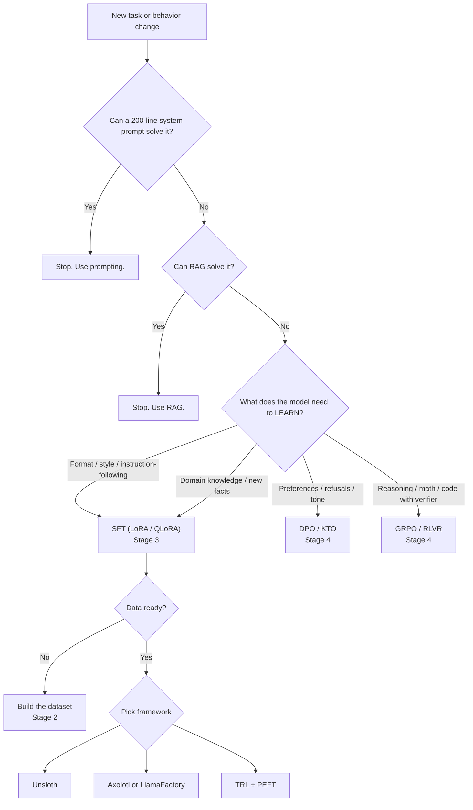

# **HuggingFace Learning Roadmap — End-to-End Master (November 2026)**

What this document is
One authoritative roadmap, merged from seven overlapping notes: two "core stack" references (a prose walkthrough and a topic checklist), and a five-file fine-tuning track (overview, methods, data, frameworks, capstones). Nothing has been dropped. Every checklist item, code block, lab, schedule line, and table from the sources appears below, corrected against library releases and official documentation as of **3 November 2026**.

The original documents were written against September 2026 pins. Roughly a dozen of their claims are now wrong in ways that produce silently broken code, so corrections are applied in place and every one is logged in the companion **Research and Version Audit (Nov 2026)** file.

The shape of the plan changed
The fine-tuning track originally ran Oct–Dec 2026 with "W5 = Capstone 1" landing on 3–9 Nov 2026. That week is now. The calendar below is re-anchored to the next 24 weeks (Nov 2026 → Apr 2027), the fine-tuning material is folded into a single 9-stage spine rather than a parallel side-quest, and data engineering moves *ahead* of training methods because the data rules were the strongest argument in the source notes and they are also what evals depend on.

The three practitioner rules that survive the merge
1. **Don't fine-tune first.** Prompting → RAG → fine-tuning, in that order.
2. **SFT first, RL later.** No RL algorithm works well without a seeded SFT base.
3. **Data beats algorithm, every time.** The dominant failure mode of a fine-tune is bad data, not a bad optimizer.

---

## **Source inventory and merge map**

The seven source documents, what each contributed, and where its content now lives.

| # | Source document | Size | Role in the merge | Landed in |
|---|---|---|---|---|
| S1 | `First.md` — core stack prose | 1,638 lines | Prose walkthrough, code, schedule, repo layout, "One Rule" | Stages 0–8, plus Schedule / Repo / Rule sections |
| S2 | `Second.md` — core stack checklist | 1,053 lines | Topic-by-topic checklist; ~40 items absent from S1 | Stage checklists (per-topic blocks) |
| S3 | `00 - Overview & Index.md` | 179 lines | Decision tree, 5-file structure, 2026 changes, 6-week plan | Stage spine, Method-selection gate, Schedule |
| S4 | `01 - Methods Deep Dive.md` | 361 lines | LoRA family, DPO family, RLVR, distillation | Stage 3 + Stage 4 |
| S5 | `02 - Data & Datasets.md` | 418 lines | Formats, dataset catalog, 5 data rules, labs | Stage 2 |
| S6 | `03 - Frameworks & Tools 2026.md` | 606 lines | Framework race, decision tables, serving bridge, 6 labs | Stage 5 + Stage 7 |
| S7 | `04 - Capstones & JD Alignment.md` | 399 lines | 4 capstones, JD mapping, interview bank, ship checklist | Stage 8 |

Every source file is represented. The per-item crosswalk that proves it is in the Research and Version Audit file, section "Source coverage matrix".

## **Stage spine and dependency map**

Nine stages. Each one is a precondition for the next; there is no branch back except for the optional Stage 6 specializations, which fork off Stage 1.

```
STAGE 0  Platform Foundation        huggingface_hub 2.4.0 · datasets 5.1.0
   |                                  auth, repos, data loading, formats
   v
STAGE 1  Core ML Stack              transformers 5.22.1 · tokenizers 0.23.3 · evaluate/lighteval/lm-eval
   |                                  pipelines, AutoModel, Trainer, generation, metrics
   v
STAGE 2  Data Engineering           formats · catalogs · 5 rules · decontamination · licensing
   |                                  the input contract for every later stage
   v
STAGE 3  Training Core              accelerate 1.15.0 · peft 0.21.2 · trl 1.17.1 SFT · safetensors 0.8.0
   |                                  LoRA/QLoRA, SFT, checkpoints, distributed basics
   v
STAGE 4  Alignment and Post-Training  DPO family · GRPO/RLVR · distillation
   |                                  preferences, verifiable rewards, compression
   v
STAGE 5  Frameworks at Scale        unsloth · axolotl 0.21.1 · LlamaFactory 0.9.5 · torchtitan 0.4.0
   |                                  verl 0.9.1 · OpenRLHF 0.11.2 · SkyRL 0.4.0 · Tinker 0.37.0
   |                                  the same job expressed as config vs code
   v
STAGE 6  Specialization / Low-Level  sentence-transformers 6.2.0 · diffusers 0.42.1 · timm 1.0.30
   |                                  bitsandbytes 0.50.2 · kernels 0.18.1 · Triton 3.9.0 · CUDA
   |                                  (optional fork: embeddings, vision, kernels)
   v
STAGE 7  Production Serving         vLLM 0.33.0 · SGLang 0.5.23 · GPTQModel 7.8.0 · llm-compressor 0.15.0
   |                                  GGUF/llama.cpp · MLX · multi-LoRA · compute options
   v
STAGE 8  Capstones, Portfolio, JD   4 public artifacts · JD mapping · interview bank
```

## **Method-selection gate**

The decision tree from the fine-tuning overview survives the merge intact, with one correction: SFT is now Stage 3 rather than a separate track, and the DPO/GRPO branches point at Stage 4.



## **Corrections applied to the sources**

These are the substantive edits. Each one is sourced in the audit file.

| # | Source claim | Corrected to (Nov 2026) |
|---|---|---|
| 1 | `huggingface_hub` 1.x; "Python 3.9 or newer" | `huggingface_hub` **2.4.0**; Python **≥3.10**, and **≥3.11** for `transformers`/`trl` [1][2][3] |
| 2 | `datasets` 4.x | `datasets` **5.1.0**; streaming shuffle defaults changed, agent-trace loading added [4][5] |
| 3 | TRL "v0.15.0 (Mar 2026)"; PPO in experimental tier | TRL **1.17.1**; PPO **removed** in 1.13.0; `trl.losses` removed in 1.14.0; KTO/Distillation are stable [6][7] |
| 4 | "Axolotl v0.29.0 (Feb 2026)" | Axolotl **0.21.1** (27 Oct 2026) — the 0.29.0 line does not exist [8] |
| 5 | Six-way framework race incl. TorchTune | **Five-way plus three RL stacks**: TorchTune is **unmaintained** (last release 0.6.1, Apr 2025); use TorchTitan, verl, OpenRLHF, SkyRL, Tinker [9][10][11][12] |
| 6 | `from awq import AutoAWQForCausalLM` for AWQ quantization | **AutoAWQ is deprecated and AutoGPTQ unmaintained** → use **GPTQModel 7.8.0** or **llm-compressor 0.15.0** [13][14] |
| 7 | LlamaFactory "GUI era / point and click" | LlamaFactory **0.9.5** carries **CVE-2026-58116** (CVSS 9.3 RCE via the WebUI model path, no patched release). Never expose the WebUI [15][16] |
| 8 | "DPO improves MT-Bench by ≥5%" as an acceptance criterion | MT-Bench is saturated/unmaintained → gate on **IFEval + Arena-Hard-Auto v2 + AlpacaEval 2.0 + a domain held-out set**; treat MT-Bench gaps <0.1–0.2 as noise |
| 9 | `from lm_eval.decontamination.decontaminate import decontaminate(...)` | That API does not exist. lm-eval detects contamination over **precomputed n-gram files** via `--decontamination_ngrams_path` and reports `*_decontaminate` metrics [17] |
| 10 | "EU AI Act now applies" | The Act applies **progressively**: 2 Aug 2026 (main rules + enforcement + Art. 50), **2 Dec 2026** (new prohibitions + Art. 50(2) transition), 2 Dec 2027 (Annex III), 2 Aug 2028 (Annex I), after the Digital Omnibus entered into force 27 Jul 2026 [18][19][20] |
| 11 | Capstone bases: Llama-3.2-3B/1B, Qwen2.5-1.5B | Current open bases: **Qwen3-4B-Instruct-2507** (text-only), **Qwen3.5-4B** and **Gemma 4 E4B** (multimodal) — pick by VRAM and modality, not by habit [21][64][65] |
| 12 | vLLM `--max-lora-rank` "choices 1–512" | Exact choices: **1, 8, 16, 32, 64, 128, 256, 320, 512**; default 16. `--max-loras` default **1** [22][23] |

---

## **Environment and version ledger**

Most tutorials online were written for older versions. The libraries below had major releases, and old code will fail or warn. This roadmap is written against the current lines. Always check your installed versions before debugging.

```bash
pip list | grep -i -E "transformers|datasets|huggingface|trl|peft|accelerate|sentence|evaluate|kernels"
```

| Library | Current line | What changed (the things that break old tutorials) |
|---|---|---|
| `transformers` | 5.22.1 | PyTorch only (TensorFlow and Flax removed). The summarization, translation, question-answering and text2text-generation pipelines were removed. `torch_dtype` became `dtype`. `Trainer(tokenizer=...)` became `processing_class=...`. `encode_plus()` removed — call the tokenizer directly. `TRANSFORMERS_CACHE` ignored, use `HF_HOME`. Requires `huggingface_hub` 1.31–2.x, Python ≥3.11 |
| `huggingface_hub` | 2.4.0 | `huggingface-cli` removed, use `hf`. HTTP backend moved from requests to httpx2. `hf_xet` is the default transfer backend, `hf_transfer` removed. `Repository` and `HfFolder` removed. CLI and Python renames (Stage 0 table). Python ≥3.10 |
| `datasets` | 5.1.0 | Loading scripts and `trust_remote_code` removed (data must be Parquet, CSV, JSON, and so on). `ds["col"]` returns a lazy `Column` object, not a list. `Sequence` replaced by `List`. Audio and video decoding uses torchcodec. Streaming shuffle defaults changed. Agent-trace loading added |
| `trl` | 1.17.1 | Stable trainers: SFT, DPO, KTO, Reward, RLOO, GRPO, Distillation. Most other methods (IPO, ORPO, CPO, GKD, and the removed PPO lineage) live under `trl.experimental` or are gone. `SFTConfig(max_seq_length=...)` became `max_length=...`. `DataCollatorForCompletionOnlyLM` replaced by `completion_only_loss` and `assistant_only_loss`. The fused Triton logprob+entropy kernel in `trl.kernels` is the default |
| `sentence-transformers` | 6.2.0 | Training uses `SentenceTransformerTrainer`. The old `model.fit()` path is deprecated. v5 adds `SparseEncoder`; v6 adds `MultiVectorEncoder` and `merge()` across all four encoder types. From v5.4 internal modules moved (for example `sentence_transformers.sentence_transformer.losses`), top-level imports are unchanged |
| `evaluate` | 0.4.6 | Still works for classic metrics. Hugging Face now recommends LightEval for LLM evaluation; use lm-evaluation-harness for standard benchmarks. No release since Sep 2025 |
| `kernels` | 0.18.1 | Fast moving. Kernel builds are tied to your torch and CUDA version, so check the kernel repo if loading fails |

Install the base environment once (Python 3.11 or newer for the full stack, because `transformers` 5.22.1 and `trl` 1.17.1 both require it):

```bash
pip install -U huggingface_hub datasets transformers accelerate evaluate
pip install -U peft trl safetensors tokenizers
```

Two install traps worth knowing before you start: `transformers` and `datasets` both cap `huggingface_hub` below 3.0, so a hub 3 prerelease will break the stack; and `trl` pulls `accelerate>=1.11` and `datasets>=4.7`, which is why the Stage 0 `datasets` line has to be 5.x.

---

# **Stage 0 — Platform Foundation**

**Outcome:** you can authenticate against the Hub, move models and datasets in both directions, and load, transform, and re-publish any dataset shape without a local copy. **Status carried from the source notes: DONE** (W1–W4 of the original schedule).

## **HuggingFace Hub and `huggingface_hub` 2.4.0**

The Hub is the GitHub of ML: models, datasets, Spaces, and Jobs. `huggingface_hub` is the Python and CLI client. Version 2 moved the HTTP stack to **httpx2/httpcore2**, requires **Python ≥3.10**, and renamed a batch of CLI subcommands and Python functions [3][24].

**Authentication**
- `login()`, `notebook_login()`, `interpreter_login()`
- Environment variable `HF_TOKEN`
- CLI: `hf auth login`, `hf auth whoami`
- Switching between multiple saved tokens
- `logout()` and `whoami()`
- Fine-grained tokens versus read and write tokens — give each project the least access it needs

**Downloading**
- `hf_hub_download()` for a single file
- `snapshot_download()` for an entire repo
- Specific revisions and branches
- `allow_patterns` and `ignore_patterns` filters
- Gated model access and `GatedRepoError` handling
- Offline mode with cached files (`HF_HUB_OFFLINE=1`)
- CLI: `hf download`
- Cache location controlled by `HF_HOME`
- Fast transfers use `hf_xet` automatically (the old `hf_transfer` is gone)

**Uploading**
- `upload_file()` for a single file
- `upload_folder()` for a directory
- `CommitOperationAdd` for atomic multi-file commits
- `create_commit()` for full commit control
- Ignoring files during upload
- CLI: `hf upload` — note the v2 rename from `hf upload-large-folder`

**Repository management**
- `create_repo()` for model, dataset, space
- `delete_repo()`
- `list_models()`, `list_datasets()`, `list_spaces()` → **renamed to `search_*` in hub v2**
- `model_info()`, `dataset_info()`
- `repo_exists()`

**Spaces management (API only)**
- `get_space_runtime()`
- `pause_space()`, `restart_space()`
- Space hardware management

**Error handling**
- Catch `HfHubHTTPError` and subclasses (`GatedRepoError`, `RepositoryNotFoundError`) — the library no longer uses `requests`, so `requests` exception handlers will never fire.

**v2 API rename table** [3][24]

| hub v1 | hub v2 | Note |
|---|---|---|
| `hf repo` | `hf repos` | pluralized |
| `hf repo-files delete` | `hf repos delete-files` | |
| `hf upload-large-folder` | `hf upload` | storage flag now `--volume` |
| `hf jobs ps` | `hf jobs --status` / `--label` | filters replace positional listing |
| `list_models()` | `search_models()` | |
| `upload_large_folder()` | `upload_folder()` | |
| `duplicate_space()` | `duplicate_repo()` | |
| `repo_type_and_id_from_hf_id()` | `parse_hf_uri()` | |
| `huggingface-cli` | `hf` | the old entry point is gone entirely |
| `from huggingface_hub.utils import httpx` | — | compatibility shim for the httpx2 move |

**Key install**
```bash
pip install -U huggingface_hub
```

**Key imports**
```python
from huggingface_hub import (
    login, logout, whoami,
    hf_hub_download, snapshot_download,
    upload_file, upload_folder,
    create_repo, delete_repo,
    HfApi, CommitOperationAdd
)
```

**CLI quick reference**
```bash
hf auth login
hf auth whoami
hf download Qwen/Qwen2.5-0.5B-Instruct --local-dir ./qwen
hf upload username/my-model ./my-model
```

**Agent Skills for the CLI.** The Hub now ships a set of Agent Skills that teach a coding agent the `hf` surface: `hf-cli` (generated from your locally installed CLI, so it tracks your version), `huggingface-datasets`, `huggingface-llm-trainer` (TRL SFT/DPO/GRPO on HF Jobs), `huggingface-community-evals`, `huggingface-vision-trainer`, `huggingface-trackio`, `gradio`, and `transformers-js`. They install with `hf skills add <name>` (add `--global` for all projects) and are refreshed with `hf skills update -g`; `hf update` refreshes the globally installed skill. They follow the Agent Skills spec and work with Claude Code, Codex, Gemini CLI, and Cursor, with `AGENTS.md` as the fallback for clients that do not support skills [25][26][27].

```bash
hf skills add hf-cli --global
hf skills list
hf skills update -g
```

## **Datasets 5.1.0**

The data layer. Built on Apache Arrow, so large datasets are memory-mapped from disk instead of loaded into RAM. Version 5 is the current line; loading scripts and `trust_remote_code` remain removed, `ds["col"]` still returns a lazy `Column`, `Sequence` remains replaced by `List`, and audio/video decoding goes through torchcodec [4][5].

**Loading — all sources**
```python
from datasets import load_dataset, Dataset, load_from_disk

load_dataset("stanfordnlp/imdb")                  # from Hub
load_dataset("stanfordnlp/imdb", split="train")   # a specific split
load_dataset("stanfordnlp/imdb", split="train[:10%]")  # split slice
load_dataset("csv", data_files="data.csv")        # local CSV
load_dataset("json", data_files="data.jsonl")     # local JSONL
load_dataset("parquet", data_files="data.parquet")  # local Parquet
load_dataset("text", data_files="notes.txt")      # plain text, one row per line
load_dataset("csv", data_files={"train": "tr.csv", "test": "te.csv"})  # files mapped to splits
Dataset.from_dict({...})                          # from Python dict
Dataset.from_pandas(df)                           # from Pandas
Dataset.from_list([...])                          # from list of dicts
Dataset.from_generator(gen_fn)                    # from a generator
load_from_disk("./saved")                         # from disk (save_to_disk output)
```

Loading with **configs and subsets** is the same call with a second argument. If you see "Dataset scripts are no longer supported", look for a Parquet version of the dataset on the Hub or convert it yourself — do not pass `trust_remote_code`.

**Inspecting**
```python
ds.features         # schema
ds.column_names
ds.shape, ds.num_rows, ds.num_columns
ds[0]               # first row as dict
ds[-1]              # last row
ds[:5]              # slice of rows (dict of lists)
ds["text"]          # lazy Column object, not a list
list(ds["text"])    # materialize the full column as a list
ds[0]["text"]       # one value
```

**Row operations**
```python
ds.sort("label")
ds.sort("label", reverse=True)
ds.shuffle(seed=42)
ds.select([0, 1, 2])
ds.filter(lambda x: x["label"] == 1)
ds.filter(lambda x, idx: idx % 2 == 0, with_indices=True)
ds.skip(1000).take(10)
ds.train_test_split(test_size=0.2, seed=42)
ds.train_test_split(test_size=0.2, stratify_by_column="label")
ds.shard(num_shards=4, index=0)
```

**Column operations**
```python
from datasets import Value, ClassLabel, List

ds.rename_column("text", "review")
ds.rename_columns({"text": "review", "label": "target"})
ds.remove_columns(["label"])
ds.add_column("length", values)
ds.cast_column("label", Value("float32"))
ds.flatten()
ds.select_columns(["text", "label"])
ds.align_labels_with_mapping(label2id, "label")
```

Schema types to know: `Value`, `ClassLabel`, `List` (replaces the old `Sequence`), `Image`, `Audio`.

**Transformation**
```python
ds.map(fn)                                  # row by row
ds.map(fn, batched=True)                    # batch processing (much faster)
ds.map(fn, batched=True, batch_size=1000)
ds.map(fn, num_proc=4)                      # multiprocessing
ds.map(fn, remove_columns=["text"])         # map and drop columns
ds.map(fn, with_indices=True)
ds.with_transform(fn)                       # on-the-fly, applied when rows are accessed
ds.with_format("torch")                     # non-destructive format change
```

A batched `map` can return more rows than it received (generate several rows from one), as long as every column grows consistently.

**Combining**
```python
from datasets import concatenate_datasets, interleave_datasets

concatenate_datasets([ds1, ds2])
interleave_datasets([ds1, ds2], probabilities=[0.7, 0.3], seed=42)
```

**Export and format**
```python
ds.to_pandas()
ds.to_dict()
ds.to_list()
ds.to_csv("out.csv")
ds.to_json("out.jsonl")
ds.to_parquet("out.parquet")
ds.to_polars()          # Arrow -> Polars without a pandas round-trip
ds.to_iterable_dataset()  # material dataset -> stream
ds.data                 # the underlying Arrow table
ds.set_format("torch", columns=["input_ids", "label"])
ds.set_format("numpy")
ds.set_format("pandas")
ds.reset_format()
```

**Save and push**
```python
ds.save_to_disk("./my_dataset")
load_from_disk("./my_dataset")
ds.push_to_hub("username/my-dataset")
ds.push_to_hub("username/my-dataset", private=True)
ds.push_to_hub("username/my-dataset", num_proc=8)   # faster upload
dataset_dict.push_to_hub("username/my-dataset")     # DatasetDict: all splits at once
```

Also learn: dataset cards and README metadata for your pushed datasets, pushing a specific split, and private versus public datasets.

**Streaming (large datasets)**
```python
ds = load_dataset("allenai/c4", "en", split="train", streaming=True)
for example in ds:
    print(example["text"])
list(ds.take(10))
ds.skip(1000).take(10)
ds.map(fn)            # lazy, runs as you iterate
ds.filter(fn)
ds.shuffle(seed=42, buffer_size=10_000)
```

Streaming returns an `IterableDataset` supporting `map`, `filter`, `shuffle`, `take`, `skip`, and `interleave_datasets`. To keep a subset, build a regular `Dataset` from it with `Dataset.from_generator`.

datasets 5.x shuffle default changed
Streaming `shuffle()` now defaults to `buffer_size=1000` and `max_buffer_input_shards=10`. A training run that "shuffles differently" after the upgrade is usually this, not a seeding bug. Pass explicit `buffer_size` if reproducibility matters.

**Agent traces.** datasets 5.x adds first-class loading of agent traces (tool-call conversations harvested from coding agents) into a normalized `messages` schema, built on the `teich` package pinned at 0.1.5 in the 5.1.0 metadata. This is the data substrate for agent-behavior SFT and is the natural bridge between Stage 2 and Stage 4 [5].

**Python dict deep dive**
```python
from collections import Counter

ds[0]                   # first row as dict
ds[:5]                  # dict of lists
ds.features.keys()      # column names
ds.features.items()     # name + type pairs
ds.to_dict()            # full dict
ds.to_list()            # list of row dicts
"text" in ds.features   # check column exists
Counter(ds["label"])    # count values
[row for row in ds if row["label"] == 1]   # comprehension
```

**Key install**
```bash
pip install -U datasets
```

---

# **Stage 1 — Core ML Stack**

**Outcome:** you can take any model on the Hub, run it, fine-tune it with the built-in `Trainer`, and measure it with a metric that matches the task. This is the stage the source notes marked **NEXT**.

## **Transformers 5.22.1**

The most important library in the ecosystem: 1M+ pretrained models for text, vision, audio, and multimodal tasks. Version 5 is PyTorch-only and requires **Python ≥3.11** and `huggingface_hub` in the 1.31–2.x range [1][2].

**Step A — Pipeline API**
```python
from transformers import pipeline

# **text**
classifier = pipeline("text-classification")
generator  = pipeline("text-generation", model="Qwen/Qwen2.5-0.5B-Instruct")
ner        = pipeline("token-classification", aggregation_strategy="simple")
fill       = pipeline("fill-mask", model="bert-base-uncased")
zero_shot  = pipeline("zero-shot-classification")
embedder   = pipeline("feature-extraction")

# **vision**
img_class  = pipeline("image-classification")
obj_detect = pipeline("object-detection")

# **audio**
asr = pipeline("automatic-speech-recognition", model="openai/whisper-large-v3")

# **run**
result = classifier("HuggingFace is amazing!")
```

**Pipeline task inventory (verify with `get_supported_tasks()`)**

```python
import transformers
from transformers.pipelines import get_supported_tasks

print(transformers.__version__)
print(get_supported_tasks())
```

Text
- text-classification — sentiment, topic, intent (`sentiment-analysis` alias)
- token-classification — NER, POS tagging (`ner` alias)
- question-answering — extractive QA
- table-question-answering
- text-generation — open-ended generation and chat
- fill-mask — masked language modeling
- zero-shot-classification — no training needed
- feature-extraction — embeddings from any model

Vision
- image-classification
- object-detection
- image-segmentation
- mask-generation
- zero-shot-image-classification
- zero-shot-object-detection
- depth-estimation
- image-to-image
- image-feature-extraction
- keypoint-matching
- video-classification

Audio
- automatic-speech-recognition — Whisper and others
- audio-classification
- zero-shot-audio-classification
- text-to-audio
- text-to-speech

Multimodal
- image-text-to-text — vision-language chat, captioning
- visual-question-answering
- document-question-answering
- any-to-any

**Pipelines removed in Transformers 5** — `summarization`, `translation`, `text2text-generation`, `image-to-text` (replaced by `image-text-to-text`), and `conversational` (removed earlier). Two replacements:

```python
# **Option 1: a modern chat model through the text-generation pipeline**
chat = pipeline("text-generation", model="Qwen/Qwen2.5-0.5B-Instruct")
messages = [{"role": "user", "content": "Summarize in one sentence: " + text}]
out = chat(messages, max_new_tokens=100)
print(out[0]["generated_text"][-1]["content"])

# **Option 2: a seq2seq model called directly with generate()**
from transformers import AutoTokenizer, AutoModelForSeq2SeqLM

tok   = AutoTokenizer.from_pretrained("google/flan-t5-base")
model = AutoModelForSeq2SeqLM.from_pretrained("google/flan-t5-base")
inputs = tok("summarize: " + text, return_tensors="pt", truncation=True)
ids = model.generate(**inputs, max_new_tokens=80)
print(tok.decode(ids[0], skip_special_tokens=True))
```

If you must follow an old tutorial that uses the removed pipelines, install the older line in a separate environment: `pip install -U "transformers<5"`.

**Step B — AutoTokenizer + AutoModel**
```python
import torch
from transformers import AutoTokenizer, AutoModelForSequenceClassification

tokenizer = AutoTokenizer.from_pretrained("bert-base-uncased")
model     = AutoModelForSequenceClassification.from_pretrained("bert-base-uncased", num_labels=2)

inputs = tokenizer("Hello world", return_tensors="pt")
with torch.no_grad():
    outputs = model(**inputs)
probs = outputs.logits.softmax(-1)
```

**Step C — Task-specific model classes**

Natural language understanding
```python
AutoModelForSequenceClassification   # text classification, sentiment
AutoModelForTokenClassification      # NER, POS tagging
AutoModelForQuestionAnswering        # extractive span QA
AutoModelForMultipleChoice           # multiple choice
```

Natural language generation
```python
AutoModelForCausalLM                 # GPT-style decoder models
AutoModelForMaskedLM                 # BERT-style fill-mask
AutoModelForSeq2SeqLM                # encoder-decoder: T5, BART
AutoModelForSpeechSeq2Seq            # Whisper-style ASR
```

Vision
```python
AutoModelForImageClassification
AutoModelForObjectDetection
AutoModelForSemanticSegmentation
AutoModelForInstanceSegmentation
AutoModelForDepthEstimation
AutoModelForImageToImage
```

Vision plus language (multimodal)
```python
AutoModelForImageTextToText          # LLaVA, Qwen-VL, PaliGemma, SmolVLM style models
AutoModelForVisualQuestionAnswering
AutoModelForDocumentQuestionAnswering
```

Audio
```python
AutoModelForAudioClassification
AutoModelForCTC                      # Wav2Vec2-style ASR
```

Base and preprocessing
```python
AutoModel                # raw hidden states, embeddings
AutoConfig               # architecture config
AutoImageProcessor       # image preprocessing
AutoFeatureExtractor     # audio preprocessing
AutoProcessor            # tokenizer + image/audio processor for multimodal models
```

**Step D — Trainer**
```python
import numpy as np
import evaluate
from datasets import load_dataset
from transformers import (
    AutoTokenizer, AutoModelForSequenceClassification,
    DataCollatorWithPadding, Trainer, TrainingArguments,
)

ds    = load_dataset("stanfordnlp/imdb")
tok   = AutoTokenizer.from_pretrained("distilbert-base-uncased")
model = AutoModelForSequenceClassification.from_pretrained(
    "distilbert-base-uncased", num_labels=2
)

def tokenize(batch):
    return tok(batch["text"], truncation=True, max_length=256)

tokenized = ds.map(tokenize, batched=True)
accuracy  = evaluate.load("accuracy")

def compute_metrics(eval_pred):
    logits, labels = eval_pred
    preds = np.argmax(logits, axis=-1)
    return accuracy.compute(predictions=preds, references=labels)

training_args = TrainingArguments(
    output_dir="./results",
    num_train_epochs=3,
    per_device_train_batch_size=16,
    per_device_eval_batch_size=64,
    warmup_steps=500,
    weight_decay=0.01,
    eval_strategy="epoch",
    save_strategy="epoch",
    load_best_model_at_end=True,
    bf16=True,                    # mixed precision on Ampere or newer GPUs, use fp16=True on older GPUs
)

trainer = Trainer(
    model=model,
    args=training_args,
    train_dataset=tokenized["train"],
    eval_dataset=tokenized["test"],
    processing_class=tok,         # replaces the old tokenizer= argument
    data_collator=DataCollatorWithPadding(tok),
    compute_metrics=compute_metrics,
)

trainer.train()
trainer.save_model("./my-model")
trainer.push_to_hub("username/my-model")
```

**Trainer topic checklist**
- `TrainingArguments` — all training hyperparameters
- `Trainer` — standard supervised training loop
- `Seq2SeqTrainer` and `Seq2SeqTrainingArguments` — for seq2seq models that use `generate()`
- `TrainerCallback` and `EarlyStoppingCallback`
- `compute_metrics` — custom evaluation function
- Mixed precision: `bf16=True` on newer GPUs, `fp16=True` on older GPUs
- Data collators:
  - `DataCollatorWithPadding` — classification
  - `DataCollatorForSeq2Seq` — summarization, translation
  - `DataCollatorForLanguageModeling` — causal and masked LM
  - `DataCollatorForTokenClassification` — NER

**Model loading and saving**
```python
model = AutoModelForCausalLM.from_pretrained(
    "Qwen/Qwen2.5-0.5B",
    dtype="auto",          # load in the saved precision (v5 name, was torch_dtype)
    device_map="auto",     # place layers across available GPUs and CPU
)
model.save_pretrained("./model")
tokenizer.save_pretrained("./model")
model.push_to_hub("username/my-model")
tokenizer.push_to_hub("username/my-model")
```
Also write a model card (README.md) for every model you push, and load community kernels through `attn_implementation` (for example `attn_implementation="kernels-community/flash-attn2"`).

**Generation**
```python
from transformers import GenerationConfig, TextStreamer, TextIteratorStreamer

inputs = tokenizer("Once upon a time", return_tensors="pt").to(model.device)

out = model.generate(
    **inputs,
    max_new_tokens=100,       # prefer this over max_length
    do_sample=True,
    temperature=0.7,
    top_k=50,
    top_p=0.9,
    repetition_penalty=1.1,
)
print(tokenizer.decode(out[0], skip_special_tokens=True))

gen_cfg = GenerationConfig(max_new_tokens=100, do_sample=True, temperature=0.7)
model.generate(**inputs, generation_config=gen_cfg)

model.generate(**inputs, max_new_tokens=100, streamer=TextStreamer(tokenizer))
```

Decoding strategies: greedy, beam search (`num_beams`), sampling (`do_sample=True`), temperature, top-k, top-p (nucleus), repetition penalty, length penalty, constrained generation, and token-by-token streaming with `TextStreamer` / `TextIteratorStreamer`.

Chat models: format conversations with `tokenizer.apply_chat_template(messages, add_generation_prompt=True, return_tensors="pt")`.

**Architectures to know**

Encoder-only (understanding): BERT, RoBERTa, DistilBERT, ALBERT, DeBERTa, XLM-RoBERTa.

Decoder-only (generation): GPT-2, Llama 3/4 family, Mistral, Qwen family (Qwen2.5, Qwen3, Qwen3.5, Qwen3.8), Gemma family, Phi family, Falcon (TII).

Encoder-decoder (seq2seq): T5 and Flan-T5, BART, Pegasus, mT5, MarianMT, NLLB.

Vision: ViT, DeiT, Swin Transformer, DINOv2, CLIP and SigLIP.

Multimodal: LLaVA, Idefics, PaliGemma, Qwen-VL, SmolVLM.

Audio: Whisper, Wav2Vec 2.0, HuBERT.

**What to practice**
- Sentiment analysis on IMDB with BERT or DistilBERT
- Text generation with GPT-2 and a small chat model
- Named entity recognition
- Question answering with `AutoModelForQuestionAnswering`
- Summarization with T5 using `generate()`
- Speech recognition with Whisper
- Image classification with ViT

**Key install**
```bash
pip install -U transformers torch
pip install -U "transformers[torch]"   # all torch deps
```

## **Tokenizers 0.23.3**

The fast tokenization library (written in Rust) that powers all `AutoTokenizer` classes. It is how models actually read text [28].

```python
from transformers import AutoTokenizer

tokenizer = AutoTokenizer.from_pretrained("bert-base-uncased")

enc = tokenizer(
    "Hello world how are you?",
    truncation=True,
    padding="max_length",
    max_length=128,
    return_tensors="pt",
)

print(enc.input_ids)         # token IDs
print(enc.attention_mask)    # 1 for real tokens, 0 for padding
print(enc.token_type_ids)    # segment IDs for sentence pairs

tokenizer("question text", "context text", truncation="only_second")
tokenizer.decode(enc.input_ids[0], skip_special_tokens=True)

tokenizer.cls_token     # [CLS]
tokenizer.sep_token     # [SEP]
tokenizer.pad_token     # [PAD]
tokenizer.unk_token     # [UNK]
tokenizer.mask_token    # [MASK]

tokenizer(["sentence one", "sentence two"], padding=True, truncation=True)

enc = tokenizer("Hello world", return_offsets_mapping=True)
print(enc["offset_mapping"])   # character spans per token
print(enc.word_ids())          # token to word index

tokenizer(long_text, truncation=True, max_length=512,
          stride=128, return_overflowing_tokens=True)

tokenizer.add_tokens(["new_token"])
tokenizer.add_special_tokens({"additional_special_tokens": ["tool_token"]})
# **model.resize_token_embeddings(len(tokenizer))**
```

In v5, call the tokenizer directly — `encode_plus()` and `batch_encode_plus()` are removed.

**Train your own tokenizer from scratch**
```python
from tokenizers import Tokenizer
from tokenizers.models import BPE
from tokenizers.trainers import BpeTrainer
from tokenizers.pre_tokenizers import Whitespace
from transformers import PreTrainedTokenizerFast

tok = Tokenizer(BPE(unk_token="[UNK]"))
tok.pre_tokenizer = Whitespace()

trainer = BpeTrainer(
    vocab_size=30000,
    special_tokens=["[UNK]", "[CLS]", "[SEP]", "[PAD]", "[MASK]"],
)
tok.train(files=["corpus.txt"], trainer=trainer)
tok.save("tokenizer.json")

fast = PreTrainedTokenizerFast(tokenizer_object=tok, unk_token="[UNK]", pad_token="[PAD]")
fast.save_pretrained("./my-tokenizer")
```

**Key concepts**
- BPE (Byte-Pair Encoding) — GPT-style models
- Byte-level BPE — GPT-2, RoBERTa
- WordPiece — BERT
- SentencePiece and Unigram — T5, LLaMA, many multilingual models
- Character-level tokenization
- Vocabulary and `vocab_size`
- Subword tokenization — why words get split
- Why padding and truncation exist
- What `attention_mask` does and why it matters
- `token_type_ids` for sentence pairs
- `offset_mapping` and `word_ids()` for alignment (essential for NER labels)
- Padding strategies: `longest`, `max_length`, `do_not_pad`
- Truncation strategies: `longest_first`, `only_first`, `only_second`
- Overflow tokens and stride for long documents
- Chat templates for instruction-tuned models
- Fast (Rust) versus slow (Python) tokenizers — unified around the fast implementation in v5, with parallel tokenization

**Key install**
```bash
pip install -U tokenizers
```

## **Evaluation stack**

Three libraries with three different jobs. The source notes blurred them into "evaluate, and LightEval for LLMs". The accurate split matters because each one answers a different question [50][51][52].

| Library | Version | Job | Reach |
|---|---|---|---|
| `evaluate` | 0.4.6 (Sep 2025) | Classic metric implementations: accuracy, F1, ROUGE, BLEU | Stable but no longer the recommended path for LLM benchmarks |
| `lighteval` | 0.13.0 (Nov 2025) | HF task frameworks with inspect-ai / accelerate / nanotron / vLLM entry points, 1000+ tasks | No release since Nov 2025 — treat as stable-but-static |
| `lm-evaluation-harness` | 0.4.13 (Aug 2026) | Standard benchmark harness: MMLU, GSM8K, HellaSwag, IFEval… | The one to reach for when a JD names a benchmark |

**`evaluate` usage**
```python
import evaluate

accuracy  = evaluate.load("accuracy")
f1        = evaluate.load("f1")
rouge     = evaluate.load("rouge")
bleu      = evaluate.load("bleu")
bertscore = evaluate.load("bertscore")

result = accuracy.compute(predictions=[0, 1, 1, 0], references=[0, 1, 0, 1])
print(result)  # {"accuracy": 0.5}

for preds, refs in batches:
    accuracy.add_batch(predictions=preds, references=refs)
accuracy.compute()

clf_metrics = evaluate.combine(["accuracy", "f1", "precision", "recall"])
clf_metrics.compute(predictions=[0, 1, 1, 0], references=[0, 1, 0, 1])

evaluate.list_evaluation_modules()
```

**Metric guide**

Classification: `accuracy`, `precision`, `recall`, `f1` (binary / macro / micro / weighted), `matthews_correlation` (MCC).

Question answering: `exact_match`, `squad` (exact match plus F1).

Generation and translation: `bleu` and `sacrebleu`, `rouge` (rouge1, rouge2, rougeL), `meteor`, `ter`.

Semantic: `bertscore`, `bleurt`.

Code: `code_eval` — executes generated code; sandbox only.

Also learn: creating custom metrics and sharing them on the Hub. The full surface is `evaluate.load()`, `evaluate.combine()`, `metric.compute()`, and `metric.add_batch()` for streaming evaluation.

**lm-eval command line**
```bash
lm-eval run --model hf --model_args pretrained=Qwen/Qwen2.5-0.5B,dtype=bfloat16 --tasks hellaswag
lm-eval run --model vllm --model_args pretrained=./my-model --tasks ifeval
lm-eval ls tasks
```
Backend extras: `pip install "lm_eval[hf]"`, `"lm_eval[vllm]"`, `"lm_eval[api]"`.

**Decontamination — the real API.** The harness does not expose a `decontaminate(train_dataset=..., eval_datasets=[...], ngram_size=8)` function, and there is no `--decontamination_ngram_size=8` flag; both snippets in the source notes describe an API that does not exist. Contamination detection is implemented in `lm_eval/decontaminate.py` over **precomputed n-gram files**: you generate n-gram files plus `info.json` for your training set, pass the directory with `--decontamination_ngrams_path`, and the evaluator excludes contaminated documents and reports a second metric with a `decontaminate` suffix. It is **disabled by default for new tasks** unless the task overrides `should_decontaminate` and `doc_to_decontamination_query`. The harness uses 13-grams as its default basis [53][54].

**Key install**
```bash
pip install -U evaluate
pip install -U lighteval
pip install "lm_eval[hf]"
pip install scikit-learn rouge_score sacrebleu
```

---

# **Stage 2 — Data Engineering**

**Why this stage exists at all:** the sources' own verdict was "a bad dataset will defeat a perfect training loop every time" and "data > algorithm, every time". Every later stage (training, alignment, evaluation, compliance) consumes this stage's output, so it sits before training rather than beside it.

## **Data shapes**

Match the data shape to the method before you choose a method.

| Data shape | Used for | Format | Example datasets |
|---|---|---|---|
| Instruction-completion pairs | SFT | Alpaca, ShareGPT, ChatML | Alpaca, Dolly, OpenHermes, Tulu |
| Multi-turn chat | SFT (chat) | ShareGPT, ChatML | ShareGPT, UltraChat |
| Tool-use / function-calling | SFT (agents) | OpenAI tools format | ToolBench, Glaive, xLAM |
| Preference pairs (chosen, rejected) | DPO, IPO, SimPO | `{prompt, chosen, rejected}` | UltraFeedback, HH-RLHF, Argilla DPO mix |
| Binary good/bad | KTO | `{prompt, completion, label: bool}` | Real user feedback |
| Verifiable-reward tasks | GRPO, RLVR | `{prompt, verifiable_check_fn}` | MATH, GSM8K, HumanEval, MBPP |
| Distillation | Teacher → student | Same as SFT, plus teacher logits | Teacher model outputs |

## **Format specifications**

The shape determines the columns, and the columns determine which trainer can consume your data without conversion.

**Alpaca (instruction-completion)**
```json
{
  "instruction": "Explain speculative decoding in 2 sentences.",
  "input": "",
  "output": "Speculative decoding uses a small draft model to propose several tokens..."
}
```

**ShareGPT (multi-turn chat)**
```json
{
  "conversations": [
    {"from": "human", "value": "What's the weather in Paris?"},
    {"from": "gpt", "value": "I don't have real-time data, but..."},
    {"from": "human", "value": "OK then what's the capital of France?"},
    {"from": "gpt", "value": "Paris."}
  ]
}
```
Each model's chat template maps `from` to role tokens. Make sure your template matches the target model's (for example Llama-3 uses `<|begin_of_text|><|start_header_id|>user<|end_header_id|>...`).

**OpenAI ChatML (the de facto standard)**
```json
{
  "messages": [
    {"role": "system", "content": "You are a helpful assistant."},
    {"role": "user", "content": "What's the capital of France?"},
    {"role": "assistant", "content": "Paris."}
  ]
}
```
Used by OpenAI, Mistral, Qwen, Yi, and most 2024–2026 models. The safest default for new projects; most frameworks auto-convert.

**OpenAI tool-calling**
```json
{
  "messages": [
    {"role": "user", "content": "What's the weather in Paris?"},
    {"role": "assistant", "content": null, "tool_calls": [
      {"id": "call_1", "type": "function", "function": {"name": "get_weather", "arguments": "{\"city\": \"Paris\"}"}}
    ]},
    {"role": "tool", "tool_call_id": "call_1", "content": "{\"temp\": 18, \"condition\": \"cloudy\"}"},
    {"role": "assistant", "content": "It's 18°C and cloudy in Paris."}
  ],
  "tools": [
    {"type": "function", "function": {"name": "get_weather", "description": "...", "parameters": {}}}
  ]
}
```
The standard for agent / function-calling fine-tunes. The model learns to call tools, receive results, and continue.

**DPO preference format**
```json
{
  "prompt": "Explain speculative decoding.",
  "chosen": [
    {"role": "user", "content": "Explain speculative decoding."},
    {"role": "assistant", "content": "Speculative decoding uses a small draft model..."}
  ],
  "rejected": [
    {"role": "user", "content": "Explain speculative decoding."},
    {"role": "assistant", "content": "Speculative decoding is a technique where you guess..."}
  ]
}
```

The hard-negative rule
The most useful preference pairs are where chosen and rejected are almost equally good. If chosen is obviously better, the model learns nothing. If they are close, the model has to learn the preference.

**GRPO / RLVR format**
```json
{
  "prompt": "What is 47 * 83?",
  "verifier": "lambda completion: int(eval(completion.strip())) == 47 * 83",
  "reward": 1.0
}
```

## **Public dataset catalog**

SFT
| Dataset | Size | Domain | Notes |
|---|---|---|---|
| Alpaca | 52K | General instruction | The original. Self-instruct from GPT-3.5. |
| Dolly | 15K | Human-written | High quality but small. |
| OpenHermes-2.5 | 1M | Mixed | The 2024 workhorse. From GPT-4 outputs. |
| Tulu-3-SFT-mixture | 940K | Mixed (code, math, safety) | Allen AI's curated mix. 2025–2026 standard. |
| UltraChat | 1.5M | Multi-turn | Multi-turn, broad coverage. |
| SmolLM-Corpus | 2T tokens | Web | Pretraining data, not SFT. |

DPO / Preference
| Dataset | Size | Notes |
|---|---|---|
| UltraFeedback | 64K | The DPO workhorse. GPT-4 ranked responses. |
| HH-RLHF | 170K | Anthropic's helpful + harmless. |
| Argilla DPO mix | ~50K | Curated mix from Argilla. |
| Tulu-3-Preference-mixture | ~300K | Allen AI's preference mix. Strong 2026 default. |

Tool use / function calling
| Dataset | Notes |
|---|---|
| ToolBench | Multi-step tool use. |
| Glaive-function-calling-v2 | 113K samples. Single + multi-turn. |
| xLAM-function-calling-60k | Salesforce. 2025–2026 standard for function-calling SFT. |
| ToolACE | Multi-turn, complex tool use. |

Reasoning / RLVR
| Dataset | Domain | Verifier |
|---|---|---|
| MATH | Math olympiad | `\boxed{...}` parsing |
| GSM8K | Grade school math | Numeric answer |
| AIME 1983–2024 | Competition math | Integer answer |
| HumanEval / MBPP | Code | `exec` test cases |
| LiveCodeBench | Code (contamination-free) | `exec` test cases |
| MMLU-Pro | Multi-domain QA | Multiple choice |
| ARC-AGI | Abstract reasoning | Grid match |

Multimodal
| Dataset | Notes |
|---|---|
| LLaVA-Instruct | 150K. The 2024 visual instruction workhorse. |
| ShareGPT4V | 1.2M. Higher quality captions. |
| ALLaVA-4V | 1.4M. 2025. |
| Cambrian-10M | 10M. The 2025 state-of-the-art visual instruction mix. |

## **The five rules**

1. **Diversity over volume.** 5K diverse beats 50K near-duplicates.
2. **Hard negatives.** Preference pairs where chosen and rejected are almost equally good teach more than obvious wins.
3. **Decontamination.** Strip eval-set leakage from training data. Always.
4. **Format consistency.** Tokenize early to catch chat-template mismatches before you waste ten GPU-hours.
5. **PII and licensing.** Document provenance. The EU AI Act applies.

## **Quality assessment**

- Read 100 random examples. If the quality is bad in 100, it is bad in 1M.
- Check the token-length distribution. Long-tail tokens indicate bloat; trim or filter.
- Check the source distribution. If 80% of your data comes from one source, you have single-source bias.
- Check for near-duplicates with MinHash or sentence embeddings.
- Check for eval contamination (n-gram overlap with MMLU, HumanEval, and so on).

```python
# **pip install datasketch**
from datasketch import MinHash, MinHashLSH

def minhash_dedup(texts, threshold=0.8):
    """Remove near-duplicates using MinHash LSH."""
    lsh = MinHashLSH(threshold=threshold, num_perm=128)
    keep = []
    for i, text in enumerate(texts):
        m = MinHash(num_perm=128)
        for word in text.split():
            m.update(word.encode())
        if i == 0:
            lsh.insert(i, m)
            keep.append(i)
        else:
            if not lsh.query(m):
                lsh.insert(i, m)
                keep.append(i)
    return keep
```

For benchmark contamination specifically, use the harness's own n-gram machinery (`--decontamination_ngrams_path`) rather than a hand-rolled overlap check, so the measurement matches how the evaluation will be scored [53].

## **Format consistency check**

```python
from transformers import AutoTokenizer

tokenizer = AutoTokenizer.from_pretrained("meta-llama/Llama-3-8B-Instruct")

sample = {
    "messages": [
        {"role": "user", "content": "Hello"},
        {"role": "assistant", "content": "Hi there!"}
    ]
}

formatted = tokenizer.apply_chat_template(sample["messages"], tokenize=False)
print(formatted)
# **<|begin_of_text|><|start_header_id|>user<|end_header_id|>**
#
# **Hello<|eot_id|><|start_header_id|>assistant<|end_header_id|>**
#
# **Hi there!<|eot_id|>**

tokens = tokenizer(formatted, return_tensors="pt")
print(f"Token count: {tokens.input_ids.shape[1]}")
```

## **Synthetic data**

**When to use:** you do not have enough real data; you need a rare edge case; you need preference pairs at scale (generate candidates with a strong model, rank with a stronger one).

**The standard pattern**
1. Generate candidates with a strong model.
2. Filter by quality (length, format, required concepts, basic checks).
3. Rank for preference data with an LLM judge and an explicit rubric.
4. Decontaminate against your eval set.
5. Train on the result.

**Tools:** Distilabel (Argilla) for generation + filtering + ranking — note the PyPI release is 1.5.3 from Jan 2025, so pin it and read the source before relying on new features [29]; LangSmith (LangChain's tracing and eval framework) for tracing and eval; PromptTools for prompt A/B testing; HuggingFace auto-DPO data generation.

**Gotchas**
- Model collapse: training on synthetic data from the same model degrades over generations. Always mix in real data.
- Style homogenization: synthetic data carries a detectable generator voice. Mix sources.
- Hallucinations: synthetic data inherits the generator's errors. Manually verify a sample.
- Licensing: outputs from a closed model have murky terms. Open-weight generators are safer.

## **Licensing and the EU AI Act**

The Act applies progressively, and the fine-tuning-relevant dates are now concrete [18][19][20]:

| Date | What applies |
|---|---|
| 2 Feb 2025 | Prohibitions, definitions, AI-literacy obligations |
| 2 Aug 2025 | Governance and general-purpose AI model obligations |
| **2 Aug 2026** | Main rules: Article 50 transparency, innovation measures, **enforcement begins** for prohibitions, GPAI, transparency, AI literacy |
| **2 Dec 2026** | New prohibitions (non-consensual sexual deepfakes, CSAM) + Article 50(2) transition deadline for systems already on the market |
| 2 Dec 2027 | High-risk obligations for Annex III use cases (education, employment, law enforcement, migration…) |
| 2 Aug 2028 | High-risk obligations for AI embedded in regulated products (Annex I) |

The Digital Omnibus on AI entered into force 27 July 2026 and is what moved the high-risk dates. Systems placed on the market before 2 Aug 2026 come into scope if they are **significantly modified** — which a fine-tune of your own model can be. Document that assessment rather than assuming you are out of scope.

**Fine-tuning obligations in practice**
- Document training data provenance: where it came from, under what license, whether consent was obtained.
- Model card: intended use, limitations, training data summary.
- Risk assessment if the use case touches Annex III.
- Logging of significant model updates and eval results.
- The GPAI downstream-modifier threshold (a model whose training compute is more than one third of the original provider's, roughly 3·10²¹ FLOP, or 3·10²⁴ for systemic risk) is far above a 7B LoRA, but documenting the computation is cheap and becomes relevant if you scale.

**License landscape**

| Source | License | Commercial fine-tune OK? |
|---|---|---|
| Alpaca | CC BY-NC 4.0 | No (NC = non-commercial) |
| Dolly | CC BY-SA 3.0 | Yes (with share-alike) |
| OpenHermes-2.5 | Apache 2.0 (mostly) | Yes (check per-source) |
| Tulu-3 | ODC-BY under the AI2 license, **but the SFT mixture embeds NC subsets** (No Robots, NuminaMath-TIR cc-by-nc-4.0) | Not cleanly — audit the mixture, or use Tulu-3 subsets you have cleared |
| UltraFeedback | MIT | Yes |
| HH-RLHF | MIT | Yes |
| xLAM | CC BY-NC 4.0 | No (NC) |
| HumanEval | MIT | Yes, for evaluation only — never train on it |
| Wikipedia | CC BY-SA | Yes (with share-alike) |
| Common Crawl | Varies | Filtering required |
| The Stack / CodeParrot | Various permissive | Yes (check per-file) |

**PII and consent**
- Strip PII before training. Use Presidio, PII-Codes, or scrub with a strong LLM.
- For user-generated data, GDPR consent is required. Document the consent flow.
- For synthetic data there is less PII risk, but verify the generator did not memorize PII from its training data.

## **Domain dataset construction**

**Step 1 — Define the task.** "Customer support chatbot" is too vague. "SaaS billing questions, structured JSON output, with citations" is actionable.

**Step 2 — Source candidates.** Real data (past conversations, support tickets, internal docs with consent and PII scrubbing), synthetic data (generate with a strong LLM using a detailed rubric), public data (relevant Hub datasets with a license check).

**Step 3 — Filter and clean.** Deduplicate with MinHash, filter by quality, decontaminate against eval sets.

**Step 4 — Format.** Convert to the target format, apply the chat template, verify tokenization.

**Step 5 — Split.** Train 80–90%, validation 5–10% for early stopping and hyperparameter selection, test 5–10% held out and never touched during training.

**Step 6 — Version and document.** Tag it (`billing-support-v1.0`), document source, license, size, date, and quality checks performed, and store it in a versioned location (Hub dataset, S3).

## **Data labs**

**Lab 1 — Inspect a public dataset.** Take `OpenHermes-2.5` or `Tulu-3-SFT-mixture`; read 100 random examples; compute the length distribution; check for duplicates with MinHash; check for MMLU contamination.

**Lab 2 — Build a small domain dataset.** Pick a domain (for example "explain ML papers"); generate 1K synthetic samples with a strong model; filter by quality; format as ChatML; verify chat-template tokenization; push to the Hub with a data card.

**Lab 3 — Build a DPO dataset.** Reuse Lab 2's SFT data; generate 2–3 candidate completions per prompt; rank with an LLM judge and a rubric; format as `{prompt, chosen, rejected}`; verify the hard-negative distribution is not all obvious wins.

**Lab 4 — Decontamination pipeline.** Take a known-contaminated dataset; run the harness decontamination flow against MMLU, HumanEval, and GSM8K using the n-gram file path; measure how much was stripped; document the result.

**Lab 5 — Format consistency check.** Convert an Alpaca-format dataset to ShareGPT, ChatML, and the Llama-3 chat template; compare token counts; verify the model's chat template handles each format correctly.

## **Data pre-flight checklist**

- [ ] Name the three standard SFT formats and when to use each.
- [ ] What is the DPO preference format? What is the hard-negative rule?
- [ ] What is decontamination and why is it non-negotiable?
- [ ] State the five rules that actually move fine-tuning metrics.
- [ ] What license is Alpaca under? Can you fine-tune commercially on it?
- [ ] What is the EU AI Act's main impact on fine-tuning practice, and which dates apply this quarter?
- [ ] For a domain dataset, what is the right train/val/test split?
- [ ] What is MinHash used for in the data prep pipeline?
- [ ] What is model collapse? How do you prevent it with synthetic data?
- [ ] How do you assess data quality before training?

---

# **Stage 3 — Training Core**

**Outcome:** you can fine-tune a base model on your own data with LoRA/QLoRA on one GPU, resume a run, and save a checkpoint that another tool can load. This is where the SFT pipeline from the fine-tuning track lives.

## **Accelerate 1.15.0**

Runs the same PyTorch training code on a single GPU, multi-GPU, TPU, or CPU with minimal changes. It powers the `Trainer` inside Transformers [30].

```python
from accelerate import Accelerator

accelerator = Accelerator(
    mixed_precision="bf16",         # or "fp16" for older GPUs
    gradient_accumulation_steps=4,
)

model, optimizer, train_dataloader = accelerator.prepare(
    model, optimizer, train_dataloader
)

for batch in train_dataloader:
    with accelerator.accumulate(model):
        outputs = model(**batch)
        loss = outputs.loss
        accelerator.backward(loss)          # replaces loss.backward()
        accelerator.clip_grad_norm_(model.parameters(), 1.0)
        optimizer.step()
        optimizer.zero_grad()

accelerator.save_state("./checkpoint")
accelerator.load_state("./checkpoint")
```

**Core concepts**
- `Accelerator` object — central controller
- `accelerator.prepare()` — wraps model, optimizer, dataloader
- `accelerator.backward()`
- Mixed precision (fp16, bf16)
- Gradient accumulation and gradient clipping

**Training setups**
- Single GPU, multi-GPU (DDP), multi-node
- TPU and CPU-only
- DeepSpeed integration (ZeRO stages 1, 2, 3)
- FSDP (Fully Sharded Data Parallel)

**State management**
- `accelerator.save_state()` and `accelerator.load_state()`
- `accelerator.wait_for_everyone()` — sync across processes
- `accelerator.gather()` — collect tensors from all GPUs
- `accelerator.is_main_process` — run code only on rank 0

**Utilities**
- `find_executable_batch_size` — automatic batch size search on OOM
- `notebook_launcher` — run distributed training from a notebook
- `PartialState` — lightweight distributed state

**CLI**
```bash
accelerate config
accelerate test
accelerate launch train.py
accelerate launch --num_processes=4 --mixed_precision=bf16 train.py
```

**Key install**
```bash
pip install -U accelerate
```

## **PEFT 0.21.2 — parameter-efficient fine-tuning**

Fine-tune massive models (7B, 13B, 70B) on limited GPUs by training a tiny fraction of the weights. LoRA is the dominant technique [9].

**LoRA — the core idea.** Freeze `W ∈ R^(d×k)` and learn a low-rank update `ΔW = B @ A`, with `A ∈ R^(r×k)`, `B ∈ R^(d×r)`, and `r << min(d, k)`. Only A and B receive gradients.

```python
class LoRALinear(nn.Module):
    def __init__(self, base_linear, r=16, alpha=32, dropout=0.05):
        super().__init__()
        self.base = base_linear  # frozen
        for p in self.base.parameters():
            p.requires_grad = False
        in_dim = base_linear.in_features
        out_dim = base_linear.out_features
        self.A = nn.Parameter(torch.randn(r, in_dim) * 0.01)  # Gaussian init
        self.B = nn.Parameter(torch.zeros(out_dim, r))         # zero init
        self.scaling = alpha / r
        self.dropout = nn.Dropout(dropout)

    def forward(self, x):
        base_out = self.base(x)  # no grad
        lora_out = self.dropout(x) @ self.A.T @ self.B.T * self.scaling
        return base_out + lora_out
```

**The default LoRA configuration**

| Hyperparameter | Default | When to change |
|---|---|---|
| rank (`r`) | 16 | r=8 if memory-bound, r=64 if quality-bound |
| `lora_alpha` | 32 | Keep α = 2×r; α/r is the scaling factor |
| `target_modules` | all-linear (q, k, v, o, gate, up, down) | The original paper used only q, v; all-linear is the 2026 default |
| `lora_dropout` | 0.05–0.1 | Raise if overfitting |
| learning rate | 1e-4 to 5e-4 | 10–100× larger than full FT |
| optimizer | AdamW (PagedAdamW8bit for QLoRA) | — |
| epochs | 2–3 | Stop when eval loss plateaus |

**Memory savings.** A 7B full fine-tune in fp16 needs roughly 84 GB (14 GB weights + 14 GB gradients + 56 GB Adam state) plus activations; LoRA r=16 needs about 16 GB — a ~5× reduction. For 70B the same ratio holds: ~600 GB full FT versus ~120 GB LoRA.

```python
from transformers import AutoModelForCausalLM
from peft import LoraConfig, get_peft_model, TaskType

model = AutoModelForCausalLM.from_pretrained("Qwen/Qwen2.5-0.5B", dtype="auto")

config = LoraConfig(
    task_type=TaskType.CAUSAL_LM,
    r=16,
    lora_alpha=32,
    lora_dropout=0.05,
    target_modules=["q_proj", "v_proj"],   # or "all-linear"
)

model = get_peft_model(model, config)
model.print_trainable_parameters()
# **trainable params: ... || all params: ... || trainable%: ...**
```

Target module names differ per architecture. Print the model and read the layer names, or use `target_modules="all-linear"`.

**QLoRA — a 4-bit base with BF16 adapters**

```python
import torch
from transformers import AutoModelForCausalLM, BitsAndBytesConfig
from peft import LoraConfig, get_peft_model, prepare_model_for_kbit_training

bnb_config = BitsAndBytesConfig(
    load_in_4bit=True,
    bnb_4bit_quant_type="nf4",
    bnb_4bit_compute_dtype=torch.bfloat16,
    bnb_4bit_use_double_quant=True,
)

model = AutoModelForCausalLM.from_pretrained(
    "Qwen/Qwen2.5-7B",
    quantization_config=bnb_config,
    device_map="auto",
)

lora_config = LoraConfig(
    task_type="CAUSAL_LM", r=16, lora_alpha=32,
    lora_dropout=0.05, target_modules="all-linear",
)

model = prepare_model_for_kbit_training(model)
model = get_peft_model(model, lora_config)
```

The 4-bit quantization applies only to the frozen base; adapters train in BF16, which is why QLoRA matches fp16 LoRA closely (Dettmers et al., 2023). Reference timings from the source notes: Llama-3 8B QLoRA r=16 on an RTX 4090 takes ~4 hours versus 8–10 hours with vanilla TRL; Llama-3 70B QLoRA r=16 on a single 80GB H100 takes ~24 hours; Qwen3-30B-A3B QLoRA on H100 runs up to 1.77× faster with Unsloth than vanilla.

**Save, load, and merge adapters**
```python
model.save_pretrained("./lora-adapter")        # saves only the small adapter
model.push_to_hub("username/my-lora-adapter")

from peft import PeftModel
base  = AutoModelForCausalLM.from_pretrained("Qwen/Qwen2.5-0.5B", dtype="auto")
model = PeftModel.from_pretrained(base, "username/my-lora-adapter")

merged = model.merge_and_unload()   # bake the adapter into the base weights
merged.save_pretrained("./merged-model")
```
To merge a QLoRA adapter, reload the base in **16-bit** (not 4-bit), attach the adapter, then merge.

**LoRA family — know the alternatives, switch only on measurement**

| Variant | Mechanism | When it wins |
|---|---|---|
| DoRA | Decomposes `W = m * V / ||V||` where `m` is magnitude and `V/||V||` is unit direction, then trains `m` and `V` separately with LoRA on the direction | Measured LoRA underperformance at the same rank; ~1–3% on reasoning benchmarks in some studies |
| GaLore | Projects gradients into a low-rank subspace before the optimizer step | Full-rank updates needed but full-FT memory is unaffordable |
| rsLoRA | Scales by `1/sqrt(r)` instead of `α/r` | Higher ranks (r ≥ 64) |
| OLoRA | Orthogonal init for `A` | Faster convergence in some cases |
| LoHa | Low-rank + Hadamard product | More expressive at the same rank |
| LoKr | Low-rank + Kronecker product | More expressive at the same rank |
| OFT | Orthogonal update matrices | Better preservation of base behavior |
| VeRA | Shared frozen random matrices; train only scaling vectors | Smallest memory of the family |
| X-LoRA | Mixture of LoRA experts | Multi-task fine-tuning |
| AdaLoRA | Adaptive per-layer rank allocation | Unknown right rank per layer |
| IA3 | Learned activation rescaling | Few-shot adaptation, smaller than LoRA |
| LoftQ | Quantization-aware LoRA init | QLoRA from a quantized starting point |

The honest verdict from the source material, unchanged by any version drift: start with vanilla LoRA r=16, all-linear, α=32, and switch only when you have measured a problem. Most "X-LoRA beats LoRA" claims do not replicate at scale.

**Other PEFT methods** — Prefix Tuning, Prompt Tuning, P-Tuning, IA3, AdaLoRA, LoftQ.

**Task types** — `TaskType.SEQ_CLS`, `TaskType.TOKEN_CLS`, `TaskType.CAUSAL_LM`, `TaskType.SEQ_2_SEQ_LM`, `TaskType.QUESTION_ANS`.

**Multi-adapter usage** — load several adapters, switch between them, and combine them (`add`, `cat`, `svd`, `linear`).

**Key install**
```bash
pip install -U peft
```

## **TRL 1.17.1 — supervised fine-tuning**

TRL is the post-training primitive layer: SFT, preference optimization, and RL [6][7].

The tier model changed under you
TRL v1.x splits trainers into stable (semver-guaranteed) and `trl.experimental` (APIs can change in any minor release). **PPO was removed from TRL entirely in 1.13.0** (`PPOTrainer`, `PPOConfig`, `modeling_value_head.py`), and `trl.losses` was removed in 1.14.0. The current stable set is SFT, DPO, KTO (stable since 1.8), Reward, RLOO, GRPO, and Distillation (stable since 1.10). Experimental trainers have been deleted in minor releases before — v1.14 removed six of them and v1.17 removed TPO — so pin `trl` and check release notes before upgrading.

```python
from datasets import load_dataset
from peft import LoraConfig
from trl import SFTConfig, SFTTrainer

dataset = load_dataset("trl-lib/Capybara", split="train")   # conversational "messages" format

trainer = SFTTrainer(
    model="Qwen/Qwen2.5-0.5B",                 # a model id string is enough
    train_dataset=dataset,
    args=SFTConfig(
        output_dir="./sft-model",
        num_train_epochs=1,
        per_device_train_batch_size=4,
        gradient_accumulation_steps=4,
        learning_rate=2e-4,                    # typical for LoRA
        bf16=True,
        max_length=1024,                       # was max_seq_length in old versions
        packing=True,                          # combine short examples for efficiency
    ),
    peft_config=LoraConfig(
        r=16, lora_alpha=32, target_modules="all-linear", task_type="CAUSAL_LM"
    ),
)

trainer.train()
trainer.save_model("./my-sft-model")
```

**SFT checklist**
- `SFTTrainer`, `SFTConfig`, `formatting_func`
- Dataset formats: plain text (`dataset_text_field`), prompt/completion `(prompt, completion)` pairs, conversational `messages`
- Chat templates and `apply_chat_template()`
- `packing` — combine short examples for efficiency; `max_length` control (was `max_seq_length`)
- `completion_only_loss` — train only on the completion (replaces `DataCollatorForCompletionOnlyLM`)
- `assistant_only_loss` — train only on assistant turns; needs a chat template with generation markers
- Integration with PEFT and LoRA
- Memory options: `gradient_checkpointing`, `activation_offloading`, chunked loss options
- `use_liger_kernel` is **deprecated** in trainers and scheduled for removal in TRL 2.0.0

The kernel that matters
TRL now defaults to a **fused Triton logprob + entropy kernel** in `trl.kernels`. It is not a micro-optimization: with it, DPO's maximum sequence length rises from 10,240 to 59,392 tokens on a 79 GiB GPU. Long-context preference tuning is newly practical.

**Package extras that decide your install:** `trl[peft]` pulls PEFT ≥0.17; `trl[kernels]` pulls `transformers[kernels]`; `trl[harbor]` pulls Harbor ≥0.13 on Python ≥3.12; `trl[vlm]` pulls torchvision. Base requirements are transformers ≥4.56.2, datasets ≥4.7.0, accelerate ≥1.11.0, torch ≥2.6.0, numpy ≥1.26.0, Python ≥3.11.

**Utilities**
- `trl vllm-serve` — fast generation during online RL
- Frozen reference model for KL divergence
- Training logs and warnings for collapsed reward signals

**Key install**
```bash
pip install -U trl
pip install -U "trl[peft,kernels]"
```

## **Safetensors 0.8.0**

The standard format for storing neural network weights: safe, fast, and with no arbitrary code execution risk, unlike pickle-based `.bin` and `.pt` files. All modern models on the Hub use it [31].

```python
import torch
from safetensors.torch import save_file, load_file

tensors = {"weight": torch.zeros(2, 2), "bias": torch.zeros(2)}
save_file(tensors, "model.safetensors", metadata={"format": "pt"})

tensors = load_file("model.safetensors")

model.save_pretrained("./model")                 # writes model.safetensors
model = AutoModel.from_pretrained("./model")     # loads it automatically

from safetensors import safe_open
with safe_open("model.safetensors", framework="pt") as f:
    print(f.keys())                     # all tensor names
    print(f.metadata())                 # file metadata
    weight = f.get_tensor("weight")     # load one tensor only
```

**Checklist**
- Why it exists: no code execution, unlike pickle
- Format: a JSON header followed by raw tensor bytes
- Zero-copy, memory-mapped loading
- Framework support: PyTorch, NumPy, JAX
- Sharded checkpoints (`model.safetensors.index.json`)
- `save_pretrained()` uses safetensors by default; `from_pretrained()` prefers it
- Converting an old `.bin` checkpoint: load it once, then `save_pretrained()` again
- Listing tensor names without loading the weights

**Key install**
```bash
pip install -U safetensors
```

---

# **Stage 4 — Alignment and Post-Training**

**Outcome:** you can take an SFT checkpoint and either align it to preferences (DPO family) or train it against a verifiable reward (GRPO/RLVR), and you can compress a teacher model into a student.

## **Preference optimization**

**What SFT teaches, and what it does not.** SFT teaches **format** (chat template, tool use, JSON output), **style** (voice, tone, length, structure), and **behavior** (instruction-following, a domain task). It does not teach **preferences** — that is DPO. It does not teach **reasoning** — that is GRPO.

**Why preference optimization.** SFT teaches what good output looks like. Preference optimization teaches the *ordering* between good and bad outputs. The RLHF objective (reward model + PPO) can be re-derived as a supervised binary classification loss over preference pairs: the Bradley-Terry model says `P(y_w ≻ y_l | x) = σ(r(x, y_w) - r(x, y_l))`, the optimal reward is `r*(x, y) = β log(π(y|x) / π_ref(y|x)) + β log Z(x)`, and substituting back cancels `Z(x)`. That cancellation is the entire DPO paper — no reward model, no RL loop, no critic [32].

```python
def dpo_loss(policy_chosen_logp, policy_rejected_logp,
             ref_chosen_logp, ref_rejected_logp, beta=0.1):
    """policy = the model being trained, ref = frozen reference (initial model)."""
    chosen_logratio = policy_chosen_logp - ref_chosen_logp
    rejected_logratio = policy_rejected_logp - ref_rejected_logp
    loss = -F.logsigmoid(beta * (chosen_logratio - rejected_logratio)).mean()
    return loss
```

```python
from datasets import load_dataset
from trl import DPOConfig, DPOTrainer

dataset = load_dataset("trl-lib/ultrafeedback_binarized", split="train")

trainer = DPOTrainer(
    model="Qwen/Qwen2.5-0.5B-Instruct",
    args=DPOConfig(output_dir="./dpo-model", beta=0.1),
    train_dataset=dataset,
)
trainer.train()
```

The reference model is created for you, or derived from the adapter when using PEFT. Truncation is controlled by `max_length` only — `max_prompt_length` and `max_completion_length` were removed, so filter overlong examples beforehand.

**The DPO family, selected by data shape**

| Variant | Mechanism | Data shape it needs | When it wins |
|---|---|---|---|
| **DPO** | Direct preference loss against a reference model | `(prompt, chosen, rejected)` | Clean pairs — the default |
| **IPO** | Replaces the sigmoid with MSE, bounding the margin | Noisy pairs where DPO overfits | Noisy preference data |
| **KTO** | Kahneman-Tversky; no pairs required | `(prompt, completion, desirable: bool)` | Real-world thumbs-up logs without A/B pairs |
| **SimPO** | Removes the reference model; length-normalized log-prob with a margin | Pairs, but memory-bound | Half the memory (no reference model) |
| **ORPO** | SFT and preference losses combined in one stage | Pairs | A single-stage pipeline |
| **Iterative DPO** | Generate fresh pairs with the current policy, label, repeat | A reward model to label with | Static data has saturated |

`KTO` and `Distillation` are stable trainers in TRL 1.17.1; `IPO`, `ORPO`, `CPO`, `GKD` remain in the experimental tier and can disappear in a minor release — pin and verify before a long run. The stable class names are `SFTTrainer`, `DPOTrainer`, `KTOTrainer`, `RewardTrainer`, `RLOOTrainer`, `GRPOTrainer`, and the Distillation trainer; the experimental ones are imported from their module, for example `from trl.experimental.orpo import ORPOTrainer`.

**Reward modeling** (`RewardTrainer` / `RewardConfig`) takes the same `chosen`/`rejected` format and produces a reward model for RL or for labeling iterative pairs.

## **RL fine-tuning: PPO, GRPO, RLVR**

**The case for RL.** Reasoning models (o1, o3, DeepSeek R1 and R1-Zero) are produced by RL fine-tuning on tasks with verifiable rewards — math answers, passing code tests, format checks. DPO cannot do this: it learns from static preference data, not from the model's own attempts.

**PPO** (Schulman et al., 2017) [34] — policy + reference + reward + **critic**, four models in memory (about 28 GB minimum for a 7B), a clipped surrogate objective, and a tuning surface of KL coefficient, clipping range, and value-loss coefficient. In 2026 it is rarely the right starting point for a new project. Note that TRL removed `PPOTrainer` in 1.13.0, so a PPO run today means a separate library (verl, OpenRLHF) or your own loop [6].

**GRPO** (Shao et al., 2024, DeepSeekMath) [33] — policy + reference + reward, **no critic**. For each prompt, sample G rollouts; the group mean is the baseline and advantages are normalized within the group. About 30% less memory than PPO and less hyperparameter-sensitive.

```python
def grpo_loss(policy_logps, ref_logps, rewards, group_size, beta=0.04, clip_range=0.2):
    """
    policy_logps: (B*G,) log probs of chosen tokens under policy
    ref_logps:    (B*G,) log probs of chosen tokens under ref
    rewards:      (B*G,) scalar reward per rollout
    """
    kl = policy_logps - ref_logps
    rewards_grouped = rewards.view(-1, group_size)
    advantages = (rewards_grouped - rewards_grouped.mean(-1, keepdim=True)) / (
        rewards_grouped.std(-1, keepdim=True) + 1e-8
    )
    advantages = advantages.view(-1)
    ratio = torch.exp(policy_logps - policy_logps.detach())
    surr1 = ratio * advantages
    surr2 = torch.clamp(ratio, 1 - clip_range, 1 + clip_range) * advantages
    loss = -torch.min(surr1, surr2).mean() + beta * kl.mean()
    return loss
```

```python
from trl import GRPOConfig, GRPOTrainer

def math_reward(completions, answer, **kwargs):
    """Reward: 1.0 if completion contains the correct answer, 0.0 otherwise."""
    rewards = []
    for completion, correct_answer in zip(completions, answer):
        match = re.search(r"\\boxed\{([^}]+)\}", completion)
        if match:
            try:
                rewards.append(1.0 if abs(float(match.group(1)) - float(correct_answer)) < 1e-3 else 0.0)
            except ValueError:
                rewards.append(0.0)
        else:
            rewards.append(0.0)
    return rewards

trainer = GRPOTrainer(
    model="Qwen/Qwen2.5-0.5B-Instruct",
    reward_funcs=math_reward,
    args=GRPOConfig(output_dir="./grpo-model", num_generations=8, max_new_tokens=512, beta=0.04),
    train_dataset=dataset,
)
trainer.train()
```

**RLVR (RL from verifiable rewards).** When the reward is programmatically checkable, skip the learned reward model entirely. R1-Zero used rule-based accuracy rewards for math and code. The 2025–2026 refinements in the source material: **DAPO** (open RL system with rule-based outcome rewards, 50% AIME 2024 accuracy with Qwen2.5-32B in half the baseline steps), **Dr.GRPO** (response-length bias in reward normalization), **CISPO** (MiniMax-M1 Team, 2025) (clipping replacement for training stability), **GFPO** (group-filtered preference optimization, addresses length inflation), **VIGOR** (variance-guided online rollout allocation, 2.3× fewer rollouts on math).

**RL algorithm selection**

| Task | Algorithm |
|---|---|
| Reasoning with verifiable reward (math, code) | GRPO (or DAPO / Dr.GRPO refinements) |
| General chat alignment with preference data | DPO (or KTO / SimPO if the data shape differs) |
| Output quality from human feedback (legacy) | PPO — still works, but GRPO usually wins |
| Long CoT reasoning on an SFT-seeded model | GRPO with iterative SFT merges |
| Reward hacking (the model gaming the reward) | Switch to rule-based RLVR, or add a KL drift constraint |

**The consensus pipeline**
1. SFT (QLoRA or LoRA) on 10K–100K high-quality instructions.
2. GRPO (or DPO/KTO depending on data) on top of the SFT checkpoint.
3. Optional iterative DPO to refine preferences.
4. Merge LoRA → quantize → serve.

## **Distillation**

Train a small model to mimic a large one — teacher → student — usually with a KL term between token distributions: `L = α·KL(p_student ‖ p_teacher) + (1-α)·CE(y, p_student)`.

Use it when you need a smaller, faster, cheaper model of similar quality, or when you cannot serve the teacher (cost, latency, licensing). Two caveats from the source material that remain true: distilled models are typically **less calibrated** and have **different optimal quantization thresholds**, and supervising on the teacher's outputs alone (SFT) discards information the logit distribution carries. Always re-evaluate the distilled model on your actual workload.

**Tools:** `transformers` + a custom training loop, `accelerate` for multi-GPU, TextBrewer for task-specific distillation, `distilwhisper`-style recipes for ASR, and the DeepSeek-R1-Distill family as the 2025–2026 standard for "reasoning model at small size".

## **Alignment mental model**

1. PEFT (the LoRA family) is the default for SFT. Vanilla LoRA r=16, all-linear, α=32, lr 1e-4 to 5e-4. Switch variants only when measured.
2. QLoRA is the de facto standard for single-GPU: NF4 + double quantization + LoRA in BF16.
3. DPO is the default for preferences. Siblings exist for different data shapes.
4. GRPO has replaced PPO for reasoning-model alignment. RLVR with rule-based rewards is the frontier.
5. The standard pipeline is SFT → DPO/GRPO. No RL works without a seeded SFT base.
6. Distillation is for compression, not new behavior.

## **Alignment pre-flight checklist**

- [ ] State the LoRA forward pass in one equation.
- [ ] What is the default LoRA config (r, α, target_modules, lr)?
- [ ] How much memory does QLoRA save versus full FT on a 70B model?
- [ ] What does DPO optimize? Why is it "direct"?
- [ ] Compare DPO, IPO, KTO, SimPO, ORPO. When does each win?
- [ ] What is GRPO? Why does it beat PPO for reasoning?
- [ ] What is RLVR? Name two examples of verifiable rewards.
- [ ] State the consensus pipeline.
- [ ] When do you use full fine-tuning instead of LoRA?
- [ ] What is DoRA? When does it beat LoRA?
- [ ] Which TRL trainers are stable in 1.17.1, and which were removed?

---

# **Stage 5 — Frameworks at Scale**

**Outcome:** you can express the same training job as configuration (Axolotl, LlamaFactory) or as code (TRL + PEFT), and you know which RL stack to reach for at each scale.

The "six-way race" is now five plus three
The source notes listed Axolotl, Unsloth, LlamaFactory, TRL, PEFT, and TorchTune. **TorchTune's last release was 0.6.1 in April 2025** and the project is unmaintained [10]. The meta-framework slot is now **TorchTitan 0.4.0** (with the TitanRL line) [11], and the RL-engine slot is split across **verl 0.9.1** [12], **OpenRLHF 0.11.2** [13], **SkyRL 0.4.0** [35], and the hosted **Tinker API 0.37.0** [36]. Building new work on TorchTune in November 2026 is a dead end.

## **Framework decision table**

Pick by hardware and scale first, then by method.

| Situation | Framework | Why |
|---|---|---|
| Single consumer GPU (RTX 4090, 3090) | Unsloth | 2–5× faster, lowest memory, longest context |
| Multi-GPU, complex parallelism | Axolotl | FSDP2, DeepSpeed, TP, CP, EP composable |
| GUI / no-code / broad model coverage | LlamaFactory | LlamaBoard web UI, 100+ models — **local only, see the CVE** |
| RLHF / GRPO / DPO research | TRL | Reference implementation, the primitive layer |
| Production, config-driven, multi-tenant | Axolotl | YAML config, deep parallelism matrix |
| Large-scale pretraining / post-training research | TorchTitan | Meta's maintained PyTorch-native path, TitanRL |
| Distributed RL at scale | verl / OpenRLHF / SkyRL / Tinker | Trainer-agnostic RL engines, hosted or self-hosted |
| Custom research, full control | TRL + PEFT | Maximum flexibility, lowest abstractions |

**The layer cake:** PEFT (adapters) at the bottom. TRL (trainers) on top. Axolotl and LlamaFactory wrap both. Unsloth replaces some kernels. TorchTitan, verl, and friends use native PyTorch instead. Most projects end up using two or three of these layers.

**Version ledger for the stack** — release dates are from each project's own release page [8][9][10][11][12][13][35][36][37][59]

| Framework | Current release | Date | Notes |
|---|---|---|---|
| Unsloth | v0.1.913-beta (PyPI `2026.10.11`) | 30 Oct 2026 | Single-GPU speed leader |
| Axolotl | v0.21.1 | 27 Oct 2026 | The source note's "v0.29.0" does not exist |
| LlamaFactory | v0.9.5 | 30 May 2026 | Carries an unpatched critical CVE |
| TRL | v1.17.1 | 30 Oct 2026 | PPO removed in 1.13 |
| PEFT | v0.21.2 | 1 Oct 2026 | |
| TorchTitan | v0.4.0 | 28 Oct 2026 | Replaces TorchTune |
| TorchTune | v0.6.1 | 7 Apr 2025 | **Unmaintained** |
| verl | v0.9.1 | 20 Sep 2026 | |
| OpenRLHF | v0.11.2 | 14 Sep 2026 | |
| SkyRL | v0.4.0 | 1 Oct 2026 | |
| Tinker | 0.37.0 | 2 Nov 2026 | Hosted LoRA/fine-tuning API |
| AgentLightning | 1.0.2 | 29 Sep 2026 | Agent RL orchestration [37] |

## **Unsloth — single-GPU training**

Hand-written Triton kernels for LoRA/QLoRA training, a drop-in replacement for the HF stack on supported models [59].

**Why it wins**
- ~2× speedup on supported models versus vanilla Transformers.
- 30–50% memory reduction.
- Automatic 4-bit quantization (NF4 + double quant).
- Longer context: up to 8× vanilla on the same GPU.
- 7.3× speedup on MoE (gpt-oss-20b on B200 at 8K context: 712 ms versus 5,227 ms per step).

**Reference numbers from the source material**

| Setup | Time | versus baseline |
|---|---|---|
| Llama 3.1 8B QLoRA r=32 on RTX 4090 (Alpaca) | ~2× faster | TRL + FA2 |
| Llama 3.2 8B QLoRA r=16 on RTX 4090 | ~4 hours | vs 8–10 hours vanilla |
| Qwen3-30B-A3B QLoRA on H100 | 1.77× faster | vs vanilla |
| gpt-oss-20b BF16 on B200 at 8K context | 712 ms/step | 7.3× vs Transformers v5 |

```python
from unsloth import FastLanguageModel
from trl import SFTTrainer
from transformers import TrainingArguments

model, tokenizer = FastLanguageModel.from_pretrained(
    model_name="unsloth/Llama-3.2-8B-Instruct-bnb-4bit",
    max_seq_length=2048,
    load_in_4bit=True,
)

model = FastLanguageModel.get_peft_model(
    model,
    r=16, lora_alpha=32,
    target_modules="all-linear",
    lora_dropout=0.05, bias="none",
    use_gradient_checkpointing="unsloth",
)

trainer = SFTTrainer(
    model=model, tokenizer=tokenizer,
    train_dataset=my_dataset,
    args=TrainingArguments(per_device_train_batch_size=2, gradient_accumulation_steps=4, ...),
)
trainer.train()
```

**Use it for:** single GPU, especially consumer; Llama, Qwen, Mistral, Phi, Gemma, gpt-oss; long context (8K–128K) where memory matters; quick iteration.

**Avoid it for:** multi-GPU (its documented weak point); models outside the supported list; TRL/PEFT features that Unsloth has not caught up with.

## **Axolotl — multi-GPU configuration layer**

YAML-driven wrapper over Transformers, PEFT, TRL, Accelerate, DeepSpeed. The most feature-complete framework [8].

**Why it wins**
- Deepest parallelism matrix: FSDP2, DeepSpeed ZeRO-2/3, TP, CP, EP composable via DeviceMesh.
- YAML config for every hyperparameter.
- Broadest model support of the wrapper frameworks.
- Most training methods (SFT, DPO, IPO, KTO, ORPO, GRPO, SimPO, reward modeling).

```yaml
# **axolotl_config.yml**
base_model: meta-llama/Llama-3.1-8B
model_type: LlamaForCausalLM
tokenizer_type: AutoTokenizer

datasets:
  - path: tatsu-lab/alpaca
    type: alpaca
  - path: argilla/distilabel-intel-orca-dpo-pairs
    type: chatml.argilla

# **adapter: lora   # LoRA / QLoRA**
# **full_finetuning: true  # Full SFT**

lora_r: 16
lora_alpha: 32
lora_dropout: 0.05
lora_target_modules: all-linear

load_in_4bit: true
bnb_4bit_quant_type: nf4
bnb_4bit_compute_dtype: bfloat16

num_epochs: 3
micro_batch_size: 2
gradient_accumulation_steps: 4
learning_rate: 2e-4
optimizer: adamw_bnb_8bit
lr_scheduler_type: cosine

fsdp: full_shard auto_wrap  # FSDP2
fsdp_config:
  fsdp_activation_checkpointing: true
# **deepspeed: deepspeed_configs/zero3_bf16.json**

sequence_packing: true

rl: dpo
dpo_beta: 0.1

output_dir: ./outputs/llama3-alpaca-lora
```

```bash
accelerate launch -m axolotl.cli.train axolotl_config.yml
```

**Use it for:** multi-GPU / multi-node; production training pipelines; composed parallelism (FSDP2 + TP + CP + EP); one config file for the whole run.

**Avoid it for:** a single consumer GPU (Unsloth is faster); custom code (the wrapper is thick); GUI workflows.

## **LlamaFactory — web UI and security constraints**

ACL 2024 system demo paper turned production framework [17]. 100+ model architectures (LLMs and VLMs), a LlamaBoard web UI, multiple backends (Transformers, Liger Kernel, Unsloth, Megatron-LM, KTransformers), and OFT support.

```bash
pip install llamafactory
llamafactory-cli webui  # Open browser, point and click
llamafactory-cli train \
  --model_name_or_path meta-llama/Llama-3.1-8B \
  --template llama3 \
  --dataset alpaca_gpt4_en \
  --output_dir ./llama3_lora \
  --finetuning_type lora \
  --lora_rank 16 \
  --quantization_bit 4 \
  --per_device_train_batch_size 2 \
  --gradient_accumulation_steps 4 \
  --num_train_epochs 3.0 \
  --learning_rate 5e-5
```

CVE-2026-58116 — do not expose the WebUI
LLaMA-Factory through 0.9.5 contains a **remote code execution** vulnerability (CVSS-B 9.3, Critical): the WebUI passes a user-supplied model path unvalidated into `AutoTokenizer.from_pretrained()` / `AutoModel.from_pretrained()` with a hardcoded `trust_remote_code=True`, so a malicious model repo executes arbitrary code with the server process's privileges. NVD lists **no patched version** for 0.9.5 [15][16]. An earlier RCE through the `vhead_file` checkpoint path was fixed in 0.9.4 by loading with `weights_only=True` [38]. The vendor's advisory list also carries an SSRF guard-bypass issue (CVE-2026-85673) [38].

Operational rule: use LlamaFactory **CLI-only, on localhost, with no inbound exposure**, or do not use it at all until a patched release lands. `llamafactory-cli webui` binds a server that must never face a network.

## **TRL — trainer primitives**

HuggingFace's RL and preference-optimization library, and the canonical reference implementation [6][7]. Other frameworks call into it.

```python
from trl import SFTTrainer, SFTConfig
from transformers import AutoModelForCausalLM, AutoTokenizer
from datasets import load_dataset

model = AutoModelForCausalLM.from_pretrained("meta-llama/Llama-3.1-8B")
tokenizer = AutoTokenizer.from_pretrained("meta-llama/Llama-3.1-8B")
dataset = load_dataset("tatsu-lab/alpaca", split="train")

trainer = SFTTrainer(
    model=model, tokenizer=tokenizer, train_dataset=dataset,
    args=SFTConfig(
        output_dir="./llama3-sft",
        per_device_train_batch_size=2, gradient_accumulation_steps=4,
        num_train_epochs=3, learning_rate=2e-4,
        # **assistant_only_loss=True,**
        # **packing=True,**
    ),
)
trainer.train()
```

```python
from trl import DPOTrainer, DPOConfig
dataset = load_dataset("argilla/ultrafeedback-binarized-preferences-cleaned", split="train")

trainer = DPOTrainer(
    model=model, ref_model=None,  # ref_model=None uses LoRA's frozen base as ref
    tokenizer=tokenizer, train_dataset=dataset,
    args=DPOConfig(
        output_dir="./llama3-dpo",
        per_device_train_batch_size=2, gradient_accumulation_steps=4,
        num_train_epochs=1, learning_rate=5e-5, beta=0.1,
    ),
)
trainer.train()
```

**Use it for:** RL work, calling trainers directly with no wrapper overhead, research on alignment algorithms, and being the library another framework calls into. TRL also carries the long-context machinery the source notes referenced: Ring Attention support and ALST/Ulysses sequence splitting for multi-GPU training.

**Avoid it for:** one-click setups (LlamaFactory's GUI), or maximum single-GPU speed (Unsloth) and maximum multi-GPU control (Axolotl).

## **PEFT — adapter formats**

The adapter standard [9]. Almost every other framework calls into it, and the format is what makes multi-LoRA serving possible.

```
adapter_config.json   # metadata (r, alpha, target_modules, base_model_name)
adapter_model.safetensors  # the A and B matrices
```

A LoRA trained with Axolotl loads directly in vLLM, SGLang, TGI, TensorRT-LLM, and Together. That portability is the entire argument for keeping adapters separate from merged weights.

**Use it for:** LoRA/QLoRA/DoRA and friends; swapping adapters without reloading the base model.

**Avoid it for:** full fine-tuning (use TRL/Transformers directly); adapter methods PEFT does not implement.

## **TorchTitan and the RL engines**

**TorchTitan 0.4.0** is Meta's maintained PyTorch-native path: native `torch.compile`, DTensor, FSDP2, with the TitanRL line for post-training research. It replaced TorchTune as the "PyTorch-native option" in the source notes, and it is the frame to use for large-scale pretraining or post-training research where the vanilla HF stack is not enough [11].

**verl 0.9.1** is a trainer-agnostic RL engine with strong support for PPO, GRPO, and multi-turn agent rollouts, and is the usual choice when you need PPO back or deep rollout control [12]. **OpenRLHF 0.11.2** covers the same ground with Ray-based scaling and a PPO/REINFORCE++ focus [13]. **SkyRL 0.4.0** targets agent RL end to end and can drive a local Tinker-compatible backend [35]. **Tinker 0.37.0** is a hosted API for LoRA training and RL against remote models — attractive when you have no GPUs but a budget [36]. **AgentLightning 1.0.2** sits above the trainers to orchestrate agent RL with credit assignment across steps [37].

## **Training quantization — bitsandbytes 0.50.2**

The library that makes QLoRA possible: 4-bit (NF4, FP4) and 8-bit weight quantization with minimal quality loss [39].

- 8-bit quantization — `BitsAndBytesConfig(load_in_8bit=True)`
- 4-bit quantization — `BitsAndBytesConfig(load_in_4bit=True)`
- NF4 — NormalFloat4, best quality for 4-bit
- FP4 — Float4, alternative to NF4
- Double quantization — quantize the quantization constants
- Compute dtypes: float16 for older GPUs, bfloat16 for A100, H100, and newer; float32 for CPU
- `BitsAndBytesConfig` passed as `quantization_config` in Transformers
- `device_map="auto"` with quantized models
- `prepare_model_for_kbit_training()` before attaching PEFT adapters
- 8-bit optimizers: `bnb.optim.Adam8bit`, `bnb.optim.AdamW8bit`, paged variants `paged_adamw_8bit` / `paged_adamw_32bit`, and `optim="paged_adamw_8bit"` in `TrainingArguments`

## **Distributed training**

**Accelerate** — the standard launch tool; `accelerate config`, `accelerate launch`; works with TRL, PEFT, Axolotl, LlamaFactory.

**DeepSpeed** — ZeRO-1/2/3 (optimizer state / gradients / parameters sharding); ZeRO-3 + LoRA is "QLoRA with sharding"; older but well tested; 70B+ on multi-node.

**FSDP2** — PyTorch-native Fully Sharded Data Parallel v2 with DTensor-based sharding; the default for multi-GPU; used by TorchTitan, available in Transformers via Accelerate; 13B+ on multi-GPU.

| Scale | Strategy |
|---|---|
| Single GPU | Unsloth (or PEFT + bitsandbytes) |
| 2–4 GPUs, one node | FSDP2 via Accelerate, or DeepSpeed ZeRO-2/3 |
| 8 GPUs, one node | FSDP2, DeepSpeed ZeRO-3, or TP+CP |
| 16+ GPUs, multi-node | FSDP2 + TP, or DeepSpeed + TP, or Megatron-LM through the LlamaFactory backend |
| MoE models | EP + TP combo |

## **Framework labs**

**Lab 1 — Train the same model with three frameworks.** Pick a small model (Llama-3.2-1B or Qwen3.5-4B); train SFT with Unsloth, TRL, and Axolotl on the same data with matched hyperparameters; compare training time, peak memory, final loss, and eval scores.

**Lab 2 — DPO with TRL.** Take the Lab 1 SFT checkpoint; train DPO on UltraFeedback or a subset with `DPOTrainer`; evaluate on IFEval, your domain eval, and a capability regression set.

**Lab 3 — GRPO with TRL.** Take the SFT checkpoint; set up GRPO on GSM8K or your math domain; define a verifiable reward (`\boxed{}` answer match); train; evaluate on the held-out test set.

**Lab 4 — Multi-LoRA serving.** Train three LoRA adapters on different tasks; serve with vLLM `--enable-lora`; hot-swap between adapters per request; measure latency, throughput, and memory.

**Lab 5 — Full pipeline, LoRA → merge → quantize → vLLM.** Train LoRA; merge the adapter into the base; quantize to INT4; serve with vLLM; benchmark TTFT, TPOT, and throughput against the FP16 base on identical hardware.

**Lab 6 — Edge deployment.** Train a LoRA on a small model; merge and convert to GGUF Q4_K_M; serve with llama.cpp or Ollama; deploy on a phone or laptop.

## **Framework pre-flight checklist**

- [ ] For each of Unsloth, Axolotl, LlamaFactory, TRL, PEFT, TorchTitan: state the best use case.
- [ ] When does Unsloth win? When does it lose?
- [ ] What is the speedup number for Unsloth, and on what hardware?
- [ ] What is TRL's relationship to Axolotl and LlamaFactory?
- [ ] What is the PEFT adapter format? Why does it matter for serving?
- [ ] For a 70B QLoRA on 8×H100, which framework do you pick?
- [ ] For a 7B LoRA on an RTX 4090, which framework do you pick?
- [ ] What is the multi-LoRA serving pattern, and why is it the default?
- [ ] Sketch the LoRA → merge → quantize → serve pipeline.
- [ ] Which framework from the source notes is now unmaintained, and what replaces it?
- [ ] What is the LlamaFactory WebUI CVE, and what is the operational rule that follows from it?

---

# **Stage 6 — Specialization and Low-Level**

**Outcome:** one of three optional specializations (embeddings, vision, generative media) plus the performance layer — bitsandbytes 0.50.2, kernels 0.18.1, Triton 3.9.0, and CUDA [39][56][61][62]. Pick the specialization that matches the target role; the low-level path is for when you hit memory or speed walls.

## **Sentence Transformers 6.2.0**

For RAG, semantic search, embeddings, similarity, clustering, reranking. Sentence-BERT and its variants live here, along with cross-encoders and, since v5, sparse encoders [40].

```python
from sentence_transformers import SentenceTransformer, util

model = SentenceTransformer("all-MiniLM-L6-v2")

sentences = ["This is a cat", "This is a dog", "Paris is beautiful"]
embeddings = model.encode(sentences, normalize_embeddings=True)
print(embeddings.shape)   # (3, 384)

print(model.similarity(embeddings, embeddings))
sim = util.cos_sim(embeddings[0], embeddings[1])

query = model.encode("What is a pet?", normalize_embeddings=True)
hits = util.semantic_search(query, embeddings, top_k=2)
```

**Core concepts**
- Sentence embeddings versus token embeddings
- Cosine similarity and dot score
- Bi-encoder versus cross-encoder
- Pooling strategies: mean, CLS, max
- Dense versus sparse embedding models (`SparseEncoder`, new in v5; v6 adds the `MultiVectorEncoder` late-interaction type, and `merge()` now works across all four encoder types)

**Popular models**
- `all-MiniLM-L6-v2` — fast, small, general purpose
- `all-mpnet-base-v2` — higher quality general purpose
- `multi-qa-MiniLM` — optimized for QA search
- `paraphrase-multilingual` — many languages
- `BAAI/bge` series — strong retrieval models
- `intfloat/e5` series — strong retrieval models
- MTEB leaderboard — check it for the current best model for your task

Leaderboard reading, November 2026
MTEB v2 boards score 41 (English) and 131 (multilingual) tasks and rank by Borda count, so row order is not mean-score order. The leading open-weight general embedders are QZhou-Embedding (75.97) and Qwen3-Embedding-8B (75.23, Apache 2.0, 32K context); the multilingual v2 leader is Microsoft's `harrier-oss-v1-27b` (MIT, 74.27, 5,376 dims — expensive to store). Prefer **RTEB** (held-out sets the maintainers evaluate) over MTEB-only claims, and check the live board before committing [41].

For reranking, the open-weight leaders include Qwen3-Reranker-4B (0.6367 retrieval average) and `bge-reranker-v2-m3`; NVIDIA's Nemotron-3.5-Rerank-8B landed 20 Oct 2026. Reranking top-100 lifted Recall@5 from 0.695 to 0.816 in one independent study — and made top-20 worse, so measure on your own queries.

**Operations**
- `encode()` with `normalize_embeddings`
- `model.similarity()` for similarity matrices
- `util.semantic_search()`, `util.cos_sim()`, `util.dot_score()`
- Paraphrase mining and clustering embeddings

**Cross encoders**
- `CrossEncoder` for reranking
- Bi-encoder retrieval followed by cross-encoder reranking for RAG
- Score normalization
- `CrossEncoderTrainer` for training rerankers

**Fine-tuning**
```python
from datasets import Dataset
from sentence_transformers import (
    SentenceTransformer,
    SentenceTransformerTrainer,
    SentenceTransformerTrainingArguments,
)
from sentence_transformers.losses import MultipleNegativesRankingLoss

model = SentenceTransformer("all-MiniLM-L6-v2")

train_ds = Dataset.from_dict({
    "anchor":   ["How do I reset my password?", "Where is my order?"],
    "positive": ["Steps to reset your account password", "Track your package status"],
})

loss = MultipleNegativesRankingLoss(model)

args = SentenceTransformerTrainingArguments(
    output_dir="./my-embedding-model",
    num_train_epochs=3,
    per_device_train_batch_size=32,
)

trainer = SentenceTransformerTrainer(
    model=model, args=args, train_dataset=train_ds, loss=loss,
)
trainer.train()
model.save_pretrained("./my-embedding-model")
model.push_to_hub("username/my-embedding-model")
```

**Losses:** `CosineSimilarityLoss` (regression pairs), `ContrastiveLoss` (positive/negative pairs), `TripletLoss` (anchor, positive, negative), `MultipleNegativesRankingLoss` (best default for retrieval), `MatryoshkaLoss` (flexible embedding sizes).

**Evaluators during training:** `EmbeddingSimilarityEvaluator`, `InformationRetrievalEvaluator`, `RerankingEvaluator`. Plus hard negative mining and `push_to_hub()`.

Import paths: from v5.4 losses and evaluators live under `sentence_transformers.sentence_transformer.losses`; top-level imports such as `SentenceTransformer` are unchanged. The old `model.fit()` with `InputExample` and a `DataLoader` is the deprecated route. A `train-sentence-transformers` skill is published in the Hub Skills registry, so a coding agent can run the training workflow end to end [25].

**Key install**
```bash
pip install -U sentence-transformers
pip install -U "sentence-transformers[train]"
```

## **Diffusers 0.42.1**

The Transformers equivalent for diffusion models. Stable Diffusion, SDXL, FLUX, and ControlNet live here [42].

```python
import torch
from diffusers import DiffusionPipeline

pipe = DiffusionPipeline.from_pretrained(
    "stable-diffusion-v1-5/stable-diffusion-v1-5",
    torch_dtype=torch.float16,
).to("cuda")
image = pipe("a photo of an astronaut riding a horse").images[0]
image.save("output.png")

pipe = DiffusionPipeline.from_pretrained(
    "black-forest-labs/FLUX.1-dev",       # gated: accept the license on the Hub first
    torch_dtype=torch.bfloat16,
)
pipe.enable_model_cpu_offload()           # fit on smaller GPUs

from diffusers import AutoPipelineForImage2Image
pipe = AutoPipelineForImage2Image.from_pretrained(...)
output = pipe(prompt="...", image=init_image, strength=0.75).images[0]

from diffusers import AutoPipelineForInpainting
from diffusers import StableDiffusionControlNetPipeline, ControlNetModel
```

The original `runwayml/stable-diffusion-v1-5` repo is no longer the home of that model — use the community-hosted `stable-diffusion-v1-5/stable-diffusion-v1-5`. Diffusers 0.42.1 (27 Oct 2026) carries a security patch, which is a good reason to be on it.

**Pipeline types:** text-to-image, image-to-image, inpainting, outpainting, text-to-video, image-to-video, text-to-audio, unconditional generation, and the auto pipelines `AutoPipelineForText2Image`, `AutoPipelineForImage2Image`, `AutoPipelineForInpainting`. Named classes worth knowing: `StableDiffusionPipeline`, `FluxPipeline`, the generic `DiffusionPipeline`, CogVideoX and AnimateDiff for video, and AudioLDM2 for text-to-audio.

**Core concepts:** forward noising and reverse denoising; denoising steps (more steps: better quality, slower); guidance scale; negative prompts; seeds for reproducibility; latent diffusion in a compressed latent space.

**Schedulers:** DDPM, DDIM, DPMSolverMultistep, Euler, EulerAncestral, PNDM, UniPC — and swapping schedulers on an existing pipeline.

**Notable models and adapters:** SD 1.5, SDXL, SD3, FLUX.1; ControlNet (canny edges, depth, pose, segmentation, scribble); IP-Adapter for image prompts; LoRA for diffusion models; Textual Inversion.

**Memory and speed:** `enable_attention_slicing()`, VAE slicing and tiling, `enable_model_cpu_offload()`, xformers memory-efficient attention, `torch.compile()` for speed, float16 versus bfloat16.

**Key install**
```bash
pip install -U diffusers
pip install -U "diffusers[torch]"
```

## **timm 1.0.30**

1000+ pretrained vision models: ResNet, ViT, EfficientNet, Swin Transformer, ConvNeXt, and more [43].

```python
import timm

timm.list_models("resnet*")
timm.list_models("vit*", pretrained=True)

model = timm.create_model("resnet50", pretrained=True)
model = timm.create_model("vit_base_patch16_224", pretrained=True)

model = timm.create_model("efficientnet_b0", pretrained=True, num_classes=10)

model = timm.create_model("resnet50", pretrained=True, num_classes=0)
features = model(image_tensor)   # (batch, 2048) embeddings

backbone = timm.create_model("resnet50", pretrained=True,
                             features_only=True, out_indices=(1, 2, 3, 4))

data_config = timm.data.resolve_model_data_config(model)
transforms  = timm.data.create_transform(**data_config, is_training=False)
```

**Architecture families:** ResNet family (ResNet18, 34, 50, 101, 152), EfficientNet (B0–B7), ViT, Swin, ConvNeXt, DenseNet, MobileNet, RegNet, MaxViT, DINOv2-based models, EfficientViT.

**Operations:** `timm.create_model()`, `pretrained=True`, `num_classes`, `num_classes=0` for feature extraction, `global_pool`, custom classifier heads, partial fine-tuning (freeze the trunk, train the head), `features_only=True` with `out_indices`.

**Preprocessing:** `resolve_model_data_config()` and `create_transform()` always give the right mean, std, and input size per model.

**Key install**
```bash
pip install -U timm
```

## **Bitsandbytes 0.50.2, kernels 0.18.1, Triton 3.9.0, CUDA**

Learn this when you hit GPU memory or speed limitations.

**Bitsandbytes** — see Stage 5 for the quantization and optimizer checklist.

**HuggingFace `kernels` library** [56]
```python
from kernels import get_kernel

kernel = get_kernel("kernels-community/flash-attn2")
# **each kernel repo documents its own functions on its model card,**
# **for example flash_attn_func and flash_attn_varlen_func**
# **out = kernel.flash_attn_func(q, k, v, causal=True)**
```
Kernels are built for specific torch and CUDA versions. If `get_kernel` fails, check the kernel repo's compatibility notes or pin the `kernels` package version. Transformers can also load community kernels directly, for example `attn_implementation="kernels-community/flash-attn2"`. To write and publish your own kernels, study the `kernel-builder` tooling in the Kernels docs.

**Triton — Python-based GPU programming**
```python
import torch
import triton
import triton.language as tl

@triton.jit
def add_kernel(x_ptr, y_ptr, output_ptr, n_elements, BLOCK_SIZE: tl.constexpr):
    pid = tl.program_id(axis=0)                      # which block am I
    block_start = pid * BLOCK_SIZE
    offsets = block_start + tl.arange(0, BLOCK_SIZE)
    mask = offsets < n_elements                      # guard the tail
    x = tl.load(x_ptr + offsets, mask=mask)
    y = tl.load(y_ptr + offsets, mask=mask)
    tl.store(output_ptr + offsets, x + y, mask=mask)

def add(x: torch.Tensor, y: torch.Tensor):
    out = torch.empty_like(x)
    n = out.numel()
    grid = lambda meta: (triton.cdiv(n, meta["BLOCK_SIZE"]),)
    add_kernel[grid](x, y, out, n, BLOCK_SIZE=1024)
    return out
```

**Triton checklist:** `@triton.jit`, `tl.program_id()`, `tl.arange()`, `tl.load()` and `tl.store()` with masks, `BLOCK_SIZE` as `tl.constexpr`, `triton.autotune()` for config search, `triton.testing.do_bench()` to benchmark, fusion of multiple ops into one kernel. Practice order: vector addition, softmax, matrix multiplication, then Flash Attention from scratch.

**Raw CUDA with PyTorch**
```python
from torch.utils.cpp_extension import load_inline

cuda_kernel = """
__global__ void add_kernel(const float* a, const float* b, float* c, int n) {
    int i = blockIdx.x * blockDim.x + threadIdx.x;
    if (i < n) c[i] = a[i] + b[i];
}
"""
```
To make this callable from Python you also need a small C++ wrapper that allocates the output tensor, computes the grid and block sizes, and launches the kernel, exposed with `load_inline(name=..., cpp_sources=..., cuda_sources=..., functions=[...])`.

**CUDA checklist:** `__global__`, `__device__`, `__host__`; launching kernels with grid and block dimensions; `cudaMalloc`, `cudaMemcpy`, `cudaFree`; shared memory (`__shared__`) and `__syncthreads()`; atomic operations; cuBLAS and cuDNN (CNN primitives); PyTorch C++ extensions and pybind11.

**GPU concepts:** thread/block/grid hierarchy; global, shared, register, constant memory; memory coalescing; occupancy; warps (32 threads); bank conflicts in shared memory; the roofline model for memory-bound versus compute-bound analysis.

**Kernels worth knowing:** Flash Attention and Flash Attention 2 (memory-efficient attention), fused LayerNorm and RMSNorm, fused RoPE (Llama, Mistral, Qwen), Paged Attention (vLLM's serving innovation), fused cross-entropy (lower training memory), Triton matmul (can beat cuBLAS at specific shapes).

**Study order**
```
1. CUDA by Example (book)
2. Triton tutorials: https://triton-lang.org/main/getting-started/tutorials
3. HuggingFace Kernels docs: https://huggingface.co/docs/kernels
4. PyTorch custom C++ and CUDA extension guide
5. NVIDIA CUDA Programming Guide
6. Flash Attention paper (Dao et al, 2022)
```

**Key install**
```bash
pip install -U kernels
pip install -U triton
pip install -U bitsandbytes
```

---

# **Stage 7 — Production Serving**

**Outcome:** you can take a trained adapter, decide between merged and multi-LoRA deployment, quantize for the target hardware, serve it, and benchmark it under a budget.

## **The deployment decision**

```
Trained LoRA adapter
   |
   +--> Multi-LoRA serve (keep adapters separate) --> one base, many tenants
   |
   +--> Merge into base --> quantize --> serve
            |
            +--> INT4 (GPTQModel / llm-compressor) --> datacenter GPU (vLLM / SGLang)
            +--> FP8 (llm-compressor)               --> H100 / H200 / B200
            +--> GGUF Q4_K_M (llama.cpp convert)   --> edge: laptop, Mac, phone
```

**Merge the adapter**
```python
from peft import PeftModel
from transformers import AutoModelForCausalLM

base = AutoModelForCausalLM.from_pretrained("meta-llama/Llama-3-8B-Instruct")
model = PeftModel.from_pretrained(base, "./outputs/llama3-alpaca-lora")
merged = model.merge_and_unload()
merged.save_pretrained("./outputs/llama3-alpaca-merged")
```

The source notes' AWQ code no longer works
`from awq import AutoAWQForCausalLM` is dead: **AutoAWQ is officially deprecated** (last validated against torch 2.6 / transformers 4.51.3) and **AutoGPTQ is unmaintained**. The live path is **GPTQModel 7.8.0** for GPTQ/AWQ work, or **llm-compressor 0.15.0** — vLLM's own recommendation for AWQ and FP8 W8A8 quantization, since the AWQ functionality moved out of vLLM into llm-compressor [14][60].

**Quantize for a datacenter GPU**
```bash
# **GPTQModel for GPTQ/AWQ**
pip install -U gptqmodel

# **llm-compressor for FP8 W8A8 and AWQ**
pip install -U llmcompressor compressed-tensors
```

**Quantize for edge (GGUF)**
```bash
# **llama.cpp's convert + quantize tooling**
python convert_hf_to_gguf.py ./outputs/llama3-alpaca-merged --outfile model.gguf
./llama-quantize model.gguf model-q4_k_m.gguf Q4_K_M
```
GGUF Q4_K_M retains roughly 92% of the quality of the unquantized model at a quarter of the weight size. Note that **GGUF support in vLLM is experimental** and requires the out-of-tree `vllm-gguf-plugin`; for a production GGUF path, run llama.cpp or Ollama.

**Serve — vLLM 0.33.0** [58]
```bash
# **merged + quantized model**
vllm serve ./outputs/llama3-alpaca-awq \
  --tensor-parallel-size 1 \
  --dtype fp16 \
  --max-model-len 4096

# **multi-LoRA: keep the base and swap adapters**
vllm serve meta-llama/Llama-3-8B-Instruct \
  --enable-lora \
  --lora-modules lora1=./outputs/lora1 lora2=./outputs/lora2 \
  --max-loras 8 \
  --max-lora-rank 16
# **then call: {"model": "lora1", ...}**
```

The LoRA knobs in vLLM, with their real defaults [22][23]:

| Flag | Default | Notes |
|---|---|---|
| `--enable-lora` | off | Enables adapter handling |
| `--max-loras` | **1** | Maximum LoRAs in a single batch — raise it or you serialize tenants |
| `--max-lora-rank` | **16** | Allowed values: 1, 8, 16, 32, 64, 128, 256, 320, 512 — it must cover your adapter's `r` |
| `--lora-dtype` | auto | Defaults to base model dtype |
| `--max-cpu-loras` | = `max_loras` | Host-side adapter cache; must be ≥ `max_loras` |
| `--fully-sharded-loras` | off | Shard all LoRA computation under tensor parallelism; faster at long context, high rank, or large TP |
| `--lora-target-modules` | all supported | Restrict which modules LoRA touches |
| `--specialize-active-lora` | off | Capture separate CUDA graphs per active-adapter count |
| `--default-mm-loras` | none | Per-modality default adapters for multimodal models |

**Serve — SGLang 0.5.23** [57]
```bash
python -m sglang.launch_server \
  --model-path meta-llama/Llama-3-8B-Instruct \
  --lora-paths ./outputs/lora1 ./outputs/lora2 \
  --max-loras-per-batch 8 \
  --max-loaded-loras 16 \
  --lora-backend csgmv
```
`--max-loras-per-batch` defaults to 8 including the base model; `--lora-backend csgmv` is the default backend and reports a 20–80% latency improvement over the alternative path for multi-adapter workloads.

**Why multi-LoRA is the default.** One base model plus many fine-tuned adapters equals one serving bill, with adapters hot-swapped per request. vLLM, SGLang, TGI, and TensorRT-LLM all support it [63], and the PEFT adapter format is portable across all three — which is why keeping the adapter separate from the merged weights is a deployment decision, not just a training detail.

**Local and edge runtimes**
- **llama.cpp** — GGUF, CPU/Metal/CUDA, the reference edge path.
- **Ollama 0.19+** — packaged local inference with an MLX backend on Apple Silicon.
- **MLX-LM 0.32.2** — LoRA, QLoRA, DoRA, and full fine-tuning on Apple Silicon, which makes a Mac Studio a legitimate fine-tuning box for a 70B QLoRA [44].
- **4-bit QAT checkpoints** — NVFP4 W4A16 builds for Hopper and Blackwell, and native Q4_0 GGUF builds for llama.cpp and Ollama, are published for Qwen3.5-4B, Qwen3.8-27B, and Gemma 4 E4B/12B; the Gemma E4B Q4_0 build reports 2× lower KL against the unquantized model than Google's own QAT, and the NVFP4 build reports +35% output throughput over BF16 on H100 [66].

## **Compute options when you have no GPU**

Cost and VRAM per option, for a 7B–13B QLoRA and for a served endpoint.

| Option | Typical cost | Shape |
|---|---|---|
| HF Spaces, T4 small | $0.40/h, 16 GB | Small QLoRA runs, demos [45][55] |
| HF Spaces, L4 | $0.80/h, 24 GB | 7B–13B QLoRA [45] |
| HF Spaces, A10G large | $1.50/h, 24 GB | Same, larger RAM [45] |
| HF Spaces, A100 large | $2.50/h, 80 GB | 13B–33B QLoRA, GRPO [45] |
| HF Spaces, RTX PRO 6000 | $2.75/h, 96 GB | Largest Spaces GPU [45][46] |
| HF GPU Instances, H100 | $4.50/h, 80 GB | Dedicated instances, not Spaces [46] |
| HF GPU Instances, H200 / B200 | $5.00/h / $9.25/h | FP8 training and serving [46] |
| HF ZeroGPU | Free tier 5 min/day; PRO 40 min/day; $1 per 10 min of credit | RTX Pro 6000 Blackwell, 48 GB (`large`) or 96 GB (`xlarge`); `xlarge` costs 2× quota [47][55] |
| HF Jobs | Per-minute billing, default 30-minute timeout | Batch training and eval [48] |
| Tinker | Hosted API | LoRA and RL without GPUs [36] |

Notes worth knowing: H100 is **no longer available in Spaces** (removed December 2025) but is available as a GPU Instance [46]. ZeroGPU does not support `torch.compile`, though ahead-of-time compilation works with torch ≥2.8. Free personal accounts can host two ZeroGPU Spaces; PRO ($9/month) raises that to ten and multiplies the daily quota by eight [45][47]. Spaces hardware can also be set programmatically through `huggingface_hub`.

## **Evaluation gates for a served model**

The source notes accepted "DPO improves MT-Bench by ≥5%" as a capstone criterion. MT-Bench is saturated and effectively unmaintained, and score differences of 0.1–0.2 on it are noise. Replace it with a panel that measures distinct failure modes:

| Gate | What it catches | Note |
|---|---|---|
| IFEval | Instruction-following regressions | Deterministic, so small deltas are meaningful |
| Arena-Hard-Auto v2 | Relative quality against strong baselines | Automated pairwise judging |
| AlpacaEval 2.0 | Length-controlled win rate | Controls the length bias |
| Domain held-out set | Your actual task | Never touched in training |
| Capability regression (MMLU, GSM8K, HumanEval) | Catastrophic forgetting | Report the delta, not the absolute |
| Format compliance | Reward hacking in GRPO | Should be ≥95% |

## **Serving pre-flight checklist**

- [ ] Merged or multi-LoRA? Can you state the cost and latency trade-off?
- [ ] Does `--max-lora-rank` cover the rank of your adapter? Is `--max-loras` above 1?
- [ ] Which quantization format, and why? Does your serving engine support it natively?
- [ ] Is GGUF being served by vLLM (experimental, plugin needed) or by llama.cpp/Ollama (supported)?
- [ ] Have you measured TTFT p50/p95/p99, TPOT, and throughput at batch 1, 8, 32?
- [ ] Is there a quantization quality delta on your domain eval, and what is its budget?
- [ ] Are you serving behind a rate limiter, with a canary, and with observability?

---

# **Stage 8 — Capstones, Portfolio and JD Alignment**

**The rule:** every skill in this roadmap should produce a public artifact. Every capstone must be public on GitHub with a clean README, real numbers, a stated baseline, reproduction instructions, and a benchmark rather than a claim.

## **Capstone 1 — Domain QLoRA fine-tune, quantize, serve (3 weeks)**

**Goal.** Take a base model, QLoRA fine-tune it on a real domain dataset, merge, quantize to INT4, serve with vLLM, and benchmark end to end.

**What you build**
- A domain dataset (1K–5K samples, public on the Hub with a data card).
- A QLoRA training script (Unsloth, or TRL + PEFT for the writeup).
- The merged FP16 model and the INT4 quantized model.
- A vLLM server serving the quantized model.
- A benchmark script measuring eval scores, TTFT, TPOT, and throughput.
- A comparison report: base model vs FT-FP16 vs FT-INT4.

**Stack.** Base model: `Qwen/Qwen3-4B-Instruct-2507` for a text-only path, or `Qwen/Qwen3.5-4B` / `google/gemma-4-E4B` (Apache 2.0, multimodal) when you want a vision-capable checkpoint — all three train on a single 24 GB GPU with QLoRA [21][64][65]. Training: Unsloth or TRL + PEFT. Quantization: GPTQModel or llm-compressor. Serving: vLLM 0.33.0. Quality evals: `lm-evaluation-harness` 0.4.13 plus your domain eval.

**Benchmarks to report**
- Training time and peak memory during training.
- Eval scores (MMLU, your domain eval) for base, FT-FP16, FT-INT4.
- TTFT p50, p95, p99 for each.
- TPOT p50, p95, p99 for each.
- Throughput at batch 1, 8, 32 for each.
- Model size on disk for each.

**Acceptance criteria**
- [ ] Public dataset on the Hub with a data card.
- [ ] Training script runs in under 4 hours on a single A100/H100 (or A10G/L4 for the small base).
- [ ] Quantization quality loss under 2% on the domain eval.
- [ ] Throughput improvement of INT4 over FP16 of at least 1.5×.
- [ ] Numbers reproducible from the README.

## **Capstone 2 — DPO for preference alignment (2–3 weeks)**

**Goal.** Take an SFT model (or Capstone 1's output), apply DPO on a preference dataset, and prove it improves alignment without losing capability.

**What you build**
- An SFT base model.
- A preference dataset (UltraFeedback subset or your own).
- A DPO training script (TRL `DPOTrainer`, TRL 1.17.1).
- Evaluation: IFEval, Arena-Hard-Auto v2, your domain eval, capability regression evals.
- A writeup comparing SFT-only versus SFT+DPO.

**Benchmarks to report**
- DPO training loss curve (chosen versus rejected reward margin).
- IFEval and domain eval score: SFT versus SFT+DPO.
- Capability regression: SFT versus SFT+DPO on MMLU, HumanEval.
- Qualitative examples: 5–10 prompts where DPO helped and 5 where it did not.
- Reference model comparison: DPO with a separate reference model versus LoRA-as-reference.

**Acceptance criteria**
- [ ] DPO improves the primary alignment gate (IFEval / AlpacaEval 2.0) by a margin larger than judge noise — report the delta and the judged sample size, not a percentage.
- [ ] Capability regression on MMLU under 1%.
- [ ] No catastrophic forgetting; capability evals still in the normal range.
- [ ] Cleanly visualized loss curves and eval bar charts.
- [ ] Reproducible from the README.

## **Capstone 3 — GRPO for reasoning improvement (3–4 weeks)**

**Goal.** Take an SFT base model, apply GRPO with a verifiable reward on a reasoning task (math or code), and prove improvement on the target task.

**What you build**
- An SFT base model small enough for one GPU (Qwen3.5-4B, or Qwen3-1.7B).
- A reasoning task with a verifiable reward (GSM8K, MATH subset, HumanEval, MBPP).
- A GRPO training script (TRL `GRPOTrainer`).
- A programmatically verifiable reward function.
- Evaluation: held-out test set, capability regression, qualitative examples.

**The reward function**
```python
import re

def math_reward(completions, answer, **kwargs):
    """Reward: 1.0 if completion contains the correct answer, 0.0 otherwise."""
    rewards = []
    for completion, correct_answer in zip(completions, answer):
        match = re.search(r"\\boxed\{([^}]+)\}", completion)
        if match:
            try:
                rewards.append(1.0 if abs(float(match.group(1)) - float(correct_answer)) < 1e-3 else 0.0)
            except ValueError:
                rewards.append(0.0)
        else:
            rewards.append(0.0)
    return rewards
```

**Benchmarks to report**
- GRPO training curve (mean reward, group variance).
- Held-out test accuracy: SFT versus SFT+GRPO.
- Capability regression: SFT versus SFT+GRPO on MMLU and IFEval.
- Format compliance: does the model actually use `\boxed{}` after GRPO?
- Qualitative examples: 10 reasoning traces before and after.
- Compute cost: G=8 rollouts × 1000 steps = 8,000 generations; report GPU-hours.

**Acceptance criteria**
- [ ] GRPO improves held-out test accuracy by at least 10% over SFT-only.
- [ ] Format compliance rate at or above 95% after GRPO.
- [ ] Capability regression on MMLU under 3%.
- [ ] No reward hacking — the model is not gaming the format.
- [ ] Cleanly visualized curves and a sample of reasoning traces.
- [ ] Reproducible from the README.

## **Bonus capstone — Multi-LoRA serving (1 week)**

**Goal.** Train three LoRA adapters on three tasks, serve them with vLLM's multi-LoRA, hot-swap per request, benchmark the overhead.

**Artifacts:** three small adapters (for example "summarize", "translate to French", "extract JSON"); a vLLM server with `--enable-lora`; a routing client; a benchmark of hot-swap overhead versus single-adapter serving.

**Benchmarks:** latency overhead of multi-LoRA versus single-LoRA; memory usage of three adapters versus one; throughput at batch 1, 8, 32.

## **Capstone sequence**

Order the three capstones plus the bonus around the calendar below.

| # | Capstone | Stage | Target window |
|---|---|---|---|
| 1 | Domain QLoRA + quantize + serve | Stages 2, 3, 7 | Dec 2026 |
| 2 | DPO for preference alignment | Stage 4 | Jan 2027 |
| 3 | GRPO for reasoning | Stage 4 | Feb–Mar 2027 |
| Bonus | Multi-LoRA serving | Stage 7 | Any time |

All three should be public on GitHub before the target application window. Combined with the inference-side capstones from the sibling roadmap, that is eight to nine public artifacts.

## **JD alignment**

Which role asks for which skill, and which capstone answers it.

| JD source | Required skill | Covered by |
|---|---|---|
| Anthropic Research Engineer, Agents | Agent harnesses, rigorous quantitative evals for agentic tasks, automated model/prompt evaluation across the training and product lifecycle, optimized **data mixes** for agentic training, plus large-scale RL and multi-agent systems | Stages 2, 4, 8 — capstones 1, 2, 3 [49] |
| AI Engineer (General / Applied) | Fine-tuning, PEFT, model customization | Stage 3 — capstone 1 |
| Multimodal AI Engineer | Fine-tuning, vision-language tuning | Stage 6 — extend capstone 1 to a VLM |
| Inference Engineer | LoRA serving, multi-LoRA, deployment | Stage 7 — bonus capstone |

The Anthropic Research Engineer, Agents posting is the most useful target specification in the source material, because it shows what the market now values in a fine-tuning engineer: **harnesses, evals, and data mixes, not only weights**. The responsibilities read: ideate, develop, and compare agent harnesses (memory, context compression, communication architectures); design and implement rigorous quantitative benchmarks for large-scale agentic tasks; assist with automated evaluation of models and prompts across the training and product lifecycle; help create and optimize data mixes for model training that maximize performance on agentic tasks. Representative projects include designing a novel agent harness that outperforms existing agents, designing a novel eval for multi-agent interaction, building a scaled model-evaluation framework driven by model-based evaluation, and finetuning a model to maximize performance with a particular set of agent tools or harness [49]. Read that list as a specification: the missing pieces in a fine-tuning-only portfolio are **eval infrastructure and agent-harness design**, and Stage 8's eval panels plus the agent-trace data pipeline are where you close them.

**Role-by-role coverage**

*Role 1 — AI Engineer (General / Applied).* Fine-tuning is listed but not as an explicit top skill; the implicit expectation is "you can take a base model and adapt it to a domain." Capstone 1 covers this fully. Questions you can answer: How would you adapt a base model to a domain with no labeled data? LoRA versus QLoRA — when to use which? How do you evaluate a fine-tuned model? What is multi-LoRA serving?

*Role 3 — Multimodal AI Engineer.* Fine-tuning is in the tech stack. Extend Capstone 1 to a VLM with LLaVA-style data. Questions: How would you fine-tune a VLM on a custom image+text dataset? What is different about LoRA on a vision-language model?

*Role 4 — Inference Engineer.* LoRA serving, multi-LoRA, and adapter hot-swap are core. Bonus capstone plus Stage 7. Questions: How do you serve 50 fine-tuned adapters on one base model? What is the memory overhead of multi-LoRA serving?

*Role 5 — Harness / Agent Infrastructure Engineer.* "Fine-tuning for agents" sits in the what's-missing list. Capstones 1, 2, and 3 cover it. Questions: How would you fine-tune a model for agent behavior? What is the difference between SFT and DPO for agent alignment?

## **Interview question bank**

**Foundational**
- [ ] What is LoRA? Why is it preferred over full fine-tuning?
- [ ] What is the difference between LoRA, QLoRA, and DoRA?
- [ ] State the default LoRA config (r, α, target_modules, lr).
- [ ] How much memory does QLoRA save versus full FT on a 70B model?
- [ ] What is the DPO loss? Why is it "direct"?
- [ ] Compare DPO, IPO, KTO, SimPO, ORPO. When does each win?
- [ ] What is GRPO? Why does it beat PPO for reasoning?
- [ ] What is RLVR? Name two examples of verifiable rewards.
- [ ] State the consensus pipeline (SFT → DPO → GRPO).
- [ ] What is the LoRA adapter format? How does it interact with vLLM?

**Practical**
- [ ] How do you pick a fine-tuning framework for a project?
- [ ] For a 7B LoRA on a single RTX 4090, which framework? For 70B on 8×H100?
- [ ] Walk me through the LoRA → merge → quantize → serve pipeline.
- [ ] How do you serve multiple LoRA adapters on one base model?
- [ ] How do you evaluate a fine-tuned model?
- [ ] What is the most common cause of fine-tuning failure? (Hint: data, not algorithm.)
- [ ] How do you decontaminate training data against an eval set?
- [ ] What is the right chat template for Llama-3? For Qwen? For Mistral?
- [ ] How do you merge a LoRA adapter into the base model?
- [ ] How do you convert a merged model to GGUF for edge deployment?

**Depth**
- [ ] Derive the DPO loss from the Bradley-Terry preference model.
- [ ] Explain why GRPO does not need a critic network.
- [ ] What is auxiliary-loss-free load balancing in MoE training?
- [ ] How does Unsloth achieve a ~2× speedup on a single GPU?
- [ ] What is the difference between TRL's `SFTTrainer` and a vanilla training loop?
- [ ] How does FSDP2 differ from ZeRO-3?
- [ ] What is the difference between sequence packing and FlashAttention's causal masking?
- [ ] How would you fine-tune a VLM?
- [ ] What is the EU AI Act's main impact on fine-tuning practice, and which dates apply this quarter?
- [ ] How would you detect reward hacking in a GRPO training run?

**Serving and systems (added in the merge)**
- [ ] What are vLLM's `--max-loras` and `--max-lora-rank` defaults, and why do they matter?
- [ ] Which quantization path is supported today, and which two are deprecated?
- [ ] When is merged deployment better than multi-LoRA, and when is it worse?
- [ ] How do you choose a compute tier for a 7B QLoRA on a budget?

## **Interviewer question list**

- Does the team own model fine-tuning, or is it outsourced to a vendor?
- What is the team's preferred fine-tuning framework? (Surfaces tech-stack alignment.)
- Does the team do DPO/GRPO in-house, or rely on closed APIs?
- How are fine-tuned models served — multi-LoRA, merged, quantized?
- What is the eval pipeline for a new fine-tuned checkpoint?
- How does the team handle catastrophic forgetting and capability regression?
- What is the data governance process, and how is EU AI Act compliance handled?
- What is the agent harness, and how is agent behavior evaluated?
- How are data mixes constructed and tested?
- What is the compute budget and the latency budget for a new model release?

## **The before-you-ship checklist**

- [ ] README has the problem, approach, results, and reproduction.
- [ ] Dockerfile builds clean.
- [ ] Reproduction works from a fresh clone.
- [ ] Numbers are real, not theoretical.
- [ ] Baseline comparison is included.
- [ ] Limitations are honest.
- [ ] Dataset is on the Hub with a data card.
- [ ] License is set (Apache 2.0 recommended).
- [ ] The repo is linked from your GitHub profile README.
- [ ] The repo is shared on LinkedIn or X with the key chart.
- [ ] The model card documents intended use, limitations, data provenance, and eval results.

## **Portfolio pre-flight**

- [ ] All capstones are public on GitHub with real numbers.
- [ ] Each README has: problem, approach, results, reproduction.
- [ ] GitHub profile README links the capstones.
- [ ] Resume updated with the new skills and capstones.
- [ ] The interview bank is drilled.
- [ ] The interviewer questions are ready.

---

## **Weekly schedule**

Re-anchored from November 2026. The original notes' weeks 1–4 (Hub and Datasets) are complete; everything after shifts accordingly.

```
Weeks 01-02   huggingface_hub 2.4.0, CLI, Skills            DONE
Weeks 03-04   datasets 5.1.0, all operations                 DONE
Weeks 05-06   transformers 5.22.1: pipeline API
Weeks 07-08   transformers: AutoModel, Trainer, generate()
Week  09      tokenizers 0.23.3
Week  10      evaluate + lighteval + lm-eval, first fine-tune
Week  11      accelerate 1.15.0 + multi-GPU training
Weeks 12-13   peft 0.21.2: LoRA + QLoRA
Weeks 14-15   data engineering: formats, catalogs, 5 rules, decontamination, labs
Weeks 16-17   trl 1.17.1: SFTTrainer on your own dataset
Week  18      safetensors + checkpoint hygiene
Weeks 19-20   trl: DPO + preference data
Weeks 21-22   trl: GRPO + verifiable reward
Weeks 23-24   capstones 1 and 2, public on GitHub
Week  25+     capstone 3, bonus multi-LoRA, specialization fork
```

**Parallel track (the original fine-tuning side-quest, preserved).** The source notes ran this 6–8 week plan alongside the inference roadmap at 25–30 hours per week total. Re-anchored to Nov 2026:

| Week | Focus | Output |
|---|---|---|
| W1 (Nov 3–9) | Methods + LoRA from scratch in PyTorch | ~150-line LoRA implementation |
| W2 (Nov 10–16) | DPO + GRPO theory, TRL hands-on | First SFT + DPO runs on a 1B–4B model |
| W3 (Nov 17–23) | Data: build a domain dataset | 1K–5K sample curated dataset, public on the Hub |
| W4 (Nov 24–30) | Frameworks: Unsloth + Axolotl comparison | Same model trained with three frameworks, compared |
| W5 (Dec 1–7) | **Capstone 1** (QLoRA → quantize → vLLM) | **Public on GitHub with eval numbers** |
| W6 (Dec 8–14) | **Capstone 2** (DPO) + serving the merged model | **Public on GitHub + vLLM serve** |
| W7–8 (Dec 15–28) | **Capstone 3** (GRPO) | **Public on GitHub with reasoning traces** |

## **Repository structure**

```
huggingface-learning/
├── 00_hub/
│   ├── login_methods.py
│   ├── download_upload.py
│   └── spaces_runtime.py
├── 01_datasets/
│   ├── loading_all_sources.py
│   ├── row_column_ops.py
│   ├── map_filter_transform.py
│   ├── streaming.py
│   └── dict_methods.py
├── 02_transformers/
│   ├── pipeline/
│   ├── automodel/
│   │   ├── text/
│   │   ├── vision/
│   │   ├── audio/
│   │   └── multimodal/
│   ├── tokenizer/
│   ├── generation/
│   └── trainer/
├── 03_tokenizers/
│   └── tokenization_deep_dive.py
├── 04_evaluate/
│   └── metrics.py
├── 05_accelerate/
│   └── distributed_training.py
├── 06_peft/
│   ├── lora/
│   └── qlora/
├── 07_data_engineering/
│   ├── formats/
│   ├── decontamination/
│   └── domain_dataset/
├── 08_trl/
│   ├── sft/
│   ├── dpo/
│   ├── grpo/
│   └── distillation/
├── 09_safetensors/
│   └── save_load_weights.py
├── 10_frameworks/
│   ├── unsloth/
│   ├── axolotl/
│   ├── llamafactory/
│   └── torchtitan_verl/
├── 11_specialized/
│   ├── sentence_transformers/
│   ├── diffusers/
│   └── timm/
├── 12_advanced/
│   ├── bitsandbytes/
│   ├── kernels/
│   ├── triton/
│   └── cuda/
├── 13_serving/
│   ├── merge_quantize/
│   ├── vllm_multilora/
│   ├── sglang/
│   └── gguf_edge/
├── 14_capstones/
│   ├── capstone1_domain_qlora/
│   ├── capstone2_dpo/
│   ├── capstone3_grpo/
│   └── bonus_multilora/
├── .env.example
├── .gitignore
├── requirements.txt
└── README.md
```

## **The One Rule**

**Code lives on GitHub. Model weights live on the HuggingFace Hub.**

Never push `.bin`, `.safetensors`, or `.pt` files to GitHub. Use `model.push_to_hub()` to put weights on the Hub instead.

Never commit your `HF_TOKEN`. Keep it in `.env` and list `.env` in `.gitignore`.

## **Notes referenced but not present in this merge**

The source files cross-link to notes that were not provided. They remain as pointers; nothing has been invented for them.

- `progress/phase1-hf-finetuning` — prior fine-tuning work referenced as the base of this track
- `inference-roadmap/*` (18 files) — sibling track: serving engines, quantization deep dive, MoE inference, production and reliability, capstone projects, JD alignment, daily schedule
- `targets/ai-engineering-role-taxonomy` — role taxonomy (Roles 1, 3, 4, 5 referenced in Stage 8)
- `targets/anthropic-agents` — target-role note referenced by the capstone file

## **Reference list**

1. Transformers v5.22.1 release — https://github.com/huggingface/transformers/releases/tag/v5.22.1
2. transformers on PyPI — https://pypi.org/project/transformers/
3. huggingface_hub on PyPI — https://pypi.org/project/huggingface_hub/
4. Datasets 5.1.0 release — https://github.com/huggingface/datasets/releases/tag/5.1.0
5. datasets on PyPI — https://pypi.org/project/datasets/
6. TRL v1.17.1 release — https://github.com/huggingface/trl/releases/tag/v1.17.1
7. trl on PyPI — https://pypi.org/project/trl/
8. Axolotl v0.21.1 release — https://github.com/axolotl-ai-cloud/axolotl/releases/tag/v0.21.1
9. PEFT v0.21.2 release — https://github.com/huggingface/peft/releases/tag/v0.21.2
10. TorchTune v0.6.1 release (last, Apr 2025) — https://github.com/meta-pytorch/torchtune/releases/tag/v0.6.1
11. TorchTitan v0.4.0 release — https://github.com/pytorch/torchtitan/releases/tag/v0.4.0
12. verl v0.9.1 release — https://github.com/verl-project/verl/releases/tag/v0.9.1
13. OpenRLHF v0.11.2 release — https://github.com/OpenRLHF/OpenRLHF/releases/tag/v0.11.2
14. GPTQModel on PyPI — https://pypi.org/project/gptqmodel/
15. NVD CVE-2026-58116 (LLaMA-Factory RCE) — https://nvd.nist.gov/vuln/detail/cve-2026-58116
16. GitHub advisory GHSA-mwc7-mf87-v3mf — https://github.com/advisories/GHSA-mwc7-mf87-v3mf
17. LlamaFactory v0.9.5 release — https://github.com/hiyouga/LlamaFactory/releases/tag/v0.9.5
18. EU AI Act implementation timeline — https://ai-act-service-desk.ec.europa.eu/en/ai-act/timeline/timeline-implementation-eu-ai-act
19. EU AI Act timeline FAQ — https://ai-act-service-desk.ec.europa.eu/en/ai-act/faq/when-does-ai-act-go-effect-what-its-timeline-implementation
20. Navigating the AI Act — https://digital-strategy.ec.europa.eu/en/faqs/navigating-ai-act
21. Qwen3.5-4B model card — https://huggingface.co/Qwen/Qwen3.5-4B
22. vLLM `serve` CLI reference (LoRA flags) — https://docs.vllm.ai/en/latest/cli/serve/
23. vLLM engine arguments (LoRAConfig) — https://docs.vllm.ai/en/latest/configuration/engine_args/
24. HuggingFace Hub CLI guide — https://huggingface.co/docs/hub/en/guides/cli
25. huggingface/skills repository — https://github.com/huggingface/skills
26. Hub Agent Skills documentation — https://huggingface.co/docs/hub/en/agents-skills
27. Hub CLI for AI Agents — https://huggingface.co/docs/hub/agents-cli.md
28. tokenizers on PyPI — https://pypi.org/project/tokenizers/
29. distilabel on PyPI — https://pypi.org/project/distilabel/
30. accelerate on PyPI — https://pypi.org/project/accelerate/
31. safetensors on PyPI — https://pypi.org/project/safetensors/
32. DPO, Rafailov et al. 2023 — https://arxiv.org/abs/2305.18290
33. GRPO, Shao et al. 2024 — https://arxiv.org/abs/2402.03300
34. PPO, Schulman et al. 2017 — https://arxiv.org/abs/1707.06347
35. SkyRL on PyPI — https://pypi.org/project/skyrl/
36. Tinker on PyPI — https://pypi.org/project/tinker/
37. AgentLightning on PyPI — https://pypi.org/project/agentlightning/
38. LlamaFactory CVE list (vendor aggregate) — https://opencve.alliance.unm.edu/cve/?vendor=hiyouga&product=llama-factory
39. bitsandbytes on PyPI — https://pypi.org/project/bitsandbytes/
40. sentence-transformers v6.2.0 release — https://github.com/huggingface/sentence-transformers/releases/tag/v6.2.0
41. MTEB leaderboard models — https://leaderboard.mteb.org/models
42. Diffusers v0.42.1 release — https://github.com/huggingface/diffusers/releases/tag/v0.42.1
43. timm on PyPI — https://pypi.org/project/timm/
44. mlx-lm on PyPI — https://pypi.org/project/mlx-lm/
45. HF Spaces overview and hardware pricing — https://huggingface.co/docs/hub/main/spaces-overview
46. HF GPU hardware and pricing — https://huggingface.co/docs/hub/spaces-gpus
47. HF ZeroGPU — https://huggingface.co/docs/hub/spaces-zerogpu
48. HF Jobs documentation — https://huggingface.co/docs/hub/jobs
49. Anthropic Research Engineer, Agents — https://www.aijobs.com/jobs/396324642-research-engineer-agents
50. Evaluate v0.4.6 release — https://github.com/huggingface/evaluate/releases/tag/v0.4.6
51. LightEval v0.13.0 release — https://github.com/huggingface/lighteval/releases/tag/v0.13.0
52. lm-evaluation-harness v0.4.13 release — https://github.com/EleutherAI/lm-evaluation-harness/releases/tag/v0.4.13
53. lm-eval decontamination guide — https://github.com/EleutherAI/lm-evaluation-harness/blob/main/docs/decontamination.md
54. lm-eval CLI interface — https://github.com/EleutherAI/lm-evaluation-harness/blob/main/docs/interface.md
55. HF pricing — https://huggingface.co/pricing
56. kernels v0.18.1 release — https://github.com/huggingface/kernels/releases/tag/v0.18.1
57. SGLang v0.5.23 release — https://github.com/sgl-project/sglang/releases/tag/v0.5.23
58. vLLM v0.33.0 release — https://github.com/vllm-project/vllm/releases/tag/v0.33.0
59. Unsloth v0.1.913-beta release — https://github.com/unslothai/unsloth/releases/tag/v0.1.913-beta
60. llm-compressor on PyPI — https://pypi.org/project/llmcompressor/
61. torch on PyPI — https://pypi.org/project/torch/
62. Triton on PyPI — https://pypi.org/project/triton/
63. TensorRT-LLM v1.2.1 release — https://github.com/NVIDIA/TensorRT-LLM/releases/tag/v1.2.1
64. Gemma 4 E4B model card — https://huggingface.co/google/gemma-4-E4B
65. Qwen3-4B-Instruct-2507 model card — https://huggingface.co/Qwen/Qwen3-4B-Instruct-2507
66. QUASAR 4-bit QAT checkpoints (NVFP4, Q4_0 GGUF) — https://huggingface.co/collections/QUASAR-QAT/all-quasar-models
