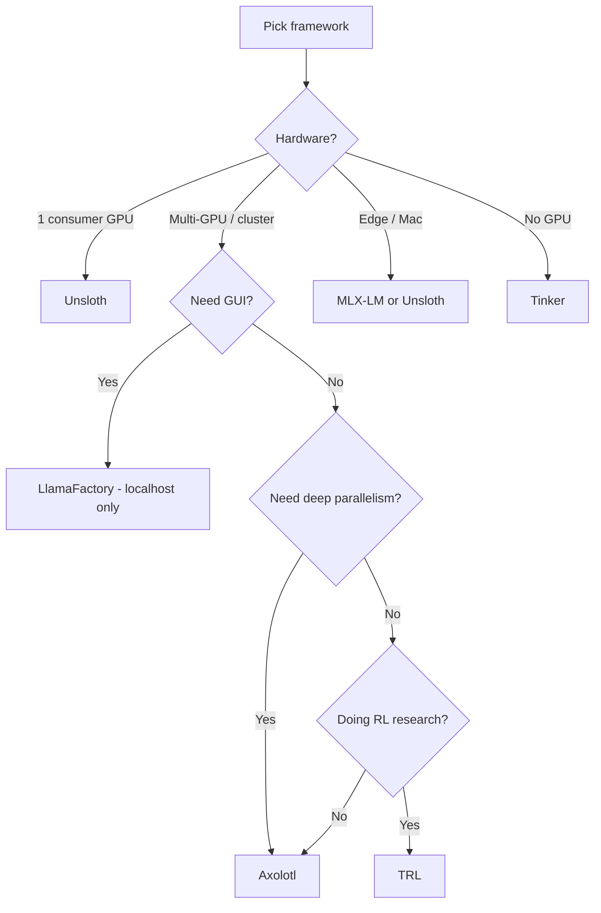

# **Stage 05 — Frameworks at Scale**
**Outcome:** express the same training job as configuration or as code, and pick the right engine for the hardware you actually have.**Frameworks:** Unsloth · Axolotl 0.21.1 · LlamaFactory 0.9.5 · TRL 1.17.1 · PEFT 0.21.2 · TorchTitan 0.4.0 · verl 0.9.1 · OpenRLHF 0.11.2 · SkyRL 0.4.0 · Tinker 0.37.0


---

## **Scope**

Stage 5 is about leverage. The Stage 3 code works; Stage 5 makes it cheap enough to iterate, and tells you what to reach for when you outgrow one GPU.

**Exit criterion:** one model trained three ways with the data held constant, and a written framework decision rule you can defend.

---

## **The landscape**

The source notes' "six-way race" no longer holds
The original list was Axolotl, Unsloth, LlamaFactory, TRL, PEFT, and TorchTune. **TorchTune's last release was 0.6.1 in April 2025 and the project is unmaintained.** Starting new work on it in November 2026 is a dead end. The meta-framework slot is now **TorchTitan**, and the RL-engine slot is split across **verl**, **OpenRLHF**, **SkyRL**, and the hosted **Tinker** API.

| Framework | Current release | Date | Best for | License | Learning curve |
|---|---|---|---|---|---|
| LlamaFactory | v0.9.5 | 30 May 2026 | GUI, broad model coverage — **local only** | Apache 2.0 | Low |
| Unsloth | v0.1.913-beta | 30 Oct 2026 | Single-GPU speed, long context | Apache 2.0 | Low–Medium |
| TRL | v1.17.1 | 30 Oct 2026 | RLHF / GRPO / DPO, the primitive layer | Apache 2.0 | Medium–High |
| PEFT | v0.21.2 | 1 Oct 2026 | Adapters (LoRA, QLoRA, DoRA…) | Apache 2.0 | Low |
| Axolotl | v0.21.1 | 27 Oct 2026 | Config-driven multi-GPU production | Apache 2.0 | Medium |
| TorchTitan | v0.4.0 | 28 Oct 2026 | Large-scale pretraining / post-training research | BSD | Medium–High |
| verl | v0.9.1 | 20 Sep 2026 | Distributed RL, PPO and GRPO | Apache 2.0 | High |
| OpenRLHF | v0.11.2 | 14 Sep 2026 | Ray-scaled PPO / REINFORCE++ | Apache 2.0 | High |
| SkyRL | v0.4.0 | 1 Oct 2026 | Agent RL end to end | Apache 2.0 | Medium–High |
| Tinker | 0.37.0 | 2 Nov 2026 | Hosted LoRA and RL, no GPUs | — | Low |
| AgentLightning | 1.0.2 | 29 Sep 2026 | Agent RL orchestration, credit assignment | Apache 2.0 | High |
| TorchTune | v0.6.1 | 7 Apr 2025 | **Unmaintained — do not start here** | BSD | — |

**The layer cake:** PEFT (adapters) at the bottom, TRL (trainers) on top, Axolotl and LlamaFactory wrapping both, Unsloth replacing some kernels, TorchTitan and the RL engines using native PyTorch. Most projects end up using two or three layers.

---

## **Decision table**

| Situation | Framework | Why |
|---|---|---|
| Single consumer GPU (RTX 4090, 3090) | Unsloth | 2–5× faster, lowest memory, longest context |
| Multi-GPU, complex parallelism | Axolotl | FSDP2, DeepSpeed, TP, CP, EP composable |
| GUI or no-code, broad model coverage | LlamaFactory | LlamaBoard web UI, 100+ models — localhost only |
| RLHF / GRPO / DPO research | TRL | Reference implementation, the primitive layer |
| Production, config-driven, multi-tenant | Axolotl | YAML config, deep parallelism matrix |
| Large-scale pretraining or post-training research | TorchTitan | Maintained PyTorch-native path, TitanRL |
| Distributed RL at scale | verl, OpenRLHF, SkyRL, Tinker | Trainer-agnostic RL engines, hosted or self-hosted |
| Custom research, full control | TRL + PEFT | Maximum flexibility, lowest abstractions |



---

## **Topic checklist**

### **Unsloth**

- [ ] Hand-written Triton kernels replacing HF's LoRA/QLoRA path
- [ ] ~2× speedup on supported models, 30–50% memory reduction
- [ ] Automatic 4-bit quantization (NF4 + double quant)
- [ ] Up to 8× longer context on the same GPU
- [ ] 7.3× MoE speedup (gpt-oss-20b on B200 at 8K: 712 ms vs 5,227 ms per step)
- [ ] `FastLanguageModel.from_pretrained()`, `get_peft_model()`
- [ ] `use_gradient_checkpointing="unsloth"`
- [ ] Known weak spot: multi-GPU
- [ ] Known limit: a model outside the supported list, or a TRL feature Unsloth has not implemented

### **Axolotl**

- [ ] YAML-driven wrapper over Transformers, PEFT, TRL, Accelerate, DeepSpeed
- [ ] FSDP2, DeepSpeed ZeRO-2/3, TP, CP, EP composable via DeviceMesh
- [ ] One config file for every hyperparameter
- [ ] Broadest model support of the wrapper frameworks
- [ ] Method coverage: SFT, DPO, IPO, KTO, ORPO, GRPO, SimPO, reward modeling
- [ ] `accelerate launch -m axolotl.cli.train axolotl_config.yml`
- [ ] Limits: single consumer GPU (Unsloth is faster), custom code (thick wrapper)

### **LlamaFactory**

- [ ] LlamaBoard web UI and the CLI
- [ ] 100+ model architectures
- [ ] Backends: Transformers, Liger Kernel, Unsloth, Megatron-LM, KTransformers
- [ ] All training methods (SFT, DPO, KTO, ORPO, SimPO, PPO, GRPO)
- [ ] OFT support
- [ ] **The CVE rule: CLI only, localhost only, never exposed**

### **TRL**

- [ ] SFT, DPO, Reward, RLOO, GRPO, Distillation as stable trainers
- [ ] Experimental trainers under `trl.experimental`
- [ ] `trl vllm-serve` for fast rollout generation
- [ ] Direct trainer access with no wrapper overhead

### **PEFT**

- [ ] The adapter file format: `adapter_config.json` + `adapter_model.safetensors`
- [ ] Portability across Axolotl, vLLM, SGLang, TensorRT-LLM
- [ ] Adapter swapping without reloading the base model

### **TorchTitan and the RL engines**

- [ ] TorchTitan: native `torch.compile`, DTensor, FSDP2, TitanRL
- [ ] verl: trainer-agnostic, PPO and GRPO, multi-turn agent rollouts
- [ ] OpenRLHF: Ray-based scaling, PPO and REINFORCE++
- [ ] SkyRL: agent RL end to end, local Tinker-compatible backend
- [ ] Tinker: hosted LoRA and RL API
- [ ] AgentLightning: agent RL orchestration with credit assignment

### **Distributed training**

- [ ] Accelerate as the launcher
- [ ] DeepSpeed ZeRO-1/2/3 and what each shards
- [ ] FSDP2 and DTensor
- [ ] TP, CP, EP and when each applies

| Scale | Strategy |
|---|---|
| Single GPU | Unsloth (or PEFT + bitsandbytes) |
| 2–4 GPUs, one node | FSDP2 via Accelerate, or DeepSpeed ZeRO-2/3 |
| 8 GPUs, one node | FSDP2, DeepSpeed ZeRO-3, or TP+CP |
| 16+ GPUs, multi-node | FSDP2 + TP, or DeepSpeed + TP, or Megatron-LM |
| MoE models | EP + TP |

---

## **Code**

### **Unsloth**

```python
from unsloth import FastLanguageModel
from trl import SFTTrainer
from transformers import TrainingArguments

model, tokenizer = FastLanguageModel.from_pretrained(
    model_name="unsloth/Qwen3-4B-Instruct-2507-bnb-4bit",
    max_seq_length=2048,
    load_in_4bit=True,
)

model = FastLanguageModel.get_peft_model(
    model,
    r=16, lora_alpha=32,
    target_modules="all-linear",
    lora_dropout=0.05, bias="none",
    use_gradient_checkpointing="unsloth",
)

trainer = SFTTrainer(
    model=model, tokenizer=tokenizer,
    train_dataset=my_dataset,
    args=TrainingArguments(per_device_train_batch_size=2, gradient_accumulation_steps=4, ...),
)
trainer.train()
```

### **Axolotl**

```yaml
# **axolotl_config.yml**
base_model: Qwen/Qwen3-4B-Instruct-2507
model_type: Qwen3ForCausalLM
tokenizer_type: AutoTokenizer

datasets:
  - path: username/billing-support-v1.0
    type: chatml
    split: train

# **adapter: lora   # LoRA / QLoRA**
# **full_finetuning: true  # Full SFT**

lora_r: 16
lora_alpha: 32
lora_dropout: 0.05
lora_target_modules: all-linear

load_in_4bit: true
bnb_4bit_quant_type: nf4
bnb_4bit_compute_dtype: bfloat16

num_epochs: 2
micro_batch_size: 2
gradient_accumulation_steps: 8
learning_rate: 2e-4
optimizer: adamw_bnb_8bit
lr_scheduler_type: cosine

fsdp: full_shard auto_wrap  # FSDP2
fsdp_config:
  fsdp_activation_checkpointing: true

sequence_packing: true

rl: dpo
dpo_beta: 0.1

output_dir: ./outputs/qlora
```

```bash
accelerate launch -m axolotl.cli.train axolotl_config.yml
```

### **LlamaFactory (CLI only)**

```bash
pip install llamafactory
llamafactory-cli train \
  --model_name_or_path Qwen/Qwen3-4B-Instruct-2507 \
  --template qwen \
  --dataset billing_support \
  --output_dir ./llama3_lora \
  --finetuning_type lora \
  --lora_rank 16 \
  --quantization_bit 4 \
  --per_device_train_batch_size 2 \
  --gradient_accumulation_steps 4 \
  --num_train_epochs 3.0 \
  --learning_rate 5e-5
```

CVE-2026-58116 — the WebUI is a remote-code-execution surface
LLaMA-Factory through 0.9.5 contains a **remote code execution** vulnerability (CVSS-B 9.3, Critical). The WebUI passes a user-supplied model path unvalidated into `AutoTokenizer.from_pretrained()` / `AutoModel.from_pretrained()` with a hardcoded `trust_remote_code=True`, so a malicious model repository executes arbitrary code with the server process's privileges. NVD lists **no patched version** for 0.9.5. An earlier RCE through the `vhead_file` checkpoint path was fixed in 0.9.4 by loading with `weights_only=True`, and the vendor's advisory list also carries an SSRF guard-bypass issue (CVE-2026-85673).

Operational rule: **CLI only, bound to localhost, never exposed to a network.** If you need a GUI, put it behind an authenticating proxy on a private interface — or pick another framework.

### **TRL, called directly**

```python
from trl import SFTTrainer, SFTConfig
from transformers import AutoModelForCausalLM, AutoTokenizer
from datasets import load_dataset

model = AutoModelForCausalLM.from_pretrained("Qwen/Qwen3-4B-Instruct-2507")
tokenizer = AutoTokenizer.from_pretrained("Qwen/Qwen3-4B-Instruct-2507")
dataset = load_dataset("username/billing-support-v1.0", split="train")

trainer = SFTTrainer(
    model=model, tokenizer=tokenizer, train_dataset=dataset,
    args=SFTConfig(
        output_dir="./sft",
        per_device_train_batch_size=2, gradient_accumulation_steps=4,
        num_train_epochs=3, learning_rate=2e-4,
        # **assistant_only_loss=True,**
        # **packing=True,**
    ),
)
trainer.train()
```

### **PEFT adapter format**

```
adapter_config.json        # r, alpha, target_modules, base_model_name
adapter_model.safetensors  # the A and B matrices
```

This is what makes multi-LoRA serving work: the adapter stays separate, portable across every serving engine, and swappable at request time.

### **Accelerate, DeepSpeed, FSDP2**

```bash
accelerate config
accelerate test
accelerate launch --num_processes=4 --mixed_precision=bf16 train.py
```

```python
from accelerate import Accelerator
accelerator = Accelerator(gradient_accumulation_steps=4)
model, optimizer, dataloader = accelerator.prepare(model, optimizer, dataloader)
```

---

## **Labs**

### **Lab 5-1 — Three frameworks, one model**
- Train `Qwen/Qwen3-4B-Instruct-2507` with Unsloth, TRL, and Axolotl on identical data and matched hyperparameters.
- Record training time, peak memory, final loss, and the domain eval score for each.
- Explain the differences: kernels, data collation, loss masking, LR schedule.

### **Lab 5-2 — DPO through the wrappers**
- Take the Lab 5-1 SFT checkpoint and run DPO with `DPOTrainer`.
- Repeat the same DPO run through Axolotl's `rl: dpo` config.
- Confirm the two produce comparable win rates on the same eval.

### **Lab 5-3 — GRPO on GSM8K**
- Set up GRPO on GSM8K with a verifiable `\boxed{}` reward.
- Train, evaluate on the held-out split.
- Record GPU-hours: G=8 rollouts × 1000 steps = 8,000 generations.

### **Lab 5-4 — Multi-LoRA serving**
- Train three LoRA adapters on different tasks.
- Serve with vLLM `--enable-lora`.
- Hot-swap between adapters per request; measure latency, throughput, and memory.

### **Lab 5-5 — Full pipeline**
- LoRA → merge → quantize → vLLM.
- Benchmark TTFT, TPOT, and throughput at batch 1, 8, 32 against the FP16 base.

### **Lab 5-6 — Edge deployment**
- Merge, convert to GGUF Q4_K_M, serve with llama.cpp or Ollama.
- Deploy on a laptop or phone and measure tokens/sec.

---

## **Pitfalls**

- **Axolotl's version line is lower than the source notes claim.** 0.29.0 does not exist; 0.21.1 is current.
- **LlamaFactory's WebUI is exploitable.** CVE-2026-58116 has no patched release. Never bind it publicly.
- **TorchTune is abandoned.** A tutorial that reaches for it is teaching a dead path.
- **Unsloth and multi-GPU do not mix.** Its documented weak point.
- **Wrapper frameworks hide the loss masking.** When a wrapper's loss differs from raw TRL, the difference is usually `assistant_only_loss` or packing.
- **Axolotl's `model_type` must match the checkpoint.** A Qwen3 checkpoint with a Llama config trains to garbage.
- **Tinker is a different kind of dependency.** It is a hosted API with its own API surface, not a drop-in `SFTTrainer`.

---

## **Acceptance gate**

- [ ] One model trained with three frameworks on identical data, with a comparison table.
- [ ] The LlamaFactory CVE and the operational rule that follows from it written down.
- [ ] A framework decision rule stated in one sentence, with the hardware it assumes.
- [ ] An Axolotl config file that reproduces a training run from a fresh clone.
- [ ] A multi-GPU launch (Accelerate, two processes) completed with a clean log.

---

## **Resources**

- Axolotl v0.21.1 — https://github.com/axolotl-ai-cloud/axolotl/releases/tag/v0.21.1
- Unsloth v0.1.913-beta — https://github.com/unslothai/unsloth/releases/tag/v0.1.913-beta
- LlamaFactory v0.9.5 — https://github.com/hiyouga/LlamaFactory/releases/tag/v0.9.5
- NVD CVE-2026-58116 — https://nvd.nist.gov/vuln/detail/cve-2026-58116
- GitHub advisory GHSA-mwc7-mf87-v3mf — https://github.com/advisories/GHSA-mwc7-mf87-v3mf
- LlamaFactory CVE list — https://opencve.alliance.unm.edu/cve/?vendor=hiyouga&product=llama-factory
- TorchTitan v0.4.0 — https://github.com/pytorch/torchtitan/releases/tag/v0.4.0
- TorchTune v0.6.1 (last release) — https://github.com/meta-pytorch/torchtune/releases/tag/v0.6.1
- verl v0.9.1 — https://github.com/verl-project/verl/releases/tag/v0.9.1
- OpenRLHF v0.11.2 — https://github.com/OpenRLHF/OpenRLHF/releases/tag/v0.11.2
- Tinker on PyPI — https://pypi.org/project/tinker/
- AgentLightning on PyPI — https://pypi.org/project/agentlightning/

**Next:** Stage 06 — Specialization and Low-Level.
