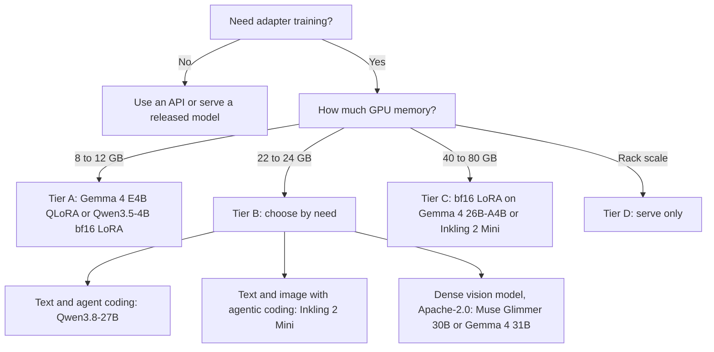

## **Stage 01: Model Landscape and Base-Model Selection**

**Outcome:** you can take a task constraint, narrow it to one base model, and defend the choice on four axes: capability, license, memory footprint, and tooling support. Nothing is trained in this stage, but everything downstream depends on it.

**Last checked:** 28 November 2026. Every row below carries a status: verified (read on a primary or documentation page this week), earlier draft (carried over from the 3 November version and not rechecked), or not checked (found in a catalog, details unread). Treat earlier draft and not checked rows as leads, not facts.

### **The distinction that decides this stage**

**Released**, **open-weight**, and **fine-tunable in this roadmap** are three different sets. Kimi K3.1 Pro, Mistral Large 4, Qwen3.8-2.4T-A95B, GLM-5.3, Muse Spark Open and Inkling 2 Small are all released and all open-weight. None of them can be adapter-trained on hardware a learner or a small team owns. A roadmap that blurs these sends people to download a terabyte of weights they cannot train.

The third set is best read as memory tiers, because the GPU you own decides the model before anything else does.

| Tier | Memory for adapter training | What lives here |
|---|---|---|
| A | 8 to 12 GB | Gemma 4 E2B and E4B with QLoRA, Qwen3.5 0.8B to 4B with bf16 LoRA |
| B | 22 to 24 GB | Qwen3.8-27B, Gemma 4 31B, Muse Glimmer 30B and Inkling 2 Mini, all with QLoRA |
| C | 40 to 80 GB | Gemma 4 26B-A4B and Qwen3.5-35B-A3B with bf16 LoRA, Inkling 2 Mini with 16-bit LoRA |
| D | A rack of data center GPUs | Serve only: Kimi K3.1 Pro, Mistral Large 4, Inkling 2 Small, GLM-5.3 and similar |

### **1.1 What changed since 3 November**

| Item | Earlier draft said | Now | Status |
|---|---|---|---|
| Kimi K3.1 Pro | API only, weights promised for 4 November | Weights are on Hugging Face (MXFP4, 2.8T total, 104B active, 1M context) under a Kimi K3.1 Pro License. Sources give 2 to 4 November for the upload. Still tier D | Verified |
| Inkling 2 Mini | Not listed | New 26.4B MoE from Thinking Machines, Apache-2.0, released 20 November. Trainable with QLoRA on about 22 GB in Unsloth. Tier B | Verified |
| Inkling 2 Small | Not listed | 594B, Apache-2.0, weights on Hugging Face from 12 November after a closed week on Tinker. Tier D | Verified |
| Muse Glimmer 30B | Muse Model License, gated | Apache-2.0, dense, released 10 August, fine-tunable on a 24 GB card. The Muse Model License applies to Muse Spark Open, not to Glimmer | Verified |
| MoE experts and 4-bit | Blocked outright | Blocked in the stock transformers and bitsandbytes stack. Unsloth quantizes the experts for Inkling 2 Mini and trains it in 4-bit | Verified for Inkling only |
| Gemma 4 12B | Listed only in passing | Released 3 June, Apache-2.0, takes image and audio without separate encoders, runs on 16 GB | Verified |
| Nemotron 3.5 Bolt E4B | Grouped with multi-GPU models | 8B parameters (4B effective), built on Gemma 4 E4B, 64K context, runs at about 4 GB VRAM when quantized to 4-bit. The 74B-A9B sibling is the large one | Verified |
| Qwen3.8-Flash-Next | Not listed | 125B MoE multimodal model on a new Qwen4 architecture, 256K context. Smallest quant needs about 32 GB of RAM to run. No training guide found | Partly verified |
| Olala mini 7A1B | Not listed | OVHcloud, 17 November, Apache-2.0, 7B total and 1B active, hybrid Mamba-3 and attention MoE. Stock Ollama and llama.cpp cannot load it yet | Verified by one source |
| Ripple-65B Preview | Not listed | Ricursive Intelligence, 4 November, Apache-2.0, BF16 and NVFP4 weights plus a base model | Partly verified |
| DeepSeek V4.1 Flash | Described as fine-tunable in one section | Treat as serve only. 284B or more parameters is over 140 GB even at 4-bit. One source lists the 0731 build at 304B, so recheck the size | Verified as serve only |

### **1.2 Refreshed Landscape as of 28 November 2026**

**Trainable on one GPU (tiers A, B and C)**

| Model | Publisher and release | Size | License | Tier and path | Status |
|---|---|---|---|---|---|
| Gemma 4 E2B, E4B | Google, 2 Apr 2026 | 2.3B and 4.5B effective | Apache-2.0 | A. E2B QLoRA about 8 GB, E4B QLoRA about 10 GB | Verified |
| Gemma 4 12B | Google, 3 Jun 2026 | 12B dense | Apache-2.0 | Training memory not found. Inference fits in 16 GB | Verified release and license |
| Gemma 4 31B | Google, 2 Apr 2026 | 31B dense | Apache-2.0 | B. QLoRA about 22 GB | Verified |
| Gemma 4 26B-A4B | Google, 2 Apr 2026 | 26B total, 4B active | Apache-2.0 | C. LoRA above 40 GB | Verified |
| Qwen3.5 small family | Alibaba, 2 Mar 2026 | 0.8B to 9B | Apache-2.0 | A and B. bf16 LoRA only, no 4-bit | Earlier draft |
| Qwen3.6-27B | Alibaba, 22 Apr 2026 | 27B dense | Apache-2.0 | B. QLoRA about 24 GB | Earlier draft |
| Qwen3.8-27B | Alibaba, 14 Aug 2026 | 27B dense, 262K context | Apache-2.0 | B. QLoRA about 24 GB, LoRA above 36 GB | Verified |
| Muse Glimmer 30B | Meta, 10 Aug 2026 | 29.6B dense with a 1.8B vision encoder, 128K context | Apache-2.0 | B. Fine-tunes on a 24 GB card | Verified |
| Inkling 2 Mini | Thinking Machines, 20 Nov 2026 | 26.4B total, 3.4B active (5.4B counting loop passes), 1M context | Apache-2.0 | B with QLoRA, C with 16-bit LoRA | Verified |
| Nemotron 3.5 Bolt E4B | NVIDIA, Oct 2026 | 8B total, 4B effective, 64K context | NVIDIA Open, not rechecked | Likely A. Training not checked | Partly verified |
| Qwen3-4B-Instruct-2507 | Alibaba, 2025 | 4B | Apache-2.0 | A. QLoRA about 10 to 12 GB. The README default | Earlier draft |
| Olala mini 7A1B | OVHcloud, 17 Nov 2026 | 7B total, 1B active | Apache-2.0 | Size fits tier A. Tooling needs a fork | Verified by one source |

**Released and open-weight, but serve only or training not documented**

| Model | Publisher and release | Size | License | Note | Status |
|---|---|---|---|---|---|
| Kimi K3.1 Pro | Moonshot, API 23 Oct, weights early Nov 2026 | 2.8T total, 104B active, 1M context | Kimi K3.1 Pro License | Highest ranked open-weight model on one leaderboard in early November | Verified |
| Kimi K3 | Moonshot, Jul 2026 | 2.8T total, 104B active | Kimi K3 License | Separate agreement needed above US$20M yearly revenue for large model-as-a-service use | Verified license summary |
| Inkling 2 Small | Thinking Machines, weights 12 Nov 2026 | 594B, 384 experts per layer | Apache-2.0 | 4-bit weights alone need about 310 GB | Verified |
| Mistral Large 4 | Mistral, 29 Oct 2026 | About 1T total, 52B active | Mistral Ecosystem Open-Weight | Selling it as a service needs a separate agreement | Verified |
| Qwen3.8-2.4T-A95B | Alibaba, Aug 2026 | 2.4T total, 95B active | Qwen Max License | Rack scale | Earlier draft |
| Qwen3.8-Flash-Next | Alibaba, 2026 | 125B MoE, 256K context | Not checked | Runs on 32 GB of RAM in the smallest quant. No training guide found | Partly verified |
| GLM-5.3 | Z.ai, Sep 2026 | 320B total, 18B active | MIT | Weights confirmed public on the Hub | Verified weights |
| DeepSeek V4.1 Flash, V4 Flash 0731, V4 Pro 0813 | DeepSeek, Jul to Oct 2026 | 284B to 304B for Flash, 1.6T for Pro | MIT | No chat template in the transformers repo for some builds, check each | Earlier draft |
| MiMo-V2.6-Pro, MiMo-V2.6-Flash | Xiaomi, 22 Sep 2026 | Flash is 310B total, 15B active | MIT | Long-horizon agent work | Verified |
| Muse Spark Open | Meta, Oct 2026 | 816B total, 42B active | Muse Model License | Gated download | Earlier draft |
| Nemotron 3.5 Bolt 74B-A9B, Super VL 120B-A12B | NVIDIA, Oct 2026 | 74B and 120B | NVIDIA Open, not rechecked | Bolt 74B-A9B runs in 24 to 32 GB of RAM at 2-bit, which is inference, not training | Partly verified |
| Ripple-65B Preview | Ricursive Intelligence, 4 Nov 2026 | 65B | Apache-2.0 | Training path not checked | Partly verified |

**Found in catalogs, not checked:** MiniMax M3.1 Flash, MiniMax H3, Mistral Medium 3.5 (128B), Mistral Small 4 (119B), Recursive Flint (40B), GLM-5.3 Flash, Nemotron 3.5 Lightning (30B-A3B), LongCat-2.5, Beam 1.0, LFM2.5-24B-A2B, Dhir 5B MoE (English and ten Indian languages, Apache-2.0, 3 November).

**May snapshot.** The May 2026 leaderboard table from the earlier draft is moved to `results/leaderboard_snapshots.md`, because every row in it is stale. Artificial Analysis publishes its index in versions, and scores from different versions cannot be compared. Save the version number next to every score you record.

### **1.3 Fine-Tuning Notes by Family**

**Qwen.** The Qwen3.5 family uses gated linear attention mixed with standard attention. Do not QLoRA it at 4-bit, because quantization error is higher than normal. Use bf16 LoRA. Qwen3.8-27B is the documented exception and works at 4-bit with an Unsloth build. Thinking is on by default, with an `enable_thinking` switch and a `reasoning_effort` control. Keep at least 75 percent reasoning examples in an SFT mix if you want the model to keep thinking.

**Gemma 4.** E4B with QLoRA is a better choice than E2B with LoRA: a bigger model with a negligible quantization difference. The 31B model fits a 24 GB card with QLoRA, and the 26B-A4B MoE needs LoRA at 16-bit above 40 GB. Loss values of 13 to 15 on E2B and E4B are normal for these multimodal models.

**Muse Glimmer 30B.** A dense model, so the usual QLoRA recipe applies. It was distilled from Meta's larger Muse model, supports reasoning effort levels low to xhigh, and is aimed at local agents. Unsloth ships Kaggle notebooks for it that use two free T4 GPUs.

**Inkling 2 Mini.** A looped transformer. Twelve of its 24 layers run three times per token, so the file stores 24 layers of weights but each token makes 48 layer visits. Practical rules for training it:

- Keep the batch size at 1 and raise gradient accumulation, because the 200K vocabulary makes the logits the largest allocation in a step.
- Keep the small message gates out of 4-bit. Plain 4-bit loading hurts the loss, and Unsloth handles this for you.
- Use the model's own chat template. Reasoning effort goes in as a number from 0 to 0.99 or a name such as `medium`. The default is high.
- Unsloth's vLLM fast inference path does not support training for this model yet.
- The vendor path in NVIDIA NeMo AutoModel needs four GB200 GPUs, so it is a reference, not a learner recipe.

**Nemotron 3.5 Bolt E4B.** A Gemma 4 E4B derivative at 8B stored parameters. Check its license text and whether your trainer supports its changes before choosing it over plain Gemma 4 E4B.

**The MoE rule, restated.** Mixture-of-experts layers store experts as 3D tensors, and the stock bitsandbytes path only quantizes `nn.Linear` layers. So in plain transformers the experts stay in 16-bit and the model does not fit. Unsloth works around this for models it supports, and quantizes the experts while loading. For any other MoE, assume bf16 LoRA until a guide says otherwise.

**Tooling is part of selection.** Olala mini 7A1B has open Apache-2.0 weights, but stock Ollama and llama.cpp cannot run it. An open license is not the same as a model your tools can load. Check the serving and training stack before you fall for a model card.

### **1.4 Models Outside Text, Briefly**

The training detail for these lives in Stage 07. Here you only need to know what exists and what you can run.

| Area | Current names | Note |
|---|---|---|
| Vision language | Qwen3.8-27B, Gemma 4 E2B, E4B and 12B, Inkling 2 Mini, Muse Glimmer 30B | Most new mid-size models take images natively |
| Image generation | Qwen-Image-2.1 (and Turbo), FLUX.1-dev, DiffusionGemma 26B-A4B | FLUX in bf16 needs at least 24 GB |
| Speech | Qwen3-TTS 0.6B and 1.7B, Whisper-large-v3, Nemotron 3.5 ASR | Apache-2.0 for Qwen3-TTS |
| Embeddings and reranking | Nemotron 3.5 Embed 8B and Rerank 8B, EmbeddingGemma 2, bge-m3 | Hard negatives matter more than any other lever |
| Function calling | FunctionGemma 270M | A small base for tool-use experiments |

### **1.5 License Audit for the Candidate Set**

License is a selection constraint. It can differ inside one family, so read the license for the exact size you plan to use.

| License family | Models in scope | Commercial use | Trigger to watch | Practical rule |
|---|---|---|---|---|
| Apache-2.0 | Qwen3.5, 3.6 and 3.8-27B, Gemma 4, Muse Glimmer, Inkling 2 Mini and Small, Ripple-65B, Olala mini | Yes, including as a service | None in the license. Inkling also has a separate acceptable use policy, reported by a mirror page, so read it | Default choice |
| MIT | DeepSeek V4, GLM-5.3, MiMo-V2.6 | Yes | None | Same in practice as Apache-2.0 for most uses |
| Kimi K3 and K3.1 Pro licenses | Kimi K3, Kimi K3.1 Pro | Yes with conditions | A separate agreement above US$20M yearly revenue for large model-as-a-service use (K3). The K3.1 Pro terms were not read | Read before any launch |
| Mistral Ecosystem Open-Weight | Mistral Large 4 | Weights and internal use | Selling inference as a service needs a separate agreement | Free weights are not a free service |
| Muse Model License | Muse Spark Open | Yes, including fine-tuning | Service revenue above a stated threshold needs a separate agreement. Gated download | Plan the commercial conversation early |
| LFM Open License | LFM2.5 and LFM3 | Below a revenue threshold | The threshold applies per customer too | Free for learning, relicense before scaling |
| Meta Custom (Llama 4) | Llama 4 Scout and Maverick | With conditions | Large monthly-active-user clause | Avoid if you might reach that scale |
| NVIDIA Open | Nemotron 3.5 family | Yes, with the NVIDIA terms | Not rechecked | Read it per model |
| Qwen Max and Community licenses | Qwen3.8-2.4T-A95B, Qwen3.8 Flash-Next | Restricted compared with Apache-2.0 | Not rechecked | Keep Apache-2.0 and custom Qwen releases separate in your registry |

Three rules follow. MIT, modified MIT, Apache-2.0 and "open weights" are not interchangeable. Open weights do not mean open source. A fine-tune inherits the base license unless the license says otherwise.

### **1.6 Memory and Hardware Matrix**

The configuration decides the base model, because a model you cannot fit is not a candidate. Each cell is what training needs, not what the weights alone cost.

| Model | QLoRA (4-bit) | bf16 or 16-bit LoRA | Notes and source | Status |
|---|---|---|---|---|
| Gemma 4 E2B | about 8 GB | 8 to 10 GB | Unsloth Gemma 4 guide | Verified |
| Gemma 4 E4B | about 10 GB | about 17 GB | Prefer E4B QLoRA over E2B LoRA | Verified |
| Gemma 4 12B | not found | not found | Inference runs in 16 GB | Gap |
| Gemma 4 26B-A4B | not found | above 40 GB | MoE | Verified for LoRA |
| Gemma 4 31B | about 22 GB | not found | Fits a 24 GB card | Verified for QLoRA |
| Qwen3.5 0.8B, 2B, 4B, 9B | not recommended | about 3, 5, 10 and 22 GB | bf16 LoRA only | Earlier draft |
| Qwen3.5-35B-A3B | not supported in the stock stack | about 74 GB | MoE | Earlier draft |
| Qwen3.6-27B | about 24 GB | above 36 GB | | Earlier draft |
| Qwen3.8-27B | about 24 GB | above 36 GB | Full fine-tune uses about 4 times the QLoRA memory | Verified |
| Muse Glimmer 30B | fits a 24 GB card | not found | Two free T4 GPUs work in the Kaggle notebooks | Verified |
| Inkling 2 Mini | about 22 GB. Peak 21.1 GB on a 24 GB card | 59 GB peak on a 96 GB GPU | One T4 is not enough, two T4 GPUs work. Full fine-tune with experts frozen peaked at 62 GB. Stock TRL needs over 40 GB | Verified |
| Nemotron 3.5 Bolt E4B | not checked | not checked | Inference at about 4 GB VRAM | Gap |
| Inkling 2 Small | not possible | not possible | 4-bit weights alone are about 310 GB | Verified |

Weights alone for a model with $N$ parameters at $b$ bytes per parameter:

$$M_{\text{weights}} = N \cdot b$$

For an MoE, $N$ is the total parameter count, because every expert must sit in memory. The active count lowers compute, not memory.

**Worked example, Inkling 2 Mini.** $N = 26.4 \times 10^{9}$.

$$\boxed{M_{\text{bf16}} = 26.4 \times 10^{9} \times 2 = 52.8\ \text{GB}}$$

$$\boxed{M_{\text{4-bit}} = 26.4 \times 10^{9} \times 0.5 = 13.2\ \text{GB}}$$

Check against the published numbers: a merged 16-bit file is about 53 GB, and the 4-bit weights are about 14.4 GB. The 1.2 GB gap at 4-bit fits parts that stay in 16-bit, such as the message gates.

**Worked example, Muse Glimmer 30B.** $N = 29.6 \times 10^{9}$.

$$\boxed{M_{\text{bf16}} = 29.6 \times 10^{9} \times 2 = 59.2\ \text{GB}}$$

$$\boxed{M_{\text{4-bit}} = 29.6 \times 10^{9} \times 0.5 = 14.8\ \text{GB}}$$

Published figures are about 58 to 60 GB at bf16 and 17 to 18 GB for a 4-bit file with extras, so the formula lands close for bf16 and a little under for 4-bit.

### **1.7 Base-Model Decision Framework**

**Choose by constraint**

| Constraint | First pick | Alternatives |
|---|---|---|
| Fastest experiments on a small GPU | Gemma 4 E4B (tier A) | Qwen3.5-4B in bf16, Nemotron 3.5 Bolt E4B after a check |
| Best open coding or agent model you can train | Qwen3.8-27B (tier B) | Inkling 2 Mini, Muse Glimmer 30B |
| Text and image input with a 1M context | Inkling 2 Mini | Qwen3.8-27B for 262K, or 1M with YaRN |
| Multimodal with audio | Gemma 4 E4B or 12B | None in tier B |
| Enterprise use, no revenue clauses | Apache-2.0 or MIT: Qwen, Gemma 4, Muse Glimmer, Inkling | Avoid Mistral Large 4 as a service and Kimi at large scale without a contract |
| Reasoning per active parameter | Gemma 4 31B (tier B) | Inkling 2 Mini at 3.4B active |
| Multi-turn RL or agentic training | Qwen3.8-27B, or a tier A model for fast loops | Check Inkling RL support first, since vLLM fast inference is not supported yet |

**Two model rule.** Pick one tier A model for fast loops and debugging, and one tier B model as the real target. Build the data and the evals once, then move them between the two.

### **1.8 Pre-Flight Checklist**

1. The chosen base is open-weight, not API only, if the plan involves any adapter training.
2. The license for the exact size is read in full, and any revenue trigger fits the product.
3. The modality you need (image, audio, video) is confirmed on the model card, not assumed from the family name.
4. VRAM for the chosen configuration is written down before the dataset is built.
5. Thinking and reasoning behavior is known: on by default, togglable, or always on.
6. The chat template exists and tokenizes a sample correctly.
7. Gated models have the access request submitted.
8. A dated snapshot of every leaderboard number used in a decision is saved, with the index version.
9. The training stack supports the architecture (experts, loops, hybrid attention), checked on its own docs page.
10. The serving engine you plan to use can load the model.
11. Each fact in the decision record has a source link and a checked date.

**Pre-flight questions**

1. Which three sets must you label every model on, and which memory tier is yours?
2. Why does an MoE model need memory for all its parameters but only compute for the active ones?
3. Why can stock bitsandbytes not 4-bit train MoE experts, and what changes with Unsloth?
4. Why can two models from one family carry different licenses?
5. What is the weights memory of a 26.4B model at 4-bit, and why might a published figure be higher?

### **1.9 Verification Log**

| Claim | Result | Where checked | Date |
|---|---|---|---|
| Kimi K3.1 Pro weights are out | Yes, on Hugging Face, Kimi K3.1 Pro License | News reports and the model page | 28 Nov 2026 |
| Inkling 2 Mini license and size | Apache-2.0, 26.4B total, 3.4B active | Hugging Face blog, NVIDIA NeMo docs, news report | 28 Nov 2026 |
| Inkling 2 Mini trains on small hardware | Yes, QLoRA about 22 GB in Unsloth | Unsloth Inkling 2 Mini guide | 28 Nov 2026 |
| Inkling 2 Small weights | Apache-2.0, on Hugging Face from 12 Nov | News report | 28 Nov 2026 |
| Muse Glimmer license | Apache-2.0, dense 30B, 24 GB fine-tune | Hugging Face blog, Meta page, Unsloth page | 28 Nov 2026 |
| Qwen3.8-27B QLoRA at 24 GB | Confirmed | Unsloth Qwen3.8 guide | 28 Nov 2026 |
| Gemma 4 training memory | E2B 8 GB, E4B 10 GB, 31B QLoRA 22 GB, 26B-A4B LoRA above 40 GB | Unsloth Gemma 4 guide | 28 Nov 2026 |
| Gemma 4 12B | Released 3 Jun, Apache-2.0, 16 GB inference | News report | 28 Nov 2026 |
| Nemotron 3.5 Bolt E4B | 8B stored, 4B effective, about 4 GB at 4-bit for inference | Unsloth model page | 28 Nov 2026 |
| Qwen3.8-Flash-Next | 125B MoE, 256K context, 32 GB RAM for the smallest quant | Unsloth model page | 28 Nov 2026 |
| Gemma 4 26B-A4B and Qwen3.5 MoE 4-bit status | Not checked | | |
| Licenses of Nemotron, Qwen Flash-Next, Muse Spark Open | Not rechecked | | |