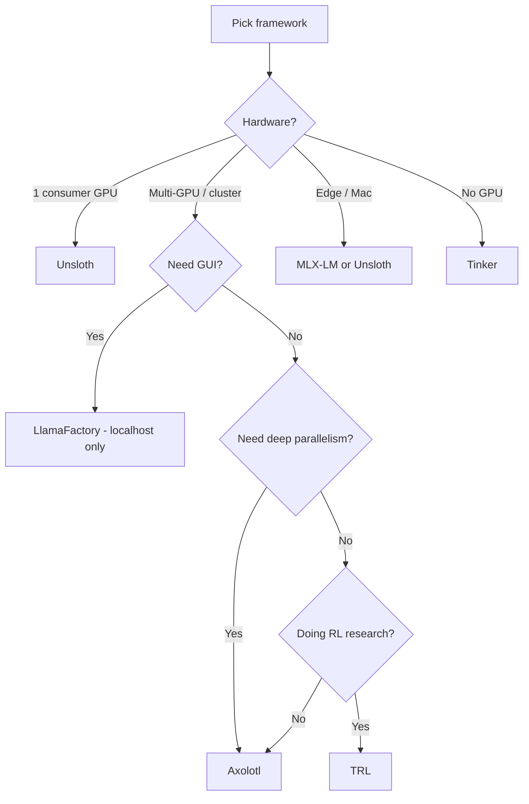

## **Stage 06: Frameworks at Scale**

**Frameworks:** Unsloth, Axolotl, LlamaFactory, TRL, PEFT, TorchTitan, verl, OpenRLHF, SkyRL, Tinker

**Outcome:** express the same training job as configuration or as code, and pick the right engine for the hardware you actually have.

### **1. Scope and Exit Criterion**

**Scope:** This stage is about leverage. The Stage 04 code works. This stage makes it cheap enough to iterate, and tells you what to reach for when you outgrow one GPU.

**Exit Criterion:** One model trained three ways with the data held constant, and a written framework decision rule you can defend.

### **2. The Landscape**

### **2.1 The "Six-Way Race" No Longer Holds**

The original list was Axolotl, Unsloth, LlamaFactory, TRL, PEFT, and TorchTune. **TorchTune is unmaintained**: its last release was in April 2025. Starting new work on it in November 2026 is a dead end. The meta-framework slot is now **TorchTitan** (with the TitanRL line). The RL-engine slot is split across **verl**, **OpenRLHF**, **SkyRL**, and the hosted **Tinker** API.

### **2.2 Framework Overview**

| **Framework** | **Best for** | **License** | **Learning curve** | **Status** |
|---|---|---|---|---|
| LlamaFactory | GUI, broad model coverage (**local only**) | Apache 2.0 | Low | Carries an unpatched critical CVE |
| Unsloth | Single-GPU speed, long context | Apache 2.0 | Low to Medium | Single-GPU speed leader |
| TRL | RLHF / GRPO / DPO, the primitive layer | Apache 2.0 | Medium to High | PPO removed |
| PEFT | Adapters (LoRA, QLoRA, DoRA, and others) | Apache 2.0 | Low | Adapter standard |
| Axolotl | Config-driven multi-GPU production | Apache 2.0 | Medium | The note claiming a much higher version line was wrong |
| TorchTitan | Large-scale pretraining and post-training research | BSD | Medium to High | Replaces TorchTune |
| verl | Distributed RL, PPO and GRPO | Apache 2.0 | High | Active |
| OpenRLHF | Ray-scaled PPO / REINFORCE++ | Apache 2.0 | High | Active |
| SkyRL | Agent RL end to end | Apache 2.0 | Medium to High | Active |
| Tinker | Hosted LoRA and RL, no GPUs | Not listed | Low | Hosted API |
| AgentLightning | Agent RL orchestration, credit assignment | Apache 2.0 | High | Active |
| TorchTune | **Unmaintained, do not start here** | BSD | Not applicable | Last release April 2025 |

### **2.3 The Layer Cake**

PEFT (adapters) sits at the bottom. TRL (trainers) sits on top. Axolotl and LlamaFactory wrap both. Unsloth replaces some kernels. TorchTitan, verl, and friends use native PyTorch instead. Most projects end up using two or three of these layers.

### **3. Framework Decision Table**

Pick by hardware and scale first, then by method.

| **Situation** | **Framework** | **Why** |
|---|---|---|
| Single consumer GPU (RTX 4090, 3090) | Unsloth | 2 to 5 times faster, lowest memory, longest context |
| Multi-GPU, complex parallelism | Axolotl | FSDP2, DeepSpeed, TP, CP, EP composable |
| GUI, no-code, or broad model coverage | LlamaFactory | LlamaBoard web UI, 100+ models. **Local only, see the CVE** |
| RLHF / GRPO / DPO research | TRL | Reference implementation, the primitive layer |
| Production, config-driven, multi-tenant | Axolotl | YAML config, deep parallelism matrix |
| Large-scale pretraining or post-training research | TorchTitan | Meta's maintained PyTorch-native path, TitanRL |
| Distributed RL at scale | verl / OpenRLHF / SkyRL / Tinker | Trainer-agnostic RL engines, hosted or self-hosted |
| Custom research, full control | TRL + PEFT | Maximum flexibility, lowest abstractions |



### **4. Unsloth: Single-GPU Training**

### **4.1 Overview**

Unsloth provides hand-written Triton kernels for LoRA/QLoRA training, a drop-in replacement for the HF stack on supported models.

**Why it wins:**

- About 2 times speedup on supported models versus vanilla Transformers.
- 30 to 50% memory reduction.
- Automatic 4-bit quantization (NF4 and double quantization).
- Longer context: up to 8 times vanilla on the same GPU.
- 7.3 times speedup on MoE (gpt-oss-20b on B200 at 8K context: 712 ms versus 5,227 ms per step).

### **4.2 Reference Numbers**

| **Setup** | **Time** | **Versus baseline** |
|---|---|---|
| Llama 3.1 8B QLoRA r=32 on RTX 4090 (Alpaca) | About 2 times faster | TRL + FA2 |
| Llama 3.2 8B QLoRA r=16 on RTX 4090 | About 4 hours | Versus 8 to 10 hours vanilla |
| Qwen3-30B-A3B QLoRA on H100 | 1.77 times faster | Versus vanilla |
| gpt-oss-20b BF16 on B200 at 8K context | 712 ms/step | 7.3 times versus Transformers |

### **4.3 Unsloth Code**

```python
from unsloth import FastLanguageModel
from trl import SFTTrainer
from transformers import TrainingArguments

model, tokenizer = FastLanguageModel.from_pretrained(
    model_name="unsloth/Llama-3.2-8B-Instruct-bnb-4bit",
    max_seq_length=2048,
    load_in_4bit=True,
)

model = FastLanguageModel.get_peft_model(
    model,
    r=16, lora_alpha=32,
    target_modules="all-linear",
    lora_dropout=0.05, bias="none",
    use_gradient_checkpointing="unsloth",
)

trainer = SFTTrainer(
    model=model, tokenizer=tokenizer,
    train_dataset=my_dataset,
    args=TrainingArguments(per_device_train_batch_size=2, gradient_accumulation_steps=4, ...),
)
trainer.train()
```

The same recipe on a Qwen base:

```python
from unsloth import FastLanguageModel
from trl import SFTTrainer
from transformers import TrainingArguments

model, tokenizer = FastLanguageModel.from_pretrained(
    model_name="unsloth/Qwen3-4B-Instruct-2507-bnb-4bit",
    max_seq_length=2048,
    load_in_4bit=True,
)

model = FastLanguageModel.get_peft_model(
    model,
    r=16, lora_alpha=32,
    target_modules="all-linear",
    lora_dropout=0.05, bias="none",
    use_gradient_checkpointing="unsloth",
)

trainer = SFTTrainer(
    model=model, tokenizer=tokenizer,
    train_dataset=my_dataset,
    args=TrainingArguments(per_device_train_batch_size=2, gradient_accumulation_steps=4, ...),
)
trainer.train()
```

### **4.4 When to Use It**

**Use it for:** single GPU, especially consumer; Llama, Qwen, Mistral, Phi, Gemma, gpt-oss; long context (8K to 128K) where memory matters; quick iteration.

**Avoid it for:** multi-GPU (its documented weak point); models outside the supported list; TRL/PEFT features that Unsloth has not caught up with.

### **4.5 Unsloth Topic List**

- Hand-written Triton kernels replacing HF's LoRA/QLoRA path
- About 2 times speedup on supported models, 30 to 50% memory reduction
- Automatic 4-bit quantization (NF4 and double quantization)
- Up to 8 times longer context on the same GPU
- 7.3 times MoE speedup (gpt-oss-20b on B200 at 8K: 712 ms versus 5,227 ms per step)
- `FastLanguageModel.from_pretrained()`, `get_peft_model()`
- `use_gradient_checkpointing="unsloth"`
- Known weak spot: multi-GPU
- Known limit: a model outside the supported list, or a TRL feature Unsloth has not implemented

### **5. Axolotl: Multi-GPU Configuration Layer**

### **5.1 Overview**

Axolotl is a YAML-driven wrapper over Transformers, PEFT, TRL, Accelerate, and DeepSpeed. It is the most feature-complete framework.

**Why it wins:**

- Deepest parallelism matrix: FSDP2, DeepSpeed ZeRO-2/3, TP, CP, EP composable via DeviceMesh.
- YAML config for every hyperparameter.
- Broadest model support of the wrapper frameworks.
- Most training methods (SFT, DPO, IPO, KTO, ORPO, GRPO, SimPO, reward modeling).

### **5.2 Axolotl Config**

```yaml
# axolotl_config.yml
base_model: meta-llama/Llama-3.1-8B
model_type: LlamaForCausalLM
tokenizer_type: AutoTokenizer

datasets:
  - path: tatsu-lab/alpaca
    type: alpaca
  - path: argilla/distilabel-intel-orca-dpo-pairs
    type: chatml.argilla

# adapter: lora   # LoRA / QLoRA
# full_finetuning: true  # Full SFT

lora_r: 16
lora_alpha: 32
lora_dropout: 0.05
lora_target_modules: all-linear

load_in_4bit: true
bnb_4bit_quant_type: nf4
bnb_4bit_compute_dtype: bfloat16

num_epochs: 3
micro_batch_size: 2
gradient_accumulation_steps: 4
learning_rate: 2e-4
optimizer: adamw_bnb_8bit
lr_scheduler_type: cosine

fsdp: full_shard auto_wrap  # FSDP2
fsdp_config:
  fsdp_activation_checkpointing: true
# deepspeed: deepspeed_configs/zero3_bf16.json

sequence_packing: true

rl: dpo
dpo_beta: 0.1

output_dir: ./outputs/llama3-alpaca-lora
```

```bash
accelerate launch -m axolotl.cli.train axolotl_config.yml
```

The same run against your own dataset:

```yaml
# axolotl_config.yml
base_model: Qwen/Qwen3-4B-Instruct-2507
model_type: Qwen3ForCausalLM
tokenizer_type: AutoTokenizer

datasets:
  - path: username/billing-support-v1.0
    type: chatml
    split: train

# adapter: lora   # LoRA / QLoRA
# full_finetuning: true  # Full SFT

lora_r: 16
lora_alpha: 32
lora_dropout: 0.05
lora_target_modules: all-linear

load_in_4bit: true
bnb_4bit_quant_type: nf4
bnb_4bit_compute_dtype: bfloat16

num_epochs: 2
micro_batch_size: 2
gradient_accumulation_steps: 8
learning_rate: 2e-4
optimizer: adamw_bnb_8bit
lr_scheduler_type: cosine

fsdp: full_shard auto_wrap  # FSDP2
fsdp_config:
  fsdp_activation_checkpointing: true

sequence_packing: true

rl: dpo
dpo_beta: 0.1

output_dir: ./outputs/qlora
```

```bash
accelerate launch -m axolotl.cli.train axolotl_config.yml
```

### **5.3 When to Use It**

**Use it for:** multi-GPU and multi-node; production training pipelines; composed parallelism (FSDP2 + TP + CP + EP); one config file for the whole run.

**Avoid it for:** a single consumer GPU (Unsloth is faster); custom code (the wrapper is thick); GUI workflows.

### **5.4 Axolotl Topic List**

- YAML-driven wrapper over Transformers, PEFT, TRL, Accelerate, DeepSpeed
- FSDP2, DeepSpeed ZeRO-2/3, TP, CP, EP composable via DeviceMesh
- One config file for every hyperparameter
- Broadest model support of the wrapper frameworks
- Method coverage: SFT, DPO, IPO, KTO, ORPO, GRPO, SimPO, reward modeling
- `accelerate launch -m axolotl.cli.train axolotl_config.yml`
- Limits: single consumer GPU (Unsloth is faster), custom code (thick wrapper)

### **6. LlamaFactory: Web UI and Security Constraints**

### **6.1 Overview**

LlamaFactory began as an ACL 2024 system demo paper and became a production framework. It supports 100+ model architectures (LLMs and VLMs), a LlamaBoard web UI, multiple backends (Transformers, Liger Kernel, Unsloth, Megatron-LM, KTransformers), and OFT.

```bash
pip install llamafactory
llamafactory-cli webui  # Open browser, point and click
llamafactory-cli train \
  --model_name_or_path meta-llama/Llama-3.1-8B \
  --template llama3 \
  --dataset alpaca_gpt4_en \
  --output_dir ./llama3_lora \
  --finetuning_type lora \
  --lora_rank 16 \
  --quantization_bit 4 \
  --per_device_train_batch_size 2 \
  --gradient_accumulation_steps 4 \
  --num_train_epochs 3.0 \
  --learning_rate 5e-5
```

CLI-only version against your own dataset:

```bash
pip install llamafactory
llamafactory-cli train \
  --model_name_or_path Qwen/Qwen3-4B-Instruct-2507 \
  --template qwen \
  --dataset billing_support \
  --output_dir ./llama3_lora \
  --finetuning_type lora \
  --lora_rank 16 \
  --quantization_bit 4 \
  --per_device_train_batch_size 2 \
  --gradient_accumulation_steps 4 \
  --num_train_epochs 3.0 \
  --learning_rate 5e-5
```

### **6.2 CVE-2026-58116: Do Not Expose the WebUI**

LLaMA-Factory through 0.9.5 contains a **remote code execution** vulnerability (CVSS-B 9.3, Critical). The WebUI passes a user-supplied model path unvalidated into `AutoTokenizer.from_pretrained()` / `AutoModel.from_pretrained()` with a hardcoded `trust_remote_code=True`, so a malicious model repository executes arbitrary code with the server process's privileges. NVD lists **no patched version** for 0.9.5. An earlier RCE through the `vhead_file` checkpoint path was fixed in 0.9.4 by loading with `weights_only=True`. The vendor's advisory list also carries an SSRF guard-bypass issue (CVE-2026-85673).

**Operational rule:** use LlamaFactory **CLI-only, on localhost, with no inbound exposure**, or do not use it at all until a patched release lands. `llamafactory-cli webui` binds a server that must never face a network. If you need a GUI, put it behind an authenticating proxy on a private interface, or pick another framework.

### **6.3 LlamaFactory Topic List**

- LlamaBoard web UI and the CLI
- 100+ model architectures
- Backends: Transformers, Liger Kernel, Unsloth, Megatron-LM, KTransformers
- All training methods (SFT, DPO, KTO, ORPO, SimPO, PPO, GRPO)
- OFT support
- **The CVE rule: CLI only, localhost only, never exposed**

### **7. TRL: Trainer Primitives**

### **7.1 Overview**

TRL is HuggingFace's RL and preference-optimization library, and the canonical reference implementation. Other frameworks call into it.

```python
from trl import SFTTrainer, SFTConfig
from transformers import AutoModelForCausalLM, AutoTokenizer
from datasets import load_dataset

model = AutoModelForCausalLM.from_pretrained("meta-llama/Llama-3.1-8B")
tokenizer = AutoTokenizer.from_pretrained("meta-llama/Llama-3.1-8B")
dataset = load_dataset("tatsu-lab/alpaca", split="train")

trainer = SFTTrainer(
    model=model, tokenizer=tokenizer, train_dataset=dataset,
    args=SFTConfig(
        output_dir="./llama3-sft",
        per_device_train_batch_size=2, gradient_accumulation_steps=4,
        num_train_epochs=3, learning_rate=2e-4,
        # assistant_only_loss=True,
        # packing=True,
    ),
)
trainer.train()
```

Called directly against your own dataset:

```python
from trl import SFTTrainer, SFTConfig
from transformers import AutoModelForCausalLM, AutoTokenizer
from datasets import load_dataset

model = AutoModelForCausalLM.from_pretrained("Qwen/Qwen3-4B-Instruct-2507")
tokenizer = AutoTokenizer.from_pretrained("Qwen/Qwen3-4B-Instruct-2507")
dataset = load_dataset("username/billing-support-v1.0", split="train")

trainer = SFTTrainer(
    model=model, tokenizer=tokenizer, train_dataset=dataset,
    args=SFTConfig(
        output_dir="./sft",
        per_device_train_batch_size=2, gradient_accumulation_steps=4,
        num_train_epochs=3, learning_rate=2e-4,
        # assistant_only_loss=True,
        # packing=True,
    ),
)
trainer.train()
```

DPO with TRL:

```python
from trl import DPOTrainer, DPOConfig
dataset = load_dataset("argilla/ultrafeedback-binarized-preferences-cleaned", split="train")

trainer = DPOTrainer(
    model=model, ref_model=None,  # ref_model=None uses LoRA's frozen base as ref
    tokenizer=tokenizer, train_dataset=dataset,
    args=DPOConfig(
        output_dir="./llama3-dpo",
        per_device_train_batch_size=2, gradient_accumulation_steps=4,
        num_train_epochs=1, learning_rate=5e-5, beta=0.1,
    ),
)
trainer.train()
```

### **7.2 When to Use It**

**Use it for:** RL work, calling trainers directly with no wrapper overhead, research on alignment algorithms, and being the library another framework calls into. TRL also carries the long-context machinery referenced in earlier notes: Ring Attention support and ALST/Ulysses sequence splitting for multi-GPU training.

**Avoid it for:** one-click setups (LlamaFactory's GUI), maximum single-GPU speed (Unsloth), or maximum multi-GPU control (Axolotl).

### **7.3 TRL Topic List**

- SFT, DPO, Reward, RLOO, GRPO, Distillation as stable trainers
- Experimental trainers under `trl.experimental`
- `trl vllm-serve` for fast rollout generation
- Direct trainer access with no wrapper overhead

### **8. PEFT: Adapter Formats**

### **8.1 Overview**

PEFT is the adapter standard. Almost every other framework calls into it, and the format is what makes multi-LoRA serving possible.

```
adapter_config.json        # metadata (r, alpha, target_modules, base_model_name)
adapter_model.safetensors  # the A and B matrices
```

A LoRA trained with Axolotl loads directly in vLLM, SGLang, TGI, TensorRT-LLM, and Together. That portability is the entire argument for keeping adapters separate from merged weights. The adapter stays separate, portable across every serving engine, and swappable at request time.

**Use it for:** LoRA/QLoRA/DoRA and friends; swapping adapters without reloading the base model.

**Avoid it for:** full fine-tuning (use TRL/Transformers directly); adapter methods PEFT does not implement.

### **8.2 PEFT Topic List**

- The adapter file format: `adapter_config.json` + `adapter_model.safetensors`
- Portability across Axolotl, vLLM, SGLang, TensorRT-LLM
- Adapter swapping without reloading the base model

### **9. TorchTitan and the RL Engines**

**TorchTitan** is Meta's maintained PyTorch-native path: native `torch.compile`, DTensor, FSDP2, with the TitanRL line for post-training research. It replaced TorchTune as the "PyTorch-native option" in earlier notes, and it is the frame to use for large-scale pretraining or post-training research where the vanilla HF stack is not enough.

**verl** is a trainer-agnostic RL engine with strong support for PPO, GRPO, and multi-turn agent rollouts, and is the usual choice when you need PPO back or deep rollout control.

**OpenRLHF** covers the same ground with Ray-based scaling and a PPO/REINFORCE++ focus.

**SkyRL** targets agent RL end to end and can drive a local Tinker-compatible backend.

**Tinker** is a hosted API for LoRA training and RL against remote models, attractive when you have no GPUs but a budget.

**AgentLightning** sits above the trainers to orchestrate agent RL with credit assignment across steps.

Topic list:

- TorchTitan: native `torch.compile`, DTensor, FSDP2, TitanRL
- verl: trainer-agnostic, PPO and GRPO, multi-turn agent rollouts
- OpenRLHF: Ray-based scaling, PPO and REINFORCE++
- SkyRL: agent RL end to end, local Tinker-compatible backend
- Tinker: hosted LoRA and RL API
- AgentLightning: agent RL orchestration with credit assignment

### **10. Training Quantization: bitsandbytes**

bitsandbytes is the library that makes QLoRA possible: 4-bit (NF4, FP4) and 8-bit weight quantization with minimal quality loss.

- 8-bit quantization: `BitsAndBytesConfig(load_in_8bit=True)`
- 4-bit quantization: `BitsAndBytesConfig(load_in_4bit=True)`
- NF4: NormalFloat4, best quality for 4-bit
- FP4: Float4, alternative to NF4
- Double quantization: quantize the quantization constants
- Compute dtypes: float16 for older GPUs, bfloat16 for A100, H100, and newer; float32 for CPU
- `BitsAndBytesConfig` passed as `quantization_config` in Transformers
- `device_map="auto"` with quantized models
- `prepare_model_for_kbit_training()` before attaching PEFT adapters
- 8-bit optimizers: `bnb.optim.Adam8bit`, `bnb.optim.AdamW8bit`, paged variants `paged_adamw_8bit` / `paged_adamw_32bit`, and `optim="paged_adamw_8bit"` in `TrainingArguments`

### **11. Distributed Training**

**Accelerate:** the standard launch tool; `accelerate config`, `accelerate launch`; works with TRL, PEFT, Axolotl, LlamaFactory.

**DeepSpeed:** ZeRO-1/2/3 (optimizer state, gradients, and parameters sharding); ZeRO-3 plus LoRA is "QLoRA with sharding"; older but well tested; 70B+ on multi-node.

**FSDP2:** PyTorch-native Fully Sharded Data Parallel with DTensor-based sharding; the default for multi-GPU; used by TorchTitan, available in Transformers via Accelerate; 13B+ on multi-GPU.

| **Scale** | **Strategy** |
|---|---|
| Single GPU | Unsloth (or PEFT + bitsandbytes) |
| 2 to 4 GPUs, one node | FSDP2 via Accelerate, or DeepSpeed ZeRO-2/3 |
| 8 GPUs, one node | FSDP2, DeepSpeed ZeRO-3, or TP+CP |
| 16+ GPUs, multi-node | FSDP2 + TP, or DeepSpeed + TP, or Megatron-LM through the LlamaFactory backend |
| MoE models | EP + TP combo |

Accelerate, DeepSpeed, and FSDP2 in practice:

```bash
accelerate config
accelerate test
accelerate launch --num_processes=4 --mixed_precision=bf16 train.py
```

```python
from accelerate import Accelerator
accelerator = Accelerator(gradient_accumulation_steps=4)
model, optimizer, dataloader = accelerator.prepare(model, optimizer, dataloader)
```

Topic list:

- Accelerate as the launcher
- DeepSpeed ZeRO-1/2/3 and what each shards
- FSDP2 and DTensor
- TP, CP, EP and when each applies

### **12. Framework-Specific Constraints That Will Break Your Run**

### **12.1 Unsloth: the Qwen3.5 / Qwen3.8 4-bit Restriction**

Unsloth's own documentation states plainly that QLoRA at 4-bit is **not recommended for the Qwen3.5 models, dense or MoE, because of higher-than-normal quantization differences**. Two separate mechanisms are behind this. The first is empirical: the family's hybrid Gated DeltaNet attention quantises worse than standard attention at 4-bit. The second is structural: bitsandbytes has no 4-bit `nn.Parameter` path for MoE experts, so MoE QLoRA is not merely discouraged but blocked.

The documented bf16 LoRA footprints are 3 GB (0.8B), 5 GB (2B), 10 GB (4B), 22 GB (9B), 56 GB (27B) and 74 GB (35B-A3B). Qwen3.8-27B is the exception that works at 4-bit: Unsloth documents QLoRA at 24 GB, LoRA above 36 GB, and RL on 24 GB, with the NVFP4 build peaking at 40.2 GB instead of 72.9 GB.

Two more Unsloth details worth knowing before you commit an afternoon to it. Qwen3.5 and Qwen3.8 share the `qwen3_5` architecture, so they use the Qwen3.5 RL path and you must **disable fast vLLM inference** (`fast_inference=False`) for models vLLM cannot serve. And the MXFP4 quant builds were retired before 27 February, so anything you cached locally needs re-downloading.

### **12.2 TRL: the Mistral Large 4 LoRA Example**

TRL added a working LoRA SFT example for `mistralai/Mistral-Large-4-1T-A52B` on a single 8xB300 node over FP8 weights. It requires recent releases of `transformers`, `peft`, and `accelerate`. That requirement is the reason the engine pin matrix exists: the serving side cannot use the same `transformers` version, so the adapter file is the only thing that crosses between environments.

### **12.3 Axolotl: a Separate Interpreter**

Axolotl requires **Python 3.12 or newer**, while the rest of the stack runs on 3.11. Keep it in its own virtual environment. A shared environment will fail at install, not at run time, which is the better of the two failure modes.

### **12.4 TGI: Archived, Not Merely in Maintenance Mode**

The `text-generation-inference` repository was **archived by its owner on 21 March 2026** and is read-only. Models released after that date fail TGI health checks, and Hugging Face's own inference documentation now points new deployments at vLLM or SGLang. TGI remains in the framework table as historical context and as a source of the API conventions it invented, but it is never the answer to "which engine should I run".

### **13. Unsloth GRPO Configuration**

Unsloth's `GRPOConfig` exposes the same knobs as TRL, plus a fast-path switch:

```python
from trl import GRPOConfig

args = GRPOConfig(
    output_dir="grpo-unsloth",
    loss_type="gspo",            # Unsloth accepts the alias; TRL does not
    epsilon=0.2,
    epsilon_high=0.28,           # DAPO-style
    delta=1.5,
    beta=0.0,                    # no reference model
    scale_rewards="group",       # group | batch | none
    mask_truncated_completions=True,
    fast_inference=False,        # required for models vLLM cannot serve, e.g. Qwen3.5
)
```

The `loss_type` values Unsloth exposes are `grpo`, `dr_grpo`, `dapo`, `bnpo` and `gspo`. Unsloth's documented wins are roughly 2 times speed and 70 to 80% less VRAM for GRPO on gpt-oss 20B, and a 2 times speed and 70% memory result for the Qwen3.5 GSPO notebook. It also supports vision RL (GRPO and GSPO on VLMs) and long-context RL at 380K context in about 5 GB of VRAM.

Note the asymmetry carefully: current TRL does not accept `loss_type="gspo"`, but Unsloth's patched trainer does. Use the TRL spelling (`importance_sampling_level="sequence"` with `loss_type="grpo"`) in shared code and switch only in the Unsloth notebook.

### **14. Framework Selection Rules That Survive**

1. **Single consumer GPU:** Unsloth, always. The alternative is fighting your own memory allocator.
2. **Multi-GPU production pipeline:** Axolotl, in its own Python 3.12 environment, with the config committed to the repository.
3. **Maximum control, or anything the framework does not expose:** TRL + PEFT directly, which is also the only way to use `environment_factory` for agentic rollouts.
4. **Rapid model-by-model iteration:** LlamaFactory CLI, never the WebUI, which carries an unpatched RCE.
5. **RL at scale:** verl, OpenRLHF or SkyRL, not a training framework with an RL shim. Unsloth is the exception, and it is a good one for single-node RL.
6. **TPU clusters:** Tunix. Pointer only, it was not independently verified against a primary source.

### **15. Labs**

### **15.1 Lab 1: Three Frameworks, One Model**

- Pick a small model (Qwen3-4B-Instruct-2507, Gemma 4 E2B, or Qwen3.5-4B).
- Train `Qwen/Qwen3-4B-Instruct-2507` with Unsloth, TRL, and Axolotl on identical data and matched hyperparameters.
- Record training time, peak memory, final loss, and the domain eval score for each.
- Explain the differences: kernels, data collation, loss masking, LR schedule.

### **15.2 Lab 2: DPO Through the Wrappers**

- Take the Lab 1 SFT checkpoint and run DPO with `DPOTrainer`. Evaluate on IFEval, your domain eval, and a capability regression set. UltraFeedback or a subset works as the data.
- Repeat the same DPO run through Axolotl's `rl: dpo` config.
- Confirm the two produce comparable win rates on the same eval.

### **15.3 Lab 3: GRPO on GSM8K**

- Take the SFT checkpoint and set up GRPO on GSM8K or your math domain with a verifiable `\boxed{}` answer-match reward.
- Train, then evaluate on the held-out split.
- Record GPU-hours: G=8 rollouts times 1000 steps gives 8,000 generations.

### **15.4 Lab 4: Multi-LoRA Serving**

- Train three LoRA adapters on different tasks.
- Serve with vLLM `--enable-lora`.
- Hot-swap between adapters per request; measure latency, throughput, and memory.

### **15.5 Lab 5: Full Pipeline (LoRA, Merge, Quantize, vLLM)**

- Train LoRA, merge the adapter into the base, and quantize to INT4.
- Serve with vLLM.
- Benchmark TTFT, TPOT, and throughput at batch 1, 8, and 32 against the FP16 base on identical hardware.

### **15.6 Lab 6: Edge Deployment**

- Train a LoRA on a small model, then merge and convert to GGUF Q4_K_M.
- Serve with llama.cpp or Ollama.
- Deploy on a phone or laptop and measure tokens/sec.

### **16. Pitfalls**

- **Axolotl's version line is lower than an earlier note claimed.** The higher version number in that note does not exist.
- **LlamaFactory's WebUI is exploitable.** CVE-2026-58116 has no patched release. Never bind it publicly.
- **TorchTune is abandoned.** A tutorial that reaches for it is teaching a dead path.
- **Unsloth and multi-GPU do not mix.** Its documented weak point.
- **Wrapper frameworks hide the loss masking.** When a wrapper's loss differs from raw TRL, the difference is usually `assistant_only_loss` or packing.
- **Axolotl's `model_type` must match the checkpoint.** A Qwen3 checkpoint with a Llama config trains to garbage.
- **Tinker is a different kind of dependency.** It is a hosted API with its own API surface, not a drop-in `SFTTrainer`.

### **17. Framework Pre-Flight Checklist**

- For each of Unsloth, Axolotl, LlamaFactory, TRL, PEFT, TorchTitan: state the best use case.
- When does Unsloth win? When does it lose?
- What is the speedup number for Unsloth, and on what hardware?
- What is TRL's relationship to Axolotl and LlamaFactory?
- What is the PEFT adapter format? Why does it matter for serving?
- For a 70B QLoRA on 8xH100, which framework do you pick?
- For a 7B LoRA on an RTX 4090, which framework do you pick?
- What is the multi-LoRA serving pattern, and why is it the default?
- Sketch the LoRA, merge, quantize, serve pipeline.
- Which framework from the earlier notes is now unmaintained, and what replaces it?
- What is the LlamaFactory WebUI CVE, and what is the operational rule that follows from it?

### **18. Acceptance Gate**

- One model trained with three frameworks on identical data, with a comparison table.
- The LlamaFactory CVE and the operational rule that follows from it written down.
- A framework decision rule stated in one sentence, with the hardware it assumes.
- An Axolotl config file that reproduces a training run from a fresh clone.
- A multi-GPU launch (Accelerate, two processes) completed with a clean log.

### **19. Resources**

- Axolotl release notes: https://github.com/axolotl-ai-cloud/axolotl/releases/tag/v0.21.1
- Unsloth release notes: https://github.com/unslothai/unsloth/releases/tag/v0.1.913-beta
- LlamaFactory release notes: https://github.com/hiyouga/LlamaFactory/releases/tag/v0.9.5
- NVD CVE-2026-58116: https://nvd.nist.gov/vuln/detail/cve-2026-58116
- GitHub advisory GHSA-mwc7-mf87-v3mf: https://github.com/advisories/GHSA-mwc7-mf87-v3mf
- LlamaFactory CVE list: https://opencve.alliance.unm.edu/cve/?vendor=hiyouga&product=llama-factory
- TorchTitan release notes: https://github.com/pytorch/torchtitan/releases/tag/v0.4.0
- TorchTune last release: https://github.com/meta-pytorch/torchtune/releases/tag/v0.6.1
- verl release notes: https://github.com/verl-project/verl/releases/tag/v0.9.1
- OpenRLHF release notes: https://github.com/OpenRLHF/OpenRLHF/releases/tag/v0.11.2
- Tinker on PyPI: https://pypi.org/project/tinker/
- AgentLightning on PyPI: https://pypi.org/project/agentlightning/

**Next:** Stage 07: Specialization and Low-Level.