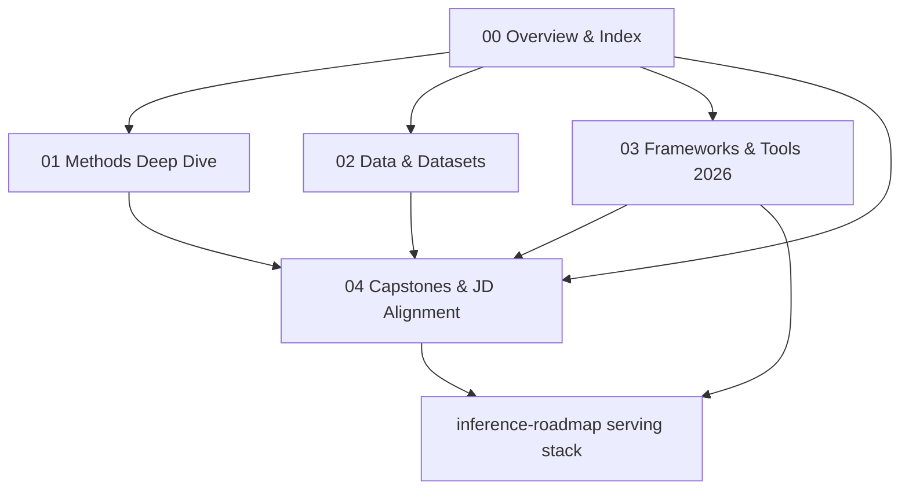
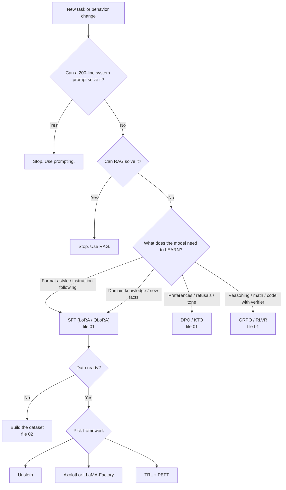
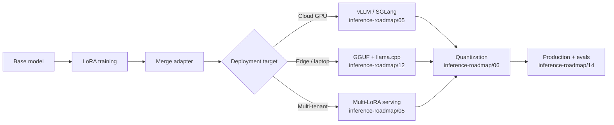

# Fine-tuning Roadmap — 2026 Master Index

> [!info] Scope
> 6–8 week roadmap, running parallel with inference work from October to December 2026 and extending into the main 6-month plan.

## Related Notes

- [[progress/phase1-hf-finetuning]]
- [[inference-roadmap/00 - Overview & Index]]
- [[targets/ai-engineering-role-taxonomy]]

# Fine-tuning Roadmap — 2026 Master Index

> [!info] Why this is a subset
> Fine-tuning is **not its own job category** in the 2026 market. It lives inside both [[targets/ai-engineering-role-taxonomy]] Role 1 (AI Engineer) and Role 3 (Multimodal AI Engineer), and shows up in inference-heavy roles as the bridge between base models and production behavior. This roadmap is the **bridge** that connects your existing [[progress/phase1-hf-finetuning]] work (in progress since April 2026) to the inference-side artifacts in [[inference-roadmap/00 - Overview & Index]].

> [!warning] The 2026 state
> Fine-tuning is now a **"user tool"** (May 2026 consensus). A single M3 Ultra Mac Studio can LoRA-tune a 70B model. Unsloth does 4-bit quantization automatically. TRL `SFTTrainer` runs SFT in 5 lines. Axolotl / LLaMA-Factory externalize every hyperparameter to a single YAML. The bar to ship a fine-tuned model has never been lower — and the bar to ship a *good* one has never been higher, because evals are the real bottleneck.

---

## TL;DR — the 5-file structure

| #   | File                                                  | What it covers                                                                                                          | Time                        |
| --- | ----------------------------------------------------- | ----------------------------------------------------------------------------------------------------------------------- | --------------------------- |
| 00  | **Overview & Index**                                  | This page. Decision tree. What to do when.                                                                              | 30 min read                 |
| 01  | [[fine-tuning-roadmap/01 - Methods Deep Dive]]        | LoRA, QLoRA, DoRA, full FT, SFT, DPO, IPO/KTO/SimPO, PPO, GRPO, RLVR, distillation, IA3                                 | 2-3 weeks                   |
| 02  | [[fine-tuning-roadmap/02 - Data & Datasets]]          | Alpaca, ShareGPT, preference pair formats, data quality, synthetic data, decontamination, licensing                     | 1-2 weeks                   |
| 03  | [[fine-tuning-roadmap/03 - Frameworks & Tools 2026]]  | Unsloth, Axolotl, LLaMA-Factory, TRL, PEFT, TorchTune, bitsandbytes — **the 2026 stack** + serving the fine-tuned model | 2 weeks                     |
| 04  | [[fine-tuning-roadmap/04 - Capstones & JD Alignment]] | 3 public capstones, every JD requirement mapped, the Anthropic target check                                             | 1 week planning + execution |

---

## The decision tree — when to fine-tune, what to use

> [!success] The three rules from the 2026 practitioner consensus
> 1. **Don't fine-tune first.** Try prompting → RAG → fine-tuning. In that order.
> 2. **SFT first, RL later.** No RL algorithm works well without a seeded SFT base.
> 3. **Validate fast with a small model.** A 7B LoRA tune takes 1-2 hours. Run small and fast first, then scale to 70B.

---

## How fine-tuning connects to inference

> The fine-tuning work **only matters** if you can serve the resulting model in production. The serving side is the bridge to the [[inference-roadmap/00 - Overview & Index]].

> **Don't ship a great fine-tune served badly.** That's the most common failure mode.

---

## What's new in 2026 (since your [[progress/phase1-hf-finetuning]] started in April)

> [!example] The 2026 changes you need to know
> - **Six-way framework race (May 2026):** Axolotl, Unsloth, LLaMA-Factory, TRL, PEFT, TorchTune. Each has a different specialization.
> - **Unsloth is the default for single-GPU** — 2-5× speedup via hand-written Triton kernels. Llama 3.2 8B QLoRA on RTX 4090: 4 hours (vs 8-10 hours vanilla).
> - **TRL v0.15.0 (Mar 2026)** ships first-class **GRPO**, **Ring Attention**, **ALST/Ulysses** sequence splitting. Reference implementation for GRPO.
> - **TorchTune** (Meta) is the PyTorch-native option. **Native GRPO since early 2026.** Tightest integration with new PyTorch releases.
> - **LoRA variants exploded:** DoRA, GaLore, rsLoRA, OLoRA, LoHa, LoKr, OFT, VeRA, X-LoRA. **Default is still vanilla LoRA r=16, alpha=32, all-linear.** Switch only if measured problem.
> - **DPO family:** DPO, IPO, KTO, SimPO, ORPO, iterative DPO. Pick by data shape (preference pairs, binary, length-normalized, etc.).
> - **GRPO is the default RL algorithm** for reasoning models. DAPO, Dr.GRPO, GFPO are the 2025-2026 refinements.
> - **Multi-LoRA serving is first-class** in vLLM, SGLang, TensorRT-LLM. Hot-swap adapters with near-zero overhead. **One base model + many fine-tunes = one serving bill.**
> - **EU AI Act** now applies. Document data provenance, evals, model card, risk assessment.

---

## The relationship to your existing work

| Existing | What this roadmap adds |
|---|---|
| [[progress/phase1-hf-finetuning]] (Apr 2026 in progress) | The base. Completing the LoRA/QLoRA/DPO milestones is the foundation. |
| [[inference-roadmap/05 - Serving Engines 2026]] | vLLM/SGLang config + multi-LoRA serving for the fine-tuned model |
| [[inference-roadmap/06 - Quantization Deep Dive]] | Merging + quantizing the fine-tuned adapter (AWQ, GGUF, FP8) |
| [[inference-roadmap/14 - Production & Reliability]] | Eval pipeline, canary, observability for fine-tuned models |
| [[targets/ai-engineering-role-taxonomy]] Role 1, 3 | The JD requirements that fine-tuning skills unlock |

---

## 6-week plan (parallel with the inference roadmap)

| Week | Focus | Output |
|---|---|---|
| **W1 (Oct 6-12)** | File 01 (Methods) + LoRA from scratch | Implement LoRA in PyTorch (~150 lines) |
| **W2 (Oct 13-19)** | DPO, GRPO theory + TRL hands-on | Train a 7B DPO model on UltraFeedback |
| **W3 (Oct 20-26)** | File 02 (Data) + build a domain dataset | 1K-5K sample curated dataset, public on HF |
| **W4 (Oct 27 - Nov 2)** | File 03 (Frameworks) + Unsloth + Axolotl | Train same model with 3 frameworks, compare |
| **W5 (Nov 3-9)** | File 04 capstone 1 (LoRA tune) | **Public on GitHub with eval numbers** |
| **W6 (Nov 10-16)** | Capstone 2 (DPO) + serving the merged model | **Public on GitHub + vLLM serve** |

> This is a **side-quest** to the main inference roadmap in [[inference-roadmap/17 - Daily Schedule & 6-Month Plan]]. Run it in parallel — total weekly load goes to 25-30 hours, but the artifacts are unique to fine-tuning and unlock additional JD matches.

---

## Quick start (1 hour)

If you only have 1 hour, do this:

1. Read the [[#The decision tree — when to fine-tune, what to use]] above.
2. Skim [[fine-tuning-roadmap/01 - Methods Deep Dive#TL;DR]] — the methods menu.
3. Read [[fine-tuning-roadmap/03 - Frameworks & Tools 2026#Pick your default]] — the framework decision.
4. Read [[fine-tuning-roadmap/02 - Data & Datasets#The hard truth]] — why data > algorithm.
5. Skim [[fine-tuning-roadmap/04 - Capstones & JD Alignment]] — what you're building.

Then come back and go deep.

---

**Next:** [[fine-tuning-roadmap/01 - Methods Deep Dive]] — LoRA, QLoRA, DoRA, full FT, SFT, DPO, GRPO, and the 2026 algorithm menu.
