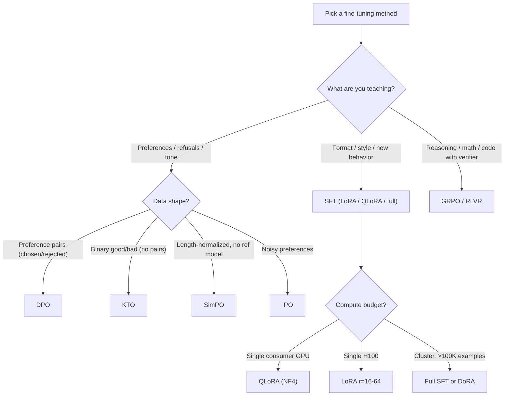

# 01 — Methods Deep Dive

> [!quote] The 2026 menu
> In 2026, fine-tuning is dominated by **PEFT (Parameter-Efficient Fine-Tuning)**, especially the **LoRA family**. Full fine-tuning is rare. Alignment is dominated by **DPO and its variants** for preferences, **GRPO and RLVR** for reasoning. The full-stack default is **QLoRA + DPO**, with GRPO added if you have a verifiable reward.

> [!warning] What changed in 2026
> - **LoRA went from a single algorithm to a family** (LoRA, QLoRA, DoRA, GaLore, rsLoRA, OLoRA, LoHa, LoKr, OFT, VeRA, X-LoRA). The default is still vanilla LoRA.
> - **DPO got siblings** (IPO, KTO, SimPO, ORPO, iterative DPO). Pick by data shape, not by fashion.
> - **GRPO replaced PPO** as the default RL algorithm for reasoning. No critic, less memory, more stable.
> - **RLVR (RL from Verifiable Rewards)** is the technique behind the reasoning-model wave (DeepSeek R1, o1, o3).
> - **SFT → DPO → GRPO is the standard 2026 pipeline.**

---

## TL;DR — the algorithm decision tree



---

## Part 1 — Supervised Fine-Tuning (SFT)

### What SFT teaches
- **Format** — chat template, tool use, JSON output.
- **Style** — voice, tone, length, structure.
- **Behavior** — instruction-following, domain task.
- **NOT preferences** (that's DPO). **NOT reasoning** (that's GRPO).

### The data
- `(prompt, completion)` pairs.
- Standard formats: Alpaca, ShareGPT, OpenAI ChatML.
- See [[fine-tuning-roadmap/02 - Data & Datasets]].

### Full fine-tuning
- Update **all** model parameters.
- Memory: 2× model size (weights + gradients) + 4-8× model size (optimizer state, Adam = 2× params for moments). So a 7B model in FP16: ~14 GB weights + 14 GB grads + 56 GB Adam = **~84 GB.** Plus activations.
- **Practical:** only feasible on 70B with 8×H100 in 2026. Llama-3 70B full FT: ~600 GB memory (LLaMA-Factory table).
- **When to use:** >100K high-quality examples, plenty of GPU, you need the model as IP, and you've measured LoRA underperforms.

### LoRA — the 2026 default

> [!example] The core idea
> Instead of updating `W ∈ R^(d×k)`, freeze `W` and learn a low-rank update `ΔW = B @ A` where `A ∈ R^(r×k)`, `B ∈ R^(d×r)`, rank `r << min(d, k)`. Only A and B get gradients.

```python
# LoRA forward pass
class LoRALinear(nn.Module):
    def __init__(self, base_linear, r=16, alpha=32, dropout=0.05):
        super().__init__()
        self.base = base_linear  # frozen
        for p in self.base.parameters():
            p.requires_grad = False
        in_dim = base_linear.in_features
        out_dim = base_linear.out_features
        self.A = nn.Parameter(torch.randn(r, in_dim) * 0.01)  # Gaussian init
        self.B = nn.Parameter(torch.zeros(out_dim, r))         # zero init
        self.scaling = alpha / r
        self.dropout = nn.Dropout(dropout)

    def forward(self, x):
        base_out = self.base(x)  # no grad
        lora_out = self.dropout(x) @ self.A.T @ self.B.T * self.scaling
        return base_out + lora_out
```

#### The 2026 LoRA defaults
| Hyperparameter | Default | When to change |
|---|---|---|
| **rank (r)** | 16 | r=8 for memory-constrained, r=64 for quality |
| **alpha (α)** | 32 | Always α = 2×r. α/r is the scaling factor. |
| **target_modules** | all 7 linear (q, k, v, o, gate, up, down) | Original paper used only q, v. All-linear is the 2026 default. |
| **dropout** | 0.05-0.1 | Increase if overfitting |
| **learning rate** | 1e-4 to 5e-4 | 10-100× larger than full FT |
| **optimizer** | AdamW (or PagedAdamW for QLoRA) | Standard |
| **epochs** | 2-3 | Stop when eval loss plateaus |

#### Memory savings
- 7B model: full FT = ~84 GB, LoRA r=16 = ~16 GB, **~5× reduction.**
- 70B model: full FT = ~600 GB, LoRA r=16 = ~120 GB, **~5× reduction.**

### QLoRA — LoRA on a 4-bit base

> [!example] The core idea
> Load the base model in **NF4 (4-bit NormalFloat)** with **double quantization**. Train LoRA adapters in BF16 on top. This is what fits a 70B model on a single 80GB GPU.

```python
# QLoRA config in PEFT
from peft import LoraConfig, get_peft_model, prepare_model_for_kbit_training
from transformers import AutoModelForCausalLM, BitsAndBytesConfig

bnb_config = BitsAndBytesConfig(
    load_in_4bit=True,
    bnb_4bit_quant_type="nf4",
    bnb_4bit_compute_dtype=torch.bfloat16,
    bnb_4bit_use_double_quant=True,  # quantize the quantization constants
)

model = AutoModelForCausalLM.from_pretrained("meta-llama/Llama-3-8B", quantization_config=bnb_config)
model = prepare_model_for_kbit_training(model)

lora_config = LoraConfig(
    r=16, lora_alpha=32,
    target_modules="all-linear",
    lora_dropout=0.05, bias="none", task_type="CAUSAL_LM"
)
model = get_peft_model(model, lora_config)
model.print_trainable_parameters()
# trainable params: ~13M || all params: ~8B || trainable%: 0.16%
```

#### Quality
> [!warning] The "no quality loss" claim
> HuggingFace's own writeup notes accuracy degradation is **0%** versus standard QLoRA, because no approximations are introduced (the 4-bit quant is for the base, adapters train in BF16). Dettmers et al. (2023) original paper showed QLoRA matches FP16 LoRA on most benchmarks.

#### 2026 numbers
- **Llama-3 8B QLoRA r=16 on RTX 4090:** ~4 hours (vs 8-10 hours vanilla TRL).
- **Llama-3 70B QLoRA r=16 on single 80GB H100:** ~24 hours.
- **Qwen3-30B-A3B (MoE) QLoRA on H100:** up to 1.77× faster with Unsloth vs vanilla.

### DoRA (Weight-Decomposed LoRA)
- **Insight:** Decompose `W = m * V / ||V||` where `m` is magnitude, `V/||V||` is unit direction. Train `m` and `V` separately with LoRA on the direction.
- **Why:** More expressive than LoRA at the same rank. ~1-3% better on reasoning benchmarks in some studies.
- **Cost:** Same as LoRA. Negligible overhead.
- **When to use:** When you have measured LoRA underperforms and you want a quick upgrade. Default: no, vanilla LoRA is fine.

### GaLore (Gradient Low-Rank Projection)
- **Insight:** Don't change the model — project the gradients into a low-rank subspace before the optimizer step. Train **all** parameters at full rank but cheap.
- **Why:** Memory comparable to LoRA, but full-parameter updates.
- **When to use:** When LoRA quality is bottlenecking and you can't afford full FT memory.
- **Maturity:** Newer (2024). Less battle-tested than LoRA.

### Other LoRA variants (mention only)

| Variant | What it does | When to use |
|---|---|---|
| **rsLoRA** | Rescaled LoRA: scale by `1/sqrt(r)` instead of `α/r` | Higher ranks (r ≥ 64) — stabilizes |
| **OLoRA** | Orthogonal init for `A` | Faster convergence in some cases |
| **LoHa** (Hadamard) | Low-rank + Hadamard product | More expressive at same rank |
| **LoKr** (Kronecker) | Low-rank + Kronecker product | More expressive at same rank |
| **OFT** (Orthogonal Fine-Tuning) | Orthogonal matrices for updates | Better at preserving model behavior |
| **VeRA** | Shared frozen random matrices, train only scaling vectors | Smallest memory (shared across layers) |
| **X-LoRA** | Mixture-of-experts over LoRA experts | Multi-task fine-tuning |
| **AdaLoRA** | Adaptive rank allocation per layer | When you don't know the right rank |
| **IA3** | Multiply activations by learned vectors | Even smaller than LoRA; few-shot adaptation |

> [!tip] The honest verdict
> **In 2026, start with vanilla LoRA r=16, all-linear, α=32.** Only switch variants if you've measured a problem. Most "X-LoRA beats LoRA" papers don't replicate at scale.

---

## Part 2 — Preference Optimization (DPO family)

### Why preference optimization
- SFT teaches **what good output looks like.** But you often have **pairs** of good and bad outputs, and you want the model to learn the *preference* between them, not just imitate the good one.
- This is the alignment step.

### DPO (Direct Preference Optimization) — Rafailov et al., 2023

> [!example] The key insight
> The RLHF objective (reward model + PPO) can be re-derived as a **supervised binary classification loss** over preference pairs. The partition function `Z(x)` cancels out. No reward model, no RL loop, no critic.

```python
# DPO loss (simplified)
def dpo_loss(policy_chosen_logp, policy_rejected_logp,
             ref_chosen_logp, ref_rejected_logp, beta=0.1):
    """policy = the model being trained, ref = frozen reference (initial model)."""
    chosen_logratio = policy_chosen_logp - ref_chosen_logp
    rejected_logratio = policy_rejected_logp - ref_rejected_logp
    loss = -F.logsigmoid(beta * (chosen_logratio - rejected_logratio)).mean()
    return loss
```

#### The math (one paragraph)
For a preference `y_w ≻ y_l | x` (chosen better than rejected), the Bradley-Terry model says `P(y_w ≻ y_l) = σ(r(x, y_w) - r(x, y_l))`. The optimal reward for a given policy is `r*(x, y) = β log(π(y|x) / π_ref(y|x)) + β log Z(x)`. Substituting back, `Z(x)` cancels, leaving a supervised loss on the log-ratio of policy to reference. **This is the entire DPO paper.**

#### When DPO works
- You have **preference pairs** `(prompt, chosen, rejected)`.
- You want the model to prefer chosen over rejected, not just imitate chosen.
- Standard datasets: UltraFeedback, HH-RLHF, Argilla DPO mix.

### IPO (Identity Preference Optimization)
- **Fix:** Replaces sigmoid with MSE. Prevents the preference margin from being pushed to infinity.
- **When:** Noisy preference data where DPO overfits.

### KTO (Kahneman-Tversky Optimization)
- **Fix:** Removes the need for paired data. You can use **single** responses with a `desirable: bool` label.
- **When:** You have real-world feedback logs without explicit A/B pairs (e.g., "user gave thumbs up" → desirable).

### SimPO (Simple Preference Optimization)
- **Fix:** Removes the reference model entirely. Uses length-normalized log probability with a margin target.
- **When:** Memory-constrained (no ref model = half the memory), or you want a simpler pipeline.

### ORPO (Odds Ratio Preference Optimization)
- **Fix:** Combines SFT and DPO into one loss. No reference model, no separate stages.
- **When:** You want a single-stage pipeline that does both SFT and preference alignment.

### Iterative DPO
- **Pattern:** Generate fresh preference pairs with the current policy → label with a reward model → DPO step → repeat.
- **Why:** DPO can't explore new response distributions. Iterative DPO recovers some exploration.

### The 2026 DPO decision

| Data shape | Use |
|---|---|
| Preference pairs, clean | **DPO** |
| Preference pairs, noisy | **IPO** |
| Binary good/bad (no pairs) | **KTO** |
| Memory-constrained, no ref model | **SimPO** |
| Want single-stage SFT + DPO | **ORPO** |
| Static dataset underperforms | **Iterative DPO** |

---

## Part 3 — RL Fine-Tuning (PPO, GRPO, RLVR)

### The case for RL fine-tuning
- **Reasoning models** (o1, o3, DeepSeek R1, R1-Zero) are produced by RL fine-tuning on tasks with **verifiable rewards** (math answers, code tests, format checks).
- **DPO can't do this** — it learns from static preference data, not from the model's own attempts.
- **PPO** is the classical RLHF algorithm. **GRPO** is the 2025-2026 default for reasoning.

### PPO (Proximal Policy Optimization) — Schulman et al., 2017
- **Architecture:** Policy model + Reference model + Reward model + **Critic (value) model**.
- **Memory:** 4 models in memory simultaneously. For a 7B model: ~28 GB minimum.
- **Loss:** Clipped surrogate objective.
- **Stability:** Needs careful tuning (KL coefficient, clipping range, value loss coefficient).
- **When to use (2026):** Rarely for new projects. Use GRPO instead unless you have a specific reason (e.g., extremely noisy reward signal where the critic's smoothed estimates help).

### GRPO (Group Relative Policy Optimization) — Shao et al., 2024 (DeepSeekMath)
- **Architecture:** Policy + Reference + Reward. **No critic.**
- **Mechanism:** For each prompt, sample G rollouts. The mean reward across the group is the baseline. Advantages are normalized within the group.
- **Memory:** 3 models. ~30% less than PPO.
- **Why it works:** The group-relative baseline is good enough for most alignment tasks. No separate value network = simpler, more stable.
- **Stability:** Less sensitive to hyperparameters than PPO.
- **When to use (2026):** Default for reasoning tasks with verifiable rewards. **This is the algorithm behind DeepSeek R1.**

```python
# GRPO loss (simplified)
def grpo_loss(policy_logps, ref_logps, rewards, group_size, beta=0.04, clip_range=0.2):
    """
    policy_logps: (B*G,) log probs of chosen tokens under policy
    ref_logps:    (B*G,) log probs of chosen tokens under ref
    rewards:      (B*G,) scalar reward per rollout
    """
    # KL between policy and ref (drift constraint)
    kl = policy_logps - ref_logps
    # Per-group advantage (group-relative baseline)
    rewards_grouped = rewards.view(-1, group_size)
    advantages = (rewards_grouped - rewards_grouped.mean(-1, keepdim=True)) / (rewards_grouped.std(-1, keepdim=True) + 1e-8)
    advantages = advantages.view(-1)
    # Surrogate loss
    ratio = torch.exp(policy_logps - policy_logps.detach())  # no detach in practice
    surr1 = ratio * advantages
    surr2 = torch.clamp(ratio, 1 - clip_range, 1 + clip_range) * advantages
    loss = -torch.min(surr1, surr2).mean() + beta * kl.mean()
    return loss
```

### RLVR (RL from Verifiable Rewards) — the 2025-2026 wave
- **Insight:** When the reward is **programmatically verifiable** (math answer matches, code passes tests, format is correct), skip the learned reward model entirely.
- **DeepSeek R1-Zero** used rule-based accuracy rewards for math and code.
- **DAPO** (Yu et al., 2025) — open-source RL system with rule-based outcome rewards, **50% AIME 2024 accuracy** with Qwen2.5-32B in half the steps of baseline.
- **Dr.GRPO** (Liu et al., 2025) — addresses response-length bias in GRPO's reward normalization.
- **CISPO** (MiniMax-M1 Team, 2025) — replaces GRPO's clipping to improve training stability.
- **GFPO** (Shrivastava et al., 2026) — Group Filtered Preference Optimization, addresses length inflation.
- **VIGOR** (2026) — variance-guided online rollout allocation. **2.3× fewer rollouts on math.**

### The 2026 RL fine-tuning decision

| Task | Algorithm |
|---|---|
| Reasoning with verifiable reward (math, code) | **GRPO** (or DAPO/Dr.GRPO refinements) |
| General chat alignment with preference data | **DPO** (or KTO/SimPO if data shape differs) |
| Output quality from human feedback (legacy) | **PPO** (still works, but GRPO usually wins) |
| Long CoT reasoning, RLHF on top of SFT-seeded model | **GRPO with iterative SFT merges** |
| Reward hacking (model gaming the reward) | Switch to RLVR with rule-based reward, or add KL drift constraint |

### The 2026 consensus pipeline
> [!example] The standard production pipeline
> 1. **SFT** (QLoRA or LoRA) on 10K-100K high-quality instructions.
> 2. **GRPO** (or DPO/KTO depending on data) on top of the SFT checkpoint.
> 3. (Optional) **Iterative DPO** to refine preferences.
> 4. **Merge LoRA → quantize → serve** (see [[fine-tuning-roadmap/03 - Frameworks & Tools 2026]]).

---

## Part 4 — Distillation

### What it is
- Train a small model to mimic a large model. **Teacher → student.**
- Often with **KL divergence** between token distributions: `L = α * KL(p_student || p_teacher) + (1-α) * CE(y, p_student)`.

### When to use
- You need a smaller / faster / cheaper model with similar quality to a large one.
- You can't serve the teacher (cost, latency, licensing).

### 2026 reality
- **Distilled models are typically less calibrated** and have **different optimal quantization thresholds.**
- The teacher's logit distribution is information-rich; supervised on its outputs (SFT) loses information.
- **Always re-evaluate** the distilled model on your actual workload.

### Tools
- HuggingFace `transformers` + custom training loop.
- `accelerate` for multi-GPU.
- `TextBrewer` (Microsoft) for task-specific distillation.
- `distilwhisper` style recipes for ASR.
- **DeepSeek-R1-Distill-Qwen** family is the 2025-2026 standard for "reasoning model at small size".

---

## What you should know from this file

> [!success] The 2026 mental model
> 1. **PEFT (LoRA family) is the default** for SFT. Vanilla LoRA r=16, all-linear, α=32, lr=1e-4 to 5e-4. Switch variants only if measured.
> 2. **QLoRA is the de facto standard** for single-GPU. NF4 + double quant + LoRA in BF16.
> 3. **DPO is the default for preferences.** Sibling variants (IPO, KTO, SimPO, ORPO) exist for different data shapes.
> 4. **GRPO has replaced PPO** for reasoning-model alignment. RLVR with rule-based rewards is the 2026 frontier.
> 5. **The standard pipeline is SFT → DPO/GRPO.** No RL works without a seeded SFT base.
> 6. **Distillation is for compression**, not for new behavior.

---

## Pre-flight checklist

- [ ] State the LoRA forward pass in one equation.
- [ ] What is the 2026 default LoRA config (r, α, target_modules, lr)?
- [ ] How much memory does QLoRA save vs full FT on a 70B model?
- [ ] What does DPO optimize? Why is it "direct"?
- [ ] Compare DPO, IPO, KTO, SimPO, ORPO. When does each win?
- [ ] What is GRPO? Why does it beat PPO for reasoning?
- [ ] What is RLVR? Name 2 examples of verifiable rewards.
- [ ] State the 2026 consensus pipeline.
- [ ] When do you use full fine-tuning instead of LoRA?
- [ ] What is DoRA? When does it beat LoRA?

**Next:** [[fine-tuning-roadmap/02 - Data & Datasets]] — the boring, critical part. Data > algorithm, every time.
