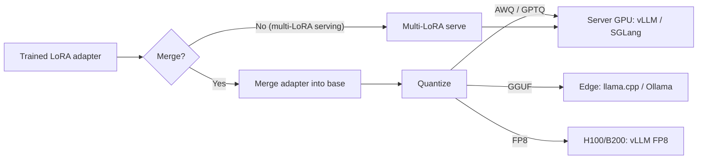
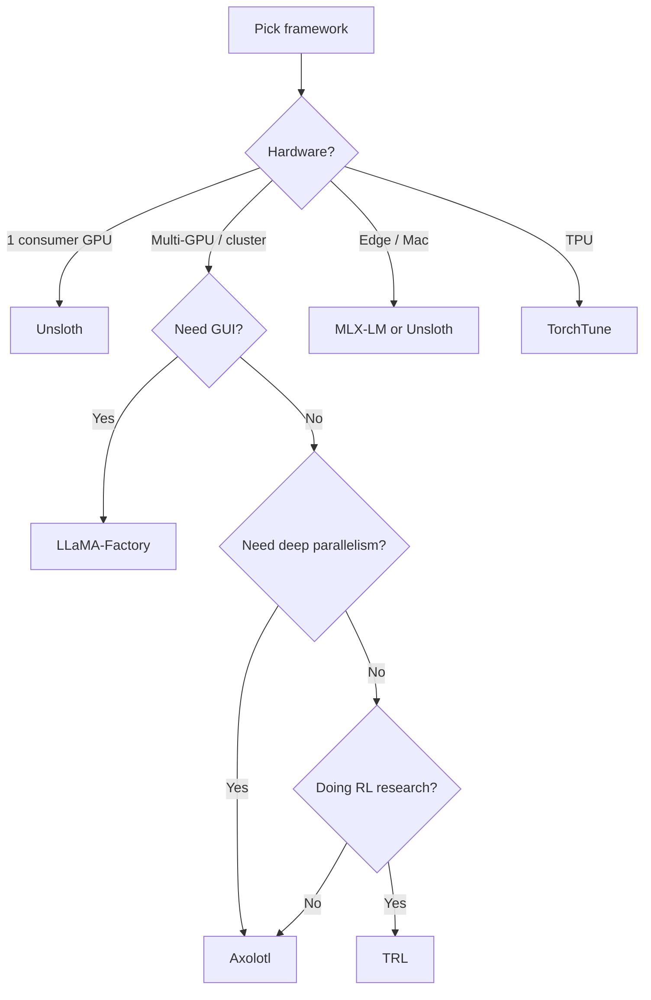

# 03 — Frameworks & Tools 2026

> [!quote] The 2026 six-way race
> Fine-tuning frameworks have crystallized into a **six-way race** (May 2026): **Axolotl, Unsloth, LLaMA-Factory, TRL, PEFT, TorchTune**. They wrap the same PyTorch + HuggingFace stack. They diverge on where they spend engineering effort. **Pick by hardware + scale + method.**

> [!warning] What changed in 2026
> - **TRL v0.15.0 (Mar 2026)** ships first-class **GRPO** (DeepSeek R1's algorithm), **Ring Attention**, **ALST/Ulysses** sequence splitting.
> - **Unsloth** does 2-5× faster single-GPU training via hand-written Triton kernels. **Llama 3.2 8B QLoRA on RTX 4090: 4 hours (vs 8-10 hours vanilla).**
> - **TorchTune** (Meta, native PyTorch) shipped native **GRPO** in early 2026.
> - **Multi-LoRA serving** is now first-class in vLLM, SGLang, TensorRT-LLM. One base model + many adapters.
> - **LLaMA-Factory v0.9.4 (Dec 2025)** added OFT support, Megatron-LM integration, KTransformers backend, migrated to uv.

---

## TL;DR — the framework decision

| Situation | Framework | Why |
|---|---|---|
| **Single consumer GPU** (RTX 4090, 3090) | **Unsloth** | 2-5× faster, lowest memory, longest context |
| **Multi-GPU, complex parallelism** | **Axolotl** | FSDP2, DeepSpeed, TP, CP, EP composable |
| **GUI / no-code / broad model coverage** | **LLaMA-Factory** | LlamaBoard web UI, 100+ models |
| **RLHF / GRPO / DPO research** | **TRL** | Reference implementation, the primitive layer |
| **Production, config-driven, multi-tenant** | **Axolotl** | YAML config, deep parallelism matrix |
| **PyTorch-native, FSDP2, Meta models** | **TorchTune** | Native GRPO, DTensor, torch.compile |
| **Custom research, full control** | **TRL + PEFT** | Maximum flexibility, lowest abstractions |

> [!tip] The layer cake
> PEFT (adapters) is at the bottom. TRL (trainers) is on top. Axolotl and LLaMA-Factory wrap both. Unsloth replaces some kernels. TorchTune uses native PyTorch instead. **Most projects end up using 2-3 of these layers.**

---

## The framework landscape (May 2026)

| Framework | GitHub stars | Latest | Best for | License | Learning curve |
|---|---|---|---|---|---|
| **LLaMA-Factory** | 68.4K | v0.9.4 (Dec 2025) | GUI, broad model support | Apache 2.0 | Low |
| **Unsloth** | 53.9K | Feb 2026 | Single-GPU speed, long context | Apache 2.0 | Low-Medium |
| **TRL** | 17.6K | v0.15.0 (Mar 2026) | RLHF/GRPO, HF ecosystem | Apache 2.0 | Medium-High |
| **Axolotl** | 11.4K | v0.29.0 (Feb 2026) | Config-driven, production | Apache 2.0 | Medium |
| **PEFT** | 17K+ | v0.14 (2026) | Adapter library (LoRA, QLoRA, DoRA, etc.) | Apache 2.0 | Low |
| **TorchTune** | ~5K | 2026 releases | PyTorch-native, Meta models | BSD | Medium-High |

---

## Unsloth — the single-GPU speed king

### What it is
Hand-written Triton kernels for LoRA/QLoRA training. Built by Daniel and Michael Han (2024). Drop-in replacement for the HuggingFace stack on supported models.

### Why it wins
- **2× speedup on supported models** vs vanilla Transformers.
- **30-50% memory reduction.**
- **Automatic 4-bit quantization** (NF4 + double quant).
- **Longer context:** 8x longer than vanilla on the same GPU.
- **7.3× speedup on MoE** (gpt-oss-20b on B200 at 8K context: 712ms vs 5,227ms per step).

### The numbers (representative 2026)
| Setup | Time | vs baseline |
|---|---|---|
| Llama 3.1 8B QLoRA r=32 on RTX 4090 (Alpaca) | ~2× faster | TRL+FA2 baseline |
| Llama 3.2 8B QLoRA r=16 on RTX 4090 | ~4 hours | vs 8-10 hours vanilla |
| Qwen3-30B-A3B QLoRA on H100 | 1.77× faster | vs vanilla |
| gpt-oss-20b BF16 on B200 at 8K context | 712 ms/step | 7.3× vs Transformers v5 |

### Quick start

```python
# pip install unsloth
from unsloth import FastLanguageModel
from trl import SFTTrainer
from transformers import TrainingArguments

model, tokenizer = FastLanguageModel.from_pretrained(
    model_name="unsloth/Llama-3.2-8B-Instruct-bnb-4bit",
    max_seq_length=2048,
    load_in_4bit=True,
    # full_finetuning=False,  # default
)

model = FastLanguageModel.get_peft_model(
    model,
    r=16, lora_alpha=32,
    target_modules="all-linear",
    lora_dropout=0.05, bias="none",
    use_gradient_checkpointing="unsloth",  # 30% less memory
)

trainer = SFTTrainer(
    model=model, tokenizer=tokenizer,
    train_dataset=my_dataset,  # ChatML, Alpaca, etc.
    args=TrainingArguments(per_device_train_batch_size=2, gradient_accumulation_steps=4, ...),
)
trainer.train()
```

### When to use
- Single GPU, especially consumer.
- Llama, Qwen, Mistral, Phi, Gemma, gpt-oss (well-supported).
- Long context (8K-128K) where memory matters.
- Quick iteration cycles.

### When NOT to use
- Multi-GPU (its documented weak point).
- Models outside the supported list.
- You need the very latest TRL/PEFT features before Unsloth supports them.

---

## Axolotl — the production multi-GPU config layer

### What it is
YAML-driven wrapper over Transformers, PEFT, TRL, Accelerate, DeepSpeed. The most feature-complete framework.

### Why it wins
- **Deepest parallelism matrix:** FSDP2, DeepSpeed ZeRO-2/3, TP, CP, EP composable via DeviceMesh.
- **YAML config** for every hyperparameter.
- **Broadest model support** of the wrapper frameworks.
- **Most training methods** (SFT, DPO, IPO, KTO, ORPO, GRPO, SimPO, PPO, reward modeling, etc.).

### Quick start (YAML config)

```yaml
# axolotl_config.yml
base_model: meta-llama/Llama-3.1-8B
model_type: LlamaForCausalLM
tokenizer_type: AutoTokenizer

datasets:
  - path: tatsu-lab/alpaca
    type: alpaca
  - path: argilla/distilabel-intel-orca-dpo-pairs
    type: chatml.argilla

# Choose one:
# adapter: lora   # LoRA / QLoRA
# full_finetuning: true  # Full SFT

lora_r: 16
lora_alpha: 32
lora_dropout: 0.05
lora_target_modules: all-linear

# Quantization for QLoRA
load_in_4bit: true
bnb_4bit_quant_type: nf4
bnb_4bit_compute_dtype: bfloat16

# Training
num_epochs: 3
micro_batch_size: 2
gradient_accumulation_steps: 4
learning_rate: 2e-4
optimizer: adamw_bnb_8bit
lr_scheduler_type: cosine

# Multi-GPU
fsdp: full_shard auto_wrap  # FSDP2
fsdp_config:
  fsdp_activation_checkpointing: true
# or DeepSpeed:
# deepspeed: deepspeed_configs/zero3_bf16.json

# Sequence packing for efficiency
sequence_packing: true

# DPO if applicable
rl: dpo
dpo_beta: 0.1

output_dir: ./outputs/llama3-alpaca-lora
```

```bash
# Run
accelerate launch -m axolotl.cli.train axolotl_config.yml
```

### When to use
- Multi-GPU / multi-node.
- Production training pipelines.
- Complex parallelism (FSDP2 + TP + CP + EP combined).
- You want one config file for the whole run.

### When NOT to use
- Single consumer GPU (Unsloth is faster).
- You want to write custom code (the wrapper is thick).
- You need a GUI.

---

## LLaMA-Factory — the GUI era

### What it is
ACL 2024 system demo paper turned production framework. 100+ model architectures. Web UI (LlamaBoard) + CLI.

### Why it wins
- **Web UI:** `llamafactory-cli webui` → point, click, train.
- **Broadest model support** (100+ LLMs and VLMs).
- **All training methods** (SFT, DPO, KTO, ORPO, SimPO, PPO, GRPO, etc.).
- **Multiple backends** (Transformers, Liger Kernel, Unsloth, Megatron-LM, KTransformers).
- **OFT support** (added Dec 2025).

### Quick start

```bash
pip install llamafactory
llamafactory-cli webui  # Open browser, point and click
# Or:
llamafactory-cli train \
  --model_name_or_path meta-llama/Llama-3.1-8B \
  --template llama3 \
  --dataset alpaca_gpt4_en \
  --output_dir ./llama3_lora \
  --finetuning_type lora \
  --lora_rank 16 \
  --quantization_bit 4 \
  --per_device_train_batch_size 2 \
  --gradient_accumulation_steps 4 \
  --num_train_epochs 3.0 \
  --learning_rate 5e-5
```

### When to use
- Non-ML teams want to fine-tune (the GUI is the killer feature).
- You need to support 100+ model architectures.
- You're doing quick experiments across many models.

### When NOT to use
- You need the absolute fastest single-GPU training (Unsloth is faster).
- You need the deepest parallelism control (Axolotl wins).
- You need to debug the underlying trainer (the wrapper is thick).

---

## TRL — the primitive layer

### What it is
HuggingFace's RL and preference-optimization library. The canonical RLHF/alignment toolkit. Other frameworks call into it.

### What's in TRL v0.15.0 (Mar 2026)
- `SFTTrainer` — supervised fine-tuning (now with sequence packing, assistant-only loss).
- `DPOTrainer` — DPO and variants (IPO, KTO, SimPO, ORPO).
- `GRPOTrainer` — **Group Relative Policy Optimization (DeepSeek R1's algorithm).**
- `KTOTrainer` — Kahneman-Tversky Optimization.
- `RewardTrainer` — reward modeling.
- `RLOOTrainer` — REINFORCE Leave-One-Out.
- **Ring Attention** support for long context.
- **ALST/Ulysses** sequence splitting for multi-GPU.

### Quick start (SFT)

```python
from trl import SFTTrainer, SFTConfig
from transformers import AutoModelForCausalLM, AutoTokenizer
from datasets import load_dataset

model = AutoModelForCausalLM.from_pretrained("meta-llama/Llama-3.1-8B")
tokenizer = AutoTokenizer.from_pretrained("meta-llama/Llama-3.1-8B")
dataset = load_dataset("tatsu-lab/alpaca", split="train")

trainer = SFTTrainer(
    model=model, tokenizer=tokenizer, train_dataset=dataset,
    args=SFTConfig(
        output_dir="./llama3-sft",
        per_device_train_batch_size=2, gradient_accumulation_steps=4,
        num_train_epochs=3, learning_rate=2e-4,
        # assistant_only_loss=True,  # Mask user tokens
        # packing=True,              # Pack short sequences for efficiency
    ),
)
trainer.train()
```

### Quick start (DPO)

```python
from trl import DPOTrainer, DPOConfig
dataset = load_dataset("argilla/ultrafeedback-binarized-preferences-cleaned", split="train")

trainer = DPOTrainer(
    model=model, ref_model=None,  # ref_model=None uses LoRA's frozen base as ref
    tokenizer=tokenizer, train_dataset=dataset,
    args=DPOConfig(
        output_dir="./llama3-dpo",
        per_device_train_batch_size=2, gradient_accumulation_steps=4,
        num_train_epochs=1, learning_rate=5e-5, beta=0.1,
    ),
)
trainer.train()
```

### Quick start (GRPO)

```python
from trl import GRPOTrainer, GRPOConfig
import re

def math_reward(completions, **kwargs):
    """Reward: 1.0 if completion contains the correct answer, 0.0 otherwise."""
    rewards = []
    for c in completions:
        match = re.search(r"\\boxed\{(\d+)\}", c)
        if match and int(match.group(1)) == kwargs["answer"][0]:
            rewards.append(1.0)
        else:
            rewards.append(0.0)
    return rewards

trainer = GRPOTrainer(
    model=model, tokenizer=tokenizer,
    train_dataset=math_dataset,  # {prompt, answer} pairs
    reward_funcs=math_reward,
    args=GRPOConfig(
        output_dir="./llama3-grpo",
        per_device_train_batch_size=4,
        num_generations=8,  # G=8 rollouts per prompt
        max_new_tokens=512,
        beta=0.04,
    ),
)
trainer.train()
```

### When to use
- You're doing RL work (TRL is the only game in town for serious RLHF/GRPO).
- You want to call the trainers directly (no wrapper overhead).
- You're doing research on alignment algorithms.
- You're calling from another framework (Axolotl, LLaMA-Factory).

### When NOT to use
- You want a one-click solution (LLaMA-Factory's GUI).
- You want max speed (Unsloth for single GPU, Axolotl for multi-GPU).

---

## PEFT — the adapter library

### What it is
HuggingFace's PEFT library. The adapter standard. **Almost every other framework calls into PEFT.** LoRA, QLoRA, DoRA, AdaLoRA, IA3, LoHa, LoKr, OFT, VeRA, X-LoRA — all behind one interface.

### The adapter format
```
adapter_config.json   # metadata (r, alpha, target_modules, base_model_name)
adapter_model.safetensors  # the A and B matrices
```
**A LoRA trained with Axolotl loads directly in vLLM, SGLang, TGI, and Together.** The format is portable across frameworks and serving engines.

### When to use
- You want to use LoRA / QLoRA / DoRA / etc. (every project does).
- You want to swap adapters without reloading the base model (multi-LoRA serving).

### When NOT to use
- Full fine-tuning (use TRL/Transformers directly).
- You need a custom adapter method not in PEFT (rare).

---

## TorchTune — the PyTorch-native option

### What it is
Meta's official fine-tuning framework. Built on native PyTorch primitives: `torch.compile`, DTensor, FSDP2. No Transformers dependency.

### Why it matters
- **Tightest integration with new PyTorch releases** (no lag).
- **Native GRPO** since early 2026.
- **Most predictable behavior** on edge cases.
- **The choice for Meta models** (Llama family).

### When to use
- You're fine-tuning Llama models and want Meta's blessed path.
- You need the latest PyTorch features.
- You want native DTensor / FSDP2 without the wrapper.

### When NOT to use
- You need broad model coverage (TorchTune is Llama-focused, though expanding).
- You want a GUI (no GUI).
- Single-GPU speed matters most (Unsloth is faster).

---

## Quantization: bitsandbytes

### What it is
The library that makes QLoRA possible. 4-bit (NF4, FP4) and 8-bit quantization of model weights with minimal quality loss.

### Used by
- QLoRA via PEFT.
- Unsloth (auto-applied).
- Axolotl (QLoRA config).
- LLaMA-Factory (quantization_bit flag).
- TRL (manual setup).

### Alternatives for 4-bit
- **AutoGPTQ** — older, GPTQ-specific.
- **AutoAWQ** — better INT4 in 2026.
- For inference-side quantization (not training), see [[inference-roadmap/06 - Quantization Deep Dive]].

---

## Distributed training: Accelerate + DeepSpeed + FSDP

### Accelerate (HuggingFace)
- The standard launch tool. Wraps multi-GPU / multi-node setup.
- `accelerate config` for interactive setup; `accelerate launch` for runs.
- Works with TRL, PEFT, Axolotl, LLaMA-Factory.

### DeepSpeed (Microsoft)
- ZeRO-1/2/3 (optimizer state / gradients / parameters sharding).
- DeepSpeed ZeRO-3 + LoRA = "QLoRA with sharding".
- Older but well-tested.
- Use case: 70B+ on multi-node.

### FSDP2 (PyTorch native)
- The 2026 default for multi-GPU. Fully Sharded Data Parallel v2.
- Native DTensor-based sharding. Better than ZeRO-3 in some cases.
- Used by TorchTune; available in Transformers via Accelerate.
- Use case: 13B+ on multi-GPU.

### The 2026 multi-GPU decision

| Scale | Strategy |
|---|---|
| Single GPU | Unsloth (or PEFT + bitsandbytes) |
| 2-4 GPUs, one node | FSDP2 via Accelerate, or DeepSpeed ZeRO-2/3 |
| 8 GPUs, one node | FSDP2, or DeepSpeed ZeRO-3, or TP+CP |
| 16+ GPUs, multi-node | FSDP2 + TP, or DeepSpeed + TP, or Megatron-LM (via LLaMA-Factory backend) |
| MoE models | EP + TP combo (see [[inference-roadmap/09 - MoE Inference Deep Dive]]) |

---

## Serving the fine-tuned model

> The fine-tuning work only matters if you can serve the result. The serving stack is in [[inference-roadmap/05 - Serving Engines 2026]]; this section is the bridge.

### The pipeline



### Step 1: Merge the LoRA adapter

```python
from peft import PeftModel
from transformers import AutoModelForCausalLM, AutoTokenizer

base = AutoModelForCausalLM.from_pretrained("meta-llama/Llama-3-8B-Instruct")
model = PeftModel.from_pretrained(base, "./outputs/llama3-alpaca-lora")
merged = model.merge_and_unload()
merged.save_pretrained("./outputs/llama3-alpaca-merged")
```

### Step 2: Quantize (optional, but almost always yes)

```python
# GGUF for edge (llama.cpp)
# pip install llama-cpp-python
from llama_cpp import Llama
# (use llama.cpp's convert.py + quantize tool from CLI)

# AWQ for server GPU
# pip install autoawq
from awq import AutoAWQForCausalLM
from transformers import AutoTokenizer
model = AutoAWQForCausalLM.from_pretrained("./outputs/llama3-alpaca-merged")
tokenizer = AutoTokenizer.from_pretrained("./outputs/llama3-alpaca-merged")
model.quantize(tokenizer, quant_config={"zero_point": True, "q_group_size": 128, "w_bit": 4})
model.save_quantized("./outputs/llama3-alpaca-awq")
```

### Step 3: Serve

```bash
# vLLM with merged model
vllm serve ./outputs/llama3-alpaca-awq \
  --tensor-parallel-size 1 \
  --dtype fp16 \
  --max-model-len 4096

# vLLM with multi-LoRA (don't merge!)
vllm serve meta-llama/Llama-3-8B-Instruct \
  --enable-lora \
  --lora-modules lora1=./outputs/lora1 lora2=./outputs/lora2 \
  --max-lora-rank 64
# Then call: {"model": "lora1", ...} in the request
```

### Multi-LoRA serving (2026 essential)
> [!example] Why multi-LoRA matters
> One base model + many fine-tuned adapters = one serving bill. Hot-swap adapters per request with near-zero overhead. vLLM, SGLang, TensorRT-LLM all support this. **The default deployment pattern when you have multiple fine-tunes of the same base model.**

See [[inference-roadmap/05 - Serving Engines 2026#Multi-LoRA]] for the full details.

---

## The hands-on decision flow



---

## Hands-on labs

### Lab 1: Train the same model with 3 frameworks (1-2 days)
- Pick Llama-3.2-1B (small, fast).
- Train SFT with Unsloth, TRL, and Axolotl.
- Same data, same hyperparameters (as close as possible).
- Compare: training time, memory, final loss, eval scores.

### Lab 2: DPO with TRL (1 day)
- Take an SFT checkpoint from Lab 1.
- Train DPO on UltraFeedback (or a subset).
- Use `DPOTrainer` from TRL v0.15.0.
- Evaluate on MT-Bench or your domain eval.

### Lab 3: GRPO with TRL (1-2 days)
- Take an SFT checkpoint.
- Set up GRPO on GSM8K (or your math domain).
- Define a verifiable reward (correct answer in `\boxed{}`).
- Train.
- Evaluate on the held-out test set.

### Lab 4: Multi-LoRA serving (1 day)
- Train 3 LoRA adapters on different tasks (e.g., "summarize", "translate", "code").
- Serve with vLLM `--enable-lora`.
- Hot-swap between adapters per request.
- Measure latency, throughput, memory.

### Lab 5: Full pipeline (LoRA → merge → AWQ → vLLM) (1-2 days)
- Train LoRA on Llama-3 8B with Unsloth.
- Merge adapter into base.
- Quantize to AWQ INT4.
- Serve with vLLM.
- Benchmark TTFT, TPOT, throughput at the same hardware vs the FP16 base.

### Lab 6: Edge deployment (1 day)
- Train LoRA on a small model.
- Merge + convert to GGUF Q4_K_M.
- Serve with llama.cpp or Ollama.
- Deploy on a phone or laptop.

---

## Pre-flight checklist

- [ ] For each of Unsloth, Axolotl, LLaMA-Factory, TRL, PEFT, TorchTune: state the best use case.
- [ ] When does Unsloth win? When does it lose?
- [ ] What's the 2× speedup number for Unsloth? On what hardware?
- [ ] What is TRL's relationship to Axolotl / LLaMA-Factory?
- [ ] What is the PEFT adapter format? Why does it matter for serving?
- [ ] For a 70B QLoRA on 8×H100, which framework do you pick?
- [ ] For a 7B LoRA on RTX 4090, which framework do you pick?
- [ ] What's the multi-LoRA serving pattern? Why is it the 2026 default?
- [ ] Sketch the LoRA → merge → quantize → serve pipeline.
- [ ] What is TRL v0.15.0's headline new feature?

**Next:** [[fine-tuning-roadmap/04 - Capstones & JD Alignment]] — 3 public capstones, every JD requirement mapped, the path to the Anthropic target.
